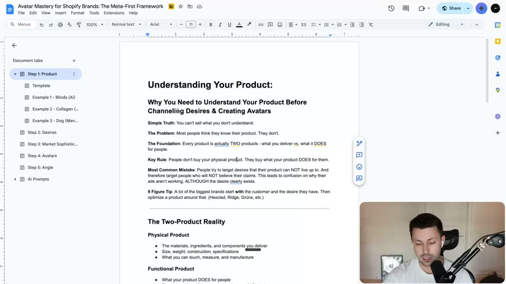
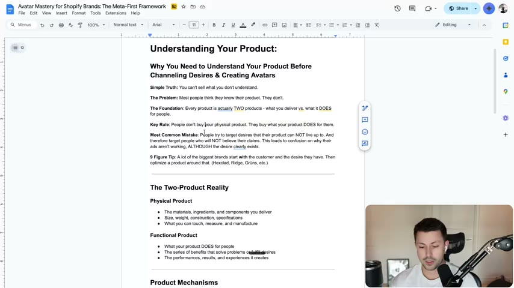
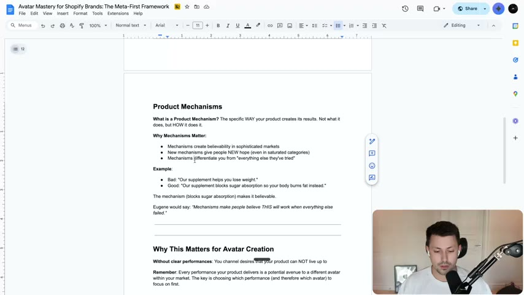
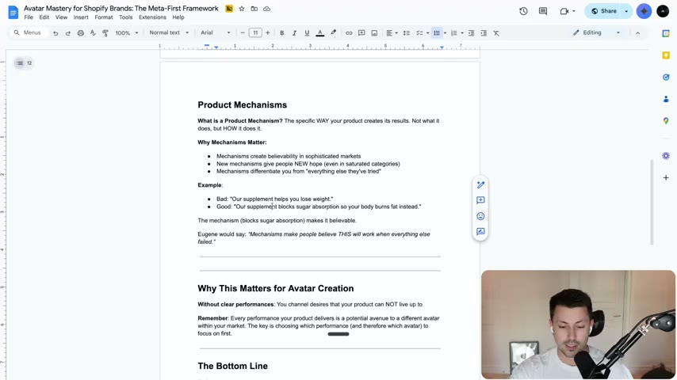

# 57. Understanding Your Product - Part 1
> Every product is two products (what you deliver and what it does), people buy what it does, and the most common mistake is targeting a desire your product cannot credibly deliver; the fix starts with a clear view of the product's functions and its mechanism (how it works).

## 🤖 Agent use
- **Use when:** starting work on any brand's ads, before choosing desires, angles or avatars; auditing why an ad aimed at a real desire does not convert; deciding whether a product-desire pairing is credible.
- **Inputs → outputs:** product page, ingredients/materials, reviews, research doc → a physical/functional split of the product, a list of mechanisms (how each result is produced), and a shortlist of desires the product can believably serve.
- **Rules:**
  - **DO** split every product into physical (materials, ingredients, size, weight, specs, manufacturer) and functional (what it does: benefits, problems solved, results, experiences). [11:22]
  - **DO** write ads about what the product does, not what it is. "People buy what it does and not what it is." [02:57–03:47]
  - **DON'T** advertise features and assume the reader will connect them to a benefit. "Some people will make the connection… but a lot of people won't." [03:47]
  - **DON'T** target desires the product "cannot live up to" or that the market already knows the product cannot deliver. [03:47–04:42]
  - **IF** a desire is already well met by familiar products (the instructor's example: stainless steel keeps water cold) **THEN** a feature-only ad fails; find a new mechanism or a different desire. [05:39–06:31]
  - **IF** the desire is far from the product (hat for back pain) **THEN** expect a big bridge to build with marketing, and also expect less competition ("more untapped"). [06:31–08:58]
  - **DO** name the mechanism: how the product creates the result, not what it does. [11:22–12:20]
  - **DO** prefer a specific, believable mechanism over a general claim ("blocks sugar absorption so your body burns fat" over "helps you lose weight"). [13:14–13:52]
  - **DON'T** assume the desire exists at the size you think. Validate how many people actually want it. [11:22]
  - **DO** complete the product overview doc before desires, sophistication or avatars. [14:44]
- **See also:** [58. Understanding Your Product - Part 2](058-understanding-your-product-part-2.md) · [56. Organizing Insights Overview](056-organizing-insights-overview-must-watch.md) · [66. How To Find & Apply New Mechanisms](066-how-to-find-apply-new-mechanisms-part-2.md) · [Unique mechanism (Copywriting)](../../copywriting/concepts/unique-mechanism.md) · [14. Why you need to use unique mechanisms](../../copywriting/lessons/14-why-you-need-to-use-unique-mechanisms.md)

Lesson page note: students who completed the research modules should use their research doc for the sections that follow; the video is "a refresher", which the lesson page still recommends. The page links the blank template and an example doc. [Page text]

## Key ideas

### You probably do not understand your product [00:00–01:33]
- "You can't sell what you don't understand." The instructor says many students (and many agencies) do not know what the product really does, because they have not done research or seen what is going on in the market. [00:00–01:33]
- Understanding the product comes first because scaling comes from "creating new avatars" and identifying the right ones, which depends on knowing what you sell. [00:00–00:42]
- He warns the order of lessons "is likely going to change". [00:00]

### Every product is two products [01:33–03:47]
- Worked example, a stainless steel cup: the physical thing is "a hunk of metal… built in a circle" with a brand name; what it does is "holds my water", "keeps it cold", gives him confidence in the brand, and helps avoid microplastics (he says he does not know if the microplastics claim is true and just follows what society says). [01:33–02:57]
- The stainless steel (physical feature) is why the water stays cold (functional benefit). He paid more for it because of what it does. [02:27–03:47]
- Key rule: "People buy what it does and not what it is." [02:57–03:47]

### The most common mistake: desires the product cannot live up to [03:47–06:31]
- People target desires "that their product cannot live up to". If the market already knows (or has tried) that the product does not deliver, the ad "will not work". [03:47–04:42]
- Staying power matters: a buyer needs one cup, not one a day, so the "need" is not recurring. [05:39]
- If everyone already knows stainless steel keeps water cold, "that desire has already been met". The desire still exists. A new way to deliver it, for instance keeping water at "the perfect temperature", would be a new angle. [05:39–06:31]
- This ties to sophistication and awareness levels, which the course covers later; "don't worry about that". [08:58]

### Marketing bridges the gap between product and desire [06:31–08:58]
- Picture the product (a hat) on one side and many desires (back pain, weight loss) on the other. [06:31]
- Pitching a hat for back pain makes "one hell of an ad". Convincing someone with a made-up story (Jimbo the farmer's sun hat, no rubbing sunscreen) would make you "a world-class marketer", but it is a huge gap to bridge. [06:31–08:09]
- Desires closer to the product make more sense but "are going to be more competitive". Further out is harder to make believable but "usually more untapped" (no one is selling hats for weight loss). Once people try it and it fails, "the market gets more sophisticated" and you need a new mechanism or a different desire. [08:09–08:58]

### Nine-figure tip: start from the customer and desire [08:58–11:22]
- "A lot of the biggest brands in the world actually start with the customer and the desire first." Also applies when searching for products. [08:58]
- Examples named by the instructor (his descriptions, not verified): [08:58–10:39]
  - **HexClad:** the founder "hated all the pans", they always burned and wore out within a year, so he built pans that "last forever". "Probably… a billion dollars" in worth (instructor claim). [09:57]
  - **Ridge:** traditional wallets "fold really messy", are bulky and gross, so they slimmed it down. [09:57]
  - **Grüns (Whisper: "Grunts"):** people disliked drinking green juice (the instructor refers to AG1), so they made gummies, then added a new avatar: parents giving gummies to kids. [09:57–10:39]
- "If you're trying to build something big, you should likely start with the person and with the actual desire that exists before you just go and grab a random product." [10:39]
- Do not assume. "I made the assumption that people want cold water, but I don't actually know how many people actually want their water cold." [11:22]

### Product mechanisms [11:22–14:44]
- "A product mechanism is the specific way that your product creates the results. It's not what it does. It's how it does it." [11:22]
- Examples: the cup's mechanism is stainless steel keeping water cold; for a CarePod stainless steel humidifier (a brand the instructor mentions he has), the stainless steel mechanism makes it "easy to clean". [12:20]
- Why mechanisms matter, as on the doc: they create believability in sophisticated markets, give people new hope even in saturated categories, and differentiate you from "everything else they've tried". [13:14]
- Supplement example: weak "our supplement helps you lose weight"; better "our supplement blocks sugar absorption so your body burns fat instead". Ideally name the ingredient responsible (he invents "peptide 47 D" as an illustrative placeholder) to add new information. [13:14–13:52]
- Quote attributed to Eugene (Schwartz): "Mechanisms make people believe this will work when everything else they have tried failed." [13:52]

### Why this feeds desires and avatars [13:52–14:44]
- Without clear benefits and functions you cannot channel desires. "Every single performance" (result) the product delivers maps to a desire and then to different avatars. [13:52–14:44]
- "Before you worry about who to target, what to say, how to scale, or do any of this stuff, ABO, CBO, you have to master what your product does." [14:44]

## Steps / framework
Process implied by this lesson and the doc screens (the doc is "Avatar Mastery for Shopify Brands: The Meta-First Framework", Step 1: Product):

| Step | Action | Source |
|---|---|---|
| 1 | Write the "Simple Truth": you cannot sell what you do not understand | Doc frame, 00:30 |
| 2 | List the physical product: materials, ingredients, components, size, weight, construction, specs, what you can touch, measure and manufacture | Doc frame; [11:22] |
| 3 | List the functional product: what it does for people; benefits that solve problems or fulfil desires; performances, results and experiences | Doc frame; [11:22] |
| 4 | For each result, write the mechanism (how it is produced) | [11:22–12:20] |
| 5 | Test each desire for fit: can the product credibly deliver it, or has the market already tried and failed? | [03:47–06:31] |
| 6 | Pick which performance (and therefore which avatar) to focus on first | Doc frame ("Why This Matters for Avatar Creation") |
| 7 | Fill out the Product Overview document (template below) | [15:32]; next lessons |

## Examples
- **Stainless steel cup:** physical = steel, brand name; functional = holds water, keeps it cold, brand confidence, avoids plastic; mechanism = stainless steel keeps water cold. Stainless-steel-keeps-cold is saturated, so an ad built on it needs something new. [01:33–06:31]
- **Hat for back pain vs hat for weight loss:** shows how far a desire can sit from the product and the tradeoff between believability and competition. [06:31–08:58]
- **Supplement:** "helps you lose weight" → "blocks sugar absorption so your body burns fat instead". [13:14]
- **CarePod humidifier:** stainless steel → easier to clean. [12:20]

## Structured units

### Rewrites
| Before | After | What changed (verb / visual / promise / self / intensity) | Source |
|---|---|---|---|
| "Our supplement helps you lose weight." | "Our supplement blocks sugar absorption so your body burns fat instead." | Added a specific mechanism (how), which makes the promise believable in a market that has heard "helps you lose weight" | [13:14]; doc frame, Product Mechanisms |

### Rules of thumb
- **DO** describe the product by what it does. **DON'T** lead with the spec list. [02:57–03:47]
- **DON'T** target desires the product cannot live up to. [03:47]
- **IF** the market already believes the standard feature delivers the result **THEN** that desire is "already met"; look for a new mechanism or a different desire. [05:39]

## Prompts / templates (verbatim)
Blank Product Overview Document (template linked in lessons 57 and 60; text identical in the course docx and the linked Google Doc):

```text
Product Overview Document

Purpose: Identify what EXACTLY your product is and does to identify desires, build avatars, and create winning ads.

Step 1: Basics
Product Name:
Price Point: $

Step 2: Product In Action
HOW does your product work? Describe the process/method of what it does and the outcome it provides. Then provide a 6th-grade reading level version.
(Example: "The probiotics colonize the gut, which improves digestion, which reduces bloating")
My product does x,y,z

Step 3: Features
What are your product's main features? (Add as few or as many as you need)
1. Feature
2. Feature
3. Feature
4. Feature
5. Feature

Step 4: Assumed* Benefits
For each feature, what does it DO for the customer? What is the "benefit" you are assuming someone gets? (Add as many as needed; some features may provide the same benefit)
Feature 1: → Benefit: It does X
Feature 2: → Benefit: It does X
Feature 3: → Benefit: It does X
Feature 4: → Benefit: It does X
Feature 5: → Benefit: It does X

Step 5: Assumed* Desires
For each benefit, what are the deeper desires you are assuming it attends to? Simply ask yourself, "Why does someone want/need that benefit?" (Add as many as needed; some benefits may lead to the same desire)
Benefit 1: → Desire: The person wants/needs X
Benefit 2: → Desire: The person wants/needs X
Benefit 3: → Desire: The person wants/needs X
Benefit 4: → Desire: The person wants/needs X
Benefit 5: → Desire: The person wants/needs X

Step 6: New Mechanisms (USPs)
USP: Unique selling proposition. Aka, what makes your product unique? Does your product have any NEW mechanisms that separate it from the market? (Add as many as you need)
1. New Mechanism
2. New Mechanism

Step 7: Hidden Mechanisms (For AI Analysis)
Answer these to help AI identify mechanisms you might be blind to:
1. What does your product do that you DON'T advertise?
2. What ingredients/components do you include that competitors don't?
3. If your product worked TOO well, what would be the "problem" customers would complain about
4. If someone was explaining this product to their friend, what would they say?
```

On-screen reference text from the Step 1: Product tab (read from the video frames; the full tabbed doc is not exported):

```text
Understanding Your Product:
Why You Need to Understand Your Product Before Channeling Desires & Creating Avatars
Simple Truth: You can't sell what you don't understand.
The Problem: Most people think they know their product. They don't.
The Foundation: Every product is actually TWO products - what you deliver vs. what it DOES for people.
Key Rule: People don't buy your physical product. They buy what your product DOES for them.
Most Common Mistake: People try to target desires that their product can NOT live up to. And therefore target people who will NOT believe their claims. This leads to confusion on why their ads aren't working, ALTHOUGH the desire clearly exists.
9 Figure Tip: A lot of the biggest brands start with the customer and the desire they have. Then optimize a product around that. (Hexclad, Ridge, Grüns, etc.)

The Two-Product Reality
Physical Product
- The materials, ingredients, and components you deliver
- Size, weight, construction, specifications
- What you can touch, measure, and manufacture
Functional Product
- What your product DOES for people
- The series of benefits that solve problems or fulfill desires
- The performances, results, and experiences it creates

Product Mechanisms
What is a Product Mechanism? The specific WAY your product creates its results. Not what it does, but HOW it does it.
Why Mechanisms Matter:
- Mechanisms create believability in sophisticated markets
- New mechanisms give people NEW hope (even in saturated categories)
- Mechanisms differentiate you from "everything else they've tried"
Example:
Bad: "Our supplement helps you lose weight."
Good: "Our supplement blocks sugar absorption so your body burns fat instead."
The mechanism (blocks sugar absorption) makes it believable.
Eugene would say: "Mechanisms make people believe THIS will work when everything else failed."

Why This Matters for Avatar Creation
Without clear performances: You channel desires that your product can NOT live up to
Remember: Every performance your product delivers is a potential avenue to a different avatar within your market. The key is choosing which performance (and therefore which avatar) to focus on first.
```

## Screenshots

*The master Google Doc "Avatar Mastery for Shopify Brands: The Meta-First Framework". The left tab list shows Step 1: Product (Template, Example 1 Blinds (AI), Example 2 Collagen, Example 3 Dog), Step 2: Desires, Step 3: Market Sophistication, Step 4: Avatars, Step 5: Angle and AI Prompts. Shows the whole pipeline order. [00:30]*


*Simple Truth, The Problem, The Foundation, Key Rule, Most Common Mistake and 9 Figure Tip, then the Physical vs Functional product split. [02:00]*


*"What is a Product Mechanism?", why mechanisms matter, and the bad vs good supplement example. [12:20]*


*Bad "Our supplement helps you lose weight" vs good "Our supplement blocks sugar absorption so your body burns fat instead", then "Why This Matters for Avatar Creation". [13:50]*

## How to apply
- [ ] Produce a two-column product sheet: physical specs, functional results.
- [ ] For each functional result, write its mechanism in one sentence (how it is produced).
- [ ] For each target desire, mark: delivered credibly / already met by the category / far from the product.
- [ ] Drop or reframe desires the market already knows the product cannot deliver.
- [ ] Mark every assumption as an assumption ("assumed benefit", "assumed desire") until research confirms it; this is how the doc labels them.
- [ ] Fill the Product Overview doc ([58](058-understanding-your-product-part-2.md) manual, [59](059-understanding-your-product-part-3.md) with Claude, [60](060-action-item-complete-understanding-product-doc.md) action item).

## Related
- Previous: [56. Organizing Insights Overview](056-organizing-insights-overview-must-watch.md) · Next: [58. Understanding Your Product - Part 2](058-understanding-your-product-part-2.md)
- [Unique mechanism (Copywriting)](../../copywriting/concepts/unique-mechanism.md) · [Market awareness](../../copywriting/concepts/market-awareness.md) · [Avatars and angles](../../copywriting/concepts/avatars-and-angles.md)
- Worked example docs (blinds, collagen, dog harness): see lessons [58](058-understanding-your-product-part-2.md) and [59](059-understanding-your-product-part-3.md); same example doc is linked from [60](060-action-item-complete-understanding-product-doc.md).

## Sources and limitations
- Transcript: [57. Understanding Your Product - Part 1….txt](<../../../../../raw/evolve/start-here/_transcripts/👣 Evolve (Start Here)/57. Understanding Your Product - Part 1 👣 Evolve (Start Here) Evolve.txt>) · Page text: [57….html.md](<../../../../../raw/evolve/start-here/_extracted/👣 Evolve (Start Here)/57. Understanding Your Product - Part 1_👣 Evolve (Start Here)_Evolve.html.md>) · Template: [57. Understanding Your Product.docx.md](<../../../../../raw/evolve/start-here/_extracted/👣 Evolve (Start Here)/57. Understanding Your Product.docx.md>) and [57-document-1NTdbKBNu3.docx.md](<../../../../../raw/evolve/start-here/_extracted/_linked/google/57-document-1NTdbKBNu3.docx.md>) · Example doc: [57-document-1LbigXSULv.docx.md](<../../../../../raw/evolve/start-here/_extracted/_linked/google/57-document-1LbigXSULv.docx.md>) (summarised in [58](058-understanding-your-product-part-2.md))
- Machine transcription (Whisper large-v3-turbo). Full recording covered (last segment 16:19 of 16:19). Whisper heard "Grunts" and "ruining gummies" (screen text: "Grüns", so likely "they turned it into gummies"), "care pod" (CarePod, as heard), "Eugene" (Eugene Schwartz; the doc says only "Eugene would say"). The "Mechanisms make people believe" line is on the doc and is not verified as a Schwartz quote.
- The exported linked docs are the blank template and the example doc only. The on-screen "Understanding Your Product" explainer text above (master doc "Avatar Mastery for Shopify Brands: The Meta-First Framework") comes from video frames, not from an exported file. That master doc's other tabs (Step 2: Desires to Step 5: Angle, AI Prompts) are not in the course files for this lesson.
- Company claims (HexClad "a billion dollars", Ridge, Grüns origin stories) are the instructor's recollection and are not verified. The microplastics remark is explicitly unverified by the instructor.
