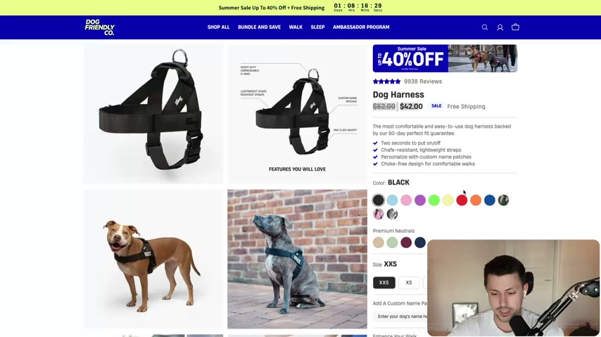
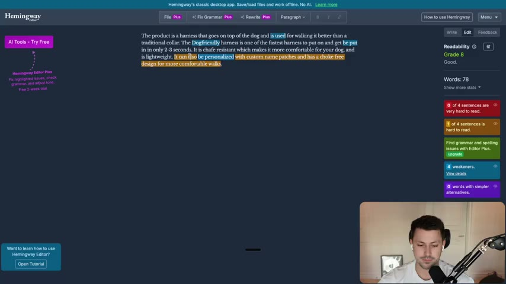
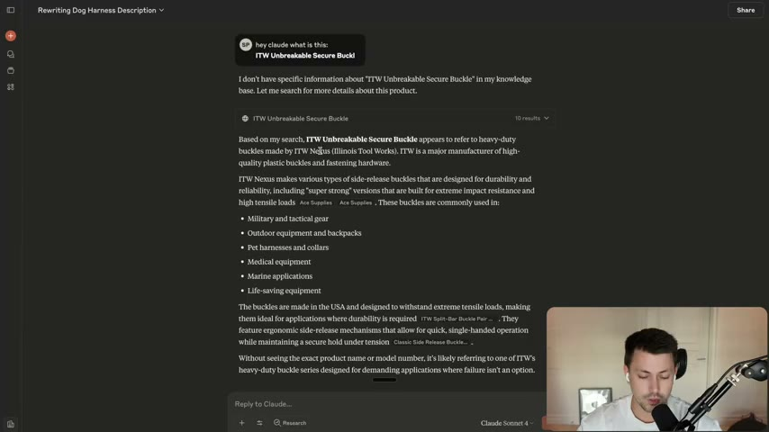
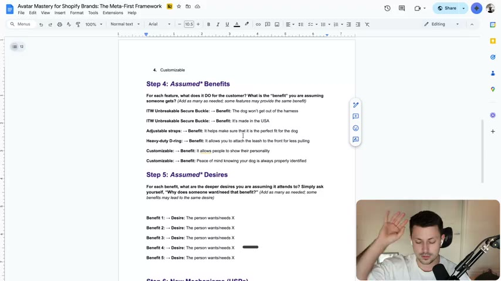
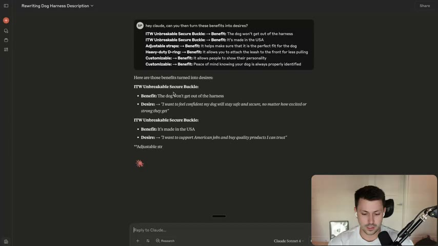
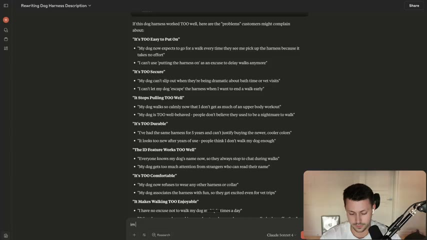
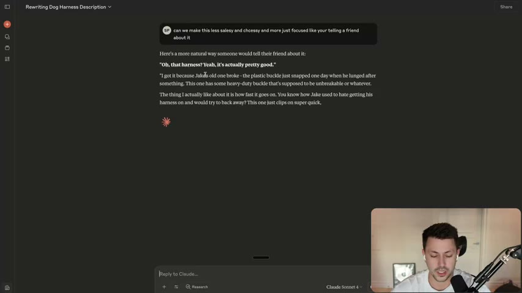

# 58. Understanding Your Product - Part 2
> A live, manual walkthrough of the Product Overview document for a dog harness: go from product page to features, assumed benefits, assumed desires, new mechanisms and hidden-mechanism prompts, using Claude only to sanity-check, widen and reword.

## 🤖 Agent use
- **Use when:** a brand has no research yet and you must build the first product understanding from the product page alone; or you are generating features → benefits → desires → mechanisms → ad ideas for any product.
- **Inputs → outputs:** product page (features, price, guarantee, specs), Hemingway-style readability check → a filled Product Overview doc with plain-language product description, features, assumed benefits, assumed desires, new mechanisms, "too well" complaints, and a friend-style explanation. Each row is a potential ad idea.
- **Rules:**
  - **DO** write the product description twice: technical, then at a sixth-grade reading level, and check it with a readability tool (Hemingway). "We want to make sure that we're communicating in a way that is easy to understand." [03:13–05:44]
  - **DO** copy features from the product page and keep the brand's own feature-benefit pairs as clues. [05:44–07:41]
  - **DO** look up unfamiliar parts ("what is an ITW buckle?") with AI and "always double check". [07:41–09:22]
  - **DO** label benefits, desires and mechanisms "assumed" until validated. "These are all assumptions… not things that we've actually validated." [14:24]
  - **DO** ask "why does someone want that?" repeatedly to move benefit → desire. [14:24–18:52]
  - **DO** let one benefit map to several desires, and several features map to one benefit. [09:22; 22:18]
  - **DON'T** use a feature that does not matter (he drops "sturdy grab handle": "I don't really know why I put that down as a feature"). [16:11]
  - **DON'T** let AI answer "what do you not advertise?" blindly; it "has no idea" what you advertise. It should ask you. [24:59]
  - **DO** treat every row as an ad idea: "these are all ad ideas right here". [11:08]
  - **IF** the product is basic and the same as everyone else's **THEN** new mechanisms will be hard to find; look for other ways to differentiate, covered later. [22:18]
  - **DO** write the "what would a friend say" answer as casual speech, then ask the AI to make it "less salesy and cheesy". That language can be used in ads. [30:09–31:40]
- **See also:** [57. Part 1](057-understanding-your-product-part-1.md) · [59. Part 3 (Claude does it)](059-understanding-your-product-part-3.md) · [60. Action Item](060-action-item-complete-understanding-product-doc.md) · [13. Write at a 6th grade level (Copywriting)](../../copywriting/lessons/13-why-you-need-to-write-at-a-6th-grade-level.md) · [Compression and plain language](../../copywriting/concepts/compression-and-plain-language.md)

Lesson page text: "for anyone who wants to put in the work to grow & understand their product on the deepest level"; "especially for you if you have not done ANY real research". Tool linked: hemingwayapp.com. [Page text]

## Key ideas

### Setup: manual, no research, one product page [00:00–03:13]
- This video is for people with no research, filling the doc for the first time. The AI version (lesson 59) is for people who have done research and are coming back. [00:00]
- Live product: Dog Friendly Co. dog harness (brand name per on-screen store header). Price point $42, struck from $52. [00:48]
- Only input is the product page: headline claims ("the most comfortable and easy-to-use dog harness backed by our 60-day perfect fit guarantee"), bullets (two seconds on/off, chafe-resistant lightweight straps, custom name patches, choke-free design), colour and size selectors. [00:48–03:13]

### Step 2: describe the product, then at a sixth-grade level [03:13–05:44]
- First draft is the instructor's paraphrase of the page. Hemingway scores it "Grade 8", with "custom name patches" a hard sentence. [03:43]
- Why sixth grade (instructor claim): "most people actually only can read at a sixth grade level." Business owners "like to sound cool, sound fancy", e.g. "choke free" makes sense to him but not necessarily to customers. [00:48–01:45; 04:49]
- Method: ask Claude "rewrite this at a sixth grade level", pass the original question as context, then paste the result in Hemingway. Claude's version scores "Grade 4". [03:43–04:49]
- Final sixth-grade text: "The harness wraps around your dog's chest and back. This spreads out the pull when your dog walks so it doesn't hurt their neck like a collar does…" (full text below). [04:49]

### Step 3: features [05:44–07:41]
- Source: the "product details" and the brand's own feature-benefit callouts. List kept: ITW unbreakable secure buckle, adjustable straps, heavy-duty D-ring, customizable (name patch). Also seen and set aside: premium shape-resistant webbing (kind of a benefit; "premium webbing might be the feature"), one-click on/off (feature and benefit), sturdy grab handle (dropped), colours, 60-day guarantee, size guide. [05:44–07:41; 16:11]
- He remarks that the brand "does a good job of saying feature and then benefit" and "has learned a lot from RCRO" (Whisper heard "RCRO", unclear) about tying features to benefits. [05:44–06:40]
- He does not know the material the harness is made from: "we probably should know." [06:40]
- Spoken total was "five"; the final doc lists four features. [07:41; doc]

### Step 4: assumed benefits (with Claude as a cross-check) [07:41–14:24]
- For each feature ask: why does it matter / what does it do for the customer? [07:41]
- **ITW buckle:** he does not know what it is, so he asks Claude. Claude (with web search) says it points to heavy-duty ITW Nexus (Illinois Tool Works) side-release buckles made in the USA, used in military/tactical gear, outdoor equipment, pet harnesses, medical and marine equipment. [08:33]
  - Benefits kept: the dog "won't get out of the harness" and it is made in the USA. [09:22]
  - When Claude was asked "What would be the benefits of a dog harness that has the feature ITW secure buckle?", it listed no breaking in emergencies, reliable under strong pulling, durability, weather resistance, quick one-handed release and "professional grade". He notes "me and Claude are on the same page" and that "that's the same thing", i.e. the AI repeats his instinct, and "AI only" would not copy a benefit across two features as he does. [09:22–10:19]
  - Ad ideas he spots: dog bolts after a squirrel, buckle doesn't snap, dog doesn't escape in a scuffle. [11:08]
- **Adjustable straps:** "perfect fit for the dog". [10:19]
- **Heavy-duty D-ring:** attach the leash at the front for less pulling. Claude adds: handles high force, secure leash attachment, versatility (dog backpacks, trainers' anchor point), but "the main thing" is it handles strong pullers. [12:01–12:52]
- **Customizable (name patch):** shows personality; also quick identification, faster reunions, always visible, no jingling tag, social benefits (strangers use the dog's name), peace of mind. [12:52–14:24]
- He admits he is "over-leveled on Claude" and uses it to brainstorm when "my brain can't really put it together". [13:24]

### Step 5: assumed desires [14:24–20:40]
- Ask "why does someone want that benefit?" and "keep asking why". Mark as assumptions: "we're just winging it right now." [14:24]
- Mappings he fills in: [14:24–18:52]

| Benefit | Desire he writes |
|---|---|
| The dog won't get out of the harness | They want their dog to be safe |
| It's made in the USA | They want American-made products; patriotism, "support local", "American made = good" association |
| It helps make sure it is the perfect fit | They want their dog to feel comfortable / not be in pain |
| Attach the leash at the front for less pulling | They want to feel more in control on walks; or be less embarrassed on walks in front of others ("there's that girl who her dog takes for a walk") |
| Peace of mind your dog is properly identified | They want their dog to be safe; they want to make sure their dog never gets lost |

- Then he asks Claude to "turn these benefits into desires". Claude's versions: "I want to feel confident my dog will stay safe and secure no matter how excited or strong they get"; "I want to support American jobs and buy quality products I can trust"; "I want my dog to be comfortable and happy on every walk"; "I want enjoyable, stress-free walks where I'm in control"; "I want my dog's gear to reflect how special and unique they are to me"; "I want to know that if something happens, my dog will find their way back to me." [19:25–20:40]
- Reflection: "going back through and doing this stuff is just really good… sometimes you just need to be reminded more than you need to be taught." [20:06]

### Angle that falls out [20:40–21:37]
- "My mind's already running with a bunch of angles": a story about a name tag that saved a dog; ask customers whether anyone has ever had their dog returned because of the name patch (if you have enough customers). [20:40]

### Step 6: new mechanisms (USPs) [20:40–24:06]
- Add "assumed" to the heading: "a lot of you think you have a unique mechanism that's actually not that unique." [20:40]
- His own picks from the page: the customizable name tag ("haven't seen that a lot on harnesses"), and the front D-ring (also noted the D-ring is not listed on the page's feature bullets). [21:37–22:18]
- Warning: new mechanisms "are going to be hard if you just have a basic product that is the same as everyone else's"; "new mechanisms are literally the most powerful things". [22:18]
- Then he asks Claude (same chat): "based on what you know about the dog harness, how would you answer this?" Claude suggests: the one-two-three quick clip system (ultra-fast application), ITW military-grade unbreakable buckle, strategic D-ring placement that redirects pulling force, an integrated customizable ID system, chafe-resistant comfort engineering with lightweight materials. [22:18–23:10]
- He keeps "military-grade unbreakable technology" as a strong new mechanism to leverage and also likes the chafe-resistant one. [23:10]

### Step 7: hidden mechanisms (the AI-analysis prompts) [24:06–31:40]
Answer each of the four questions; they feed the AI step and also generate ad ideas.
1. **What does your product do that you DON'T advertise?** Claude lists unadvertised benefits (reduces vet bills, saves your back and shoulders, improves dog confidence, protects your investment, makes training easier, increases daily exercise, reduces escape-related liability, builds a stronger human-dog bond), noting some "might seem like over promising". The instructor says AI "has no idea" what you advertise and should ask first; his own known gap is the military-grade buckle, which the brand is not advertising ("a good thing to chat with the team about"). [24:06–26:31]
2. **What do you include that competitors don't?** Name tag; the front D-ring (some competitors do it, "but not as much"); the ITW buckle. [26:31]
3. **If your product worked TOO well, what would customers complain about?** Playful prompt for creative ideas. His list: dog walks are so boring, the dog never pulls anymore; dog confused by how fast it goes on; never chafes; no shoulder workout from being pulled. Claude's list: "too easy to put on", "too secure", "stops pulling too well", "too durable", "ID feature works too well", "too comfortable", "makes walking too enjoyable". Further lines he likes: "My dog is addicted to walks now", "Now I get as excited as my dog", "It makes other owners feel bad / everyone stops and asks me about it", "I can't have a quick walk anymore", "The name tag creates too much social interaction", "It spoiled my dog". [26:31–29:16]
   - He notes the exercise "gets your creative juices flowing for new ad ideas" and that Claude can "spark ideation". He rejects some AI lines ("I don't like this"). [26:31–28:40]
4. **If someone explained this product to a friend, what would they say?** Use AI, or text a friend or relative "can you explain this product to me?" Claude's first draft is salesy; he asks "less salesy and cheesy… like you're telling a friend". Result is casual: "Oh, that harness? Yeah, it's actually pretty good…" (full text below). He says this is language "you guys can use as well". [29:16–31:40]

### Wrap-up: the seven steps [31:40–32:44]
- "Your work works more than you." Steps recapped: 1 basics, 2 what the product does (dumbed down to sixth grade), 3 features, 4 assumed benefits, 5 assumed desires, 6 assumed new mechanisms (USPs), 7 hidden mechanisms. Next lesson is on desires. [31:40–32:14]
- He admits that even in the manual version he "still cheated with Claude". [31:40]

## Steps / framework
| Step | What to do | Output |
|---|---|---|
| 1 Basics | Product name, price (include the strike-through price if it matters) | Dog Harness, ~~$52~~ $42 |
| 2 Product in action | Describe how it works and the outcome; rewrite at sixth grade; check in Hemingway | Technical + 6th-grade version |
| 3 Features | List the main features from the product page and anything you know of materials | 4 to 5 features |
| 4 Assumed benefits | For each feature: what does it do for the customer? | Feature → benefit pairs (many-to-many) |
| 5 Assumed desires | For each benefit: why does someone want that? Ask "why" until the deeper want | Benefit → desire pairs |
| 6 New mechanisms | What is new vs the market? | 1 to n USPs, marked assumed |
| 7 Hidden mechanisms | Four prompts (not advertised, competitor-unique, worked too well, friend explanation) | Ad-idea fuel and language |

## Examples
- **Hemingway pass:** original product description "Grade 8", with one hard sentence ("personalized with custom name patches…"); Claude's sixth-grade rewrite scores "Grade 4". [03:43–04:49]
- **ITW buckle:** feature → benefits "dog won't get out of the harness", "made in the USA" → desires "dog is safe", "American-made products". [09:22; 16:11]
- **Front D-ring:** feature → benefit "attach leash at the front for less pulling" → desires "feel in control", "less embarrassed on walks". [12:01; 17:10]
- **Name patch:** benefit "peace of mind your dog is properly identified" → desire "my dog finds its way back to me" → angle "name tag saved a dog" story. [18:09–20:40]
- **"Too well" complaints:** turn a product strength into a humble-brag line ("everyone stops and asks me where I got it") for third-party-validation angles. [29:16]

## Structured units

### Angles
| Angle | Core desire / pain | Heuristic(s) | Best format | Example line | Source |
|---|---|---|---|---|---|
| Name tag saved a dog | Dog safety, never getting lost | — | Story / UGC (needs a real customer story; the instructor says to ask customers first) | Story about a name patch that got a dog home | [20:40] |
| Unbreakable buckle in an emergency | Dog safety | — | Demo / story | "If your dog bolts after a squirrel, it won't snap" | [11:08] |
| Front D-ring control | Feel in control; less embarrassment on walks | — | Before/after walk video | "Less pulling" (derived) | [12:01; 17:10] |
| Made in the USA | Patriotism, support local, American-made = quality | — | Static / callout | "Made in the USA" | [16:17] |
| Product worked too well | Third-party validation, delight | — | UGC reaction | "Everyone stops and asks me where I got it" | [29:16] |
| Friend recommendation | Trust through casual voice | — | UGC talking head | "Oh, that harness? Yeah, it's actually pretty good." | [30:09–31:40] |

### Templates
| Template | Use for | Example fill | Source |
|---|---|---|---|
| "[Feature] → [Benefit: what it does for the customer]" | Step 4 | "ITW Unbreakable Secure Buckle → the dog won't get out of the harness" | [07:41] |
| "[Benefit] → [Desire: the person wants/needs X]" | Step 5 | "It allows you to attach the leash to the front for less pulling → they want to feel in more control on walks" | [17:10] |
| "If it worked too well, customers would complain that ___" | Ad-idea generation | "I can't have a quick walk anymore. Every dog owner wants to know where I got it." | [26:31–29:16] |

## Prompts / templates (verbatim)
Claude prompts used on screen (typed text; spelling as shown):

```text
hey claude what is this:
ITW Unbreakable Secure Buck!
```
(on-screen text at [08:40], typo as shown; the intended text is "Buckle")

```text
hey claude, can you then turn these benefits into desires?
ITW Unbreakable Secure Buckle: → Benefit: The dog won't get out of the harness
ITW Unbreakable Secure Buckle: → Benefit: It's made in the USA
Adjustable straps: → Benefit: It helps make sure that it is the perfect fit for the dog
Heavy-duty D-ring: → Benefit: It allows you to attach the leash to the front for less pulling
Customizable: → Benefit: It allows people to show their personality
Customizable: → Benefit: Peace of mind knowing your dog is always properly identified
```
(on-screen text at [19:30])

```text
can we make this less salesy and chcessy and more just focused like your telling a friend about it
```
(on-screen text at [30:40], typos as shown)

Other prompts, as spoken (not verbatim text): "Hey Claude, rewrite this at a sixth grade level. For context, here is the original question I am answering…" [04:14]; "What would be the benefits of a dog harness that has the feature ITW secure buckle?" [09:22]; "What would be the benefit of a heavy-duty D-ring on a dog harness?" [12:01]; "Why would customizable feature be a benefit for a dog harness?" [12:52]; "Based on what you know about the dog harness, how would you answer this [new mechanisms prompt]?" [22:18].

Final filled example (Example 3 – Dog; from the linked example Google Doc, tab 1):

```text
Product Name: Dog Harness
Price Point: $52.00 (struck) $42.00

Step 2: Product In Action
The product is a harness that goes on top of the dog and is used for walking it better than a traditional collar. The Dogfriendly harness is one of the fastest harness to put on and get be put in in only 2-3 seconds. It is chafe resistant which makes it more comfortable for your dog, and is lightweight. It can also be personalized with custom name patches and has a choke free design for more comfortable walks.
It helps dog owners put their dogs harness on easier and faster, and overall is safer and cute for the dog.

6th-grade version: The harness wraps around your dog's chest and back. This spreads out the pull when your dog walks, so it doesn't hurt their neck like a collar does. You can put it on super fast - just 2-3 seconds! The soft material won't rub your dog's skin the wrong way. It's also really light so your dog won't feel heavy. You can add your dog's name to make it special. Your dog will be more comfortable and happy on walks because the harness doesn't squeeze their throat.

Step 3: Features
1. ITW Unbreakable Secure Buckle
2. Adjustable straps
3. Heavy-duty D-ring
4. Customizable

Step 4: Assumed* Benefits
ITW Unbreakable Secure Buckle: → Benefit: The dog won't get out of the harness
ITW Unbreakable Secure Buckle: → Benefit: It's made in the USA
Adjustable straps: → Benefit: It helps make sure that it is the perfect fit for the dog
Heavy-duty D-ring: → Benefit: It allows you to attach the leash to the front for less pulling
Customizable: → Benefit: It allows people to show their personality
Customizable: → Benefit: Peace of mind knowing your dog is always properly identified

Step 5: Assumed* Desires
Benefit: The dog won't get out of the harness: → Desire: They want their dog to be safe
Benefit: It's made in the USA → Desire: They want American-made products
Benefit: It helps make sure that it is the perfect fit for the dog → Desire: They want their dog to feel comfortable
Benefit: It allows you to attach the leash to the front for less pulling → Desire: They want to feel in more control on walks
Benefit: It allows you to attach the leash to the front for less pulling → Desire: They want to be less embarrassed when they go on walks in front of others
Benefit: Peace of mind knowing your dog is always properly identified → Desire: They want to make sure their dog is safe

Step 6: Assumed* New Mechanisms (USPs)
1. Customizable name tag
2. The front D-Ring
3. ITW Military-Grade Unbreakable Buckle Technology: New Mechanism: Uses the same buckle system trusted by military and life-saving equipment

Step 7: Hidden Mechanisms (For AI Analysis)
1. What does your product do that you DON'T advertise?
   ITW Military-Grade Unbreakable Buckle Technology
2. What ingredients/components do you include that competitors don't?
   Name Tag
3. If your product worked TOO well, what would be the "problem" customers would complain about
   Dog walks are so boring, the dog never pulls anymore
   The dog is confused on how I put the harness on so fast
   My Dog some how likes walks even more
   Now I get as excited as my dog for walks
   "I can't have a quick walk anymore - every dog owner wants to know where I got it"
4. If someone was explaining this product to their friend, what would they say?
"Oh, that harness? Yeah, it's actually pretty good."
"I got it because Jake's old one broke - the plastic buckle just snapped one day when he lunged after something. This one has some heavy-duty buckle that's supposed to be unbreakable or whatever.
The thing I actually like about it is how fast it goes on. You know how Jake used to hate getting his harness on and would try to back away? This one just clips on super quick, so there's less drama.
And it has his name on it, which is kind of nice. I was always worried about losing those little ID tags that jingle around.
But honestly, the biggest difference is he doesn't pull as much anymore. The leash clips to the front instead of his back, so when he tries to pull forward, it just kind of redirects him. I don't know if it's the harness or if he's just getting older, but our walks are way less stressful now.
It's held up pretty well too. I think I've had it for like eight months? No issues so far.
Why, is Buddy giving you trouble on walks? Yeah, you might want to try something like this. I think I got it online... let me see if I can find the link."
```

Note: "I've had it for like eight months", "Jake" and "Buddy" are invented AI-generated storytelling details in a practice example. Do not reuse them as real customer claims. (derived)

## Screenshots

*The only input for the manual exercise: the product page with sale price, bullets (two seconds on/off, chafe-resistant lightweight straps, custom name patches, choke-free design) and a feature call-out image (heavy-duty unbreakable D-ring, lightweight chafe-resistant straps, custom name patches, one-click on/off). [01:40]*


*Readability check: the draft description scores Grade 8 with one hard sentence; this is the pass/fail step before rewriting at sixth grade. [03:50]*


*Using Claude with web search to learn what an unfamiliar component is (ITW Nexus heavy-duty buckles, used in military, outdoor, pet-harness, medical and marine gear, made in the USA). [08:40]*


*The doc with Step 4 benefits filled (ITW buckle, adjustable straps, D-ring, customizable) and Step 5 still blank. [14:20]*


*The prompt that converts the benefit list into desire statements, with the first answers. [19:30]*


*Claude's "if it worked TOO well" list (too easy to put on, too secure, stops pulling too well, too durable, ID feature, too comfortable, too enjoyable), used to spark ad ideas. [28:20]*


*The "less salesy and cheesy… like you're telling a friend" rewrite, which produces casual UGC-style language. [30:40]*

## How to apply
- [ ] Start from the product page: list price, claims, guarantee, features, materials. Mark materials as "unknown" if the page does not say.
- [ ] Draft a plain description, rewrite at sixth grade, and check the grade in Hemingway.
- [ ] Build feature → benefit pairs. Look up anything unfamiliar and verify it from a second source.
- [ ] For every benefit, ask "why does someone want that?" at least once; allow more than one desire per benefit.
- [ ] Mark everything "assumed" until research validates it.
- [ ] List 1 to 3 candidate new mechanisms and mark whether the product is truly different from the category.
- [ ] Answer the four hidden-mechanism prompts; capture 3 to 5 "too well" complaints and a friend-style explanation as copy language.
- [ ] Convert each row into an ad idea and log it with the feature/benefit/desire it came from.
- [ ] Do not copy invented names/details from example docs (Jake, Buddy, eight months) into real ads.

## Related
- Previous: [57. Understanding Your Product - Part 1](057-understanding-your-product-part-1.md) · Next: [59. Understanding Your Product - Part 3](059-understanding-your-product-part-3.md)
- [60. Action Item: Complete Understanding Product Doc](060-action-item-complete-understanding-product-doc.md) · [61. Understanding & Applying Desire - Part 1](061-understanding-applying-desire-part-1.md)
- [Labels and customer language (Copywriting)](../../copywriting/concepts/labels-and-customer-language.md)

## Sources and limitations
- Transcript: [58. Understanding Your Product - Part 2….txt](<../../../../../raw/evolve/start-here/_transcripts/👣 Evolve (Start Here)/58. Understanding Your Product - Part 2 👣 Evolve (Start Here) Evolve.txt>) · Page text: [58….html.md](<../../../../../raw/evolve/start-here/_extracted/👣 Evolve (Start Here)/58. Understanding Your Product - Part 2_👣 Evolve (Start Here)_Evolve.html.md>) · Template and example docs: [57-document-1NTdbKBNu3.docx.md](<../../../../../raw/evolve/start-here/_extracted/_linked/google/57-document-1NTdbKBNu3.docx.md>), [57-document-1LbigXSULv.docx.md](<../../../../../raw/evolve/start-here/_extracted/_linked/google/57-document-1LbigXSULv.docx.md>) (the same docs are also exported under lesson 60). The blinds and collagen examples in that doc are summarised in [59](059-understanding-your-product-part-3.md).
- Machine transcription (Whisper large-v3-turbo). Full recording covered (last segment 32:44 of 32:44). Whisper heard "Doc Friendly Co" (screen shows "Dog Friendly Co."), "Heming" (Hemingway), "Dark friendly" (Dog Friendly), "RCRO" (unclear brand or person), "skewer buckle" and "ITW Nexus Illinois" (Claude's output on screen reads "ITW Nexus (Illinois Tool Works)"). "Grade eight" and "grade four" are confirmed on-screen.
- The sixth-grade reading level claim ("most people only read at a sixth grade level") is the instructor's, without evidence.
- The Claude chat uses "Claude Sonnet 4" per on-screen label; outputs will differ with other models. Claude's list of "unadvertised benefits" (vet bills, back and shoulders, etc.) contains unproven claims; do not use them in ads without evidence.
