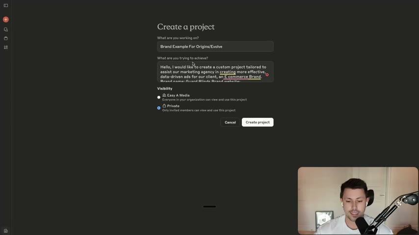
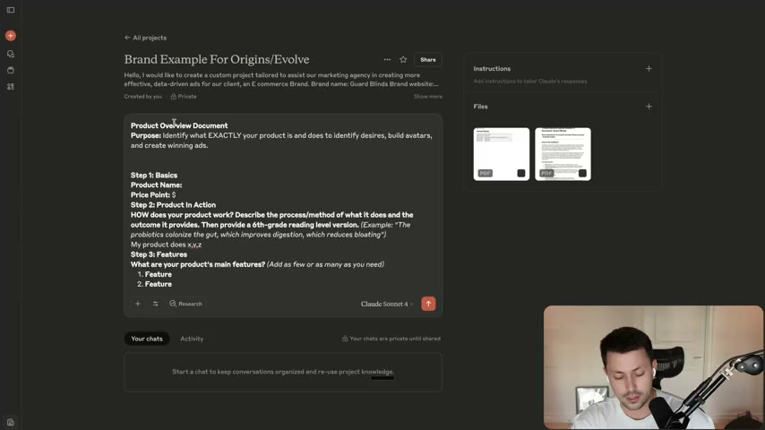
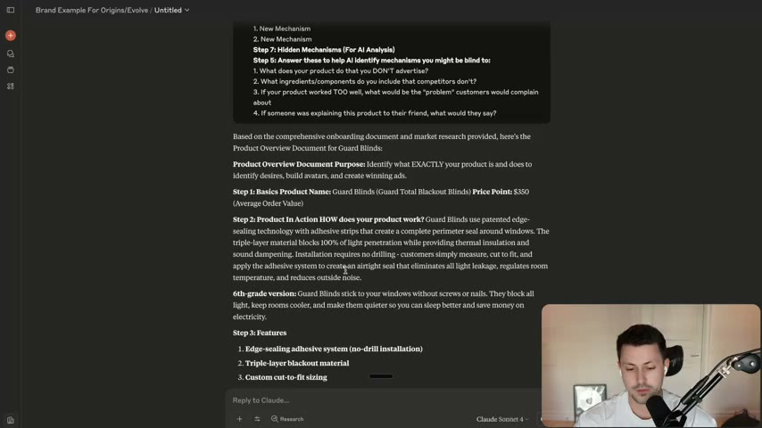

# 59. Understanding Your Product - Part 3
> Create a Claude project loaded with reviews, the research doc and the brand's onboarding doc, then paste the Product Overview template and have Claude fill it out, and audit the result for fluff because AI "makes educated guesses".

## 🤖 Agent use
- **Use when:** research files already exist (reviews, research doc, onboarding doc) and you need a first-draft Product Overview doc fast, or you need to set up a persistent brand "project" context for later ad work.
- **Inputs → outputs:** brand name and website, customer reviews, research doc, brand self-onboarding doc, blank Product Overview template → a filled product overview (steps 1 to 7) that you then audit and correct.
- **Rules:**
  - **DO** create one project per brand and attach three inputs: reviews, the research document, and the self-onboarding document. [01:22–02:39]
  - **IF** you have no reviews **THEN** use the research doc for now, but "definitely… get some kind of custom reviews", since they help the AI understand the brand. [01:22–02:01]
  - **DO** paste the whole template into the chat and say: "Hey Claude, can you please fill out the following". Optionally add "if you can fill anything out, or if you have questions, let me know." [02:39–03:34]
  - **DO** review the output and ask "what of this is fluff, and what is actually accurate and good?" [04:06]
  - **DON'T** treat the output as researched truth. "Claude and AI in general makes educated guesses… it assumes. That's why this has assumed benefits." [04:06]
  - **DON'T** skip the manual exercise. "You don't really learn a lot from doing this." [04:06–04:58]
  - **DO** keep the project and reuse it after later research steps. [04:58]
  - **DO** keep the instructor's caveat in mind: "your work works more on you then you work on it" (as transcribed; he says the same line in lesson 58). [00:00–00:48]
- **See also:** [58. Part 2 (manual)](058-understanding-your-product-part-2.md) · [60. Action Item](060-action-item-complete-understanding-product-doc.md) · [7. Evolve Master Prompt Doc](007-evolve-master-prompt-doc.md) · [36. What about AI (Copywriting)](../../copywriting/lessons/36-what-about-ai.md) · [AI in copywriting](../../copywriting/concepts/ai-in-copywriting.md)

## Key ideas

### Why use Claude, and the caveat [00:00–00:48]
- The instructor recommends everyone use Claude, "even the paid version… like 20 bucks a month" (instructor claim on price). He is "very over leveraged on Claude" and calls it "absolutely sensational" for speed and workflow. [00:00]
- He still thinks many people should do the manual version first and may reorder the lessons to put this one after the manual one. [00:48]

### Set up the project [00:48–02:39]
- A Claude project (free users can use a normal chat and drag the same documents in). Name used on screen: "Brand Example For Origins/Evolve". [00:48; frame 01:40]
- The project description is the "custom project" prompt below, with BRAND and website filled in. "This prompt will be attached below in the Skool." The lesson page includes it. [01:22]
- Files to upload (three things): [01:22–02:39]
  1. All customer reviews you have.
  2. The research document (from the research modules).
  3. The brand's self-onboarding document (the one the brand filled out; students have the same doc).
- "You want this AI to essentially be trained on specific files": it needs context. [02:39]

### Fill the template [02:39–04:06]
- Copy the entire Product Overview template into the project chat: "Hey Claude, can you please fill out the following". [02:39]
- Claude returns the full document: Step 1 basics, price, how the product works, the sixth-grade version, features and so on through assumed benefits, assumed desires, new mechanisms and hidden mechanisms. The on-screen output is the example for the brand shown on screen (blinds brand; the same example is in the example doc). [03:34–04:06]
- These outputs are needed for the next steps: desires, market sophistication and avatars. [04:06]

### Audit the output [04:06–05:37]
- "You don't really learn a lot from doing this. Obviously, you should have learned a lot from doing the research." [04:06]
- Ask what is fluff and what is accurate. [04:06]
- AI "makes educated guesses". The doc calls things "assumed" for that reason. This lesson is "just us understanding the product", based on assumptions of what the product does, before market research validates them. [04:06–04:58]
- Doing it manually is "really good to do" because it forces understanding. [04:58]
- After the process, go back and give the results to Claude again and "use it later on". [04:58]

## Steps / framework
1. Create a Claude project per brand. Description = the prompt below with brand name and website. [01:22]
2. Upload reviews (or the research doc if no reviews), the research doc, and the self-onboarding doc. [01:22–02:39]
3. Paste the blank Product Overview template (see [57](057-understanding-your-product-part-1.md) for the full text) into a chat in the project. [02:39]
4. Instruct: "Hey Claude, can you please fill out the following." Add "if you can't fill something out or have questions, let me know". [02:39–03:34]
5. Audit: mark fluff, unverified claims and assumptions; compare with the manual pass from [58](058-understanding-your-product-part-2.md). [04:06]
6. Store the audited doc and keep using the project for desires, sophistication and avatars. [04:58]

## Examples
- **Blinds brand output (on screen):** Claude, given the onboarding doc and research, produced a product overview with price ($350), a technical "how it works" ("patented edge-sealing technology with adhesive strips that create a complete perimeter seal… triple-layer material blocks 100% of light penetration…"), a 6th-grade version ("stick to your windows without screws or nails… block all light, keep rooms cooler… quieter") and a features list beginning with edge-sealing adhesive system, triple-layer blackout material and custom cut-to-fit sizing. [03:34; frame 03:50] (The brand name on screen reads "Guard Blinds"; the example doc calls the product "Total Blackout Blinds".)
- **Collagen and blinds example docs:** see the example doc linked in lessons [57](057-understanding-your-product-part-1.md) and [60](060-action-item-complete-understanding-product-doc.md); summaries below.

### Example doc summaries (from the linked example Google Doc, second and third examples; these are the doc's own examples, not instructor-verified claims)
| Example | Product / price | Features and mechanism highlights (as written in the doc) | Hidden-mechanism "too well" and friend lines |
|---|---|---|---|
| Blinds | Total Blackout Blinds, $350 | Edge-sealing track system; custom-cut to exact window; no-drill adhesive install; aluminum frame; "patented" blackout fabric; SGS-certified manufacturing; removable/renter-friendly; heat-blocking; sound-dampening. New mechanisms: edge-sealing track vs curtains that leak light; 5-minute no-drill install; custom-cut precision; triple-benefit light/heat/sound system; removable adhesive; "patented blackout fabric technology… true 0% light transmission". | Too well: room too dark, might oversleep, claustrophobic, too quiet, too cool. Friend: "It's like having blackout curtains but they actually work"; "You literally cannot see your hand in front of your face"; "Finally something that works for shift workers"; "It's expensive but worth every penny". |
| Collagen | Collagen, $59 one-time / $47.20 subscription / $39 three-month bundle | Dyglomera 300mg, Suntheanine 200mg, marine collagen peptides 10g, easy-mixing powder, great taste. Doc claims include "increases natural GLP-1 production by 68%", "absorb 30x better than standard collagen", "same hormone as Ozempic but naturally". New mechanisms: "Only collagen with Dyglomera" and "Triple-hormone targeting". | Too well: losing weight too fast, too energetic, more attention, needing medication adjustment. Friend: "It's not just collagen - it actually helps with the weight gain that happens during menopause…" |

Compliance flag (derived): the collagen example contains unverified efficacy and drug-comparison claims (68%, 30x, Ozempic). Do not reuse such claims in ads without substantiation.

## Prompts / templates (verbatim)
Custom project prompt from the lesson page. Replace BRAND and YOURWEBSITE. (The text is one paragraph in the source; line breaks below are added only for readability and the hyphenation matches the source.)

```text
Hello, I would like to create a custom project tailored to assist our marketing agency in creating more effective, data-driven ads for our client, an E commerce Brand. Brand name: BRAND Brand website: YOURWEBSITE The purpose of this custom project is to support the following key marketing functions for this brand: Customer Understanding & Market Trends: Analyze customer surveys, buyer personas, and behavioral data to uncover customer preferences, pain points, and purchasing motivations.Identify market trends and audience segments relevant to this brand's products. Market Research & Competitive Analysis: Gather and analyze data on competitors and broader industry trends. Identify opportunities for differentiation in brand's positioning and advertising strategies. Creative Ideation & Strategy: Generate new creative concepts and strategies for ad campaigns based on insights from market data, customer feedback, and competitive analysis. Provide feedback on existing ideas, suggesting improvements grounded in customer insights and market trends. Scriptwriting & Copy Development: Assist with crafting persuasive, targeted scripts for ads and other marketing materials. Review and critique copy-writing to ensure it resonates with the target audience, incorporating customer pain points and desires. Ad Review & Performance Feedback Loop: Assist in analyzing post-launch ad performance by reviewing metrics such as ad spend, ROAS, hook rate, hold rate, CTR, etc. Provide insights on why certain ads performed well or underperformed, identifying key learnings from each campaign. Close the feedback loop by suggesting actionable takeaways from winning and losing ads, incorporating these learnings into future creative strategies. Knowledge Base: This project should use the attached files as its primary knowledge base and refer to the information within when providing insights or recommendations. Whenever this project provides an answer, it should be informed by the content within the knowledge base. It should autonomously apply the insights from the attached files to ensure all responses are grounded in data and relevant context. Key Responsibilities: Interpret customer feedback and survey data to identify trends and actionable insights. Suggest ad strategies, creative angles, and copy that align with market research and customer insights. Ensure all insights, scripts, and suggestions are data-driven and relevant to brand's target audience, drawing on the knowledge base provided. Analyze ad performance post-launch, using key metrics to provide insights into ad success or failure. Instructions: Always ground your responses in the content within the knowledge base. Highlight any recommendations based on specific insights or principles from the provided data or resources, especially when drawing on "Breakthrough Advertising." Prioritize relevance to brand's audience, and use data to back up your suggestions.
```

Chat instruction (spoken, [02:39–03:34]):

```text
Hey Claude, can you please fill out the following
[paste the full Product Overview template]
```

## Screenshots

*"Create a project" dialog in Claude: project name and the long custom-project description as "what are you trying to achieve". Visibility is set to Private. [01:40]*


*Project page with two PDFs added to Files (research doc and onboarding doc) and the Product Overview template pasted in the chat box. [03:20]*


*Claude's filled-out doc: Steps 1 to 3 completed from the uploaded files for the blinds example brand. [03:50]*

## How to apply
- [ ] Gather reviews, the research doc and the brand's onboarding doc. If missing, list them as blockers.
- [ ] Create the project and attach the files; paste the project prompt with the real brand name and website.
- [ ] Paste the template and ask for it to be filled; allow the model to ask questions.
- [ ] Audit every line: mark claims as verified (source) or assumed; delete fluff.
- [ ] Check efficacy, medical and legal claims before they enter any ad.
- [ ] Compare with a manual pass ([58](058-understanding-your-product-part-2.md)) for blind spots.

## Related
- Previous: [58. Understanding Your Product - Part 2](058-understanding-your-product-part-2.md) · Next: [60. Action Item: Complete Understanding Product Doc](060-action-item-complete-understanding-product-doc.md)
- [Evolve master prompt doc (lesson 7)](007-evolve-master-prompt-doc.md) · [Evolve Copywriting: Evolve writing prompts](../../copywriting/lessons/37-evolve-writing-prompts.md)

## Sources and limitations
- Transcript: [59. Understanding Your Product - Part 3….txt](<../../../../../raw/evolve/start-here/_transcripts/👣 Evolve (Start Here)/59. Understanding Your Product - Part 3 👣 Evolve (Start Here) Evolve.txt>) · Page text (prompt): [59….html.md](<../../../../../raw/evolve/start-here/_extracted/👣 Evolve (Start Here)/59. Understanding Your Product - Part 3_👣 Evolve (Start Here)_Evolve.html.md>) · Docs: [57-document-1NTdbKBNu3.docx.md](<../../../../../raw/evolve/start-here/_extracted/_linked/google/57-document-1NTdbKBNu3.docx.md>), [57-document-1LbigXSULv.docx.md](<../../../../../raw/evolve/start-here/_extracted/_linked/google/57-document-1LbigXSULv.docx.md>)
- Machine transcription (Whisper large-v3-turbo). Full recording covered (last segment 5:37 of 5:37). Whisper heard "guard blinds" (screen: "Guard Blinds"). The "your work works more on you" line is as transcribed and may be garbled.
- The uploaded research doc and onboarding doc used in the video are not in the course files. The only generic onboarding doc referenced is "the same doc" students have; it is not exported here.
- Sequencing is muddled in the video: at the start he says "another video… follows up on how to do it manually" [00:00], and at the end "you should have seen that in the first video" [04:58]. In the course, the manual walkthrough is [Part 2](058-understanding-your-product-part-2.md) and he says he may reorder lessons [00:48].
