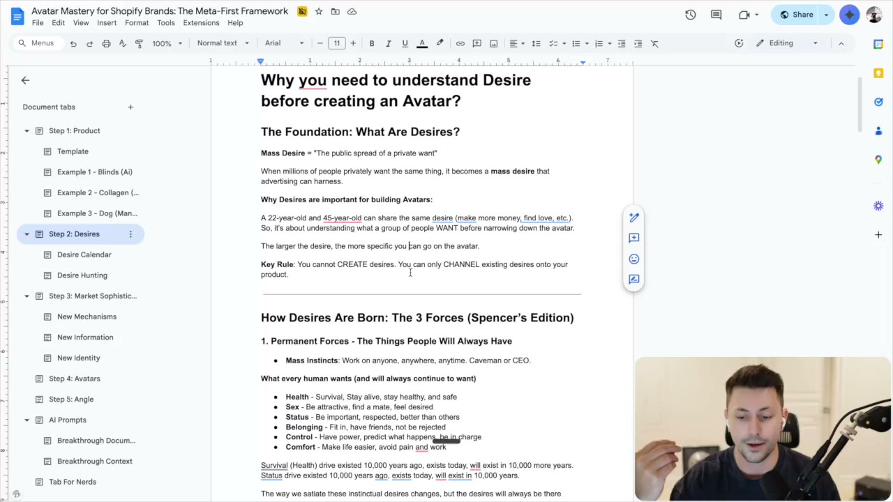
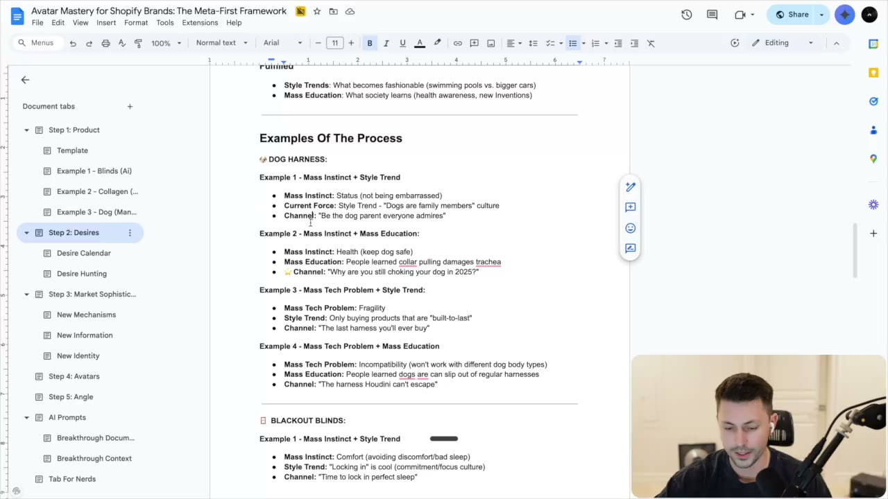
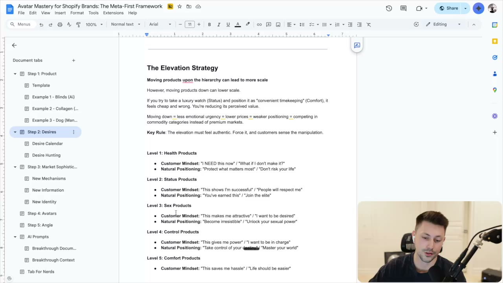
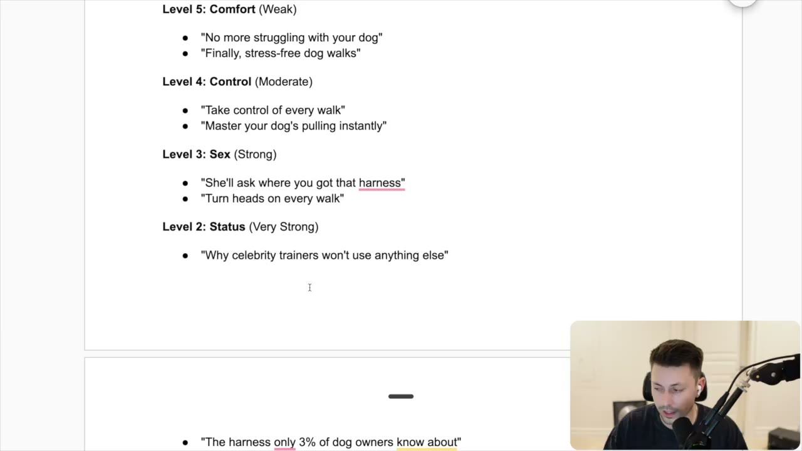

# 61. Understanding & Applying Desire - Part 1
> Desires are what a mass of people already want; you cannot create them, only channel them. This lesson gives a four-part model for where desires come from, a three-factor test for which to pick, a power ranking of the six instincts, and the "elevation strategy" for moving a product up that ranking, all demonstrated by turning desires into headlines. It is the base layer under avatars, angles and hooks.

## 🤖 Agent use
- **Use when:** analysing a product or market before building an avatar or angle; diagnosing why an ad or headline worked; generating headline directions for a brand; choosing which desire a new batch of ads should target.
- **Inputs → outputs:** product + market facts, current trends and "new things people learned" in the niche, customer complaints and "I want/need" language → a ranked list of desires (instinct or tech problem + the trend/education that shapes it), 1 channelled headline per combination, and a decision on which desire level to test.
- **Rules:**
  - **DO** start from desire, not demographics. "A 22-year-old and a 45-year-old can share the same desire." Demographic avatars "are just dumb" because they say nothing about what people want. [01:22–02:40]
  - **DON'T** try to create a desire. "You cannot create desire"; check that the desire already exists before writing. "Never fight desires. You will fail if you go after desires that do not exist." [02:40–04:01; 57:02]
  - **DO** find the desire behind any benefit by asking "why do you want that?" until you reach a core want. "Whatever people say they want or need is usually a desire." [04:01–05:20]
  - **DO** classify every desire as (a) one of the six permanent mass instincts or (b) one of the six mass technological problems, then add the force of change that shapes it now (style trend or mass education). [05:20–20:23]
  - **DO** write headlines by combining one instinct or tech problem with one trend or one new piece of education. [20:23–30:23]
  - **IF** you already have a headline **THEN** reverse-engineer it: which trend or education is behind it and which instinct does it hit? That also exposes patterns across your winning ads. [22:59–24:22]
  - **IF** the market is product-aware **THEN** lean on mass technological problems; the instructor says problems with existing products are "massive" there, and mass instinct + mass education "usually always lead to the biggest breakthroughs". [24:22–25:37]
  - **DO** test a candidate desire on Scope, Urgency and Staying Power; "scope more than anything". [36:31–40:39]
  - **DO** try elevating the product to a stronger desire (control to status, health, sex), but only where it feels authentic. [44:05–47:57]
  - **DON'T** elevate in the other direction (e.g. a status product sold as "convenient"): "moving down = less emotional urgency = lower prices = weaker positioning". [45:14–46:42]
  - **IF** your category is health **THEN** the instructor recommends considering a lower desire (comfort, control, sex), because "everybody in health is selling health" (blue-ocean logic). [45:14]
  - **DON'T** fake an association to claim status (e.g. "celebrity trainers use it") if untrue; he is "not a lawyer" and warns you will get in trouble. [53:15]
  - **DO** make the visual congruent with a broad headline so people know what the product is. [32:56]
  - **DON'T** turn this into a mechanical checklist ("analysis paralysis"): write, then analyse why it works. [57:02–1:01:14]
- **See also:** [Market Desires (lesson 9)](009-market-desires.md) · [Rule of 1: desire, avatar, message (lesson 14)](014-rule-of-1-1-desire-avatar-message.md) · [The Desire Calendar (62)](062-the-desire-calendar-part-2.md) · [How To Find Desires (63)](063-how-to-find-desires-part-3.md) · [Avatars and angles (Copywriting)](../../copywriting/concepts/avatars-and-angles.md) · [Market awareness (Copywriting)](../../copywriting/concepts/market-awareness.md)

Lesson page text: only a link to "The Desire Document" (Google Doc, exported as the attachment). The video is a screen-share walkthrough of that doc (on-screen title "Avatar Mastery for Shopify Brands: The Meta-First Framework"), whose left-hand tabs run Step 1: Product, Step 2: Desires (Desire Calendar, Desire Hunting), Step 3: Market Sophistication, Step 4: Avatars, Step 5: Angle, plus AI Prompts. [04:10]

## Key ideas

### 1. Desire first, avatar second [00:00–04:01]
- "The reason why you need to understand desire before creating avatars is because desires essentially create avatars, or at least they create strong ones." [00:00]
- Definition used: mass desire is "the public spread of a private want": when millions privately want the same thing it becomes a mass desire advertising can harness. The instructor attributes the phrasing to Eugene Schwartz (*Breakthrough Advertising*). "Private" only means people usually keep it to themselves; "I want to lose weight" is the example, which is why health and wellness is a "hundreds of billions" industry. [00:00–01:22]
- Demographic avatars ("female, 55+", "mom, 30 to 45") are what most people give when asked who their avatar is. Desires create shared "labels" and groups; "the larger the desire, the more specific you will likely need to go on an avatar". [01:22–02:40]
- **Key rule: you cannot create desire, only channel it.** Chip-clip example: no matter how cool the clip is, people who don't care will roll up the bag. [02:40–04:01]
- Method to find the desire inside a benefit: benefit "I can call my friends" → why? "I want to be in touch... maintain relationships... feel belonging". Keep asking why. [04:01–05:20]


*The Desire Document: left tabs show where this lesson sits (Step 2: Desires, with Desire Calendar and Desire Hunting beneath it, then Market Sophistication, Avatars, Angle). The body shows the mass-desire definition and "Key Rule: You cannot CREATE desires. You can only CHANNEL existing desires onto your product." [04:10]*

### 2. Where desires come from: two permanent forces + forces of change [04:01–20:23]
The doc heading says "3 Forces" but the instructor corrects himself: there are "two essential sources" (permanent forces; forces of change) with three-plus talking points. The doc's second subsection is mislabeled "Permanent Forces" again; it is the second permanent force. [04:01–05:20]

**Permanent force 1: Mass instincts** [06:42–11:39]. "Work on anyone, anywhere, anytime. Caveman or CEO." Strength varies person to person (some do not care about belonging, status or health), but in aggregate:

| Instinct | Doc definition | Instructor's gloss |
|---|---|---|
| Health | Survival; stay alive, healthy, safe | "literally an instinct"; also applies to pets and people around us [06:42; 25:37] |
| Sex | Be attractive, find a mate, feel desired | Used instead of "relationships" to make clear it is attraction/mate-finding, not friendship [06:42–08:02] |
| Status | Be important, respected, better than others | Tribal leader then, followers/influencers now; "money, people buy status" [08:02] |
| Belonging | Fit in, have friends, not be rejected | "More or less the sense of family"; labels help with belonging [08:02; 49:14] |
| Control | Have power, predict what happens, be in charge | Example: backlash when iPhone dropped the headphone jack; "we don't like change" [08:02–09:19] |
| Comfort | Make life easier, avoid pain and work | "We always look for the easiest way out"; couch + chips gives the same dopamine as hard work [09:19] |

- The drive is permanent; only how it is satisfied changes: "The status drive existed 10,000 years ago. It exists today. It will exist in 10,000 years." [09:19–10:37]
- Mechanism examples of the same instinct: pornography/OnlyFans as a modern mechanism for "feel desired" (instructor calls it sad but real); status once meant being known at the local bar, now "you have to go online and make videos of yourself"; your "tribe" used to be ~10 people and is now millions (Ronaldo example). [10:37–11:39; 19:05]

**Permanent force 2: Mass technological problems** [11:39–17:47]. Technology is any advancement (wheel, boats, guns), not just phones. Problems can be experienced directly or known indirectly (a friend tells you about seasickness). Problems create new desires and industries (AI now; TV repair men in the 1950s–60s). [11:39–16:23]

| Problem | Doc description | Feeling | Instructor example |
|---|---|---|---|
| Complexity | Too hard to figure out | You feel dumb | An 80-year-old facing a phone or laptop [14:11] |
| Overwhelm | Too many choices, beeps, distractions | Anxious | Phone buzzing, 47 apps, too many streaming services [15:11] |
| Fragility | Breaks when you need it most | Frustrated | Phone dies mid-call; "tech companies then use this as positioning" [15:11] |
| Maintenance | Always needs fixing, updating, paying | Tired | Daily app updates, rising subscriptions; 1950s TV needing the wire adjusted [15:11–16:23] |
| Incompatibility | Won't work with your other stuff | Trapped | Old charger vs new phone [16:23] |
| Obsolescence | Gets old and useless fast | Cheated | MP3 players replaced by phones [16:23] |

"TV reception was terrible in the 1960s, internet connection is shaky today, and holograms will lag in 2050. The technology changes, but the problems persist." [17:47]

**Forces of change** (change *how* permanent desires are satisfied; not desires themselves) [17:47–20:23]
- **Style trends:** what becomes fashionable (pools then, bigger cars and big watches now). Trends of this kind take "sometimes a decade", not a Bitcoin-pump two months. [17:47; 24:22]
- **Mass education:** what society learns (health awareness, new inventions). Example: Ozempic/GLP-1 is hot because mass education (people learned about it) met a style trend (people want to be skinnier/fitter). (Whisper wrote "Ozampic".) [19:05–20:23]
- Education can be weaponised on small groups ("very hard to educate mass, mass markets"); revisited under market sophistication. [20:23]

### 3. The channelling experiment: instinct/problem + force → headline [20:23–34:21]
Method: pick one instinct or tech problem, pair it with one current style trend or mass education, write the headline. Count: 6 instincts + 6 tech problems = 12 starting points, times trends/education = "24 combinations"; "I'm not telling you to go and just test 24 combinations", use the power ranking instead. [26:57–27:59]
- Write the headline first and peel it back, or start from the framework. "If you write a headline and then you try to break it down... what is the trend behind this? what is the education? what instinct?... that will help you also find patterns in your winning ads." [22:59]
- The headline is "a bold call out"; add subheadings for context. [31:34]
- Blinds ad: broad headline requires a clear product photo "to make it congruent" so nobody misreads what is sold. [32:56]
- Dog-harness results flagged by the instructor: "Why are you still choking your dog in 2025?" was "actually a winning headline" and "winning angle" [25:37; 54:18]; "Master your dog's pulling instantly" is "one of the winners we have running" [49:14–50:31]; "The harnesses that fit big dogs" is "one of our best headlines for this brand" [30:23] (all instructor claims, no numbers). "Finally stress-free dog walks" / comfort angle "has converted a little bit" but not well [49:14]. "She'll ask where you got that harness" is untested, "could fully flop" [51:59].


*"Examples Of The Process: Dog Harness". Each example lists Mass Instinct or Mass Tech Problem, the Style Trend or Mass Education, and the headline "Channel"; the star marks the winning headline "Why are you still choking your dog in 2025?" [24:10]*

### 4. How to find and evaluate desires (3 steps) [34:21–44:05]
1. **Spot the desire.** Watch for complaint patterns; look for "wants" and "needs" ("I want", "I need", "I wish I had"; careful, some wishes can't be fulfilled); follow cultural trends; look at where people spend money (Valentine's Day: flowers, reservations, chocolate). The last two give "trending desires"; see [lesson 62](062-the-desire-calendar-part-2.md). Full method in [lesson 63](063-how-to-find-desires-part-3.md). [34:21–36:31]
2. **Test its power on three dimensions** [36:31–40:39]:
   - **Scope:** how many people share it ("making money" vs "fine antiques"). "Scope is one of the most important ones", "understand scope more than anything". [39:16]
   - **Urgency:** how desperately/soon they need relief ("broken bone vs cut"; phone breaks vs toned calves; drug addicts as the extreme). More urgency makes a more powerful desire. [36:31–37:50]
   - **Staying power:** does it renew? Hunger returns in 3–6 hours; sex and status "come back fast". [37:50–39:16]
3. **Choose the strongest** by the combination of all three, using the instructor's pre-ranked instincts (from "a lot of deep research"). [39:16–44:05]

**Power ranking of the six instincts** [39:16–44:05] (the instructor's ranking):

| Rank | Instinct | Doc rationale | Spoken addition |
|---|---|---|---|
| 1 | Health | "Still ultimate. Rich or poor, health scares move everyone" | Natural disaster = "survival mode" [40:39] |
| 2 | Status | "Amplified massively by social media. More visible competition than ever" | Status industries are "trillion dollar" (instructor claim) [40:39] |
| 3 | Sex | "Fundamental but more subtle in modern marketing (regulations/platforms)" | Status vs sex "kind of a coin toss" [40:39] |
| 4 | Comfort | "Elevated because technology made it possible + expected" | Maybach example [41:51] |
| 5 | Control | "Boosted by modern complexity. People want control over chaotic systems" | Lower rank != weak; people may prioritise health over control [41:51–42:55] |
| 6 | Belonging | "Important but less survival-urgent (don't need tribe to literally survive)" | Belonging and control "can flip flop" [42:55] |

- "Health, status and sex are by far the big three"; money works as a super-desire because it can solve most of them (all but belonging, roughly). [42:55–44:05]
- A lower rank "doesn't mean it's not powerful"; for some products (dog-harness control and belonging) a lower-ranked desire gives stronger headlines "by nature of the product". [42:55; 51:59–53:15]

### 5. The elevation strategy [44:05–55:39]
- **Idea:** moving a product up the desire hierarchy "can lead to more scale"; moving down lowers it. "Moving down = less emotional urgency = lower prices = weaker positioning = competing in commodity categories instead of premium markets." [44:05–46:42]
- **Don't abandon what works:** "I would rather be massive in the control desire and have a product that crushes in control versus being super small in health." And do not make every brand jump into health. [45:14–46:42]
- **Blue-ocean use:** market a product that everyone sells on control as health or status, "and now all of a sudden people are like, oh shit... I didn't know this product could help me with that." [45:14]
- **Rolex test:** positioning a $40,000 watch as convenient timekeeping (comfort) "ruins the brand side"; Rolex's status comes from Tiger Woods and Roger Federer winning in it. [45:14–46:42]
- **Authenticity rule:** "The elevation must feel authentic. If you force it, customers are going to know that they are being manipulated." Paper sold "to get girls because you can write a phone number on it" is the failure example. [46:42–47:57]
- **Labels:** "labels create a sense of belonging and they create relatability." [47:57]

The doc in the video (44:30 frame) shows an earlier "levels" version with customer mindset and natural positioning per level; the exported docx and later video frames carry the dog-harness headline ladder instead (see Structured units). The instructor says he "just optimized" it. [44:05; 44:30]


*Elevation Strategy as shown on screen: Level 1 Health, 2 Status, 3 Sex, 4 Control, 5 Comfort, each with "Customer Mindset" and "Natural Positioning" lines (transcribed under Prompts / templates). [44:30]*

### 6. Final words [55:39–1:01:50]
- **Recommended book:** Eugene Schwartz, *Breakthrough Advertising* (he suggests the hard copy, "a hard read", read it three times; also owns the workbook). No affiliate link. [55:39–57:02]
- **Never fight desires.** [57:02]
- **Education is powerful:** companies can educate audiences through ads; needs deep research and strong copywriting; covered later. [57:02]
- **Timing is important:** the same product/desire can win or lose depending on what is happening; if a GLP-1 brand's topic suddenly links to a scare, "that desire can change overnight". [57:02]
- **Analysis paralysis:** "Don't write like a mechanical robot." Force yourself to write headlines per desire/category, then check why they work. [57:02–58:30]
- **Why iterations on the surface fail:** he contrasts "Why are you still choking your dog in 2025?" (health) with the iteration "Why are you still wearing collars in 2025?" and says the second "kind of goes after a status desire" (collars are outdated). Iterating wording without asking what desire it hits is "focused on shit that doesn't matter". [58:30–59:48]
- "Marketing is about giving someone what they want, not about getting what you want." [59:48]
- **Execution above all:** "how you communicate desire is what will lead to real success." [1:01:14]

## Steps / framework

**Channel a desire into a headline**
1. Name the product and market.
2. Pick one starting point: a mass instinct (health, sex, status, belonging, control, comfort) or a mass technological problem (complexity, overwhelm, fragility, maintenance, incompatibility, obsolescence). [20:23–27:59]
3. Pick one force of change that shapes it today: a style trend (a decade-scale cultural shift, not a fad) or mass education (something people recently learned). [17:47–20:23; 24:22]
4. Write the "Channel" headline that speaks to both. [21:45–30:23]
5. Check congruence: does the creative make the product obvious? [32:56]
6. Rank candidates by Scope, Urgency, Staying Power and by the instinct ranking; don't test all 24 combinations. [27:59; 36:31–44:05]
7. Consider an elevation (up the ladder) if the authentic bridge exists. [44:05–47:57]
8. Afterwards, state what the headline communicates and which desire it hits. [58:30–1:01:14]

## Examples

**Dog harness (all four combinations)** [21:45–30:23; docx "Examples Of The Process"]

| Combination | Instinct / problem | Force | Channel (headline) |
|---|---|---|---|
| Mass instinct + style trend | Status (not being embarrassed) | "Dogs are family members" culture | "Be the dog parent everyone admires" |
| Mass instinct + mass education | Health (keep dog safe) | People learned collar pulling damages the trachea | "Why are you still choking your dog in 2025?" (winning headline) |
| Mass tech problem + style trend | Fragility | Buying only products "built to last" | "The last harness you'll ever buy" |
| Mass tech problem + mass education | Incompatibility (won't fit different dog body types) | People learned dogs can slip out of regular harnesses | "The harness Houdini can't escape" (analogy; instructor notes it needs people to know Houdini; "the harnesses that fit big dogs" was a better, tested headline) |

An "American made" trend could feed the "built to last" lane. [28:00–29:07]

**Blackout blinds** [30:23–34:21; docx]

| Combination | Instinct / problem | Force | Channel |
|---|---|---|---|
| Instinct + style trend | Comfort (avoiding discomfort/bad sleep) | "Locking in" is cool (commitment/focus culture) | "Time to lock in perfect sleep" |
| Instinct + mass education | Health (staying healthy) | People learned light disrupts sleep cycles (poor sleep = health problems) | "Light is slowly killing you." (he calls the tone "lower valence"/negative) |
| Tech problem + mass education | Complexity (too hard to install) | People learned installation usually sucks | "No tools. No drilling. No BS." (needs a product photo) |
| Tech problem + style trend | Complexity (sleep optimisation is complicated) | Biohacking/sleep optimisation is trendy | "Biohack your bedroom in 5 minutes" (idea: "optimize your sleep in three seconds", showing the blind closing) |

**Elevation ladder, dog harness** [47:57–55:39; docx]

| Level | Desire (strength label in doc) | Headlines | Instructor note |
|---|---|---|---|
| 6 | Belonging (weakest) | "Join the responsible dog owner community." / "Every caring dog owner needs this." | Labels create belonging; second line targets the ought self [47:57–49:14] |
| 5 | Comfort (weak) | "No more struggling with your dog" / "Finally, stress-free dog walks" | "We've beat this down a ton... haven't really seen it convert" [49:14] |
| 4 | Control (moderate) | "Take control of every walk" / "Master your dog's pulling instantly" | Second is a current winner; pulling is a known tech problem of leashes/collars [49:14–50:31] |
| 3 | Sex (strong) | "She'll ask where you got that harness" / "Turn heads on every walk" | Untested; "we're selling a girl paying attention to the guy"; he calls it his favourite [50:31–51:59] |
| 2 | Status (very strong) | "Why celebrity trainers won't use anything else" / "The harness only 3% of dog owners know about" | Don't claim celebrity use if untrue; rarity/exclusivity creates status [53:15–54:18] |
| 1 | Health (strongest) | "Why vets are begging owners to switch" / "Why are you still choking your dog in 2025?" | Authority-driven; second is the winning angle [54:18] |

Credibility-borrowing illustration (jawline gum): "celebrities like Bradley Cooper are chewing jawline gum... by the way, I also sell jawline gum" (instructor describes this pattern; he is "not a lawyer"). [53:15]


*Dog harness ladder as shown in the doc: Level 5 Comfort through Level 2 Status headlines (the 3% line continues below). [54:30]*

## Structured units

### Hooks
| Hook (verbatim or near) | Heuristic(s) | Emotion / zone | Self targeted | Why it works | Source |
|---|---|---|---|---|---|
| "Be the dog parent everyone admires" | Aspirational identity (derived) | — | Ideal self (derived) | Status instinct + "dogs are family" trend | [22:59–24:22] |
| "Why are you still choking your dog in 2025?" | Loss framing; new-education reveal (derived) | Guilt/fear (derived) | — | Health instinct + trachea education; instructor-labelled winning headline | [25:37–26:57] |
| "The last harness you'll ever buy" | — | — | — | Fragility problem + "built to last" trend | [28:00–29:07] |
| "The harness Houdini can't escape" | Analogy | — | — | Incompatibility problem + dogs-slip-out education; instructor says "harnesses that fit big dogs" was better | [29:07–30:23] |
| "The harnesses that fit big dogs" | Specificity (derived) | — | — | Named by instructor as one of the best headlines | [30:23] |
| "Time to lock in perfect sleep" | Trend-jacking (derived) | — | — | Comfort instinct + "lock in" culture | [31:34] |
| "Light is slowly killing you." | — | Low valence per instructor | — | Health instinct + light-disrupts-sleep education | [31:34–32:56] |
| "No tools. No drilling. No BS." | — | — | — | Complexity problem + installation-sucks education; needs product shown | [32:56] |
| "Biohack your bedroom in 5 minutes" | — | — | — | Complexity of sleep optimisation + biohacking trend | [32:56–34:21] |
| "Every caring dog owner needs this" | Label / ought-self targeting | — | Ought self (instructor: "the person that they know they need to be") | Belonging | [49:14] |
| "Master your dog's pulling instantly" | — | — | — | Control; current winner (instructor claim) | [50:31] |
| "She'll ask where you got that harness" | — | — | — | Sex instinct bridged to a dog harness; untested | [50:31–51:59] |
| "The harness only 3% of dog owners know about" | Scarcity / exclusivity | — | — | Rarity creates status | [54:18] |
| "Why vets are begging owners to switch" | Authority | — | — | Health instinct | [54:18] |

### Angles
| Angle | Core desire / pain | Heuristic(s) | Best format | Example line | Source |
|---|---|---|---|---|---|
| Dog safety education | Health: keep the dog safe from collar damage | New information / education | Static headline or video | "Why are you still choking your dog in 2025?" | [25:37] |
| Pulling control | Control over walks | — | Demo video (dog spun around by the harness; described in [lesson 63](063-how-to-find-desires-part-3.md) [11:31]) | "Master your dog's pulling instantly" | [50:31] |
| Fit for big dogs | Incompatibility problem with big-dog bodies | — | — | "The harnesses that fit big dogs" | [30:23] |
| Sleep health | Health + light/sleep education | — | Static with product photo | "Light is slowly killing you." | [31:34] |

### Rewrites
| Before | After | What changed | Source |
|---|---|---|---|
| "Why are you still choking your dog in 2025?" | "Why are you still wearing collars in 2025?" | Instructor's claimed iteration: still "close" in wording but moves from health (very strong) to status ("collars are outdated"); he uses it to explain why A beat B | [58:30–59:48] |
| Comfort headline "Finally, stress-free dog walks" | "Take control of every walk" / "Master your dog's pulling instantly" | Moved up one level (comfort to control); control versions performed better for this brand (instructor claim) | [49:14–50:31] |

### Rules of thumb
- **DO** state which desire a headline targets before iterating it. [58:30–1:01:14]
- **DON'T** iterate wording only; iterate the desire/feeling. [58:30–59:48]
- **IF** a desire is lower on the ladder but fits the product (control, belonging for dog harness) **THEN** keep it; elevation is a test, not a mandate. [45:14; 51:59]
- **IF** timing or news shifts what people know (e.g. a GLP-1 scare) **THEN** the desire can "change overnight"; recheck before scaling. [57:02]

## Prompts / templates (verbatim)

Desire Document, Step 2 skeleton (doc text, condensed only by omitting repeated examples):

```
Mass Desire = "The public spread of a private want"
Key Rule: You cannot CREATE desires. You can only CHANNEL existing desires onto your product.

Mass Instincts: Work on anyone, anywhere, anytime. Caveman or CEO.
- Health - Survival, Stay alive, stay healthy, and safe
- Sex - Be attractive, find a mate, feel desired
- Status - Be important, respected, better than others
- Belonging - Fit in, have friends, not be rejected
- Control - Have power, predict what happens, be in charge
- Comfort - Make life easier, avoid pain and work

Mass Technological Problems:
1. Complexity - Too hard to figure out how it works. (You feel dumb.)
2. Overwhelm - Too many choices, beeps, and distractions. (You feel anxious.)
3. Fragility - Breaks right when you need it most. (You feel frustrated.)
4. Maintenance - Always needs fixing, updating, or paying for. (You feel tired.)
5. Incompatibility - Won't work with your other stuff. (You feel trapped.)
6. Obsolescence - Gets old and useless fast. (You feel cheated.)

Forces of Change (what changes how the permanent desires are fulfilled):
- Style Trends: What becomes fashionable (swimming pools vs. bigger cars)
- Mass Education: What society learns (health awareness, new inventions)

How to Find & Evaluate Desires
Step 1: Spot the Desire - Watch for complaint patterns / Look for "wants" and "needs" / Follow cultural trends / Look at where people spend money
Step 2: Test Its Power (The 3 Dimensions)
  Scope: How many people share this desire? (fine antiques VS making money)
  Urgency: How desperately do they want/need relief? (broken bone VS cut)
  Staying Power: Does this desire renew continuously? (hunger VS Going to paris)
Step 3: Choose the Strongest - power rankings:
  #1 Health - Still ultimate. Rich or poor, health scares move everyone
  #2 Status - Amplified massively by social media. More visible competition than ever
  #3 Sex - Fundamental but more subtle in modern marketing (regulations/platforms)
  #4 Comfort - Elevated because technology made it possible + expected
  #5 Control - Boosted by modern complexity. People want control over chaotic systems
  #6 Belonging - Important but less survival-urgent (don't need tribe to literally survive)

The Elevation Strategy
Moving products within the hierarchy can lead to more scale. However, moving products down can lower scale.
If you try to take a luxury watch (Status) and position it as "convenient timekeeping" (Comfort), it feels cheap and wrong. You're reducing its perceived value.
Moving down = less emotional urgency = lower prices = weaker positioning = competing in commodity categories instead of premium markets.
Key Rule: The elevation must feel authentic. Force it, and customers sense the manipulation.

Final Words From Schwartz + Spencer
Never Fight Desires: You will fail if you go after nonexistent desires.
Education Is Powerful: Successful companies can educate audiences through their ads (more on this later)
Timing is Important: The Same product can succeed or fail based on which desires are rising/falling and what mass education or trends are happening
Analysis Paralysis: Don't write like a mechanical robot. What's important is to be able to identify desires from headlines & going deeper on understanding why specific ones are working.
Execution Above All: If you've done the research and you know the desire exists, you need to understand your execution (how you communicate the desire) is what will lead to real success
```

Elevation levels as shown on screen at 44:30 (earlier doc version; Level 5 natural positioning and Level 6 are not visible in the frame):

```
Level 1: Health Products
  Customer Mindset: "I NEED this now" / "What if I don't make it?"
  Natural Positioning: "Protect what matters most" / "Don't risk your life"
Level 2: Status Products
  Customer Mindset: "This shows I'm successful" / "People will respect me"
  Natural Positioning: "You've earned this" / "Join the elite"
Level 3: Sex Products
  Customer Mindset: "This makes me attractive" / "I want to be desired"
  Natural Positioning: "Become irresistible" / "Unlock your sexual power"
Level 4: Control Products
  Customer Mindset: "This gives me power" / "I want to be in charge"
  Natural Positioning: "Take control of your [word partly hidden on screen, likely "destiny"]" / "Master your world"
Level 5: Comfort Products
  Customer Mindset: "This saves me hassle" / "Life should be easier"
```

Process template (derived from the doc's "Example" blocks):

```
<Product>: 
Example N - <Mass Instinct | Mass Tech Problem> + <Style Trend | Mass Education>
- Mass Instinct / Mass Tech Problem: <one of the six>
- Style Trend / Mass Education: <specific trend or newly learned fact>
- Channel: "<headline>"
```

## Screenshots
Embedded above: Desire Document tabs and key rule [04:10]; dog harness channel examples [24:10]; elevation levels with customer mindset [44:30]; dog harness elevation headlines [54:30]. Other frames sampled (talking head or text already in the docx) were not kept.

## How to apply
- [ ] Before writing for a product, list 6 instincts and 6 tech problems that plausibly apply and mark which exist in real customer language (see [lesson 63](063-how-to-find-desires-part-3.md)).
- [ ] Add one current style trend and one recent piece of mass education for the niche; reject fads that last weeks.
- [ ] Write 1 headline per promising combination; do not attempt all 24.
- [ ] Score each desire on Scope, Urgency, Staying Power; break ties with the instinct ranking.
- [ ] Ask whether an authentic elevation exists (control to health/status/sex); never fabricate endorsements.
- [ ] For each existing winner, write "instinct + trend/education" next to it, then iterate the desire, not just the words.
- [ ] Check the current month in the [Desire Calendar](062-the-desire-calendar-part-2.md) if performance dips.

## Related
- Previous: [60. Action Item: Complete Understanding Product Doc](060-action-item-complete-understanding-product-doc.md) · Next: [62. The Desire Calendar - Part 2](062-the-desire-calendar-part-2.md)
- [63. How To Find Desires - Part 3](063-how-to-find-desires-part-3.md) · [64. Action Item: Start Your Desire Hunt](064-action-item-start-your-desire-hunt.md) · [65. Understanding Market Sophistication - Part 1](065-understanding-market-sophistication-part-1.md)
- [Lesson 9: Market Desires (slides)](009-market-desires.md) · [Ought self](../../../../concepts/ought-self.md) · [Valence](../../../../concepts/valence.md) · [Authority borrowing](../../../../concepts/heuristics/authority-borrowing.md) · [Scarcity heuristic](../../../../concepts/heuristics/scarcity-heuristic.md)

## Sources and limitations
- Transcript: [61. Understanding & Applying Desire - Part 1](<../../../../../raw/evolve/start-here/_transcripts/👣 Evolve (Start Here)/61. Understanding & Applying Desire - Part 1 👣 Evolve (Start Here) Evolve.txt>) · Page text: [lesson page](<../../../../../raw/evolve/start-here/_extracted/👣 Evolve (Start Here)/61. Understanding & Applying Desire - Part 1_👣 Evolve (Start Here)_Evolve.html.md>) · Attachment: [Understanding & Applying Desire.docx](<../../../../../raw/evolve/start-here/_extracted/👣 Evolve (Start Here)/61. Understanding & Applying Desire.docx.md>) (same content as the linked Google Doc [61-document-1EMcucZFCT](<../../../../../raw/evolve/start-here/_extracted/_linked/google/61-document-1EMcucZFCT.docx.md>)).
- Machine transcription (Whisper large-v3-turbo). Full recording covered (last segment 61:50 of 61:50). Whisper heard "Ozampic" (Ozempic) and sometimes "Eugene" ambiguously; the Schwartz attribution is the instructor's own ("Final words from Schwartz + Spencer"). The speaker joked about his poor English and struggled with some words ("fragile", "incompatibility"); concepts were taken from the doc where audio is rough.
- The on-screen doc differs from the exported docx in places (Step 2 order: Scope/Urgency/Staying Power vs Urgency/Staying Power/Scope; Elevation Strategy levels vs dog-harness ladder), which reflects live edits during recording.
- Winning/best headline claims and "trillion dollar" status industries are instructor claims without data. The chip-clip, toned-calves, Rolex and paper examples are illustrations, not case data.
