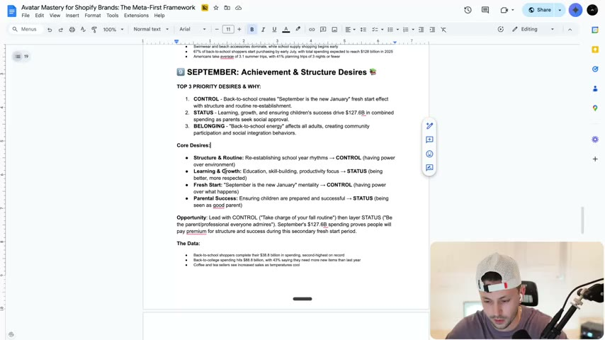

# 62. The Desire Calendar - Part 2
> A month-by-month calendar of which mass desires peak in the US market and why, to be used as a diagnostic when a month underperforms and as a source of messaging tests, not as a replacement for your core angles.

## 🤖 Agent use
- **Use when:** planning ad messaging for a given month or quarter; diagnosing a seasonal dip ("why does July/August/January/February suck?"); creating variations of winners or revivals of dead ads; timing gifting/holiday creative.
- **Inputs → outputs:** the current and next month + product category + current winning/dead ads → the month's top-3 desires, a list of core desires with matching instincts, and 3+ message tests (and inverse tests) mapped to those desires.
- **Rules:**
  - **DO** use the calendar when performance is poor: "come to this and be like, okay, what's going on with people?" then test ads against the rising desires. [04:11]
  - **DON'T** drop your other desires or core angles: "this does not mean that you stop going after all the other desires." [04:11]
  - **DON'T** assume a seasonal ad guarantees results: a "back to school sale" water bottle ad "does not mean you're going to cook"; it only shows where desires are shifting. [15:42]
  - **DO** start seasonal messaging early: people buy a month ahead for Valentine's; "people don't buy gifts on Valentine's Day, they buy gifts for Valentine's Day"; 67% of back-to-school shoppers start by early July; Halloween "has become a whole season". [07:32; 14:55; 11:02]
  - **DO** test the inverse of a desire: if people seek structure and routine, also try messaging for those who miss summer ("we missed summer too"). [08:21]
  - **IF** you sell to a niche that peaks in a month (e.g. supplements in January) **THEN** "don't take your foot off the pedal in December". [13:48]
  - **IF** performance dips in late summer **THEN** consider that spending tightens after big summer expenses (trips, vacations) show up on statements in late August/early September. [05:53–06:41]
  - **DO** create variations of current winners, or revive ads that died, around control and status messaging in the current month. [16:31]
- **See also:** [61. Understanding & Applying Desire](061-understanding-applying-desire-part-1.md) · [63. How To Find Desires](063-how-to-find-desires-part-3.md) · [Market Desires (lesson 9)](009-market-desires.md) · [Customer research stack](../../../../frameworks/customer-research-stack.md) · [Triggering events](../../../../concepts/triggering-events.md)

Lesson page text: only a link to "The Desire Calendar" (Google Doc; exported as the attachment; the Desire Document's "Desire Calendar" tab contains the same material). The DOCX has no embedded images.

## Key ideas

### 1. Why a desire calendar [00:00–01:41]
- "I don't think a lot of people have ever seen" this; he doesn't know if one exists elsewhere. It shows "what desires are peaking and what people are feeling during the year". [00:00]
- Explains why brands "do really, really well in December" and then "January comes and it absolutely sucks", February "getting wrecked", July/August "totally destroyed because they don't really know what to do". [00:00–00:56]
- Basis (instructor claim): "literal biology", e.g. sun exposure; credited to a study by "Alan Sultanic" (Whisper spelling; unverified, his own hedge "I think his name is"). In summer people get more dopamine and make bigger purchases (vacations, cars); in winter, with less dopamine, people crave it and make "a lot of smaller purchases", plus gifts. [00:56–01:41]
- For beginners: "don't let this overcomplicate you"; it is for those who "have bad months" and want to break through. [01:41]

### 2. How to read each month's entry [02:26–03:09]
- Each month has the same structure: **top three desires** (power ranking for that period), **core desires** (specific wants mapped to an instinct), **opportunity** (messaging direction), **data** ("the data for nerd section"). Built from AI deep research with "a pretty intensive prompt" that he "gave guidelines and corrected". [02:26–03:09]
- Use for ads: "you can start to basically optimize your ads towards those kind of core desires that people just have during this period." [02:26]

### 3. Worked example: September [03:09–10:10]
- Top three: **control, status, belonging**. Theme: achievement and structure. "Lead with control... take charge of your fall routine and then layer in some status. Be the parent professional everyone admires." [03:09–05:03]
- "Fresh start effect": "September is the new January". Tests he suggests: routine/restart messaging ("restart your routine", back-to-school routine, "when the kids are gone, you now have time to focus on this"); fresh-start framing ("take back the year", "get the year back on track", "be careful with that messaging"). [05:03; 09:07]
- **Inverse view:** many don't want to return to routine; try copy such as "we missed summer too". [05:53; 08:21]
- **Spending reality:** after summer lake trips/flights, bank statements arrive in late August/early September and "spending starts to tighten up. Not for everyone, but just be aware." (instructor's reasoning, not from the doc's data.) That is why his DMs say "my performance sucks in August". [06:41]
- **Timing:** back-to-school shopping mostly happens earlier: "67% of back-to-school shoppers start purchasing by early July... if you're running back to school September 1st, you missed it." Being early can reach the prepared-mom segment. [07:32–08:21]
- **Learning and growth:** "now's the time to invest in yourself... you were side-questing the last two months, now it's time to lock in for Q4" (his example Evolve ad). [09:07]
- **Parental success:** parents sending kids to college; "a lot of moms are very emotional right now... empty nesting"; if you sell to women about 40–55, the 'kid just went to college' moment matters. [09:07–10:10]
- Lesson: "when you understand how people feel, it helps you market to them better... Best marketing shows that you understand people." [10:10]


*The September block in the doc: top-3 desires (Control, Status, Belonging), core desires mapped to instincts, the "Lead with CONTROL then layer STATUS" opportunity line and the data bullets. [02:30]*

### 4. October to December and January/February [10:10–15:42]
- **October** (status, belonging, control): Halloween "gives you the opportunity even if you don't sell costumes" to position jewelry, health etc. as "look good for this specific event"; identity expression, social belonging at parties, seasonal home/yard decorating, controlled fear (comfort). Start in late September. Money is "going to other things", so you compete with $12.2B of Halloween spend; leverage identity expression and social belonging. [10:10–11:57]
- **November** (belonging, comfort, control): family, "everybody wants to look their best for their family"; value and savings (Black Friday deal hunting, covered "in the Q4 call"); gifting-list preparation: get in front of people (maybe "add this to your list" ads for colder audiences, "not saying I'd recommend it"); gratitude expression. [11:57–13:00]
- **December** (belonging, comfort, status): connection and celebration, $240B "basically spending money on other people". [13:00]
- **January** (control, health, status): fresh-start effect, 35–40% health spending increase (doc claim); supplement/health brands "January should be one of your biggest months". Post-holiday financial discipline helps products framed as taking control. [13:00–13:48]
- **February:** Valentine's and belonging; spending record $27.5B in 2025 (he misread "up from $25.8B" at first and corrected it). Extend to Galentine's, friends, co-workers; if not romantic, "other forms of self appreciation"; can start mid-January. [13:48–14:55]
- March to June: "skip over this"; read the doc. [14:55]

### 5. How to deploy it [15:42–16:47]
- In September the team will "talk more about control and status messaging... structures and routines and growth opportunities and fresh starts and being a great parent." [15:42]
- "Look at your ads through this lens": create variations of current winners, or ads that died out, optimised for control and status messaging. [16:31]
- Sources are listed at the end of the doc for validation. [15:42]

## Steps / framework
1. Identify the current month and the next month (creative needs lead time; Valentine's buying starts a month ahead).
2. Read the month's top-3 desires and core desires in the table below.
3. List 3–6 messaging lines for the first two desires: lead with #1, layer #2 (September: control then status). [03:09]
4. Write at least one inverse test (what the audience resists or misses). [08:21]
5. Match to existing winners/dead ads; produce variations or revivals. [16:31]
6. If the month is weak, check spending effects (post-vacation, post-holiday) before changing the product angle. [06:41; 13:48]

## Examples
- **Back-to-school timing:** "if you're running back to school September 1st... you missed it, bro. They're already in school." 67% start by early July (doc data). [07:32]
- **Halloween for non-costume brands:** jewelry or health brands positioned as "look good for this specific event". [10:10]
- **Evolve ad for September (instructor's own):** "now's the time to get ready... you were side-questing the last two months, now it's time to lock in for Q4." [09:07]
- **Valentine's flexibility:** non-romantic products via "self appreciation" or Galentine's. [14:55]
- **Supplement brands:** January should be a top month, so keep December spend/prep going. [13:48]

## Structured units

### Angles
| Angle | Core desire / pain | Heuristic(s) | Best format | Example line | Source |
|---|---|---|---|---|---|
| Fall routine reset | Control: structure, routine, fresh start | — | Any; "restart your routine" | "Take charge of your fall routine" (doc) | [03:09; doc: September] |
| Be the parent/professional everyone admires | Status | Aspirational identity (derived) | — | "Be the parent/professional everyone admires" (doc) | [03:09] |
| Invest in yourself, lock in for Q4 | Status: learning and growth | — | — | Instructor's Evolve ad idea | [09:07] |
| Missed summer / inverse | Comfort / resistance to routine | — | — | "We missed summer too" (instructor's phrasing: "something like that") | [08:21] |
| Empty-nest mom | Parental success, emotion | — | Targets women ~40-55 | — | [09:07–10:10] |
| Halloween identity | Status, belonging, control | — | Seasonal | Look good for this event | [10:10] |

### Templates
| Template | Use for | Example fill | Source |
|---|---|---|---|
| Lead with <#1 desire>, then layer <#2 desire> | Structuring a month's message | "Take charge of your fall routine" then "Be the parent/professional everyone admires" | doc: September opportunity |

### Rules of thumb
- **DO** use the calendar as a lens when a month underperforms, not as a mandate. [04:11]
- **DON'T** wait for the month to start; "people buy a month ahead". [14:55]
- **IF** your niche is aligned with the month's top desires (supplements in January; family/gifting in Nov/Dec) **THEN** extend spend rather than pausing. [13:48]

## Prompts / templates (verbatim)
The doc's month entries (US market, per the doc "based on comprehensive analysis of US consumer behavior data from 2021-2025"; sources named at the end: "National Retail Federation annual surveys, McKinsey ConsumerWise data, Bureau of Labor Statistics, fitness industry reports, retail seasonality studies"). All figures are the doc's claims, not verified.

Entry structure used for every month:

```
TOP 3 PRIORITY DESIRES & WHY: (ranked 1-3, each with the reason)
Core Desires: (named want -> INSTINCT)
Opportunity: (messaging direction)
The Data: (spend and behaviour stats)
```

| Month | Top 3 (ranked) | Core desires → instinct | Opportunity (doc) | Data (doc claims) |
|---|---|---|---|---|
| Jan: Transformation | 1 Control; 2 Health; 3 Status | Physical transformation → Health; organization/decluttering → Control; financial discipline → Control; career advancement → Status | Target transformation desires when motivation is highest, but keep price points accessible post holiday | 12% of gym memberships start in January; "25-30% increase in enrollment"; 47% spike in gym visits (fresh-start effect); 35-40% rise in health spending; luxury retail has post-holiday fatigue |
| Feb: Relationship & Self-Love | 1 Sex; 2 Belonging; 3 Status | Romantic connection → Sex; platonic love → Belonging; self-love/Galentine's → Sex; social recognition → Status | Expand beyond romantic love to all forms of appreciation and self-care | Valentine's record $27.5B in 2025 (up from $25.8B in 2024); 56% plan to celebrate, avg $188.81; 32% buy for friends and 19% for co-workers (records); 30% rise in dating app activity |
| Mar-Apr: Action & Renewal | 1 Control; 2 Health; 3 Belonging | Home renewal → Control; physical revival → Health; social reconnection → Belonging; fresh start energy (second wave) → Control | "Spring forward" messaging | Home improvement/gardening spend up (McKinsey); 35% plan spring break travel, avg $8,306 in 2025 |
| May: Appreciation & Memorial | 1 Belonging; 2 Status; 3 Comfort | Gratitude → Status; family connection → Belonging; outdoor living → Comfort; memorial reflection → Belonging | Focus on appreciation, family bonds, preparing for summer lifestyle | Mother's Day $34.1B in 2025, avg $259.04; Memorial Day travel record 45.1M |
| Jun: Achievement & Paternal | 1 Status; 2 Comfort; 3 Belonging | Achievement recognition → Status; paternal appreciation → Status + Belonging; freedom/adventure → Comfort; life transitions → Status | Combine achievement celebration with summer preparation | Father's Day $22.4B (doc says "in 2024", second-highest); 70% plan summer vacations, avg $3,471 |
| Jul-Aug: Lifestyle & Preparation | 1 Comfort; 2 Status; 3 Control | Present-moment living → Comfort; looking good for summer → Status; back-to-school preparation anxiety → Control; family harmony → Belonging | Balance "enjoy now" summer messaging with "prepare for fall" planning | 67% of back-to-school shoppers start by early July; $128B total in 2025; 3.1 average summer trips, 41% of trips 3 nights or fewer |
| Sep: Achievement & Structure | 1 Control; 2 Status; 3 Belonging | Structure/routine → Control; learning/growth → Status; fresh start → Control; parental success → Status | Lead with CONTROL ("Take charge of your fall routine") then layer STATUS ("Be the parent/professional everyone admires") | Back-to-school $38.8B (second-highest); back-to-college $88.8B, 43% need more new items; $127.6B combined; coffee/tea sales up |
| Oct: Identity & Seasonal | 1 Status; 2 Belonging; 3 Control | Identity expression → Status; social belonging → Belonging; seasonal transformation (decorating) → Control; controlled fear → Comfort | Halloween is "a whole season": start messaging in September | $12.2B in 2023, $11.6B in 2024; 77% buy decorations ($3.8B), 69% costumes ($3.8B); 47% shop before October (32% in 2014); decorations +42% 2019-2024 ($2.6B to $3.8B) |
| Nov: Gratitude & Preparation | 1 Belonging; 2 Comfort; 3 Control | Family harmony → Belonging; value & savings → Comfort; gifting preparation → Control; gratitude → Status | Bridge gratitude messaging with gift preparation and value positioning | Black Friday online $10.8B in 2024 (+10.2%), 200M shoppers; 73% plan to shop Black Friday; 45% begin holiday shopping in November |
| Dec: Connection & Celebration | 1 Belonging; 2 Comfort; 3 Status | Connection/love via gifts → Belonging; tradition → Belonging; joy and celebration → Comfort; social belonging → Belonging | Peak emotional spending when people prioritise relationships over price | Cyber Monday $13.3B in 2024; holiday season $240.8B; avg $902 per person ($641 gifts, $261 seasonal products) |

Doc summary lists:

```
Spending Intensity Rankings (by month):
1. December: $240.8B total holiday spending
2. August-September: $128B back-to-school/college spending
3. May: $34.1B Mother's Day spending
4. February: $27.5B Valentine's Day spending
5. June: $22.4B Father's Day spending
6. October: $11.6B Halloween spending

Key Behavioral Patterns:
- 45% of consumers start holiday shopping on Black Friday, with 33% starting on Cyber Monday
- 67% start back-to-school shopping in July, 2 months early
- 47% start Halloween shopping before October (up from 32% in 2014)
```

Caveat on the September number: the doc's "$127.6B" equals the $38.8B back-to-school plus $88.8B back-to-college figures (derived: 38.8 + 88.8 = 127.6), i.e. whole-season spending, not spending inside September. The instructor says "$127 billion... people spend that much in September" [03:09]; treat it as a seasonal total.

## Screenshots
Embedded above: September entry [02:30]. Other frames show other months' text already captured in the DOCX.

## How to apply
- [ ] Look up this month and next month in the table; copy the top-3 desires into the brief.
- [ ] Write one line per top-3 desire and one inverse line; keep the original winning angle running.
- [ ] Check whether product timing is already late for the event (back-to-school July; Valentine's January; Halloween September).
- [ ] If sales dip, compare against post-holiday/post-vacation spending before killing an angle.
- [ ] Produce variations of winners, plus revivals of dead ads, for control and status in the current month.
- [ ] Validate any stat before putting it in an ad; none of these numbers were verified in the course.

## Related
- Previous: [61. Understanding & Applying Desire - Part 1](061-understanding-applying-desire-part-1.md) · Next: [63. How To Find Desires - Part 3](063-how-to-find-desires-part-3.md)
- [Market Desires (lesson 9)](009-market-desires.md), which separates permanent from trending desires (Valentine's Day, crypto, AI). [Triggering events](../../../../concepts/triggering-events.md)

## Sources and limitations
- Transcript: [62. The Desire Calendar - Part 2](<../../../../../raw/evolve/start-here/_transcripts/👣 Evolve (Start Here)/62. The Desire Calendar - Part 2 👣 Evolve (Start Here) Evolve.txt>) · Page text: [lesson page](<../../../../../raw/evolve/start-here/_extracted/👣 Evolve (Start Here)/62. The Desire Calendar - Part 2_👣 Evolve (Start Here)_Evolve.html.md>) · Attachment: [The Desire Calendar.docx](<../../../../../raw/evolve/start-here/_extracted/👣 Evolve (Start Here)/62. The Desire Calendar.docx.md>) · Linked doc: [62-document-16SmXmn1FZ](<../../../../../raw/evolve/start-here/_extracted/_linked/google/62-document-16SmXmn1FZ.docx.md>)
- Machine transcription; full recording covered (last segment 16:47 of 16:47). The month data was AI-generated deep research (instructor says so); sources are listed by name only, with no links, and some numbers conflict (January has both a 25-30% enrollment rise and a 47% visit spike; Father's Day is dated 2024 while others are 2025). Whisper heard "Sultanic" for the study's author; unverified.
- Recorded in September (the instructor says "it's September" and talks about Q4 ahead), and data is US-only.
