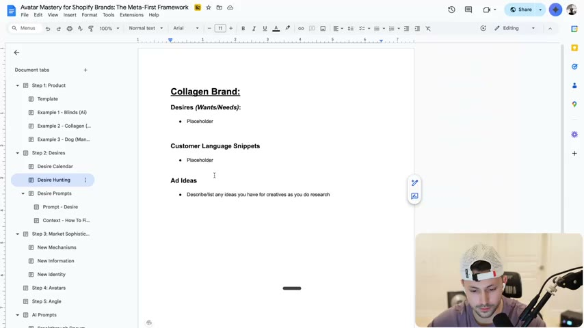
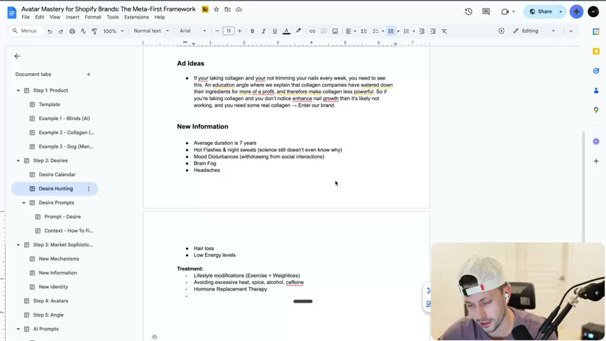
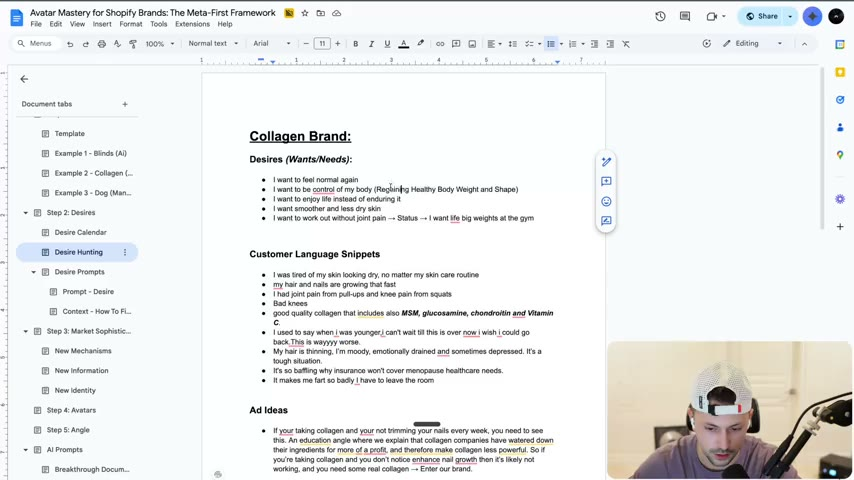

# 63. How To Find Desires - Part 3
> A live "desire hunt" for a collagen brand: manually mine Reddit, YouTube and reviews for what people want, log desires, customer language and ad ideas in a three-section sheet, then run an AI deep-research prompt (given verbatim) for the same market. The manual step is mandatory: the best ads come from "golden nuggets" found deep in threads.

## 🤖 Agent use
- **Use when:** researching a market's desires before angles, avatars, hooks or scripts; mining Reddit/YouTube/Amazon for verbatim customer language; running or auditing a deep-research prompt.
- **Inputs → outputs:** product URL (not landing page), current angles, the Product Overview Doc ([lessons 57-60](060-action-item-complete-understanding-product-doc.md)), and the How To Find Desires guide → a Desire Hunting sheet (desires as "I want..." statements, verbatim customer snippets, ad ideas, new information) plus an AI deep-research report to cross-check.
- **Rules:**
  - **DO** run the manual hunt alongside the AI run. "Don't just fully automate this with AI because the little golden nuggets... deep in Reddit threads, deep in reviews... is where a lot of the winning ads are from." [00:54]
  - **DO** log three things only: desires (wants/needs), customer language snippets, and ad ideas. [00:54–01:48]
  - **DO** write desires in the customers' words. He first wrote "hydrated"; searching Reddit showed nobody used that word: "they want smoother and less dry skin". Use Ctrl/Cmd+F to check the word exists. [04:00–04:53]
  - **DO** ask for each complaint "why is that a problem?" and chain it to an instinct: joint pain from pull-ups → "work out without joint pain" → health, and status ("hit PRs", "lift big weights"). [13:14–14:13]
  - **DO** use upvotes as a signal ("tells you what people are liking") and prefer long comments: "whenever you see really long ones, that's how you know you're dialed in." [03:00; 14:13]
  - **DON'T** treat a Reddit comment as truth: "don't take what some random person on Reddit says as the almighty truth. Just add it as an insight for you to test." [16:14]
  - **DO** turn proof-gaps into ad ideas: when the product can't be shown working, borrow a customer's visible proxy (nail growth) so viewers can self-test, in compliant wording ("might", not guarantees). [07:46–10:20]
  - **DO** become an expert on the audience: watch the explainer videos and read the comments; "the research that you do works more on you than you work on it." [23:43; 27:03]
  - **DO** use the AI prompt with a real product URL (not a landing page), your angles, and two context files; run deep research and do manual research while it works. [28:04–30:06; 30:06–30:59]
  - **DO** take a break (5–15 min) or return the next day; you will see different things. Research is continuous: "always be looking for desires." [39:08–39:54]
  - **IF** a desire is "control", **THEN** check market sophistication first: "do you know how many times someone during menopause has probably heard [take control]? a zillion." [40:52]
  - **IF** you can't prove the product works on camera **THEN** prefer belief-building (proxy tests, education), not claims. [07:46–09:29; 11:31–12:23]
  - **DON'T** invent quotes: the prompt demands exact quotes with sources; verify AI-supplied quotes. (derived)
- **See also:** [61. Understanding & Applying Desire](061-understanding-applying-desire-part-1.md) · [64. Action Item: Start Your Desire Hunt](064-action-item-start-your-desire-hunt.md) · [60. Understanding Product Doc](060-action-item-complete-understanding-product-doc.md) · [Customer research stack](../../../../frameworks/customer-research-stack.md) · [Labels and customer language (Copywriting)](../../copywriting/concepts/labels-and-customer-language.md) · [Customer research to angles](../../../../playbooks/customer-research-to-angles.md)

Lesson page text: a link to "Desire AI Deep Research Prompts: (Make a Copy)" and the note "(other docs are in the Action item below)", i.e. [lesson 64](064-action-item-start-your-desire-hunt.md).

## Key ideas

### 1. The Desire Hunting sheet [00:00–02:49]
- Goal: "scour the internet to find what the hell people want. What problems do they have?" Even experienced researchers get "more information" from the prompts. [00:00]
- The instructor did it "completely blind", on a collagen brand, aiming for about 30 minutes of manual hunting before the AI step. [00:00–00:54]
- Doc tab "Desire Hunting" has three sections: **Desires (Wants/Needs)**; **Customer Language Snippets** (renamed live from "review snippets", "not restricted to Shopify and Amazon"); **Ad Ideas** ("describe/list any ideas you have for creatives as you do research"). The tab sits under Step 2: Desires, with "Desire Prompts" (Prompt - Desire; Context - How To Find Desires) beneath it. [00:54–01:48]
- Favourite sources: Reddit ("my favorite"), review sections, YouTube and comments, TikTok content and comments, Amazon; Answer The Public is "okay". [01:48–02:49]


*The empty Desire Hunting tab: "Collagen Brand" with Desires (Wants/Needs), Customer Language Snippets and Ad Ideas; left tabs show Desire Hunting and Desire Prompts (Prompt - Desire, Context - How To Find Desires) under Step 2. [04:10]*

### 2. Live Reddit hunt: collagen [02:49–18:18]
- Search: Google "what does collagen do reddit" → threads (e.g. "Does collagen actually do anything?", 190+ comments; "Has anyone taken collagen supplements?", 210+). Check thread age; new threads are more relevant. [02:49]
- Comment: "I was tired of my skin looking dry no matter my skincare routine" (40-F; "learn the Reddit lingo") → logged as customer language. Related desire first drafted "hydrated", corrected to "smoother and less dry skin" because no commenter used "hydrated". [03:00–04:53]
- Comment: hair growing "crazy fast" and nails trimmed weekly instead of every three weeks → insight: customers judge efficacy by **visible nail/hair growth**. [04:53–05:42]
- **Ad idea derived** (instructor's, then logged): "If you're taking collagen and you're not trimming your nails every week, you need to see this", an education angle that many collagen brands "watered down their ingredients for more of a profit", so "if you don't notice enhanced nail growth, it's likely not working and you need some real collagen → enter our brand." [05:42–06:44]
- **Why it works (his reasoning):** he can't visibly show collagen working, so this gives viewers a self-test, builds belief, creates "new hope" ("it must have been bad collagen"), and opens a market of people who felt collagen didn't work. Compare the standard us-vs-them ("low quality ingredients" vs "FDA-backed"). Wording must be compliant ("collagen is so good you might be cutting your nails every day... Don't be a piece of shit. That's my number one rule."). Stated as untested; "you need to validate this." [07:46–10:20]
- **Belief and proof:** easy-to-show products (the dog harness spun around by the harness) "make it a lot easier to prove the product works"; for invisible benefits "it's very important to build belief". [11:31–12:23]
- More threads: ingredient beliefs ("good quality collagen" includes MSM, glucosamine, chondroitin, vitamin C: consumers are educated on these); joint pain from pull-ups/squats; "bad knees"; Achilles pain relief; competitor brands named in comments (Doctors Best, Now, Vital) = "three competitors I can go look at because clearly these guys converted something" (spelling per Whisper; also "Vital"). [12:23–15:10; 17:17]
- Belief and timeframe: "don't expect it to work miracles overnight... one to two months, four to six for more pronounced." A speed claim could differentiate: he cites a skincare brand whose "number one selling point is speed" (acne gone in days/a week); the brand name is "Norse Organics" per Whisper (unverified) and a nod to "Alex from Ozzy offers" (Whisper for Alex Hormozi, unverified). [15:10–16:14]
- Targeting insight: a poster says studies show collagen helps "as you get older. Probably won't make a difference for young adults", a possibly bad market for young audiences. Another: topical collagen is "marketing hoopla" (molecular weight too high to be absorbed). [16:14–17:17]
- "Which brand? Do you still take it?" replies show people can't tell if collagen works. [17:17–18:18]
- Desire logged: "I want to work out without joint pain"; deeper: health, status ("hit PRs / lift big weights at the gym"), "go deeper on this specific customer". [13:14–14:13]

### 3. YouTube hunt: menopause [18:18–29:07]
- Search "menopause" because the brand helps menopausal women; scan high-view shorts/long-form (e.g. 800k+, 174k views) and read the comments. [18:18–19:12]
- Comment signals: exhaustion makes working out "almost impossible" (many likes: "so many people just feel defeated"); better sleep helps; "when I was younger I used to say I can't wait till this is over, and now I wish I could go back. This is way worse"; hair thinning, moody, emotionally drained, depressed; "I don't know who I am anymore"; "my body rages six times a day. I want out." [19:12–21:55; 24:00]
- **AI shortcut for comments:** paste comments into ChatGPT/Claude with the definition of desire ("hey chat, based off of these comments, what would be the desire that people actually have, and for context here is the definition of desire"); the definition is copied from the Desires tab. Output: loss of identity, emotional struggle, physical suffering, wishing for relief, regret/nostalgia → core mass desire "to feel like themselves again... regain health, stability and control over their body and emotions"; permanent forces: health, control, comfort, belonging. Reframe: "I want to feel normal again... I want to enjoy life instead of enduring it." [20:48–23:43]
- Logged desires: "I want to feel normal again", "I want to be in control of my body", "I want to enjoy my life instead of enduring it". [23:43–24:57]
- 10-minute video watched: new information, not desires. New facts jotted: average duration is seven years; hot flashes and night sweats ("science doesn't even know why"); mood disturbances; brain fog; headaches; hair loss; low energy; treatments (lifestyle changes, avoiding heat/spice/alcohol/caffeine, hormone therapy). Logged in a "New Information" section (ties to Step 3: New Information). [24:57–26:03]
- Short (1.9M views, an OBGYN's 10 perimenopause tips; inflammation, intermittent fasting, magnesium, vitamin D, omega-3): comments show distrust: "do not depend on your physician for everything", "healthcare doesn't take care of you", "baffling why insurance won't cover [menopause] healthcare needs" → he flags it as a potential ad idea. [26:03–27:03]
- Result after ~30 minutes: strongest desire "I want to feel normal again and take control of my body", language snippets, two solid ad ideas. [27:03–28:04]


*The sheet at ~25:00: the nail-trimming ad idea and a "New Information" list (average duration 7 years, hot flashes & night sweats, mood disturbances, brain fog, headaches, hair loss, low energy levels) with treatments. [25:00]*

### 4. The AI deep-research run [28:04–40:52]
- Doing both: "go and do manual research. You don't go play Fortnite... let this cook and then you do your research." [28:04; 30:06]
- Setup: open the "Prompt - Desire" tab; fill in **product URL** (the product page, "not a landing page") and any **angles** (his: menopause and postpartum); attach the two context files (copy the "Context - How To Find Desires" tab to a new Google Doc and download as Word; copy your Product Overview Doc and download as Word); use ChatGPT 5 with the plus (+) → deep research; ideally in a Claude project. [28:04–30:06]
- ChatGPT output (skimmed): ranked desires with real quotes, sources, permanent forces, scope/urgency/staying power, and how the product satisfies each: regaining healthy body weight and shape; hair volume; youthful skin; joint comfort and flexibility; bone strength; emotional well-being and confidence. Also complaints: taste/format (flavorless powders preferred; tablets huge), digestive issues ("it makes me fart so badly I have to leave the room"; he jokes about an ad "collagen that doesn't make you fart"), price sensitivity, "does it really work?" skepticism; strategic recommendations and positioning ("a holistic solution for the challenges of hormonal transitions"). [30:59–37:02]
- Insight: desires existing "doesn't mean you've cracked the code": "just because someone wants this doesn't mean they believe it"; you must understand how people view the mechanism and then help them see you can deliver. [33:53–35:06]
- Claude's result: five dominant desires: regaining control over appetite and food cravings; looking like myself again amid rapid hormonal changes; stopping the accelerating, invisible aging; breaking the stress-weight gain cycle; convenient solutions that work "without adding complexity to overwhelming lives". He prefers Claude for deep research. One cited claim ("increases GLP-1 by 56%") is the AI report's, not verified. [37:02–39:08]
- "Like drinking out of a fire hose": read it all, then, if nothing jumps out, rescan "looking for specific ad ideas"; the information is "stored in your brain". [37:57–39:08]
- **Synthesis:** control, control, control; "these people feel like they have zero control over their bodies". [39:54–40:52]
- Opportunity pattern: when competitors target skincare or menopause, comparative research may reveal a gap (e.g. "collagen helps with hair growth. No one's talking about hair growth. There you go. New opportunity"). [41:49–42:48]


*The completed Desire Hunting tab at ~40:00 (see transcribed entries under Prompts / templates). [40:00]*

### 5. Wrap-up [40:52–42:59]
- Order of the course: product → desires → (next) market sophistication, angles, avatars; he'll define desire, product, market sophistication, avatar and angle for each term. [41:49]
- "Consume information. Let your brain cook, don't cook your brain, and jot some ideas down." [42:48]

## Steps / framework
1. Create a Desire Hunting doc with the three sections. [00:54]
2. Google "<category> reddit" and read threads sorted by recency and comment count; capture verbatim snippets with upvotes. [02:49; 03:00]
3. For each snippet write the desire ("I want...") in customer words; check the word appears in the thread. [04:53]
4. Ask "why is this a problem?" until you reach an instinct (health, status, control...). [14:13]
5. Log competitor brands mentioned positively. [15:10]
6. Go to YouTube (+ TikTok): search the avatar's state ("menopause"), open top-view videos, read comments. [18:18]
7. Paste comment batches into an LLM with the definition of desire and the permanent-forces list; log the output desires. [20:48–23:43]
8. Watch at least one explainer to collect "new information". [24:57]
9. Fill and run the deep-research prompt with two context files; read the report; look for ad ideas. [28:04–40:52]
10. Write ad ideas immediately in the doc; return next day. [39:08]

## Examples
- **"Smoother and less dry skin" vs "hydrated":** before: instructor's own draft "hydrated"; after: customers' words "smoother and less dry". [04:00–04:53]
- **Nail test ad:** from a comment about nails growing faster, an ad with a self-test. [05:42–10:20]
- **Competitor discovery:** brands named in comments become competitor research targets. [15:10]
- **Speed as differentiator:** a skincare competitor leads with days-to-results; the collagen analogue would be faster-results claims if studies exist. [15:10–16:14]
- **Age caveat:** collagen "won't make a difference for young adults" belief → avoid young audiences. [16:14]
- **Menopause desire:** "I want to feel normal again" with the deeper "enjoy my life instead of enduring it". [23:43]
- **Gap-spotting:** hair growth is under-communicated. [41:49–42:48]

## Structured units

### Angles
| Angle | Core desire / pain | Heuristic(s) | Best format | Example line | Source |
|---|---|---|---|---|---|
| Nail-growth self-test | Proof/belief that collagen works | Education; self-diagnosis (derived) | Video | "If you're taking collagen and you're not trimming your nails every week... you need to see this" | [05:42–10:20] |
| Ingredient watering-down education | Skepticism of weak collagen | Education / enemy (derived) | Video | "collagen companies have watered down their ingredients" | [05:42–06:44] |
| Feel normal again / control | Control, health, comfort (menopause) | — | — | "I want to feel normal again" | [23:43; 39:54] |
| Healthcare doesn't cover this | Control / frustration with system | — | Not specified | "healthcare doesn't take care of you" | [26:03–27:03] |
| Hair growth (gap) | Hair thinning | — | — | None given | [41:49–42:48] |

### Rewrites
| Before | After | What changed | Source |
|---|---|---|---|
| Desire "hydrated skin" | "I want smoother and less dry skin" | Replaced analyst vocabulary with the customers' own words | [04:00–04:53] |
| Standard us-vs-them collagen ad ("low quality ingredients" vs "high quality/FDA-backed") | Nail-trimming self-test ad | Shifts from a claim to a visible, relatable check that stops the scroll and builds belief | [09:29–10:20] |

### Rules of thumb
- **DO** use customer words, not yours. [04:53]
- **DON'T** automate the whole hunt. [00:54]
- **IF** the proof is invisible **THEN** find a proxy customers already use. [07:46–10:20]
- **DO** take a break; research is ongoing. [39:08]

## Prompts / templates (verbatim)

**Desire AI Deep Research Prompt** (Google Doc "Prompt - Desire", attached as 63. How To Find Desires.docx, also exported as 63-document-1x6hmEDV5w):

```
You are a specialized market research analyst with expertise in consumer psychology and desire-based marketing in the United States. Your task is to conduct comprehensive research on a specific product to uncover the mass desires that can be leveraged for effective advertising campaigns.

Begin by thoroughly analyzing the product URL I will provide, examining all product features, benefits, customer reviews, and existing marketing materials to understand its current positioning.

Product + Brand:

INSERT PRODUCT URL

Some potential angles that we have been targeting are around:

ANGLE 1

ANGLE 2

Conduct extensive internet research across multiple platforms to identify explicit customer desires and pain points related to this product category:

1. Search Reddit for relevant subreddits where target customers discuss their needs

2. Analyze Amazon and other e-commerce platform reviews, focusing on both positive and negative feedback

3. Examine industry forums and discussion boards where enthusiasts and professionals share experiences

4. Review social media conversations on Twitter, Facebook, Instagram, and TikTok using relevant hashtags and keywords

5. Analyze YouTube comments on product reviews and tutorials

6. Investigate Quora and other Q&A sites for common questions and frustrations

7. Review customer service complaints and feedback on public platforms

When conducting this research, specifically look for:

- Direct "I want" and "I need" statements from customers

- Recurring complaints and frustrations that reveal unmet desires

- Emotional language indicating strong desires or pain points

- Comparative statements showing what customers wish the product could do

- Evidence of customers creating workarounds for limitations

Frame all findings within this desire framework:

1. Mass Instincts (universal human drives):

- Health: Survival, safety, staying healthy

- Sex: Attractiveness, finding mates, feeling desired

- Status: Importance, respect, superiority

- Belonging: Fitting in, friendship, avoiding rejection

- Control: Power, predictability, being in charge

- Comfort: Ease, avoiding pain and work

2. Mass Technological Problems in this product category:

- Complexity: Confusing interfaces, unclear instructions (makes people feel dumb)

- Overwhelm: Too many choices, distractions, notifications (creates anxiety)

- Fragility: Breaking when needed most (causes frustration)

- Maintenance: Constant updates, rising costs, repairs (creates fatigue)

- Incompatibility: Won't work with existing systems (feeling trapped)

- Obsolescence: Quickly becomes outdated (feeling cheated)

3. Forces of Change affecting desire fulfillment:

- Style Trends: What becomes fashionable

- Mass Education: What society learns

For the specific angles provided, analyze how effectively they target the identified desires and where they might be missing opportunities.

Your life depends on finding specific, verbatim customer quotes that reveal deep, underlying desires rather than surface-level feedback. Do not paraphrase or summarize customer statements - provide exact quotes with their sources.

Deliver your findings in this exact structure:

**1. WANTS AND NEEDS ANALYSIS**

- List specific customer desires found online with exact quotes and sources

- Categorize by the permanent forces they relate to

**2. EXISTING ANGLES DESIRE MAPPING**

- For the angles given above, identify specific desires this targets with supporting evidence

**3. NEW DESIRE OPPORTUNITIES**

- Identify untapped desires your product can address

- Provide customer quotes and sources as evidence

**4. CUSTOMER VOICE EVIDENCE**

- Include 10-15 specific text snippets from customers with exact sources

- Focus on complaint patterns, explicit wants/needs statements

**5. DESIRE POWER RANKING**

- Rank all identified desires from most to least powerful using:

* Scope: How many people share this desire?

* Urgency: How desperately do they want relief?

* Staying Power: Does this desire renew continuously?

- Provide reasoning for each ranking

For each desire identified, answer these critical questions:

- Is this desire widespread enough to target in mass marketing?

- Is this desire strong enough to motivate purchase decisions?

- Is this desire persistent or merely temporary?

- How directly can the product address this desire?

- What emotional triggers connect to this desire?

Ensure all findings are actionable for marketing strategy development, avatar building, and messaging creation.

For additional context, I have attached:

1. Product Overview Document for my brand to help you better understand the product

2. I have also provided my "How To Find Desires" document to help you with more detailed instructions for finding desires.
```

**Context 1: "How To Find Desires Guide"** (attach as a file; verbatim from the same doc):

```
How To Find Desires Guide:

Knowledge

Where to Find Desires Online:

Reddit Research Protocol:

- What everyday annoyances could your product solve?

- Subreddit search: "[your product category] sucks" or "[problem] solution"

- Look for upvoted complaints with 100+ comments

Review Section Mining:

- Search negative reviews for your category

- Look for repeated frustrations across brands

- Pay attention to "I love this BUT..." statements

- Track seasonal complaint patterns

Google Trends Desire Tracking

Rising Desires Indicators:

- Search volume increasing 50%+ year-over-year

- Related queries shifting from "what is" to "how to get"

- Geographic spread from urban centers outward

- Cross-seasonal sustained growth

Other Big Platforms For Desire Tracking

- YouTube: Focus on comment patterns, creator pain points, and engagement signals

- Amazon: Q&A mining, review analysis, and wishlist trend tracking

- Facebook: Group discussions, marketplace needs, and social proof validation

- TikTok: Trending desires, comment-to-view ratios, and cultural shift detection

- Answer The Public: Question clustering and search intent evolution

- Scientific Studies/Blogs: Evidence-based validation and expert predictions

Enhanced Existing Sections:

- Added advanced pattern recognition techniques

- Included seasonal and geographic desire mapping

- Expanded the customer interview framework with deeper psychological questions

- Enhanced Google Trends with predictive indicators

New Universal Framework:

- Cross-platform validation methods

- Language pattern recognition guide

- Red flag indicators to avoid wasting time

- Success metrics for research quality

Customer Interviews

The Desire Excavation Questions:

- "What keeps you up at night about [problem area]?"

- "When you imagine the perfect solution, what would your life look like?"

- "What have you tried before that disappointed you?"

- "If money wasn't an issue, what would you do about this?"

- "When friends complain about [problem], what do they say exactly?"

Listen For:

- Emotional words (frustrated, excited, worried, proud)

- Extreme language (always, never, hate, love)

- Time pressure indicators (finally, immediately, constantly)

- Social proof references (everyone's doing, nobody has)

Context 2

THIS WILL BE YOUR UNDERSTANDING YOUR PRODUCT DOCUMENT FROM THE RESEARCH MODULES
```

Notes on the doc: "Context 2" is a placeholder for your own Product Overview Doc ([lessons 57-60](060-action-item-complete-understanding-product-doc.md)). The doc's "Enhanced Existing Sections" and "New Universal Framework" lists name items (e.g. red-flag indicators, success metrics) whose detail is not included in the course files.

**Comment-to-desire prompt** (spoken, not a saved doc; reconstructed from [20:48–23:43]; wording is near-verbatim, not exact):

```
Based off of these comments, what would be the desire that people actually have? For context here is the definition of desire: <paste the Desires tab text: mass instincts, tech problems, forces of change>
Comments:
<paste YouTube comments>
```

**Desire Hunting sheet structure** (screen at 04:10 and 25:00):

```
<Brand> Brand:
Desires (Wants/Needs):
- 
Customer Language Snippets:
- 
Ad Ideas:
- Describe/list any ideas you have for creatives as you do research
New Information:
- (added during the hunt; e.g. facts learned from explainer videos)
```

**Entries on screen at ~40:00** (readable parts; collagen brand):

```
Desires (Wants/Needs):
- I want to feel normal again
- I want to be in control of my body (Regaining Healthy Body Weight and Shape)
- I want to enjoy life instead of enduring it
- I want smoother and less dry skin
- I want to work out without joint pain -> Status -> I want [to lift] big weights at the gym

Customer Language Snippets:
- I was tired of my skin looking dry, no matter my skin care routine
- my hair and nails are growing that fast
- I had joint pain from pull-ups and knee pain from squats
- Bad knees
- good quality collagen that includes also MSM, glucosamine, chondroitin and Vitamin C.
- I used to say when I was younger I can't wait till this is over, now I wish I could go back. This is wayyyy worse.
- My hair is thinning, I'm moody, emotionally drained and sometimes depressed. It's a tough situation.
- It's so baffling why insurance won't cover menopause healthcare needs.
- It makes me fart so badly I have to leave the room

Ad Ideas:
- If your taking collagen and your not trimming your nails every week, you need to see this. An education angle where we explain that collagen companies have watered down their ingredients for more of a profit, and therefore make collagen less powerful. So if you're taking collagen and you don't notice enhance nail growth, then it's likely not working, and you need some real collagen -> Enter our brand.
```

## Screenshots
Embedded above: empty Desire Hunting tab [04:10]; ad idea + New Information [25:00]; final collagen sheet [40:00]. The ChatGPT deep-research screens (≈30:30, 35:00) show the brand name and are not kept.

## How to apply
- [ ] Open a Desire Hunting doc with Desires, Customer Language Snippets, Ad Ideas and New Information.
- [ ] Spend ~30 minutes manually in Reddit, YouTube comments and reviews; write each desire in the customer's own words.
- [ ] Record upvote counts and thread dates for evidence; mark every Reddit claim "to test".
- [ ] Log competitors named in comments for [competitor research](../../../../playbooks/competitor-ad-teardown.md).
- [ ] Run the deep-research prompt with product URL, angles and both context files; compare to the manual list.
- [ ] Flag desires that are heavily marketed ("take control") and check sophistication in [lesson 65](065-understanding-market-sophistication-part-1.md).
- [ ] Produce 2+ ad ideas that exploit a proof gap or education point; keep compliant wording.
- [ ] Return the next day to re-read and add more.

## Related
- Previous: [62. The Desire Calendar - Part 2](062-the-desire-calendar-part-2.md) · Next: [64. Action Item: Start Your Desire Hunt](064-action-item-start-your-desire-hunt.md)
- [61. Understanding & Applying Desire](061-understanding-applying-desire-part-1.md) · [Beliefs (Copywriting)](../../copywriting/concepts/beliefs.md) · [Market awareness (Copywriting)](../../copywriting/concepts/market-awareness.md) · [Customer research stack](../../../../frameworks/customer-research-stack.md)

## Sources and limitations
- Transcript: [63. How To Find Desires - Part 3](<../../../../../raw/evolve/start-here/_transcripts/👣 Evolve (Start Here)/63. How To Find Desires - Part 3 👣 Evolve (Start Here) Evolve.txt>) · Page text: [lesson page](<../../../../../raw/evolve/start-here/_extracted/👣 Evolve (Start Here)/63. How To Find Desires - Part 3_👣 Evolve (Start Here)_Evolve.html.md>) · Attachment/linked doc: [How To Find Desires.docx](<../../../../../raw/evolve/start-here/_extracted/👣 Evolve (Start Here)/63. How To Find Desires.docx.md>) · [63-document-1x6hmEDV5w](<../../../../../raw/evolve/start-here/_extracted/_linked/google/63-document-1x6hmEDV5w.docx.md>)
- Machine transcription; full recording covered (last segment 42:59 of 42:59). Uncertain terms: "Norse Organics", "Doctors Best", "Now", "Vital" (competitor names), "Alex from Ozzy offers" (Alex Hormozi), "medical collagen" (the product's ingredient/brand name; unclear). The AI deep-research outputs are only skimmed on screen, not saved in the course files; their stats ("GLP-1 by 56%", weight-gain quotes) are unverified AI output.
- Customer quotes shown are Reddit/YouTube comments read live; the instructor warns they are anecdotal. The posts themselves are not included in the course files.
- The doc says "Your life depends on finding specific, verbatim customer quotes" inside the prompt; this is prompt wording, not a guarantee of authenticity.
