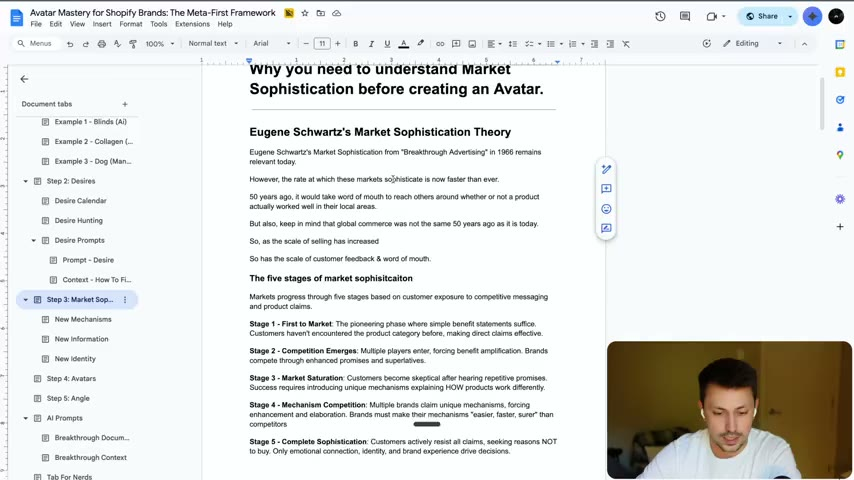
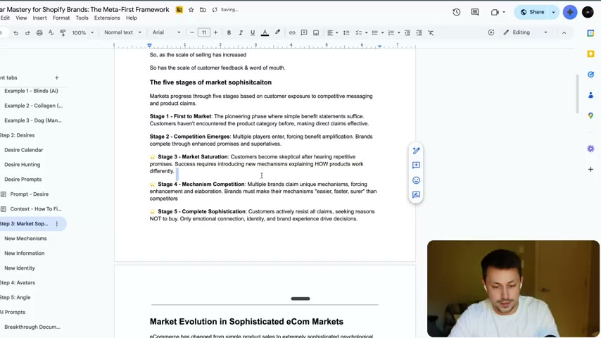
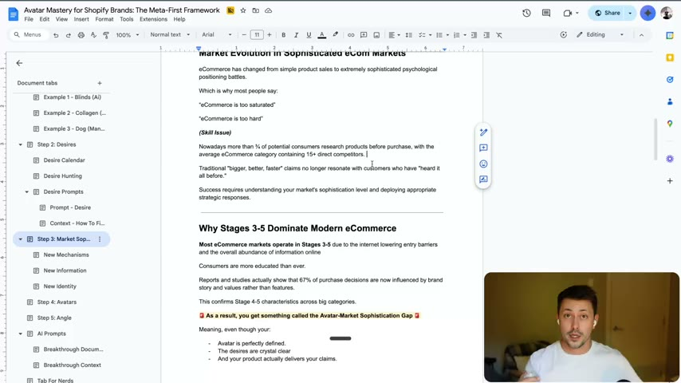
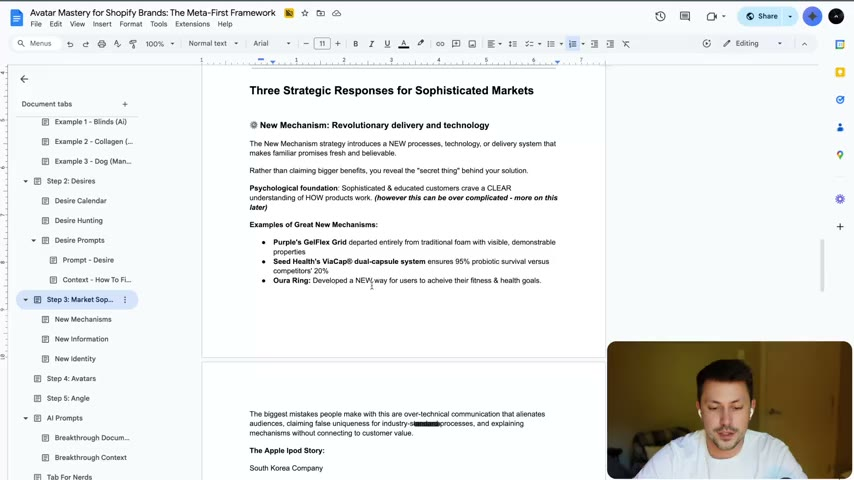
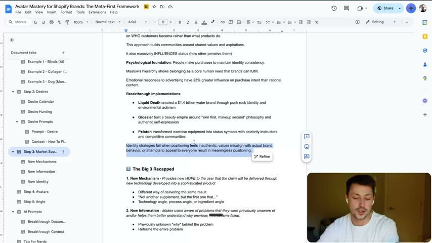

# 65. Understanding Market Sophistication - Part 1
> E-commerce markets sit in Schwartz stages 3-5, where customers have heard every claim, so ads only break through with one of three strategic responses (new mechanism, new information, new identity); knowing this explains why "good product + clear desire + defined avatar" can still produce ads that do not scale.

## 🤖 Agent use
- **Use when:** diagnosing why ads for a product with a real desire and a clear avatar still fail; choosing the strategic lever (mechanism, information, identity) before writing hooks or angles; deciding what to research for a saturated category.
- **Inputs → outputs:** product, category, what competitors already claim → a decision on which of the three responses to pursue and what to research for it (feeds [66](066-how-to-find-apply-new-mechanisms-part-2.md), [68](068-how-to-find-apply-new-information-part-3.md), [70](070-how-to-find-apply-new-identities-part-4.md)).
- **Rules:**
  - **DO** assume the market is sophisticated (stage 3, 4 or 5). "You are likely in stage three, four or five... Just know that you're in a sophisticated market and that's the TLDR." [10:43]
  - **DON'T** spend effort labelling the exact stage. "You don't need to be thinking, oh, did I make this a stage three? ... don't overcomplicate it." [10:43]
  - **DON'T** test sophistication levels as an ad variable. "You do not test different levels of sophistication. Your sophistication just exists." [17:47]
  - **DON'T** confuse sophistication with market awareness. "This is not market awareness." [17:47] (see [10. Market Awareness](010-market-awareness.md), [market awareness concept](../../copywriting/concepts/market-awareness.md))
  - **DO** pick at least one of the three responses: new mechanism, new information, new identity. [18:39; 25:00; 30:24]
  - **DON'T** rely on "bigger, better, faster" claims; they "don't really resonate like they used to anymore". [12:20]
  - **DO** explain a mechanism in plain words a non-expert gets instantly. Apple's "a thousand songs in your pocket" beat the Korean inventor's technical MP3 language. [22:38-24:29]
  - **DON'T** use surface-level education ("your shoulder hurts because you're old"). Go deep or don't educate. [29:30]
  - **IF** a mature category's mechanism genuinely works and is new **THEN** the market "circles back" to stage 3 where new mechanisms run the show (e.g. Ozempic in weight loss). [08:13]
  - **IF** you are a beginner **THEN** avoid super-sophisticated products at first, but expect to become a better marketer by selling into them. [16:09]
  - **IF** an ad scales fast with no skill behind it **THEN** suspect a new mechanism or an early-stage market, not durable skill; expect decay as word spreads. [16:55; 04:22]
- **See also:** [12. Market Sophistication](012-market-sophistication.md) (earlier slide version) · [66. New Mechanisms](066-how-to-find-apply-new-mechanisms-part-2.md) · [68. New Information](068-how-to-find-apply-new-information-part-3.md) · [70. New Identities](070-how-to-find-apply-new-identities-part-4.md) · [Unique mechanism (Evolve Copywriting)](../../copywriting/concepts/unique-mechanism.md) · [Authority in ads](../../copywriting/concepts/authority-in-ads.md)

Lesson page text: only a link to the "Market Sophistcation Document" (Google Doc, exported; identical to the attached docx). The doc is a tab ("Step 3: Market Sophistication") of the master doc "Avatar Mastery for Shopify Brands: The Meta-First Framework".

## Key ideas
### Why this matters: sophistication explains "why e-commerce is hard" [00:00-01:19]
- The instructor promises a simple explanation. Without it, "it is extremely hard to compete in sophisticated markets". "If you've ever heard the word saturated, that's essentially what market sophistication is." [00:00]
- The course builds piece by piece: product, desire, market sophistication, then avatars, then angles. [00:00; 00:41]
- Source theory: Eugene Schwartz, 1966 (the doc names "Breakthrough Advertising"). The fundamentals still apply; only the vehicle changed (newspapers, magazines, direct mail then; social media now). [00:41-01:19]

### Markets now sophisticate faster than ever [01:19-05:39]
- 50 years ago a bad experience travelled by word of mouth only, and rarely reached strangers (his plant-based gum example). [01:19-03:00]
- Now e-commerce lets you sell globally, and "so has customer feedback and word of mouth": TikTok and Reels can tell millions a product is bad; Reddit threads answer "what is this product like". [03:00-03:35]
- Consequence: brands hit "a couple hundred thousand dollars a month" in Nov/Dec or on an early product, then "six months later... my ads aren't working". The product had low sophistication; exposure raised it. "What may have taken six years or at least three years now is happening in three months or six months." [03:35-04:54] (instructor claim, no data)
- Side point: "you want to be a good marketer more than you want to be good at finding products." [03:35] Also: a great product helps scale, "but at some point, because of market sophistication, it's going to become harder to sell", and without marketing skill you are "back where you are right now". [04:54]
- When exposed, the market learns either that a better mechanism exists or that your ads stop working because other sellers and options now exist. [04:54]

### The five stages, as taught [05:39-10:43]
Slide/doc stage names: 1 First to Market, 2 Competition Emerges, 3 Market Saturation, 4 Mechanism Competition, 5 Complete Sophistication. Stages 3-5 are starred in the doc.

| Stage | Customer state | What the ad does (video) | Instructor's example |
|---|---|---|---|
| 1 First to market | Never seen the category | "Here's the product." Simple benefit statement suffices (doc) | AI "is pretty first to market"; first gas station in town can charge $20 a gallon [05:39; 06:37] |
| 2 Competition emerges | Competitors appear | "My product's better than Bob's"; talk benefits | Second gas station "mine's cheaper... my gas is better" [06:37] |
| 3 Saturation | "Skeptical after hearing a lot of claims, a lot of promises" | Need a unique or, better, **new mechanism** explaining how the product differs [07:30] | Purple, Ozempic (below) |
| 4 Mechanism competition | Many mechanisms claimed | Claim yours is "better... faster, easier"; "you just basically one up people" [09:01]. Doc: "easier, faster, surer" | "faster mechanism than traditional mechanisms like mine" |
| 5 Complete sophistication | "Actively resist all claims, seeking reasons NOT to buy" (doc) | "You really have to get into identity marketing" [09:56] | Fashion: "shirts are shirts"; a self-cleaning shirt would be a new mechanism [09:56] |

- The instructor says stages 3-5 are "where all of the markets are for 99.9% of people in e-commerce". Stages 1-2 can be ignored. A product image that "is absolutely ripping" in a stage-1 feel "just means you found a new mechanism". [05:39-07:30] (instructor claims)
- **Circle-back rule:** even in stage 4-5, "if a new mechanism comes out that actually does work, essentially markets will circle back into stage three". Example: weight loss is "probably stage five", yet Ozempic "was this new way to get weight loss. Again, that same old desire." Marketers now borrow its credibility ("nature's Ozempic", "goes great with Ozempic"). [08:13-09:01]
- Stage 5 realism: people have "heard that like lose weight in 20 days... tons of times", so "we need to find ways to be more creative". [10:43]

### Why e-commerce is stage 3-5 [11:24-13:47]
- "It's just a skill issue." More than 75% of potential customers research before buying (doc: "more than ¾... with the average eCommerce category containing 15+ direct competitors"). Impulse "photo of a water bottle" first-to-market selling (2015-2016 style) is largely gone. [11:24-12:20] (instructor/doc claims, no source)
- Internet lowered entry barriers and made information abundant; "67% of purchase decisions are now influenced by brand story and values rather than features" (said to come from "deep research that we did"; doc repeats it, no source). [12:59]
- Making basic desire-based claims anyone can make puts you "ahead of some people", but you must also check "what are the claims that are being made out there". [12:20]

### The Avatar-Market Sophistication Gap [13:47-15:21]
- Even with a perfectly defined avatar, crystal-clear desires and a product that really delivers ("this literally helps you lose weight", "grow back your hair"), ads fail if you "fail to communicate with your avatars the right way". "Come and get it. No one believes you." [13:47]
- Customers have heard the claims "not just once, not just twice but like a hundred times". Without this awareness you scratch your head saying "I'm going after the desires, I know my person... I can't scale". [14:32]
- A truly great product can still spread by word of mouth (Ozempic), but you cannot count on it. [13:47-14:32]

### Four things to note (doc "Important Things To Note") [15:21-18:39]
1. **Facebook gets extremely hard when you have no true USPs**; a generic product facing many beliefs that products like it don't work is the hardest case for a beginner. [15:21]
2. **Bad marketers get rich quick** with a new mechanism or an early-stage market ("5K days, 10K days, 15K days... zero skillset") because word hasn't spread that the mechanism does or doesn't work. A trend like Dubai chocolate (Google Trends spike) is a new-to-market product with strong word of mouth, not a mechanism; "it doesn't mean sell Dubai chocolate". [16:55]
3. **Don't test it.** Sophistication exists; you don't A/B stage 3 vs stage 4. [17:47]
4. **It is not Market Awareness.** [17:47; doc item 4]
- Why sophisticated products still pay: "a product is sophisticated for a reason... a lot of people want it but if you know how to market it the right way you can make a ton of money." Beginners should start less sophisticated, but trying sophisticated markets builds skill. [16:09]
- "I would rather be a great marketer than anything else because if you're a great marketer, you can sell anything." [17:47]

### Three strategic responses [18:39-37:11]
**1. New mechanism** [18:39-25:00]
- Introduce "new processes, new technology, or some kind of new something... that most consumers have not seen". It "makes familiar promises fresh and believable" and "revives brands" by giving people hope. Instead of claiming bigger benefits, reveal "this one thing is what's actually going to make this work for you". [18:39-19:29]
- Psychology: sophisticated customers want a clear understanding of how the product works, but "you don't want to make people feel dumb" or alienate with jargon. [20:13]
- Mistakes (doc): over-technical communication, claiming false uniqueness for industry-standard processes, explaining a mechanism without connecting to customer value. Doc also says a new mechanism needs R&D, patent or trade-secret protection, technical communication capability and demonstration/proof systems.
- Mechanism can be a specific ingredient or "a specific way that you do things", not only a new product; "there may be new mechanisms in your product that you're just not talking about". The instructor promises an example where a brand found one it had not seen. [22:38] (that example appears in [66](066-how-to-find-apply-new-mechanisms-part-2.md))
- **Apple iPod story:** a Korean company invented MP3 and pitched technical language ("download... in what device?"). Apple said "a thousand songs in your pocket" and "boom, everybody gets it" versus a Walkman's "maybe 20 or 30". Lesson: clear communication of the mechanism. Source: a Korean client of the agency told him this story. [23:36-25:00] (instructor anecdote; the doc says "South Korean company first created the MP3", unverified)

**2. New information** [25:00-31:18]
- For people who can't do product R&D: "anybody can do" it "because education is powerful". You educate, and become an authority rather than "some random guy saying buy my stuff". [25:00-25:57]
- Helps people understand problems, solutions, why earlier solutions failed and root causes, "before they actually position their product". Makes the later claim believable: this "builds belief". [25:57-26:45]
- Principle: **reciprocity** ("if I just bought you a Ferrari, you might feel like you owe me something"); if you help, people infer the claim is also true. Plus "problem awareness creation" for unaware avatars. [27:25-28:15]
- It's usually delivered through video ads. It is "not a new mechanism. It's just new information." [28:15]
- Examples: **AG1** ($5M clinical studies, educational content on 75 ingredients, "$600 million business" per instructor/doc); **The Ordinary** (radical ingredient transparency, products named after actives and concentrations); **Ritual** (supply-chain transparency, interactive ingredient maps). He calls them "three supplement brands" although The Ordinary is skincare (his misstatement; doc is correct that it is skincare). [28:15-29:30]
- Requirements: real expertise, deep research "not with Claude, not with GPT... you actually go and spend time to deeply understand your customers" and why solutions fail; translate "boring" abundant information into simple, clear, comprehensive messaging. No surface-level education. [28:57-29:30]
- Customers are educated, but "you can be an expert". Anecdote: Evolve members earning "200K a month" who "think they know everything" see him as an expert after learning something new, "so when I tell people something the next time... they listen." [29:30-30:24]
- Doc: needs "subject matter expertise, content creation resources, educational platform development, and long-term commitment to authority building".

**3. New identity** [31:18-34:08]
- Buying driven by "who they become as a result of using your product", not just the result. Often seen as brand-only but it works at product level. "Selling more than what the product actually is. It's what the product represents." [31:18; 34:52]
- Identity "massively influence[s] status" (how others perceive the customer). Examples: his Ray-Ban AI glasses ("people are going to be like, damn, those are cool"), iPhone vs Android, Mac vs Windows ("business bro... entrepreneur kind of vibe"), Nike and Michael Jordan, Rolex ("people spend 50, $60,000... the identity"). [31:18-34:08]
- Brands: **Liquid Death** (punk-rock, environmental activism; "water in a can"; the doc says "$1.4 billion"), **Glossier** ("skin first, makeup second"), **Peloton** (bikes with screens, a new mechanism, plus celebrity instructors and influencers made it a status symbol). "This is selling air." [33:24-34:08]
- Doc: identity strategies fail when positioning feels inauthentic, values misalign with real brand behaviour, or when trying to appeal to everyone.
- Doc: needs brand strategy expertise, influencer relationships, authentic storytelling. Instructor: new identity is "probably the hardest one"; for most it means choosing a specific avatar and relating to them (see [70](070-how-to-find-apply-new-identities-part-4.md)). [35:44]

**Recap** [34:08-37:11]
- Mechanism gives new **hope**; information makes people aware of things they didn't know, so they trust you and see you as an authority; identity builds **relatability**. [34:08-34:52]
- Strong brands stack all three. Liquid Death: mechanism (water in a can), information ("we're destroying our world by using plastic bottles"), identity ("looks like you're hardcore drinking beer"). Purple and HexClad likewise. "A lot of times new mechanisms have new information... the information that follows is here's why" (the MP3 example), then identity builds through association or specific avatars. [36:32-37:11]
- Follow-ups: 66 mechanisms, 68 information, 70 identity/avatars (step 4). He recommends "Sean's product research module" for R&D-style mechanism discovery. [35:44; 37:11]

## Steps / framework
1. Accept the market is stage 3-5. Do not spend time labelling the stage. [10:43]
2. List claims already made in the category (check what competitors say). [12:20]
3. Choose a response, in the instructor's order of accessibility: new information (all can do), new mechanism (needs a real product difference; can be an ingredient or process), new identity (hardest; at your stage = a narrower avatar). [35:44]
4. If mechanism: run the finder prompt ([66](066-how-to-find-apply-new-mechanisms-part-2.md)). If information: run the finder prompt and fact-check ([68](068-how-to-find-apply-new-information-part-3.md)). If identity: build a specific avatar ([71](071-the-evolve-avatar-training.md)).
5. Communicate it in plain language ("a thousand songs in your pocket"). [23:36]
6. Stack: new mechanisms usually need new information to explain "why", and an identity to attach to. [37:11]

## Examples
- **Gas stations** (stages 1-2): only station charges $20 a gallon; once Jerry opens across the street you compete on price and quality. [06:37]
- **Weight loss and Ozempic:** stage 5 desire, new mechanism returns market to stage 3. [08:13]
- **Purple mattress:** dropped traditional foam for a "purple grid... flex" structure; doc: "GelFlex Grid... visible, demonstrable properties". Instructor: "a hundred plus million dollar company". [20:13-20:59]
- **Seed Health (Whisper "See"):** dual-capsule system claiming 95% probiotic survival vs competitors' 20% (doc "ViaCap"). Instructor notes it also ties in new information. [20:59]
- **Oura Ring** (new way to reach fitness goals; doc), **HexClad** (Whisper "HexCloud"; "hexagonal technology"; "over $500 million" instructor claim), **Ridge Wallets** (redesigned wallet), **Netflix** vs Blockbuster. [20:59-21:50]
- **Dubai chocolate:** trend with strong word of mouth, "not really a new mechanism". [16:55]
- **AG1, The Ordinary, Ritual:** new information. [28:15-29:30]
- **Ray-Ban glasses, Apple, Nike, Rolex, Liquid Death, Glossier, Peloton:** new identity. [31:18-34:08]

## Structured units
### Templates
| Template | Use for | Example fill | Source |
|---|---|---|---|
| "Not another [category], but the first one that..." | New-mechanism positioning (doc) | "Not another supplement, but the first one that..." | Doc, "Big 3 Recapped" |
| "Not another [category], but for people who..." | New-identity positioning (doc) | — | Doc, "Big 3 Recapped" |
| "[Number] [thing] in your pocket" (plain benefit-as-size) | Make a technical mechanism instantly legible | "A thousand songs in your pocket" | [23:36] |

### Rules of thumb
- **DO** state the mechanism as a concrete, visual consequence, not a spec. [23:36-24:29]
- **DON'T** claim uniqueness for an industry-standard process. (doc)
- **IF** your category is stage 5 **THEN** lead with identity or a new mechanism; claims alone won't land. [09:56]
- **IF** you lack R&D **THEN** use new information first. [25:00]

### Ad teardown seeds (brands named, no specific ad shown)
| Brand / product (niche) | Format | Hook / opening | What works | What fails | Fix suggested | Principle | Source |
|---|---|---|---|---|---|---|---|
| Apple iPod (consumer electronics, historical) | Campaign line | "A thousand songs in your pocket" | Turns technical MP3 into a concrete benefit | Korean MP3 pitch: jargon ("download... in what device") | Plain language | Clear mechanism communication | [23:36] |
| Liquid Death (water) | Brand | Water in a can; plastic-bottle environmental message; "hardcore" look | Stacks mechanism, information, identity | — | — | Identity stacking | [36:32] |

## Prompts / templates (verbatim)
Doc excerpt "The Big 3 Recapped" (verbatim):
```
1. New Mechanism - Provides new HOPE to the user that the claim will be delivered through new technology developed into a sophisticated product
- Different way of delivering the same result
- "Not another supplement, but the first one that..."
- Technology angle, process angle, or ingredient angle

2. New Information - Makes users aware of problems that they were previously unaware of and/or helps them better understand why previous mechanisms failed.
- Previously unknown "why" behind the problem
- Reframe the entire problem
- Reveal hidden obstacles others miss

3. New Identity - Builds relatability in sophisticated markets & creates buy-in for what the product represents more than just the mechanism & information
- Redefine what using the product says about the customer
- "Not another [category], but for people who..."
- Cultural angle, tribal angle, or anti-establishment angle
```
Doc stage definitions (verbatim):
```
Stage 1 - First to Market: The pioneering phase where simple benefit statements suffice. Customers haven't encountered the product category before, making direct claims effective.
Stage 2 - Competition Emerges: Multiple players enter, forcing benefit amplification. Brands compete through enhanced promises and superlatives.
Stage 3 - Market Saturation: Customers become skeptical after hearing repetitive promises. Success requires introducing new mechanisms explaining HOW products work differently.
Stage 4 - Mechanism Competition: Multiple brands claim unique mechanisms, forcing enhancement and elaboration. Brands must make their mechanisms "easier, faster, surer" than competitors
Stage 5 - Complete Sophistication: Customers actively resist all claims, seeking reasons NOT to buy. Only emotional connection, identity, and brand experience drive decisions.
```

## Screenshots

*The master Google Doc "Avatar Mastery for Shopify Brands: The Meta-First Framework". The left outline shows where this lesson sits: Step 2 Desires (Desire Calendar, Desire Hunting, Desire Prompts), Step 3 Market Sophistication (New Mechanisms, New Information, New Identity), Step 4 Avatars, Step 5 Angle, AI Prompts. [02:00]*


*Stage definitions with stars on stages 3, 4 and 5, where the instructor says all e-commerce markets sit. [08:15]*


*Doc section "Market Evolution" and "Why Stages 3-5 Dominate Modern eCommerce", leading into the Avatar-Market Sophistication Gap. [12:30]*


*"Three Strategic Responses": the New Mechanism definition, Purple, Seed Health and Oura examples, and the "biggest mistakes" list. [18:45]*


*The New Identity section: Liquid Death, Glossier and Peloton implementations and the "identity strategies fail when..." warning. [34:10]*

## How to apply
- [ ] Write the three to five claims every competitor makes; if yours is the same, you are in the claims trap.
- [ ] Decide mechanism, information or identity as the primary lever; write one line why.
- [ ] Run the finder prompt for that lever ([66](066-how-to-find-apply-new-mechanisms-part-2.md), [68](068-how-to-find-apply-new-information-part-3.md)).
- [ ] Rewrite the lever in plain words a stranger gets in one read ("X in your pocket" test).
- [ ] Do not add a "stage" variable to a test plan.
- [ ] Record where mechanisms need explaining with information, and where an avatar gives identity.

## Related
- Previous: [64. Action Item: Start Your Desire Hunt](064-action-item-start-your-desire-hunt.md) · Next: [66. How To Find & Apply New Mechanisms - Part 2](066-how-to-find-apply-new-mechanisms-part-2.md)
- [12. Market Sophistication](012-market-sophistication.md) · [10. Market Awareness](010-market-awareness.md) · [Identity stacking](../../../../concepts/identity-stacking.md) · [Authority in ads (Evolve Copywriting)](../../copywriting/concepts/authority-in-ads.md)

## Sources and limitations
- Transcript: [65. Understanding Market Sophistication - Part 1….txt](<../../../../../raw/evolve/start-here/_transcripts/👣 Evolve (Start Here)/65. Understanding Market Sophistication - Part 1 👣 Evolve (Start Here) Evolve.txt>) · Page text: [….html.md](<../../../../../raw/evolve/start-here/_extracted/👣 Evolve (Start Here)/65. Understanding Market Sophistication - Part 1_👣 Evolve (Start Here)_Evolve.html.md>) · Attachment: [65. Understanding Market Sophistication.docx.md](<../../../../../raw/evolve/start-here/_extracted/👣 Evolve (Start Here)/65. Understanding Market Sophistication.docx.md>) · Linked doc: [65-document-1PRDRnAG6i.docx.md](../../../../../raw/evolve/start-here/_extracted/_linked/google/65-document-1PRDRnAG6i.docx.md) (same text as the attachment)
- Machine transcription (Whisper large-v3-turbo); full recording covered (last segment 38:06 of 38:06).
- Whisper fixes: "See" = Seed Health (doc); "HexCloud" = HexClad (likely); "Liquid Debt" in lesson 70 = Liquid Death; "cloud" = Claude. The speaker credits Eugene Schwartz with the theory "in 1966" [00:41]; the doc cites "Breakthrough Advertising". The stage names and descriptions are the course's version; they are not checked against the original book here.
- All statistics (75% research, 15+ competitors, 67% brand story, 23% emotional influence in the doc, AG1 $5M/$600M, Liquid Death $1.4B, Purple $100M+, HexClad $500M+) are unverified instructor or doc claims.
- Instructor misstatement: calls The Ordinary a supplement brand [29:30].
- The docx is 1 MB but contains no extractable images in the course exports; the screenshots above come from the video.
