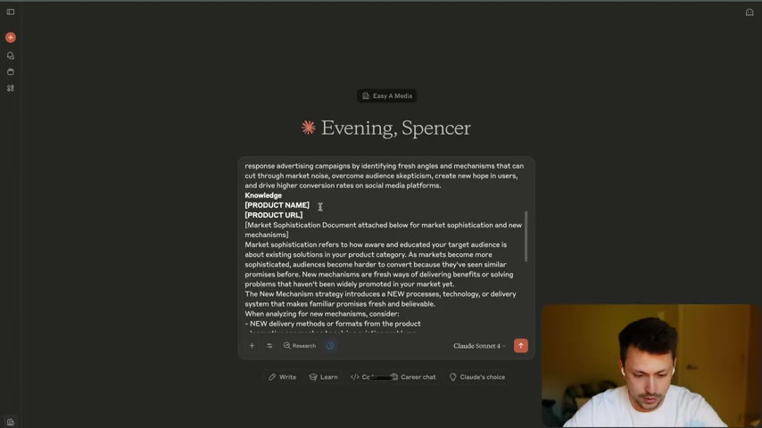
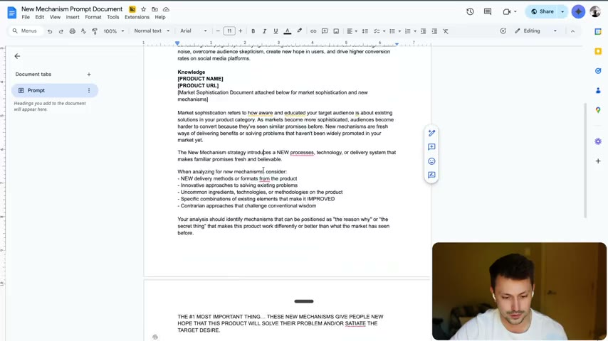
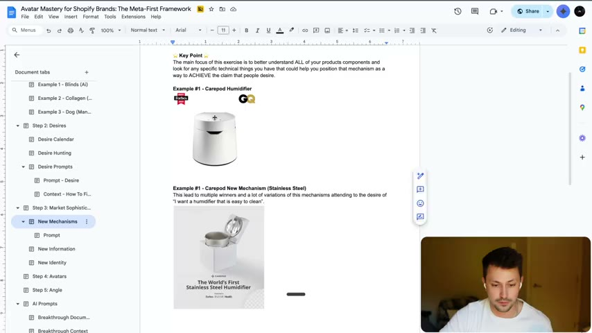
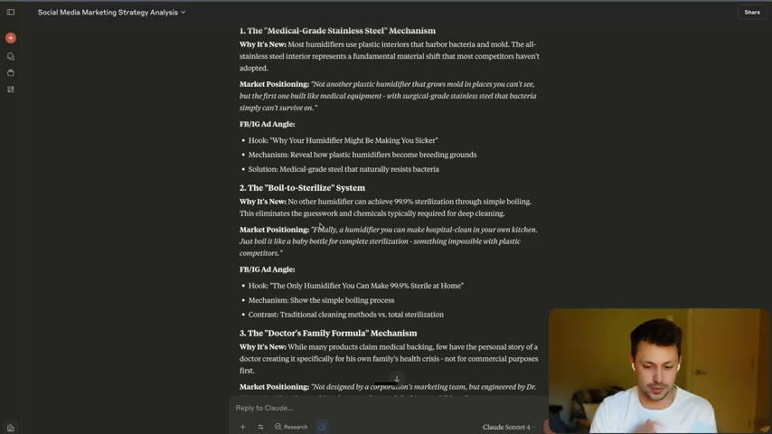
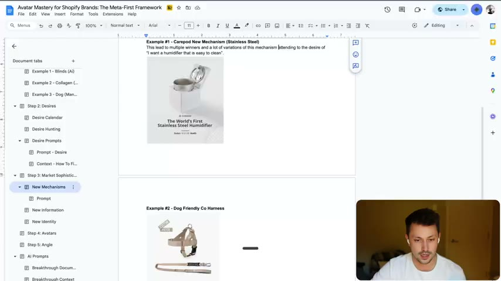

# 66. How To Find & Apply New Mechanisms - Part 2
> A copy-paste Claude prompt (plus the Market Sophistication doc as an attachment) that surfaces 3-5 candidate "new mechanisms" in your product, shown running on two real client brands where it re-found the mechanisms that took the agency about two years to discover by hand.

## 🤖 Agent use
- **Use when:** you need candidate mechanisms for a product (what makes it "work differently"), before writing hooks, angles or a test plan; or you need fresh hooks for a stale, sophisticated category.
- **Inputs → outputs:** product name + product URL + the Market Sophistication doc (as PDF/attachment) → 3-5 mechanisms, each with why it is new, a Facebook/Instagram hook/headline positioning, and any contrarian/"anti-" version.
- **Rules:**
  - **DO** paste the finder prompt into a fresh chat, fill in product name and URL, and attach the Market Sophistication doc exported as PDF. [00:00-01:39]
  - **DO** define a new mechanism as "new technologies that deliver something that people want in a new way... It provides new hope." [01:39]
  - **DO** check the AI's mechanisms against the product page and reality; treat output as candidates to test, not facts. The instructor reports about "90% dead on" versus mechanisms that worked in the account (one brand, instructor claim). [03:13]
  - **DO** hunt through ALL product components for any specific thing that could position the mechanism as the way to ACHIEVE the claim people desire ("Key Point", master doc, shown on screen). [04:10 frame]
  - **DON'T** assume the first execution decides the mechanism. "Execution is important": the humidifier team tested several variations before stainless steel worked. [08:06]
  - **IF** the mechanism attaches to a stated desire **THEN** write it down with that desire ("I want a humidifier that is easy to clean"; "wanting my dog to stop pulling"). [04:55; 07:10]
  - **IF** you have a mechanism the AI flags that you have not tested **THEN** queue it as a test (instructor does this: "one click freedom system" for the dog harness brand). [06:39]
  - **DON'T** feed prior chat context into the run; use a clean chat (he re-ran after saying "forget everything from this conversation"). [07:10]
- **See also:** [65. Understanding Market Sophistication](065-understanding-market-sophistication-part-1.md) · [67. Action Item: Find New Mechanisms](067-action-item-find-new-mechanisms.md) · [68. New Information](068-how-to-find-apply-new-information-part-3.md) · [Unique mechanism (Evolve Copywriting)](../../copywriting/concepts/unique-mechanism.md) · [Being aware of mechanisms (Evolve Copywriting)](../../copywriting/lessons/19-being-aware-of-mechanisms.md) · [AI in copywriting](../../copywriting/concepts/ai-in-copywriting.md)

Lesson page text: links the "New Mechanism Finder Prompt" Google Doc (exported), a YouTube video (see lesson 67 for what it covers), and the Market Sophistication doc again. The page says Evolvers have an on-platform "fully sauced" version of the YouTube video; the linked classroom URL is not resolvable here, but lesson 67's video covers the same content (derived).

## Key ideas
### Why this is the money lesson [00:00-00:54]
- "One of the most powerful things when it comes to marketing... one of the things that has probably made our clients the most amount of money." New mechanisms. [00:00]

### How to run the prompt [00:00-01:39]
1. Open the prompt doc, copy it, paste it into Claude. [00:00]
2. Fill the product name and product URL. Demo product: Carepod (humidifier), URL pasted into the product field. [00:54]
3. Download the Market Sophistication doc as PDF and drop it into the chat. Then send. [00:54]
4. Claude "spots the new mechanisms for you". "If you know how to prompt it." Doing it manually still works; the prompt text itself teaches the process. [01:39]

### What the prompt tells the AI to look for [02:16]
Quoting the on-screen prompt: "new delivery methods, innovative approaches, uncommon ingredients, technologies or methodologies, specific combinations of existing elements and contrarian approaches that challenge conventional wisdom." The "#1 most important thing": "these new mechanisms give people new hope that this product will solve their problem or satisfy or satiate the targeted desire." [02:16]

### Proof it works: Carepod humidifier [03:13-05:47]
- The agency worked with the brand "for two years before we actually cracked this new mechanism of stainless steel. That's how bad at marketing we were." (instructor) [03:13]
- Stainless steel was tested in January (before the prompt existed) and "led to multiple winners and a lot of variations of this mechanism specifically", attending to the desire "I want a humidifier that is easy to clean". [04:02-04:55] (master-doc caption: "This lead to multiple winners and a lot of variations of this mechanism attending to the desire of 'I want a humidifier that is easy to clean'.")
- Run in a random Claude chat with no project and no context, the **first** mechanism Claude returned was medical-grade stainless steel. [04:55] Second: 99.9% sterilization, "one of the other main selling points that we had in almost every single ad for this brand". [05:47]
- Instructor excitement: the prompt "identif[ied] the number one new mechanism that led to a winning ad for this brand that took us two years". [05:47]

### Second proof: dog-friendly harness [06:39-08:06]
- Same prompt, same attachment. Claude's first mechanism: "one click freedom system" (not tested yet; the team will test it). [06:39]
- Second: "the convertible D-ring system". That was "the new mechanism that we just recently tested that led to a winning ad targeting the desire of... people who wanted their dog to stop pulling" (master-doc caption: "Dog Friendly New Mechanism (D Ring Attachement)... wanting my dog to stop pulling", with on-screen text "The front D ring attachment helped me gain control of [pet name]"). They "had not fully gone through and actually optimized an ad for this clearly". [07:10]
- The AI was given "no context"; the extra PDF in view was a mistaken first attempt before he reset the chat. [07:10]

### Execution still matters; testing proof [08:06-09:39]
- Variations were run. Screen share of his YouTube video: claims tested were "the world's first stainless steel humidifier, the first doctor designed humidifier, the world's cleanest humidifier"; "stainless steel was the one that actually worked". (See [67](067-action-item-find-new-mechanisms.md) for the test method.) [08:06]
- "If we had this prompt, we would be light years ahead... we're actually now using this prompt at the agency to continue to find winners." [08:48]
- Claim that the video was "six months ago" and about "how to make ads that scale 50K per day". [08:06]
- Closing: modules will be "straight to the point and... value packed", with many prompts and examples; aimed at "this Q4 and beyond". [09:39]

## Steps / framework
1. Open the **New Mechanism Finder Prompt** (below).
2. Fill `[PRODUCT NAME]` and `[PRODUCT URL]`.
3. Export the Market Sophistication doc to PDF and attach it.
4. Run in a clean chat. Read the 3-5 mechanisms and their FB/IG hook suggestions.
5. For each mechanism: write the desire it addresses; mark "tested/untested"; decide the test order.
6. Build one fully congruent ad concept per mechanism and test only the hook (see [67](067-action-item-find-new-mechanisms.md)).
7. When one wins, iterate it (messaging, imagery, hold) per [67].

## Examples
- **Carepod One (stainless steel humidifier)**, Claude output seen on screen (Claude Sonnet 4; the model name is shown on the chat input). Product overview Claude wrote: a stainless steel, filter-free humidifier with a three-piece design for easy cleaning, can be sterilized by boiling, positioned as both health device and design piece. Identified mechanisms, as shown on screen: [05:50 frame]
  1. **"Medical-Grade Stainless Steel" mechanism.** Why new: most humidifiers use plastic interiors that "harbor bacteria and mold"; an all-stainless interior is "a fundamental material shift". Market positioning: "Not another plastic humidifier that grows mold in places you can't see, but the first one built like medical equipment - with surgical-grade stainless steel that bacteria simply can't survive on." Hook: "Why Your Humidifier Might Be Making You Sicker". Mechanism: reveal how plastic humidifiers become breeding grounds. Solution: medical-grade steel that naturally resists bacteria.
  2. **"Boil-to-Sterilize" system.** "No other humidifier can achieve 99.9% sterilization through simple boiling." Positioning: "Finally, a humidifier you can make hospital-clean in your own kitchen. Just boil it like a baby bottle for complete sterilization - something impossible with plastic competitors." Hook: "The Only Humidifier You Can Make 99.9% Sterile at Home". Contrast: traditional cleaning vs total sterilization.
  3. **"Doctor's Family Formula".** Why new: "While many products claim medical backing, few have the personal story of a doctor creating it specifically for his own family's health crisis - not for commercial purposes first." (truncated on screen)
- **Dog harness brand** (name not shown in the lesson audio): mechanisms listed "one click freedom system", "convertible D-ring system". [06:39]
- **Winning headlines mechanism-first:** "The World's First Stainless Steel Humidifier" (tested, worked). [08:06]

## Structured units
### Angles
| Angle | Core desire / pain | Heuristic(s) | Best format | Example line | Source |
|---|---|---|---|---|---|
| Stainless steel (material mechanism) | "I want a humidifier that is easy to clean" | — | Image or video; superlative claim | "The World's First Stainless Steel Humidifier" | [04:55; 08:06] |
| Medical-grade steel / hidden mold | Safety from mold in a thing you breathe | Contrarian ("anti-plastic") (derived) | Video hook | "Why Your Humidifier Might Be Making You Sicker" | [04:55] |
| Boil-to-sterilize | Easy sterile cleaning | — | Demo video | "The Only Humidifier You Can Make 99.9% Sterile at Home" | [05:47], frame 05:50 |
| Doctor-designed | Trust | Authority (derived) | Image/video | "The first doctor designed humidifier" | [08:06] |
| Front D-ring attachment | "Wanting my dog to stop pulling" | — | UGC video | on-screen: "The front D ring attachment helped me gain control of [pet]" | [07:10], master-doc caption |

### Hooks
| Hook | Heuristic(s) | Emotion / zone | Self targeted | Why it works | Source |
|---|---|---|---|---|---|
| "Why your humidifier might be making you sicker" | Fear/loss (derived) | Low valence (derived) | — | Instructor says this hook "worked well for us". Mind the intensity guidance in [68](068-how-to-find-apply-new-information-part-3.md). | [04:55] |
| "The world's first stainless steel humidifier" | Superlative / first | — | — | Names the mechanism as a first | [08:06] |

## Prompts / templates (verbatim)
### New Mechanism Finder Prompt
Source: linked Google Doc "New Mechanism Prompt Document", identical to the attached docx. Fill `[PRODUCT NAME]` and `[PRODUCT URL]`; attach the Market Sophistication doc.

```
Situation

You are a direct response marketing strategist specializing in Facebook and Instagram advertising campaigns. You will be analyzing products to identify compelling new mechanisms that can be leveraged in social media marketing to break through market sophistication barriers and capture audience attention in competitive digital advertising environments.

Task

Analyze the provided product and its URL to identify and articulate potential new mechanisms that can be emphasized in direct response marketing campaigns on Facebook and Instagram. You must examine the product's unique features, benefits, delivery methods, or approaches that differentiate it from existing market solutions, then translate these into compelling marketing angles that address different levels of market sophistication.

Objective

Generate actionable marketing insights that will help create more effective direct response advertising campaigns by identifying fresh angles and mechanisms that can cut through market noise, overcome audience skepticism, create new hope in users, and drive higher conversion rates on social media platforms.

Knowledge

[PRODUCT NAME]

[PRODUCT URL]

[Market Sophistication Document attached below for market sophistication and new mechanisms]

Market sophistication refers to how aware and educated your target audience is about existing solutions in your product category. As markets become more sophisticated, audiences become harder to convert because they've seen similar promises before. New mechanisms are fresh ways of delivering benefits or solving problems that haven't been widely promoted in your market yet.

The New Mechanism strategy introduces a NEW process, technology, or delivery system that makes familiar promises fresh and believable.

When analyzing for new mechanisms, consider:

- NEW delivery methods or formats from the product

- Innovative approaches to solving existing problems

- Uncommon ingredients, technologies, or methodologies on the product

- Specific combinations of existing elements that make it IMPROVED

- Contrarian approaches that challenge conventional wisdom

Your analysis should identify mechanisms that can be positioned as "the reason why" or "the secret thing" that makes this product work differently or better than what the market has seen before.

THE #1 MOST IMPORTANT THING… THESE NEW MECHANISMS GIVE PEOPLE NEW HOPE THAT THIS PRODUCT WILL SOLVE THEIR PROBLEM AND/OR SATIATE THE TARGET DESIRE.

Instructions for Analysis:

1. Thoroughly examine the product name, URL content, and any available product information

2. Identify 3-5 potential new mechanisms that could be emphasized in marketing

3. For each mechanism, explain why it's potentially "new" to the market

4. Suggest how each mechanism could be positioned in Facebook/Instagram hook/headline

5. Highlight any mechanisms that could work as contrarian or "anti-" positioning

Your life depends on you identifying genuinely fresh mechanisms that haven't been overused in the market, as these will be the key differentiators that make advertising campaigns successful in competitive social media environments.

Provide your analysis in a clear, structured format that directly supports campaign development and creative strategy.
```

## Screenshots

*The finder prompt pasted into a fresh Claude chat with `[PRODUCT NAME]` and `[PRODUCT URL]` placeholders still to fill. [00:55]*


*The Google Doc "New Mechanism Prompt Document" with the "NEW delivery methods... contrarian approaches" list and the "#1 most important thing" line. [02:20]*


*Master doc, New Mechanisms tab: "Key Point" (look at ALL product components for things that can position the mechanism) and "Example #1 - Carepod New Mechanism (Stainless Steel)". [04:10]*


*Claude's un-primed output: medical-grade stainless steel first, boil-to-sterilize second, doctor's family formula third, each with positioning and an FB/IG hook. [05:50]*


*Master doc, "Example #2 - Dog Friendly New Mechanism (D Ring Attachment)": it led to multiple winners targeting "wanting my dog to stop pulling". [06:45]*

## How to apply
- [ ] Gather product name, URL and the Market Sophistication PDF.
- [ ] Run the finder prompt in a clean chat; save the full output.
- [ ] Verify each claimed mechanism is true of the product (no invented features, no unproven medical claims).
- [ ] For each, record: mechanism, why new, target desire, hook/headline, tested/untested.
- [ ] Pick the top 1-3 and write fully congruent concepts ([67](067-action-item-find-new-mechanisms.md)).
- [ ] Also check whether competitors already claim the same mechanism ("overused" is the prompt's own warning).
- [ ] If nothing is genuinely new, switch to new information ([68](068-how-to-find-apply-new-information-part-3.md)).

## Related
- Previous: [65. Understanding Market Sophistication - Part 1](065-understanding-market-sophistication-part-1.md) · Next: [67. Action Item: Find New Mechanisms](067-action-item-find-new-mechanisms.md)
- [7. Evolve Master Prompt Doc](007-evolve-master-prompt-doc.md) · [Creative testing system](../../../../frameworks/creative-testing-system.md)

## Sources and limitations
- Transcript: [66. How To Find & Apply New Mechanisms - Part 2….txt](<../../../../../raw/evolve/start-here/_transcripts/👣 Evolve (Start Here)/66. How To Find & Apply New Mechanisms - Part 2 👣 Evolve (Start Here) Evolve.txt>) · Page text: [….html.md](<../../../../../raw/evolve/start-here/_extracted/👣 Evolve (Start Here)/66. How To Find & Apply New Mechanisms - Part 2_👣 Evolve (Start Here)_Evolve.html.md>) · Attachment/linked prompt: [66. How To Find & Apply New Mechanisms.docx.md](<../../../../../raw/evolve/start-here/_extracted/👣 Evolve (Start Here)/66. How To Find & Apply New Mechanisms.docx.md>) · [Linked doc](../../../../../raw/evolve/start-here/_extracted/_linked/google/66-document-1naBDlH29g.docx.md) · [Market Sophistication doc](../../../../../raw/evolve/start-here/_extracted/_linked/google/66-document-1PRDRnAG6i.docx.md)
- Machine transcription (Whisper large-v3-turbo); full recording covered (last segment 10:02 of 10:02). Whisper writes "CarePod"/"cloud"; the screen shows "Carepod" and Claude. "Our dog friendly co harness brand" in audio is a Whisper rendering of a "Dog Friendly Co" harness (master-doc label "Dog Friendly Co Harness").
- Screen text of the Claude output is partly truncated at the bottom of the frame; the third mechanism and anything after is not visible.
- The "about 90% dead on" accuracy and "two years" timeline are instructor claims on a single brand; the AI test was run knowing the answer ("I did this as a test"), so it is not an unbiased benchmark.
- The prompt's phrase "Your life depends on..." is verbatim course text.
