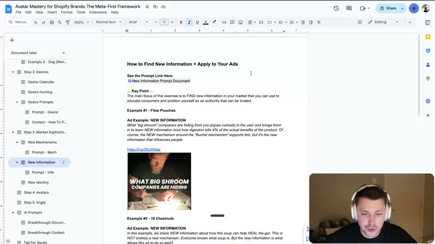
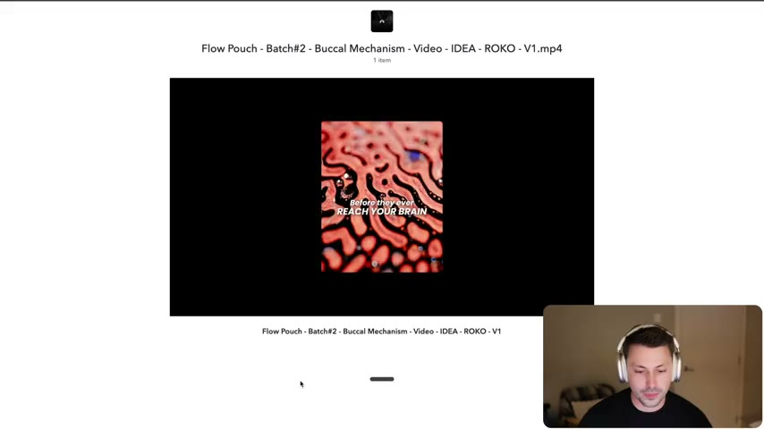
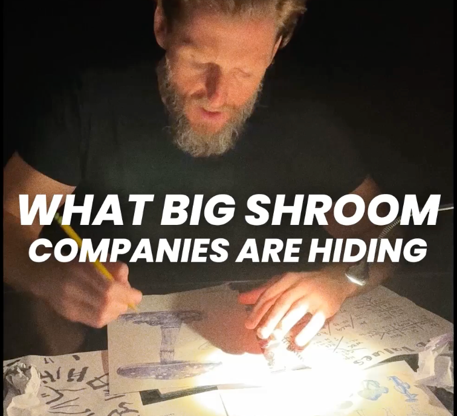
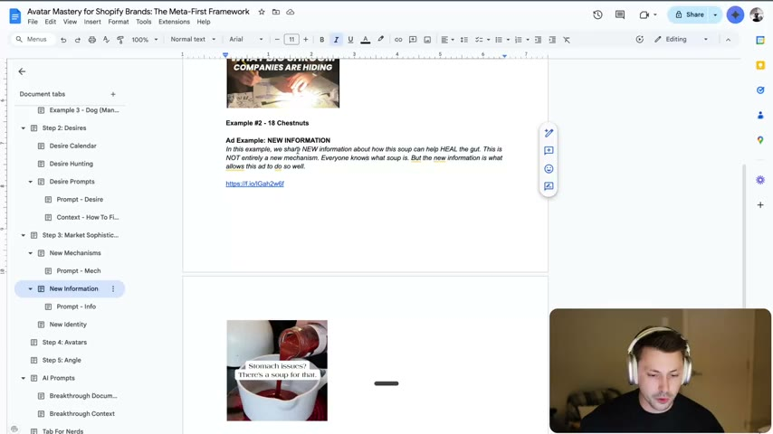
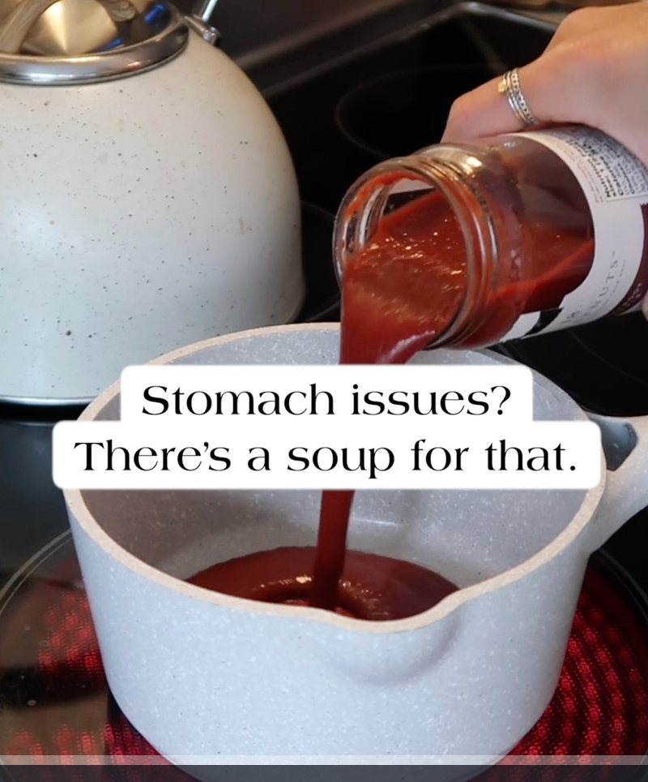
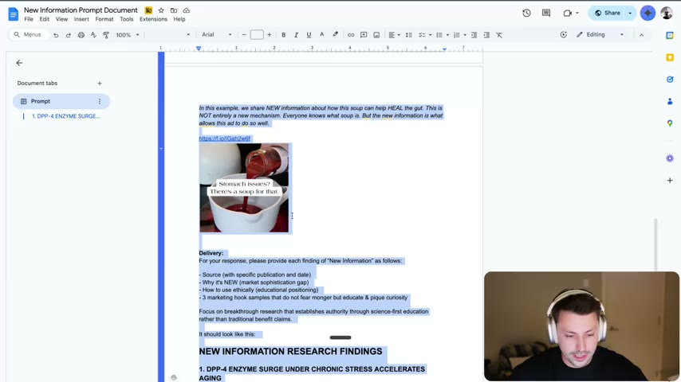
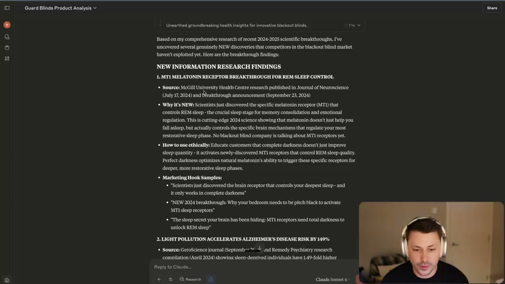
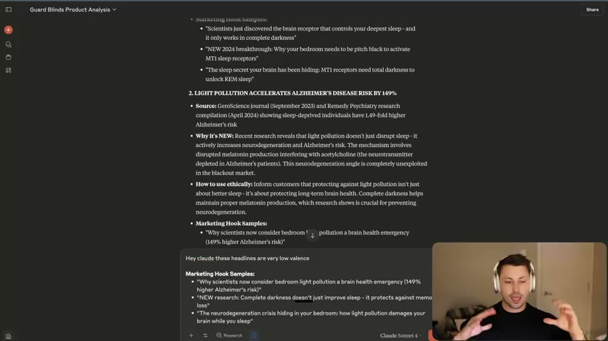
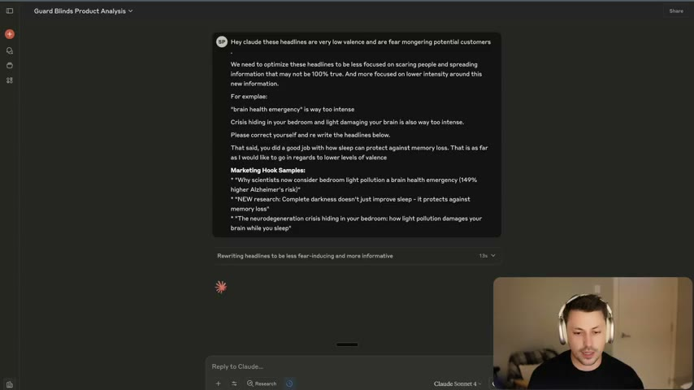

# 68. How To Find & Apply New Information - Part 3
> New information (research, discoveries, root causes the market doesn't know) lets any product, even an ordinary one, stand out in a sophisticated market by educating and becoming the authority; this lesson gives the AI finder prompt, two winning examples, and a hard ethics rule: fact-check everything and keep fear-based hooks low-intensity.

## 🤖 Agent use
- **Use when:** writing unaware or education-led ads; finding research-backed hooks for a saturated category; needing an authority angle when the product has no unique mechanism.
- **Inputs → outputs:** product name + URL + Market Sophistication doc → structured "NEW INFORMATION RESEARCH FINDINGS": source and date, why it is new, how to use ethically, 3 hook samples per finding → a verified shortlist of educational hooks (after human fact-check) and, if any hook is too fear-based, a rewritten lower-intensity version.
- **Rules:**
  - **DO** use new information to "educate your customers to position yourself as an authority". [00:45]
  - **DO** fact-check every claim yourself, then go deeper. "It needs you to fact check it... consumers that are hyper educated. And so you can make yourself look like a real ass." [01:30] "Go and double check that Claude did not hallucinate." [21:00]
  - **DON'T** run the prompt "blindly"; its output is "direction that you can then go and do deeper research on". [00:45; 02:28]
  - **DON'T** ship fear-mongering. "Do not be a piece of shit... rule number one." [14:43] Fear at high intensity can get you banned: Meta ad account, business manager, profile, even Shopify store (instructor claim). [15:22]
  - **IF** an AI hook is low valence **and** high intensity (e.g. "brain health emergency") **THEN** re-prompt it to lower the intensity: keep "new research" / "protects against memory loss" style framing. [13:55-17:54]
  - **DO** apply the family test: "Would you run this message to your mom or would you run this to your sister?" [18:38]
  - **DON'T** use technical jargon without a plain-language bridge (the iPod "thousand songs" principle). A single unexplained term like "MT1" can work as curiosity, but explain it. [11:43-12:26]
  - **DO** present credibility when you answer the curiosity ("McGill University Health Center, Journal of Neuroscience") on the landing page or in the video. [12:26-13:00]
  - **DON'T** skip research on serious claims (e.g. an Alzheimer's-risk statistic). Research it and extract the safe, understandable core (light pollution disrupts melatonin production → worse sleep). [19:22-20:11]
  - **IF** new information is paired with a new mechanism **THEN** expect the biggest lift. [00:00]
- **See also:** [65. Understanding Market Sophistication](065-understanding-market-sophistication-part-1.md) · [66. New Mechanisms](066-how-to-find-apply-new-mechanisms-part-2.md) · [69. Action Item: Find New Information](069-action-item-find-new-information.md) · [Valence](../../../../concepts/valence.md) · [Intensity](../../../../concepts/intensity.md) · [Valence-intensity diagnostic](../../../../frameworks/valence-intensity-diagnostic.md) · [Unaware ads (Evolve Copywriting)](../../copywriting/concepts/unaware-ads.md) · [Authority in ads](../../copywriting/concepts/authority-in-ads.md) · [Facts over opinions](../../copywriting/concepts/facts-over-opinions.md)

Lesson page text (verbatim): "REMINDER - BE ETHICAL. DOUBLE CHECK YOUR FACTS. DOUBLE CHECK AI RESEARCH. DO NOT BE A PIECE OF SHIT." followed by the New Information Finder Prompt link, the Market Sophistication doc link and a "Mini Text Prompt" (reproduced below).

## Key ideas
### What new information is and why it works [00:00-02:28]
- "Doesn't require you to actually really have anything crazy unique about your product." Combined with new mechanisms it gives "the biggest lift". Two demo cases: one slightly unique product, one standard product. [00:00]
- Goal: find new information to educate customers and "position yourself as an authority that can be trusted", so they understand how your product can help "because you know something that they don't". It also explains why other mechanisms failed or why yours will work. [00:45-01:30]
- Doable manually: "all of your research comes into play"; while hunting desires and studying the product, record any bits of new information. [00:45] (see [64](064-action-item-start-your-desire-hunt.md): the desire template has a "New Information" heading)
- Do it ethically and don't make things up; even AI research must be checked because customers may be better informed. [01:30]
- You must become an expert: "educate yourself, don't just run this prompt and be like yeah that's good". [02:28]

### Example 1: Flow Pouch, "What big shroom companies are hiding" (new information + buccal mechanism) [02:28-05:22]
- A two-minute video ad (the shown file is "Flow Pouch - Batch#2 - Buccal Mechanism - Video - IDEA - ROKO - V1.mp4", 2:11 long). It "started this ad by sharing new information". [02:59]
- Doc caption: *"What 'big shroom' companies are hiding from you piques curiosity in the user and brings them in to learn NEW information about how digestion kills X% of the actual benefits of the product. Of course, the NEW mechanism around the 'Buccal mechanism' supports this, but it's the new information that influences people."*
- Delivery on screen/voiceover: compounds are "being destroyed before they reach your brain... Your stomach acid is breaking it down"; then a bridge: "scientists have known for decades that certain medications are better absorbed through your mouth... than through your digestive tract"; "buccal" means absorbed "directly into your bloodstream... through your gums"; then the product (functional mushrooms in pouches) appears; one frame reads "FIRST NOOTROPIC". [04:33-05:22; frames 04:40, 05:30]
- He calls it an unaware-style ad and "an editing masterclass" that new editors probably can't match; "we've got a lot of work to do." [03:57]
- Pattern (derived): open with a hidden-truth/curiosity hook → teach why existing products fail → bridge to the mechanism → introduce the product.

### Example 2: 18 Chestnuts, "Stomach issues? There's a soup for that." [05:22-07:56]
- Not a new mechanism: "everyone knows what soup is". Early on the brand marketed "soup that tastes good" or "soup that's good for you". The agency instead gave new information: "there's a soup that can fix your stomach issues." [05:22-06:18]
- Structure of the scene (text overlays): "Stomach issues? There's a soup for that." → plant-based and gluten-free with local ingredients → promotes gut health and eases digestion → ready in minutes. [06:18]
- Why it works: it names the exact things people with stomach issues are told to do: eat less gluten, eat local, whole foods, plant-based. "That person has everything they need to know in 10 seconds." [07:05]
- Result (instructor claim): it "led to this ad being a winning ad that scaled this brand to hundred K per month". He admits the team "had no idea what they were doing" when making it and only now sees why it worked. [06:18; 07:56]
- Lesson: simple execution beats the two-minute cinema when new information is clear. [07:05-07:56]

### Running the prompt live: blackout blinds ("Guard Blinds") [07:56-12:26]
- Procedure on screen: new Claude chat → type the mini text prompt (references the attached "New Information Prompt") + product URL + product name → attach the Market Sophistication doc (he copies the doc text into the prompt as well, leaving the placeholder in "in case AI reads it") → send. [07:56-08:41]
- Claude's result opens: "Based on my comprehensive research of recent 2024-2025 scientific breakthroughs, I've uncovered several genuinely new discoveries that competitors in the blackout blind market haven't exploited yet." Finding 1: **MT1 melatonin receptor breakthrough for REM sleep control** (source on screen: McGill University Health Centre research in the Journal of Neuroscience, July 17, 2024, with an announcement on September 23, 2024). [08:41-09:26; frame 09:10]
- Hook samples Claude produced (verbatim from the frame):
  - "Scientists just discovered the brain receptor that controls your deepest sleep - and it only works in complete darkness"
  - "NEW 2024 breakthrough: Why your bedroom needs to be pitch black to activate MT1 sleep receptors"
  - "The sleep secret your brain has been hiding: MT1 receptors need total darkness to unlock REM sleep"
- Why hook 1 works (instructor): "dangles the carrot"; science "just discovered"; new hope, new information, new discovery; then "it only works in complete darkness" creates the gap that only the product (blackout blinds) can close. "That is a banger hook." Claude "kind of better than GPT if you ask me." [09:57-11:43]
- Jargon handling: "MT1" may spark "what's MT1?" curiosity, but keep the number of new terms low (remember "a thousand songs in your pocket"). Then answer the curiosity with credibility: the MT1 receptor controls melatonin release; new studies from the McGill University Health Centre, Journal of Neuroscience. This can be on the landing page or in the video. [11:43-13:00]

### The ethics stop: fear-mongering hooks [13:00-20:11]
- Another finding on screen: light pollution and Alzheimer's risk (source on screen: GeroScience journal, Sept 2023, and a "Remedy Psychiatry research compilation" April 2024, "sleep-deprived individuals have 1.49-fold higher Alzheimer's risk"; the finding is headed "Light pollution accelerates Alzheimer's disease risk by 149%"). The heading's 149% and the source's 1.49-fold do not mean the same thing (a 1.49 hazard ratio is about 49% higher risk); check before using any number. (derived)
- Hooks Claude gave for it: "Why scientists now consider bedroom light pollution a brain health emergency (149% higher Alzheimer's risk)" and "The neurodegeneration crisis hiding in your bedroom: how light pollution damages your brain while you sleep". Instructor: "very low valence... very high intensity... you're going to scare people and you're going to fear monger... extremely unethical", even though Claude labelled it ethical. [13:00-14:43]
- He uses the valence frame: valence = positive vs negative; intensity = how positive/negative. "Low valence can be effective, but when you go too high intensity in the low valence quadrant, you just become a piece of shit." [15:22; 17:54-18:38]. See [Valence](../../../../concepts/valence.md) and [Intensity](../../../../concepts/intensity.md) for the course's definitions.
- Consequences he states: "If you try to fear monger... this will cripple your brand harder than anything else"; Meta may ban the ad account, business manager and profile, and "Shopify will take you down from your store" (instructor claim). Scared buyers also "are not going to be good customers". [15:22; 18:38]
- Fix by re-prompting Claude with the offending hooks and a short instruction; the reprompt (read from the frame) is in the templates below. The model agreed ("You're absolutely right. Those headlines are way too fear-mongering and intense") and returned three lower-intensity versions (quoted in Rewrites). [15:22-17:54]
- Safe use of a scary finding: research it, then communicate the understandable part. For Alzheimer's: light pollution disrupts melatonin production (acetylcholine link mentioned on screen); "people can associate that melatonin helps them sleep better", so you can say light pollution disrupts it and it is why you don't sleep as well versus in a blackout room. [19:22-20:11]
- Instructor warning: "I'm going to have to keep an eye on this stuff because this is very powerful... if I start seeing specific angles... that I'm just not happy with, I will remove this." [20:11]
- Final reminder: "It has to be factual... Don't just take Claude's word for it." [21:00]

## Steps / framework
1. Copy the **New Information Finder Prompt** (below).
2. New chat with Claude. Type the **Mini Text Prompt** (below) with product name and URL; attach the Market Sophistication doc (and paste the prompt text).
3. For each finding Claude lists: source with publication and date, why it's new (market sophistication gap), how to use ethically, 3 hook samples.
4. **Verify**: open the source, confirm the finding and the numbers, find any contrary evidence. Keep only claims you can stand behind. (instructor: "double check", "go do more research")
5. **Screen each hook for valence and intensity**: reject or rewrite low-valence + high-intensity ones (see re-prompt).
6. Build the ad: curiosity hook → education that proves why existing solutions fail → bridge to your product (mechanism) → credibility (study named) → simple product benefits.
7. Test as new concepts under the hook-only method in [67](067-action-item-find-new-mechanisms.md).

## Examples
- **Flow Pouch** (functional-mushroom pouches): hook "What 'big shroom' companies are hiding" → digestion destroys part of the benefit (X%, unstated) → buccal absorption bridge.
- **18 Chestnuts** (soups): "Stomach issues? There's a soup for that." plus ingredient callouts.
- **Guard Blinds** (blackout blinds) run: MT1 receptor, light pollution; before/after below.
- **Doc template finding** (from the prompt's own example, product category implied as a GLP-1 style supplement): "DPP-4 enzyme surge under chronic stress accelerates aging" with source, why-it's-new, how to use ethically, and three hooks (below).

## Structured units
### Hooks
| Hook | Heuristic(s) | Emotion / zone | Self targeted | Why it works | Source |
|---|---|---|---|---|---|
| "What 'big shroom' companies are hiding from you" | Hidden truth / curiosity gap (derived) | Curiosity | — | Piques curiosity, then new information about digestion | [02:59]; doc Example #1 |
| "Stomach issues? There's a soup for that." | Specific problem-solution | — | Person with stomach issues (derived) | Names the exact problem; ingredients answer known advice | [05:22-07:05]; frame/doc |
| "Scientists just discovered the brain receptor that controls your deepest sleep - and it only works in complete darkness" | New discovery + gap | Curiosity, hope | — | Dangles the carrot, then the condition only the product provides | [09:57-10:55] |
| "NEW 2024 breakthrough: Why your bedroom needs to be pitch black to activate MT1 sleep receptors" | New discovery | Curiosity | — | Jargon term triggers "what's MT1?" | [10:55-12:26] |
| "The sleep secret your brain has been hiding: MT1 receptors need total darkness to unlock REM sleep" | Hidden-secret / curiosity | Curiosity | — | Same | frame 09:10 |
| "Scientists just discovered why stress makes you gain weight even when eating the same foods (it's destroying this hormone in real-time)" | New discovery | — | — | Example hook in the prompt's template (not shown in video) | Prompt doc |

### Rewrites (before → after)
| Before | After | What changed (verb / visual / promise / self / intensity) | Source |
|---|---|---|---|
| "Why scientists now consider bedroom light pollution a brain health emergency (149% higher Alzheimer's risk)" | "New research shows complete darkness may support long-term memory health" | Intensity down; "emergency" and statistic removed; hedged "may support"; promise reframed from threat to benefit | [17:54] |
| "The neurodegeneration crisis hiding in your bedroom: how light pollution damages your brain while you sleep" | "Scientists discover how quality darkness contributes to cognitive wellness" | Threat framing to positive wellness; "crisis" removed | [17:54] |
| (Keep) "NEW research: Complete darkness doesn't just improve sleep - it protects against memory loss" | "New research, complete darkness doesn't just improve your sleep. It protects against memory loss." | Instructor's accepted level: "that is as far as I would like to go" | [16:48-17:54] |

### Ad teardowns
| Brand / product (niche) | Format | Hook / opening | What works | What fails | Fix suggested | Principle | Source |
|---|---|---|---|---|---|---|---|
| Flow Pouch (functional mushrooms) | 2:11 video | "What 'big shroom' companies are hiding" | Curiosity, education then bridge to buccal mechanism | Complex to produce ("editing masterclass") | — | New information + new mechanism | [02:59-05:22] |
| 18 Chestnuts (soups) | Short video/static scene | "Stomach issues? There's a soup for that." | Ingredient callouts match known stomach advice; 10-second clarity; scaled to ~100K/month (instructor claim) | Early versions were generic ("soup that tastes good") | Lead with the specific problem | New information, simple | [05:22-07:56] |
| Guard Blinds (blackout blinds), AI output | Hook list | "...brain health emergency (149% higher Alzheimer's risk)" | — | Low valence, high intensity; fear-mongering | Rewrite per above | Valence / intensity | [13:00-17:54] |

## Prompts / templates (verbatim)
### New Information Finder Prompt
Source: linked Google Doc (same as the attached docx). Attach the Market Sophistication doc. The two example ads referenced inside the prompt are the Flow Pouch and 18 Chestnuts examples above (the doc embeds their frames and Frame.io links).

```
Situation

You are a direct response marketing research specialist working with Facebook and Instagram advertising campaigns. The client needs to stay ahead of market sophistication by discovering cutting-edge information that can differentiate their product in increasingly competitive markets. Market sophistication refers to how aware and educated consumers have become about existing marketing messages, requiring advertisers to find fresh angles and newly discovered benefits to capture attention and drive conversions.

Task

Conduct comprehensive research on the provided product and its market to uncover new information, recent discoveries, emerging benefits, or fresh angles that can be leveraged in direct response advertising. Your research must go beyond commonly known product features and benefits to find genuinely novel information that competitors likely haven't exploited yet. Analyze the product URL, investigate recent scientific studies, industry developments, consumer behavior shifts, and emerging use cases that could provide new marketing angles.

Objective

Identify breakthrough information that will enable the creation of compelling Facebook and Instagram ads that cut through market noise by presenting genuinely new, credible, and persuasive angles that differentiate the product from competitors and re-engage sophisticated consumers who have become immune to standard marketing messages.

Knowledge

Market sophistication evolves through predictable stages where consumers become increasingly aware of and resistant to marketing messages. As markets mature, advertisers must find progressively more sophisticated approaches:

Stage 3: Unique mechanisms and proprietary processes are required

Stage 4: New discoveries, breakthrough research, or expanded benefits are essential

Stage 5: Complete repositioning or identification of new markets becomes necessary

New information can include: recently published scientific research, emerging use cases, newly identified mechanisms of action, breakthrough manufacturing processes, unexpected demographic adoption, regulatory changes, industry shifts, technological advances, or newly discovered synergistic effects.

Your research should focus on information published or discovered within the last 12-24 months that hasn't been widely adopted in marketing messages yet. Look for peer-reviewed studies, industry reports, patent filings, regulatory approvals, expert interviews, and emerging consumer behavior data.

Examples

The Market Sophistication Document attached below, plus the 2 examples included should guide your understanding of what constitutes as "new information."

When you receive the product name and URL, structure your research findings as follows:

Recent Scientific Discoveries - New studies, research findings, or clinical data

Emerging Market Trends - Shifts in consumer behavior, new use cases, or demographic changes

Industry Developments - Regulatory changes, technological advances, or competitive landscape shifts

Novel Mechanisms or Benefits - Newly identified ways the product works or previously unknown advantages

Untapped Angles - Fresh positioning opportunities or unexplored marketing messages

For each finding, include the source, date of discovery/publication, and specific implications for advertising messaging.

Your life depends on you finding genuinely NEW information that hasn't been saturated in the market yet - information that will give this product a competitive edge in sophisticated markets where consumers have seen every standard marketing angle.

Example #1 - Flow Pouches

Ad Example: NEW INFORMATION

What "big shroom" companies are hiding from you piques curiosity in the user and brings them in to learn NEW information bout how digestion kills X% of the actual benefits of the product. Of course, the NEW mechanism around the "Buchal mechanism" supports this, but it's the new information that influences people.

[Frame.io link + frame image: "WHAT BIG SHROOM COMPANIES ARE HIDING"]

Example #2 - 18 Chestnuts

Ad Example: NEW INFORMATION

In this example, we share NEW information about how this soup can help HEAL the gut. This is NOT entirely a new mechanism. Everyone knows what soup is. But the new information is what allows this ad to do so well.

[Frame.io link + frame image: "Stomach issues? There's a soup for that."]

Delivery:

For your response, please provide each finding of "New Information" as follows:

- Source (with specific publication and date)
- Why it's NEW (market sophistication gap)
- How to use ethically (educational positioning)
- 3 marketing hook samples that do not fear monger but educate & pique curiosity

Focus on breakthrough research that establishes authority through science-first education rather than traditional benefit claims.

It should look like this:

NEW INFORMATION RESEARCH FINDINGS

1. DPP-4 ENZYME SURGE UNDER CHRONIC STRESS ACCELERATES AGING

Source: Multiple 2024 studies including Advanced Science (December 2024) and frontiers in Pharmacology research on DPP-4 and stress-induced vascular aging

Why it's NEW: Recent 2024 research reveals that chronic stress dramatically upregulates DPP-4 enzyme production, creating a vicious cycle where stress literally breaks down your natural GLP-1 faster than your body can use it. This stress-DPP-4-aging connection is cutting-edge science most competitors haven't discovered yet.

How to use ethically: Educate consumers that their stress isn't just making them feel bad—it's actively destroying their body's natural appetite regulation system at the cellular level. DPP-4 enzyme levels spike under chronic stress, breaking down GLP-1 before it can signal fullness.

Marketing Hook Samples:

- "Scientists just discovered why stress makes you gain weight even when eating the same foods (it's destroying this hormone in real-time)"

- "NEW 2024 study: Your stress is literally breaking down your appetite control system—here's how to repair it"

- "Why chronic stress ages you twice as fast (hint: it's not just cortisol)"
```
Template note: the DPP-4 block is the doc's output-format example only; do not reuse its study claims without verification (derived). It also pairs "how to repair it" hooks with a stress-aging fear frame; apply the same intensity check.

### Mini Text Prompt (page text, verbatim)
```
I have attached my prompt as "New Information Prompt"
Here are the product URL + Product Name for the prompt:
Product Name: [YOUR PRODUCT]
Product URL: [YOUR PRODUCT URL]
```

### Re-prompt to lower fear intensity (from the video frame, [16:00-17:50])
```
Hey claude these headlines are very low valence and are fear mongering potential customers.

We need to optimize these headlines to be less focused on scaring people and spreading information that may not be 100% true. And more focused on lower intensity around this new information.

For exmplae:

"brain health emergency" is way too intense

Crisis hiding in your bedroom and light damaging your brain is also way too intense.

Please correct yourself and re write the headlines below.

That said, you did a good job with how sleep can protect against memory loss. That is as far as I would like to go in regards to lower levels of valence

Marketing Hook Samples:
* "Why scientists now consider bedroom light pollution a brain health emergency (149% higher Alzheimer's risk)"
* "NEW research: Complete darkness doesn't just improve sleep - it protects against memory loss"
* "The neurodegeneration crisis hiding in your bedroom: how light pollution damages your brain while you sleep"
```
(Text transcribed from the screen; typos "exmplae" and "re write" are on screen.)

## Screenshots

*Master doc, New Information tab: Key Point ("FIND new information in your market that you can use to educate consumers and position yourself as an authority that can be trusted"), then the Flow Pouch example. [00:50]*


*Frame from the Flow Pouch ad: "Before they ever REACH YOUR BRAIN", the educational middle of the new-information structure. [04:40]*


*Doc Example #1 frame: "WHAT BIG SHROOM COMPANIES ARE HIDING". (From the attached docx, not the video.)*


*Doc Example #2 shown in the master doc: "Stomach issues? There's a soup for that." with the caption that this is new information, not a new mechanism. [06:20]*


*The same soup ad frame as embedded in the attached docx. (From the docx, not the video.)*


*The prompt's "Delivery" block (Source / Why it's NEW / How to use ethically / 3 marketing hook samples) and the start of the "NEW INFORMATION RESEARCH FINDINGS" format example. [08:50]*


*Claude's output for the blackout blinds product: MT1 melatonin receptor finding with source, why it's new, how to use ethically and three hook samples. [09:10]*


*The "Light pollution accelerates Alzheimer's disease risk by 149%" finding and the instructor typing the "very low valence" correction below it. [16:00]*


*The complete re-prompt sent to Claude: keep "protects against memory loss", lower the intensity of the other two. [17:50]*

## How to apply
- [ ] Run the New Information Finder Prompt with product name, URL and the Market Sophistication doc.
- [ ] For each finding open the cited study/article; record title, date, claim and any caveats.
- [ ] Drop findings you cannot verify or that need medical-claim risk you cannot carry.
- [ ] Score each hook on valence and intensity; rewrite anything low valence + high intensity (use the re-prompt).
- [ ] Run the family test: would you say this to your mom or sister?
- [ ] Write the ad: curiosity hook, the education, the bridge to the product, named credibility.
- [ ] Keep jargon to one curiosity term at most, explained in plain words.
- [ ] Log verified findings with source links in the brand's "New Information" list (desire template).

## Related
- Previous: [67. Action Item: Find New Mechanisms](067-action-item-find-new-mechanisms.md) · Next: [69. Action Item: Find New Information](069-action-item-find-new-information.md)
- [65. Understanding Market Sophistication](065-understanding-market-sophistication-part-1.md) · [66. How To Find & Apply New Mechanisms](066-how-to-find-apply-new-mechanisms-part-2.md) · [High vs low information buyers](../../copywriting/concepts/high-vs-low-information-buyers.md)

## Sources and limitations
- Transcript: [68. How To Find & Apply New Information - Part 3….txt](<../../../../../raw/evolve/start-here/_transcripts/👣 Evolve (Start Here)/68. How To Find & Apply New Information - Part 3 👣 Evolve (Start Here) Evolve.txt>) · Page text: [….html.md](<../../../../../raw/evolve/start-here/_extracted/👣 Evolve (Start Here)/68. How To Find & Apply New Information - Part 3_👣 Evolve (Start Here)_Evolve.html.md>) · Attachment: [68. How To Find & Apply New Information.docx.md](<../../../../../raw/evolve/start-here/_extracted/👣 Evolve (Start Here)/68. How To Find & Apply New Information.docx.md>) · Linked docs: [New Information prompt](../../../../../raw/evolve/start-here/_extracted/_linked/google/68-document-18cxeIZ8Zv.docx.md), [Market Sophistication doc](../../../../../raw/evolve/start-here/_extracted/_linked/google/68-document-1PRDRnAG6i.docx.md). Doc images: `D:\resources\_work\ecomtalent\evolve-start\media\68-how-to-find-apply-new-information-docx\media\`.
- Machine transcription (Whisper large-v3-turbo); full recording covered (last segment 21:38 of 21:38). Whisper hears "buccal" as "buckal"; the docx spells "Buchal"/"Buccal"; "cloud" is Claude; "suit for that" in the last paragraph is "soup for that"; "big stream companies" = "big shroom companies". "Origins" at [15:22] is likely a sister course/brand name (unverified).
- The hook, source and date details for the blinds run come from the Claude output frames (09:10, 10:00, 16:00); they are AI outputs and unverified, including the McGill/Journal of Neuroscience and GeroScience attributions.
- The Frame.io links in the doc could not be fetched (the Flow Pouch ad file is only seen as a screen share).
- Whether the "X%" digestion-loss number in the Flow Pouch ad is real is not stated; treat as unverified.
