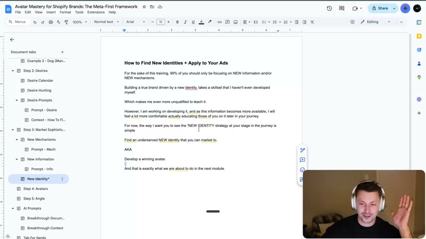

# 70. How To Find & Apply New Identities/ - Part 4
> The third market-sophistication lever, new identity, is how billion-dollar brands "sell air", but it takes brand-building skill the instructor says he has not developed; for everyone else it reduces to finding an underserved, specific avatar to market to (next module).

## 🤖 Agent use
- **Use when:** deciding whether to pursue a brand-identity play or a narrower avatar; scoping a brief for a brand that wants to "build a brand"; deciding which market-sophistication lever to assign to a growth-stage brand.
- **Inputs → outputs:** product, current avatar, brand maturity → a decision: default to new information or new mechanism; use "new identity" only as "find an underserved identity = develop a winning avatar" ([71](071-the-evolve-avatar-training.md)).
- **Rules:**
  - **DO** put effort into new information and/or new mechanisms: "99% of you should only be focusing on new information and or... new mechanisms." [00:00]
  - **DON'T** attempt to build a billion-dollar identity-led brand as a first venture. The examples all had years of prior marketing/branding experience. [01:21-03:39]
  - **DO** treat "new identity" at your stage as "finding an underserved new identity that you can market to... also known as developing a winning avatar." [04:31]
  - **DO** become more specific about who you sell to and understand that person; "when we show that we understand a person" that lets us "market and scale further". [06:05-06:41]
  - **IF** the market is "way too competitive, way too sophisticated" and customers "resist claims" **THEN** identity, emotional connection and brand experience is the counter. [05:06-06:05]
  - **IF** you want the tactical version **THEN** skip this explainer; the next module is tactical (page text).
- **See also:** [65. Understanding Market Sophistication](065-understanding-market-sophistication-part-1.md) · [71. The Evolve Avatar Training](071-the-evolve-avatar-training.md) · [74. How To Build Core Avatars](074-how-to-build-core-avatars.md) · [Identity stacking](../../../../concepts/identity-stacking.md) · [Avatars and angles (Evolve Copywriting)](../../copywriting/concepts/avatars-and-angles.md)

Lesson page text, in full: "The Next module will cover the tactical side of this if you want to skip this more 'Explainer' style video."

## Key ideas
### Why this is a short "explainer" [00:00-01:21]
- This is "the third and final piece of the market sophistication document". It is "less of a yap session" than the others; "99% of you should only be focusing on new information and/or new mechanisms." [00:00]
- Reason: "building a true brand that is actually driven by a new identity takes a skill set that I personally haven't even developed yet myself", which makes him "pretty unqualified to teach it". [00:00]
- Identity examples from lesson 65, plus **Comfort** (Whisper "Comfort"; likely the apparel brand Comfrt; spelling unverified): "developed a brand around mental health... if you wear Comfort, you support mental health and you feel comfortable and you're kind of aware of the anxiety that exists in the world". [00:49]

### Founders behind identity brands had track records [01:21-03:39]
Instructor's quick Google research:
- **Glossier:** the founder (Whisper "Emily Wise", probably Emily Weiss) "was not her first business": a beauty blog launched in 2010 while she worked at Vogue; "pretty insane track record before she went and built a billion dollar business". [01:21]
- **Liquid Death:** founder (Whisper "Mike Cesario", probably Mike Cessario) asked "what's the dumbest possible idea we could have? Let's sell water", to prove branding skill; graphic design, skateboard and music culture shaped him; "years, probably decades" of large advertising campaigns before the company. [01:21-02:14]
- **Peloton:** John Foley, already a CEO of other companies and a president of e-commerce at Barnes & Noble; "his company is apparently crashing right now" (instructor remark, unverified). [02:14-02:54]
- **Comfort:** the founder ("Hudson") "did not start Comfort... wasn't his first brand"; he had another brand "Purely White Deluxe" (Whisper rendering, unverified spelling) where "he spent five years learning about this stuff". [02:54]
- Takeaway: "I wouldn't recommend taking your first stab at trying to build a billion dollar brand or trying to build a world-class brand." [02:54]

### What the instructor will and won't teach [03:39-05:06]
- He can teach what the agency has done for clients: new information and new mechanisms. "We have not essentially built a brand." If knowledge on building brands and communities becomes available to him he'll share it. [03:39]
- New identity "allows you to sell air": selling "more than the product", which "allows you to sell things at a premium", unlike information or mechanism plays. "Today is not that day." It is a long-term goal "in a couple of years". [05:06]

### The practical version: new identity = new avatar* [04:31; 06:05-06:41]
- "New identity strategy for you guys and at your stage... should be the idea of finding an underserved new identity that you can market to. Also known as developing a winning avatar." This is the subject of "step four, which is finally getting down to avatars". [04:31]
- The asterisk (shown as "NEW IDENTITY*"): you "find new identities by just being more specific about who you are selling to and understanding more about that person." It "technically" still builds a brand, "but not in the way that these guys have done it". [06:05-06:41]
- Bridge to the next step: the same lever in market sophistication ("customers resist claims and they look for emotional connection and identity and brand experience") is addressed by "finding and innovating avatars to market to". [05:06-06:41]

## Steps / framework
| Level | What it is | Who should do it | Source |
|---|---|---|---|
| Brand-led new identity | Build a lifestyle/tribe brand (Liquid Death, Glossier, Peloton, Comfort); sells "air"; premium pricing | Experienced brand builders; not the focus of this course ("we haven't built a brand") | [02:54-05:06] |
| Avatar-led new identity (course version) | Find an underserved specific person/identity and market to them; "develop a winning avatar" | Everyone (99%) | [04:31; 06:05] |
| Default levers | New information and new mechanisms | Everyone | [00:00] |

Order of attack (derived from the lessons 65 and 70): mechanism and information first; avatar specificity next; full brand identity only with experience.

## Examples
- **Liquid Death:** "punk rock, environmental activism" water in a can; stacks all three levers (see [65](065-understanding-market-sophistication-part-1.md)).
- **Glossier:** "skin first, makeup second"; founder started with a blog.
- **Peloton:** bikes + screens + celebrity instructors + influencers = status symbol.
- **Comfort(rt):** mental-health identity; "if you wear it, you support mental health".

## Structured units
### Rules of thumb
- **DON'T** copy an identity brand's tone before you have the brand-building skillset. [03:39]
- **DO** convert "identity" to "specific avatar + deeper understanding of them". [04:31; 06:05]
- **IF** a founder example is cited as proof identity works **THEN** note the founder's prior experience: they weren't first-time builders. [01:21-02:54]

## Prompts / templates (verbatim)
Master-doc tab "New Identity" (read from the video frame, 04:35; verbatim text):
```
How to Find New Identities + Apply to Your Ads

For the sake of this training, 99% of you should only be focusing on NEW information and/or NEW mechanisms.

Building a true brand driven by a new identity, takes a skillset that I haven't developed myself.

Which makes me even more unqualified to teach it.

However, I am working on developing it, and as this information becomes more available I will feel a lot more comfortable actually educating those of you on it later in your journey.

For now, the way I want you to see the "NEW IDENTITY" strategy at your stage in the journey is simple

Find an underserved NEW identity that you can market to.

AKA

Develop a winning avatar.

And that is exactly what we are about to do in the next module.
```

## Screenshots

*The master doc's "New Identity" tab: 99% should focus on new information/mechanisms; for now "find an underserved NEW identity that you can market to. AKA develop a winning avatar." [04:35]*

## How to apply
- [ ] Do not assign an identity-led brand build to a new brand; assign information or mechanism work first ([66](066-how-to-find-apply-new-mechanisms-part-2.md), [68](068-how-to-find-apply-new-information-part-3.md)).
- [ ] Choose one underserved, specific person to market to; write who they are and what they say about themselves (feeds [71](071-the-evolve-avatar-training.md)).
- [ ] For each identity-style brand an ad references, check whether the founder brought prior brand skill before copying the playbook.
- [ ] Mark any identity ideas as "later": keep a running list for when the brand is mature.

## Related
- Previous: [69. Action Item: Find New Information](069-action-item-find-new-information.md) · Next: [71. The Evolve Avatar Training](071-the-evolve-avatar-training.md)
- [65. Understanding Market Sophistication - Part 1](065-understanding-market-sophistication-part-1.md) · [74. How To Build Core Avatars](074-how-to-build-core-avatars.md)

## Sources and limitations
- Transcript: [70. How To Find & Apply New Identities - Part 4….txt](<../../../../../raw/evolve/start-here/_transcripts/👣 Evolve (Start Here)/70. How To Find & Apply New Identities - Part 4 👣 Evolve (Start Here) Evolve.txt>) · Page text: [70. How To Find & Apply New Identities_ - Part 4….html.md](<../../../../../raw/evolve/start-here/_extracted/👣 Evolve (Start Here)/70. How To Find & Apply New Identities_ - Part 4_👣 Evolve (Start Here)_Evolve.html.md>). No attachments or linked docs.
- Machine transcription (Whisper large-v3-turbo); full recording covered (last segment 7:08 of 7:09). "Liquid Debt" = Liquid Death; "Asterix" spoken for asterisk. Person and brand names (Emily Weiss, Mike Cessario, John Foley, "Comfort", "Hudson", "Purely White Deluxe") were heard by Whisper; verify before reuse. Founder history is the instructor's recollection from Google, unverified; "Peloton... crashing" is an offhand remark.
- Lesson title shows "Identities*" with an asterisk; the on-screen "NEW IDENTITY*" tab uses the same asterisk to mean "our version: develop avatars".
- Slight tension with lesson 65: that lesson lists identity as a full strategic response and says it is "probably the hardest"; this lesson narrows it to avatars for 99% of learners. No data support either claim.
