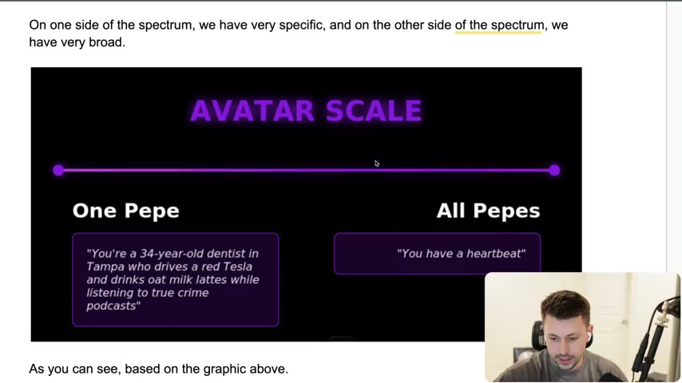
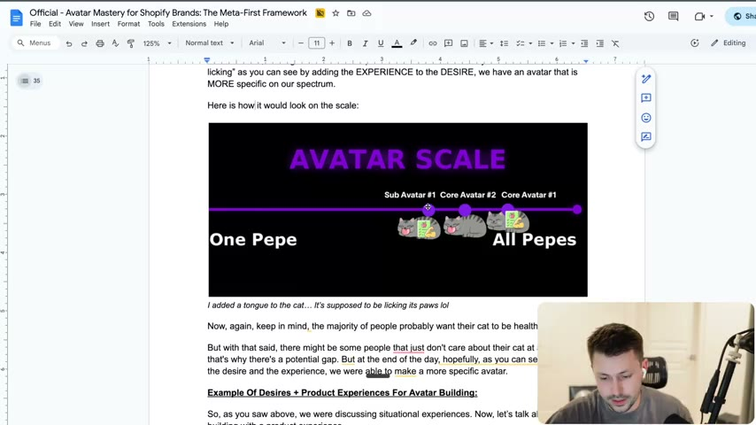
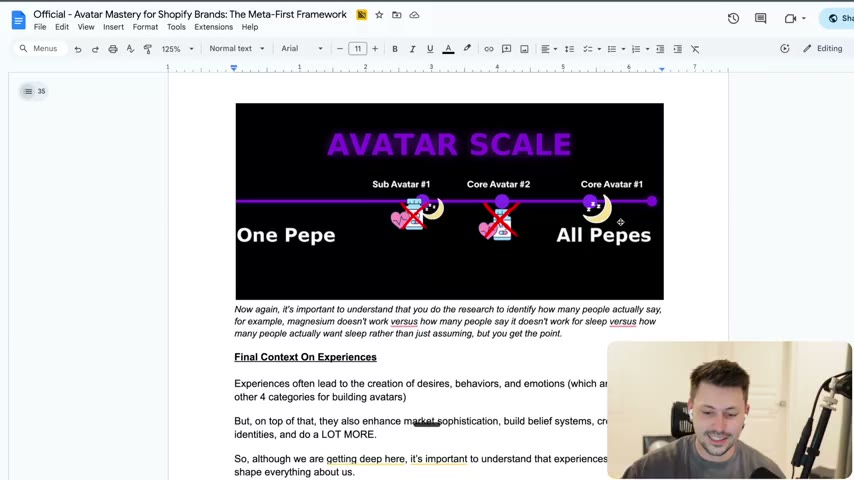
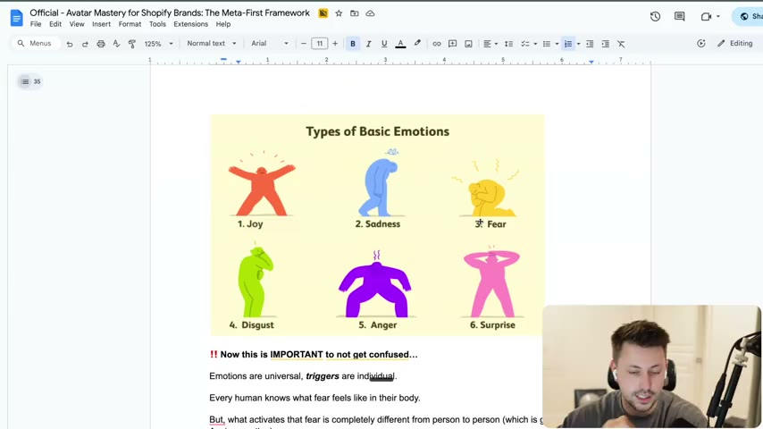
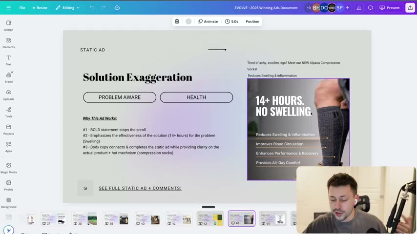
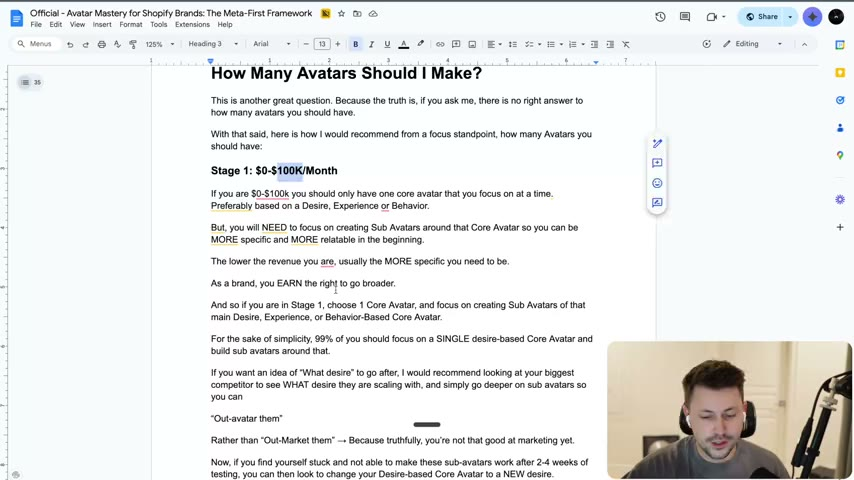

# 71. The Evolve Avatar Training
> Defines an avatar as "a group of specific people most likely to buy your product", and teaches a five-category method (Desires, Experiences, Emotions, Behaviors, Demographics) for building relatable core and sub avatars, with demographics last, plus how many avatars to run at each revenue stage.

## 🤖 Agent use
- **Use when:** defining who an ad or script is for; turning research (desires, reviews, Reddit, comments) into avatars; auditing an "avatar" that is only a demographic profile; choosing how many core avatars to run for a brand at a given revenue level; writing headlines that call out an experience, emotion, behavior or desire.
- **Inputs → outputs:** research statements (customer language, complaints, tried-and-failed products, habits) + the brand's monthly revenue stage → tagged atoms (desire / experience / emotion / behavior / demographic), one **core avatar** (a single category), several **sub avatars** (core + 1-3 more categories), and call-out headlines for each.
- **Rules:**
  - **DO** define the avatar as "a group of specific people most likely to buy your product" and judge it by the goal: instant relatability, so the reader thinks "that's me". [01:32–03:31]
  - **DO** treat every ad as targeting an avatar: "no matter what you write, you're targeting" one, usually a broad, unrelatable one. [08:42–10:07]
  - **DON'T** start with a demographic ("Susan, 47, corporate, two kids"). It is "not actionable", so it is not used. [06:20–08:42; 27:42]
  - **DO** build avatars from the five categories and order them roughly Desires, Experiences, then Emotions and Behaviors (interchangeable), with Demographics last. [25:32–27:42; 34:38]
  - **DO** make a **core avatar** from exactly one category, then make **sub avatars** by adding more categories. More categories means more specific; fewer means broader. [22:41–24:33; 30:05]
  - **DO** isolate each category when tagging research. An experience contains no wanting (desire), no feeling (emotion), no response (behavior). [45:25–48:32]
  - **DON'T** combine more than one (surface) desire in one avatar. [29:11]
  - **DO** use surface-level desires ("I want my dog to stop pulling"), not core desires ("I want status"), for building avatars. [34:38–37:36]
  - **IF** a stated emotion is not one of the six primary emotions (joy, sadness, fear, disgust, anger, surprise) **THEN** ask "why" and "what" until you reach the experience or desire underneath. [1:19:50; 1:41:54]
  - **IF** the brand is below roughly $100K per month **THEN** run one desire-based core avatar and build many sub avatars on it for 2-4 weeks before changing the desire. [2:24:49–2:28:25]
  - **IF** the product or offer is not "insanely innovative" **THEN** go more specific (but not alienating) to build trust. [31:49–32:47]
  - **IF** a broad avatar is needed **THEN** the product, offer, brand and marketing skill must all be strong. [29:11–31:01; 36:24]
  - **DON'T** copy what a big brand does today (e.g. "moms of 15-year-olds"). Copy what they did at your size. [2:12:39–2:13:25]
  - **DO** target the avatar through the creative, not through Meta interest selection. [14:47–15:47]
- **See also:** [74. How To Build Core Avatars](074-how-to-build-core-avatars.md) · [76. How To Build Sub Avatars](076-how-to-build-sub-avatars.md) · [14. Rule Of 1](014-rule-of-1-1-desire-avatar-message.md) · [Avatars and angles (Evolve Copywriting)](../../copywriting/concepts/avatars-and-angles.md) · [Being aware of avatars (Evolve Copywriting 17)](../../copywriting/lessons/17-being-aware-of-avatars.md)

Lesson page text: only the link "Evolve Only Document Access" to the Google Doc that the instructor reads and edits live. The Doc (exported as a text file and as a docx attachment with identical content) is the written version of this training and is cited below as "Doc, <heading>". On screen its title reads "Official - Avatar Mastery for Shopify Brands: The Meta-First Framework" and the table of contents shows 35 tabs [1:15:30]. The video is a screen recording of that Doc with a webcam inset.

## Key ideas

### 1. Why avatars: relatability builds trust, trust sells [00:00–05:26]
- Intro: "one of the most in-depth trainings that I think I have ever done"; more modules will follow (live core-avatar build, live sub-avatar build, optimizing avatars, ad execution, "tabs for nerds"). [00:00–01:32]
- Definition: "An avatar is a group of specific people that are most likely to buy your product." [01:32–02:32] (Doc, Definition.)
- Goal: create relatability so that "when people see your ad or they read your ad, they think, yeah, that's me". "When people feel like you really get them, they trust you. And when someone trusts you, they buy your stuff." [02:32–03:31]
- Origin: the training came from studying **Comfrt** (Whisper writes "Comfort"; the Doc spells it Comfrt). The instructor says it does "over $50 million a month" (instructor claim) and identifies two drivers: volume ("over 10,000 videos a week", [04:31]) and relatability "at a scale that we have never seen". [03:31–05:26]
- Takeaway: "the more relatable that we can be with people... the more that we can scale". [05:26]

### 2. The problem: avatars are demographic, generic and never used [06:20–10:07]
- Avatar, ICP, persona, customer profile, target audience, target market: "it's the same shit"; all mean a specific group likely to buy. [06:20; 11:03] (Doc, "What is an Avatar for eCommerce?")
- When asked for an avatar, "the first thing that they say is a fucking demographic", e.g. "Susan... corporate worker, she's 47 and a half years old, she's got two kids". [06:20–07:09]
- The instructor admits the course itself is "guilty of this": the "identify your avatars" prompt returns Susan or Brad the gym bro: "cool... but what do we do with that? It's not actionable." People make avatars, then "we hardly ever look at them". [07:09–07:56] (Prompt reference: [7. Evolve Master Prompt Doc](007-evolve-master-prompt-doc.md).)
- "If something is not actionable, you will not do it." [07:56–08:42]
- Every ad targets an avatar even if it does not feel like it. "The reason why you cannot scale... is because you're targeting avatars that are super broad", and not relatable. [08:42–10:07]

### 3. Why broad avatars no longer work, and why the avatar matters on Meta [11:48–16:40]
- 2015 example: "if you threw up an ad that was like very broad that said, we sell pans online... that's dope because most people don't buy things online." That is no longer true. Common, broad avatars "are already being called out and sold to". [11:48–12:43]
- Failure reason: calling out "the same avatar as everyone else... with the same mechanism and information". [13:16–14:06] (See [Market sophistication](012-market-sophistication.md), [66. New mechanisms](066-how-to-find-apply-new-mechanisms-part-2.md), [68. New information](068-how-to-find-apply-new-information-part-3.md).)
- Broad avatars only succeed if (1) great product with a new mechanism, (2) you educate with new information, or (3) the best offer in the market. Otherwise "you're in a race to the bottom with your offer". [14:06–14:47]
- A clear avatar "tells you what to say in your ads, how to say it, what emotions to trigger, and how to make strangers feel like your product was made specifically for them, even if you don't have anything incredibly new". [14:47] (Doc.)
- Meta: "targeting is now done 99 percent by the actual creative" (the instructor calls this an exaggeration), "not by selecting specific interests on Meta". Meta "rewards relevance": the more the creative resonates with a specific avatar, the lower the costs and the higher the conversions (instructor claim). [14:47–15:47]
- Meme test: a relatable video calls out a specific avatar; if you are that person you laugh and say "that is me"; otherwise "scroll right by it". Same mechanism, "done at scale with organic", now to be done in ads. [15:47–17:11]
- Provenance: the framework is the instructor's own, built with Claude, ChatGPT and "50 plus hours"; "might be flawed" and "will change". [17:11–18:00]

### 4. The avatar scale: one Pepe to all Pepes, with infinite combinations [18:48–22:41]
- Avatars sit on a scale from very specific to very broad. "All Pepes" (Pepe is an inside joke for "people") is "You have a heartbeat" (Apple-style, "if you have a heartbeat, you can buy"). "One Pepe" is "a 35 year old dentist in Tampa who drives a red Tesla and drinks oat milk lattes while listening to true crime podcasts". [18:48–19:32] (The Doc graphic says 34; the speaker says 35 once and 34 elsewhere.)
- Too specific is bad ("not a lot of 34 year old dentists in Tampa") and too broad is bad. [19:32; 28:30]
- Variables multiply (age, city, car, coffee), so there are effectively infinite avatars, "so we are always going to have someone that we can basically relate to" and there is always an untapped combination, "a little bit of our own blue ocean". [21:08–22:41]


*The "Avatar Scale" graphic in the Doc: "One Pepe" (34-year-old dentist in Tampa, red Tesla, oat milk lattes, true crime podcasts) to "All Pepes" ("You have a heartbeat"). Every later avatar example is placed on this line. [51:30]*

### 5. Core avatar vs sub avatar, and the Core 5 categories [22:41–34:38]
- **Core avatar** = the starting point, built from one category. **Sub avatar** = the core avatar narrowed with one or more other categories. Any of the five can be the starting category. [22:41–24:33; 1:01:33]
- Mapping the dentist: 34-year-old dentist = demographic; Tampa = demographic; red Tesla, oat milk lattes and true crime podcasts = behaviors. [24:33]
- The order of categories matters: the first is most important, the last the least; categories three and four can flip. [25:32; 35:31]
- Definition of "effective": "avatars that scale and make you money". Answer to "is this a good avatar?": "a good avatar is an effective avatar", one that is working. [26:03]
- Avatars can have "zero mentions of demographics" ("fuck demographics because they don't matter. I mean, they do."). Use demographics last so you do not "alienate people based on logistics" and keep purchase-intent categories in front. [26:03–29:11]
- Five categories only: after "head scratching, back and forth and proof checking with AI", there is "no reason" to complicate it; unless you are at roughly 5-10 million per month, you do not need more. [32:47–33:40]

### 6. Rules of thumb for specificity [29:11–32:47]
- Avoid combining more than one desire in an avatar (the instructor attributes this to "Eugene"; Whisper heard "Eugene", the person is not identified). [29:11]
- More categories = more specific avatar; fewer = broader. [29:11–30:05]
- "The more broad your avatar is, the better your product, offer, brand, and marketing skillset have to be to get conversions." Example: Carepod (Whisper "CarePod") had a parents avatar and did well because of "an incredible product... a great offer and... an awesome brand". [30:05–31:01]
- "The more specific, but not alienating, your avatar is, the worse your product, offer, brand, and marketing skillset can be." It does not mean sell a bad product. If you have nothing innovative and are "more sophisticated", go more specific "to build trust" (the instructor swapped "belief" for "trust" live). [31:01–32:47]
- Reasoning: broad avatars are where big brands compete; a 100K/month beginner against a 5M+/month operator with more spend will lose. [36:24–36:56]

### 7. Category 1: Desires [33:40–41:40]
- Desires are "I want / I need" statements already hunted in research ([Understanding and applying desire](061-understanding-applying-desire-part-1.md), [How to find desires](063-how-to-find-desires-part-3.md)). [33:40]
- Do **not** group by core desire ("I want to be healthy", "I want status"): too broad. Use **surface-level desires**, which are more specific. Brands at larger scale ($500K+/month, an arbitrary number) can start with core desires but need heavier product, offer, brand, skill and combinations. [34:38–37:36] (Doc, Category 1.)
- "You should always start your avatar creation process with the desire over a demographic." Desire-first avatars are "stronger than demographic first" because of emotional pull. [37:36]
- Always know the core desire behind a surface desire, because one surface desire can serve several core desires, and digging into the "why" reveals it. [38:28–39:22]
- **Desire check:** use the "I want X" or "I need Y" statement. "If you can't say that in a sentence, it's not a desire." Complaint to desire: "Why does it take so long to brush your teeth?" becomes "I want to brush my teeth faster." [39:59–41:40]

### 8. Category 2: Experiences (the longest section) [41:40–1:12:17]
- Experiences are situations people have gone through or are going through. Two kinds: **situational** (circumstances) and **product-based** (a solution was tried and a specific outcome resulted). [41:40–44:28]
- Situational can be **active** (more urgency, "if someone is actively experiencing pain, they need to fix it") or **past** (relatability through nostalgia, "remember when"). [43:37]
- Product-based experiences always have an outcome, even "I'm still testing it"; situational ones often do not. [1:03:20]
- **Isolate the experience.** Do not include what they want as a result (desire), how they feel (emotion), or their response (behavior). Blackout-curtains example: "tried blackout curtains and still woke up tired" has an implied desire (sleep better), emotion (frustrated, or hopeless) and behavior (looking for a better way), but "we only care about what is happening". Implied is not confirmed: curtains might have been bought for sound. Confirm desire and emotion in research. [44:28–48:32]
- Purpose: experiences "unite people because they have been through the same thing". What comes after (feeling, response) narrows the avatar further. [48:32–50:15]
- **Direct vs indirect experiences:** "if you've ever wondered why market sophistication exists, it's because of experiences across the masses", including indirect ones (hearing a friend's product failed or worked). Example: a Discord member's good experience with GorillaMind made the instructor more inclined to buy ("that's word of mouth"). [1:03:20–1:05:10] Ozempic ads work the same way: "it's like Ozempic" borrows an indirect experience that it works. [1:06:09–1:07:51] (See [12. Market sophistication](012-market-sophistication.md).)
- A product with multiple benefits (magnesium: sleep, migraines, bone and heart health...) leads to multiple desires. Attacking "magnesium doesn't work" may alienate people for whom it worked for another use. Research how many say "doesn't work" vs "doesn't work for sleep". [1:06:09–1:07:51]
- Experiences "shape everything about us": they create desires, emotions and behaviors, sometimes shift demographics (flying first class changes the wish for more income), and feed sophistication, belief systems and identities. [1:08:42–1:10:26]
- **Experience test (two questions):** (1) Does it describe a circumstance or event? (2) Did we remove the emotion (and desire)? Pure: "Just had a baby", "Lives in a noisy apartment", "Tried Ozempic and it worked". Not pure: "Wants to have another baby after having a new baby" (adds desire), "Hates living in a noisy apartment" (adds emotion). Demographic overlap (just had a baby implies female) is fine. [1:10:26–1:12:17]


*Desire "wants their cat to be healthy" (Core Avatar #1, broadest), experience "cat excessively licking its paws" (Core Avatar #2), and the combination (Sub Avatar #1, most specific) placed on the scale. [1:02:20]*


*"Want to sleep better" (Core Avatar #1, broadest), "tried magnesium and it didn't work" (Core Avatar #2), and "want to sleep better but magnesium doesn't work" (Sub Avatar #1, most specific). [1:08:00]*

### 9. Category 3: Emotions [1:12:17–1:42:38]
- "Emotions are how people feel about what is happening. That's it." The goal is relatability, "not to be a therapist". Emotions "bypass logical thinking" (tire-slashing after a breakup example) and create instant "that's me" recognition. [1:13:14–1:14:41]
- **Primary emotions** (universal, in the moment, you can make each as a facial expression): joy, sadness, fear, disgust, anger, surprise. Their job in the training is awareness. [1:15:11–1:18:04]
- **"Emotions are universal, triggers are individual."** Everyone knows fear, but what triggers it differs (a small spider; failure makes most people sad, while the instructor says Michael Rubin, founder of Fanatics, "loves failing"). Triggers differing per person is what makes emotion useful for avatar creation. [1:18:04–1:19:50]
- **Secondary emotions** are "emotional shortcuts" and "a sign that you need to go deeper". If someone does not say "I'm scared of spiders" or "being overweight makes me sad", unpack why. [1:19:50–1:21:19] The Doc decomposes each into primary emotions plus a cause (see Prompts / templates).
- Why bother: "if you understand how someone feels deep down, you can speak to them in a way that's like, this person gets me" = relatable avatar. [1:23:11–1:24:09]
- Emotion can be a core avatar on its own ("people who feel anxious"), and the stronger move is narrowing a desire, experience, behavior or demographic with emotion. A more advanced route starts with the emotion and narrows with the others. But "I would not recommend emotion-based avatars" as a start; "desire-based ones are better". [1:24:09–1:25:34; 1:38:50–1:39:23]
- Whenever research states a secondary emotion ("I feel motivated"), ask why and what: someone motivated "because they have the desire of becoming a millionaire and they recently found a winning ad". [1:41:54–1:42:38]
- **Emotion check:** "Does this describe how a person feels about or in response to something?" (the "I feel" test); if it is not one of the six, ask why and what. [1:40:53]
- Side benefit he states: this work moves him toward becoming a better brand builder. [1:29:14]


*"Types of Basic Emotions" in the Doc: 1 Joy, 2 Sadness, 3 Fear, 4 Disgust, 5 Anger, 6 Surprise. Used as the checklist for "is this a primary emotion or do I need to dig deeper". [1:16:30]*

### 10. Category 4: Behaviors and habits [1:42:38–2:07:20]
- Behaviors are "regular action patterns that people develop as responses to their experiences, emotions, desires, or demographics"; "how people act", "oftentimes predictable". Pattern: Experience "I tried X and Y happened" produces behavior "so now I do Z instead". Desire "I want X" produces "so now I do Z to get X". Emotion "I feel anxious around people" produces "I never go to social events". Demographic "45-year-old male" produces "I take testosterone supplements". [1:43:08–1:44:31]
- Why strong (1): behaviors "reveal how someone approaches life, makes decisions and handles situations" and are core to self-identity and ego. "When you create ads that target an avatar's ego, also known as the behaviors that make them who they are, that is where you can create a sense of buy-in that is much, much stronger." Ferrari example: people buy to be "the type of person that buys Ferraris". [1:44:31–1:46:50]
- Why strong (2): understanding one behavior lets you **predict** other behaviors (luxury cars imply luxury watches) and **future-pace**: "tell them the future" in the ad (research skincare, try it, it doesn't work, ask friends, break out). [1:47:47–1:48:37]
- He rates behaviors as the category he is "most excited about" and says knowing they exist "puts you probably 95% ahead". [1:49:18–1:50:15; 1:51:09–1:52:02]
- Different experiences and desires can produce the **same behavior** (quick 15-20 minute home workouts from postpartum + weight loss desire; from leaving the gym early to pick up kids + wanting to be "in shape"; from a podcast that taught that short home workouts work). So you can go broad by targeting the behavior alone, or drill down with the other categories. [1:50:15–1:53:44]
- Behaviors are best found in research ("even better"), but can be inferred. [1:51:09]
- **Behavior check:** "Does this describe what the person does?" It can be mental ("constantly overthinking"). Strength = how often: "the more one does the behavior, the stronger it is... the more relatable". Golf example: watching or playing golf weekly makes golf memes relatable; one round does not. A one-off is an experience. [2:04:34–2:07:20]

### 11. Category 5: Demographics (last, least) [2:07:20–2:20:02]
- Static factual traits. Often implied by the other categories (giving birth implies female). [2:08:00]
- Use demographics when the **product works better for that demographic**: a past client sold skincare for African-American women, whose melanin-rich skin has specific needs, and "we were effectively able to narrow down avatars and be more successful with just demographics" (instructor claim; no figures). Even then, a bra brand's overarching core avatar is simply women. [2:08:54–2:10:47]
- **Norse Organics** ("moms of 15-year-olds") works because they have a new-mechanism product, an "absolutely insane" offer, a massive brand and strong marketing skill ("Two for two... Three for three"). Do not copy that: "do what they did when they were at your size". [2:10:47–2:13:25]
- Demographics should not be the main differentiator, drive "nowhere near as much purchase motivation as the other four categories", and "a lot of time are not even needed". The biggest mistake: isolating buyers by demographic. Dating example: a 22-year-old woman and a 54-year-old man can share the desire, experience, emotion and behavior; adding a demographic "cuts people out". [2:13:25–2:15:15]
- When the desire is huge and the experiences common, a demographic can differentiate: "Farmers Only" dating site (the Doc shows a Google AI overview saying revenue as high as $10 million, 1.5 million members; unverified third-party claim). [2:16:05–2:16:48]
- **Hollow Socks** (instructor says "over 100K per day", founder Zach is public about it: instructor claim): main avatar is a **demographic (employment: construction workers)**, but it works because the product has a new mechanism, the offers are strong, a brand is forming, and the founder "runs a fucking eight figure agency". He still goes deep on their desires, experiences, emotions and behaviors. The instructor pieces together (and says he never asked the founder): long days on their feet, legs swell, it hurts, hence the static "14 hours. No swelling." As the brand grew it had to broaden to people who work on their feet. [2:16:48–2:19:04]
- Demographic list (Gender, Birth date/Generation, Race and Ethnicity, Age, Location, Language, Religion, Marital status, Education, Employment, Income, Disabilities, Health conditions, Height, Weight): "If you're going to pick one, maybe employment is good. Education, meh." [2:20:02]
- **Demographic check:** "Does it go under one of the categories above? If not, it's probably not a demographic." (Doc.)


*Slide 43 of the "EVOLVE - 2025 Winning Ads Document" (Canva), shown to illustrate a demographic-plus-experience avatar: static ad tagged "Solution Exaggeration", "Problem Aware", "Health", headline "14 HOURS. NO SWELLING.", with a three-point "Why this ad works". See [4. 100+ Winning Ads Document](004-100-winning-ads-document.md). [2:18:45]*

### 12. Beliefs are not a sixth category [2:21:00–2:23:52]
- An earlier draft had Beliefs & Values as category 6; it took "like four hours" to decide it is not a core building block, because "beliefs are often just experience, emotions and behaviors tied together". [2:21:00–2:21:58]
- "I don't want the belief to be your core avatar", because there is more to unpack. [2:21:58–2:22:57]
- When research shows a belief, ask: What happened to make them believe this (experience)? How does it make them feel (emotion)? What do they do because of it (behavior)? Then use the resulting beliefs later for messaging: "beliefs are really great for hooks" (e.g. "if you think you can't lose weight anymore"). Beliefs get their own treatment in the sub-avatar optimization module. [2:22:57–2:23:52] (See [16. Market belief](016-market-belief.md), [Beliefs (Evolve Copywriting)](../../copywriting/concepts/beliefs.md).)

### 13. How many avatars to run by revenue stage [2:23:52–2:34:39]
- "There is no right answer", but for focus:
  - **Stage 1, $0-$100K/month** (he says "plus or minus", even up to about 250K): one core avatar at a time, preferably desire, experience or behavior based; "99% of you should focus on a single desire-based core avatar" and build sub avatars. "As a brand, you earn the right to go broader." Choose the desire by looking at what desire your biggest competitor scales with and "out-avatar" them rather than "out-market" them: "you're not that good at marketing yet". Pick a medium-scope, strong desire, then "sub avatar, sub avatar, sub avatar". If nothing works after 2-4 weeks of testing and you have exhausted sub avatars, switch to a new desire-based core avatar. [2:23:52–2:28:55]
  - **Stage 2, $100K-$1M/month:** still one core avatar plus specific sub avatars; better execution lets you go "slightly broader" (not "go broader"). Above $500K/month consider two to three total core avatars. If a pivot to a new core avatar makes sales fall, "you probably lost your focus on the avatar that was working". Alternative: keep the core avatar and push broader and better execution. "We have been able to scale to a million plus a month with one core avatar and great execution." [2:28:55–2:31:33]
  - **Stage 3, $1M-$10M/month:** broader avatars and/or more avatars (3-10 core avatars near $10M). Need world-class execution and volume, plus "new mechanisms, new information, and true new identities" through branding, not avatar building. Comfrt: over 10,000 ads a week; "even if 10% are relatable" that is about 1,000 relatable pieces on repeat; avatars + mechanism (weighted hoodies) + brand (supporting mental health) + volume. He speculates they "might be doing a hundred million dollars in November" (unverified). [2:31:33–2:34:09]
  - **Stage 4, $10M+/month:** use everything in the Doc plus volume; talk to people who have been there. The instructor says he has only seen a few brands at that level. [2:34:09–2:34:39]


*Doc section "How Many Avatars Should I Make? Stage 1: $0-$100K/Month": one core avatar, build sub avatars around it, "Out-avatar them" rather than "Out-Market them". [2:24:50]*

### 14. Close and what comes next [2:34:39–2:36:40]
- Recap: why avatars (relatability, then trust, then buying); traditional avatars are not actionable; learn the scale and the five categories. [2:34:39–2:36:40]
- Follow-up modules announced: building core avatars, building sub avatars, "a lot more coming" ([74](074-how-to-build-core-avatars.md), [76](076-how-to-build-sub-avatars.md)). [2:36:40]

## Steps / framework

**Build avatars with the Core 5** (agent version, derived from the lesson):

| Step | Do this | Check | Source |
|---|---|---|---|
| 1 | Pull raw statements from research (reviews, Reddit, comments, calls) | Keep customer wording | [14:47]; [2:23:52] (derived) |
| 2 | Tag each statement into one of 5 categories, isolating the category | Use the check for each (below) | [39:59; 1:10:26; 1:40:53; 2:04:34] |
| 3 | If a statement mixes categories, split it ("hates living in a noisy apartment" = experience + emotion) | Experience test: no "wants", no "hates" | [1:10:26–1:12:17] |
| 4 | Pick **one** surface-level desire-based core avatar (stage 1) | One desire only | [29:11; 2:25:46] |
| 5 | Make sub avatars by adding experience, emotion, behavior, then (last) demographic | More categories = more specific | [30:05; 29:11] |
| 6 | Place each avatar on the scale; stay specific but not alienating | Would many people still say "that's me"? | [28:30; 31:01] |
| 7 | Write call-out headlines for the core avatar and for each sub avatar | One per category plus combined | [1:55:31–1:56:02] |
| 8 | Test sub avatars for 2-4 weeks before changing the core desire | Stage 1 | [2:26:35] |

**Category checks (verbatim logic):**

| Category | Check | Source |
|---|---|---|
| Desire | Can you say "I want X" or "I need Y"? | [39:59]; Doc |
| Experience | Circumstance or event? Emotion removed? | [1:10:26]; Doc |
| Emotion | Describes how a person feels about or in response to something? If not a primary six, ask why and what | [1:40:53]; Doc |
| Behavior | Describes what the person does (can be mental)? How often? | [2:04:34]; Doc |
| Demographic | Is it in the demographics list? | Doc |

## Examples
- **Disneyland (experience-only core avatar).** Core: "someone who went to Disneyland". Sub #1: went and "feels that it is overrated" (emotion). Sub #2: went and "feels like there is no better place in the world" (emotion). Desire could also narrow it: went to create memories for kids (belonging), relive childhood nostalgia (comfort), take Instagram-worthy photos (status). Analogy lines for a product: "It's like going to Disneyland every day" (resonates with Sub #2) and "It's like if Disneyland was actually fun" (Sub #1, also dads who go for their kids). The instructor calls this "a crazy example" to teach grouping and narrowing. [49:21–54:57; 1:00:46]
- **Cat (desire + situational experience).** Core #1: wants their cat to be healthy. Core #2: notices the cat excessively licking its paws. Sub #1: wants a healthy cat and notices the paw licking. If someone said "tried paw cream and now my cat is licking its paws" that becomes a product experience. The experience-only core avatar works as an "unaware" ad ("noticing that your cat is excessively licking its paws?"). [57:20–1:00:46]
- **Magnesium (desire + product experience).** Core #1: wants to sleep better. Core #2: tried magnesium, didn't work. Sub #1: wants to sleep better but magnesium doesn't work. [1:03:20–1:07:51]
- **Six-pack (desire + emotion).** Core #1 (desire): wants a six-pack. Core #2 (emotion): feels motivated. Sub #1: wants a six-pack and feels motivated. Sub #2: wants a six-pack and feels defeated (with a belief they never will). He strips "men" because women also want it. He contrasts this with "Sarah, 44, corporate, mom" as an avatar to write for. [1:25:34–1:27:37]
- **Dog pulling (experience + emotion).** Core #1: has a dog that is pulling. Core #2: feels embarrassed. Sub #1: dog pulling and embarrassed about it. Sub #2: dog pulling and scared or anxious about it. He keeps removing "her" and "woman": "it's built into our DNA" to add demographics. [1:27:37–1:34:07]
- **40-year-old (demographic + emotion).** Core #1: 40 years old. Core #2: feels excited. Sub #1: 40 and excited. Sub #2: 40 and feels extreme anxiety about being 40. He calls the demographic core avatar "not a great one". [1:35:03–1:37:32]
- **Tired family (emotion + experience + desire).** Core: wants their whole family to sleep better (desire; implies a family). Sub: wants the family to sleep better, but their baby wakes at 5 a.m. because of morning light in the nursery (experience), and the parent feels tired (emotion). Other emotions may exist, so check the primary and secondary emotions. [1:37:32–1:40:53]
- **Post-partum to behavior.** Experience (just had a baby) + desire (lose post-partum weight) leads to behaviors "scrolling Instagram for mom body transformations" or "quick 15-20 minute home workouts". Instead of "are you someone who just had a baby that now wants to lose post-partum weight?", write "are you stopping on every single mom body transformation that you see?" [1:50:15–1:52:02]
- **Experience to behavior pairs:** kids' public tantrums leads to always bringing snacks and entertainment (implied emotion: embarrassed); crowded gym + social anxiety leads to working out only at home; dog keeps pulling leads to walking the dog at 5 a.m. to avoid crowds; first pregnancy leads to reading every ingredient label obsessively. [1:54:37–1:57:43; Doc]
- **Desire to behavior pairs:** lose 20 pounds by summer leads to meal prepping every Sunday; appear successful and put together leads to buying name brands only; feel in control of health and future leads to 15+ supplements every morning. [1:57:43–2:01:45; Doc]
- **Emotion to behavior pairs:** insecure about skin leads to constantly ordering new skincare and serums; happy when people notice her leads to constantly buying statement pieces ("rather than creating ads that are kind of cringy where it's like, want to be noticed"). [2:01:45–2:04:34]
- **Skincare caution.** In sophisticated markets "a lot of these types of avatars are already being targeted", so use more of the five categories, not one or two. [2:02:43–2:03:36] (derived implication: stack three or more categories in sophisticated niches.)
- **Hollow Socks, Norse Organics, skincare for melanin-rich skin, Farmers Only:** see Key idea 11.

## Structured units

### Hooks
(Headline patterns from the lesson. Heuristic / Emotion / Self left "—" because the instructor does not label them.)

| Hook (verbatim or near) | Heuristic(s) | Emotion / zone | Self targeted | Why it works | Source |
|---|---|---|---|---|---|
| "Do your kids throw temper tantrums in public?" (experience only) | — | — | — | Calls out a shared situation | [1:55:31]; Doc |
| "If you never leave the house without snacks for your kids, then…" (behavior only) | — | — | — | Calls out how they act | [1:55:31]; Doc |
| "Do you want to lose 20 pounds by summer?" (desire only, "very broad") | — | — | — | Broad core avatar | [1:58:32]; Doc |
| "If you still meal prep every Sunday, there's a better way." / "If you're the type of person that meal preps every Sunday, this is for you." / "Are you seriously still meal prepping every Sunday?" (behavior) | — | — | — | Behavior call-out, "more specific" | [1:59:21] |
| "If you're trying to lose 20 pounds in time for summer and you think meal prepping every Sunday will actually work, then X…" (desire + behavior sub avatar; Doc wording) | — | — | — | Desire + behavior; can add "and meal prep is not working" (experience) | [2:00:09]; Doc |
| "If your skin makes you feel insecure…" (emotion, "very broad") | — | — | — | Broad | [2:01:45]; Doc |
| "If you constantly order skincare products…" (behavior, "more specific") | — | — | — | Behavior call-out | [2:01:45]; Doc |
| "If you're constantly ordering new skincare products because you feel insecure…" (sub avatar) | — | — | — | Behavior + emotion | [2:01:45]; Doc |
| "POV: you only buy name brands until you found this company." (fashion; instructor's improvised line) | — | — | — | Behavior call-out | [2:00:55] |
| "Are you stopping on every single mom body transformation that you see?" | — | — | — | Behavior call-out | [1:51:09] |
| "It's like going to Disneyland every day." | Analogy (derived) | Joy (derived) | — | Speaks to avatars who loved Disneyland | [53:01] |
| "It's like if Disneyland was actually fun." | Analogy (derived) | — | — | Speaks to avatars who found it overrated | [53:59] |
| "If you think you can't lose weight anymore…" (belief hook) | — | — | — | Belief from experience, emotion, behavior | [2:23:52] |

### Angles
| Angle | Core desire / pain | Heuristic(s) | Best format | Example line | Source |
|---|---|---|---|---|---|
| Past-experience nostalgia ("remember when") | — | — | — | — | [43:37] |
| Unaware experience call-out (noticing a symptom before knowing the cause) | Pet health (cat) | — | Unaware ad | "Noticing that your cat is excessively licking its paws?" | [1:00:03] |
| Indirect-experience borrowing ("it's like Ozempic") | Weight loss | Social proof (derived) | — | "It's like Ozempic" | [1:06:53] |
| Anti-solution via product experience | Better sleep | — | — | "Want better sleep, but magnesium doesn't work" (avatar; not a line) | [1:03:20] |

### Ad teardowns
| Brand / product (niche) | Format | Hook / opening | What works | What fails | Fix suggested | Principle | Source |
|---|---|---|---|---|---|---|---|
| Hollow Socks (compression socks) | Static | "14 HOURS. NO SWELLING." with body copy "Tired of achy, swollen legs?..." (on-screen text) | Slide says: (1) bold statement stops the scroll, (2) emphasizes effectiveness (14+ hours) for the problem (swelling), (3) body copy connects and completes the static while giving clarity on the product + mechanism (compression socks) | — | — | Solution Exaggeration; Problem Aware; Health (slide tags) | [2:18:45] (frame; slide 43 of the 2025 Winning Ads Document) |

### Rules of thumb
- **DO** start from a desire, not a demographic. [37:36]
- **DON'T** combine multiple surface desires in one avatar. [29:11]
- **DO** isolate one category per atom before combining. [45:25]
- **IF** the avatar is broad **THEN** every other lever (product, offer, brand, marketing skill) must be stronger. [30:05]
- **IF** the product is not innovative **THEN** go more specific but not alienating. [31:49]
- **DO** use demographics last, or when the product works better for them. [27:42; 2:08:54]
- **DO** use behaviors to call out identity and predict what the avatar does next. [1:44:31–1:48:37]
- **DON'T** use belief as a core avatar; unpack it into experience, emotion, behavior. [2:21:58–2:23:52]

## Prompts / templates (verbatim)

**Core five categories (Doc):**
```
Category 1: Desires - the "I want/I need" statements.
Category 2: Experiences - situations people have gone through in the past or are currently going through.
  1. Situational Experiences - circumstances or situations the person is in or has gone through
  2. Product-Based Experiences - a solution/product was tried and a specific outcome resulted
Category 3: Emotions - how people feel or states they enter as a result of the experiences, desires, and behaviors they have.
Category 4: Behaviors & Habits - regular action patterns that people develop as responses to their experiences, emotions, desires, or demographics.
Category 5: Demographics - the relatively static, factual characteristics that define who someone is.
```

**Rules of thumb (Doc):**
```
Avoid combining more than one Desire when building your Avatar.
The more of these categories you use, the more specific your Avatar will be.
The fewer categories you use, the less specific your Avatar will be.
The more BROAD your Avatar is: The better your product, offer, brand, and marketing skillset have to be to get conversions
The more SPECIFIC but not ALIENATING your Avatar is: The worse your product, offer, brand, and marketing skillset can be to get conversions
```

**Checks (Doc):**
```
Desire: use the "I want X..." or "I need Y..." statement. If you can't say that in a sentence, it's not a desire.
Experience: Does this describe a circumstance or event? Did we remove the EMOTION from it?
Emotion: Does this describe how a person feels ABOUT or IN RESPONSE to something? If it is NOT one of the primary 6 emotions, ask WHY and WHAT.
Behavior: Does this describe what the person does? (can be mental). How often might they do it?
Demographic: Does it go under one of the categories above?
```

**Pure vs impure experience examples (Doc):**
```
Pure: "Just had a baby" / "Lives in a noisy apartment" / "Tried Ozempic and it worked"
Not pure: "Wants to have another baby after having a new baby" (experience + desire)
Not pure: "Hates living in a noisy apartment" (experience + emotion)
```

**Behavior pattern (Doc):**
```
Experience = "I tried X and Y happened"  -> Behavior = "So now I do Z instead"
Desire = "I want X thing"                -> Behavior = "So now I do Z to try to get X"
Emotion = "I feel anxious around other people" -> Behavior = "So now I never go to social events"
Demographic = "45 year old male"         -> Behavior = "So now I take testosterone supplements"
```

**Belief unpacking (Doc):**
```
"What happened to make them believe this?" (Identify the Experience)
"How does this belief make them feel?" (Identify the Emotion)
"What do they do because of this belief?" (Identify the Behavior)
```

**Primary emotions:** joy, sadness, fear, disgust, anger, surprise.

**Secondary emotions decomposed (Doc, "Examples Of Secondary Emotions"):**
```
Anxious -> They feel anxious because they likely "fear" a specific experience. Or are future pacing "Sadness" as an outcome that has not happened yet.
Frustrated -> ...maybe they felt "joy" in an experience and then that "joy" went away. And now they are going through other experiences to get that "joy" but it is not giving that same "joy". Or they have a specific desire but can't attain it so they experience "anger" of things failing which leads to frustration.
Overwhelmed -> ...likely "fear" they can't handle all the demands/responsibilities. Or they're experiencing "anger" at having too much put on them with no control over the situation.
Confident -> ...likely experienced "joy" from past successes in similar situations. Or they have specific evidence/experiences that removed their "fear" about the outcome.
Excited -> ...anticipating "joy" from a future experience or outcome. They're future pacing positive emotions that haven't happened yet.
Stressed -> ..."fear" the consequences of not meeting expectations/deadlines. Or they're experiencing "anger" at the pressure/demands being placed on them.
Motivated -> ...anticipating "joy" from achieving their goal. Or they "fear" the consequences of NOT taking action, so they're driven to move.
Worried -> ..."fear" a specific negative outcome. Very similar to anxious - they're future pacing potential loss or "sadness."
Disappointed -> ...experienced "sadness" from unmet expectations. They anticipated "joy" from something that didn't deliver.
Insecure -> ..."fear" judgment, rejection, or not being good enough. Or they've experienced "sadness" from past failures that make them doubt themselves.
```

**Appendix in the Doc: "Most common emotions people use beyond fear, anger, joy, sadness, surprise, and disgust"** (reached from the "linked here" link in the secondary-emotions section; instructor did not read it aloud). Tiers, names only (the Doc attaches third-party statistics to each, not verified here):
```
Tier 1 (highest frequency): Stress & Overwhelm; Anxiety & Worry; Frustration; Love & Affection; Satisfaction & Contentment
Tier 2: Confidence; Loneliness & Isolation; Excitement & Anticipation; Gratitude; Pride
Tier 3: Hope & Optimism; Disappointment; Confusion; Relief; Trust
Tier 4: Empowerment; Belonging & Connection; Nostalgia; Valued & Appreciated; Inspiration
Tier 5 (context-specific): Guilt & Shame; Envy & Jealousy; Security & Safety; Curiosity; Accomplishment & Achievement
Tier 6 (niche): Awe & Wonder; Validation; Urgency; Comfort & Ease; Competence & Capability
```
The Doc also links the Plutchik wheel of emotions ("my favorite resource for better understanding emotions": https://www.6seconds.org/2025/02/06/plutchik-wheel-emotions/) and notes "Video coming Soon".

**Demographics list (Doc):**
```
Gender (Male/Female/Other); Birth date/Generation ("90's baby"/Boomer); Race and Ethnicity (Latino/Chinese); Age (25/65+); Location (Canada/British Columbia/Vancouver/Surrey); Language (English/French); Religion (Christian/Agnostic); Marital status (Married/Engaged); Education (Diploma/Doctorates); Employment (Construction Worker/Entrepreneur); Income ($100k per year/Middle Class/Top 1%); Disabilities (Blind/Paralyzed/Deaf); Health conditions (Anxiety/Broken Bone/Diabetes); Height (5'5 "short" / 6'5 "tall"); Weight (180lbs/overweight/skinny)
```

**Stage guide (Doc "How Many Avatars Should I Make?"):**

| Stage | Revenue | Avatars | Source |
|---|---|---|---|
| 1 | $0-$100K/month | One core avatar (desire, experience or behavior based; 99% desire-based) + many sub avatars; "Out-avatar" the biggest competitor | [2:23:52–2:28:55] |
| 2 | $100K-$1M/month | Still one core + sub avatars; above $500K/month add 2-3 total core avatars | [2:28:55–2:31:33] |
| 3 | $1M-$10M/month | Broader and/or more avatars (3-10 core avatars); world-class execution, volume, new mechanisms, new information, new identity via branding | [2:31:33–2:34:09] |
| 4 | $10M+/month | Everything in the Doc plus volume; talk 1-to-1 with people at that level | [2:34:09–2:34:39] |

**Headline templates implied by the examples (derived):**
```
Experience:  "Do you [experience]?"
Behavior:    "If you [behavior], then…"  /  "Are you seriously still [behavior]?"
Desire:      "Do you want to [surface desire]?"
Emotion:     "If [thing] makes you feel [emotion]…"
Sub avatar:  "If you're [behavior/experience] because you feel [emotion]…"
Analogy:     "It's like [experience the avatar has had]." (match the avatar's emotion about it)
```

## Screenshots
Embedded above under Key ideas 4, 8, 9, 11 and 13 (scale graphic, cat and magnesium scales, six primary emotions, Hollow Socks winning static, Stage 1 guidance).

## How to apply
- [ ] Take each research statement and tag it as exactly one of desire, experience, emotion, behavior or demographic; split mixed statements.
- [ ] Rewrite every research desire as "I want X" / "I need Y", at surface level, and note the core desire underneath.
- [ ] For each emotion that is not one of the six primary emotions, ask "why" and "what" and record the experience or desire underneath.
- [ ] Choose one desire-based core avatar (stage 1) by checking what desire the biggest competitor scales with.
- [ ] Build at least one sub avatar for each added category (desire + experience, desire + emotion, desire + behavior), with demographics added last and only if the product works better for them.
- [ ] Place each avatar on the scale; if it feels alienating (too narrow) drop a category, if it sounds like "everyone" add one.
- [ ] Write one call-out headline per avatar using the experience, behavior, desire or emotion in the customer's words; reject headlines that mention a demographic you did not need.
- [ ] Give each sub avatar 2-4 weeks of testing before changing the core desire; log which sub avatars worked.
- [ ] Check revenue stage and set the number of core avatars accordingly.
- [ ] When a belief appears, unpack it into experience, emotion and behavior; keep the belief for hook writing.

## Related
- Previous: [70. How To Find & Apply New Identities, Part 4](070-how-to-find-apply-new-identities-part-4.md) · Next: [72. Evolve Avatar Training (AI Podcast Version)](072-evolve-avatar-training-ai-podcast-version.md)
- Follow-ups: [73. Action Item: Take a Breather](073-action-item-take-a-breather.md) · [74. How To Build Core Avatars](074-how-to-build-core-avatars.md) · [75. Action Item: Identify Your Core Avatars](075-action-item-identify-your-core-avatars.md) · [76. How To Build Sub Avatars](076-how-to-build-sub-avatars.md) · [77. Action Item: Create Your Sub Avatars](077-action-item-create-your-sub-avatars.md)
- Earlier ideas it builds on: [9. Market Desires](009-market-desires.md) · [12. Market Sophistication](012-market-sophistication.md) · [14. Rule Of 1](014-rule-of-1-1-desire-avatar-message.md) · [16. Market Belief](016-market-belief.md) · [61. Understanding and Applying Desire](061-understanding-applying-desire-part-1.md) · [70. New Identities](070-how-to-find-apply-new-identities-part-4.md) · [4. 100+ Winning Ads Document](004-100-winning-ads-document.md)
- Evolve Copywriting: [Avatars and angles](../../copywriting/concepts/avatars-and-angles.md) · [Beliefs](../../copywriting/concepts/beliefs.md) · [Unique mechanism](../../copywriting/concepts/unique-mechanism.md) · [17. Being aware of avatars](../../copywriting/lessons/17-being-aware-of-avatars.md)
- Shared KB: [Emotional zones](../../../../concepts/emotional-zones.md) · [Self-targeting](../../../../concepts/self-targeting.md) · [Mirror effect](../../../../concepts/mirror-effect.md)

## Sources and limitations
- Transcript: [71. The Evolve Avatar Training….txt](<../../../../../raw/evolve/start-here/_transcripts/👣 Evolve (Start Here)/71. ⭐️ The Evolve Avatar Training 👣 Evolve (Start Here) Evolve.txt>) · Page text: [….html.md](<../../../../../raw/evolve/start-here/_extracted/👣 Evolve (Start Here)/71. ⭐️ The Evolve Avatar Training_👣 Evolve (Start Here)_Evolve.html.md>) · Attachment: [….docx.md](<../../../../../raw/evolve/start-here/_extracted/👣 Evolve (Start Here)/71. ⭐️ The Evolve Avatar Training.docx.md>) · Linked Google Doc export: [71-document-1Szeg3Oxcq.docx.md](<../../../../../raw/evolve/start-here/_extracted/_linked/google/71-document-1Szeg3Oxcq.docx.md>) (same content as the attachment).
- Machine transcription (Whisper large-v3-turbo). Coverage is complete (last segment 2:37:25, equal to the video duration). Mishearings and uncertain names: "Comfort" is Comfrt (Doc spelling); "hollow sucks" is Hollow Socks; "Zach Stuck" (Doc: Zach, surname not given); "CarePod" (likely Carepod); "Social Savannah" and "Dara Denny" are spoken in passing as example creators and left unverified; "Eugene" (who the instructor credits for the one-desire rule) is not identified; "Hudson" (2:33:17) is not identified. Spencer's surname does not appear in this lesson.
- Spoken statements differ slightly from the Doc: video says "34" and once "35" for the dentist's age; speaker says "10,000 videos a week" (04:31) and "10,000 ads a week" (2:33:17) where the Doc says "10,000+ pieces of content per week". Spoken page counts vary (30, 32, 33 pages).
- Unproven claims (instructor claims): Comfrt over $50M/month and possibly $100M in November; Hollow Socks over $100K/day; Meta targeting "99%" by creative (he calls it exaggerated); Meta rewards relevance with lower costs; the skincare client's success with demographics; scaling to $1M/month with one core avatar. The Doc's emotion appendix cites third-party statistics (Gallup, HubSpot, etc.) that were not verified here, and the Farmers Only revenue figure is a Google AI overview screenshot.
- The instructor says the framework is his own, built with AI, and will change; the five-category order is flexible between categories 3 and 4. He contradicts himself lightly on desires: core desires are "not recommended" for avatars [34:38] while "99% should focus on a single desire-based core avatar" [2:25:46]; the second means surface-level desires.
- Screenshots are keyframes grabbed from the video at the listed timestamps; the Doc images (Pepe scales, emotions graphic) are also in the attachment media folder. The "AI Podcast Version" (lesson 72) is a separate lesson and was not used.
