# 74. How To Build Core Avatars
> A live walkthrough for a blackout-blinds brand: turn AI-generated "assumed desires" into 3 desire-based core avatars, rank them by scope, urgency and staying power, choose one by revenue stage, then mine the Meta Ad Library, Reddit, Google and Claude to find labels, new information, sub-avatars and headline ideas.

## 🤖 Agent use
- **Use when:** choosing which desire-based core avatar to commit to for a brand, or turning a product overview doc plus desire list into core avatars, labels, potential desires and headline ideas before writing angles or scripts.
- **Inputs → outputs:** product overview doc (features → assumed benefits → assumed desires), Meta Ad Library, Reddit threads, Google AI Overviews, an LLM → a ranked list of desire-based core avatars, a research doc with Labels / Information / Potential Desires / Potential Headlines, and early sub-avatars.
- **Rules:**
  - **DO** build ONE core avatar first, "preferably a desire, experience or a behavior", and for 99% start desire-based. [00:57; 10:38; 46:39]
  - **DO** write the avatar as a plain "Wants X" / "Person wants to …" line and add a bracket tag such as "(Desire)" or "(behavior)" to each piece, "at least that helps me". [04:10]
  - **DO** delete AI-suggested desires that are "super broad" or not tied to what the product does (here: "wants solutions that actually work versus failed attempts", "wants confidence in their purchase", "flexibility and freedom in their living situation"). Keep them in the sheet, just don't use them now. [02:33; 07:45; 09:06]
  - **DO** tie every avatar back to the product: "We're tying this back to a product that is total blackout blinds and what does it do". [07:45]
  - **DON'T** use mega-broad desires "quite yet, especially if your brand is sub a mil a month". [09:06]
  - **DO** score candidate desires on scope, urgency and staying power, and pick by revenue stage. [15:10–19:55]
  - **IF** you are $0–100K/month **THEN** choose the smallest, most specific desire (here "sleeps in a quiet environment"); **IF** $100K–$1M **THEN** the middle desire (restorative sleep); **IF** $1M–$10M **THEN** start from the broad desire (enhance health). [19:14–19:55]
  - **DO** check what competitors already push in the ad library before choosing; the instructor liked "peace and quiet" because "this is not really an angle that a lot of people are pushing". [19:55]
  - **DO** log "Labels" (words that describe the avatar), "Information that we've found" and "Potential Desires" in the same doc as you research. [20:41; 25:51]
  - **DON'T** trust AI statistics at face value: "take AI with a grain of salt"; check a second source before building an ad on a claim. [29:47; 43:28]
  - **IF** research surfaces a surprising line in a customer's words **THEN** turn it into a headline immediately (e.g. "9pm looks like it's the middle of the night" becomes "Turn 9pm into 2am"). [45:45–46:39]
- **See also:** [71. The Evolve Avatar Training](071-the-evolve-avatar-training.md) · [72. AI podcast version](072-evolve-avatar-training-ai-podcast-version.md) · [61. Understanding & Applying Desire](061-understanding-applying-desire-part-1.md) · [63. How To Find Desires](063-how-to-find-desires-part-3.md) · [76. How To Build Sub Avatars](076-how-to-build-sub-avatars.md) · [Labels and customer language (Evolve Copywriting)](../../copywriting/concepts/labels-and-customer-language.md)

Lesson page text: none ("no lesson text on page"). All content is from the video.

## Key ideas

### Setup: the product overview doc and AI desire list [00:00–02:33]
- He builds one core avatar live "for one of these brands": **blackout blinds**, using the Product Overview doc and the earlier desire prompt (see [57–60](057-understanding-your-product-part-1.md), [63](063-how-to-find-desires-part-3.md)). [00:00]
- The doc flow shown on screen: product features → assumed benefits → "Step 5: Assumed Desires" ("For each benefit, what are the deeper desires you are assuming it attends to? Simply ask yourself, 'Why does someone want/need that benefit?'") → "Step 6: New Mechanisms (USPs)". [00:57; 02:33]
- Product facts he reads out: cut to fit the exact window; special seal around the edges; stick on with strong tape, no tools; blocks light so the room is completely dark; also keeps heat out and reduces noise. [07:45]
- "How many avatars should you make? … you should likely only have one core avatar that you focus on, preferably a desire, experience or a behavior." [00:57]

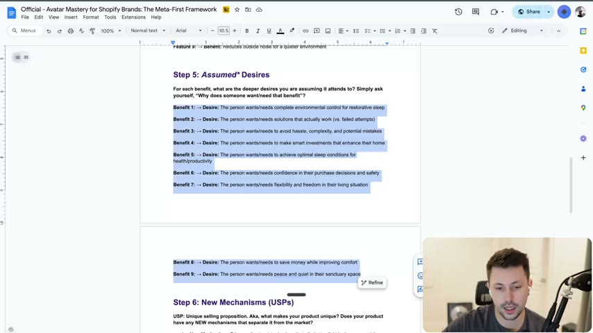
*The Google Doc ("Avatar Mastery for Shopify Brands: The Meta-First Framework") with nine assumed desires, e.g. Benefit 1: complete environmental control for restorative sleep; Benefit 9: peace and quiet in their sanctuary space. This list is the raw material for core avatars. [00:57]*

### Pruning AI desires into 3 core avatars [00:57–10:38]
- AI output is "just spitting out bleh… it's not really thinking deep"; edit it with common sense. [07:45]
- Desire 1: "complete environmental control for restorative sleep" becomes **Core Avatar #1 "Wants restorative sleep"**. "More specific than just wants better sleep… restorative, which I like a little bit better." [01:54]
- Deleted as too broad: "solutions that actually work vs failed attempts", "avoid hassle, complexity and potential mistakes", "confidence in their purchase and safety", "flexibility and freedom in their living situation" (could mean a comfier couch or a bigger patio), "save money while improving comfort". [02:33; 07:45; 08:36; 09:48]
- "Make smart investments to enhance their home" is "kind of a behavior" ("someone that does a certain type of thing"), so he rewrites it as "person wants to enhance their health", and makes the smart-investments piece **Sub Avatar #1** (desire + behavior). That sub-avatar supports a line like "if you're the type of person that believes in investing into your health". [03:11–04:52]
- "Optimal sleep conditions for health and productivity" is relabelled "wants optimal sleep"; he drops it as near-duplicate of restorative. Language still matters: "are you trying to get a more restorative sleep" vs "are you wanting to optimize your sleep routine" can reach different people (an exhausted mom vs a "biohacking bro"). [05:41–07:45]
- "Peace and quiet in their sanctuary space" becomes **Core Avatar #3 "Person wants to sleep in a quiet environment"**. [09:48–10:38]
- He would not use emotion or behavior core avatars "quite yet"; start with desire-based and add experience-based later. [10:38]

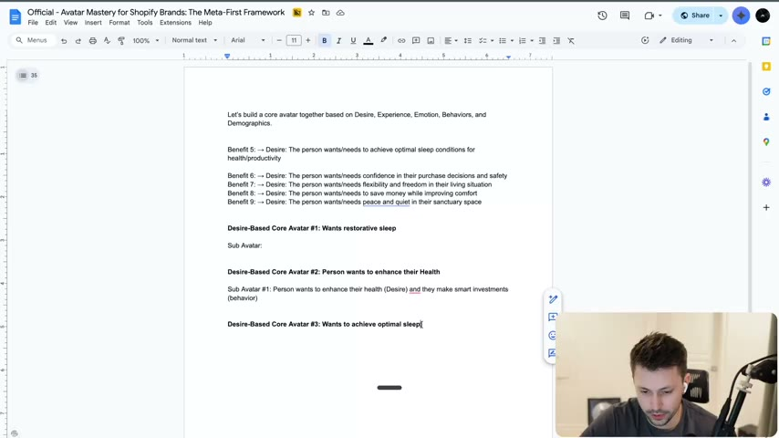
*The early doc state: "Desire-Based Core Avatar #1: Wants restorative sleep", "#2: Person wants to enhance their Health" (Sub Avatar #1 = health + smart investments behavior), "#3: Wants to achieve optimal sleep" (later renamed "sleep in a quiet environment"). [06:40]*

### Rank by the avatar scale, then scope, urgency, staying power [12:01–19:55]
- Plot the three on the avatar scale ("the Pepes", see [71](071-the-evolve-avatar-training.md)): **wants to enhance their health** (broadest: eating, sleep, gym, mental health) → **wants restorative sleep** → **wants to sleep in a quiet environment** (most specific; includes both light and heavy sleepers). [12:01–15:10]
- Scoring (reusing the desire criteria from [61](061-understanding-applying-desire-part-1.md)):

| Desire | Scope | Urgency | Staying power | Source |
|---|---|---|---|---|
| Wants to enhance their health | Largest; "the most amount of people" | "Can be extremely urgent depending on the experiences" | Strong; "people want to just keep being healthy" | [18:25] |
| Wants restorative sleep | Middle | Lower; may not be super urgent | Middle; a continuum ("even more restorative sleep"); example Eight Sleep adding supplements and jet-lag products | [16:36–18:25] |
| Wants to sleep in a quiet environment | Smallest | "Actually has a lot of urgency" (instructor is currently suffering noise at home) | Lowest; "once you make your environment quiet you kind of don't really need to do it again" | [15:10–17:34] |

- "Choosing the strongest doesn't… you don't always have to, but it's just good to be aware." The strongest "are going to be the most competitive and a lot of times the most broad". [18:25–19:14]
- **Revenue-stage pick** [19:14–19:55]: $0–$100K/month → "someone who wants to sleep in a quiet environment"; $100K–$1M → "someone who wants restorative sleep"; $1M–$10M → "wants to enhance their health" (or at least starting there).
- His own example: for Evolve (they spend about "a thousand dollars a day" on their own ads, instructor claim) he would start with "I want to grow my Shopify brand" before climbing to "wants to make money". [11:11–12:01]

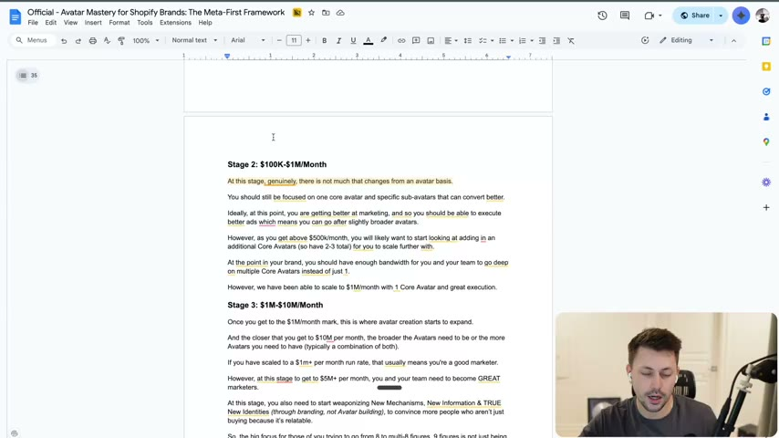
*The "how many avatars" section of the avatar doc (full text in [71](071-the-evolve-avatar-training.md)): Stage 2 stays on one core avatar, adds 2-3 above about $500K/month; Stage 3 expands and relies on new mechanisms, new information and true new identities. [15:00]*

### Scan the market before committing [19:55–27:26]
- Search the Meta Ad Library for "blackout blinds" (works without a paid spy tool; "you can do this anywhere"). Look for "other desires", not ad inspo: "you're not just competing against people who sell it online". [19:55–23:55]
- What he logged:
  - **Label**: "light sleeper" (from a Reddit post: "I'm a light sleeper too. Any recommendations for blackout blinds?"). Definition: "a label is something that is used to describe this avatar". [20:41]
  - **Information**: ad line "Eight hours of solid sleep during the day" gives "sleep during the day" as a behavior/experience that explains why someone needs blackout blinds. [21:13–21:49]
  - **Potential desire**: remove light from a nursery without ruining the look (see teardown below). [22:27–24:54]
  - **Potential desire**: "wants total darkness" (from "Your alarm shouldn't be the sun. When I need total darkness, this is what I use"). [24:54]
- Levels of sophistication visible: "everybody's talking about 100% blackout"; "100% blackout with just one click" (speed); a VSL-style "Nordic sleep secret"; local competitors with "free in-home consultation", in Spanish and other languages. [21:13; 23:09–24:54]
- Nursery avatar math: needs a baby, a nursery, a well-designed room: "that is a great little market… to get to your first 100K plus a month, start building some sales and then scale from there". It likely stems from a past product experience with ugly blackout blinds, and taps status. [24:54–26:44]

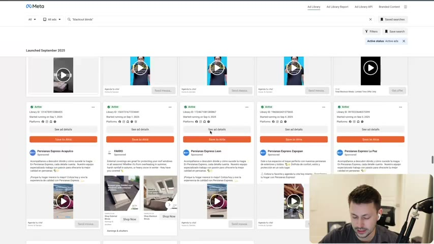
*Meta Ad Library search "blackout blinds" (active ads): a mix of local installers, external-blind brands and video ads. The instructor scans these for new desires, labels and levels of market sophistication rather than for creative to copy. [24:10]*

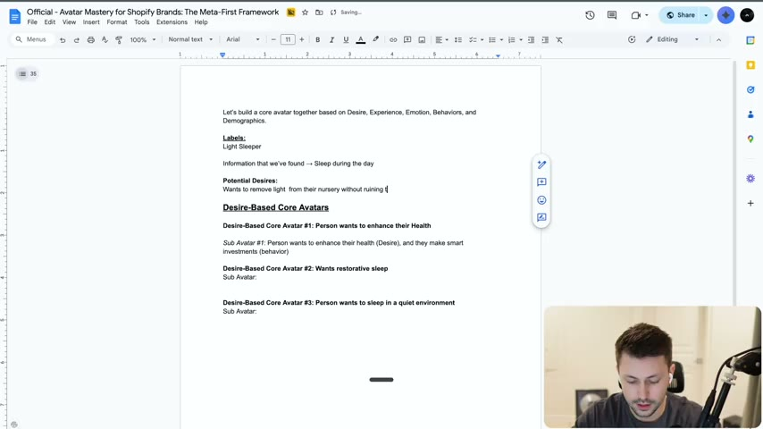
*The research scratch area at the top of the doc: Labels, Information that we've found, Potential Desires. Typed live during the ad-library scan. [25:00]*

### Reddit: finding Core Avatar 2.5 [27:26–32:31]
- Google "want more restorative sleep reddit" leads to r/whoop thread "What has helped you increase your REM / Deep Sleep?". The question is itself a desire: "wants to improve their REM and deep sleep", inserted as **Core Avatar #2.5** ("we could just call this like 2.5"). [27:26–28:23]
- Learn unknown terms: "what is REM sleep" in Google. "Potentially we just found new information." [28:23–29:02]
- AI-assisted check of awareness (voice-texted into Claude): what share of people know what REM is, and what share of the higher-income, health-conscious segment? Claude found no survey data, gave a guess: general population "30% to 40%" have heard the term but only "15% to 25%" can explain it; higher-income health-conscious "60-70%" familiar and "40-50%" understand it well enough to care. The instructor summarises "67% are familiar… 45% actually understand it" and warns these are "rough numbers… take Claude's guess". [29:47–31:38]
- Use: "You're not going to come in and treat people like they're dumb" with "brand new discovery REM sleep". Fit with [Market Awareness](010-market-awareness.md). [31:38]

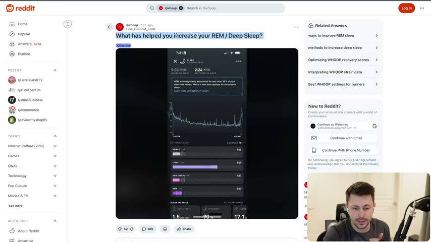
*The r/whoop thread that supplied Core Avatar #2.5 and later the magnesium sub-avatar. 109 comments. [27:30]*

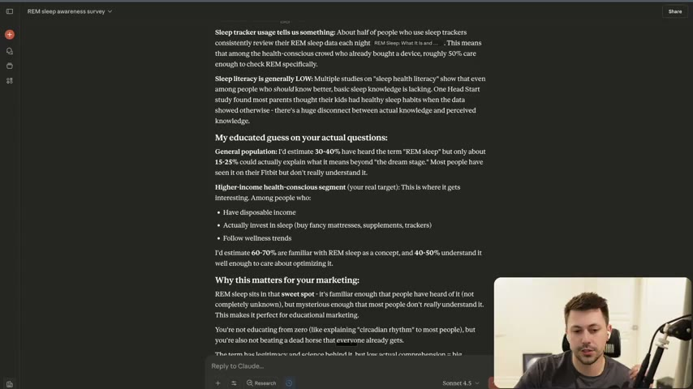
*Claude's estimate of REM awareness, shown on screen ("Sonnet 4.5"). Treat as an unsourced AI guess, not data; the instructor flags it the same way. [31:40]*

### From one Reddit comment to a sub-avatar and a headline [32:31–40:20]
- Top comment (54 upvotes): takes magnesium, doesn't eat close to bedtime, Whoop shows a full belly hurts recovery, careful with caffeine timing, pre-workout not within 8 hours of bed. [33:17–34:31]
- Categorise: "has tried magnesium" is a **product experience** → **Sub Avatar #1 under Core Avatar #2.5**. "Has heard about REM sleep but doesn't know what it means" is an experience (or information); "uses a Whoop or Oura" is a behavior that "probably signifies" the desire. [32:31–36:21]
- Ad concept thinking: "if you want to improve your deep sleep and you've only tried taking magnesium… wait until you try this". Someone who has taken magnesium and knows REM/deep sleep "don't you think that ad is going to grab their attention? Probably… you won't know until you test". [34:31–36:21]
- Mindset: get "lost in the sauce", then "your work works more on you than you work on it"; but "the end goal is we're trying to make winning ads". [36:52–37:44]
- Prompt to turn it into headlines (see Prompts section). Claude returned three angle options; he calls the prompt "horrible… awful" and still gets "banger" lines, then proposes broadening magnesium to supplements in general. [37:44–39:25]

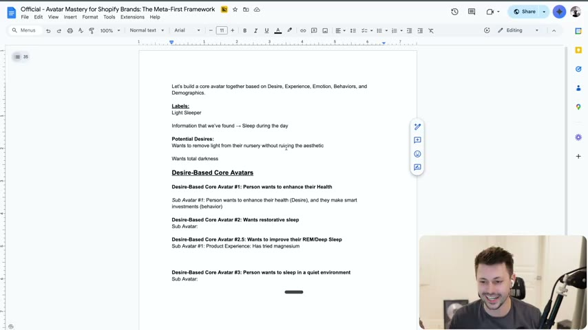
*Core avatar 2.5 with its first sub-avatar logged in the doc, plus Labels / Information / Potential Desires above. [37:30]*

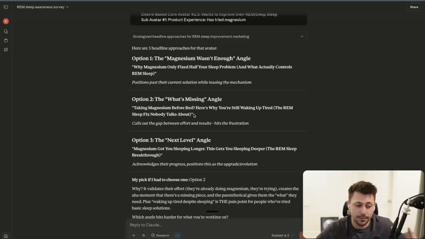
*Claude's three headline approaches ("Magnesium Wasn't Enough", "What's Missing", "Next Level"), with a recommended pick. [38:50]*

### Behavior-based core avatar: "people who don't eat before bedtime" [40:20–45:45]
- From a line in the Reddit thread (not eating close to bedtime), he creates a **behavior-based core avatar**, still "one line on a Reddit thread". [40:20; 45:45]
- Research it: Google AI Overview says eating too close to bedtime can disrupt sleep, but "a small, easily digestible snack can be beneficial"; Sleep Foundation: "Eating before bed may stabilize your blood sugar levels and satisfy cravings, helping you fall asleep faster." Always "double confirm… go and read another one from Healthline". [41:22–44:25]
- Hook he drafts: "Are you not eating before bed? That actually might be making your sleep worse." Then script: "most people think… you can't eat before bed whatsoever, but research shows it's only when you eat the wrong things." That is new information used as a mechanism "to hook someone in". [41:58–43:28]
- Product swap-ins (derived from his commentary): a sleep supplement could say a snack with the product "keeps you full throughout the night"; for blackout blinds, pivot: the thing hurting your sleep may be light, not food. [43:28–45:45]

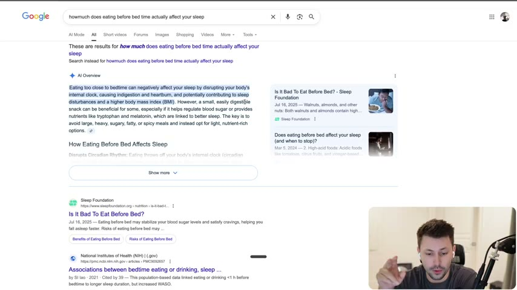
*Google search "how much does eating before bed time actually affect your sleep": the AI Overview text he reads, with Sleep Foundation and NIH results beneath. Used to validate a behavior-based avatar before writing a hook. [41:40]*

### Customer line to static ad [45:45–47:21]
- Reddit comment: "9pm looks like it's the middle of the night". He turns it into **"Turn 9 p.m. into 2 a.m."**: a static ad showing the product. Desire it implies: wants darkness in the bedroom ("I can't guarantee it, but… we can assume"). [45:45–46:39]
- Close: "focus on desire-based for 99% of you… then in the next module you're going to see how we break it down into more sub avatars". [46:39]

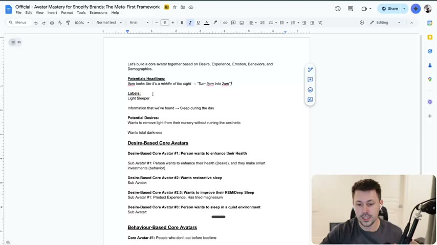
*End state of the research doc: Potential Headlines at the top, then Labels, Information, Potential Desires, desire-based core avatars (with #2.5 and its sub-avatar) and "Behaviour-Based Core Avatars: Core Avatar #1: People who don't eat before bedtime". [46:30]*

## Steps / framework
1. Open the Product Overview doc: features → assumed benefits → assumed desires. [00:57]
2. Copy every desire into a "Desire-Based Core Avatars" list; rewrite each as "Wants X" / "Person wants to …". [03:11–04:10]
3. Delete or park desires that are mega-broad or not tied to what the product actually does. [02:33; 07:45–09:48]
4. Reclassify non-desires: e.g. "makes smart investments" is a behavior → sub-avatar under a desire. [03:11]
5. Merge near-duplicates (restorative vs optimal sleep) but note that wording can target different people. [05:41–06:57]
6. Plot the remaining 3 on the avatar scale; score scope, urgency, staying power. [12:01–19:14]
7. Pick by revenue stage ($0–100K: smallest; $100K–$1M: middle; $1M–$10M: broad). [19:14–19:55]
8. Scan the Meta Ad Library for the product keyword: log Labels, Information, Potential Desires, and the sophistication level. [19:55–24:54]
9. Mine Reddit/Google (Reddit is his default): find one-line desires, product experiences, behaviors; add as core 2.5 or sub-avatars. [27:26–36:21]
10. Look up unfamiliar terms; estimate how many in the market already know them; don't treat the market as ignorant. [28:23–31:38]
11. Convert findings to headlines as you go (prompt below) and log under "Potential Headlines". [37:44; 45:45]
12. Stop researching when you have one core avatar plus a few sub-avatars; "watching me take action doesn't make you money. You taking action makes you money." [26:44–37:44]

## Examples
- **Avatar naming:** "Desire-Based Core Avatar #1: Wants restorative sleep" / "#2: Person wants to enhance their Health" / "#3: Person wants to sleep in a quiet environment" / "#2.5: Wants to improve their REM/Deep Sleep" / "Behaviour-Based Core Avatar #1: People who don't eat before bedtime". [06:40; 37:30; 46:30]
- **Sub-avatar line:** "Sub Avatar #1: Person wants to enhance their health (Desire), and they make smart investments (behavior)". [04:10]
- **Desire to product-experience sub-avatar:** wants improve REM/deep sleep + "has tried magnesium" (product experience). [35:29]
- **Desire reach logic:** a "light sleeper" and a "super heavy sleeper" both want restorative sleep; only some want a quiet environment, and only for a specific reason. [14:22]
- **Language targeting:** "restorative sleep" for an exhausted mom vs "optimize your sleep routine" for a biohacker; same desire, different avatar. [06:57–07:45]

## Structured units

### Angles
| Angle | Core desire / pain | Heuristic(s) | Best format | Example line | Source |
|---|---|---|---|---|---|
| "Magnesium only fixed half" | Wants better deep sleep; magnesium did not fully work | Gap between effort and result (derived) | Headline / static | "Magnesium got you sleeping longer. This gets you sleeping deeper." | [38:50] |
| Quiet bedroom | Sleep in a quiet environment | — | Video / UGC | Not written live; instructor notes few competitors push it | [19:55] |
| Total darkness, daytime sleepers | Wants total darkness; sleeps during the day | — | Video / static | Competitor line: "Your alarm shouldn't be the sun." | [24:54] |
| Nursery without the jail look | Remove light from nursery without ruining the aesthetic | Status / design (derived) | Static / UGC | Competitor line: "Blackout blinds that don't ruin your nursery vibe" | [22:27] |
| Eating before bed is not the villain | People who don't eat before bed, wanting better sleep | New information as mechanism | UGC hook | "Are you not eating before bed? That actually might be making your sleep worse." | [41:58] |
| Turn 9 pm into 2 am | Wants darkness in the bedroom | Visualization (derived) | Static | "Turn 9 p.m. into 2 a.m." | [45:45] |

### Hooks
| Hook (verbatim or near) | Heuristic(s) | Emotion / zone | Self targeted | Why it works | Source |
|---|---|---|---|---|---|
| "Why Magnesium Only Fixed Half Your Sleep Problem (And What Actually Controls REM Sleep)" (Claude, option 1) | — | — | — | Positions beyond their current solution while teasing the mechanism (Claude's note on screen) | [38:50] |
| "Taking Magnesium Before Bed? Here's Why You're Still Waking Up Tired (The REM Sleep Fix Nobody Talks About)" (Claude, option 2; Claude's pick) | — | — | — | Calls out the gap between effort and results (Claude's note on screen); works for people who tried magnesium and felt nothing (instructor) | [38:37] |
| "Magnesium Got You Sleeping Longer. This Gets You Sleeping Deeper (The REM Sleep Breakthrough)" (Claude, option 3) | — | — | — | Acknowledges progress; positions product as the upgrade (Claude's note on screen); instructor: "Banger" | [38:37] |
| "Are you not eating before bed? That actually might be making your sleep worse." (instructor) | — | — | — | Challenges a held belief; sets up "wait, I can eat?" | [41:58] |
| "Turn 9 p.m. into 2 a.m." (instructor, from a customer comment) | — | — | — | "It gives a visualization" | [45:45] |

### Ad teardowns
| Brand / product (niche) | Format | Hook / opening | What works | What fails | Fix suggested | Principle | Source |
|---|---|---|---|---|---|---|---|
| Unnamed brand, blackout blinds (home) | Video, VSL-style | "the Nordic sleep secret" (instructor reads the title) | Instructor calls it "more of an advanced ad" with curtain setup | — | — | — | [21:13] |
| Unnamed brand, blackout blinds | Video | "Eight hours of solid sleep during the day" | Names daytime sleepers as an avatar | — | — | Find information/avatar from competitor copy | [21:13–21:49] |
| "Portafox" (Whisper spelling; unverified), nursery blackout blinds | Image/video | "Blackout blinds that don't ruin your nursery vibe… our designs are made to complement your space and not clash it while still blocking 100% of the light" | Goes after a very specific avatar (parents with a nursery, design-minded) | USP may not be big enough to reach "everyone that's like a health nut" | Use as a smaller starter market to reach first $100K+/month | Specificity earns the right to a smaller market | [22:27–24:54] |
| Unnamed brand | Image/video | "Your alarm shouldn't be the sun. When I need total darkness, this is what I use." | Implies "wants total darkness" desire in first-person language | — | — | — | [24:54] |
| Local installers, multi-language | Video | "Free in-home consultation" | Reminds you competitors include offline sellers | — | — | — | [23:55] |

## Prompts / templates (verbatim)

**Core-avatar doc skeleton** (as typed on screen; capitalisation as shown):
```
Let's build a core avatar together based on Desire, Experience, Emotion, Behaviors, and Demographics.

Potentials Headlines:
<customer line> → "<headline>"

Labels:
<label>

Information that we've found → <fact>

Potential Desires:
<desire>

Desire-Based Core Avatars
Desire-Based Core Avatar #1: <Person wants to ...>
Sub Avatar #1: <Person wants ... (Desire), and they ... (behavior)>

Desire-Based Core Avatar #2: Wants <...>
Sub Avatar:

Behaviour-Based Core Avatars
Core Avatar #1: People who don't eat before bedtime
```
[04:10; 37:30; 46:30]

**Assumed-desire question** (doc Step 5, on screen): "For each benefit, what are the deeper desires you are assuming it attends to? Simply ask yourself, 'Why does someone want/need that benefit?'" [00:57]

**Claude prompt for headline ideas** (typed on screen, typo included):
```
Heyc aude how would I turn this information into a potential headline? Give me 3 examples:

Desire-Based Core Avatar #2.5: Wants to improve their REM/Deep Sleep
Sub Avatar #1: Product Experience: Has tried magnesium
```
Spoken version: "Hey, Claude, how would I turn this information into a potential headline. Give me three examples." The instructor calls it "a horrible prompt… I'm acting like a complete moron". [37:44–39:25]

**Claude prompt for REM awareness** (voice-dictated; wording reconstructed from audio, not exact): "Based off research you can find in the market, what percentage of people potentially know what REM sleep is? … is it commonly known? … and more importantly, based off people that can afford to likely enhance their sleep… people with some income to spend on investing into their health, what percentage of those people actually know about it?" [29:47–30:39]

## Screenshots
Embedded inline above (11 frames): assumed desires [00:57], first core avatars [06:40], stage guidance [15:00], Meta Ad Library [24:10], labels doc [25:00], Reddit thread [27:30], Claude REM estimate [31:40], core 2.5 + sub-avatar [37:30], Claude headlines [38:50], Google AI Overview on eating before bed [41:40], final doc [46:30].

## How to apply
- [ ] List assumed desires from the product doc; rewrite as "Wants X" lines and delete the mega-broad ones.
- [ ] Check each desire is something the product can truly deliver and a believable mechanism ([76](076-how-to-build-sub-avatars.md) [05:12–06:34]).
- [ ] Score the shortlisted desires on scope, urgency and staying power; pick the one that fits the current revenue stage.
- [ ] Search the Meta Ad Library for the product keyword; log labels, information, potential desires, and sophistication.
- [ ] Search Reddit (desire, product experience, behavior terms); copy one-line quotes into the doc.
- [ ] Look up every unfamiliar term; estimate market awareness and cross-check any AI figure with a second source.
- [ ] Turn 1-3 customer lines into headlines; keep them under "Potential Headlines".
- [ ] Hand the chosen core avatar to [76](076-how-to-build-sub-avatars.md) for sub-avatar building.

## Related
- Previous: [73. Action Item / Take a Breather](073-action-item-take-a-breather.md) · Next: [75. Action Item / Identify Your Core Avatars](075-action-item-identify-your-core-avatars.md)
- [57. Understanding Your Product](057-understanding-your-product-part-1.md) · [63. How To Find Desires](063-how-to-find-desires-part-3.md) · [31. Reddit Research](031-reddit-research.md) · [Customer research to angles](../../../../playbooks/customer-research-to-angles.md) · [Avatars and angles (Evolve Copywriting)](../../copywriting/concepts/avatars-and-angles.md)

## Sources and limitations
- Transcript: [74. How To Build Core Avatars.txt](<../../../../../raw/evolve/start-here/_transcripts/👣 Evolve (Start Here)/74. How To Build Core Avatars 👣 Evolve (Start Here) Evolve.txt>) · Page text: [74 page](<../../../../../raw/evolve/start-here/_extracted/👣 Evolve (Start Here)/74. How To Build Core Avatars_👣 Evolve (Start Here)_Evolve.html.md>) (empty) · Stage text cross-checked in [71 doc text](<../../../../../raw/evolve/start-here/_extracted/👣 Evolve (Start Here)/71. ⭐️ The Evolve Avatar Training.docx.md>).
- Machine transcription (Whisper large-v3-turbo). Complete coverage (last segment ends 47:21 of 47:22). Whisper mishearings: "Andromeda" is the instructor's own uncertain pronunciation; "Atria" (ad tool) heard as "Atrio"; "Blackout Brian" for blackout blinds; "Portafox" brand spelling unverified; "sixth grade reading level" in the product description is probably the instructor reading the AI output, content unclear; "Norse"/"Nordic sleep secret" are audio spellings of an ad title; "Aqua" = a voice-dictation tool he thanks (name unverified).
- Product facts, AI percentages (30–40% / 15–25%, 60–70% / 40–50%) and the "$1,000/day" spend are unverified instructor or AI statements.
- Contradiction flags: in [76](076-how-to-build-sub-avatars.md) [07:33–11:11] he advises not to use a broad core desire (health, sex, status, belonging, control, comfort) as the core avatar; here "wants to enhance their health" is shown as the broad end for $1M+ brands. Also here he says not to use behaviors "quite yet" [10:38] but builds a behavior-based core avatar at [40:20]; [76](076-how-to-build-sub-avatars.md) [00:42] says every avatar needs a desire.
