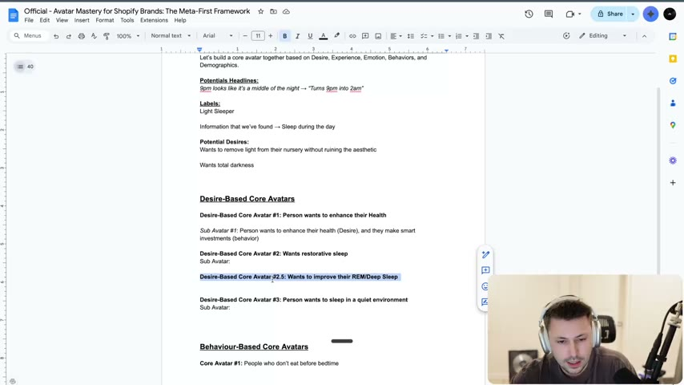
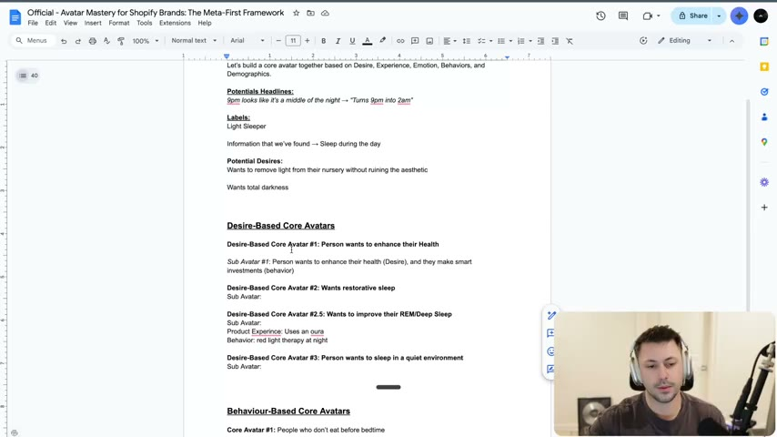
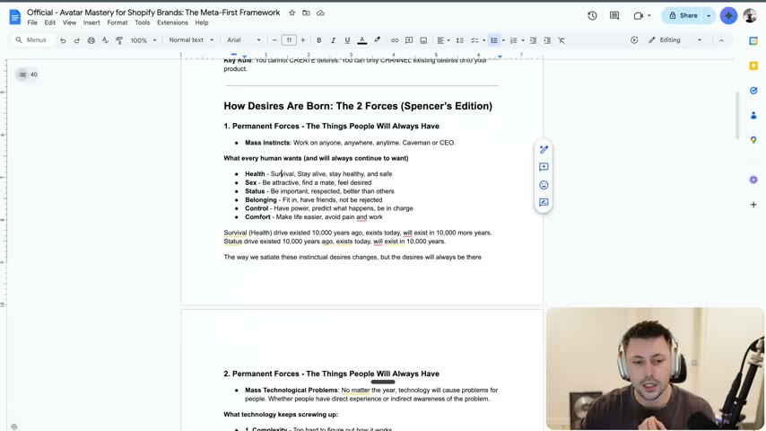
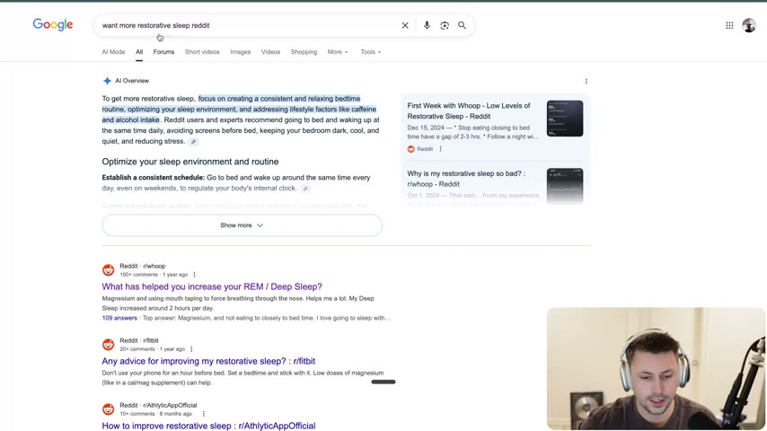
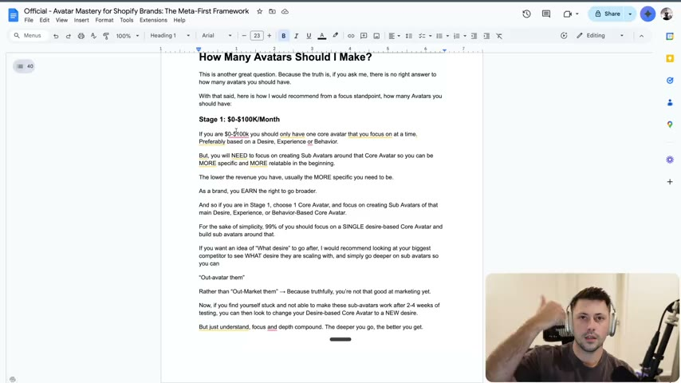
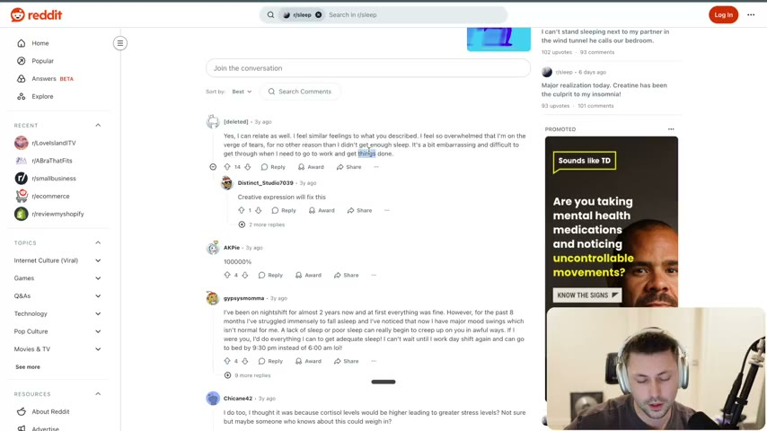
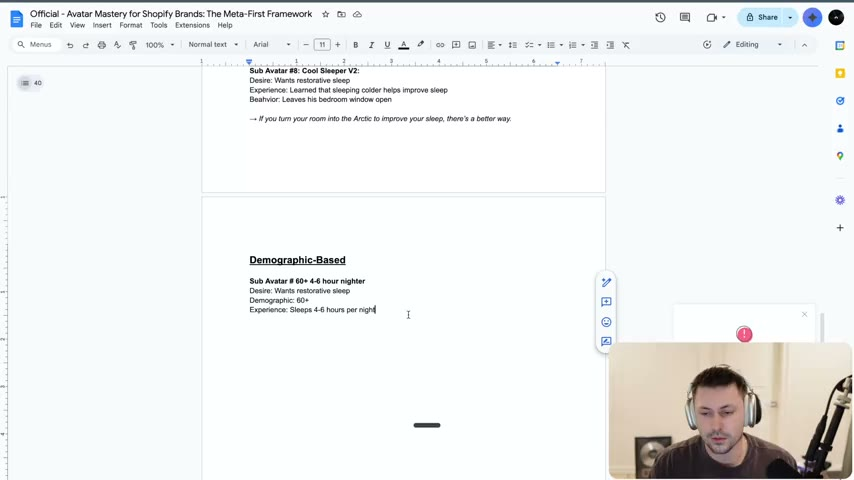
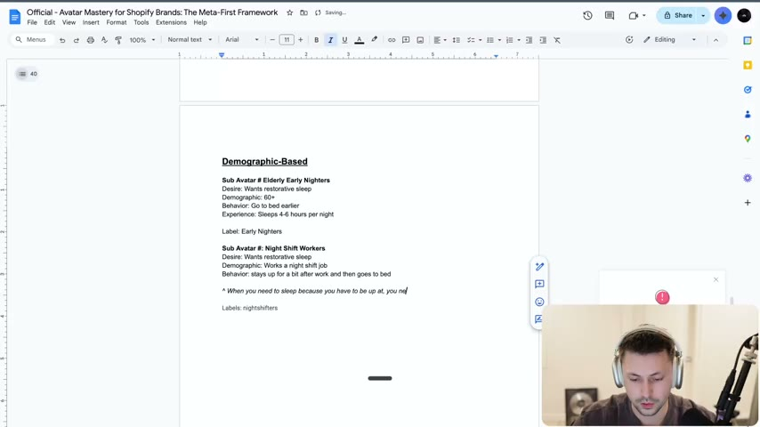
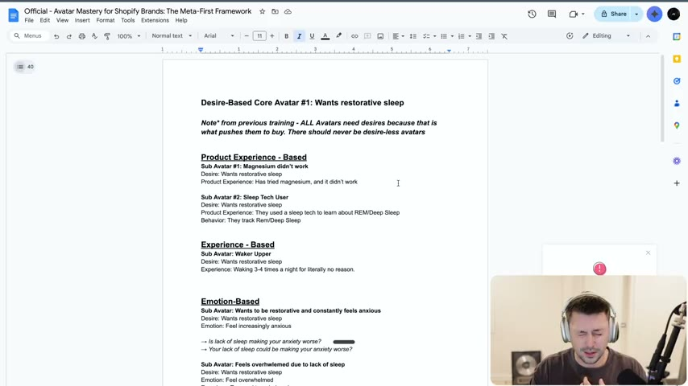

# 76. How To Build Sub Avatars
> Pick a slightly-broad, desire-based core avatar your product can truly deliver on, then mine Google and Reddit for product experiences, experiences, emotions, behaviors and demographics to write sub-avatars that each become a relatable ad angle.

## 🤖 Agent use
- **Use when:** you have a desire-based core avatar and need many sub-avatars; auditing a core-avatar choice; turning Reddit threads into sub-avatar records, labels and headlines.
- **Inputs → outputs:** one desire-based core avatar, Google/Reddit threads → sub-avatar records (Desire + one category field each, plus label and an optional draft headline), grouped as Product Experience / Experience / Emotion / Behavior / Demographic based.
- **Rules:**
  - **DO** give every avatar a desire: "all avatars need to have desires because that is what actually pushes them to buy… you should never have desireless avatars". [00:42]
  - **DO** start with a desire-based core avatar on a first pass. [01:29]
  - **DO** choose a core avatar that is "slightly more broad" than where you will end up so you can go deeper, but "not too broad where it's a core desire" (health, sex, status, belonging, control, comfort). [05:12; 07:33–09:58]
  - **DO** pick a desire your product "actually has to live up to" and can plausibly deliver: "if your product can't help with sleep, it's not going to be a good desire". [05:12]
  - **DO** check the mechanism is believable for the desire (sunglasses vs a sleep machine such as Eight Sleep). [06:34]
  - **DO** research each category separately by searching it: desire, emotion, demographic, product experience, behavior. [10:47–13:14]
  - **DO** use the customer's lingo for labels (e.g. "night shifters", "graveyard shift"). [28:21]
  - **DON'T** research for days: "you can maybe spend an hour going through all these threads". [15:05]
  - **IF** 0–$100K/month **THEN** one core avatar and many sub-avatars; **IF** $100K–$1M **THEN** a few core avatars; **IF** $1M+ **THEN** a few more depending on how broad each is. [13:14–14:08]
  - **IF** a researched person has no problem (e.g. sleeps great on weed gummies and wine) **THEN** don't make an avatar of them; mine them for information and an adjacent angle. [23:52–24:49]
  - **IF** a Reddit comment expresses a problem or feeling in vivid words **THEN** put the words into an LLM to draft headlines for that sub-avatar. [17:31–19:42]
- **See also:** [74. How To Build Core Avatars](074-how-to-build-core-avatars.md) · [71. The Evolve Avatar Training](071-the-evolve-avatar-training.md) · [72. AI podcast version](072-evolve-avatar-training-ai-podcast-version.md) · [31. Reddit Research](031-reddit-research.md) · [77. Action Item / Create Your Sub Avatars](077-action-item-create-your-sub-avatars.md) · [Labels and customer language (Evolve Copywriting)](../../copywriting/concepts/labels-and-customer-language.md)

Lesson page text: "IMPORTANT - Make sure you check the action item below. The next section on how to use these sub-avatars begins under the folder: 📝 How To Make Ads (Execution)… check the action item to make sure that you build your sub-avatars and then proceed to the following modules, there for the remainder of the avatars training and how to create ad angles."

## Key ideas

### Why a re-record, and the "never desireless" rule [00:00–02:27]
- This is the second sub-avatar video he filmed; the first "wasn't clear enough". He had spent about two weeks on "about seven other worksheets" between uploads. [00:00–00:42]
- Behavior-based core avatars are possible ("people who don't eat before bedtime"), but they still need a desire: maybe better sleep, maybe weight loss ("their body will just like burn all their calories if they go to bed hungry"). Pick at least one desire. [00:42–01:29]
- For simplicity, especially the first time, "start with the desire-based core avatar". Each desire has its own urgency and scope, so choose one "we can kind of work with". [01:29–02:27]

### One thing can be a desire, a core avatar or a sub-avatar [02:27–05:12]
- "Wants to improve REM and deep sleep" (found in an r/whoop thread) could be a core avatar, but he'd rather see it used as a sub-avatar under "restorative sleep". [02:27]
- Same Reddit line also shows an experience: a Whoop user. **Sub Avatar #2 "Sleep Tech User"**: desire = wants restorative sleep; product experience = used a sleep tech to learn about REM/deep sleep; behavior = tracks REM/deep sleep. [03:22]
- Going more specific: product experience "uses an Oura" plus behavior "red light therapy at night" (or cold plunge in the morning). "Very specific. Not only does this person need to know what REM and deep sleep is, they also want to improve it." [04:21]


*The doc carried over from lesson 74, with "Core Avatar #2.5: Wants to improve their REM/Deep Sleep" highlighted before being reframed as a sub-avatar. [02:30]*


*Building a sub-avatar live: product experience "Uses an oura" and behavior "red light therapy at night" under the REM/deep-sleep desire. [05:12]*

### How to choose the core avatar [05:12–09:58]
1. **Desire-based**, "slightly more broad because then we can go deeper on it". [05:12]
2. **Your product must live up to the desire.** "Even if they believe you and… your mechanism can do it, when they get the product, [if] the product doesn't do it… that's just going to kill your brand." Not every product works for everyone, but "if majority of people are not having a good experience" it fails. [05:12–06:01]
3. **The mechanism must be believable** for that desire. Example: "if you wear sunglasses during the day, it's actually going to help you get more restorative sleep" (he admits he made it up) versus Eight Sleep, a "massive sleep machine" where "the mechanism is just better… and makes more sense". [06:01–07:33]
4. **Don't use a core desire** as the desire-based core avatar. Core desires, per [lesson 61](061-understanding-applying-desire-part-1.md), are "health, sex, status, belonging, control, and comfort". Wanting to be healthy is "very, very broad". [07:33–09:00]
5. **TL;DR:** when listing surface-level desires, "definitely go with one that is slightly more broad… but not too broad where it's a core desire". Asking "why does someone want restorative sleep" reveals the deep core desire (healthier, more energy). [09:00–09:58]


*Reference list the instructor flips to when warning against core desires as core avatars: Health (survive, stay healthy and safe), Sex (be attractive, find a mate), Status (be important, respected), Belonging (fit in, have friends), Control (have power, predict what happens), Comfort (make life easier, avoid pain and work). [07:33]*

### Where to find each category: just search it [09:58–13:14]
- "Behaviors are like my favorite… there's nothing more relatable than what we actually do." [09:58–10:47]
- Searches shown (all Google, mostly landing on Reddit):

| Category searched | Search or thread | What it found | Source |
|---|---|---|---|
| Desire | "want more restorative sleep reddit"; "I want to start sleeping better Reddit" | r/whoop: "What has helped you increase your REM / Deep Sleep?"; r/fitbit and r/AthleticAppOfficial advice threads | [10:47–11:18] |
| Emotion | "how lack of sleep is making me feel Reddit" (he calls it "the dumbest… just true Chad") | "Anyone else experience strong emotional changes when you don't get enough sleep?" | [12:18] |
| Demographic | "At what age does sleep start getting worse?" | r/Aging: "Did your sleep get worse with age?" | [12:18–13:14] |
| Product experience | "blackout room sleep Reddit" | people using the product category | [12:18–13:14] |
| Behavior | no separate search shown; behaviors were read out of comments in the other threads (e.g. night-shift habits, gummies and wine) | — | [13:14; 22:48; 30:02] |

- "Because we went desire hunting and we found our desire-based core avatar, we can click that one out of there": now search behaviors, emotions, experiences and demographics. [13:14]


*"Want more restorative sleep reddit": the search that surfaced the REM/deep-sleep thread. [11:20]*

### How many core avatars at each stage [13:14–14:08]
- $0–$100K/month: "just try to find one core avatar… focus on creating sub-avatars from that main desire". $100K–$1M/month: "a few different… desire-based core avatars". $1M+: "a few more", depending on how broad each is. [13:14–14:08]
- Compare [71](071-the-evolve-avatar-training.md), which says $100K–$1M should "still be focused on one core avatar" and add 2-3 only above about $500K/month (see contradictions below).


*Stage 1 text from the avatar doc: one core avatar, build sub-avatars so you're "MORE specific and MORE relatable", copy your biggest competitor's desire and "Out-avatar them", and change core desire only after 2-4 weeks of failed sub-avatar tests. [13:20]*

### Emotion-based sub-avatar to headline [15:58–19:42]
- Reddit comment: "I feel so overwhelmed that I'm on the verge of tears for no other reason than I didn't get enough sleep. It's a bit embarrassing and difficult to get through when I need to go to work and get things done." [16:56–17:31]
- Record: **Sub-avatar "Feels overwhelmed due to lack of sleep"**: desire = wants restorative sleep; emotion = feels overwhelmed. [17:31]
- Draft headlines with an LLM using the thread and the product (blackout blinds); "Claude has zero context right now… with proper context it's going to print for you"; "I'm going to give you way better prompts, I promise". [18:02–18:55]
- He picks "The real reason you overthink after tossing and turning all night" as best: it "covers both" the overthinking (emotion) and tossing/turning (cause). Some outputs are "more broad". [18:55–19:42]


*The emotional comment he mines for the overwhelmed sub-avatar and headline prompt. [17:30]*

### Experience-based and demographic sub-avatars [19:42–31:41]
- **Waker Upper (experience).** r/Aging post: "I wake up almost three to four times a night… for literally no reason." Not a product experience, "a regular experience". [19:42–21:12]
- **Weed-gummy / wine 71-year-old (information, not an avatar).** A 71-year-old says legal indica gummies and a glass of cab sav help him sleep ("I love my sleeps!"). Demographic 70+, behavior takes gummies and drinks wine, but he already has great sleep, so "not really someone who wants more restorative sleep". Use the information: potential desire "wants to sleep better, but in a healthier way… without having to intoxicate yourself" (instructor's inference). Possible follow-up search "weed gummies to improve sleep Reddit". [21:54–24:49]
- **60+ four-to-six-hour nighter (demographic).** "I haven't slept more than four hours straight in 20 years." Desire = restorative sleep, demographic = 60+, experience = sleeps four to six hours a night. Assumed behavior: go to bed earlier ("Not true, but I'm assuming…"). Hypothesis: their room isn't dark enough. Label: **"early nighters"** / "elderly early nighters". Ad idea: a call-out ad like "if you're 60+ and you only sleep six hours, here's why…" (Whisper heard "Norse style ad"; meaning unclear). [25:41–27:35]
- **Night-shift worker (demographic).** From a "How do people who work night shifts manage their lives" thread: 12-hour 6-to-6 shifts; a top comment says "embrace the lifestyle of a vampire". Record: desire = restorative sleep, demographic = works a night shift, behavior = stays up a bit after work, then goes to bed. Labels: "night shifters", "graveyard shift". Headline direction: "When you need to sleep because you have to be up at [time], you need total darkness" (on screen: "^ When you need to sleep because you have to be up at, you ne…"). Why it fits blinds: "they sleep during the day… and it's bright out". [28:21–31:41; screen at 30:50]
- Why do demographics at all: "as much as you guys know I hate demographics", they can be paired with new information and new mechanisms to educate. [15:58–16:56]


*Writing the demographic-based record live. Above it, an earlier "Sub Avatar #8: Cool Sleeper V2" (desire = restorative sleep; experience = learned that sleeping colder helps; behavior = leaves bedroom window open; line: "If you turn your room into the Arctic to improve your sleep, there's a better way."), written off-camera. [26:40]*


*Night-shift worker record: desire, demographic, behavior, a first hook line, and the label "nightshifters". [30:50]*

### Sub-avatars create the angles [31:41–end]
- "Your sub avatars create the angles… if the angles are relatable, you're going to have better angles." Next: definitions and angles (the module group "How To Make Ads (Execution)"). There is "no right or wrong answer" to how you build them. [31:41]
- He expects the video to "last a very long time" and says they are "very close to Q4" (timing context only). [31:41]


*The finished layout: core avatar line, the "ALL avatars need desires" reminder, then sub-avatars grouped by category with arrow-prefixed headline ideas. This is the template to copy. [31:40]*

## Steps / framework
1. Choose one desire-based core avatar: slightly broad, not a core desire, deliverable and believable for the product. [05:12–09:58]
2. Write the core avatar line and the reminder "ALL avatars need desires". [31:40 screen]
3. Search each category on Google/Reddit: product experience, experience, emotion, behavior, demographic. Skip the desire search once the core avatar exists. [10:47–13:14]
4. Spend about an hour reading threads, not days. [15:05]
5. For each useful comment, write a sub-avatar record with Desire plus the one or two category fields that apply. [17:31; 20:38; 25:41]
6. Add a label (customer word for the person) and, if inspiration hits, a headline line prefixed with an arrow. [20:38–35:35; screen 31:40]
7. If the person has no problem, treat the comment as information, not an avatar. [23:52–24:49]
8. Hand the sub-avatars to the angle modules (next section). [31:41]

## Examples
- Core avatar: "Wants restorative sleep" for blackout blinds. Sub-avatars on screen: Magnesium didn't work (desire + product experience "Has tried magnesium, and it didn't work"); Sleep Tech User (product experience + behavior); Waker Upper (experience); "Wants to be restorative and constantly feels anxious" [sic] (emotion); Feels overwhelmed due to lack of sleep (emotion); Cool Sleeper V2 (experience + behavior); Elderly Early Nighters (demographic); Night Shift Workers (demographic). [31:40; 26:40; 30:50 screen]
- On-screen headline drafts under anxiety sub-avatar: "Is lack of sleep making your anxiety worse?" / "Your lack of sleep could be making your anxiety worse?" [31:40 screen]
- Same wording, different avatar: "restorative sleep" works for an exhausted mom and for a "biohacking bro"; only the language changes. ([74](074-how-to-build-core-avatars.md) [06:57–07:45])

## Structured units

### Angles
| Angle | Core desire / pain | Heuristic(s) | Best format | Example line | Source |
|---|---|---|---|---|---|
| Overwhelmed by bad sleep | Restorative sleep; emotional fallout of sleep loss | — | Headline / UGC | "The real reason you overthink after tossing and turning all night" | [18:55] |
| "Not you, bad sleep" | Restorative sleep; irritability after bad nights | — | Headline | "Things that shouldn't bother you suddenly do. That's not you, that's bad sleep. Be yourself tomorrow." | [19:42] |
| Wrong version of yourself | Restorative sleep | — | Before/after static | "Stop waking up as the wrong version of yourself." | [18:02] |
| Anxiety loop | Restorative sleep; anxiety | — | Headline | "Is lack of sleep making your anxiety worse?" | [31:40 screen] |
| Early nighters 60+ | Restorative sleep for 60+ | Age call-out (derived) | Call-out ad | "If you're 60 plus… you only sleep six hours… here's why" (instructor sketch) | [27:35] |
| Night-shift darkness | Sleep in daylight on a fixed wake time | — | Headline | "When you need to sleep because you have to be up at [time], you need total darkness" | [30:50] |
| Healthier sleep aid | Sleep better without intoxicating yourself | — | Hook | "Get a better sleep without having to… get stoned" (instructor's wording) | [24:49] |
| Cool sleeper | Sleep colder but better | — | Headline | "If you turn your room into the Arctic to improve your sleep, there's a better way." | [26:40 screen] |

### Hooks
| Hook (verbatim or near) | Heuristic(s) | Emotion / zone | Self targeted | Why it works | Source |
|---|---|---|---|---|---|
| "One bad night turns you into someone you're not. Here's why light is ruining your sleep" (Claude, draft) | — | — | — | Links bad nights to identity change | [18:02] |
| "Jealous, irritable, emotional. You're not broken. You're just not sleeping in total darkness." (Claude, draft) | — | — | — | Uses the customer's own emotion words, then reframes | [18:02] |
| "From overthinking mess to calm and centered just by blocking out light." (Claude, draft) | — | — | — | Before/after | [18:02] |
| "Sleep in complete darkness, wake up as yourself again." (Claude, draft) | — | — | — | — | [18:55] |
| "If two bad nights turn you into an overthinker, you need blackout blinds." (Claude, draft) | — | — | — | Direct problem-solution | [19:42] |

### Rewrites
| Before | After | What changed | Source |
|---|---|---|---|
| Reddit: "I feel so overwhelmed that I'm on the verge of tears for no other reason than I didn't get enough sleep" | "The real reason you overthink after tossing and turning all night" | Customer emotion turned into a "real reason" headline covering emotion and cause | [17:31; 18:55] |
| Reddit: "I haven't slept more than four hours straight in 20 years" | Sub-avatar "60+ 4-6 hour nighter" with label "early nighters" | Quote turned into desire + demographic + experience record | [25:41–27:35] |

### Rules of thumb
- **DO** write every sub-avatar with a desire. [00:42]
- **DON'T** make a core desire the core avatar. [07:33–09:00]
- **DO** use customer lingo for labels. [28:21]
- **IF** the commenter is satisfied **THEN** use as information only. [23:52–24:49]

## Prompts / templates (verbatim)
**Sub-avatar record format (from screen, 31:40, 26:40, 30:50; spelling as shown):**
```
Desire-Based Core Avatar #1: Wants restorative sleep

Note* from previous training - ALL Avatars need desires because that is what pushes them to buy. There should never be desire-less avatars

Product Experience - Based
Sub Avatar #1: Magnesium didn't work
Desire: Wants restorative sleep
Product Experience: Has tried magnesium, and it didn't work

Sub Avatar #2: Sleep Tech User
Desire: Wants restorative sleep
Product Experience: They used a sleep tech to learn about REM/Deep Sleep
Behavior: They track Rem/Deep Sleep

Experience - Based
Sub Avatar: Waker Upper
Desire: Wants restorative sleep
Experience: Waking 3-4 times a night for literally no reason.

Emotion-Based
Sub Avatar: Wants to be restorative and constantly feels anxious
Desire: Wants restorative sleep
Emotion: Feel increasingly anxious
→ Is lack of sleep making your anxiety worse?
→ Your lack of sleep could be making your anxiety worse?

Demographic-Based
Sub Avatar # Elderly Early Nighters
Desire: Wants restorative sleep
Behavior: Go to bed earlier
Demographic: 60+
Experience: Sleeps 4-6 hours per night
Label: Early Nighters

Sub Avatar #: Night Shift Workers
Desire: Wants restorative sleep
Demographic: Works a night shift job
Behavior: stays up for a bit after work and then goes to bed
^ When you need to sleep because you have to be up at, you ne[...]
Labels: nightshifters
```

**LLM headline prompt (spoken description; he says it will "sound really dumb" and promises better prompts):** "Write me some headlines or hooks based off of this Reddit thread for my product which helps with improving sleep, blackout blinds." Paste the Reddit thread. [18:02]

## Screenshots
Inline above (9 frames): REM/deep-sleep core avatar [02:30], Oura sub-avatar [05:12], core desires list [07:33], Google search [11:20], Stage 1 doc text [13:20], overwhelmed Reddit comment [17:30], 60+ demographic record [26:40], night-shift record [30:50], finished layout [31:40].

## How to apply
- [ ] Confirm the core avatar is desire-based, slightly broad, not a core desire, deliverable and believable for the product.
- [ ] Search each category separately; read threads for about an hour.
- [ ] For each useful quote write a record: Desire plus Product Experience / Experience / Emotion / Behavior / Demographic, plus a label.
- [ ] Exclude satisfied commenters from avatars; log them as information.
- [ ] Prompt an LLM with the thread and product for headline drafts; keep the ones that mirror the customer's words.
- [ ] Set aside sub-avatars for angle building in the next section ([77](077-action-item-create-your-sub-avatars.md)).

## Related
- Previous: [75. Action Item / Identify Your Core Avatars](075-action-item-identify-your-core-avatars.md) · Next: [77. Action Item / Create Your Sub Avatars](077-action-item-create-your-sub-avatars.md)
- [61. Understanding & Applying Desire](061-understanding-applying-desire-part-1.md) · [63. How To Find Desires](063-how-to-find-desires-part-3.md) · [68. How To Find & Apply New Information](068-how-to-find-apply-new-information-part-3.md) · [Customer research to angles](../../../../playbooks/customer-research-to-angles.md)

## Sources and limitations
- Transcript: [76. How To Build Sub Avatars.txt](<../../../../../raw/evolve/start-here/_transcripts/👣 Evolve (Start Here)/76. How To Build Sub Avatars 👣 Evolve (Start Here) Evolve.txt>) · Page text: [76 page](<../../../../../raw/evolve/start-here/_extracted/👣 Evolve (Start Here)/76. How To Build Sub Avatars_👣 Evolve (Start Here)_Evolve.html.md>) · Cross-reference: [71 doc text](<../../../../../raw/evolve/start-here/_extracted/👣 Evolve (Start Here)/71. ⭐️ The Evolve Avatar Training.docx.md>).
- Machine transcription (Whisper large-v3-turbo). Complete coverage (last segment ends 32:40 of 32:40). Whisper mishearings: "Aura" for Oura ring (screen shows "oura"); "true Chad" is unclear (possibly "true chat"); "L-Tripe" is an unclear supplement name; "Norse style ad" is unclear; "Mrs. Leahy" is a Reddit username heard aloud. Reddit usernames are omitted here; quotes are public Reddit comments.
- "Sub Avatar #8 Cool Sleeper V2", "brown noise" and other text visible on screen was not discussed aloud; treated as on-screen evidence only. The doc's sub-avatars 3-7 are not visible.
- Contradictions with other lessons: (1) here $100K–$1M/month "could start looking at a few different core avatars" [13:14–14:08] but [71](071-the-evolve-avatar-training.md) (Stage 2) says one core avatar until about $500K/month, then 2-3 total. (2) Here every avatar needs a desire [00:42]; the 71 document says an experience-only core avatar need not be tied to a desire. (3) [74](074-how-to-build-core-avatars.md) shows "wants to enhance their health" (a core desire) as the broad $1M+ pick, while here a core desire should not be the core avatar [07:33–11:11].
