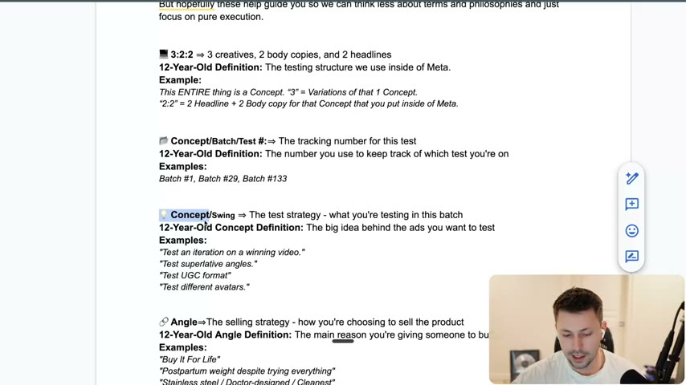
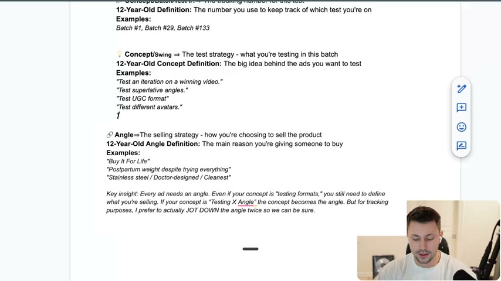
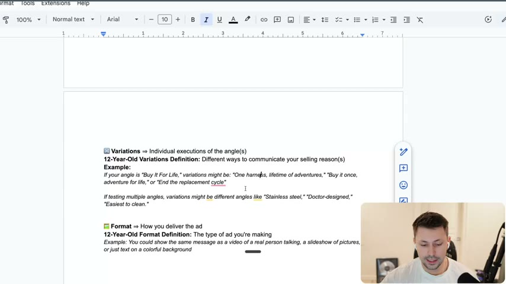

# 78. Understanding Ad Definitions
> The six working terms (3:2:2, batch number, concept/swing, angle, variations, format) that the rest of the Angles and Planning section uses, so that every test is logged as one concept with one defined angle and three variations.

## 🤖 Agent use
- **Use when:** logging, naming or briefing any Meta test; checking that a "concept" actually has an angle; translating a teammate's loose terms ("swing", "iteration", "UGC test") into the course vocabulary.
- **Inputs → outputs:** a test idea → a record with batch number, concept, angle (the reason to buy, written separately even if it equals the concept), variations, format, and the 3:2:2 Meta setup.
- **Rules:**
  - **DO** set up each Meta test as 3:2:2: three creatives, two body copies, two headlines. [01:28–02:10]
  - **DO** give every test a running number (batch / test / concept #) so you can see "how many ads it took you to kind of unlock that winner". [02:50]
  - **DO** write the concept (what you test) and the angle (the reason to buy) as two separate lines. "Every ad needs an angle, period." [05:44]
  - **DON'T** run "UGC format", "us versus them" or "three reasons why" as a test without saying of what: "testing UGC formats of what, right?" [06:39–07:21; 09:08–10:36]
  - **IF** the concept is "test the X angle" **THEN** the concept becomes the angle, but still write the angle a second time "for tracking purposes". [07:21–08:12]
  - **IF** you test several angles in one concept **THEN** each of the three variations carries a different angle. [11:31–12:57]
  - **DON'T** over-argue terms: "I want you to use the definitions that make the most amount of sense to you." [00:41]
- **See also:** [79. How To Come Up With Ad Angles](079-how-to-come-up-with-ad-angles.md) · [81. The 3 Testing Methods - Part 1](081-the-3-testing-methods-part-1.md) · [Copywriting: avatars and angles](../../copywriting/concepts/avatars-and-angles.md) · [Iteration vs variation](../../../../concepts/iteration-vs-variation.md)

Page text (Skool): the definition sheet itself. It is the same doc the instructor scrolls in the video, titled in the video "Avatar Mastery for Shopify Brands: The Meta-First Framework". Terms are the instructor's own choice, not an industry standard (his words, [00:41]).

## Key ideas

### Why this lesson exists and how to watch the mini-series [00:00–01:28]
- This is the first of a short series on "extracting the angles". Watch the videos together, then do the action item; each video defines or explains one part, and examples that tie everything together come at the end (see [83. Putting All The Planning Together](083-putting-all-the-planning-together-examples.md)). [00:00]
- Scope: "ad execution" here means "the ad organization side of things"; the actual writing comes in later steps. [00:41]
- The goal of defining terms: "think less about terms and philosophies, and just focus on pure execution". [00:41]

### 3:2:2 [01:28–02:10]
- "3 creatives, 2 body copies, and 2 headlines". The "12-year-old definition": "the testing structure that we use inside of Meta". [01:28]
- The whole 3:2:2 is one **concept**. The "3" is three variations of that concept; the "2:2" is the two headlines and two body copies "that go around the Facebook ad". [01:28]
- "That is exactly how we set up ads inside of Meta." [02:10]

### Concept / Batch / Test number [02:10–03:48]
- Names are interchangeable (concept number, test number, batch number). It is "the number you use to keep track of which test you're on". Examples on the sheet: Batch #1, Batch #29, Batch #133. [02:10; 02:50]
- Why track it: you can look back at "test number 27, how did that do", and measure "how long is it taking us to actually find a winning ad", i.e. how many ads it took to find the winner. [02:50]

### Concept / Swing [03:48–05:44]
- Concept = "the test strategy. It's what you're choosing to test in that specific batch"; plain version: "the big idea behind the ads that you want to test". People also say "take a bigger swing". [03:48]
- Sheet examples: "Test an iteration on a winning video", "Test superlative angles", "Test UGC format", "Test different avatars". [03:48–04:45]
- "Superlative" is explained as a claim like "the world's best or like the world's first" (more in [82](082-the-3-testing-methods-part-2.md)). [04:45]
- The concept is "what are we testing? ... the goal of the test" and "your internal guider". [04:45; 13:51]

### Angle [05:44–08:12]
- Angle = "the selling strategy: how you're choosing to sell the product". Plain version: "the main reason you're giving someone to buy". [05:44]
- Spoken examples: "buy it for life", "postpartum weight despite trying everything", "stainless steel / doctor-designed / cleanest" (this is also what the doc on screen shows at [08:40]; see the examples section for the Skool page's different list). [05:44]
- **Key insight, quoted:** "Every ad needs an angle." If the concept is testing formats, "you still need to find what you're selling ... Because testing UGC formats of what?" [05:44–06:39]
- "That's why your ads suck because you don't even have an angle. You're just thinking of like a format." [06:39]

### When the concept is the angle [07:21–10:36]
- A concept can test formats, iterations or many other things, but if it is "test X angle", then the concept becomes the angle. That is why people use the words as if they were the same. [07:21]
- Best practice: write the angle down a second time. Example: concept "test the durability angle" → angle "durability". [08:12]
- "Us versus them" is "just an idea ... better in what way? For what?" Pet-niche example: one concept compared how the product is "easier to put on versus others" (angle: easier to put on); another us-vs-them concept could be about durability. [09:08]
- "Three reasons why" has the same problem: "great of what?" Winging it means "zero thought process" about the angle. [10:05]

### Variations [10:36–12:57]
- "Individual executions of the angle(s)", plain version "different ways to communicate your selling reason". [10:36]
- Single angle ("buy it for life"): variations = different wordings of it. Multiple angles: variations "might be different angles". [11:31]
- Worked pointer: a superlative concept whose variations were "stainless steel, doctor designed and easiest to clean"; "for every concept, there's going to be three creatives" and each is a variation. [12:01] (Full breakdown: [82](082-the-3-testing-methods-part-2.md).)

### Format [12:57–13:51]
- "How you deliver the ad": "the type of ad that you're making". High level: image, video, carousel, gif. Then specific video types such as AI voiceovers or UGC. [12:57–13:51]
- The instructor says he will provide the list of formats the team uses, with examples of each; the list itself is not included in this lesson's files. [13:51]

### Recap [13:51–15:40]
- Six definitions to know: 3:2:2, batch/test number, concept/swing, angle, variations, format. [14:46]
- "Concept again is your big idea. Angle is how you're choosing to position that big idea basically to the customer. ... variations is like how you execute it. And format is again, how it actually comes out in the actual ad form." [15:40]
- Where people get confused: concept, angle and (a little) variations. [15:40]

## Steps / framework

Order the terms in a test record. The table is the definitions; the "record template" row is (derived) from the instructor's advice to jot the angle twice.

| Term | Plain meaning | Question it answers | Example from the lesson |
|---|---|---|---|
| 3:2:2 | Meta test structure | How do we load it into Meta? | 3 creatives, 2 body copies, 2 headlines |
| Batch / test / concept # | Tracking number | Which test is this? | Batch #1, #29, #133 |
| Concept / swing | Big idea being tested | What are we testing? | "Test an iteration on a winning video", "Test UGC format" |
| Angle | Main reason to buy | How do we sell it? | "Buy it for life", "stainless steel", "easier to put on" |
| Variations | Individual executions | How do we say it / which angles per creative? | "One harness, lifetime of adventures" |
| Format | Delivery type | What does the ad look like? | Real person talking, slideshow, product image |

Record template (derived):
```
Batch #:
Concept (what we test):
Angle (reason to buy; repeat even if concept = angle):
Variations (3): V1 / V2 / V3
Format:
Headlines (2): H1 / H2
Body copies (2): B1 / B2
```

## Examples
- **Page-text angle examples (Skool sheet):** "Your child will enjoy taking their greens" (Grüns), "It will help your digestive system" (Grüns), "You won't be drinking microplastics" (Liquid Death), "You'll look cool while you drink us" (Liquid Death). [page text]
- **Doc on screen / spoken angle examples:** "Buy It For Life", "Postpartum weight despite trying everything", "Stainless steel / Doctor-designed / Cleanest". [05:44; frame 08:40] The two lists differ (the live doc was probably edited after the Skool text was captured, derived); keep both.
- **Variations for "Buy It For Life"** (page text): "One harness, lifetime of adventures", "Buy it once, adventure for life", "End the replacement cycle". [11:31]
- **Variations when testing multiple angles** (page text): "Stainless steel", "Doctor-designed", "Easiest to clean". [12:01]
- **Format example** (page text): the same message as "a video of a real person talking, a slideshow of pictures, or just a product image" (the doc on screen ends the list with "just text on a colorful background"). [12:57]
- **Concept examples:** "Test an iteration on a winning video", "Test superlative angles", "Test UGC format", "Test different avatars". [03:48–04:45]

## Structured units

### Rewrites (before → after)
| Before | After | What changed | Source |
|---|---|---|---|
| Concept: "Test UGC format" | Concept: test UGC format; angle: the reason to buy the UGC video sells (must be written) | Added the missing angle | [06:39] |
| Concept: "Us vs them" | Concept: us vs them; angle: "easier to put on" (or "durability") | Named the "what" being compared | [09:08] |
| Concept: "Three reasons why" | Concept: three reasons why; angle: e.g. durable / easy / looks cool, each chosen on purpose, not winged | Angle chosen deliberately | [10:05] |
| Concept: "test the durability angle" | Concept: test the durability angle; Angle: durability | Angle written twice for tracking | [08:12] |

### Rules of thumb
- **DO** write the angle in its own field on every test sheet. [05:44]
- **DON'T** choose a trending format ("post-it", "three reasons why") before choosing the angle (stated more strongly in [79](079-how-to-come-up-with-ad-angles.md)). [06:39]
- **IF** variations are different angles **THEN** you are in multiple-angle testing (the Marksman method in [81](081-the-3-testing-methods-part-1.md)). [11:31]

## Screenshots

*The live definition sheet showing 3:2:2, the batch/test number, and Concept/Swing with its four example concepts. [03:50]*


*The Angle entry with the examples "Buy It For Life", "Postpartum weight despite trying everything", "Stainless steel / Doctor-designed / Cleanest" and the "jot down the angle twice" key insight. [08:40]*


*Variations (single-angle and multi-angle examples) and Format. [11:40]*

## How to apply
- [ ] Add "Batch #", "Concept", "Angle" and "Variations" columns to the test log; fill Angle even when Concept already names it.
- [ ] Load every new concept as 3:2:2 (3 creatives, 2 body copies, 2 headlines).
- [ ] Reject any concept that has only a format or structure ("UGC", "us vs them", "three reasons why") until its angle is written.
- [ ] Track batch number against "ads until first winner".

## Related
- Previous: [77. Action Item: Create Your Sub Avatars](077-action-item-create-your-sub-avatars.md) · Next: [79. How To Come Up With Ad Angles](079-how-to-come-up-with-ad-angles.md)
- Sub-avatars (where angles come from): [76. How To Build Sub Avatars](076-how-to-build-sub-avatars.md)
- Copywriting sister course: [18. Being aware of angles](../../copywriting/lessons/18-being-aware-of-angles.md) · [Avatars and angles](../../copywriting/concepts/avatars-and-angles.md)

## Sources and limitations
- Transcript: [78. Understanding Ad Definitions….txt](<../../../../../raw/evolve/start-here/_transcripts/👣 Evolve (Start Here)/78. Understanding Ad Definitions 👣 Evolve (Start Here) Evolve.txt>) · Page text: [….html.md](<../../../../../raw/evolve/start-here/_extracted/👣 Evolve (Start Here)/78. Understanding Ad Definitions_👣 Evolve (Start Here)_Evolve.html.md>)
- Machine transcription (Whisper large-v3-turbo). Full recording covered (last segment 16:25 of 16:25). Whisper wrote "stain the steel" for "stainless steel" and "322" for "3:2:2"; both normalised here.
- The Skool page text and the doc shown in the video differ in the angle examples (Grüns/Liquid Death vs buy-it-for-life/postpartum/stainless steel); the format list promised at [13:51] is not in the course files.
- The instructor says to watch the series and then take the action item, but the action item page ([80](080-action-item-come-up-with-new-ad-angles.md)) sits after lesson 79, before the testing-method videos.
