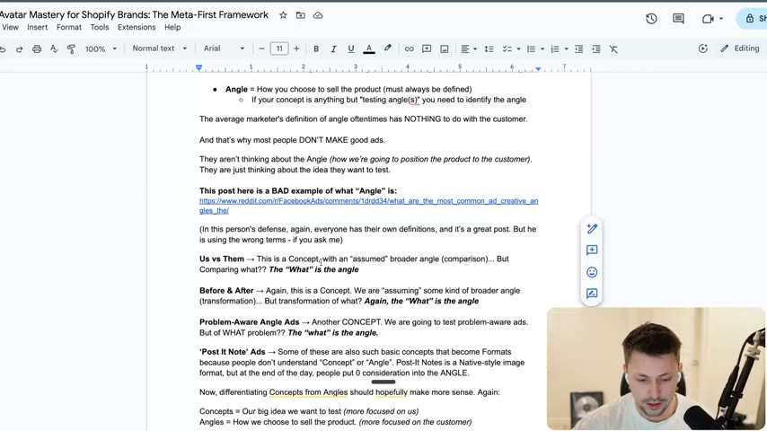
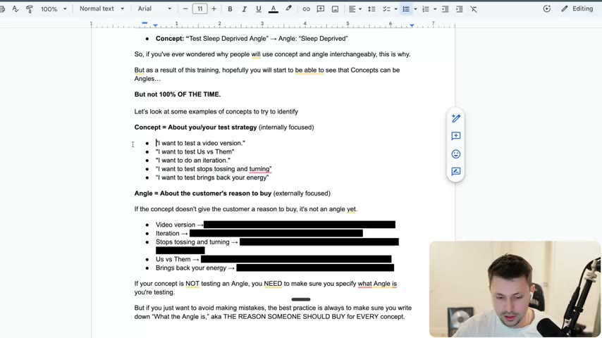
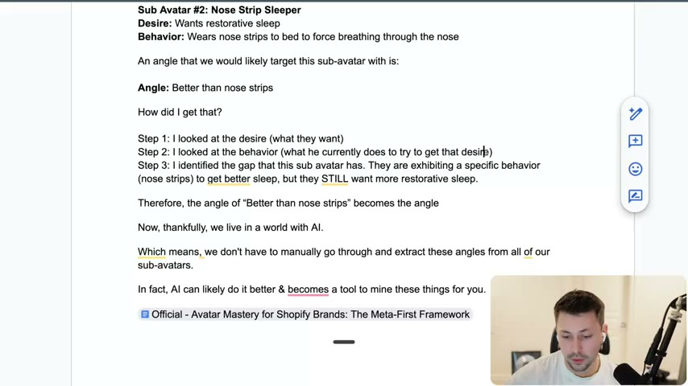
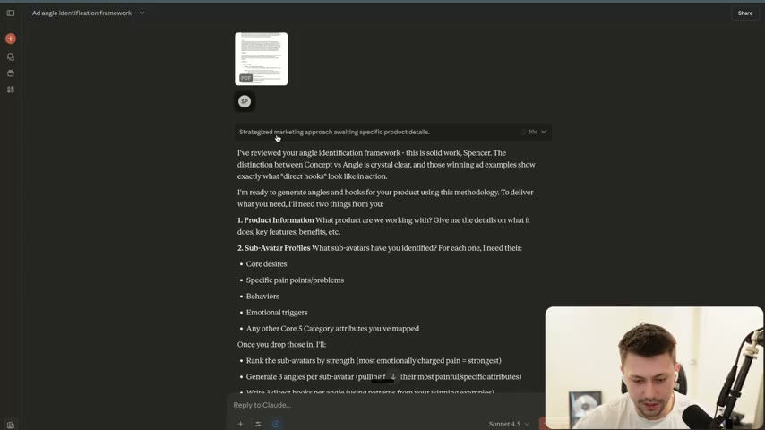
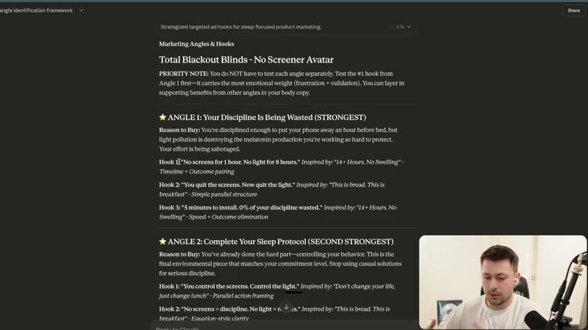
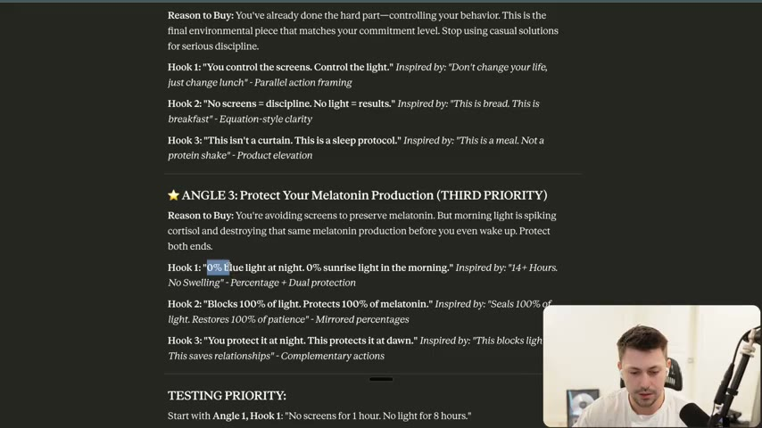
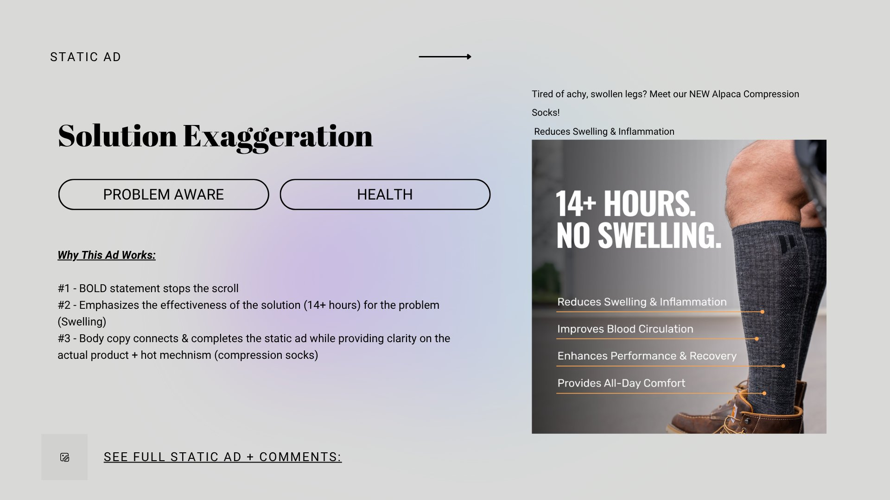
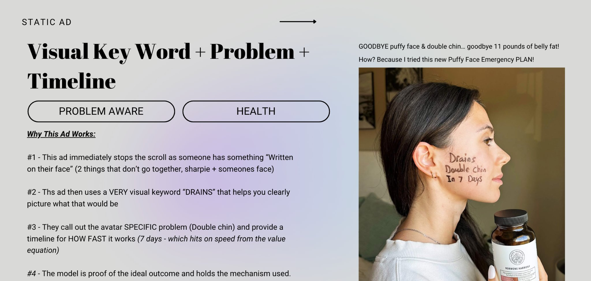
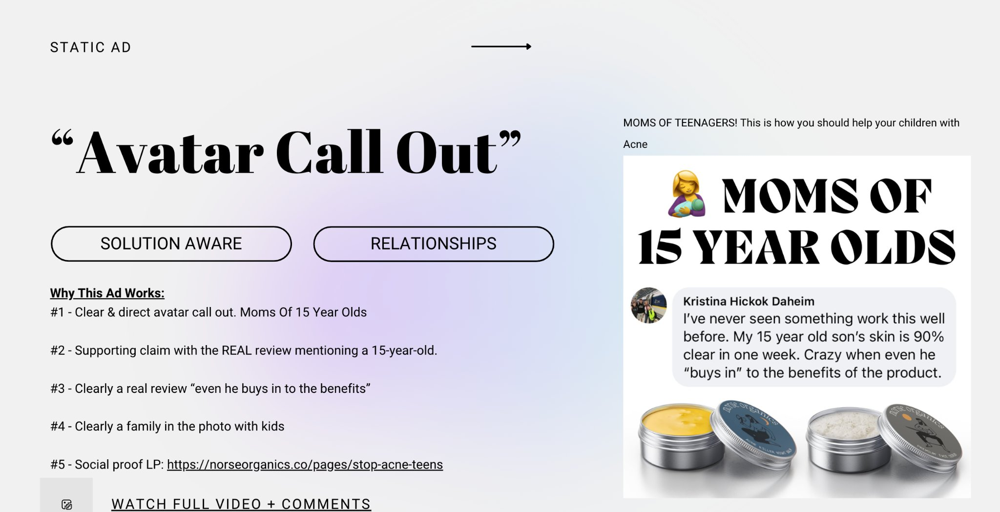

# 79. How To Come Up With Ad Angles
> An angle is the customer's reason to buy, not the test idea; because you already built sub-avatars, each one yields actionable angles (desire + behavior + gap), and an AI prompt can turn them into ranked angles and direct hooks.

## 🤖 Agent use
- **Use when:** turning sub-avatars into angles and hook/headline drafts; deciding whether a proposed test is a concept or an angle; ranking which angle to test first.
- **Inputs → outputs:** product information + at least one sub-avatar profile (desire and behavior are enough) + the winning-ad examples in the prompt → per sub-avatar: 3 angles with a "reason to buy", direct hooks, a ranked order and a testing priority.
- **Rules:**
  - **DO** write the angle (the reason someone should buy) for every concept, even when the concept is a format or an iteration. [01:15; 08:41; 11:09]
  - **DON'T** call "Us vs Them", "Before & After", "Problem-Aware ads" or "Post-it note ads" an angle: they are concepts or formats, and "the what is the angle". [02:00–05:27]
  - **DO** judge an angle by one test: "If the concept doesn't give the customer a reason to buy, it's not an angle yet." [09:14]
  - **DO** start from product → desires → avatars → sub-avatars → angle, not product → benefit → angle. [16:21–19:37]
  - **DO** mine an angle from a sub-avatar with three steps: desire (what they want), behavior (what they do now to get it), gap (why that still falls short). [24:25–25:50]
  - **DO** keep hooks "direct instead of indirect" until advanced: the hook states the angle. [20:19–22:14]
  - **DO** keep angles actionable: "as long as your angles are actionable, writing will become much easier". [23:40]
  - **DON'T** trust AI output blindly: "sometimes it can give you bad stuff as well". [26:41]
  - **IF** the AI returns several angles **THEN** test the #1 hook of the #1 angle first; "you do not have to test each angle separately", and you can layer supporting benefits into body copy. [28:32; 33:30]
  - **IF** a trending format (post-it, "three reasons why") is not working **THEN** check the angle inside it before blaming the format. [04:29–06:57]
- **See also:** [78. Understanding Ad Definitions](078-understanding-ad-definitions.md) · [76. How To Build Sub Avatars](076-how-to-build-sub-avatars.md) · [81. The 3 Testing Methods - Part 1](081-the-3-testing-methods-part-1.md) · [4. 100+ Winning Ads Document](004-100-winning-ads-document.md) · [6. 13 Winning Static Ad Templates](006-13-winning-static-ad-templates.md) · [Copywriting: avatars and angles](../../copywriting/concepts/avatars-and-angles.md) · [Playbook: angle remix](../../../../playbooks/angle-remix.md)

Lesson page text: a warning to go back and watch the "How To Make Avatars" section if you skipped it, plus a link to the Google Doc prompt. The doc is also attached as a .docx; both hold the same prompt (reproduced below).

## Key ideas

### Concept vs angle: the core relationship [00:31–02:00]
- Concept = "the big idea. It's what you're testing" (formats, iterations, awareness levels or angles). Angle = "how you choose to sell the product and it must always be defined". [00:31]
- If the concept is anything other than testing a specific angle, "you just need to make sure that you identify the angle". [00:31]
- "The average marketer's definition of angle oftentimes has nothing to do with the customer." Most marketers think about the idea they want to test, not "how we're going to position the product to the customer". [01:15]

### Four "angles" that are really concepts or formats [02:00–06:57]
- The instructor opens a year-old Reddit post listing "most common ad creative angles" and says it is a good post but uses "the wrong terms - if you ask me". [02:00]
- **Us vs Them** is a concept with an assumed broader angle (comparison). "Comparing what? The what is the angle." [02:00–02:56]
- **Before & After** is a concept with an assumed angle (transformation): "transformation of what?" [02:56]
- **Problem-aware angle ads** is a concept: "of what problem?" [03:46]
- **Post-it note ads** is "basically just a format, a native-style image"; "what we write in the post-it notes is the angle". [03:46–04:29]
- Why formats "work" for others and fail for you: "they are good hooks and good headlines ... they do help you get attention. But if the angle sucks, no one's going to care." Same for negative "three reasons why you shouldn't buy": think about what the reasons are. [04:29–05:27]
- Same for the static templates in the course ([6](006-13-winning-static-ad-templates.md)): "if they're not working for you, it's because your angle and ... what you've put into it is not really working." [06:11]


*The doc's "This post here is a BAD example of what Angle is" section (Us vs Them, Before & After, Problem-Aware, Post-it Note). [02:20]*

### Concepts are about us, angles about the customer [06:57–08:41]
- "Concepts ... are more focused on us, like what we want to test ... angles need to be focused on the customer and what they want." [06:57]
- Why people mix them up: when the concept is to test an angle, they coincide. Examples: Concept "Test Buy It For Life Angle" → angle "Buy It For Life"; Concept "Test Sleep Deprived Angle" → angle "Sleep Deprived". Concepts "can be angles, but not 100% of the time". [07:55]
- Best practice: whenever you write a concept, also write the angle, "even if you say I'm testing this angle". [08:41]

### The concept-or-angle game [09:14–11:09]
Concept examples: "I want to test a video version", "...Us vs Them", "...do an iteration", "...test stops tossing and turning", "...test brings back your energy". Instructor's verdicts [09:14–11:09]:

| Statement | Verdict | Why |
|---|---|---|
| Video version | Concept | No reason to buy; identify the angle |
| Iteration | Concept (not an angle) | "Iteration of what angle?" |
| Stops tossing and turning | Angle | "It solves their problem" |
| Us vs Them | Concept | No clear reason |
| Brings back your energy | Angle | Gives a reason to buy |


*The doc's game: concept examples listed, then the verdicts hidden behind black bars for the video. [09:20]*

### Angles sit on a spectrum, and sub-avatars already give you the angle [11:09–15:27]
- It is natural to ask "what is an angle, how do I know?" The answer: "angles do exist on a spectrum. Superlative angle is a very broad angle" (more a concept: "superlative of what?"). [11:54]
- Angle matrix: superlatives such as "world's first doctor-designed humidifier" and "world's cleanest humidifier" are different angles under one broad idea. [11:54–12:48]
- Because you built sub-avatars, "you've already got your angle. So you don't need to worry whether it's too broad or too specific." [12:48–13:43]
- You do not need to name the avatar in the ad: "your angle basically is the avatar". Not one-to-one ("sub avatar means angle. That's not true") but "if you analyze your sub avatar, you will be able to find the angle ... when you're testing your angle, you're testing your sub avatar." [13:43–14:32]
- Broad core avatar example: desire "wants better sleep" → broad angles such as "Want better sleep?" or "Feel like you're not getting enough sleep?". They are angles, but weak: "broad avatars are usually harder to sell to because you have to use broader angles." [14:32–15:27]

### Why the backwards process works (product → people → angle) [16:21–19:37]
- Typical (99%) path: look at the product, list features and benefits, jump to the angle ("get better skin", "fix your acne"), test it in many formats, "hope that something hits". (99% is the instructor's figure.) [16:21–17:16]
- The Evolve path: product → what it does / benefits → why someone wants that benefit (desire) → core avatar(s) → sub-avatars (behaviors, feelings, experiences) → angle. [17:16–18:15]
- "Every headline that you write targets an avatar." "Fix your acne" targets anyone who wants that, so it is not relatable. [18:15–18:49]
- Claim: the top 1% do not just "look at their product, find the benefits" and write angles without considering the person. (instructor claim) [18:49]

### Hooks and headlines (side quest) [19:37–23:40]
- A hook/headline is "how we get attention to sell the product ... basically how we're communicating the angle"; "boomers" call them leads. [20:19]
- Until you are advanced, keep hooks **direct**, not indirect: "the hook directly communicates the angle". Examples (taken from the winning-ad prompt set): stops swelling → "14+ Hours. No Swelling"; keeps you full like a meal → "This is a meal. Not a protein shake" (he assumes the Huel angle); stops you snapping at people → "5 minutes to install. No more snapping". [20:19–22:14]
- "As a junior writer, these are much easier hooks and headlines to write." Advanced strategies come later in Evolve. [21:16]
- "I accidentally lost 12 pounds at 52": the broad angle (lose weight) is narrowed by sub-avatar (a specific age, a specific amount) and supported by mechanism language (blocking and dissolving fat cells). [22:14]
- "Teen always grumpy": the sub-avatar is a parent of a moody teen; the hook says it plainly. "Very direct." [23:09]

### Extracting an angle from a sub-avatar by hand [23:40–26:41]
- Goal of all this work: "to make writing winning ads easier." [23:40]
- Worked example: sub-avatar "No strip sleeper" (desire: wants restorative sleep; behavior: wears nose strips to bed to force nose breathing). Angle: **"better than nose strips"**. [24:25]
- Three steps: (1) desire (what they want), (2) behavior (what they currently do to get that desire), (3) the gap: they do the behavior but "still want more restorative sleep". [24:25–24:55]
- Second possible angle from the same sub-avatar (assuming a good experience with the strips): "this combined with nose strips will give you the best sleep of your life". [25:50]
- Try a few by hand first, then use AI: "AI can likely do it much better than us", and a sub-avatar often hides several angles. [25:50–26:41]


*Doc section "Sub Avatar #2: Nose Strip Sleeper": desire, behavior, the three steps, angle "Better than nose strips". [25:00]*

### The AI prompt and a live run [26:41–34:26]
- Download the prompt as a PDF/doc, upload it to Claude ("I like Claude for writing"; ChatGPT works too). Claude's reply confirmed it understood "the distinction between concept and angle". [26:41]
- Then provide: product information and at least one sub-avatar profile. A sub-avatar with only desire and behavior is enough ("you can have more surface level sub-avatars or very in-depth"). [27:36]
- Warning: do not be "overly reliant on AI"; with good prompts you get good output but sometimes bad. [26:41]
- Live run: sub-avatar "no screener" (wants restorative sleep; no screens one hour before bed) plus the product facts for blackout blinds. Output is on screen below. [27:36–28:32]
- Claude's output ranks the angles, names a priority note and testing priority; the instructor calls Angle 1 "a sick angle ... almost a headline in itself", and the reason to buy "almost a script"; he suggests asking Claude to turn it into a script. [28:32–29:06]
- Why it works: "an AI would likely never write this headline for you unless you actually gave it the context", i.e. the sub-avatar behavior. [30:03]
- Testing: start with Angle 1 / Hook 1; "If that hook performs, run variations of angle one. If it doesn't, pivot to angle two, hook three or whatever." With 3:2:2 "a lot of you could actually just run these three hooks". [32:51]
- Hooks are not scripts or full videos: "start thinking about how these can be turned into potential ads". [33:30]
- Closing claim: "this is how we make ads that scale to massive scale ... We've spent one hundred thousand dollars per day" at peak. (instructor claim) [34:26]


*Claude chat after the PDF upload. Claude asks for (1) product information and (2) sub-avatar profiles with core desires, pain points, behaviors, emotional triggers and other Core 5 attributes, then says it will rank sub-avatars, generate 3 angles per sub-avatar and write direct hooks. [27:20]*


*Claude output for the "No Screener" avatar: priority note, Angle 1 "Your Discipline Is Being Wasted (STRONGEST)" with three hooks, start of Angle 2. [33:20]*


*Angle 2 hooks and Angle 3 "Protect Your Melatonin Production (THIRD PRIORITY)" with the "Inspired by" ad reference per hook. [32:00]*

## Steps / framework

**A. Is it an angle? (decision rule from [09:14–11:09])**
1. Read the statement. Does it give the customer a reason to buy, in customer terms (solves a problem, brings back something)? → Angle.
2. If it names a test strategy, format, comparison or structure (video version, iteration, Us vs Them, Before & After, Post-it) → Concept. Write the angle underneath.

**B. Mine angles from a sub-avatar ([24:25–25:50])**
1. Copy the sub-avatar's desire.
2. Copy its behavior (what it does now to get the desire).
3. Name the gap: what the current behavior still does not give them.
4. Write the angle as a reason to buy that fills the gap ("better than X", "X plus our product", "completes your X setup").
5. Repeat for a second angle that uses the behavior positively (derived from the combo example at [25:50]).

**C. Run the prompt ([26:41–33:30])**
1. Upload the prompt doc to Claude (or ChatGPT).
2. Paste product information and one or more sub-avatars (desire + behavior at minimum).
3. Read the ranked output; edit weak hooks by hand.
4. Pick Angle 1 / Hook 1 first; use the other hooks as extra creatives or headlines in the 3:2:2 ([78](078-understanding-ad-definitions.md)).
5. Log the angle in the test sheet.

## Examples

### Angle spectrum for one core avatar (desire: wants better sleep) [14:32–15:27; 24:25]
| Level | Angle / hook | Source |
|---|---|---|
| Broad core avatar | "Want better sleep?" / "Feel like you're not getting enough sleep?" | [15:27] |
| Sub-avatar "no strip sleeper" | "Better than nose strips"; "this combined with nose strips will give you the best sleep of your life" | [24:25; 25:50] |
| Sub-avatar "no screener" | "Your Discipline Is Being Wasted" → "No screens for 1 hour. No light for 8 hours." | [29:06] |
| Doc example sub-avatars | Short Fuse, Cool Sleeper, Night Faster (blackout blinds) | doc, "Example Of Perfect Output" |

### Claude output on screen, "Total Blackout Blinds - No Screener Avatar" [28:32–33:20]
Text read from the frames (the screen is low resolution; hook 1 of Angle 3 is partly cut off):

| Angle (rank) | Reason to buy (on screen) | Hooks (with the "Inspired by" reference) |
|---|---|---|
| 1. Your Discipline Is Being Wasted (STRONGEST) | You're disciplined enough to put your phone away an hour before bed, but light pollution is destroying the melatonin production you're working so hard to protect. Your effort is being sabotaged. | "No screens for 1 hour. No light for 8 hours." (14+ Hours. No Swelling: timeline + outcome pairing). "You quit the screens. Now quit the light." (This is bread. This is breakfast: simple parallel structure). "5 minutes to install. 0% of your discipline wasted." (14+ Hours. No Swelling: speed + outcome elimination) |
| 2. Complete Your Sleep Protocol (SECOND STRONGEST) | You've already done the hard part, controlling your behavior. This is the final environmental piece that matches your commitment level. Stop using casual solutions for serious discipline. | "You control the screens. Control the light." (Don't change your life, just change lunch: parallel action framing). "No screens = discipline. No light = results." (This is bread. This is breakfast: equation-style clarity). "This isn't a curtain. This is a sleep protocol." (This is a meal. Not a protein shake: product elevation) |
| 3. Protect Your Melatonin Production (THIRD PRIORITY) | You're avoiding screens to preserve melatonin. But morning light is spiking cortisol and destroying that same melatonin production before you even wake up. Protect both ends. | "0% blue light at night. 0% sunrise light in the morning." (14+ Hours. No Swelling: percentage + dual protection). "Blocks 100% of light. Protects 100% of melatonin." (Seals 100% of light. Restores 100% of patience: mirrored percentages). "You protect it at night. This protects it at dawn." (This blocks light. This saves relationships: complementary actions) |

Testing priority on screen: "Start with Angle 1, Hook 1: 'No screens for 1 hour. No light for 8 hours.'" The instructor reads the rationale: it "hits the core frustration ... validates their effort while showing them the missing piece, the timeline contrast, one hour discipline, eight hours of protection makes the value obvious"; if it works run variations of angle 1, if not pivot to angle 2 or hook 3. [31:58–32:51] (The spoken versions differ slightly from the screen, e.g. "we control the light"; screen text is used above.)

### The winning-ad examples fed to the prompt (angle, hook, card analysis)
The prompt's "Additional Context" section pairs each angle/hook with a slide card from the course's Winning Ads / Templates deck (see [4](004-100-winning-ads-document.md) and [6](006-13-winning-static-ad-templates.md)). Brand names are given only where they are visible on the card. Awareness level and desire label are as printed on the card.


*Card "Solution Exaggeration" (Problem Aware / Health) for compression socks; reasons given: a bold statement stops the scroll; it stresses the effectiveness of the solution (14+ hours) for the problem (swelling); body copy completes the ad and names the product and mechanism (compression socks). (prompt image16)*

![Card: This is NOT [the product], Huel](../../../../assets/evolve/start-here/079-how-to-come-up-with-ad-angles/079-winning-ad-this-is-not-product-huel.jpg)
*Card "This is NOT [the product]" (Product Aware / Health), Huel: wordplay naming the product something it is not creates a curiosity gap, then returns to the product. Caution on the card: "it has to make sense. Do not overstretch it. If the dots don't get connected, and the ad will flop". (prompt image10)*


*Card "Visual Key Word + Problem + Timeline" (Problem Aware / Health): text "written on their face" stops the scroll, the visual keyword "DRAINS", an avatar-specific problem plus a speed timeline (7 days); the model is proof of the outcome and holds the mechanism. (prompt image8)*


*Card "Avatar Call Out" (Solution Aware / Relationships): direct call-out in the headline, a real review that mentions a 15-year-old, a family in the photo, and a social-proof landing page. (prompt image5)*

## Structured units

### Angles
| Angle | Core desire / pain | Heuristic(s) | Best format | Example line | Source |
|---|---|---|---|---|---|
| Stops swelling | Swollen, achy legs (problem aware, health) | Solution exaggeration (card label) | Static | "14+ Hours. No Swelling" | prompt, card 1; [20:19] |
| Keeps you full like a meal | Health / convenience (product aware) | "This is NOT [the product]" (card label) | Static | "This is a meal. Not a protein shake" | prompt, card 2; [21:16] |
| Don't sacrifice things you like to be healthy | Health without dieting overhaul (problem aware) | "Don't Sacrifice X For Y" (card label; card cites the Hormozi value equation) | Static | "Don't change your life, just change lunch" | prompt, card 3 |
| Sleeping better | Sleep (unaware, health) | Ideal outcome analogy (card label) | Static | "Sleep Like A Baby" | prompt, card 4 |
| Getting rid of double chin | Puffy face / belly fat (problem aware) | Visual keyword + problem + timeline | Static (person with text on face) | "Drains double chin in 7 days" | prompt, card 5 |
| Moms of teenagers with acne (derived from the card; the doc's label is missing) | Clear skin for a teen (solution aware, relationships) | Avatar call-out | Static with real review | "Moms of 15 year olds" | prompt, card 6 |
| Nutella turns bread into breakfast | Convenience / value (product aware, wealth) | "Simplified Us VS Them" (card label) | Static | "This is bread. This is breakfast" | prompt, card 7 |
| Take control of your life with better food | Health goals (brand aware) | Common saying | Static | "Grab life by the bowls" | prompt, card 8 |
| Losing weight without even trying | Weight loss at a specific age (problem aware) | "Accidentally got ideal outcome" (card label), unique numbers | Static | "I accidentally lost 12 pounds at 52" | prompt, card 9; [22:14] |
| Losing hormonal weight | Hormonal weight (problem aware) | Visual keyword + problem | Static | "I flushed 19 pounds of hormonal weight" | prompt, card 10 |
| Dealing with a grumpy teenager | Parent pain (problem aware) | Indirect avatar call-out | Static with advertorial | "Teen always grumpy?" | prompt, card 11; [23:09] |
| Show people who don't think they have wavy hair how to get it | Hair (unaware) | Educational, curiosity hook | UGC video | "3 signs your hair is actually wavy" | prompt, card 12 |
| How tick preventatives don't work | Pet safety (solution aware) | Sophisticated new mechanism; failed-mechanism call-out | AI voiceover | "Ever wonder why tick preventatives don't work anymore?" | prompt, card 13 |
| Vitamin deficiency in kids | Parenting fear (unaware, relationships) | Educational, fear angle | Voiceover video | "3 red flags of vitamin deficiency in kids" | prompt, card 14 |
| Shampoo with better ingredients | Hair health (unaware) | Educational, "watch out" angle | Text-overlay video | "Watch for these ingredients when buying shampoo" | prompt, card 15 |
| A wallet that is RFID proof | Theft / money security (unaware, wealth) | Educational, fear angle ("not malicious", a real thing) | AI voiceover | "Why millennials are ditching their old wallets" | prompt, card 16 |
| Better than nose strips (sub-avatar) | Restorative sleep despite nose-strip use | Desire + behavior + gap | — | (no hook shown) | [24:25] |

### Hooks
| Hook | Heuristic(s) | Emotion / zone | Self targeted | Why it works | Source |
|---|---|---|---|---|---|
| "14+ Hours. No Swelling" | Timeline + specific outcome elimination (prompt's own label) | — | — | Directly communicates the angle | [20:19] |
| "This is a meal. Not a protein shake" | Product redefinition | Curiosity (derived) | — | Directly communicates the angle | [21:16] |
| "5 minutes to install. No more snapping" | Timeline + outcome elimination | — | — | Directly communicates the angle | [21:16]; doc |
| "I accidentally lost 12 pounds at 52" | Specific numbers, avatar-specific | — | — | Narrowed by a specific age and weight; mechanism language supports it | [22:14] |
| "Teen always grumpy?" | Direct avatar call-out | — | Parent of a teen | Plain-language pain for the sub-avatar | [23:09] |
| "This blocks light. This saves relationships." | "This does X. This does Y" pattern | — | Short-fuse sleeper | Inspired by "This is bread. This is breakfast" | doc, Perfect Output |
| "Seals 100% of light. Restores 100% of patience." | Specific percentage + outcome promise | — | Short-fuse sleeper | Inspired by "14+ Hours. No Swelling" | doc |
| "You have the fan. You have the AC. You need this." | Minimal change, maximum impact | — | Cool sleeper | Inspired by "Don't change your life, just change lunch" | doc |
| "This is a curtain. This is a cooling system." | Product redefinition | — | Cool sleeper | Inspired by "This is a meal. Not a protein shake" | doc |
| "Cool room in 5 minutes. Deep sleep in 8 hours." | Dual timeline (speed + result) | — | Cool sleeper | Inspired by "Drains double chin in 7 days" | doc |
| "Serious about fasting? Serious about darkness." | Direct avatar call-out with identity match | — | Night faster | Inspired by "Moms of 15 year olds" | doc |
| "0% light. 100% melatonin production." | Percentage-based outcome promise | — | Night faster | Inspired by "14+ Hours. No Swelling" | doc |
| "This is a blackout curtain. This is a sleep protocol." | Elevation from commodity to system | — | Night faster | Inspired by "This is bread. This is breakfast" | doc |
| "No screens for 1 hour. No light for 8 hours." | Timeline + outcome pairing | — | No-screener sleeper | Instructor: "hits the core frustration" | [31:58]; frame |
| "You quit the screens. Now quit the light." | Simple parallel structure | — | No-screener sleeper | Instructor: "a sick, sick headline" | [30:03] |

### Ad teardowns
These are the "why this ad works" notes from the prompt's example cards (close paraphrase of the card text). "What fails" and "Fix" are not given in the source unless stated.

| Brand / product (niche) | Format | Hook / opening | What works | What fails | Fix suggested | Principle | Source |
|---|---|---|---|---|---|---|---|
| Compression socks (health) | Static | "14+ HOURS. NO SWELLING." | Bold statement stops scroll; stresses solution effectiveness for the problem; body copy names product and mechanism | — | — | Solution exaggeration | card 1 |
| Huel (meal replacement) | Static | "This is a meal. Not a protein shake." | Wordplay creates a curiosity gap, then returns to the product; leverages "just another protein shake" perception | Fails if overstretched: "If the dots don't get connected, and the ad will flop" | Only use when the claim is true and connects | This is NOT [the product] | card 2 |
| Huel (meal replacement) | Static | "Don't change your life, just change lunch" | Leans into the dieting problem (must change everything); user sacrifices less | — | Pro tip on card: think about what your customer has to sacrifice to get the desire, and help them keep it | Don't sacrifice X for Y (Hormozi value equation) | card 3 |
| RYZE (mushroom cocoa, sleep) | Static | "Sleep Like A Baby" | Common saying stands out to people who struggle with sleep; the photo does not obviously connect, forcing a read; then sells the functional outcome | No clear link between hot-chocolate photo and headline | — | Ideal outcome analogy | card 4 |
| Hormone-support supplement (visible bottle: Hormone Harmony) | Static | "Drains Double Chin In 7 Days" | Text on face stops scroll; visual keyword "DRAINS"; avatar-specific problem plus timeline; model proves outcome and holds mechanism | — | — | Visual keyword + problem + timeline | card 5 |
| Acne balm (teen skincare) | Static with review screenshot | "MOMS OF 15 YEAR OLDS" | Clear avatar call-out; real review mentioning a 15-year-old; family in photo; social-proof landing page | — | — | Avatar call-out | card 6 |
| Nutella (spread) | Static ("world class statics") | "This is bread. This is breakfast." | Uses something everyone understands; simplified headline; congruent visual; adds credibility ("1964") | — | — | Simplified Us vs Them | card 7 |
| Huel (meal replacement) | Static | "Grab life by the bowls" | Common saying; emphasizes core USP for health goals | — | — | Common saying | card 8 |
| Weight-loss supplement (visible: Ultimate Weight Control) | Static | "I Accidentally Lost 12 Pounds At 52" | "Accidentally" creates curiosity; visual mechanism language ("blocking", "dissolving"); "unique numbers" (12, 52, 56.4%) are more believable than round numbers | — | — | Accidentally got ideal outcome | card 9 |
| Hormone-support supplement | Static | "I FLUSHED 19 POUNDS of hormonal weight" | Visual keyword "FLUSHED"; names the specific kind of weight; clear mechanism shot and name | — | — | Visual keyword + problem | card 10 |
| Teen multivitamin (First Day, per landing-page URL) | Static + advertorial | "TEEN ALWAYS GRUMPY?" | Painful pain point for parents; educational "new hope" from nutrient imbalance; visual of vitamins in the product; dialed advertorial | — | — | Indirect avatar call-out | card 11 |
| Custom haircare (Prose, per caption) | UGC video | "3 signs your hair is actually wavy" | Shows expertise; user nods "yes this is me"; flows from "You" to "Me" to "Brand" | — | — | Educational curiosity hook | card 12 |
| Pet product (dog, tick prevention) | AI voiceover video | "Ever wonder why tick preventatives don't work anymore?" | Intense pain visual makes you "cringe"; calls out failed mechanism; vet revelation builds credibility; suspense ("pet care industry doesn't want you to know"); story begins | — | — | Sophisticated new mechanism | card 13 |
| Kids vitamins (First Day, per landing-page URL) | Voiceover video | "3 red flags of vitamin deficiency in kids" | Fear motivator; "eating chicken nuggets" is a common thing parents never question; relatable vulnerability ("I always thought these were normal?") | — | — | Educational fear angle | card 14 |
| Custom haircare (Prose, per caption) | Text-overlay video | "Watch for these ingredients when buying shampoo..." | Odd visual hook makes people read the text; gives an alternative "after gaining their trust" | — | — | Educational watch-out angle | card 15 |
| Wallet (unverified brand) | AI voiceover video | "Why millennials are ditching their old wallets" | Scares in a non-malicious way about a real thing; calls out a specific but broad audience; educational hook and visual | Card: "I am not recommending fear-mongering at all" | — | Educational fear angle | card 16 |

### Rewrites (before → after)
| Before | After | What changed | Source |
|---|---|---|---|
| Broad angle "Want better sleep?" | "Better than nose strips" | Desire + behavior + gap from one sub-avatar | [14:32; 24:25] |
| Product-first angle "fix your acne" | Sub-avatar angle from a specific person's behavior and experience | Starts from the person, not the product | [16:21–18:49] |
| Concept "Iteration" | Concept: iteration; angle: the specific reason to buy being iterated | Added the missing angle | [09:14–10:14] |

### Rules of thumb
- **DO** keep the hook direct: the hook states the angle. [20:19]
- **DO** copy a winning ad's structure (timeline + outcome, "This is X. This is Y", percentage pairs), not its words. (derived; the prompt's "Inspired by" lines show this practice)
- **DON'T** test every angle separately by default; a concept can test multiple angles with the best hook. [28:32]
- **IF** you cannot find an angle by hand **THEN** run the prompt on 1+ sub-avatars; **IF** the output looks generic **THEN** add behavior and experience detail to the sub-avatar. [26:41; 30:03]

## Prompts / templates (verbatim)

The linked Google Doc (also the attached .docx) is the prompt. Section order: Situation, Task, Objective, Knowledge, Additional Context (winning ads), Example Of Perfect Output. The Knowledge section repeats the concept/angle teaching summarised above (full text in the raw file). Text below is verbatim.

```text
**Situation**

You are a direct response marketing strategist specializing in customer avatar analysis and angle development. You work with businesses to identify the most compelling marketing angles based on deep customer psychology, using sub-avatar frameworks to uncover specific pain points, desires, and emotional triggers that drive purchasing decisions.

**Task**

The assistant should analyze the provided product information and sub-avatar profiles to generate targeted marketing angles. For each sub-avatar, identify 3 potential marketing angles by examining their most painful or specific attributes, framing these as problems from their perspective, and converting them into compelling "reason to buy" statements that are relatable. Then provide 3 strategic written hooks/headlines that could be used for each angle for proper implementation. You MUST but the strongest angles and the strongest hooks/headlines up at the top first and make sure to remind the user that they do NOT have to test each angle separately. They can do a concept that tests "multiple angles" with the best hook/headline.

**Objective**

Enable the user to develop data-driven, psychologically-targeted marketing angles that resonate with specific customer segments, allowing them to either test multiple approaches simultaneously or focus resources on the highest-probability angle with multiple execution variations.
```

Additional Context lead-in (verbatim): "Below, you have been given winning ads that you will reference when providing your answer for the three specific angles, as well as the three specific hooks and headlines."

Winning-ad list inside the prompt (Angle → Hook/Headline, verbatim; each followed in the doc by a card image with "why this ad works"):
```text
Stops Swelling -> 14+ Hours. No Swelling
How the protein shake keeps you full -> This is a meal. Not a protein shake
Don't sacrifice things you like to be healthy -> Don't change your life, just change lunch
Sleeping better -> Sleep like a baby
Getting rid of double chin -> Drains double chin in 7 days
[angle label missing in the doc; it repeats the double-chin label above this card] -> Moms of 15 year olds   [hook quoted in the output example; text on the card]
Nutella turns bread into breakfast -> This is bread. This is breakfast
take control of your life with better food -> Grab life by the bowls
losing weight without even trying -> I accidentally lost 12 pounds at 52
losing hormonal weight -> I flushed 19 pounds of hormonal weight
dealing with a grumpy teenager -> Teen always grumpy?
Show people who don't think they have wavy hair, how to get wavy hair -> 3 signs your hair is actually wavy
Showing how tick preventatives don't work -> Ever wonder why tick preventatives don't work anymore?
Vitamin deficiency in kids -> 3 red flags of vitamin deficiency in kids
Get a Shampoo with better ingredients -> Watch for these ingredients when buying shampoo
A wallet that is RFID proof -> Why millennials are ditching their old wallets
```

Example Of Perfect Output (verbatim structure, doc section "Marketing Angles & Hooks: Total Blackout Blinds - Restorative Sleep Avatar"):
```text
PRIORITY NOTE:
You do NOT have to test each angle separately. Test the #1 hook from Sub-Avatar #3 first—it carries the most emotional weight. You can layer in supporting benefits from other angles in your body copy.

SUB-AVATAR #3: Short Fuse Avatar ⭐ STRONGEST
Angle 1: Stops You From Snapping At People
Reason to Buy: Complete darkness lets your nervous system actually recover, so you stop being irritable and short-tempered with the people you care about.
Hook: "5 minutes to install. No more snapping."
Inspired by: "14+ Hours. No Swelling" - Timeline + Specific outcome elimination

Angle 2: Restores Your Patience
Reason to Buy: Your brain needs pitch-black sleep to reset your nervous system. Get that, get your patience back.
Hook: "This blocks light. This saves relationships."
Inspired by: "This is bread. This is breakfast" - Simple "This does X. This does Y" pattern

Angle 3: Eliminates The "On Edge" Feeling
Reason to Buy: Stop feeling wired and irritable all day by giving your body the complete darkness it needs to actually repair while you sleep.
Hook: "Seals 100% of light. Restores 100% of patience."
Inspired by: "14+ Hours. No Swelling" - Specific percentage + outcome promise

SUB-AVATAR #1: Cool Sleeper ⭐ SECOND STRONGEST
Angle 1: Completes Your Cool Sleep Setup
Reason to Buy: You already have the fan and AC. This is the missing piece that blocks heat AND light so your room stays cool and dark all night.
Hook: "You have the fan. You have the AC. You need this."
Inspired by: "Don't change your life, just change lunch" - Minimal change, maximum impact framing

Angle 2: Keeps Room Cooler Than AC Alone
Reason to Buy: These block heat transfer from the sun, so your room stays cooler without cranking the AC. Better sleep, lower energy bills.
Hook: "This is a curtain. This is a cooling system."
Inspired by: "This is a meal. Not a protein shake" - Product redefinition pattern

Angle 3: The Final Sleep Optimization Step
Reason to Buy: You've optimized temperature. Now optimize light. This is what serious sleep optimizers add after mastering cooling.
Hook: "Cool room in 5 minutes. Deep sleep in 8 hours."
Inspired by: "Drains double chin in 7 days" - Dual timeline showing speed + result

SUB-AVATAR #2: Night Faster ⭐ THIRD PRIORITY
Angle 1: Matches Your Sleep Discipline
Reason to Buy: You're disciplined enough to fast before bed. Now use equipment that's equally serious about blocking 100% of light.
Hook: "Serious about fasting? Serious about darkness."
Inspired by: "Moms of 15 year olds" - Direct avatar call-out with identity match

Angle 2: Protects Your Melatonin Production
Reason to Buy: Your fasting discipline is wasted if light is destroying your melatonin production every morning. Protect both.
Hook: "0% light. 100% melatonin production."
Inspired by: "14+ Hours. No Swelling" - Percentage-based outcome promise

Angle 3: Professional Tools For Serious Sleepers
Reason to Buy: People who fast before bed aren't casual about sleep. Stop using casual blackout curtains.
Hook: "This is a blackout curtain. This is a sleep protocol."
Inspired by: "This is bread. This is breakfast" - Elevation from commodity to system

TESTING PRIORITY:
Start with Sub-Avatar #3, Angle 1. Test that hook first. If it hits, run variations. If not, move to Sub-Avatar #1, Angle 1.
```
Note: the Task section asks for 3 hooks per angle, but the doc's example output shows one hook per angle; the live run in the video produced three hooks per angle. Treat "3 hooks per angle" as the instruction.

Input template for the prompt (derived from Claude's request on screen, [27:20]):
```text
Product information: <what it does, key features, benefits>
Sub-avatar profile(s): <core desire; specific pain points/problems; behaviors; emotional triggers; any other Core 5 category attributes>
```

## How to apply
- [ ] For each existing concept, write the angle as "reason someone should buy" and delete any "angle" that is really Us vs Them / Before & After / a format.
- [ ] For each sub-avatar from [76](076-how-to-build-sub-avatars.md), write desire, behavior and gap, then derive 1-3 angles by hand.
- [ ] Upload the prompt to Claude, paste product info and sub-avatars, and collect the ranked output.
- [ ] Rewrite each hook so it states the angle directly; borrow the structure from the "Inspired by" ad, not its words.
- [ ] Load the top 3 hooks into one 3:2:2 concept ([78](078-understanding-ad-definitions.md)) or test Angle 1 / Hook 1 alone with the Sniper method ([81](081-the-3-testing-methods-part-1.md)).
- [ ] Sanity-check any AI angle against real customer language from your research; do not accept it blindly. [26:41]

## Related
- Previous: [78. Understanding Ad Definitions](078-understanding-ad-definitions.md) · Next: [80. Action Item: Come Up With New Ad Angles](080-action-item-come-up-with-new-ad-angles.md)
- Avatars: [74. How To Build Core Avatars](074-how-to-build-core-avatars.md) · [75. Action Item: Identify Your Core Avatars](075-action-item-identify-your-core-avatars.md) · [77. Action Item: Create Your Sub Avatars](077-action-item-create-your-sub-avatars.md)
- Hooks in the sister course: [Hooks](../../copywriting/concepts/hooks.md) · [23. The framework behind great hooks](../../copywriting/lessons/23-the-framework-behind-great-hooks.md) · [18. Being aware of angles](../../copywriting/lessons/18-being-aware-of-angles.md)
- [Angle rut](../../../../concepts/angle-rut.md) · [Creative testing system](../../../../frameworks/creative-testing-system.md)

## Sources and limitations
- Transcript: [79. How To Come Up With Ad Angles….txt](<../../../../../raw/evolve/start-here/_transcripts/👣 Evolve (Start Here)/79. How To Come Up With Ad Angles 👣 Evolve (Start Here) Evolve.txt>) · Page text: [….html.md](<../../../../../raw/evolve/start-here/_extracted/👣 Evolve (Start Here)/79. How To Come Up With Ad Angles_👣 Evolve (Start Here)_Evolve.html.md>) · Prompt doc: [79 ….docx.md](<../../../../../raw/evolve/start-here/_extracted/👣 Evolve (Start Here)/79. How To Come Up With Ad Angles.docx.md>) and its Google Doc export [79-document-1apOBJnwgJ.docx.md](../../../../../raw/evolve/start-here/_extracted/_linked/google/79-document-1apOBJnwgJ.docx.md)
- Machine transcription (Whisper large-v3-turbo). Full recording covered (last segment 34:31 of 34:31). Whisper heard "no strips" for "nose strips" and "Spencer" appears only as an address from a viewer's imagined voice; "boomers" is the instructor's joke.
- The doc's example output (Short Fuse / Cool Sleeper / Night Faster) and the live run in the video (No Screener) use the same product (blackout blinds) but different sub-avatars. The prompt's winning-ad list repeats the label "Getting rid of double chin" above two cards; the second card is the "Moms of 15 year olds" avatar call-out, whose hook is quoted in the example output. The 16 card images sit inside the .docx; the instructor does not read them in the video.
- Card brand names are read from the cards; "unverified" where not visible. The docx also embeds three gun photos in lesson 81, not this lesson.
- Each hook's "Inspired by" line comes from the winning-ad list inside the prompt; the instructor notes Claude is "actually referencing specific ads that are in the prompt". [30:59]
