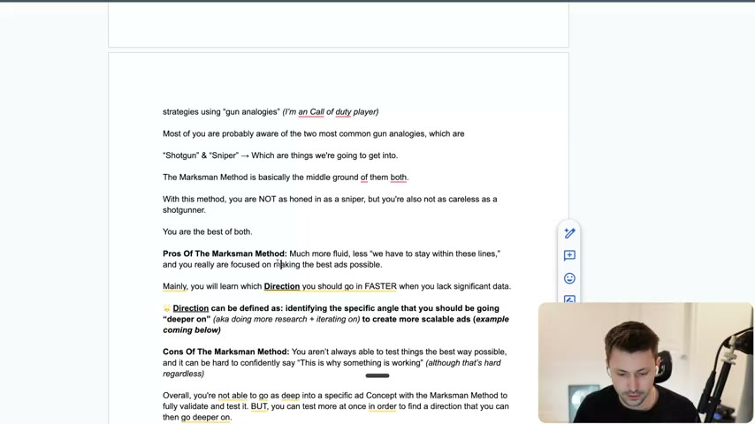
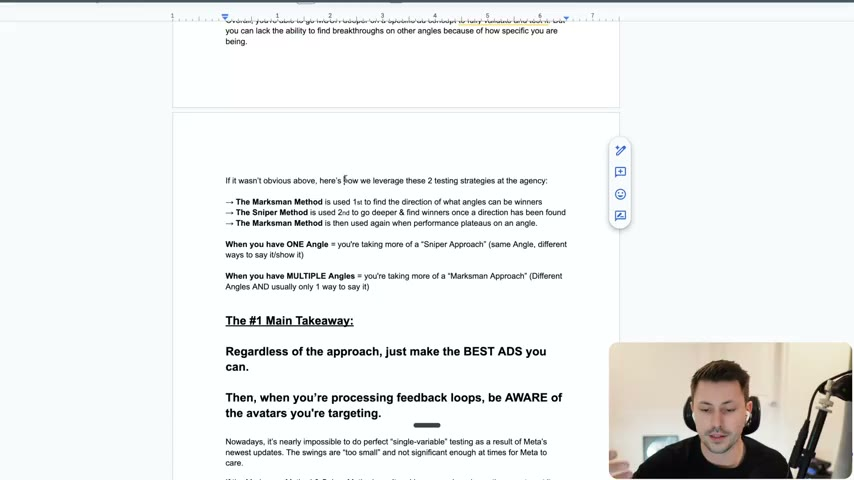
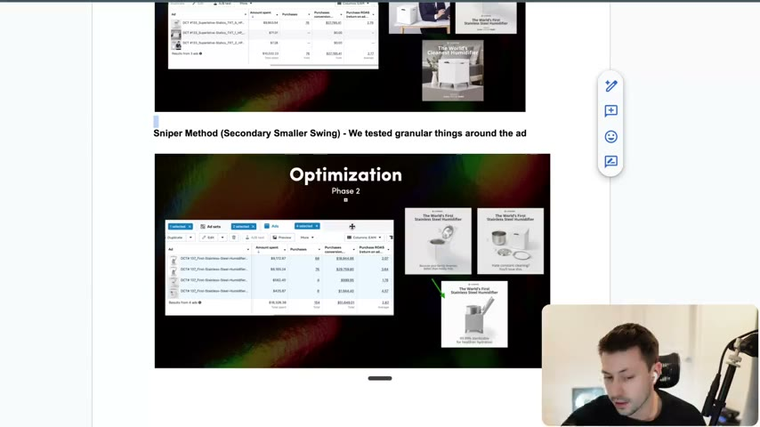
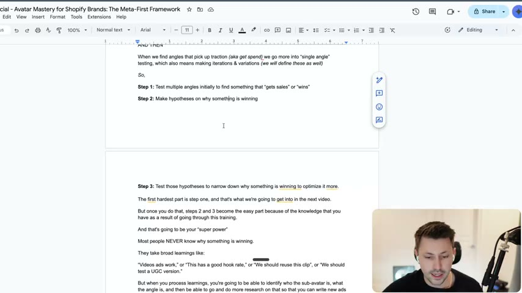
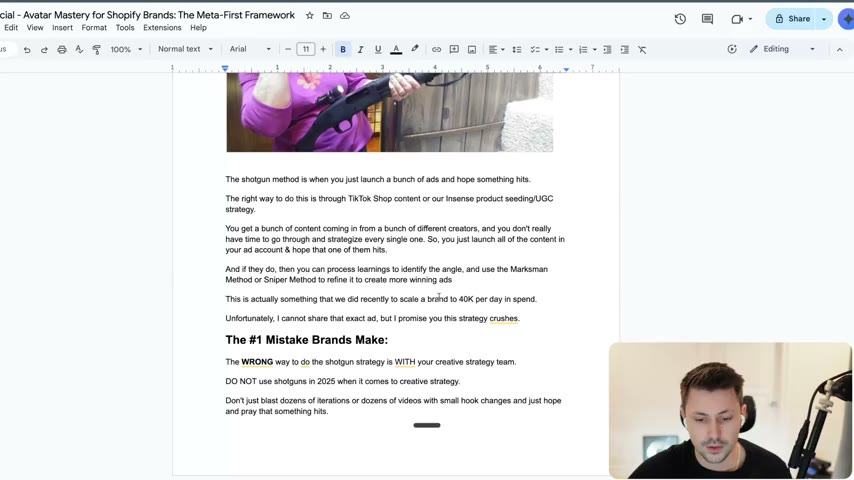

# 81. The 3 Testing Methods - Part 1
> Test many angles at once to find direction (Marksman), then go deep on the winning angle (Sniper), re-run Marksman when it plateaus, and keep Shotgun for creator content only; always know which sub-avatar a result belongs to.

## 🤖 Agent use
- **Use when:** planning the next test batch, choosing between "new angles" and "iterate the winner", deciding what to do after a plateau, setting weekly concept volume, or writing up a learning.
- **Inputs → outputs:** the list of angles/sub-avatars, current account state (any angle getting spend?), team capacity → which method to run, how many angles per concept, how many variations per angle, and a hypothesis-based learning.
- **Rules:**
  - **DO** run Marksman first (many angles, one variation each) to find "direction" when you lack significant data or have plateaued. [05:12; 10:58]
  - **DO** switch to Sniper (one angle, different executions) once Meta "tells you what angle is working well" (direction = the angle getting spend). [08:37]
  - **DO** return to Marksman "when performance plateaus on an angle". [10:58]
  - **DON'T** use Shotgun in creative strategy: "Do not use shotguns in 2025 when it comes to creative strategy." Shotgun is for creator content (TikTok Shop, Insense seeding). [16:28–17:57]
  - **DON'T** expect clean single-variable tests: "nearly impossible to do perfect single variable testing as a result of Meta's updates". [12:17]
  - **DO** write learnings about the customer (sub-avatar, angle, why they care), not structure ("it's a video", "good hook rate"). [13:46–14:35]
  - **DO** make the best ad you can regardless of method: "the customer doesn't care about this". [11:43]
  - **IF** you are not sure which method to pick **THEN** "just pick one and go and be aware of it". [00:46]
  - **IF** your team is small **THEN** aim for one concept a day, not volume for its own sake. [18:55–19:53]
- **See also:** [82. The 3 Testing Methods - Part 2](082-the-3-testing-methods-part-2.md) · [78. Understanding Ad Definitions](078-understanding-ad-definitions.md) · [79. How To Come Up With Ad Angles](079-how-to-come-up-with-ad-angles.md) · [Creative testing system](../../../../frameworks/creative-testing-system.md) · [Iteration vs variation](../../../../concepts/iteration-vs-variation.md)

Lesson page text: two notes. (1) If you skipped the avatar section, "this may not make 100% sense. However, it can still apply." (2) If Marksman vs Sniper vs Shotgun is still unclear, watch the two modules below this one ([82](082-the-3-testing-methods-part-2.md) and [83](083-putting-all-the-planning-together-examples.md)). A Google Doc with the same text as the attached .docx is linked.

## Key ideas

### Awareness is the main thing [00:00–02:18]
- "No matter what, you are now aware of the angle and ... where the angle came from". The person you built "gave you the angle", so when an angle works "it's likely to do with the person that you're targeting". [00:00–00:46]
- "Being aware of this stuff is 99% of the battle." Most people are not aware of the angles they come up with. [00:46]
- Do not freeze over method choice: "just pick one and go". [00:46]
- Purpose of the avatar work: angles that are "actually relatable for your concepts". The open question is how to test all those angles in an organised way. The methods are a simplified model built "based on looking at the winning ads that we have made for brands". [01:37]

### 1. Marksman method [02:18–06:48]
- Definition: "test a lot of things at once to see what sticks, but you do it in a controlled environment." Middle ground between sniper and shotgun: "not as honed in as a sniper but ... not as careless as a shotgunner". The gun names are the instructor's habit (a Call of Duty player). [02:18]
- Link to 3:2:2: like a three-round burst, pulling the trigger on an angle gives three variations; in Marksman you shoot "three different angles" in one go. [02:58–03:45] (See [78](078-understanding-ad-definitions.md).)
- Pros: "much more fluid", less "stay in the lines of this angle", focus on "the best ad I can for this angle". [03:45]
- Goal: learn the **direction** faster "when you don't have significant data ... or if you are plateaued". **Direction** = "identifying the specific angle that you should be going deeper on, aka doing more research and iterating on, to create more scalable ads". [04:15–05:12]
- Cons: you cannot test any angle "all the way through"; "it can be hard to confidently say 'this angle is not going to work'". [05:12]
- How to build one: find three angles to group under one concept, "even if you have one sub avatar and there's three angles you want to test for that sub avatar, or maybe you just group three sub avatars and you have an angle for each". The concept does not have to be superlatives. One variation per angle. [06:06–06:48]
- Worked example (details in [82](082-the-3-testing-methods-part-2.md)): superlative concept, three angles: stainless steel, easy to clean, doctor designed; one headline for each. [04:15]
- On the "newest Andromeda updates" and AI-content spam: "I'd rather see you do this instead of ... the sniper approach on every single ad". [06:48] (Whisper "Andromeda" = Meta's ad delivery update; name as heard.)

### 2. Sniper method [06:48–10:14]
- Definition: "test within a strict environment to get closer to significant learnings as fast as possible". Unlike Marksman it tests "different executions or different styles or different headlines, different hooks of a specific angle". Used after you know an angle works. [06:48–07:40]
- Pros: clearer view of what works, more organised, faster learning, more confidence that the angle is validated; three variations of one angle remove the "execution problem" (a bad angle vs a bad execution). [07:40–08:37]
- "Really crushes ... once you gain direction from the Marksman method", direction being "what angle Meta is liking". [08:37]
- Cons: much less fluid; restricts creativity; can hold you back from the best ads; "most people are unable to stay this focused on one specific direction"; can cause "iteration overload ... stuck in this funk"; you can miss breakthroughs on other angles; slower (a sniper "doesn't shoot three bullets at once"). [08:37–10:14]

### How the agency sequences them [10:14–11:43]
- Marksman first "to find direction of what angles can be winners"; Sniper second "to go deeper and find winners once a direction has been found"; Marksman again "when performance plateaus on an angle and we feel like we've sniped our hearts out". [10:58]
- Rule of thumb: **one angle** = Sniper approach (same angle, different ways to show/say it); **multiple angles** = Marksman approach (different angles, usually one way to show/say each). [10:58]
- The on-screen example: the superlative concept ("three big swings": angle 1, angle 2, angle 3) vs a secondary smaller swing where all ads focus on the stainless-steel angle. [10:14]


*The doc's Marksman section: pros, the definition of "Direction", cons and the overall trade-off. [04:15]*


*"Here's how we leverage these 2 testing strategies at the agency", the Marksman → Sniper → Marksman sequence, the one angle / multiple angles rule and "The #1 Main Takeaway". [10:20]*


*The doc's example of "Sniper Method (Secondary Smaller Swing): we tested granular things around the ad". Ad-set table for several stainless-steel humidifier statics, with the best variant marked. Numbers are discussed in [82](082-the-3-testing-methods-part-2.md). [10:40]*

### The #1 takeaway and the 3-step loop [11:43–13:46]
- "Regardless of this approach, just please make the best ads that you can ... you're making an ad for a customer." Then, when processing feedback loops, be aware of the avatars. [11:43]
- Why not pure single-variable tests: Meta updates mean "the teeny tiny swings ... are just not significant enough for Meta to actually care". [12:17]
- Simplest framing: test many new angles early; when one "picks up traction, aka gets spend", go "single angle" (iterations and variations). [12:17]
- **Step 1:** test multiple angles to find something that "gets sales or can be a bit of a winner". **Step 2:** hypothesis on why it is winning "and why the customer cares". **Step 3:** test those guesses to narrow down why it wins and optimise. Step 1 is the hardest; 2 and 3 become easy with this training. [12:53]
- Claim: this is what lets people scale "from like 5K a day to like 80K a day in like a month and a half" because they "crack the code on why their ad is working". (instructor claim) [12:53]


*Doc text for Steps 1 to 3 and the line "Most people NEVER know why something is winning", with the "broad learnings" list. [13:00]*

### Process learnings about the person, not the structure [13:46–15:29]
- Typical learnings: "video ads work", "this ad's working because it has a good hook rate", "we should reuse this clip", "we should test a UGC version". [13:46]
- Better: identify "who the sub-avatar is, what the angle is" and research that person for new ads; "customer rather than structural components". [13:46]
- "What the customer needs to hear will influence the structural components." Rephrase "it's a video" as: "we drive curiosity in the hook", "we're educating the person about this specific thing", "we're showing them the outcome that they want", "we've positioned ourselves as an authority". [14:35]
- "The faster you figure out why something is not winning, the faster you can scale. The faster you figure out why something is winning ... the faster you can scale." [14:35]

### 3. Shotgun method [15:29–18:55]
- Definition: "test a bunch of random things at once and see what sticks"; "launch a bunch of ads and hope something hits. And that's what most of you guys are doing." [15:29]
- To follow the agency: Marksman first, then Sniper when direction appears. If still confused, "just shotgun a bunch ... into your ad account and that's fine", but when something hits, apply the process ("process learnings"). [15:29]
- The right place for Shotgun: **TikTok Shop** content or the **Insense** product-seeding strategy (Whisper wrote "incense"): lots of content from many creators, no time to strategise each one; creators get "a bit of guidance. Go ahead, just do whatever you want"; then "blast it in the ad account"; when one hits, refine with Marksman/Sniper after processing learnings. [15:29–16:28]
- The agency used this "recently to scale a brand to $40,000 a day" in spend (instructor claim; the example video was taken down at the client's request). [16:28–17:03]
- Only for scale: "if you're doing less than a hundred K per month, you probably don't need to even think about" a shotgun engine. [17:03]
- #1 mistake: Shotgun inside the creative strategy team. "Do not use shotguns in 2025 ... Don't just blast dozens of iterations or dozens of videos with teeny tiny little hook changes." Reasons: Meta "isn't gonna care about all those other little iterations", and you compete with people who use Marksman/Sniper "calculated". "Volume ... where you're just doing a bunch of random shit is stupid." [17:03–18:55]


*The doc's Shotgun section: TikTok Shop / Insense seeding, "scale a brand to 40K per day in spend", "The #1 Mistake Brands Make", "DO NOT use shotguns in 2025 when it comes to creative strategy". [15:40]*

### Volume benchmarks [18:55–20:40]
- Real volume comes from "manpower": people making 20 ads a day have an in-house team (sometimes two) and one or two creative agencies. [18:55]
- The agency: creative director, creative strategist, two video editors, one graphic designer (five people). "With very high intent" they make 15 concepts a week, i.e. 3 a day, which he says is "nine ads" a day (3 creatives per concept). [18:55]
- Smaller team: "just making one concept a day". "The last two people that I interviewed who hit a hundred K per day in Evolve tested one concept per day ... five to seven concepts per week ... 15 to 20 ads a week." (instructor claim) [18:55–19:53]
- "It's about the concepts ... one concept with the marksman strategy is like almost three concepts that you're testing." If you test more than that, "correct and go forward with intent". [19:53]
- After a direction appears: Sniper concepts testing different executions, formats, headlines, ways of saying it, or going deeper on the specific sub-avatar. [20:40]

## Steps / framework

| | Marksman | Sniper | Shotgun |
|---|---|---|---|
| What you test | Several angles (usually one execution each) | One angle, several executions (styles, headlines, hooks) | Many random things / creator content |
| Use when | New account or concept, no data, or plateau | An angle is getting spend ("direction") | Creator seeding (TikTok Shop, Insense) at scale |
| Pros | Fluid, fast direction, test more at once | Clear learnings, organised, validates the angle, rules out "execution problem" | Volume of raw material, little strategy time |
| Cons | Cannot validate any one angle; hard to say why | Slow, restrictive, iteration overload, misses other angles | Not a creative-team strategy; Meta ignores tiny variations |
| Source | [02:18–06:48] | [06:48–10:14] | [15:29–18:55] |

Operating loop (the instructor's, [10:58; 12:53]):
1. Marksman: group ~3 angles in one concept, one variation each, in a 3:2:2.
2. When one angle gets spend, write a hypothesis on why the customer cares.
3. Sniper: test executions of that angle (and go deeper on the sub-avatar) to test the hypothesis.
4. When the angle plateaus, go back to step 1 with new angles.

## Examples
- **Superlative concept (Marksman):** three angles under one concept: stainless steel, easy to clean, doctor designed. The stainless steel variant "got most of the actual spend" (instructor, in [82](082-the-3-testing-methods-part-2.md)). [04:15]
- **Sniper follow-up:** all ads focus on the stainless-steel angle, with different images and subtext. [10:14]
- **Reframing learnings:** "video ads work" → "I think it's because we drive curiosity in the hook" / "we're showing them the outcome that they want". [13:46–14:35]
- **Shotgun that works:** TikTok Shop and Insense creator content blasted into the account, then process learnings. [15:29]

## Structured units

### Rules of thumb
- **DO** use Marksman to find direction, Sniper to deepen, Marksman again at plateau. [10:58]
- **DON'T** shotgun with the creative strategy team; use it only for creator content. [17:03–18:55]
- **IF** one angle → Sniper; **IF** multiple angles → Marksman. [10:58]
- **DO** treat one Marksman concept as "almost three concepts" when measuring volume. [19:53]
- **DON'T** write structure-only learnings ("it's a video"); name the avatar, angle and reason. [13:46]

### Rewrites (before → after)
| Before (typical learning) | After (course learning) | What changed | Source |
|---|---|---|---|
| "Video ads work." | "We drive curiosity in the hook" / "we show the outcome they want" about this sub-avatar | From format to customer reason | [13:46–14:35] |
| "We should test a UGC version." | Research the sub-avatar behind the winning angle and write new ads for that person | From structure to person | [13:46] |

## Prompts / templates (verbatim)
Doc text, "How we leverage these 2 testing strategies at the agency":
```text
→ The Marksman Method is used 1st to find the direction of what angles can be winners
→ The Sniper Method is used 2nd to go deeper & find winners once a direction has been found
→ The Marksman Method is then used again when performance plateaus on an angle.

When you have ONE Angle = you're taking more of a "Sniper Approach" (same Angle, different ways to say it/show it)
When you have MULTIPLE Angles = you're taking more of a "Marksman Approach" (Different Angles AND usually only 1 way to say it)
```
Doc text, the three steps:
```text
Step 1: Test multiple angles initially to find something that "gets sales" or "wins"
Step 2: Make hypotheses on why something is winning
Step 3: Test those hypotheses to narrow down why something is winning to optimize it more.
```

## Screenshots
See the four frames above (Marksman section, agency sequence, Sniper optimisation example, steps, Shotgun rules). The doc also embeds three stock photos of guns (a rifle, a sniper rifle and a woman holding a shotgun) as decoration; they carry no information and are not stored here.

## How to apply
- [ ] Group 3 angles (from 79's prompt output) into one concept, one headline/creative each, in one 3:2:2.
- [ ] After a few days, mark which angle got spend; call that "direction".
- [ ] Write a hypothesis: which sub-avatar, which desire/behavior/experience, why they care.
- [ ] Run a Sniper concept: 3 executions of that angle (different hook, headline, format, or a deeper sub-avatar cut).
- [ ] When the angle plateaus, queue the next Marksman concept with new angles.
- [ ] Use creator seeding for volume only if above ~$100K/month (instructor guidance); log what hits and process learnings before iterating.
- [ ] Rewrite every learning in the account log as "[sub-avatar] + [angle] + [why]".

## Related
- Previous: [80. Action Item: Come Up With New Ad Angles](080-action-item-come-up-with-new-ad-angles.md) · Next: [82. The 3 Testing Methods - Part 2](082-the-3-testing-methods-part-2.md)
- Angles: [79. How To Come Up With Ad Angles](079-how-to-come-up-with-ad-angles.md) · Definitions: [78](078-understanding-ad-definitions.md)
- Sister course: [Iteration playbook](../../copywriting/frameworks/iteration-playbook.md) · [46. The 10-step iteration process](../../copywriting/lessons/46-the-10-step-iteration-process.md)
- [Playbook: test and iterate](../../../../playbooks/test-and-iterate.md)

## Sources and limitations
- Transcript: [81. The 3 Testing Methods - Part 1….txt](<../../../../../raw/evolve/start-here/_transcripts/👣 Evolve (Start Here)/81. The 3 Testing Methods - Part 1 👣 Evolve (Start Here) Evolve.txt>) · Page text: [….html.md](<../../../../../raw/evolve/start-here/_extracted/👣 Evolve (Start Here)/81. The 3 Testing Methods - Part 1_👣 Evolve (Start Here)_Evolve.html.md>) · Doc: [81 The 3 Testing Methods.docx.md](<../../../../../raw/evolve/start-here/_extracted/👣 Evolve (Start Here)/81. The 3 Testing Methods.docx.md>) and [Google Doc export](../../../../../raw/evolve/start-here/_extracted/_linked/google/81-document-1a1I_vFuPm.docx.md)
- Machine transcription (Whisper large-v3-turbo). Full recording covered (last segment 21:26 of 21:26). Whisper heard "Marksman" as "marsman" in places, "Insense" as "incense", and "stainless steel" as "staying the steel". At 01:37 he says "two types" before introducing three; the doc and the lesson title say three.
- The "5K to 80K in a month and a half", "$40,000 a day" and "one hundred K per day" figures are instructor claims without evidence. The Marksman results screenshots from the live doc are discussed in [82](082-the-3-testing-methods-part-2.md). The line "9 ads a day" is as spoken (3 concepts x 3 creatives).
- The spoken script and the doc differ a little; the doc is the more precise text.
