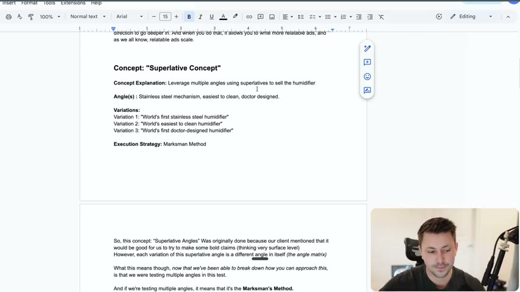
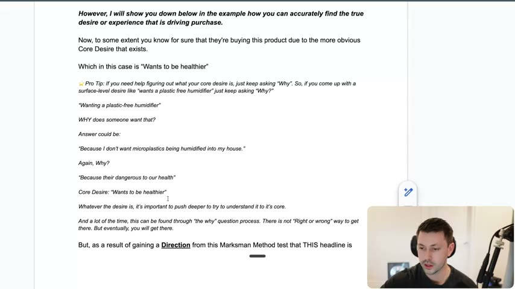
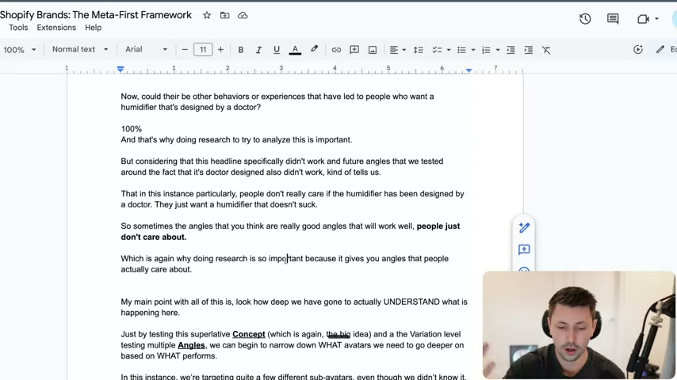
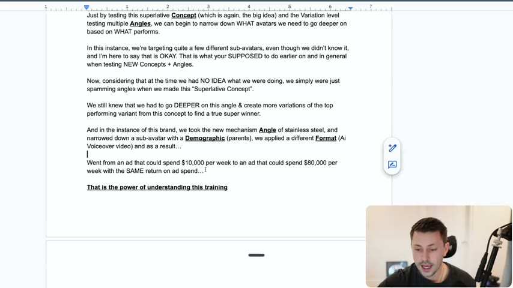
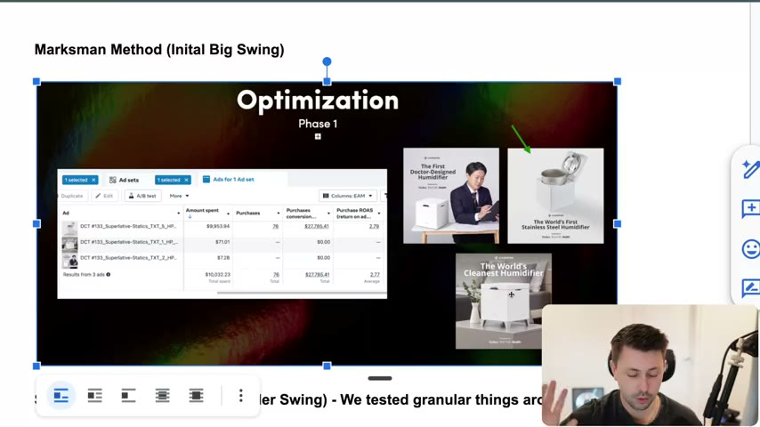
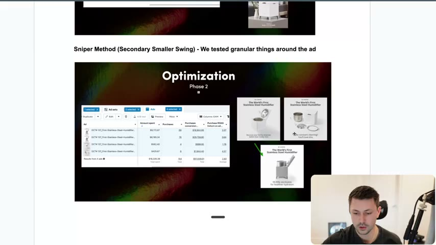
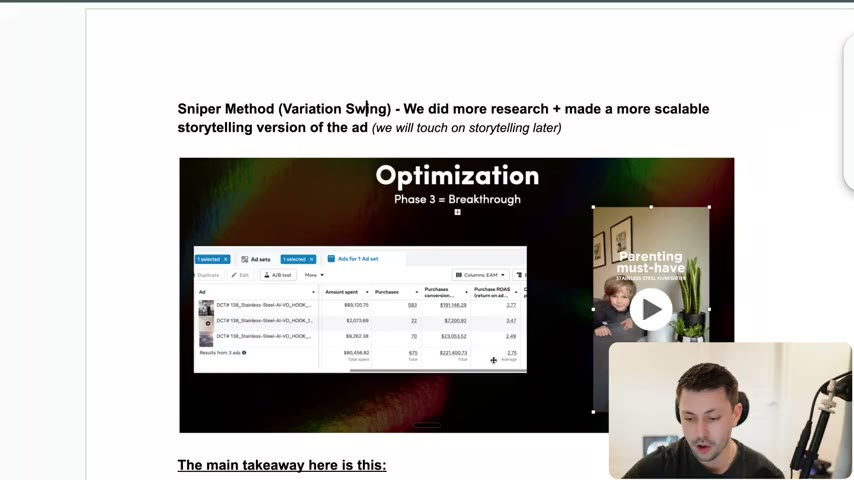

# 82. The 3 Testing Methods - Part 2
> A worked case: one superlative concept testing three angles (Marksman), a loser teardown, then two Sniper rounds that took an ad from about $10K to $80K per week at the same ROAS, plus how to reverse-engineer the avatar behind any winning angle, yours or a competitor's.

## 🤖 Agent use
- **Use when:** reading the results of a multi-angle test; writing a hypothesis about why an angle won or lost; analysing a competitor's winning ad for the avatar behind it; planning what to test after a direction appears.
- **Inputs → outputs:** an ad (own or competitor's) with its angle and headline, and any result data → a hypothesis (surface desire, behavior or product experience, core desire via "why"), a verdict on whether the angle or the execution failed, and the next Sniper tests.
- **Rules:**
  - **DO** study winning ads (yours and competitors') for the desire, behavior or product experience they target, then ask how to "say it better" or make it "more relatable". Do not copy them. [00:00; 21:39]
  - **DO** write a hypothesis (an educated guess) on why an angle works, then make ads around it: "That is how you make progress in your ad account. You don't blindly test things." [07:55–08:51]
  - **DO** find the core desire by asking "why" until you reach it: plastic-free humidifier → no microplastics → dangerous to health → "wants to be healthier". [10:29–11:58]
  - **DON'T** assume your first avatar guess is right: "the avatar may not be the first avatar that you assume". [07:55–09:45]
  - **IF** research-based angles lose **THEN** suspect the execution; **IF** product-first angles lose **THEN** "people just don't care". [16:13–17:12]
  - **IF** one variation in a Marksman test gets most of the spend **THEN** run Sniper tests around it on the underlying desires/behaviors, then a bigger research-based swing. [11:58; 18:53–21:39]
  - **DON'T** run only an iteration when you can do more research and change the format: the bigger swing here gave the exponential jump. [19:48]
  - **DO** process learnings from losers too (behaviors/desires to go deeper on), in terms of customers, "rather than just 'this headline sucks'". [13:50]
- **See also:** [81. The 3 Testing Methods - Part 1](081-the-3-testing-methods-part-1.md) · [78. Understanding Ad Definitions](078-understanding-ad-definitions.md) · [79. How To Come Up With Ad Angles](079-how-to-come-up-with-ad-angles.md) · [66. How To Find & Apply New Mechanisms](066-how-to-find-apply-new-mechanisms-part-2.md) · [83. Putting All The Planning Together](083-putting-all-the-planning-together-examples.md) · [Playbook: competitor ad teardown](../../../../playbooks/competitor-ad-teardown.md)

Lesson page text: this video breaks down and processes learnings on an ad, and also shows "how to understand and identify things from your current winning ads ... as well as from your competitors", to put the avatar training "into actual ad concepts". No document is attached or linked; the doc visible in the video (the Marksman/Sniper case study) is not in the course files, so its text below is read from video frames.

## Key ideas

### Why this clip leads the video [00:00–01:58]
- The instructor moved a clip from the end of the video to the front "because of how powerful it is" (the same passage repeats at [21:39–22:36]). [00:00]
- Apply it to competitors: follow the lessons on finding best winning ads, then "rather than just copying them brainlessly or rather than ripping them, which is illegal", study them: "it's actually going after this desire ... someone who has this behavior or had this specific product experience, there's their avatar. I wonder how I could say it better ... or make it more relatable." [00:00]
- The payoff: "you're gonna make a lot more money for a lot longer compared to the people that just get lucky and use someone else's content". [00:58]
- Shout-out to Nick Shackleford ("Shack"), who calls everybody a nerd: "The nerds make the money." [00:58]
- Caveat: the ads in the case were made before the avatar training existed: "we did know, but we didn't have it documented". [00:58–01:58]

### What a super winner is and why identify avatars [01:58–02:53]
- **Super winner** (his term; others say "breakthrough"): an ad that "pull[s] off the spend and allow[s] us to increase budget" and also raises ROAS, so you can scale. [01:58]
- Problem to solve: which avatar is in your best ads, and in competitors' ads, "from just the angle and the headline"? Knowing the avatar behind an angle that works "provides you with a direction to go deeper in", letting you write "more relatable ads". [01:58–02:53]

### The superlative concept (Marksman example) [02:53–06:13]
- Concept: **"Superlative Concept"**. Explanation: "Leverage multiple angles using superlatives to sell the humidifier." A superlative is "the best", "world's first", "a big claim". [03:46]
- Angles (more actionable than the broad "superlatives" idea): stainless steel mechanism, easiest to clean, doctor designed. Variations, one per angle: **"World's first stainless steel humidifier"**, **"World's easiest to clean humidifier"**, **"World's first doctor-designed humidifier"**. Execution strategy: Marksman method. [03:46–04:38]
- The concept started because the client suggested "bold claims thinking very surface level". Each variation of the superlative concept "is a different angle in itself" (the angle matrix). [04:38]
- Testing multiple angles = Marksman. If the concept is "testing angles", variations "will also likely target different avatars". Retrospectively the concept is really "testing different sub avatars that care about these specific things", with superlatives as the execution. [05:30–06:13]


*The doc's concept record: Concept, Concept Explanation, Angle(s), Variations 1-3, Execution Strategy: Marksman Method, then the note that each variation is a different angle (the "angle matrix"). [03:35]*

### Variation 1: "World's first stainless steel humidifier" [06:13–11:58]
- Angle: a **new mechanism**: "this is something that most humidifiers don't have". [06:13]
- A new-mechanism angle still targets an avatar. Possible avatar: desire "plastic free humidifier", or the broader desire "get rid of dry air" narrowed by the behavior "avoids using plastic products because of microplastics". [07:06]
- Reminder from the desire section: "Technological problems create desires": a problem with a product creates desires such as wanting a plastic-free humidifier. [07:06]
- Why hypotheses matter: "a hypothesis is an educated guess". "There's no right or wrong learning ... the right learning is the one that actually makes you a winning ad." At first you guess what people care about. Even a niche reading ("someone who wants a stainless steel humidifier") is acceptable; accuracy improves with practice. [07:55–08:51]
- Expect to feel lost for the first month or two: he recalls a call with Sean where they could not identify awareness levels on ads. [08:51–09:45]
- The desire or behavior may be wrong; the sure thing is that "people are buying from this headline ... for a reason. And it's your job to find that reason." Start by reasoning from your research "why would someone care?" and later verify through research. [09:45–10:29]
- Core desire here: "wants to be healthier". Pro tip: **"keep asking why."** [10:29–11:10]
- After the Marksman result: "this headline is specifically working", so launch further tests on stainless steel with the Sniper method to test "what underlying desires, behaviors, or experiences ... are truly driving the conversions". [11:58]


*Doc text: "Which in this case is 'Wants to be healthier'. Pro Tip: If you need help figuring out what your core desire is, just keep asking 'Why'", with the plastic-free humidifier → microplastics → dangerous to health chain. [11:40]*

### Variation 2: "World's easiest to clean humidifier" [11:58–13:50]
- A benefit-focused headline (versus feature-driven), so the avatar is easier to infer. Likely surface desire: "wanting an easier to clean humidifier", likely from a product experience with a hard-to-clean one (a "mass-tech problem"); or the behavior "not cleaning their humidifier". [11:58–12:52]
- A different angle means a **different sub-avatar**. "This is not chaos. This is controlled chaos." [12:52]
- Edge: because you look deeper at the avatars, "you have ability to actually make iterations or variations with strategy that matters, instead of brainless ChatGPT iterations and random clips that you rip". [12:52]

### Learning from the headline that did not land [13:50–14:36]
- "This headline specifically didn't land. The stainless steel one is the one that got most of the actual spend." [13:50]
- Still extract learnings: behaviors to go deeper on, desires, product experiences, thinking "about customers and avatars first, rather than just 'this headline sucks'". [13:50]

### Variation 3: "World's first doctor-designed humidifier" [14:36–17:12]
- Likely avatar: someone with a positive experience with doctors (other behaviors possible; "that's why doing research ... is important"). [14:36]
- "Considering that this headline didn't work and future angles that we tested around the fact that it's doctor designed still didn't work, people don't care if the humidifier has been designed by a doctor. They just want a humidifier that doesn't suck." [14:36]
- Lesson: angles you think are "super sick" may not matter to people. "We as marketers think we know what people want. And when you see that your ads are getting spent and scaling, you definitely do. But if your ads are not getting spent ... you're making things that people don't care about." [15:35]
- The research behind these three angles was **product first** ("our doctor designed it, let's tell people"), "not the right way to do it. Can it work still? Yes". When angles come from customer research, a loser is "probably how you executed it" (an execution problem, covered later in the course). [16:13]


*Doc text: "people don't really care if the humidifier has been designed by a doctor. They just want a humidifier that doesn't suck ... people just don't care about." [16:40]*

### The result: from about $10K to $80K a week [17:12–21:39]
- By testing the superlative concept at variation level the team "can begin to narrow down what avatars we need to go deeper on based on what performs"; they were targeting several sub-avatars "even though we didn't know it at the time". [17:12–17:59]
- They took the stainless steel new-mechanism angle, narrowed to a demographic (calling out **parents**) and changed the format to an **AI voiceover**. "We went from an ad that was spending $10,000 per week to an ad that could spend $80,000 per week with the same return on ad spend." [17:59]
- Three phases: [18:53–19:48]
  1. **Marksman (initial big swing):** Dr. Design, world's first stainless steel, cleanest.
  2. **Sniper (secondary, smaller swing):** "granular things around the ad": different images, different subtext. Result: "$18,000 per week at a 2.8X return on ad spend".
  3. **Sniper (variation swing, bigger):** more research, a "more scalable storytelling version that provided more context". Result: "$80,000 per week, again, at the exact same ROAS".
- "This is where most people stop" (an iteration like phase 2); the leap came from more research plus a different execution. [19:48]
- Main takeaway: "It is okay to test multiple angles, but only if you are aware of them", because then, after a winner appears, you can refine the avatar, be more relatable, "test different formats for them, which in turn will allow you to scale further". [19:48]
- Timeline: with direction on stainless steel, "next couple of days" did iterations (worked); "longer term ... give us a week or week and a half" to research why people care and build a more scalable ad type (AI voiceover storytelling). "Statics can scale like crazy" but a storytelling ad "can rip even harder"; no Shotgun was used here, only Marksman then Sniper. [20:45–21:39]
- Depth check: this took "basically 20 minutes" to break down one ad; "do you need to go this deep on every single ad? Probably not." [20:45]


*Doc text: new-mechanism angle of stainless steel, sub-avatar narrowed with a demographic (parents), a different format (AI voiceover video), and the result "$10,000 per week to $80,000 per week with the SAME return on ad spend". [18:45]*


*"Marksman Method (Initial Big Swing)", Optimization Phase 1: the three superlative statics (doctor-designed, stainless steel with the green arrow, cleanest). Read from the low-resolution frame: the stainless-steel ad row about $9.95K spend, 76 purchases, ROAS about 2.79; the other two rows about $71 and $7 with zero purchases; 3 ads total about $10.0K spend, ROAS about 2.77. [19:05]*


*"Sniper Method (Secondary Smaller Swing)", Optimization Phase 2: four stainless-steel statics (different images and subtext), green arrow on the leading variant. The table is hard to read; the instructor's figure is about $18K per week at about 2.8x ROAS (the total row appears to read 2.82). [19:40]*


*"Sniper Method (Variation Swing)": more research, a more scalable storytelling version ("Phase 3 = Breakthrough"), a parenting-themed AI-voiceover video for the stainless steel humidifier. Table total (as read) about $80.5K spend, 675 purchases, ROAS about 2.75. [20:15]*

## Steps / framework

**Reverse-engineer the avatar behind a winning angle (own or competitor ad)**, built from [02:53–11:58]:
1. Write the angle and the headline in one line. Mark it feature-driven (e.g. stainless steel) or benefit-driven (easier to clean).
2. Name the surface desire it implies (e.g. "plastic-free humidifier", "easier to clean humidifier").
3. Name the behavior or product experience behind it (e.g. "avoids plastic because of microplastics", "had a hard-to-clean humidifier", "not cleaning it").
4. Ask "why" until the core desire appears (wants to be healthier).
5. Write the hypothesis: who, why they care, what they currently do.
6. Verify with research (reviews, Reddit etc.); the first guess may be wrong.
7. Plan Sniper tests on the desires/behaviors that could drive the win; then plan a bigger research-based swing with a different format/demographic.

**Case timeline** [18:53–21:39]

| Phase | Method | What changed | Reported result |
|---|---|---|---|
| 1 | Marksman, initial big swing | 3 superlative angles, one static each | stainless steel static took the spend (frame: about $10.0K, ROAS about 2.77) |
| 2 | Sniper, smaller swing | different images and subtext | about $18K/week, 2.8x ROAS |
| 3 | Sniper, bigger swing | more research, storytelling AI voiceover, parents demographic | about $80K/week, same ROAS (frame: about $80.5K, ROAS about 2.75) |

## Examples
- **Variation read-outs:** [06:13–14:36] (stainless steel = new mechanism; easiest to clean = benefit/mass-tech problem; doctor designed = positive doctor experience, did not land).
- **Why-ladder:** "Wanting a plastic free humidifier" → "I don't want microplastics being humidified ... into my house" → "Because they're dangerous to our health" → core desire "wants to be healthier". [11:10; frame 11:40]
- **Learning rewrite:** "this headline sucks" → "these are the behaviors / desires / product experiences I potentially need to go deeper on". [13:50]
- **Competitor study:** see the opening and closing passages. [00:00; 21:39]

## Structured units

### Angles
| Angle | Core desire / pain | Heuristic(s) | Best format | Example line | Source |
|---|---|---|---|---|---|
| Stainless steel (new mechanism) | Wants to be healthier; plastic-free humidifier, avoid microplastics, or "get rid of dry air" with a behavior of avoiding plastic | New mechanism; technological problems create desires | Static, then AI-voiceover storytelling aimed at parents (the winner) | "World's first stainless steel humidifier" | [06:13–11:58; 17:59] |
| Easiest to clean | Easier-to-clean humidifier after a hard-to-clean one; or not cleaning it | Benefit-driven | Static | "World's easiest to clean humidifier" | [11:58–13:50] |
| Doctor designed | Positive experience with doctors (hypothesis) | Authority claim | Static | "World's first doctor-designed humidifier" | [14:36–17:12] |

### Hooks
| Hook | Heuristic(s) | Emotion / zone | Self targeted | Why it works | Source |
|---|---|---|---|---|---|
| "World's first stainless steel humidifier" | Superlative + new mechanism | — | Health-conscious / plastic-avoiding (hypothesis) | Won most spend in the Marksman test | [04:38; 11:58] |
| "World's easiest to clean humidifier" | Superlative + benefit | — | Hard-to-clean-humidifier owner (hypothesis) | Did not win | [11:58; 13:50] |
| "World's first doctor-designed humidifier" | Superlative + authority | — | Doctor-trusting buyer (hypothesis) | Did not work; "people don't care" | [14:36] |

### Ad teardowns
| Brand / product (niche) | Format | Hook / opening | What works | What fails | Fix suggested | Principle | Source |
|---|---|---|---|---|---|---|---|
| Stainless steel humidifier (home / health; brand unverified) | Static (phase 1-2), then AI-voiceover storytelling video (phase 3) | "World's first stainless steel humidifier" | New-mechanism angle; later narrowed to parents with story context | Doctor-designed and easiest-to-clean statics lost | Research why people care about stainless steel, then change format/execution | Marksman → Sniper (small) → Sniper (big) | [04:38; 18:53–21:39] |

### Rules of thumb
- **DO** read a loser as information about the avatar, not just a bad headline. [13:50]
- **DON'T** treat "product first" angles as research: "our doctor designed it" is a feature, not a customer reason. [16:13]
- **IF** results look good only for a feature-led headline **THEN** check the underlying desire by asking why. [10:29–11:58]
- **DO** expect mistakes in the first one to two months of making hypotheses. [08:51–09:45]
- **DO** change more than the creative on the bigger swing (format, demographic, depth of story). [17:59–19:48]

### Rewrites (before → after)
| Before | After | What changed | Source |
|---|---|---|---|
| Static "World's first stainless steel humidifier" ($10K/week) | AI-voiceover storytelling video for parents on the same angle ($80K/week, same ROAS) | Demographic + format + story depth after more research | [17:59–19:48] |
| "This headline sucks" | "Behaviors/desires/experiences to go deeper on" | Learning phrased about the customer | [13:50] |

## Prompts / templates (verbatim)
Concept record shown in the doc (field names verbatim; the content is the case):
```text
Concept: "Superlative Concept"

Concept Explanation: Leverage multiple angles using superlatives to sell the humidifier

Angle(s) : Stainless steel mechanism, easiest to clean, doctor designed.

Variations:
Variation 1: "World's first stainless steel humidifier"
Variation 2: "World's easiest to clean humidifier"
Variation 3: "World's first doctor-designed humidifier"

Execution Strategy: Marksman Method
```
Why-ladder from the doc (verbatim wording):
```text
Pro Tip: If you need help figuring out what your core desire is, just keep asking "Why". So, if you come up with a surface-level desire like "wants a plastic free humidifier" just keep asking "Why?"
"Wanting a plastic-free humidifier"
WHY does someone want that?
Answer could be: "Because I don't want microplastics being humidified into my house."
Again, Why?
"Because their dangerous to our health"
Core Desire: "Wants to be healthier"
```

## How to apply
- [ ] Log every multi-angle test as the concept record above: concept, explanation, angles, one variation per angle, execution strategy (Marksman).
- [ ] After results, for each variation write surface desire, behavior/experience, core desire (why-ladder) and a hypothesis, including for losers.
- [ ] Mark which angles came from research and which were "product first".
- [ ] For the winner: queue a small Sniper round (images, subtext), then a larger swing (more research, new format such as an AI-voiceover story, a tighter demographic).
- [ ] Run the same exercise on three competitor winners from your research; record the avatar they imply and how you would say it more relatably (do not reuse their lines).
- [ ] Budget time: one deep teardown can take a long time; do it for winners, not every ad. [20:45]

## Related
- Previous: [81. The 3 Testing Methods - Part 1](081-the-3-testing-methods-part-1.md) · Next: [83. Putting All The Planning Together (Examples)](083-putting-all-the-planning-together-examples.md)
- [76. How To Build Sub Avatars](076-how-to-build-sub-avatars.md) · [63. How To Find Desires](063-how-to-find-desires-part-3.md) · [12. Market Sophistication](012-market-sophistication.md)
- Sister course: [10-step iteration learnings](../../copywriting/frameworks/ten-step-iteration-learnings.md) · [Avatars and angles](../../copywriting/concepts/avatars-and-angles.md)

## Sources and limitations
- Transcript: [82. The 3 Testing Methods - Part 2….txt](<../../../../../raw/evolve/start-here/_transcripts/👣 Evolve (Start Here)/82. The 3 Testing Methods - Part 2 👣 Evolve (Start Here) Evolve.txt>) · Page text: [….html.md](<../../../../../raw/evolve/start-here/_extracted/👣 Evolve (Start Here)/82. The 3 Testing Methods - Part 2_👣 Evolve (Start Here)_Evolve.html.md>)
- Machine transcription (Whisper large-v3-turbo). Recording covered (last segment 23:22 of 23:22). Whisper heard "staying the steel" for "stainless steel", "Marksman's/Markson" for "Marksman" and "Shackleford" may be a misspelling of a real name; no attachment or linked doc exists for this lesson, so doc text comes from video frames.
- Spend and ROAS figures: the spoken numbers ($10K, $18K at 2.8x, $80K at the same ROAS) are the instructor's claims (the ad account tables are low-resolution; the values quoted from frames are approximate). No brand name, test dates or budgets are given; the product is a stainless steel humidifier. "Per week" figures are spend capacity ("could spend"), not confirmed delivered spend.
- At [05:30] the audio says "we identified people who care about stainless steel ... but we didn't" (the sub-avatars were inferred after the fact, not planned).
