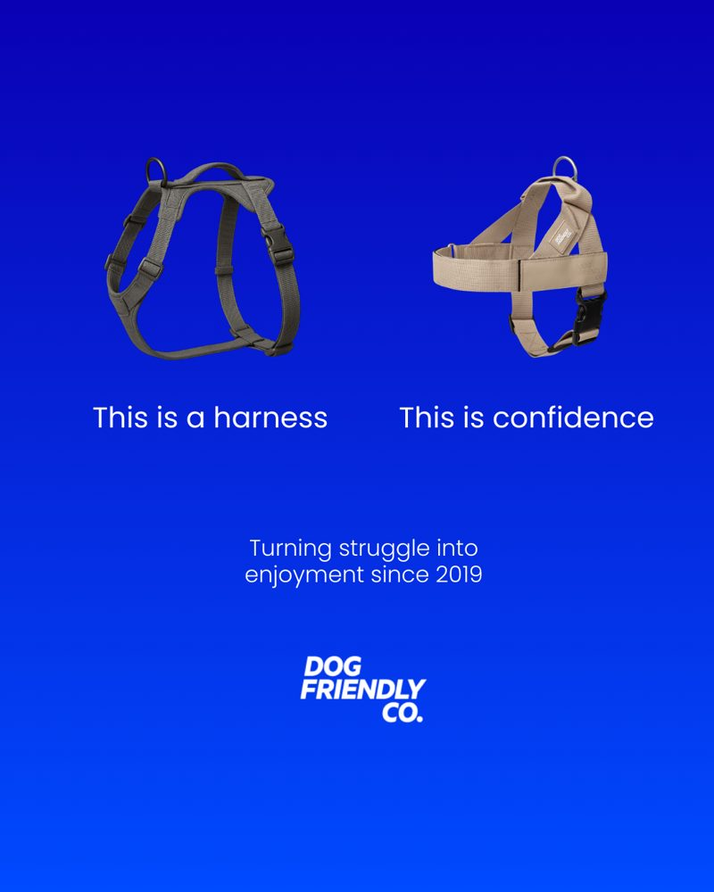
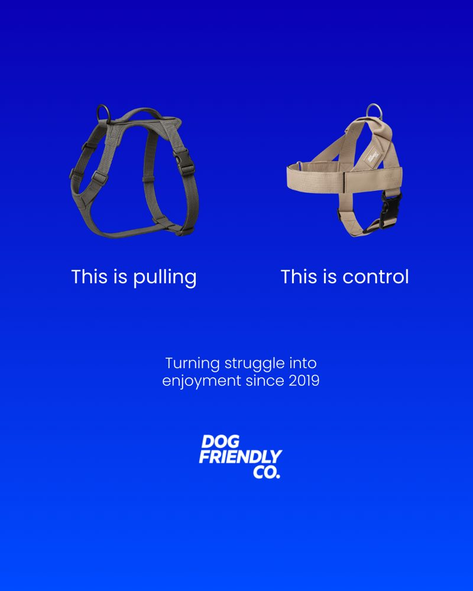
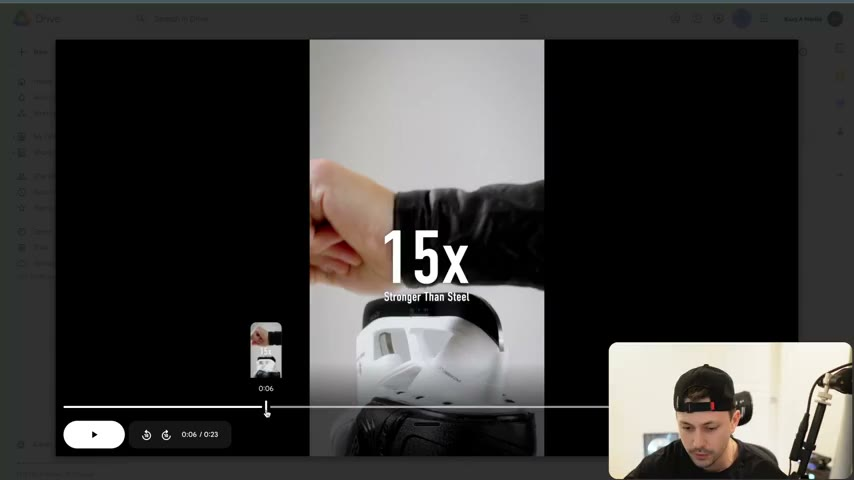
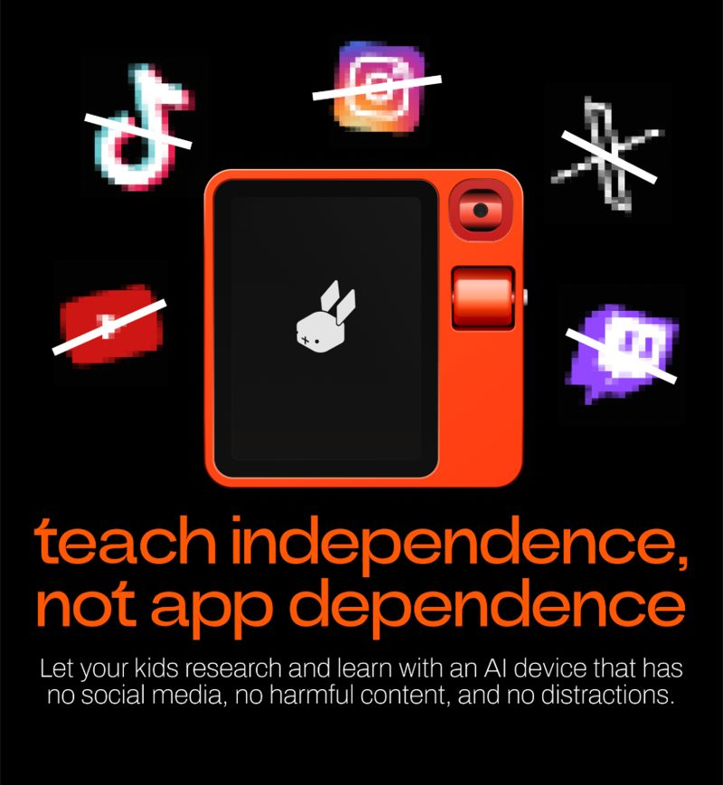
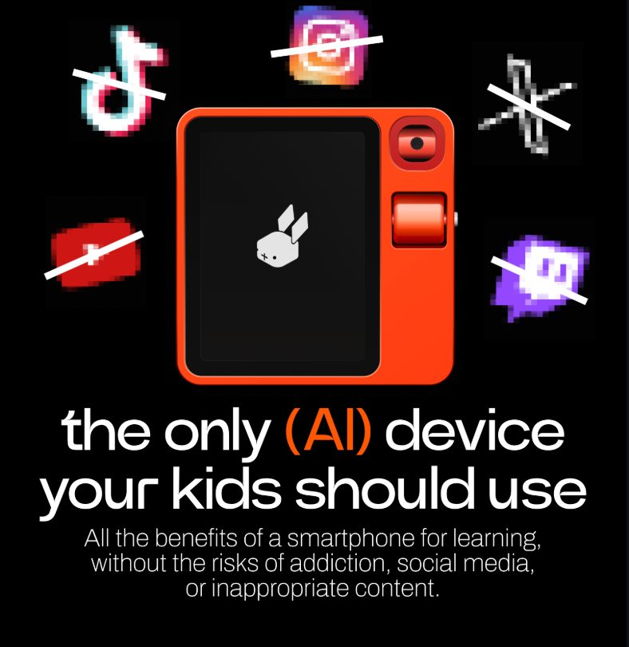
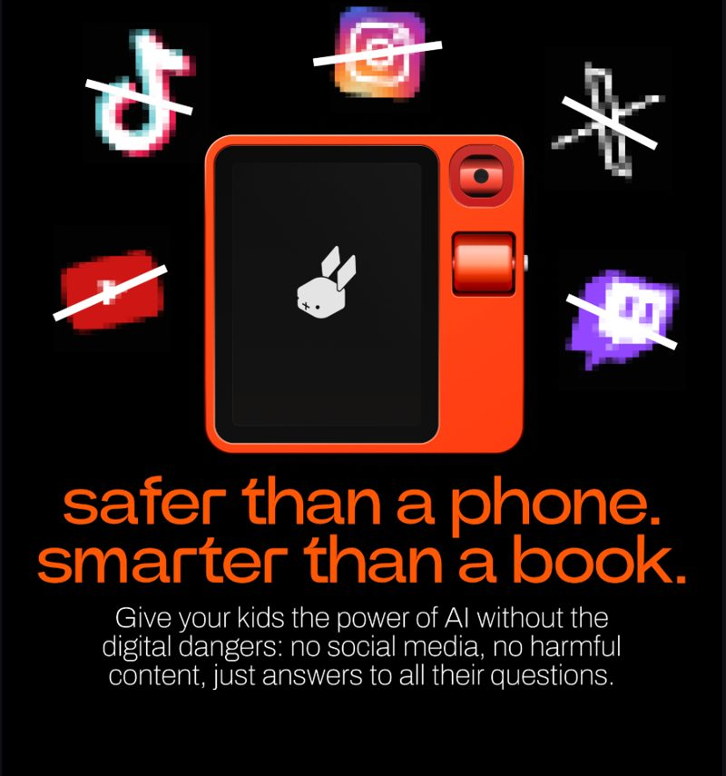
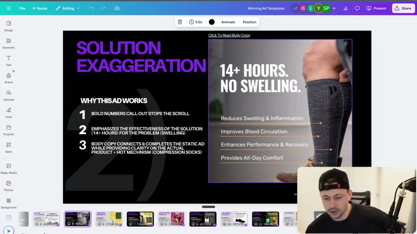
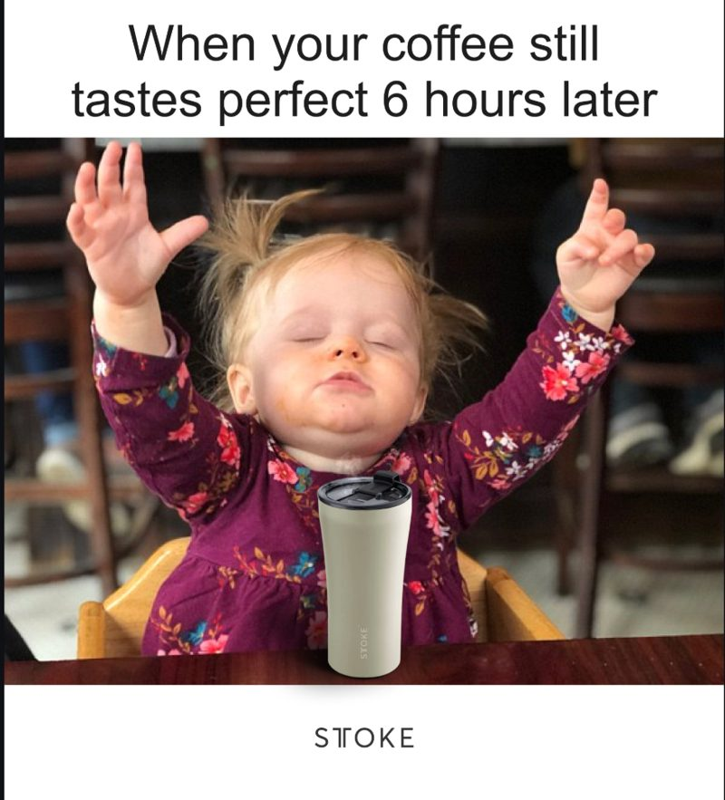
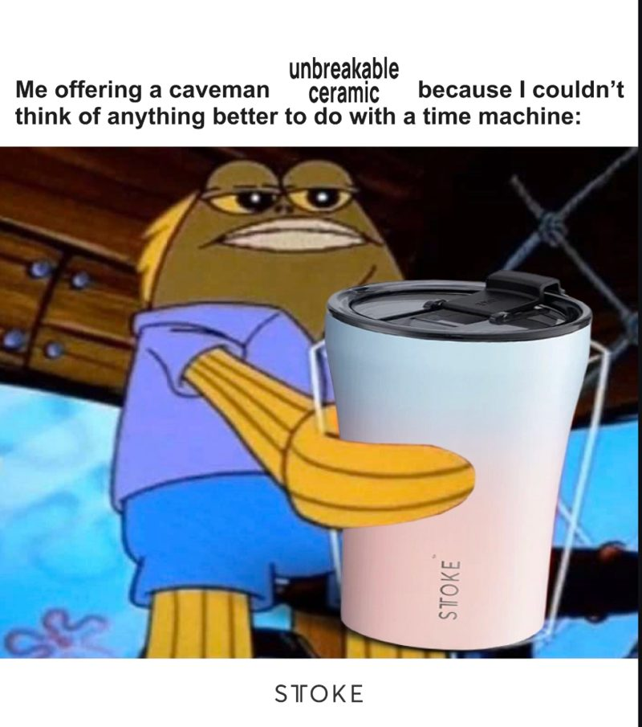

# 83. Putting All The Planning Together (Examples)
> Six worked ad examples (dog harness, blackout "total darkness", coffee tumbler memes, hockey neck guard, kids AI device) show how one concept, its angles, variations, format and testing method (Marksman vs Sniper) fit together, which executions failed, and how to run Marksman on video by keeping hooks specific and holds generic.

## 🤖 Agent use
- **Use when:** turning researched sub-avatars and angles into a concrete test plan; deciding whether a test is Marksman (many angles) or Sniper (one angle); writing a video concept where several hooks share one hold; critiquing a team's ad for "generic hold" or "half Sniper, half Marksman" mistakes.
- **Inputs → outputs:** a desire-based core avatar, 1-4 sub-avatars/angles, a format (static, subtitles + B-roll, meme, product photo + headline) → one filled concept card (Concept, Concept Explanation, Angle(s) with sub-avatar, Variations, Format, Testing Method, Explanation) per test.
- **Rules:**
  - **DO** fill every card with the same six fields: concept, angle(s), variations, format, testing method, explanation. [00:00–00:39]
  - **DO** name what the concept is "about". "Meme static ads, but meme static ads about what?" [24:48] A concept (a format idea) always needs an angle (a reason to buy) attached. [24:48; 23:49]
  - **DO** test 2-4 creatives in a round: "I would say don't do more than four", and with only two ideas "just test two, do a two, two, two." [00:39]
  - **DO** write the angle as any selling point or reason to buy; do not get stuck in the angle matrix. "Angles also exist on a spectrum... just put down the angle that makes sense to you." [02:16]
  - **DO** make a sub-avatar only as detailed as you need: desire + one more field (e.g. product experience) is enough. [03:14–04:09]
  - **IF** you are under $100K/month and want the easy mode **THEN** use Marksman for initial image tests and Sniper for video; follow-up tests (iterations, variations) should "probably always" be Sniper. [12:22–13:43]
  - **DO** in a Marksman video test make the hooks specific (each calls out a sub-avatar, "who needs it") and the hold generic (shows the shared desire/mechanism, "why they need it"). [17:19–19:15; 21:11]
  - **DON'T** pair a hold that is deeply specific to one sub-avatar (e.g. coming home at 7 a.m. after a night shift) with other sub-avatars' hooks (light sleeper, insomnia). [19:57–20:37]
  - **DON'T** run "half Sniper, half Marksman": if you commit to one angle, "go after it... make a good hold." [20:37–21:11]
  - **IF** a Sniper video's hold would work for any angle **THEN** it is too generic: rewrite it with the behaviors, experiences and emotions of that one sub-avatar. [09:49–11:23]
  - **DON'T** run image ads and video ads in separate campaigns because images are not spending; "your image ads aren't getting spent because they suck." [14:42–15:40]
  - **DON'T** read an angle as dead when the ad is poorly executed: "most people suck at execution and can get turned off from an angle because they screwed up execution". [13:43–14:42] (See [88](088-the-execution-problem.md).)
  - **IF** an image-ad angle wins **THEN** study why, go deeper on the sub-avatar's pain points and behaviors, and move to Sniper video/iteration variants of that angle. [05:49–06:25]
- **See also:** [78. Understanding Ad Definitions](078-understanding-ad-definitions.md) · [81. The 3 Testing Methods Part 1](081-the-3-testing-methods-part-1.md) · [82. The 3 Testing Methods Part 2](082-the-3-testing-methods-part-2.md) · [88. The Execution Problem](088-the-execution-problem.md) · [Iteration vs variation](../../../../concepts/iteration-vs-variation.md) · [Creative testing system](../../../../frameworks/creative-testing-system.md)

Lesson page text: only the link to the Google Doc "Document from the Presentation" (the same doc as the attached .docx) and two Canva links for the "13 winning ad templates" (overview and templates), mentioned at 1:50 (the page's own label). See [6. 13 Winning Static Ad Templates](006-13-winning-static-ad-templates.md). The doc is titled on screen "Official - Avatar Mastery for Shopify Brands: The Meta-First Framework" [00:00–00:40].

## Key ideas

### 1. The card that "puts everything together" [00:00–00:39]
- Each example is reviewed in the same order: **concept → concept explanation → angle(s) → variations → format → testing method**. "We're gonna put everything altogether." [00:00]
- The instructor apologises for the slow rollout of the avatar training ("for anybody that's been watching this part by part") and says he tried to present it "in a way that... it's just not confusing". [00:00]
- Count of creatives is flexible: "can I test four creatives here instead of three? Sure... don't do more than four"; with two ideas "just test two, do a two, two, two." "Your goal is to make the best ads possible." [00:39]

### 2. Example 1: Dog harness, two angles, one variation each (Marksman, static) [00:39–06:25]
- **Concept:** "Nutella ad" taken from the 13 winning ad templates; "that was the entire inspiration for our concept". [01:32] The ad itself was made by an EcomTalent community member who "didn't actually apply this strategy"; the instructor reverse-engineers it. [02:16]
- **Angles:** a "Confidence angle" and a "Control angle". Both are broad. [02:16]
- **Sub-avatars (Desire / Product Experience / Emotion / Behavior):**
  - Confidence: wants their dog to stop pulling; has tried traditional harnesses; feels embarrassed walking their dog; avoids walking their dog in certain situations. [03:14]
  - Control: wants their dog to stop pulling; has tried traditional harnesses and it did not stop the dog pulling; feels frustrated that harnesses don't work. [03:14]
- **Minimum viable sub-avatar:** "Is the product experience needed? Maybe not. Is the emotion needed? Maybe not." Desire + product experience alone "could just be the sub avatar that you go after". [03:14–04:09]
- **Variations:** "This is a harness | This is confidence" and "This is pulling | This is control". One variation per angle, i.e. "two different angles with one variation" = Marksman. [04:09–04:58]
- **Format:** static, simple graphic design. [04:58]
- **What to do with a winner:** if "this is a harness, this is confidence" wins, study it: why aren't people confident, can it become a video version, what pain points and behaviors sit behind the lack of confidence? Candidate follow-up: a video about having "zero confidence in your ability as a dog owner to walk your dog". That is "sniper method variations and iterations of this angle". [05:49–06:25]


*Example 1, angle 1 (Confidence): two harness photos on a blue background, "This is a harness / This is confidence", tagline "Turning struggle into enjoyment since 2019", brand logo (Dog Friendly Co. on screen). It copies the Nutella "This is bread / This is breakfast" structure. [04:09]*


*Example 1, angle 2 (Control): identical layout and images, only the two captions change to "This is pulling / This is control". Same format, two different angles = a Marksman test. [04:58]*

### 3. Example 2: "POV: Label" videos, four sub-avatars (Marksman, video) [06:25–08:57]
- **Concept:** call out sub-avatars directly with "labels" to find which avatar the mechanism "total darkness" resonates with most. [06:25]
- **Angles / sub-avatars (page doc):** "Sleep better during the day with total darkness" = night shift worker; "Sleep more regularly with total darkness" = insomniac; "Avoid premature wake-ups with total darkness" = light sleeper; "Stay asleep through sunrise with total darkness" = early riser. [07:01]
- **Variations (the hooks):** "POV: You work night shift", "POV: You have insomnia", "POV: You hate being an early riser", "POV: You're a light sleeper". [07:01]
- **Execution:** "very simple": the POV text, then the product working, "and we're done". Clips differ per label ("we chose the clips that we felt would best resonate with the label that we called out") because "we're taking bigger swings". Format: subtitles + B-roll. [07:01–08:00]
- The callout stays in the hook only; the video holds the rest. [08:00]

### 4. Example 2.5: Shift worker, Sniper follow-up (and why it was weak) [08:57–11:23]
- The Marksman test pointed to night-shift workers, so the team "doubled down": one angle ("Sleep better during the day with total darkness", night shift worker), three hooks: "Graveyard shift! I'm finding it impossible to sleep in the morning", "Night shift is killing me", "Night shift job but I can't sleep all day. My life is taking a quick downturn..." [08:57]
- The hold (shared by all three) said "Fix your sleep with a hundred percent darkness", "five minutes, custom made", "30 day in home trial", plus "Join 10,000 shift workers sleeping better on their schedule". [08:57–09:49]
- **Critique:** the social-proof line is good because it speaks to the target person, but the rest "is generic... can apply to anyone". "If your hold is kind of generic and could be used on any angle, I don't really think it's that good of a hold, especially when you're doing the sniper approach." The instructor "called out my team on this... it was an execution problem." [09:49–10:36]
- **What it should have shown:** "someone coming home from work at 7 a.m., sun rising, kids getting ready for school, and then someone closing the blinds to get total darkness to go to bed." Also: "What are their behaviors? What are their emotions? What is work like?... Are they waking up late because they can't sleep?" All of it belongs in the hold, because all three hooks target the same person. [10:36–11:23]
- In Sniper tests "the hold is the same" across the three hooks; you vary only the hook execution. [09:49]

### 5. Marksman vs Sniper: the simple rule and the video deep dive [11:23–23:49]
- **Images: Marksman is easy.** "You have three different angles and you test them congruently in your ad and that's it." [11:23; 13:43] "Congruent" means headline, image and style all say the same thing (his reference: "Doctor design, stainless steel, the world's cleanest" with a doctor and steel shown on a clean background). "Don't worry about the images being different. Just make the best ads you can." [13:43]
- **Four test categories:** initial image test, initial video test, follow-up image test, follow-up video test. "For follow-up tests you should probably always be testing sniper." Initial images: Marksman. Initial video: if Marksman is confusing, use Sniper. [12:22–13:43]
- **Under $100K/month, easy mode:** "Marksman means images and sniper means videos. That's it. If you're gonna do a video ad, go deep. If you're gonna do image ads, test more angles." [12:22; 23:01]
- **Images "seem simple" but are not easy.** A good image ad needs a strong headline and one box ("one by one box or four by five") to communicate everything; the Facebook primary copy also matters and is often ignored. [14:42–15:40]
- **How Marksman works on video (3:2:2 logic):** the "3" is three variations of the hook (sometimes the bridge), usually the first 3-5 seconds, sometimes up to 10; the hold (everything after) stays the same. To support several angles, the hold must be "universal enough to support all of the angles that your hook has set up", i.e. relevant to the **core avatar** and its shared desire. [17:19–18:18]
- **Rule:** "When you're testing the marksman method, you need to focus on making the hooks more specific and the holds more generic." [17:19] Example: hooks "POV: You work night shift", "POV: You're a light sleeper", "POV: You have insomnia" over one hold (blinds closing, complete darkness, restful sleep). The hold "just demonstrates the mechanism, total blackout"; each hook "calls out who needs it", the hold "just shows why they need it". [18:18–19:15]
- A more hook-aligned hold would perform better "100%", but the goal of Marksman "is really not to make super winners... It's to get direction." Then Sniper optimises the hold. [19:15–19:57]
- **Too-specific hold warning:** a night-shift-specific hold under the "light sleeper" or "insomnia" hook "doesn't really make sense"; this is the "avatar scale" problem (a person who does all of that and is also a light sleeper). [19:57–20:37]
- **Sniper on video:** once direction is clear, build tailored videos that "go deeper on the angle"; the three variations are "different executions of that angle". [21:11–22:04]
- **Sniper on images:** if the melatonin angle wins among three image angles, double down and execute that angle three different ways. [22:04]
- **Advanced option (later lessons):** if a lot of time went into a hold and the ad flopped, keep the hold and swap the hooks. [21:11]
- **Customers don't care about method names.** "Your customers don't give two... if you're running Marksman method or Sniper method. They care about the ad that's in front of them and what's in it for them." Test customer-first ads and complete feedback loops; "you can test shotgun method" if the loops are completed. [22:04–23:49]

### 6. Example 4: Meme static ads, two angles (Marksman) [23:49–24:48]
- **Concept:** "meme static ads". **Angles:** "Keeps your coffee hot for six hours" and "Unbreakable ceramic". **Variations:** "When your coffee still tastes perfect 6 hours later"; "Me offering a caveman unbreakable ceramic because I couldn't think of anything better to do with the time machine". Format: meme style. [23:49]
- **Critique:** "Could these have been a lot... more relatable if we actually went deeper on the sub-avatar? Absolutely. But unfortunately our team didn't... they didn't have the training." The example is included to show a format concept still needs an emphasis on what the memes are about. [23:49–24:48]

### 7. Example 5: "Career Ending Injury" (Sniper, older iteration, failed) [24:48–27:11]
- **Concept:** career-ending injury. **Angle:** "Stay protected from a Career-Ending Injury". **Variations:** "Don't risk a career-ending injury"; "This is the best way to prevent career-ending injuries"; "The right skate cut protection not only prevents career-ending injuries... but it can also save your life". Format: subtitles + B-roll. [24:48] (variation text from the page doc; spoken text differs slightly)
- **What failed:** all hooks "say the same thing very similarly" ([doc]). The body after the small bridge is generic: "Breathable, comfortable, secure, zero distractions... 15 times stronger, 360 neck and wrist". "We don't talk anything about a career ending injury... no behaviors, no experiences, no emotions." [25:21; 27:11]
- **Swap test:** if the hook were "this is the best way to keep your neck protected" or "the most comfortable base layer in hockey", the rest of the ad "still works", which proves it is generic. [26:17]
- **Missing:** a story of someone who nearly had a career-ending injury, or a stat on how many players are "inches away", right after the hook. [26:17]
- Instructor shows failing ads on purpose: "most of the time you guys make ads that don't work and then you wonder why." [27:11]
- The doc says to take "bigger swings" even for different executions of one angle (compare Example 6). [doc, Example 5]


*The Example 5 video as played from Drive: "15x Stronger Than Steel" at 0:06 of 0:23, a product-feature claim right after the injury hook. This is the generic "body" the instructor criticises. [26:00]*

### 8. Example 6: Kids angle for Rabbit R1 (Sniper) [27:11–29:50]
- **Concept:** "Kids Angle" (spoken: "some samples that we actually did for Rabbit Tech"). **Angle:** "We're selling how the R1 is a great device for kids". [27:11]
- **Variations:** "Teach independence, not app dependence"; "The only (AI) device your kids should use"; "Safer than a phone. Smarter than a book". Format: product photography + headline. [28:02]
- **Sub-avatar:** Desire: wants their kid(s) to be safe; Demographic: parent with kids; Emotion: worried about tech affecting their kid; Behavior: takes away the kid's device to limit screen time. [28:02–28:57]
- **Marksman vs Sniper ambiguity:** one could argue Marksman (sub-avatar with an app-dependent kid; one whose kid asks about AI; one who wants the kid to read more books). Instructor: "You can get stuck in the angle matrix... just make the best answer you can." [28:02]
- **Verdict:** a Sniper test "on this specific sub-avatar": three ways to speak to the same person. [28:57]


*Example 6, variation 1: the R1 device surrounded by crossed-out TikTok/Instagram/YouTube/Twitch icons; headline "teach independence, not app dependence" with a one-line explanation (no social media, no harmful content, no distractions). [28:02]*


*Example 6, variation 2: the same product image with the headline "the only (AI) device your kids should use". Same visual, different hook: an execution variation of a single angle. [28:02]*


*Example 6, variation 3: "safer than a phone. smarter than a book." with a sub-line about AI without the digital dangers. [28:02]*

### 9. The point of the exercise and the handoff to execution [28:57–31:58]
- "This stuff is not meant to trip you up. It's meant to give you a guide." The chain: desires → core avatar → sub-avatars → angles → test method. "If you want to test a lot of them at once, especially in initial swings, you use the marksman method. If you want to test one specific angle because you're really confident in it, you can use the sniper method and then you just keep going." [28:57–29:50]
- "The only thing that will hold you back is your ability to execute." The next module (the execution problem, [88](088-the-execution-problem.md)) is introduced as the explanation of "why my ads suck" (skill issue), plus a hoped-for masterclass on writing ads. [29:50–31:26]
- Example the instructor uses: people tired of their dog pulling exist, yet an ad that just says "tired of your dog pulling, buy my..." fails because of execution. [30:38]
- Closing instruction: stop analysis paralysis and "go take some action and start crushing out some ads." [31:26]

## Steps / framework

### The concept card (per test)
1. **Concept:** the idea for the test (a format or style: "Nutella ad", "POV: Label Videos", "Meme Static Ads", "Kids Angle"). Never leave it as format-only; attach the angle(s).
2. **Concept Explanation:** one sentence on what you are testing (e.g. "calling out sub avatars directly using labels to find out which avatar total darkness resonates with most").
3. **Angle(s):** each with its sub-avatar (Desire + Product Experience / Emotion / Behavior / Demographic as needed).
4. **Variations:** the individual executions (hook lines or headline pairs).
5. **Format:** static graphic, subtitles + B-roll, meme, product photography + headline.
6. **Testing Method:** Marksman (several angles, one variation each) or Sniper (one angle, several executions).
7. **Explanation:** why the test is structured this way and what you will do with the answer.

### Choosing Marksman vs Sniper (instructor's rules)
| Situation | Method | Source |
|---|---|---|
| Initial image test, several angles ready | Marksman (2-4 images, different angles) | [12:22–13:43] |
| Initial video test, comfortable running several hooks over one generic hold | Marksman video (specific hooks, generic hold) | [17:19–19:15] |
| Initial video test and Marksman is confusing | Sniper | [13:13] |
| Follow-up after direction found (iteration/variation, image or video) | Sniper | [12:22–13:43; 21:11] |
| One angle you are confident in | Sniper | [29:50] |

## Examples
Every example is listed in the Key ideas above. Before/after material is under Structured units.

## Structured units

### Hooks
| Hook | Heuristic(s) | Emotion / zone | Self targeted | Why it works | Source |
|---|---|---|---|---|---|
| "POV: You work night shift" | — | — | — | Labels one sub-avatar in the first line; product demo follows | [07:01] |
| "POV: You have insomnia" | — | — | — | Same label structure, different sub-avatar | [07:01] |
| "POV: You hate being an early riser" | — | — | — | Same | [07:01] |
| "POV: You're a light sleeper" | — | — | — | Same | [07:01] |
| "Graveyard shift! I'm finding it impossible to sleep in the morning" | — | — | — | First-person complaint in the target person's words (derived) | [08:57] |
| "Night shift is killing me" | — | — | — | Short emotional statement from the same sub-avatar | [08:57] |
| "Night shift job but I can't sleep all day. My life is taking a quick downturn..." | — | — | — | Longer relatable pain statement | [08:57] |
| "This is a harness / This is confidence" and "This is pulling / This is control" | — | — | — | Two-panel contrast copied from the Nutella "bread / breakfast" template | [04:09–04:58] |
| "Teach independence, not app dependence" | — | — | — | Pairs the parent's fear (app dependence) with the desire (independence) (derived) | [28:02] |
| "The only (AI) device your kids should use" | — | — | — | Exclusive, safe-choice claim | [28:02] |
| "Safer than a phone. Smarter than a book" | — | — | — | Two-sided comparison against known alternatives | [28:02] |
| "Don't risk a career-ending injury" | — | — | — | High-stakes loss framing (derived) | [24:48] |

### Angles
| Angle | Core desire / pain | Heuristic(s) | Best format | Example line | Source |
|---|---|---|---|---|---|
| Confidence (dog walking) | Wants dog to stop pulling; embarrassed to walk the dog | — | Static two-panel | "This is a harness / This is confidence" | [03:14; 04:09] |
| Control (dog walking) | Wants dog to stop pulling; frustrated that harnesses don't work | — | Static two-panel | "This is pulling / This is control" | [03:14; 04:09] |
| Sleep better during the day with total darkness | Night shift worker | — | POV video | "POV: You work night shift" | [07:01] |
| Sleep more regularly with total darkness | Insomniac | — | POV video | "POV: You have insomnia" | [07:01] |
| Avoid premature wake-ups with total darkness | Light sleeper | — | POV video | "POV: You're a light sleeper" | [07:01] |
| Stay asleep through sunrise with total darkness | Early riser | — | POV video | "POV: You hate being an early riser" | [07:01] |
| Keeps your coffee hot for 6 hours | (not stated) | — | Meme static | "When your coffee still tastes perfect 6 hours later" | [23:49] |
| Unbreakable ceramic | (not stated) | — | Meme static | "Me offering a caveman unbreakable ceramic..." | [23:49] |
| Stay protected from a career-ending injury | Hockey player safety | — | Subtitles + B-roll | "Don't risk a career-ending injury" | [24:48] |
| R1 is a great device for kids | Parent wants kid safe; worried about tech | — | Product photo + headline | "Safer than a phone. Smarter than a book" | [27:11; 28:57] |

### Ad teardowns
| Brand / product (niche) | Format | Hook / opening | What works | What fails | Fix suggested | Principle | Source |
|---|---|---|---|---|---|---|---|
| Dog harness (pet; brand "Dog Friendly Co." on the image) | Static, two-panel graphic | "This is a harness / This is confidence" | Template-proven structure; one clear selling point per ad; clean Marksman test | The ad was made by a community member without the strategy; angles are broad | If "confidence" wins, go deeper (pain points, behaviors, video) | One angle per ad, congruent image | [01:32–06:25] |
| Total-darkness blinds (sleep; brand not named) | POV subtitles + B-roll | "POV: You work night shift" etc. | Label hook calls out who; hold shows the mechanism simply | Clips differ per label (acceptable for Marksman) | — | Hook specific, hold generic | [06:25–08:57] |
| Total-darkness blinds, shift worker (sleep) | Subtitles + B-roll, Sniper | "Night shift is killing me" etc. | Hooks all target one sub-avatar; "10,000 shift workers" social proof | Hold "Fix your sleep with 100% darkness / 5 minutes / 30 day trial" is generic, same for every hook | Show 7 a.m. commute, sunrise, kids to school, blinds closing; behaviors, emotions, work life | Sniper hold must be specific to the sub-avatar | [08:57–11:23] |
| Stoke coffee tumbler (drinkware; brand on image) | Meme static | "When your coffee still tastes perfect 6 hours later" | Humor format with a clear claim | Angles not tied to a sub-avatar; "not as relatable as it could be" | Go deeper on the sub-avatar | A format concept still needs a specific angle | [23:49–24:48] |
| Hockey neck/wrist protection (sports; brand not named) | Subtitles + B-roll, Sniper | "Don't risk a career-ending injury" | Strong high-stakes opening | Hooks nearly identical; body generic (breathable, comfortable, secure) with no injury story, behavior or emotion | Tell a near-miss story, add stats, vary hooks more | Hook and body must carry the same angle | [24:48–27:11] |
| Rabbit R1 (AI gadget, kids angle) | Product photo + headline, Sniper | "Teach independence, not app dependence" | Three headlines speak to one sub-avatar's worry | None named; instructor notes Marksman could also fit | — | Sniper on one sub-avatar | [27:11–28:57] |

### Rewrites
| Before | After | What changed (verb / visual / promise / self / intensity) | Source |
|---|---|---|---|
| Hold: "Fix your sleep with 100% darkness / 5 minutes / custom made 30-day trial" | Hold: someone coming home at 7 a.m., sunrise, kids heading to school, then closing the blinds | Generic promise to specific lived scene (visual, self) | [10:36] |
| Body: "Breathable, comfortable, secure, zero distractions" after a career-ending-injury hook | A story or stat about near career-ending injuries; behaviors and emotions of the player | Features to experience and emotion | [26:17] |

### Rules of thumb
- **DO** let hooks do the specific callout and let the hold carry the shared desire in a Marksman video. [17:19]
- **DO** make a Sniper hold specific: "if you're going to use the sniper method, your hold is going to be more specific". [21:11]
- **DON'T** judge an angle by one poorly executed ad. [13:43–14:42]
- **IF** an ad flops after a big hold investment **THEN** keep the hold and re-do the hooks (advanced). [21:11]

## Prompts / templates (verbatim)
The concept card used in the doc, as headings (the doc's own field names):
```
Concept:
Concept Explanation:
Angle(s):
  Sub avatar:
Variations:
Format:
Testing Method:
Explanation:
```
Sub-avatar line format used throughout the doc:
```
Sub avatar: Desire - <what they want>, Product Experience - <what they have tried>, Emotion - <how they feel>, Behavior - <what they do>
```
Sub-avatar for the Kids angle (from the doc):
```
Desire - Wants their kid(s) to be safe, Demographic - Parent with kid(s), Emotion - is worried about tech affecting their kid, Behavior - takes away their kid(s) device to limit screentime
```
Marksman-with-video rule (from the doc):
```
The Marksman Method with video works when:
- Hooks = Call out the specific sub avatar/angle
- Hold = Demonstrates the shared desire of the core avatar, or broader angle.
```

## Screenshots

*The Canva "Winning Ad Templates" deck the instructor opens while discussing good image ads: the "Solution Exaggeration" slide ("14+ HOURS. NO SWELLING.") with a three-point "Why this ad works". See [6](006-13-winning-static-ad-templates.md) and [88](088-the-execution-problem.md). [16:40]*


*Example 4, angle 1: meme static with a baby celebrating, headline "When your coffee still tastes perfect 6 hours later", product pasted at the bottom (Stoke on image). [23:49]*


*Example 4, angle 2: a cartoon meme with the product swapped in; "unbreakable ceramic" is the only angle word and sits inside the meme text. [23:49]*

## How to apply
- [ ] Write a concept card (7 fields above) for each planned test; do not leave concept as a format with no angle.
- [ ] Decide Marksman vs Sniper with the table; under $100K/month default to Marksman for first images and Sniper for videos.
- [ ] For a Marksman video: write 2-4 hooks that name different sub-avatars, then ONE hold that shows the shared mechanism/desire. Check each hook still "makes sense" over that hold.
- [ ] For a Sniper video: write the hold from the sub-avatar's behaviors, emotions and day (see Example 2.5 rewrite) and vary only the hooks.
- [ ] Swap test: replace the hook with a different hook; if the body still reads fine, the body is generic, so rewrite it.
- [ ] After a winner appears, list pain points, behaviors and emotions behind it and plan the Sniper follow-up.
- [ ] Hand off to the execution check in [88](088-the-execution-problem.md) before concluding an angle failed.

## Related
- Previous: [82. The 3 Testing Methods (Part 2)](082-the-3-testing-methods-part-2.md) · Next: [84. Action Item / Plan Your 5-10 First Concepts](084-action-item-plan-your-5-10-first-concepts.md)
- [6. 13 Winning Static Ad Templates](006-13-winning-static-ad-templates.md) · [76. How To Build Sub Avatars](076-how-to-build-sub-avatars.md) · [85. The 3.0 Evolve Growth Guide](085-the-3-0-evolve-growth-guide.md)
- Evolve Copywriting: [Avatars and angles](../../copywriting/concepts/avatars-and-angles.md) · [Hooks](../../copywriting/concepts/hooks.md) · [Mini breakthrough memo + Growth Guide](../../copywriting/frameworks/mini-breakthrough-memo-and-growth-guide.md)

## Sources and limitations
- Transcript: [83 transcript](<../../../../../raw/evolve/start-here/_transcripts/👣 Evolve (Start Here)/83. Putting All The Planning Together (Examples) 👣 Evolve (Start Here) Evolve.txt>) · Page text: [83 page](<../../../../../raw/evolve/start-here/_extracted/👣 Evolve (Start Here)/83. Putting All The Planning Together (Examples)_👣 Evolve (Start Here)_Evolve.html.md>) · Attachment text: [83 docx](<../../../../../raw/evolve/start-here/_extracted/👣 Evolve (Start Here)/83. Putting All The Planning Together (Examples).docx.md>) · Linked Google Doc export (identical to the attachment): [83 linked doc](../../../../../raw/evolve/start-here/_extracted/_linked/google/83-document-1ukLfAYFTY.docx.md).
- Machine transcription (Whisper large-v3-turbo). Full recording covered (last segment 31:58 of 31:58). Whisper heard "Marksmen", "marshmallow method", "Martian method" for Marksman, "cyber method" for Sniper; "Rabbit Tech" is the spoken name for Rabbit (the doc says "R1"). "If Spencer can spell, marksman" [04:58] is a joke about the doc's "Marksmen Method" spelling (fixed to Marksman here).
- The doc has no "Example #3": it runs 1, 2, 2.5, 4, 5, 6, with a "Example 1,2,2.5 Deep Dive" between 2.5 and 4. The Drive folders linked as "Ad Example #2, #2.5, #5" (video files) are not in the course files; only the career-ending-injury video frame at 0:06 is visible in the recording.
- Variation text for Example 5 and "first 3-10 seconds" (doc) differ slightly from the spoken "first 3-5 seconds... sometimes 10" [17:19].
- Brand names shown only on images or in the doc (Dog Friendly Co., Stoke, Rabbit R1) are as visible; the blind and hockey products are unnamed. Screen-recording frames of the Google Doc add nothing beyond the attachment text and were not kept. No statistics are given in this lesson.
