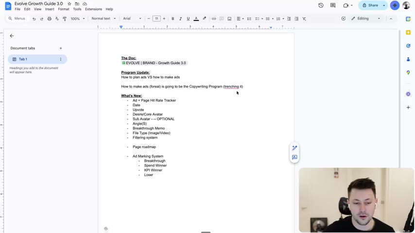
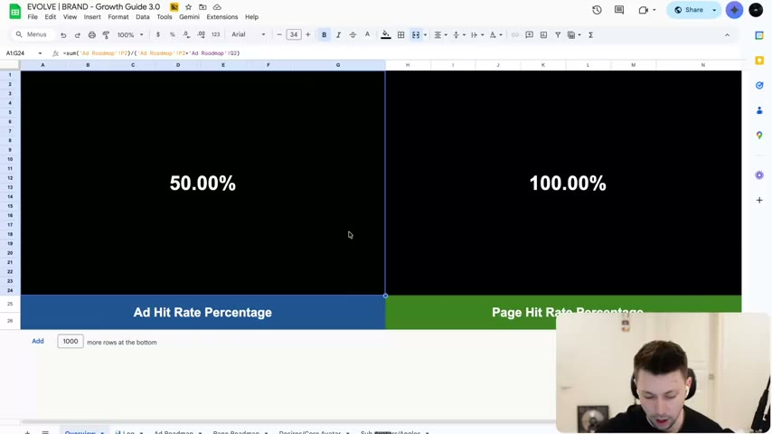
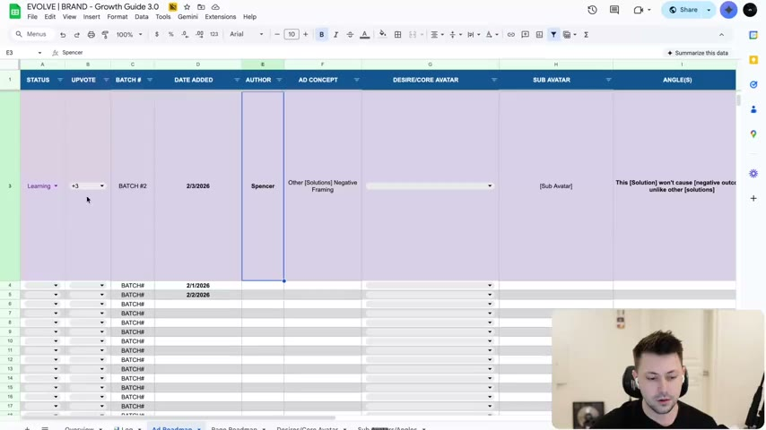
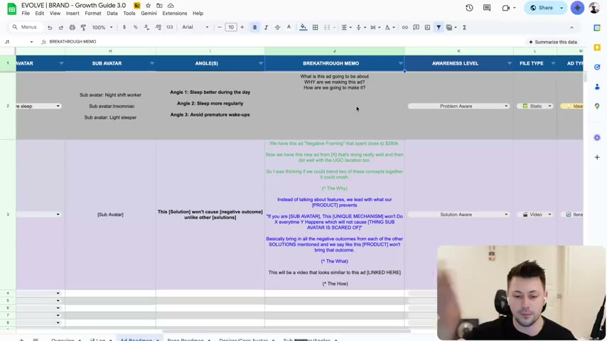
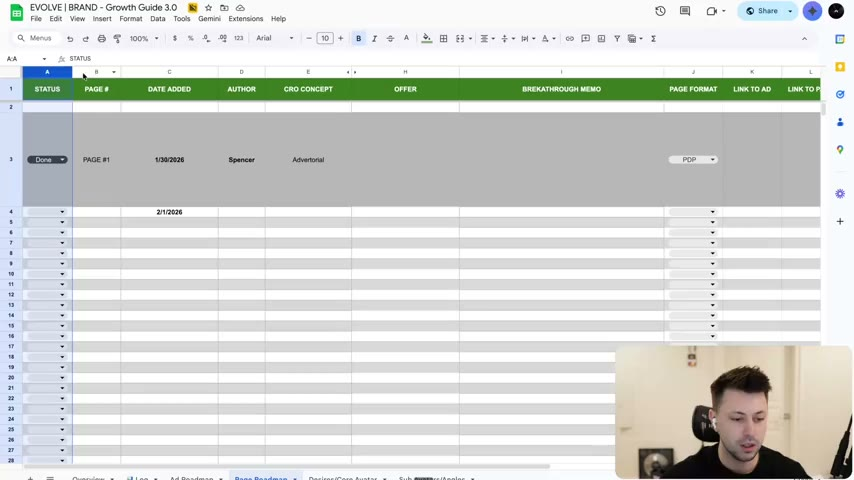
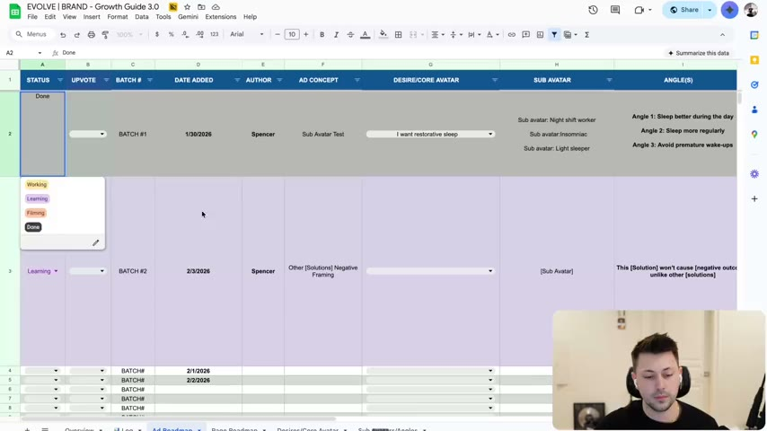
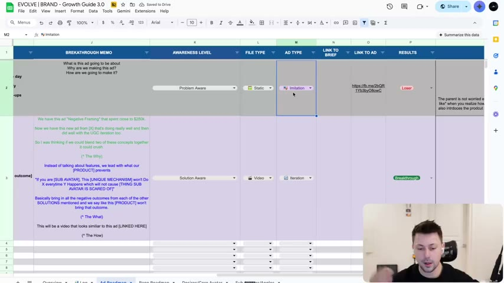
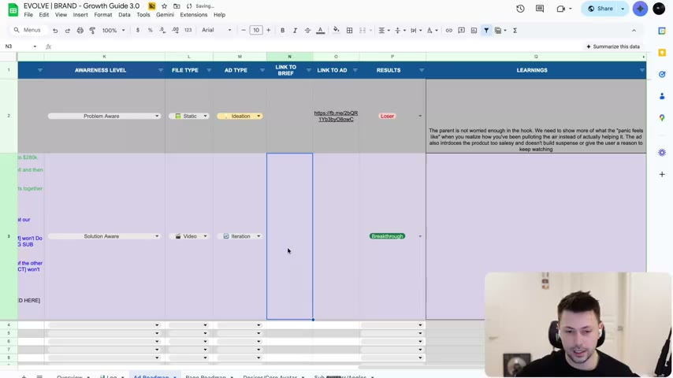

# 85. The 3.0 Evolve Growth Guide
> The 2026 Growth Guide is the tracking sheet that holds every ad idea (Ad Roadmap), page test (Page Roadmap), daily account change (Log) and hit rate, with new columns for upvotes, breakthrough memo, awareness level, file type, optional sub-avatar and a four-label result system (Breakthrough, Spend Winner, KPI Winner, Loser).

## 🤖 Agent use
- **Use when:** logging an ad idea, planning a weekly batch, closing the loop on a launched ad, filtering the backlog, tracking hit rate by author, or deciding whether an ad counts as a scaling win.
- **Inputs → outputs:** an ad idea, its desire, sub-avatar, angle(s), awareness level, file type and a Why/What/How memo → one Ad Roadmap row; later the result label and learnings. Account changes → a daily Log note.
- **Rules:**
  - **DO** put "every single concept" in the sheet; the page calls it "the #1 system" behind 43+ brands reaching $100k/day (instructor claim; the audio says 34+ [25:26]).
  - **DO** write a breakthrough memo with WHY, WHAT, HOW, with at least what and why first: "don't really start with the how first, start with what or why." [14:14]
  - **DO** name the desire/core avatar for every idea: "who is it for". [07:37]
  - **DO** give every ad idea an angle ("the main reason someone is going to buy"); the sub-avatar column is optional and can be hidden. [08:34–09:57]
  - **DO** label every ad set with its batch number: "please please please... label your ads". [22:52–23:47]
  - **DO** log each account change in the daily Log; he has seen teams turn off a high-spend ad after a bad couple of days and then decline for weeks. [02:25–03:19]
  - **DO** wait seven days after launch before marking the result. [21:54–22:52]
  - **DON'T** mark an ad Done until learnings are processed; the sheet is built to hold you to it. [22:52]
  - **DON'T** treat spend winners as scale: "Spend winners usually don't allow you to scale." Only breakthroughs do. [21:18]
  - **IF** you have a team of more than two or three **THEN** use the upvote column; **IF** not, hide it. [04:57; 17:09]
  - **IF** you are short of ideas **THEN** filter Results = Breakthrough and study or iterate those. [17:52]
  - **IF** you do not want the sub-avatar column **THEN** hide it and go straight from desire to angle. [08:34]
- **See also:** [83. Putting All The Planning Together](083-putting-all-the-planning-together-examples.md) · [86. Make a Copy + Add Your Concepts](086-action-item-make-a-copy-add-your-concepts.md) · [88. The Execution Problem](088-the-execution-problem.md) · [Mini breakthrough memo + Growth Guide (Copywriting)](../../copywriting/frameworks/mini-breakthrough-memo-and-growth-guide.md) · [Ten-step iteration learnings](../../copywriting/frameworks/ten-step-iteration-learnings.md) · [Creative testing system](../../../../frameworks/creative-testing-system.md)

Lesson page text: "⚠️ IMPORTANT: This tool is the #1 system that has helped 43+ brands in Evolve Scale to $100k/day. So take it seriously. And let's level up your creative strategy." plus a link to "The New 3.0 Growth Guide (2026)" (a Google Sheet). The sheet exported with the lesson is the same workbook that [86](086-action-item-make-a-copy-add-your-concepts.md) tells students to copy.

## Key ideas

### 1. What it is and where it sits [00:00–02:25]
- This is the "2026 version" of the Growth Guide, revamped every year: "we find the flaws and we try to make it better." Older 1.0 and 2.0 modules sit in the Evolve Archive section ("outdated"). [00:00–00:58]
- The 3.0 sheet "incorporates all of the best parts of the growth guide 1.0, as well as the 2.0" and is based on the avatar training. [00:58]
- Claim: "any brand that has scaled to 100K per day has implemented this system inside Evolve, at least"; later "34 plus brands" (instructor claim). [00:00; 25:26]
- **Planning vs making:** "there's a big difference between planning ads and making ads." The Growth Guide is planning (what Evolve "is known for"); how to make ads is the new Evolve Copywriting program, so the sheet leaves the "how to make" part out. [00:58–01:42; 02:25] See [87](087-overview-of-how-to-make-ads.md).


*The instructor's outline: Program Update (plan ads vs make ads; "how to make ads (for real) is going to be the Copywriting Program"), then What's New: Ad + Page Hit Rate Tracker, Date, Upvote, Desire/Core Avatar, Sub Avatar (optional), Angle(S), Breakthrough Memo, File Type (Image/Video), Filtering system, Page roadmap, Ad Marking System (Breakthrough, Spend Winner, KPI Winner, Loser). [00:10]*

### 2. Tabs and the hit-rate tracker [02:25–04:08]
- Tabs in the workbook: Overview, Log, Ad Roadmap, CRO, Page Roadmap, Desires/Core Avatar, Sub Avatars/Angles, Avatars, Awareness, Creators (export order). In the screen recording the visible tab row runs Overview, Log, Ad Roadmap, Page Roadmap, Desires/Core Avatar, Sub Avatars/Angles; the CRO tab may be hidden in the live sheet. [02:30]
- **Ad and Page Hit Rate tracker (Overview):** now "fully working" for both ads and pages; "this will go up and down based off how you perform with your team." [02:25; 04:08] The Overview shows two big percentage cells labelled "Ad Hit Rate Percentage" and "Page Hit Rate Percentage" (50.00% and 100.00% in the demo). The formula bar shows a ratio of cells on the Ad Roadmap (partly legible). [02:30]
- **Ad Log ("Meta Ads Log"):** a day-by-day note sheet for the media buyer; "whenever you make a change in the account, just jot it down." Anecdote: a team turned off a high-spending ad after a few bad days, the account then declined for weeks, and turning it back on likely brought performance back, "so that's why it's important to keep a log especially if you have a media buyer." "This log should be updated for 2026." [02:25–03:19] (The export shows dated rows from 2025-02-03 with "Weekly Recap" rows and empty notes.)


*Overview tab: Ad Hit Rate Percentage (50.00%) and Page Hit Rate Percentage (100.00%), computed from the Ad Roadmap and Page Roadmap result columns. [02:30]*

### 3. New columns on the Ad Roadmap [04:08–11:28]
- **Date added.** Ideas "were very outdated" so a date column plus a filter shows only this week's ideas on the strategy call, and exposes old ideas. [04:08–04:57]
- **Upvote (team only).** "More than two or three people": before each strategy call everyone (the creative team is "10, 11 people") adds +1 to ideas they like; an editor votes, a copywriter bumps it to +2, a senior strategist adds more. Filter to plus 3, 4, 5 so "everybody on the team is confident"; the author then explains the idea and the team moves on. It exists "to sift out all of the crappy ideas". [04:57–06:24]
- **Desire / Core Avatar.** Renamed from "Desire" (1.0) because the core avatar should be built on a desire ("the desire is what actually makes people buy"). Example desire: "scale my brand to 100K per day". Pick it on every ad idea: "I have this ad idea but who is it for?" [06:24–07:37] See [61](061-understanding-applying-desire-part-1.md) and [74](074-how-to-build-core-avatars.md).
- **Sub Avatar (optional).** The person with experiences, behaviors, emotions, plus the desire. Added to stop people being "very robotic" (core avatar → sub-avatar → prompt → angle) and to make them think about how the person feels. "If you feel like you're just good with angles, you can actually hide this section and you could just go, hey, this is the desire and this is the angle." [07:37–08:34]
  - A broad sub-avatar (night shift worker) has several angles; a narrow one (light sleeper) has "really only one angle". [08:34–09:19]
- **Angle(s).** "The angle is what matters most." Example: desire "improve my REM sleep"; sub-avatar a user of a sleep-tracking wearable ("WAP" in the transcript, likely a Whoop); angle "optimizing your REM sleep with darkness". [09:19–09:57] Angles has an "s": some ads carry one angle, some several, the source of the Marksman/Sniper confusion. [09:57]
  - Definition re-read from the definitions doc: "how you're choosing to sell a product", "the main reason you're giving someone to buy". Examples: "they can sleep better during the day"; "this solution won't cause this negative outcome". One angle = more Sniper; several = more Marksman. [09:57–11:28] See [78](078-understanding-ad-definitions.md).
- **Awareness level** is back "because awareness level is important when planning". [11:28]
- **File type** replaces "ad format": just Static or Video (GIF counts as video). [11:28–12:23]


*Ad Roadmap: Status, Upvote (+3 in the demo), Batch #, Date Added, Author, Ad Concept, Desire/Core Avatar, Sub Avatar, Angle(s). Row 3 is the Negative Framing idea. [05:00]*

### 4. The breakthrough memo [11:28–16:22]
- A memo means thinking through the whole idea: what the ad is about, why it is made, how. "The guys in Apex are going to get some more advanced memo training and not just for ads specifically, but for company decisions." [11:28]
- **Winning example (brand withheld):** concept "Other [Solutions] Negative Framing". The WHY was an evidence chain: "we have this ad 'Negative Framing' that has spent close to $280,000", a new ad from another team doing well, which also did well as a UGC iteration; "if we could blend two of those concepts together, it could crush." [13:20–14:14] (instructor's figures)
- **WHAT** (the hook idea): "instead of talking about features, we lead with what our product prevents": "If you are [sub-avatar], this [unique mechanism] won't do X every time Y happens, which will not cause [thing sub-avatar is scared of]." Bring in the negative outcomes of each competing solution and say our product won't cause them. [15:04–15:45]
- **HOW:** "a video ad that looks similar to this ad linked here." Awareness level solution aware ("targeting other solutions"); file type video; ad type iteration; result Breakthrough. [15:45–16:22]
- For ideation (not iteration) the WHY could be research: "I found this thing across a lot of different people. And they all mentioned this specific pain point." Order what/why/how is flexible; "what and why are usually the most important ones". [14:14–15:04]
- The doc cell header reads: "What is this ad going to be about / Why are we making this ad / How are we going to make it". [11:28; 12:23]


*Row 3's breakthrough memo: green lines = the WHY (the $280k "Negative Framing" ad and the blend idea), blue = the WHAT (lead with what the product prevents), black = the HOW (a video like a linked ad). Next to it: Awareness Level "Solution Aware", File Type Video, Ad Type Iteration. [11:40]*

### 5. Filtering system [16:22–18:47]
- Filter blanks to pull all new ideas to the top; filters stack: "show me all the ones that are plus four and plus five". Undo with Command Z. [16:22–17:09]
- Batch number is not the main filter; Date added can be filtered ("date is after..."); with no team, right-click and hide the upvote column. [17:09–17:52]
- Filter by Author (e.g. creative strategist's ideas), Status (not Done or Learning), Desire/Core Avatar, Sub Avatar ("probably won't really work"), or Results: "show me all of my breakthrough ads", useful when short of ideas ("maybe I should do some iterations"). [17:52–18:47]

### 6. Page Roadmap [18:47–19:46]
- Same pattern as the Ad Roadmap. Columns: Status, Page #, Upvote (optional), Date Added, Author, CRO Concept, Desire/Core Avatar (optional), Offer, Breakthrough Memo (why/what/how), Page Format (PDP, sales page, advertorial or listicle: new), Link To Ad, Link To Page. [18:47–19:46]
- Pace: "anywhere from like one to two pages... really just one page per week", versus the creative team's "15 to 20" ads. [18:47]
- Every page should name the ad it serves ("what ad are we running this to?") to judge congruence, e.g. "I want to do this advertorial... based off of this ad because... this ad is going here and it's not as congruent". [19:46]


*Page Roadmap: Status, Page #, Date Added, Author, CRO Concept, Offer, Breakthrough Memo, Page Format (PDP in the demo), Link to Ad, Link to Page. [19:00]*

### 7. Ad marking (result) system [19:46–21:54]
- The instructor is in "a major data trench": one CSV had "like 36,000 lines" and he has "like 25 of those CSVs", so the team is building its own script (instructor claim: "we've literally broken Claude, we've broken Gemini, broken Manus"). Updated terms and definitions "will be here shortly". [19:46–20:31]
- Winning ads sit on a scale defined by three variables: "how much spend it gets, how high the KPI is, and how long it runs." The ideal: "an ad that can spend infinitely, can have a 10X ROAS and run forever". [20:31]
- **Breakthrough:** lets you scale the account, e.g. spending $2K/day, you launch an ad that "sucks up a bunch of spend, is hitting your KPI" and you scale from $2K to $3K/day. [20:31–21:18]
- **Spend winner:** soaks up spend but keeps you where you are; "likely not hitting your KPI". **KPI winner:** hits KPI, little spend. **Loser:** misses KPI, little spend. Every creative team's goal: breakthroughs. [21:18–21:54]
- (For the Copywriting course's hit-rate rule see [the framework page](../../copywriting/frameworks/mini-breakthrough-memo-and-growth-guide.md).) This lesson's audio does not state which labels count in the hit rate.

### 8. Status, batch, author, ad type, links [21:54–26:13]
- **Status:** Working (concept being worked on this week) → Learning (live; wait 7 days, then mark result) → Done (only after learnings). Filming is rarely used now: it is for ideas given to an in-house UGC creator. [21:54–22:52]
- The sheet "plays a bit of a psychology trick": you want to mark Done, but "before I mark this as done I have to process learnings on it". [22:52]
- **Batch #:** number each batch (#2, #3...); apply it "at the ad set level". "By the end of this year you will want to label your ads with batch number"; otherwise upcoming reports will be "a complete mess". [22:52–23:47]
- **Author:** whose idea; needed to track idea hit rate by person. [23:47–24:31]
- **Ad concept:** "what are we essentially testing... the big idea behind what we want to test here". [24:31]
- **Ad type (idea source):** Iteration = idea from looking at ads you made; Imitation = idea from other people's ads ("that's fine"); Ideation = idea from your own research. "The most important thing is where did the ad start from." (Whisper lists "iter, inspiration, imitation, ideation"; the sheet dropdown has Ideation, Iteration, Imitation.) [24:31–25:26]
- **Link to brief** (Google Doc or Milanote) and **Link to ad** (media buyer adds once live, for learnings). [25:26]
- Closing: "the number one system that has helped... 34 plus brands scale to a hundred K per day... how you stay organized... rather than just spamming" (instructor claim; the page says 43+). [25:26–26:13]


*Status dropdown: Working, Learning, Filming, Done; Row 2 shows Batch #1, Row 3 (Batch #2) is "Learning". [22:10]*


*Right side of the Ad Roadmap: Awareness Level, File Type, Ad Type (Ideation/Iteration/Imitation), Link to Brief, Link to Ad, Results (Loser, Breakthrough), start of Learnings. [25:00]*


*Link to Brief, Link to Ad, Results and Learnings columns. Row 2 (Loser) already has learnings text; the Breakthrough row has none yet. [25:30]*

## Steps / framework

### Weekly use (derived from [04:57–06:24; 16:22–17:52; 21:54–22:52])
1. Everyone adds ideas to the Ad Roadmap (Author, Concept, Desire, optional Sub Avatar, Angle(s), memo, awareness, file type, ad type).
2. Before the strategy call team members upvote.
3. On the call filter by Date added (this week) and Upvote (+3 and up); the author explains each idea.
4. Chosen ideas get a Batch # and status Working; a brief link is added.
5. On launch, status Learning; the media buyer adds Link to Ad.
6. After 7 days mark the Result (Breakthrough / Spend Winner / KPI Winner / Loser), write Learnings, then Done.
7. Hit rate on the Overview tab updates by itself.

### Result labels
| Label | Definition (instructor) | Source |
|---|---|---|
| Breakthrough | Spends heavily, hits KPI, and lets you raise account spend (e.g. $2K to $3K/day) | [20:31–21:18] |
| Spend Winner | Pulls a lot of spend but likely does not hit KPI; keeps you where you are | [21:18–21:54] |
| KPI Winner | Hits KPI but pulls little spend | [21:18–21:54] |
| Loser | Misses KPI and pulls little spend | [21:18–21:54] |

### Statuses
| Status | Meaning | Source |
|---|---|---|
| Working | Concept being worked on this week | [21:54] |
| Filming | Idea with an in-house UGC creator (rarely used) | [21:54] |
| Learning | Launched; wait 7 days before marking the result | [21:54–22:52] |
| Done | Result marked and learnings processed | [22:52] |

## Examples
- **Row 2 (Done, Batch #1, 2026-01-30):** concept "Sub Avatar Test"; desire "I want restorative sleep"; sub-avatars: night shift worker, insomniac, light sleeper; angles: "Sleep better during the day", "Sleep more regularly", "Avoid premature wake-ups"; awareness Problem Aware; Static; Ad type Ideation; Result Loser. Learnings (verbatim, typos kept): "The parent is not worried enough in the hook. We need to show more of what the "panic feels like" when you realize how you've been pulloting the air instead of actually helping it. The ad also intrdoces the prodcut too salesy and doesn't build suspense or give the user a reason to keep watching". (Sheet filler: the learnings are about a different product than the sleep angles, so treat them as a sample.)
- **Row 3 (Learning, Batch #2, 2026-02-03):** concept "Other [Solutions] Negative Framing"; angle "This [Solution] won't cause [negative outcome] unlike other [solutions]"; Solution Aware; Video; Iteration; Result Breakthrough; Learnings "NO LEARNINGS + NOT DONE!!!!!!!" (the sheet's reminder that a Breakthrough still has to be learned from before Done).
- **Page Roadmap row (Done, PAGE #1, 2026-01-30):** CRO Concept "Advertorial"; desire "I want restorative sleep"; page format "PDP"; result Breakthrough (demo data; concept and format do not agree).

## Structured units

### Rewrites
| Before | After | What changed (verb / visual / promise / self / intensity) | Source |
|---|---|---|---|
| Idea logged as "Negative Framing" with no reason | WHY (spent ~$280k + new winner + UGC iteration), WHAT (lead with what the product prevents), HOW (video like linked ad) | Idea gets evidence and a build plan | [13:20–16:22] |
| Core avatar column "Desire" (1.0) | "Desire/Core Avatar" (3.0) | Avatar must be built on a desire | [06:24–07:37] |
| "Ad format" column | "File type" (Static or Video) | Simplified; GIF counts as video | [11:28–12:23] |

### Rules of thumb
- **DO** upvote and filter before building; only ideas the team backs get made. [05:51]
- **DO** keep the Why/What/How on the row. [16:22]
- **IF** results are only KPI winners or spend winners **THEN** keep iterating but do not call it scale. [21:18]

## Prompts / templates (verbatim)

### Ad Roadmap columns (export header row)
```
STATUS | UPVOTE | BATCH # | DATE ADDED | AUTHOR | AD CONCEPT | DESIRE/CORE AVATAR | SUB AVATAR | ANGLE(S) | BREKATHROUGH MEMO | AWARENESS LEVEL | FILE TYPE | AD TYPE | LINK TO BRIEF | LINK TO AD | RESULTS | LEARNINGS | Ad Variable | Test Result | Learnings
```
("BREKATHROUGH" is the sheet's own typo. The last three columns appear in the export but were not discussed.)

### Page Roadmap columns
```
STATUS | PAGE # | DATE ADDED | AUTHOR | CRO CONCEPT | DESIRE/CORE AVATAR | SUB AVATAR | OFFER | BREKATHROUGH MEMO | PAGE FORMAT | LINK TO AD | LINK TO PAGE | RESULTS | LEARNINGS | Ad Variable | Test Result | Learnings
```

### Breakthrough memo (template text in the demo row)
```
We have this ad "Negative Framing" that spent close to $280k.

Now we have this new ad from [X] that's doing really well and then did well with the UGC iteration too.

So I was thinking if we could blend two of these concepts together it could crush.
(^ The Why)

Instead of talking about features, we lead with what our [PRODUCT] prevents

"If you are [SUB AVATAR], This [UNIQUE MECHANISM] won't Do X everytime Y Happens which will not cause [THING SUB AVATAR IS SCARED OF]"

Basically bring in all the negative outcomes from each of the other SOLUTIONS mentioned and we say like this [PRODUCT] won't bring that outcome.
(^ The What)

This will be a video that looks similiar to this ad [LINKED HERE]
(^ The How)
```
Header prompt in the memo cell: `What is this ad going to be about / WHY are we making this ad? / HOW are we going to make it?`

### Other tabs (export content)
| Tab | Columns / content |
|---|---|
| Overview | "Ad Hit Rate Percentage" and "Page Hit Rate Percentage" (cached value 0.5 each) |
| Log | DATE, Meta Ads Log; per day "Day / Notes"; "Weekly Recap" rows |
| CRO | Status, Date Added, Author, Landing Page Concept, Test Start, Test End, Coupon, Explanation, URL, Offer, Selling Point, Avatar, Test Result, Learnings |
| Desires/Core Avatar | Header (two cells): `Market's Desire - "I want..."` and `Remeber that we can not create desires, we can only channel them` (sic); demo rows "I want restorative sleep", "I want to improve my rem sleep" |
| Sub Avatars/Angles | Product Name, Feature (what it is), Benefit "so you can...", Desire, Sub Avatar, Angle(s). Demo: Blackout Blind; feature "Edge-sealing track system that creates a complete perimeter seal"; benefit "Total Darkness whenever you want"; desire "I want restorative sleep"; "Sub Avatar #6: No Screener" (Behavior: no screens 1 hour before sleeping); angle "Protect Your Melatonin Production" |
| Avatars | "Avatars: Parents with Young Children" |
| Awareness | Product Name, Most Aware Questions, Product Aware Questions, Solution Aware Questions, Problem Aware Questions, Unaware. Example row (air purifier) below |
| Creators | "Top Creator Anaylsis" guide below |

Awareness tab example row (verbatim):
```
Most Aware: What's the least expensive air purifier that does the best job?
Product Aware: How much space can an air purifier really clean? Is it worth it?
Solution Aware: Is ultraviolet cleaning a better long term way to keep the air in my home clean?
Problem Aware: I feel congested at home but not at work. What in the world is going on?
Unaware: Exercise and health are important to me - besides doing cardio, how else can I improve my cardiovascular health?
```
Creators tab guide (verbatim; columns: Audience Size, Creator, YouTube, TikTok, Instagram, High Performing Content Trends, User Comment Notes):
```
Step 1: Identify our target persona for your ad.
Step 2: Research creators & influencers that make content for those people.
Step 3: Study the top-performing content from those creators to see which kinds of videos get the most engagement & what kind of messaging they use: (YouTube thumbnails, YouTube titles, YouTube videos, TikTok hooks, TikTok trends, Instagram Reels, Instagram Bios, etc.)
Step 4: Create our content & craft ads with those ideas in mind as you already know it will resonate with our avatar
```
CRO tab demo rows (Carepod humidifier landing pages, tested Sept-Oct 2024 per the sheet; not discussed in the audio): "US - Carepod Cube LP" result Winning (selling point "Easy To Clean", persona "Clean + Safe Persona"; learnings include a bold above-the-fold claim "The worlds cleanest humidifer with No Filter", "Trusted by Doctors", testing an offerless page); "CA - Carepod One Founder's V1" and "V2 (15% Off)" result Losing (founder's-letter style, selling point "Doctor-Invented").

## Screenshots
Screenshots are embedded in the sections above (outline, hit-rate tab, upvote column, breakthrough memo, page roadmap, status dropdown, results columns, learnings).

## How to apply
- [ ] Make a copy of the sheet (see [86](086-action-item-make-a-copy-add-your-concepts.md)); fill Desires/Core Avatar and Sub Avatars/Angles first.
- [ ] Log each idea with Date Added, Author, Batch #, Desire/Core Avatar, Angle(s), memo, Awareness Level, File Type, Ad Type.
- [ ] Write the memo as WHY, then WHAT, then HOW with evidence (spend, past winners, research findings).
- [ ] Use Upvote and filters if there are 3+ people; hide the column otherwise.
- [ ] Put the Batch # on every ad set in Meta; paste the ad link into the row when live.
- [ ] After 7 days mark Breakthrough / Spend Winner / KPI Winner / Loser, write learnings, then set Done.
- [ ] Log every account change in the daily Log.
- [ ] When short of ideas filter Results = Breakthrough and plan iterations.

## Related
- Previous: [84. Action Item / Plan Your 5-10 First Concepts](084-action-item-plan-your-5-10-first-concepts.md) · Next: [86. Action Item / Make a Copy + Add Your Concepts](086-action-item-make-a-copy-add-your-concepts.md)
- [83. Putting All The Planning Together](083-putting-all-the-planning-together-examples.md) · [87. Overview Of How To Make Ads](087-overview-of-how-to-make-ads.md) · [Copywriting 22. How to finalize your ad ideas](../../copywriting/lessons/22-how-to-finalize-your-ad-ideas.md) · [Iteration outcomes](../../copywriting/concepts/iteration-outcomes.md)

## Sources and limitations
- Transcript: [85 transcript](<../../../../../raw/evolve/start-here/_transcripts/👣 Evolve (Start Here)/85. ⭐️ The 3.0 Evolve Growth Guide 👣 Evolve (Start Here) Evolve.txt>) · Page text: [85 page](<../../../../../raw/evolve/start-here/_extracted/👣 Evolve (Start Here)/85. ⭐️ The 3.0 Evolve Growth Guide_👣 Evolve (Start Here)_Evolve.html.md>) · Workbook text: [85 xlsx](<../../../../../raw/evolve/start-here/_extracted/👣 Evolve (Start Here)/85. ⭐️ The 3.0 Evolve Growth Guide.xlsx.md>) · Linked Google Sheet export: [85 linked sheet](../../../../../raw/evolve/start-here/_extracted/_linked/google/85-spreadsheets-1zdDeYK0gw.xlsx.md).
- Machine transcription (Whisper large-v3-turbo). Full recording covered (last segment 26:34 of 26:34). Likely mishearings: "WAP" = Whoop; "Milano" = Milanote; "the marking system" = result labels; "iter... inspiration, imitation, and ideation" (sheet has Iteration/Imitation/Ideation); "Apex" is an Evolve tier name taken as heard; "19 now, it's 34 plus" at [25:26] is a self-correction.
- Contradiction: page text says "43+ brands" scaled to $100k/day; audio says "34 plus" [25:26]. Both are instructor claims without proof.
- The audio's definitions of spend winner differ slightly: "keeps you where you're at" [21:18] vs "likely not hitting your KPI" [21:54]. The Copywriting course counts spend winners in hit rate; this lesson does not state the formula.
- The export holds cached values only (no formulas, dropdown lists or colours). The hit-rate formula bar is partly legible in the recording. The sheet's sample rows are demo data; some do not agree with each other. The CRO, Awareness and Creators tabs were not discussed aloud.
