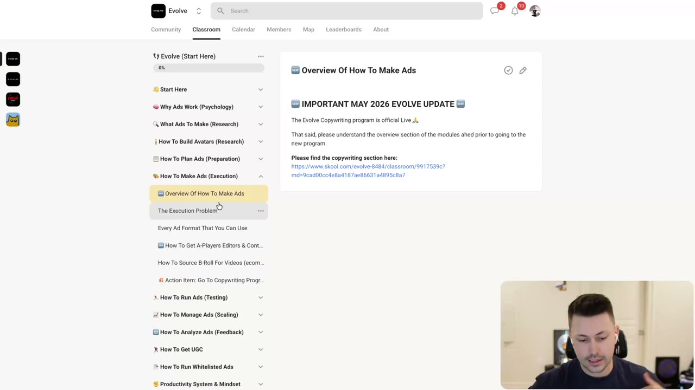
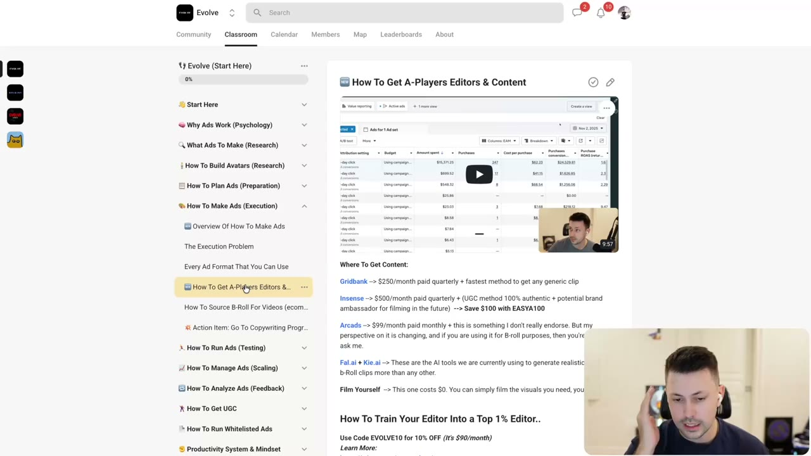
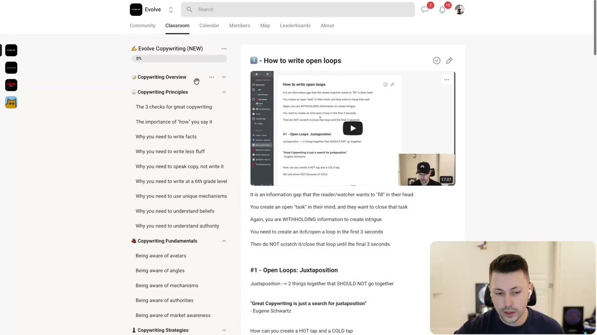
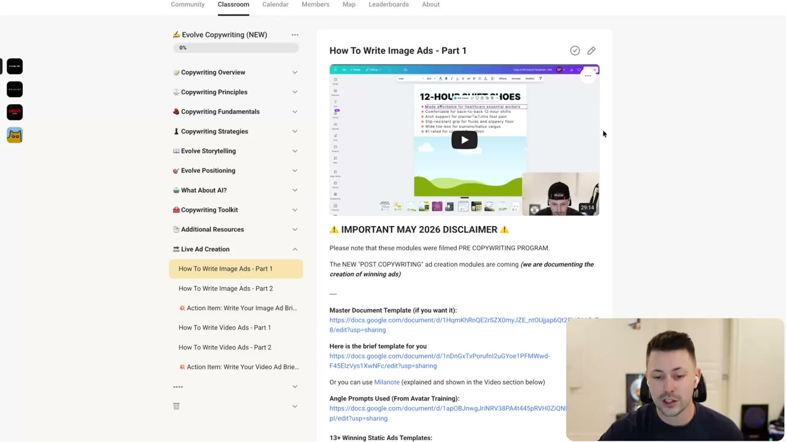

# 87. Overview Of How To Make Ads
> The "How To Make Ads (Execution)" section is now deliberately short because making ads moved into the new Evolve Copywriting program; watch the Execution Problem video, learn formats, editors and content sourcing, then go to the copywriting program.

## 🤖 Agent use
- **Use when:** routing a "how do I write/make the ad?" task to the right part of the knowledge base; deciding what to read before writing scripts; explaining why this section has so few lessons.
- **Inputs → outputs:** a planned concept (from the Growth Guide) → a reading path: Execution Problem → ad formats → editors and content sourcing → Evolve Copywriting program.
- **Rules:**
  - **DO** read [88. The Execution Problem](088-the-execution-problem.md) first: "The first thing that I want you to do is actually watch the execution problem video." [00:00]
  - **DO** treat the Execution Problem video as pre-copywriting-program material: "this was filmed before the copywriting program, so keep that in mind, but this is actually a really good video". [00:00]
  - **DO** make the copywriting program the main action item for writing: "the main action item here is to go to the copywriting program." [00:58]
  - **DO** apply the copywriting fundamentals when prompting AI: knowing what good ads look like "is going to help you when you use your AI prompts and everything else, make ads that don't suck." [01:47]
  - **DON'T** rely on the older "Live Ad Creation" modules for current method: "these ads were made before the copywriting program" and new modules documenting a winning ad brief are planned. [01:47–02:46]
  - **DO** learn storytelling: "a lot of the brands that are scaling to millions of dollars a month are masters at storytelling" (instructor claim). [01:47]
- **See also:** [88. The Execution Problem](088-the-execution-problem.md) · [89. Every Ad Format That You Can Use](089-every-ad-format-that-you-can-use.md) · [90. How To Get A-Players Editors & Content](090-how-to-get-a-players-editors-content.md) · [91. Action Item / Go To Copywriting Program](091-action-item-go-to-copywriting-program.md) · [Copywriting 01. Overview of copywriting program](../../copywriting/lessons/01-overview-of-copywriting-program.md)

Lesson page text (May 2026 update banner): "💥 IMPORTANT MAY 2026 EVOLVE UPDATE 💥 The Evolve Copywriting program is official Live 🙏 That said, please watch this overview video prior to going into the new program." In the recorded screen the banner reads a little differently ("please understand the overview section of the modules ahead prior to going to the new program" plus a link to the copywriting section), so the live page was edited after the export.

## Key ideas

### 1. Why the section is condensed [00:00–00:58]
- "This section is pretty condensed and that's because we literally had to make an entire new program to help people understand how to actually make ads the right way." [00:00]
- The lessons in the section, as shown on screen: Overview Of How To Make Ads; The Execution Problem; Every Ad Format That You Can Use; How To Get A-Players Editors & Content; How To Source B-Roll For Videos; Action Item: Go To Copywriting Program. [00:05 frame] (The course files hold lessons 87-91; "How To Source B-Roll For Videos" has no separate lesson in the file map. The instructor says he will probably remove this overview. [00:00])

*The Evolve (Start Here) sidebar with "How To Make Ads (Execution)" expanded: Overview, The Execution Problem, Every Ad Format That You Can Use, How To Get A-Players Editors & Content, How To Source B-Roll For Videos, Action Item: Go To Copywriting Program. [00:05]*

### 2. The reading path [00:00–01:47]
1. **The Execution Problem** (filmed before the copywriting program; "a really good video just to... help you understand why potentially you're having some issues"). [00:00] → [88](088-the-execution-problem.md)
2. **Every ad format that you can use:** a carry-over from the definitions lesson ("what actually is a format"). [00:00] → [89](089-every-ad-format-that-you-can-use.md)
3. **How to get editors to become A-players and where content comes from** ("a very important video"). He says much of the B-roll now comes from AI tools, spoken as "foul AI and Kai or key AI" (Whisper; the page on screen shows Fal.ai and Kie.ai). He plans to update the page with a new video from "Econ Talent" (EcomTalent). [00:58] → [90](090-how-to-get-a-players-editors-content.md)
4. **Go to the copywriting program:** "the main action item". [00:58] → [91](091-action-item-go-to-copywriting-program.md)

*The "How To Get A-Players Editors & Content" page as shown at about 0:50 ("Where To Get Content"): Gridbank ($250/month, paid quarterly, "fastest method to get any generic clip"); Insense ($500/month, paid quarterly, "UGC method 100% authentic + potential brand ambassador"); Arcads ($99/month, paid monthly, "something I don't really endorse, but my perspective on it is changing"); Fal.ai + Kie.ai (AI tools "we are currently using to generate realistic b-roll clips"); Film Yourself ($0). Prices are as shown on screen. [00:50]*

### 3. What is in the copywriting program [00:58–02:46]
- Sections he names: "the current state of copywriting, how to guarantee that you actually get better", "how we actually write ads in the environment, which is honestly one of the best things that you can start doing right away", plus other helpful pieces. [00:58–01:47] → Copywriting [02](../../copywriting/lessons/02-the-current-state-of-copywriting.md), [03](../../copywriting/lessons/03-how-to-guarantee-you-get-better-at-copywriting.md), [05](../../copywriting/lessons/05-why-you-need-to-write-in-the-environment.md).
- "The copywriting principles... fundamentals... and the strategies on how we actually write great ads and... understanding what good ads actually look like" are what make AI-assisted ads good. [00:58–01:47]
- A deep storytelling section follows. [01:47]
- Teaching approach: "most important thing is for you to understand this copywriting program. And then from there, use it and apply it when you're writing your own scripts... a new level of knowledge around how to write copy that doesn't actually suck. That way you could actually scale your brand." [02:46]

*The "Evolve Copywriting (NEW)" classroom: Copywriting Overview; Copywriting Principles (3 checks for great copywriting, importance of "how" you say it, write facts, less fluff, speak copy not write it, write at a 6th grade level, unique mechanisms, beliefs, authority); Copywriting Fundamentals (being aware of avatars, angles, mechanisms, authorities, market awareness); Copywriting Strategies. The open lesson is "How to write open loops". [01:50]*

### 4. Live Ad Creation modules (pre-program) [01:47–02:46]
- The "Live Ad Creation" section ("How To Write Image Ads Part 1/2", "Action Item: Write Your Image Ad Brief", "How To Write Video Ads Part 1/2", "Action Item: Write Your Video Ad Brief") "gives you our prompts" but "these ads were made before the copywriting program". [01:47]
- "I made this for our beginner program." New modules are coming in which he documents himself writing ads, "a winning ad brief and not just a random brief, because the goal... is to show you guys how to make winning ads, not just ads in general." [01:47–02:46]
- On screen the page carries an "IMPORTANT MAY 2026 DISCLAIMER" that the modules were filmed before the copywriting program and "the NEW POST COPYWRITING ad creation modules are coming (we are documenting the creation of winning ads)". [02:30 frame] See Copywriting [67](../../copywriting/lessons/67-how-to-write-image-ads-part-1.md)-[72](../../copywriting/lessons/72-action-item-write-your-video-ad-briefs.md).

*"How To Write Image Ads - Part 1" page: the May 2026 disclaimer, a master document template, a brief template, angle prompts from the avatar training and "13+ Winning Static Ads Templates". The list on the left shows the Live Ad Creation lessons. [02:30]*

## Steps / framework
Reading path (as taught): Execution Problem → Every ad format → A-players editors and content → copywriting program → (later) new post-copywriting ad-creation modules.

## How to apply
- [ ] Before writing any script, read [88](088-the-execution-problem.md) and the Copywriting principles ([08](../../copywriting/lessons/08-the-3-checks-for-great-copywriting.md), [12](../../copywriting/lessons/12-why-you-need-to-speak-copy-not-write-it.md), [13](../../copywriting/lessons/13-why-you-need-to-write-at-a-6th-grade-level.md)).
- [ ] For editors and sourcing, use [90](090-how-to-get-a-players-editors-content.md).
- [ ] Use the Copywriting course (not the older live ad-creation modules) as the method source; use the old modules only for prompts and brief templates.

## Related
- Previous: [86. Action Item / Make a Copy + Add Your Concepts](086-action-item-make-a-copy-add-your-concepts.md) · Next: [88. The Execution Problem](088-the-execution-problem.md)
- [Copywriting 01. Overview of copywriting program](../../copywriting/lessons/01-overview-of-copywriting-program.md) · [Static ad workflow](../../copywriting/frameworks/static-ad-workflow.md) · [Video ad script workflow](../../copywriting/frameworks/video-ad-script-workflow.md)

## Sources and limitations
- Transcript: [87 transcript](<../../../../../raw/evolve/start-here/_transcripts/👣 Evolve (Start Here)/87. 🆕 Overview Of How To Make Ads 👣 Evolve (Start Here) Evolve.txt>) · Page text: [87 page](<../../../../../raw/evolve/start-here/_extracted/👣 Evolve (Start Here)/87. 🆕 Overview Of How To Make Ads_👣 Evolve (Start Here)_Evolve.html.md>).
- Machine transcription (Whisper large-v3-turbo). Full recording covered (last segment 3:22 of 3:22). Whisper heard "foul AI and Kai or key AI" (screen: Fal.ai and Kie.ai), "a players" for A-Players, "Econ Talent" (likely EcomTalent), "copyright" for copywriting.
- Tool prices and descriptions come only from the screen frame and belong to lesson 90 (not reproduced here in full). Some listed lessons (Every Ad Format, B-roll sourcing) were not watched here; see 89-90.
