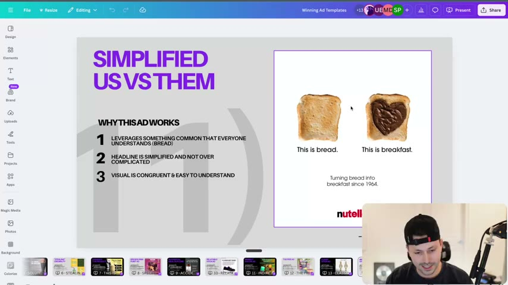
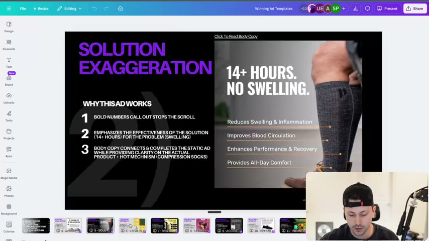
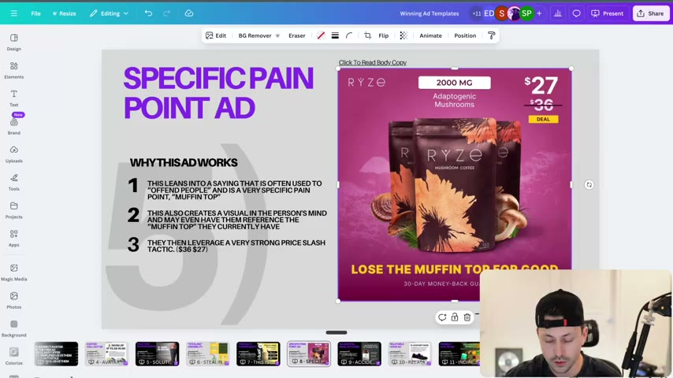
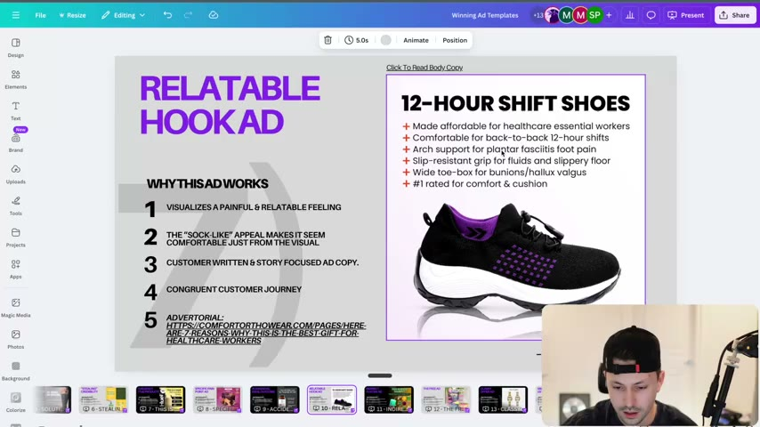
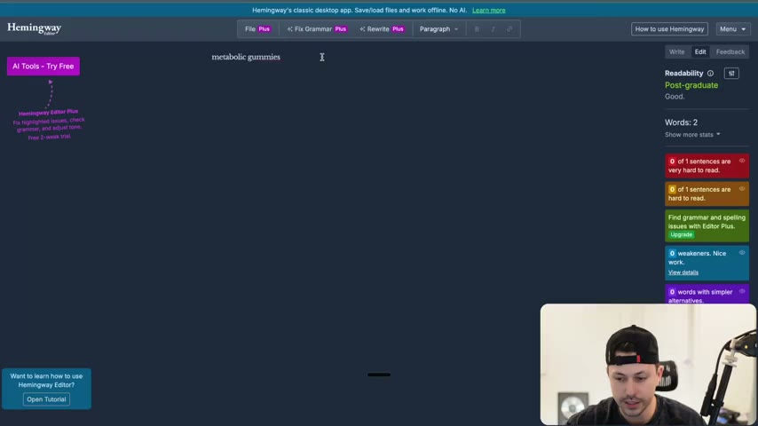
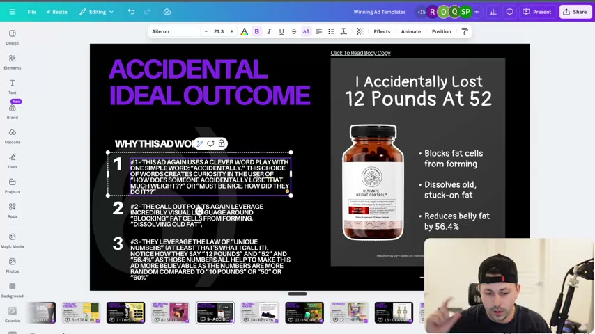
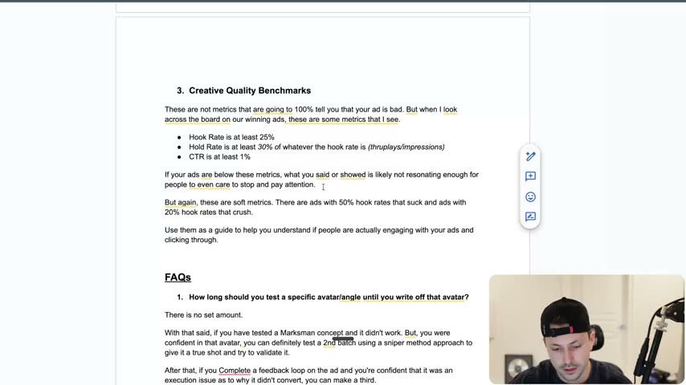

# 88. The Execution Problem
> When your strategy (avatar, angle, format, method) is right and the ad still flops, the cause is usually execution: the words you wrote and the content you showed. This lesson gives 13 checks to diagnose a failed ad, a test design that separates strategy from execution, creative benchmarks, and rules for how many times to retest an angle.

## 🤖 Agent use
- **Use when:** an ad or script lost and you need to decide whether the angle is wrong or the execution is; before writing any script; when auditing a draft against common failure causes; when setting how long to keep testing an avatar or angle.
- **Inputs → outputs:** a losing (or draft) ad, its angle/avatar, its metrics → a pass/fail against the 13 execution checks, a verdict "strategy vs execution", and a next test (new format, better execution, or move on).
- **Rules:**
  - **DO** complete a feedback loop on every ad: "remove any ego and ask yourself... if this ad didn't work, why does it suck? Better yet, why don't people like this ad?... where is that gap?" [00:00–00:56]
  - **DO** on winners ask "why are people caring about this... why is Meta pushing this out... why are people buying?" and think "from the customer perspective more than anything". [00:56–01:49]
  - **DO** study world-class winning ads in your niche, not only your own: sort an ad spy tool by shares for big brands' top ads, read the scripts, ask how they are written and what that does to the person. [01:49–02:43; 04:22–05:11]
  - **DON'T** give up an angle because one execution lost: "some marketers move on from angles... simply due to the fact that they just don't know how to actually execute them." [03:34]
  - **DO** run the 13 checks (list below) on every draft. [10:30–26:54]
  - **DO** test one angle in multiple formats before judging it: all three fail = likely strategy; one gives direction = execution. [27:24–28:21]
  - **DO** reuse proven creative structures (the winning-ad templates) while learning to execute; then "it's what's inside those" that decides the result. [08:11–09:42; 28:21]
  - **IF** you test a vastly different avatar **THEN** do not clone the same script; ask whether it makes sense to this person. [29:15]
  - **DON'T** iterate on ads that keep you stuck; study ads "that are actually scaling further". [29:15–30:10]
  - **DON'T** live or die by benchmarks: hook rate ≥25%, hold rate ≥30% of hook rate, CTR ≥1%; "focus on what actually matters, which is ROAS and CPA". [31:47–33:16]
  - **IF** an avatar/angle failed in a Marksman test and you were confident **THEN** run a second batch with Sniper; **IF** you confirm an execution error **THEN** a third; after three, move to a different angle. [33:16–34:04]
  - **DO** give scripts to an LLM and ask what techniques the writers use; apply those techniques. [35:34]
- **See also:** [83. Putting All The Planning Together](083-putting-all-the-planning-together-examples.md) · [85. The 3.0 Evolve Growth Guide](085-the-3-0-evolve-growth-guide.md) · [6. 13 Winning Static Ad Templates](006-13-winning-static-ad-templates.md) · [4. 100 Winning Ads Document](004-100-winning-ads-document.md) · Copywriting [08. The 3 checks](../../copywriting/lessons/08-the-3-checks-for-great-copywriting.md) · [12. Speak copy, not write it](../../copywriting/lessons/12-why-you-need-to-speak-copy-not-write-it.md) · [13. Write at a 6th grade level](../../copywriting/lessons/13-why-you-need-to-write-at-a-6th-grade-level.md) · [26. How to write open loops](../../copywriting/lessons/26-how-to-write-open-loops.md) · [Iteration outcomes](../../copywriting/concepts/iteration-outcomes.md)

Lesson page text: the module "begins with completing feedback loops" but is placed first so you know "what mistakes to AVOID when it comes to writing the scripts that you're about to write". Links given: the Execution Problem Doc (Google Doc; identical to the attached .docx), the Hemingway app (hemingwayapp.com, to check reading grade level), "Winning Ad Templates" (Canva), "Winning Ads Doc (For you to study)" and "Ad Spy to Find Winners" (two Skool classroom pages; see [4](004-100-winning-ads-document.md) and the research lessons on creative research, [41](041-creative-research-part-1-atria.md)).

## Key ideas

### 1. Frame: feedback loops and studying other ads come before execution tips [00:00–02:43]
- Goal: help you see why ads fail "from an execution standpoint versus just the actual strategy", given that "your strategy should be really good" after the training. [00:00]
- Feedback loop on a loser: "remove any ego... you might have to look at [it] for 15 minutes and yes, you're going to suck at it at first, but you need to start with that." [00:00–00:56]
- Feedback loop on a winner: why people care, why Meta pushes it, why people buy. "Unless you do that, you are not gonna be able to get better." [00:56–01:49]
- "You need to stop looking at just your ads." The hack: on an ad spy tool, "break down and sort by shares, big brands and what their top ads are". Reverse-engineer them, then compare with your own and "correct your lens on what a good ad is". [01:49–02:43]

### 2. Execution is the extra variable [02:43–05:11]
- The planning stack: concept (idea of the test), angle (how you sell), variation (individual executions), format (how you deliver), testing method (Marksman/Sniper). "There's one other variable... execution. And this is the biggest variable." [02:43]
- You can do all of it right and the ad can still flop. "It's a skill issue, but that's good. At least you know that it's a skill issue and you can work on that skill." [03:34]
- Anyone can have Claude write at an above-average level; the edge is knowing what good writing looks like: "someone who's a really great copywriter is going to be able to use AI tools better than someone who is not a good copywriter." [03:34–04:22]
- Study scripts in your own niche: "I'm not in your niche. I don't know what your product is." Copying the hook is not enough: ask "how are they writing it? And what is that doing with the person?" [04:22–05:11]

### 3. Definition [05:11–06:02]
- "The execution problem is basically when your angle is correct and you do understand your avatar. However, the way that you executed the ad, AKA the words you wrote and the content you used... was not good enough to actually convert the customer." He knows editing styles etc. matter but simplifies to words plus visuals. [05:11–06:02]
- Marketers struggle to "properly communicate that understanding". [06:02]

### 4. Turn avatar research into lines; templates remove variables [06:02–09:42]
- From the avatar training you should have "very specific lines and quotes and sayings" to piece together scripts. Example: a behavior (going to the gym late to avoid people) becomes a headline: "Go to the gym late to avoid everyone." [06:02–06:42]
- Image templates are "validated... winners". If a template-based ad fails, either the template does not fit your niche (unlikely), or "what you put in it" failed. [06:42–07:23]
- **Evidence 1 (instructor claim):** a team ad built on a template was tested and "didn't work"; "literally a month later" someone made another ad in the same format "with a different copy and different images" and "it scaled to $15,000 a day in spend". Conclusion: "Was it the format or was it the actual execution?" [07:23–08:11]
- **Evidence 2 (instructor claim):** someone said a socks template "is not working"; for a client, "an exact replicate" of the idea (headline plus call-out points, different product) now "spends $700 a day", moving them "from like $200 a day in spend to $700 a day". [08:11–09:07]
- Using proven formats "eliminat[es] variables": if it fails "it's probably because I sucked. What I wrote in here for my brand just didn't make sense." Still test other formats too. [09:07–09:42]


*Canva "Winning Ad Templates": Simplified Us vs Them. Bread vs a chocolate-hazelnut-spread toast, "This is bread / This is breakfast", "Turning bread into breakfast since 1964". Why it works (slide): leverages something everyone understands (bread); headline is simplified; visual is congruent and easy to understand. [08:20]*


*Template slide "Solution Exaggeration": "14+ HOURS. NO SWELLING." on a compression-sock image with four benefit call-outs. Why it works (slide): bold numbers stop the scroll; emphasises the solution's effectiveness (14+ hours) for the problem (swelling); body copy completes the static ad while clarifying the product and its "hot mechanism" (compression socks). [09:20]*

### 5. The 13 reasons an ad fails (execution) [10:30–26:54]
He frames them as "things that I wish somebody told me" and "plenty enough reasons" that have led to ads failing. Many concern the customer. [10:30]

**1. Copywriting lacks emotional impact** [10:30–12:22]. "The more it feels like an internal conversation your avatar would have in their own head, the higher the emotional impact." Examples: "lose weight" → "lose the muffin top for good" (more specific and relatable); "teen always grumpy" (a visual and a feeling); "14+ hours of no swelling" (felt by someone on their feet all day). "You can make them feel happy... a little bit scared... sad as long as you're tying it back around." [11:24–13:21]


*Template slide "Specific Pain Point Ad" (mushroom coffee, "LOSE THE MUFFIN TOP FOR GOOD", $36 struck through to $27). Why it works (slide): leans into a saying often used to "offend people" and a very specific pain point; creates a visual in the person's mind; leverages a strong price-slash tactic. [11:40]*

**2. Doesn't create curiosity** [13:21–14:17]. "Without it, nobody will care to watch your ad or click through." Example: seeing the Nutella ad cold ("This is bread, this is breakfast") makes you click to find out what it is. Open loops apply (see [Copywriting 26](../../copywriting/lessons/26-how-to-write-open-loops.md)). Statics too: "12-hour shift shoes", "I accidentally lost 12 pounds at 52". [13:21–14:57]


*Template slide "Relatable Hook Ad": "12-HOUR SHIFT SHOES" with call-outs for healthcare workers. Why it works (slide): visualises a painful, relatable feeling; "sock-like" appeal looks comfortable from the visual; customer-written, story-focused copy; congruent customer journey; plus a linked advertorial ("7 reasons why this is the best gift for healthcare workers"). [14:20]*

**3. Doesn't create suspense (video)** [14:17–17:18]. Once hooked, "that's only the first step. You need to maintain the suspense." Without a reward coming, no reason to keep watching. Examples: MrBeast previews the end ("light someone on fire for a million dollars"); Bryson DeChambeau's "Break 50" series (you watch to see if he does it); a First Day ad "three red flags that your child has a vitamin deficiency", which keeps you watching because the reward is knowing your kid is fine. A video must pay off: if the promised ending never comes you've "click baited" them. "That payoff and that reward... is what increases conversion rate when they actually click the ad to go and buy." [14:57–17:18]

**4. Too complex** [17:18–18:41]. Reads above a grade-six level and goes "over people's heads". Tool: Hemingway app. "metabolic gummies" scores post-graduate; "gummies for your tummy" scores grade 3. Ask AI to rewrite at grade 5-6 ("I had a 12 year old definition"). "Don't try to be smart... dumbing down your script... might help it. I'm being dead serious." [17:18–18:41] See [Copywriting 13](../../copywriting/lessons/13-why-you-need-to-write-at-a-6th-grade-level.md).


*Hemingway Editor with "metabolic gummies" (2 words): Readability "Post-graduate". [17:40]*

**5. Empty claims** [18:41–19:38]. "The best X" or "better than Y" with no reason to believe, or a reason people don't care about ("ZTR X01 mechanism... I don't know what that is. I don't care. I'd scroll"). Replace with proof; his illustrations: "we're number one on Skool", or "I sold my company... worth over a hundred million" (Whisper: "Hermosie", likely Hormozi) shows credibility without saying "I'm good". [18:41–19:38]

**6. Bossy claims** [19:38–20:36]. "Stop scrolling and watch this" / "watch these next five seconds": "Bro, you didn't give me... a reason to stop." Better: "If you have X thing, give me five seconds and I'll show you how to get rid of it." [19:38–20:36]

**7. Repetitive claims** [20:36–21:28]. Same claim, same way as competitors: no reason to believe you. Example: he wrote "fast hair drying without heat damage" and one click into the Facebook ad library showed "literally every single hair drying brand" using it. "It doesn't mean I can't find a new way to execute it." [20:36–21:28]

**8. Written script, not spoken** [21:28–22:25]. Written and spoken language differ; AI voiceover of a written script "is not going to sound natural". Fix: voice-to-text, or ask AI to rewrite so it sounds spoken: "loose... casual", with pauses and tonality. Credit given to "Golfim" (Whisper; unclear). [21:28–22:25] See [Copywriting 12](../../copywriting/lessons/12-why-you-need-to-speak-copy-not-write-it.md).

**9. You wrote it for yourself** [22:25–23:23]. Use the customer's exact words and tone. "A lot of the brands, I'm not the avatar... you have to write it for the person and use their language." Some ads "crush" that he finds dumb because he is not the avatar. [22:25–23:23]

**10. Angle too broad** [23:23–24:19]. After the avatar training people "ignore the training", copy "Spencer's template", and paste the same headline, forgetting the avatar work. "Use the training that you have and make sure you actually use it in your writing." [23:23]

**11. Angle said by everyone else (sophistication)** [24:19–25:16]. Different from repetitive claims: it is the angle that is crowded. You can use a popular angle if you can out-market competitors, but "a lot of you are getting slapped in the face because you don't have a great copywriting skill set"; either get better at communicating it or choose a different angle. [24:19–25:16] See [12. Market sophistication](012-market-sophistication.md).

**12. Editing style doesn't fit the demographic** [25:16–25:55]. "I know I say demographics don't matter. However, when it comes to consuming content, they definitely do." Anecdote: a VSL with science visuals for a 25-35 demographic whose converting ads are "girls sitting in their car drinking matcha talking about the new product". "Align your lens with your customer"; "it just matters what performs." The doc's wording: ads that look good to you at 20-25 vs what works for 55-65, "VSL for a gen z". [25:16–25:55]

**13. Bad format** [25:55–27:24]. A static chosen because it was easy may fail; that does not mean the angle fails. "The easier the format is, the better the messaging and copy has to be": image ads with templates and AI headlines are made by "dozens, probably hundreds, likely thousands". [26:54–27:24]

### 6. Separate strategy from execution (action items) [27:24–30:10]
1. **Test multiple formats per angle** [27:24–28:21]: Concept 1 product photography + headline; Concept 2 static/graphic design (e.g. us vs them); Concept 3 voiceover with B-roll. "If all three fail, it's likely to do with your strategy." (He adds it could still be execution for some.) "If two fail but one provides direction, or one fails and two provide direction, or one wins, then it's execution," so keep communicating it better (Sniper, different formats). Some angles are only so scalable, "but for most of you you don't have to worry about that". [27:24–28:36]
2. **Use proven creative templates** [28:21–29:15]: before testing new avatars/angles, validate your execution ability "using winning ad structures from your account and then similar winning ad structures from the industry"; "structures" = how you wrote and edited the ad. Reusing a proven structure lets you test whether an angle works with an execution style that worked before. [28:21–29:15]
3. **Two important things** [29:15–30:10]: (a) a vastly different avatar may need a different structure: "Don't just be a robot... Would this script, if I rewrote it for this angle, actually make sense to this person?" (b) "what is winning in your account is obviously not winning because you want to scale further", so analyse ads that scale further rather than ads that keep you at your current spend; and do real feedback loops "rather than just being like, let me test new hooks". [29:15–30:10]

### 7. Study ads like this [30:10–31:47]
- "How have you gotten better than most people at creating winning ads? I just look at a ton of them. And then... I break them down." [30:10]
- Breakdown of "I accidentally lost 12 pounds at 52": (1) clever wordplay with one simple word, "accidentally", creating curiosity ("how does someone accidentally lose that much weight?"); (2) call-outs with strong visual language ("blocking fat cells from forming", "dissolving old fat"); (3) the "law of unique numbers" (his term): 12 pounds, 52 and 56.4% are random-looking numbers, "more believable... compared to 10 pounds or 50 or 60%, which can be easily faked". [30:10–31:47]
- The slide text on screen carries the same three points, numbered #1-#3.


*Template slide "Accidental Ideal Outcome": the ad "I Accidentally Lost 12 Pounds At 52" (supplement bottle; "Blocks fat cells from forming / Dissolves old, stuck-on fat / Reduces belly fat by 56.4%") beside the instructor's own three learnings: clever wordplay with "accidentally", visual language, and the "law of unique numbers". [30:50]*

### 8. Creative benchmarks [31:47–33:16]
- "For us, 25% hook rate, try to get that. Hold rate should be 30% of whatever your hook rate is... 30% of 25% is 7.5%", so at a 25% hook rate "I'd want to see at least a hold rate of 8%". [31:47]
- Hold rate here is "not three second plays by impressions. It's thruplays by impressions. I don't know why we do it that way. That's just how we do it." CTR "at least 1%". [32:17] (The doc writes "(thruplays/impressions)".)
- Soft metrics: "there are ads with 50% hook rates that suck and ads with 20% hook rates that crush". Below them "what you said or showed is likely not resonating enough for people to even care to stop and pay attention." "Focus on what actually matters, which is ROAS and CPA". [32:17–33:16]


*Doc section "Creative Quality Benchmarks": hook rate at least 25%; hold rate at least 30% of the hook rate (thruplays/impressions); CTR at least 1%; "these are soft metrics" with the 50%/20% hook-rate caveat. Start of the FAQs below. [32:30]*

### 9. FAQs [33:16–35:34]
- **How long to test an avatar/angle before writing it off?** "There is no set amount." Tested as a Marksman concept and confident? Run a second batch with Sniper "to give it a true shot". If a feedback loop shows it was an execution issue (no curiosity, no reward, no reason to keep watching, no feeling), make a third. "Anything after three is likely just a sign that you can't execute this angle... you might just need to move on." He says angle, not avatar. [33:16–34:04]
- **Avatars:** focus on one, maybe two, "if you're sub 100K per month, if you're above 100K per month, then you should really still only be focusing on one and two". Going surface-level and jumping avatar to avatar means you stand out less; "you get rewarded for going deeper". [34:04–34:48]
- **How many concepts per angle?** Losing ad: same as above. Winning ad: "as many as you want", but beware "iteration overload"; take a break so the brain gets "a reset" and "space". [34:48–35:34]
- A later Evolve module covers questions like "was it educational? Was it entertaining? Did you use a label?"; those come in the copywriting sections. [35:34]

### 10. The two-step summary [35:34–36:31]
"If you just want to stop sucking at ads, two things for you to do. Complete feedback loops on every ad and go and study other winning ads." Give a winning script to Claude: "Claude, what are these people doing? How are they writing this script?" and test those techniques. "It's a skill issue. And so if you just get better, all of a sudden you start making a lot more money." [35:34–36:31]

## Steps / framework

### Execution diagnosis (run in order)
1. Pull the ad's metrics: hook rate, hold rate, CTR, ROAS, CPA.
2. Check the 13 reasons below; write one line per "yes".
3. Look for a format-level test: has this angle run in 2-3 formats? If all lost, suspect strategy; if one gave direction, it is execution.
4. Re-execute with a proven structure and plain, spoken, customer-worded language; use Sniper for the follow-up batch.
5. After the third failed execution of one angle, move to a different angle.

### The 13 execution checks (doc wording)
| # | Check (failure) | Instructor's fix | Source |
|---|---|---|---|
| 1 | Copywriting lacks emotional impact | Internal-conversation language; more specific lines ("muffin top") | [10:30–13:21] |
| 2 | Doesn't create curiosity | Give a reason to stop and click; open loops | [13:21–14:57] |
| 3 | Doesn't create suspense (video) | Preview/payoff; reward at the end | [14:57–17:18] |
| 4 | Too complex (above grade 6) | Hemingway; AI rewrite to grade 5-6 | [17:18–18:41] |
| 5 | Empty claims | Give a believable reason or proof people care about | [18:41–19:38] |
| 6 | Bossy claims | Give a reason before asking for attention | [19:38–20:36] |
| 7 | Repetitive claims | New way to say it; check the Ad Library | [20:36–21:28] |
| 8 | Written, not spoken | Voice-to-text or AI "make it spoken" | [21:28–22:25] |
| 9 | Written for yourself | Customer's exact words and tone | [22:25–23:23] |
| 10 | Angle too broad | Use the avatar work; don't just copy a template headline | [23:23–24:19] |
| 11 | Angle said by everyone else | Out-communicate or change the angle | [24:19–25:16] |
| 12 | Editing style fits the creator, not the demographic | Match the demographic's native style | [25:16–25:55] |
| 13 | Bad format | Test another format; easy formats need better copy | [25:55–27:24] |

### Benchmarks
| Metric | Instructor's benchmark | Source |
|---|---|---|
| Hook rate | at least 25% | [31:47] |
| Hold rate | at least 30% of hook rate (7.5%; "at least 8%" at a 25% hook rate); thruplays / impressions | [31:47–32:17] |
| CTR | at least 1% | [32:17] |
| Caveat | soft metrics; judge by ROAS and CPA | [32:17–33:16] |

### Retest limits
| Question | Rule | Source |
|---|---|---|
| Write off an angle? | Marksman → Sniper batch 2 → batch 3 only if execution flaw confirmed → then move on | [33:16–34:04] |
| How many avatars? | One, maybe two | [34:04–34:48] |
| Concepts per winning angle | Unlimited, but watch iteration overload | [34:48–35:34] |

## Examples
- **Muffin top.** "Lose weight" → "Lose the muffin top for good": more specific, relatable, visual. [11:24] (template slide on screen)
- **Metabolic gummies.** Post-graduate → "gummies for your tummy", grade 3. [17:18–17:48]
- **Nutella template.** "This is bread / This is breakfast" creates curiosity; applied in lesson 83 to a dog harness. [13:21]; see [83](083-putting-all-the-planning-together-examples.md)
- **Template reuse.** Same format failed once, then scaled to $15,000/day with different copy and images (instructor claim). [07:23–08:11]
- **Sock-template replication.** A different product reached $700/day from $200/day using the headline-plus-call-outs structure (instructor claim). [08:11–09:07]
- **Hair dryer claim.** "Fast hair drying without heat damage": every brand in the Ad Library already said it. [20:36–21:28]
- **VSL for gen Z.** A VSL aimed at 25-35 where the converting style is car-and-matcha creators. [25:16–25:55]
- **Accidental ideal outcome.** "I accidentally lost 12 pounds at 52": curiosity word, visual words, unique numbers. [30:10–31:47]

## Structured units

### Ad teardowns
| Brand / product (niche) | Format | Hook / opening | What works | What fails | Fix suggested | Principle | Source |
|---|---|---|---|---|---|---|---|
| Nutella-style template (food, shown as template) | Static, two-panel | "This is bread / This is breakfast" | Common object, simple headline, congruent visual | — | — | Curiosity; simplified us-vs-them | [13:21; slide] |
| Compression socks template (health/comfort) | Static, benefit call-outs | "14+ hours. No swelling." | Bold number, solution effectiveness, body copy completes the ad | — | — | Solution exaggeration | [12:22; slide] |
| Mushroom coffee template (supplements) | Static, price-slash | "Lose the muffin top for good" | Specific pain point, visual in the mind, price slash ($36 to $27) | — | — | Specific pain point | [11:24; slide] |
| Shift shoes template (footwear, healthcare workers) | Static + advertorial | "12-hour shift shoes" | Relatable, visual, customer-written story, congruent journey | — | — | Relatable hook | [14:17; slide] |
| Weight-control supplement template | Static | "I accidentally lost 12 pounds at 52" | Curiosity word, visual language, unique numbers | — | — | Accidental ideal outcome | [30:10–31:47; slide] |
| Team ad built on a template (brand not named) | Static | (not shown) | Proven format | "didn't work"; same format later scaled to $15k/day elsewhere | Execute the words and images better | Format vs execution | [07:23–08:11] |
| First Day (kids' vitamins), as heard | Video | "three red flags that your child has a vitamin deficiency" | Promise of a payoff keeps viewers | — | — | Suspense | [15:43] |

### Hooks
| Hook | Heuristic(s) | Emotion / zone | Self targeted | Why it works | Source |
|---|---|---|---|---|---|
| "Lose the muffin top for good" | — | — | — | Specific, relatable, visual vs "lose weight" | [11:24] |
| "Teen always grumpy" | — | — | — | Creates a visual and a memory | [12:22] |
| "14+ hours of no swelling" | — | — | — | Felt by someone on their feet all day | [12:22] |
| "I accidentally lost 12 pounds at 52" | — | — | — | "Accidentally" plus unique numbers | [14:17; 30:10] |
| "Three red flags that your child has a vitamin deficiency" | — | — | — | Reward of knowing your kid is fine | [15:43] |
| "Go to the gym late to avoid everyone" | — | — | — | A behavior turned into a headline | [06:02–06:42] |
| "If you have X thing, give me five seconds and I'll show you how to get rid of it" | — | — | — | A reason to stop, versus "stop scrolling" | [20:36] |

### Rewrites
| Before | After | What changed (verb / visual / promise / self / intensity) | Source |
|---|---|---|---|
| "Lose weight" | "Lose the muffin top for good" | Generic outcome to specific, visual pain point | [11:24] |
| "Metabolic gummies" (post-graduate) | "Gummies for your tummy" (grade 3) | Jargon to plain words | [17:48] |
| "Stop scrolling and watch this" / "Watch these next five seconds" | "If you have X thing, give me five seconds and I'll show you how to get rid of it" | Command to reason plus payoff | [20:36] |
| "We're the best" / "better than Y" | A proof such as "number one on Skool" or a sold company | Claim to evidence | [18:41–19:38] |
| Written script | Voice-to-text or AI "make it spoken" | Page language to talking language | [21:28] |
| One format failed | Same angle in three formats | Strategy test | [27:24] |

### Rules of thumb
- **DO** write for the customer's words, not yours. [22:25]
- **DON'T** judge an angle on one execution. [03:34; 33:16]
- **IF** an ad has a payoff the viewer wants **THEN** conversion after the click improves. [17:18]
- **IF** the format is easy (static with templates) **THEN** the messaging must be better than the thousands doing the same. [26:54]

## Prompts / templates (verbatim)
The doc's framing (unchanged):
```
Concept - the idea for your test
Angle - how you're choosing to sell the product
Variation - the Individual executions of the angle(s)
Format - How you deliver the ad
Testing Method - How you test the angle (marksman, sniper)
Execution: ???
```
Test multiple formats per angle (doc):
```
Concept 1: Product photography + Headline
Concept 2: Static/Graphic Design
Concept 3: Voiceover with b-roll

If all 3 fail, it's likely a strategy.
If 2 fail but one provides a direction, it is execution, and you just need to focus on communicating it better.
```
Proven creative templates (doc):
```
Before testing new avatars/angles, validate your creative execution ability using:
- Winning ad structures from your account
- Similar winning ad structures from the industry as a whole
```
Creative Quality Benchmarks (doc):
```
- Hook Rate is at least 25%
- Hold Rate is at least 30% of whatever the hook rate is (thruplays/impressions)
- CTR is at least 1%
```
LLM uses described aloud (not an official prompt):
- "Claude, what are these people doing? How are they writing this script?" [35:34]
- Ask AI to rewrite a script "so it sounds more spoken" and to dumb it down to grade five or six. [18:41; 21:28]

## Screenshots
Screenshots are embedded in the sections above (templates, Hemingway, ad breakdown, benchmarks).

## How to apply
- [ ] Before drafting: pull the customer's one-liners from the avatar work and write in those words.
- [ ] Run the 13 checks on the draft; fix each failed check.
- [ ] Run the script through Hemingway or an LLM readability check; target grade 5-6; read aloud and make it spoken.
- [ ] Add a payoff: tell the viewer early what they will get, and deliver it.
- [ ] Replace bossy or empty claims with a reason or proof.
- [ ] Search the Ad Library for the same claim; reword if every competitor says it.
- [ ] Match the editing style to the demographic.
- [ ] Test the angle in at least two formats before judging it.
- [ ] Check hook rate, hold rate and CTR as signals only; decide on ROAS and CPA.
- [ ] Stop an angle after three honest executions; keep one or two avatars.
- [ ] Break down at least one winning ad per week and log the techniques.

## Related
- Previous: [87. Overview Of How To Make Ads](087-overview-of-how-to-make-ads.md) · Next: [89. Every Ad Format That You Can Use](089-every-ad-format-that-you-can-use.md)
- [83. Putting All The Planning Together (Examples)](083-putting-all-the-planning-together-examples.md) · [85. The 3.0 Evolve Growth Guide](085-the-3-0-evolve-growth-guide.md) · [81. The 3 Testing Methods Part 1](081-the-3-testing-methods-part-1.md) · [Copywriting 03: Results over emotion](../../copywriting/lessons/03-how-to-guarantee-you-get-better-at-copywriting.md)
- [Iteration vs variation](../../../../concepts/iteration-vs-variation.md) · [Test and iterate (playbook)](../../../../playbooks/test-and-iterate.md) · [Competitor ad teardown (playbook)](../../../../playbooks/competitor-ad-teardown.md)

## Sources and limitations
- Transcript: [88 transcript](<../../../../../raw/evolve/start-here/_transcripts/👣 Evolve (Start Here)/88. The Execution Problem 👣 Evolve (Start Here) Evolve.txt>) · Page text: [88 page](<../../../../../raw/evolve/start-here/_extracted/👣 Evolve (Start Here)/88. The Execution Problem_👣 Evolve (Start Here)_Evolve.html.md>) · Attachment text: [88 docx](<../../../../../raw/evolve/start-here/_extracted/👣 Evolve (Start Here)/88. The Execution Problem.docx.md>) · Linked Google Doc export (same content): [88 linked doc](../../../../../raw/evolve/start-here/_extracted/_linked/google/88-document-1z5DCkpijz.docx.md).
- Machine transcription (Whisper large-v3-turbo). Full recording covered (last segment 36:31 of 36:31). Whisper heard "copyright" for copywriting, "Q-shirt problem" for execution problem, "Hermosie" for Hormozi, "First Day" and "Golfim" are taken as heard (unverified brand and person), "life" in "making ads for life" is unclear (likely a brand or niche, not used), "ladder" at [08:11] likely "latter"; the transcript shows "I'm doing everything right, Spencer".
- The $15,000/day, $200→$700/day and other results are instructor claims; the brands are not named, so none can be checked.
- Hold-rate definition: the audio says thruplays/impressions and admits not knowing why; the same text is in the doc. Hook rate is not defined in this lesson. 30% of 25% is 7.5%; he rounds to 8%.
- The doc lists the 13 failure reasons and the two action items; the audio adds the template evidence, examples and the winning-ad breakdown. The "Winning Ads Doc" and "Ad Spy" links are Skool pages that are not part of this lesson's files.
- The template slides (Canva "Winning Ad Templates") are shown on screen only for the five ads listed above; the full 13-template deck is covered in [6](006-13-winning-static-ad-templates.md).
