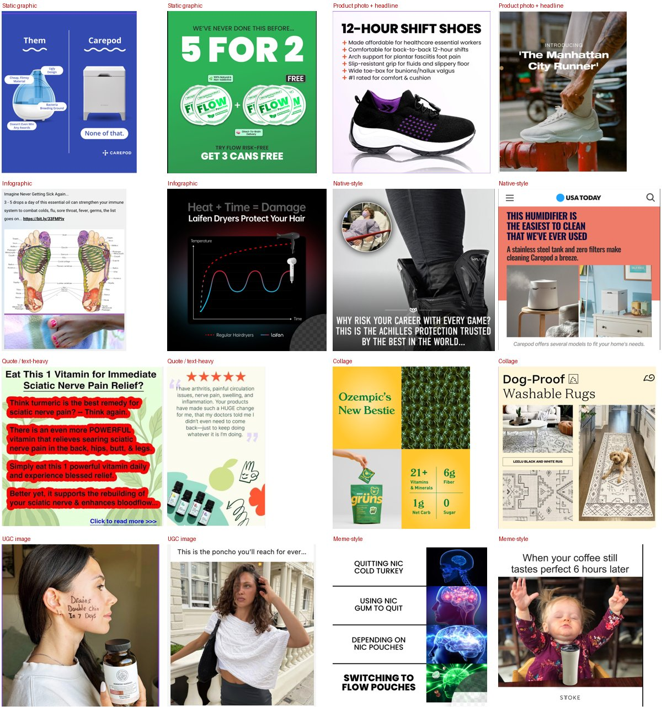
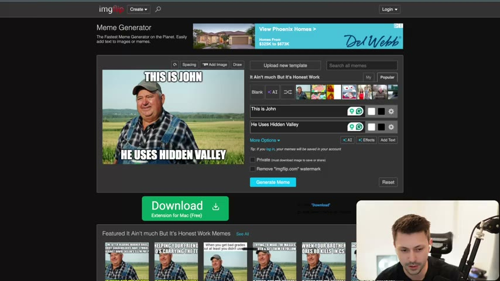

# 89. Every Ad Format That You Can Use
> A neutral catalogue of 6 video and 8 image ad formats, defined by structure only (not by angle), so a brief can name the exact format instead of just "video" or "image".

## 🤖 Agent use
- **Use when:** writing a creator or editor brief, choosing what to produce for a concept, or tagging a competitor ad with its format during a teardown.
- **Inputs → outputs:** a concept (desire, angle, hook) plus the available assets (footage, product photos, customer photos, budget) → one named format from the list below, with its defining traits written into the brief.
- **Rules:**
  - **DO** name the format explicitly in every brief. The page text says the goal is "to be much clearer with your editors on what type of FORMAT you want, rather than just saying video or image". [page text]
  - **DO** treat formats as structure only. "They don't have any assumed angle to them, like us versus them. That's not a format." [00:00] Angle (us vs them, offer, never-done-this-before) is chosen separately and then put inside a format.
  - **DO** start with images before video. "I would definitely recommend starting with images first and then getting into the videos." [09:21]
  - **DON'T** invest in studio-style professional video early: "most of the time these also don't work", "they just don't really convert so we don't really do these as much anymore". [02:48–03:22] It can work at higher scale (see Examples).
  - **DON'T** fake press-release or news-article ads. "Do not make fake press release ads... that's false advertising and you can get sued." [06:06] Native-style layouts are fine; fabricated media coverage is not. The doc repeats it: "DO NOT FAKE PRESS RELEASE ADS". [doc, Native-style image]
  - **IF** CPMs are very high (especially early) **THEN** try meme-style or hyper-relatable images: "usually really good cost per clicks", but "the overall conversion rate is not as good". [08:31]
  - **IF** you want AI people **THEN** use them for B-roll or fashion photos, not as talking heads. "Use AI at your own risk. We don't actually use AI people." [02:13] For fashion, putting clothing on AI models is "a really good thing to do", but "legal compliance wise, double check". [07:46]
  - **IF** you lack video footage **THEN** build a slideshow video from images (slow zoom in or out, heavy text reveals, optional voiceover). [01:34–02:13]
- **See also:** [90. How To Get A-Players Editors & Content](090-how-to-get-a-players-editors-content.md) · [88. The Execution Problem](088-the-execution-problem.md) · [6. 13 Winning Static Ad Templates](006-13-winning-static-ad-templates.md) · [4. 100+ Winning Ads Document](004-100-winning-ads-document.md) · [Format variation ladder](../../../../frameworks/format-variation-ladder.md) · [Native advertising](../../../../concepts/native-advertising.md)

## Key ideas

### Formats are structural, not angle-based [00:00–00:41]
- Spencer calls formats "everybody's favorite, apparently" and promises "as unbiased as possible". Each format is "literally... what it is... structurally". [00:00]
- Not formats: "UGC", "VSL", "us versus them", "never done this before" and "offer" ads. Those are angles or contents placed inside a format. [00:00; 04:16; 04:16–05:08]
- Page text: this module sits in the "How to Create Avatars" series but "fits in the How to Make Ads section". [page text]
- Every format in the doc has a worked example link (video examples are Frame.io links, image examples are screenshots). [doc]

### The 6 video formats [00:00–04:16]
1. **Voiceover with B-roll.** "One of our most common ones." Voiceover (real or AI) over product shots, UGC, A-roll and stock; low-volume background music that flows with the ad; heavily edited, multiple clips. [00:00; doc] Example shown: a stainless-steel humidifier ad ("parenting must-have stainless steel humidifier") with the script voiced over. [00:41]
2. **Subtitles with B-roll.** Generated subtitles over footage and product shots, with background music. Why it works: "it allows the reader to read it in their own head. So it taps into... this internal voice that everyone has" (credit to Carlo's framing). [00:41–01:34] "Music selection is very important." Example shown: a nicotine-pouch education ad with only violin music and on-screen text ("when you pop it in, nicotine hits your bloodstream instantly..."). [01:34]
3. **Slideshow video with text.** Static images with transitions, heavy text overlay with movement and text reveals, optional voiceover; images get a slow zoom in or out. "If you don't have video... you can just use images as well." [01:34–02:13]
4. **Authentic UGC / talking head only.** One person talking to camera, casual, usually single take or minimal edit; real or AI. Example: a creator "just talking straight to camera... no extra edits"; "one of the winning ads that we have in our Evolve winning ad stock". [02:13–02:48]
5. **Professional shot video.** High production value, pro lighting and equipment, polished branded look. Example: a studio-style shoot with text over it. "Most of the time these also don't work." Can work at higher scale: "brands like True Classic will go and work with like a Harmon Brothers" (Whisper wrote "Harman brothers"). [02:48–03:22]
6. **Animation.** Animated characters or graphics, 2D, 3D or motion graphics, no real people or locations. Example: "hormonal gaslighting explained by ducks" (a duck-life metaphor for hormonal change). [03:22–04:16]
- The instructor flags the list may be incomplete ("Am I missing one? Probably"), but the point is naming by structure, not by "UGC format" or "VSL format". [04:16]

### The 8 image formats [04:16–09:21]
1. **Static graphic / design.** Colorful designed graphics with text overlays "like Canva templates", bold headline on branded background, product visual usually in it ("can be without, but that's for more advanced marketers"). "Us versus them... we've never done this before offer ads kind of fall in this category." [04:16–05:08]
2. **Product photography + headline.** Clean photos on white or neutral backgrounds, or lifestyle shots; photo plus a headline above. "Very, very simple." [05:08]
3. **Infographic.** Charts, graphs, step-by-step processes combining data and visual design. Instructor says it could sit under static design but gets its own entry because it is "their own kind of breed"; "We probably use these the least right now." [05:08–06:06]
4. **Native-style image.** Looks native or organic to the platform: mimics organic posts, "often looks unbranded or casual"; the reference style is Pubity (Whisper wrote "puberty"). The USA Today style example is real because that brand actually appeared in USA Today: "we didn't fake this... it better be real if you're going to use it." [06:06–06:54]
5. **Quote / text-heavy image.** Mostly text, minimal design, text is the main focus. Example read aloud: "Eat this one vitamin for immediate sciatic nerve pain relief" ("literally just a text ad"); second example has a product photo but still "leading with the text". [06:54–07:46]
6. **Collage.** Several images in a grid or scatter, shows multiple angles or uses. "Winning ad from Grunz" (Grüns) and another from Ruggable (dog on the rug, close-up, natural setting). [06:54–07:46]
7. **UGC image.** Real customer photos or selfies, authentic and unpolished. AI avatars are acceptable for stills "because the AI avatars aren't saying anything". [07:46–08:31]
8. **Meme-style image.** Popular meme templates with custom text. "Really great if you have super high CPMs, especially early on." [08:31]


*Montage rebuilt from the 16 images embedded in the Formats doc, in doc order: static graphic (Carepod "Them vs None of that", Flow "5 for 2"), product photography + headline (12-hour shift shoes, "The Manhattan City Runner"), infographic (a foot-chart ad, Laifen "Heat + Time = Damage" chart), native-style (a boot ad, a USA Today-style Carepod page), quote/text (sciatic vitamin text ad, 5-star review card), collage (Grüns, Ruggable), UGC image (face-writing selfie, poncho), meme (nicotine "galaxy brain", Stoke "coffee still tastes perfect 6 hours later"). [doc images]*

## Steps / framework

Format selection (derived from the lesson's rules):

1. Pick the concept (desire, angle, hook) first. [00:00]
2. List what raw material exists: footage, product shots, customer photos, voiceover talent, budget. [derived]
3. Choose one format from the tables, starting with an image format if the brand is early. [09:21]
4. Copy the format's defining traits into the brief (see "Prompts / templates").
5. Check the compliance flag for the format (native-style, AI people, AI fashion models). [06:06; 07:46]

### Video formats
| Format | Defining traits (doc) | Notes from the video |
|---|---|---|
| Voiceover with B-roll | Voiceover over footage / product shots (real or AI); low-volume background music; heavy edit with multiple clips (UGC, A-roll, stock) | "One of our most common ones" [00:00] |
| Subtitles with B-roll | Generated subtitles over footage / product shots ("taps into internal voice"); background music; heavy edit | Music choice sets mood and tone [00:41–01:34] |
| Slideshow video with text | Static images with transitions; heavy text overlay with movement; text reveals | Slow zoom effect on images; voiceover optional [01:34–02:13] |
| Authentic UGC / talking head only | Person to camera, real or AI ("use AI at your own risk"); casual; single take or minimal edit | One of the Evolve winning ads is this format [02:48] |
| Professional shot video | High production value; pro lighting and equipment; polished, branded | Usually doesn't convert; try only at higher scale [02:48–03:22] |
| Animation | Animated characters / graphics; 2D, 3D or motion graphics; no real people or locations | Duck metaphor ad for hormones [03:22] |

### Image formats
| Format | Defining traits (doc) | Notes from the video |
|---|---|---|
| Static graphic / design | Colorful designed graphics, text overlays, product visual, bold headline on branded background | Us-vs-them and offer ads live here [04:16–05:08] |
| Product photography + headline | Clean professional product photos, white/neutral or lifestyle, plus headline | Simplest format [05:08] |
| Infographic | Charts, graphs, step-by-step processes; data plus design (doc example: "3 Steps to Better Sleep" with icons) | Used least right now [05:08–06:06] |
| Native-style image | Looks native / organic (Pubity style), unbranded or casual | Never fake a press release [06:06–06:54] |
| Quote / text-heavy | Mostly text, quote layouts, text is the focus | "Literally just a text ad" [06:54] |
| Collage | Multiple images, grid or scattered, multiple angles / uses | Grüns and Ruggable winners [06:54–07:46] |
| UGC image | Real customer photos or selfies, unpolished | AI stills OK, check legal [07:46–08:31] |
| Meme-style | Popular meme templates with custom text (doc example: Drake pointing meme with product comparison) | Good CTR, weaker conversion rate [08:31] |

## Examples
- **Voiceover + B-roll:** stainless-steel humidifier ad with a script voiced over footage. [00:41]
- **Subtitles + B-roll:** nicotine-education ad, violin music, subtitles only; "starts like educating people and it's using their own internal voice". [01:34]
- **Authentic UGC:** one winner in the Evolve winning-ads stock, a creator talking straight to camera with no extra edits. "I'd really listen to what she's saying... it's very, very good." [02:13–02:48] See [4. 100+ Winning Ads Document](004-100-winning-ads-document.md).
- **Professional video (when it can work):** True Classic with a comedy-twin production house, cited as an example of a high-scale brand using polished shoots. [03:22] (Instructor claim: "those can work if you're at higher scale".)
- **Animation:** "hormonal gaslighting explained by ducks": ducks live "like clockwork, sun comes up, eggs come out all smooth, then one day everything changes... belly gets rounder, pond feels smaller". [03:22]
- **Static design:** us-vs-them and "we've never done this before" offer ads. [04:16–05:08]
- **Native:** an ad styled like a USA Today article, allowed only because the brand was really covered by USA Today. [06:06]
- **Meme ads built with imgflip:** the instructor generates a sample ("This is John. He uses Hidden Valley") and calls it a "terrible ad but you get the idea". [08:31–09:21] Real examples from the doc: a "galaxy brain" ladder "Quitting nic cold turkey / Using nic gum to quit / Depending on nic pouches / Switching to Flow pouches", and "When your coffee still tastes perfect 6 hours later" with the product in frame. "These are kind of ugly ads, but they're funny. They make people laugh and can sometimes convert as well." [09:21]

## Structured units

### Hooks (visible in the doc images and read aloud)
| Hook (verbatim or near) | Heuristic(s) | Emotion / zone | Self targeted | Why it works | Source |
|---|---|---|---|---|---|
| "Eat this 1 vitamin for immediate sciatic nerve pain relief?" | — | — | — | Text-only ad that leads with a specific, single-item solution. Do not copy the medical claim (derived) | [06:54]; doc image (quote/text-heavy) |
| "When your coffee still tastes perfect 6 hours later" | — | — | — | Meme-style relatable benefit statement with the product in the image | [09:21]; doc image (meme) |
| "Quitting nic cold turkey → using nic gum to quit → depending on nic pouches → switching to Flow pouches" | — | — | — | Meme template ("galaxy brain") used as a product-comparison ladder | [09:21]; doc image (meme) |
| "Hormonal gaslighting explained by ducks" | — | — | — | Animal metaphor in animation makes a hormonal-change angle funny and visual | [03:22] |

### Templates
| Template | Use for | Example fill | Source |
|---|---|---|---|
| "[Old behaviour] → [half-measure] → [dependence on rival product] → [switching to our product]" (galaxy-brain meme) | Product-comparison meme ad | The nicotine-pouch ladder above | [09:21] |
| "[Benefit] still [holds] [long time] later" over a relatable photo with product | Meme / hyper-relatable image | "When your coffee still tastes perfect 6 hours later" | [09:21] |
| "This is [name]. He uses [product]." on a meme-generator template | Quick meme draft (instructor calls his own sample bad) | "This is John, he uses Hidden Valley" | [08:31–09:21] |

### Rules of thumb
- **DO** describe a format by structure, then add the angle separately. [00:00]
- **DON'T** present a native-style layout as a real news article unless the brand really was in that outlet. [06:06]
- **IF** conversion rate matters more than click cost **THEN** do not rely on memes; expect cheaper clicks and weaker conversion. [08:31]

## Prompts / templates (verbatim)
Format block for a brief (derived from the doc's wording; fill the bracket):

```text
FORMAT: [one name from the lists]
Defining traits: [copy the bullet list for that format from the Formats doc]
Real or AI: [real | AI at our own risk]
Compliance: [native-style: no fake press / AI model: check disclosure rules / none]
```

The doc's own bullets, verbatim, for the two formats with a warning:

```text
Native-style image:
- Designed to look like it's native to the platform (organic)
- Mimics organic social media posts (like Pubity style)
- Often looks "unbranded" or casual
- IMPORTANT -> DO NOT FAKE PRESS RELEASE ADS (This is false advertising)

Meme-style image:
- Popular meme templates with custom text
- Often uses recognizable meme formats
- Example: Drake pointing meme with your product comparison
Extra Sauce: https://imgflip.com/memegenerator
```

## Screenshots

*The meme tool the instructor recommends ("extra sauce"): imgflip's meme generator, with his throwaway "This is John / He uses Hidden Valley" sample. [09:35]*

## How to apply
- [ ] Write the format name from the tables into every brief; never write only "video" or "image".
- [ ] When tagging a competitor ad, record its format (structure) separately from its angle.
- [ ] For a new brand, plan image formats first (product + headline, static design, UGC image, meme), then video.
- [ ] If using meme or hyper-relatable images, judge them on cost per click and engagement, and expect weaker conversion rate.
- [ ] For any native-style layout, confirm every element (outlet, quote, rating) is real before approving.
- [ ] If using AI people for B-roll or fashion stills, check platform and legal disclosure requirements first.

## Related
- Previous: [88. The Execution Problem](088-the-execution-problem.md) · Next: [90. How To Get A-Players Editors & Content](090-how-to-get-a-players-editors-content.md)
- [6. 13 Winning Static Ad Templates](006-13-winning-static-ad-templates.md) · [Format variation ladder](../../../../frameworks/format-variation-ladder.md) · [Evolve Copywriting: static ad workflow](../../copywriting/frameworks/static-ad-workflow.md) · [Evolve Copywriting: video ad script workflow](../../copywriting/frameworks/video-ad-script-workflow.md)

## Sources and limitations
- Transcript: [89. Every Ad Format…txt](<../../../../../raw/evolve/start-here/_transcripts/👣 Evolve (Start Here)/89. Every Ad Format That You Can Use 👣 Evolve (Start Here) Evolve.txt>) · Page text: [….html.md](<../../../../../raw/evolve/start-here/_extracted/👣 Evolve (Start Here)/89. Every Ad Format That You Can Use_👣 Evolve (Start Here)_Evolve.html.md>) · Doc text: [….docx.md](<../../../../../raw/evolve/start-here/_extracted/👣 Evolve (Start Here)/89. Every Ad Format That You Can Use.docx.md>) (same as the linked Google Doc export `_extracted/_linked/google/89-document-1pvdJxpQU7.docx.md`).
- Machine transcription (Whisper large-v3-turbo); full recording covered (606.49 s, last segment 606.49 s). Whisper heard "Harman brothers" (likely Harmon Brothers), "puberty" (the doc says Pubity), "Grunz" (brand Grüns appears in the image) and "Nick"/"nic" for nicotine. The instructor's name is not spoken in this video; "Spencer" comes from lesson 90's audio.
- Video-format example ads are Frame.io links (f.io) and an Instagram post in the doc; those files are not in the course files. The video's pop-up ad examples were not captured as screenshots because the frame grabber only gets sparse keyframes of a screen share of the doc; the image examples are taken from the doc's own embedded images.
- Counts: the doc and the video give 6 video formats and 8 image formats (14 total).
