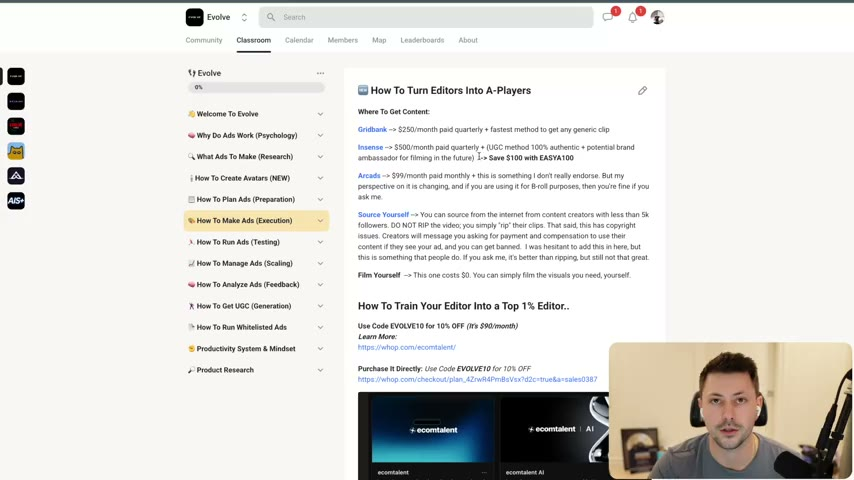
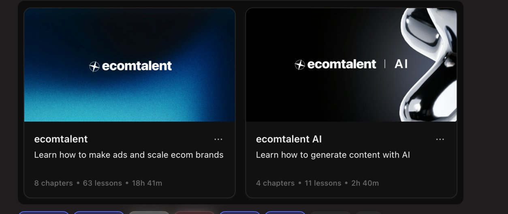

# 90. How To Get A-Players Editors & Content
> Where to source B-roll and creator footage for a brief, and why the instructor says every brand owner should put their editors through the sister program ecomtalent so that execution keeps up with strategy.

## 🤖 Agent use
- **Use when:** a script or brief is ready and footage must be sourced, or when deciding who executes a brief (editor skill, editor training, AI B-roll).
- **Inputs → outputs:** a script with B-roll needs (generic clips, authentic UGC, AI-generated B-roll) → a source choice per clip type from the list below, plus a note on editor development.
- **Rules:**
  - **DO** pick the footage source by clip type: generic stock clip, authentic UGC, AI B-roll, or self-filmed. Options and prices are in the table below. [01:55–03:35; page text]
  - **DO** treat execution as a first-order cause of failure. "Poor execution of your brief is one of the biggest reasons why your ads fail." [07:02–07:52]
  - **DO** train editors on marketing fundamentals: "how to actually process scripts, how to read what the script is actually saying, how to complete learnings on ads". [06:02]
  - **DON'T** reduce editors to executors of the brief. "It is so important to have a video editor that understands more than just executing the brief." [05:26] (instructor claim)
  - **DON'T** endorse AI UGC as a talking head; the instructor does not like it, but accepts AI for B-roll. [02:44; page text]
  - **IF** you cannot get real UGC for a visual (e.g. a very messy home scene) **THEN** AI B-roll can fill it: the instructor shows two fully AI clips "used for B-roll". [04:56–05:26]
  - **IF** sourcing clips from the internet **THEN** do not rip videos; the page warns of copyright problems, payment demands and possible bans (screenshot of the page). [02:44; frame at 02:00]
- **See also:** [89. Every Ad Format That You Can Use](089-every-ad-format-that-you-can-use.md) · [88. The Execution Problem](088-the-execution-problem.md) · [91. Action Item: Go To Copywriting Program](091-action-item-go-to-copywriting-program.md) · [98. How To Set Up Raw Content Campaign](098-how-to-set-up-raw-content-campaign.md) · [Evolve Copywriting: video ad script workflow](../../copywriting/frameworks/video-ad-script-workflow.md)

## Key ideas

### Proof offered: an editor-made ad that spent $15,000 a day [00:00–01:55]
- Spencer shows an "EAM Bounty" dashboard (client details hidden). Bounties are ads that editors "make... 100% themselves". [00:00]
- Claim: "on November 2nd" one editor, with nobody helping him, "made an ad that spent $15,000 for one of our brands" ("$15,000 a day" at [00:59]). "This editor beat our entire team." The team then launched a new ad that took the majority of spend. The instructor says this "has happened multiple times now". [00:00–00:59] (instructor claim; the dashboard was shown but is not in a captured frame, and year is not stated)
- Second claim: "The last two guys that I interviewed who hit 100K per day, it was them and an editor or them, a creative strategist and an editor." [00:59–01:55] (instructor claim)
- Why it matters: if editors are developed into A-players "they will print for you and they will be so bought in", "like they're your partner". [00:59–01:55]

### Where to get content [01:55–03:35]
The lesson page lists five sources; the audio walks through four of them. Fal.ai and Kie.ai appear only on the page.

| Source | Cost (page text) | What it is for | Instructor's comment |
|---|---|---|---|
| Gridbank | $250/month paid quarterly | "Fastest method to get any generic clip" | Search in plain language: "show me someone walking in snow". [01:55] |
| Insense | $500/month paid quarterly; code EASYA100 saves $100 | Authentic UGC "100% authentic + potential brand ambassador for filming in the future" | "That's this entire how to get UGC content section." [01:55–02:44] See [98](098-how-to-set-up-raw-content-campaign.md) for how that raw content is tested. |
| Arcads | $99/month paid monthly | AI UGC; use for B-roll only | "I don't endorse AI UGC. I'm not the biggest fan"; page: "my perspective on it is changing, and if you are using it for B-roll purposes, then you're fine". [02:44] |
| Fal.ai + Kie.ai | not priced on page | "AI tools we are currently using to generate realistic photos + B-roll clips more than any other" | Page text only, not discussed in audio. |
| Source yourself (a Karlo video from ecomtalent, linked on the page) | not priced | Sourcing clips from creators with fewer than 5k followers | Page screenshot warns not to rip; copyright issues, creators may demand payment and "you can get banned"; "better than ripping, but still not that great". [02:44; frame 02:00] |
| Film yourself | $0 | Film the visuals you need | "You can simply film the visuals you need, yourself." [02:44; page text] |

### The ecomtalent pitch [03:35–05:26; 05:26–09:57]
- The editor who made the $15k/day ad came "from Ecom Talent". [03:35] It is described as "an upsell": "$90 a month" (normally "100 bucks"), code **EVOLVE10** gives 10% off. [03:35; 08:26; page text] (The page links carry a referral parameter; not reproduced here.)
- Contents: ecomtalent course card shows 8 chapters, 63 lessons, 18h 41m; ecomtalent AI shows 4 chapters, 11 lessons, 2h 40m (screenshot of the page; the instructor says "63 modules" at [04:06]). The page text says the course is "15+ hours" from marketing fundamentals to video ads, static ads and AI, and that its last section on creative strategy "unlocks 30 days after joining". [page text]
- **ecomtalent AI** (page text, "Note from Karlo", the course's creator; the audio says Carlo): how to generate photorealistic product images and videos "out of thin air", create realistic AI humans, "a bunch of custom Gemini Projects for building prompts", and a step-by-step guide to realistic AI UGC; updated weekly. [page text]
- Evidence offered for AI B-roll: a tweet with two clips described as "100% AI", showing a messy home, "a month pregnant with toys over the place... even how dirty the mirror is", "no way anybody will ever be able to see that this is fake". [04:56–05:26] (instructor claim; the clips themselves were not captured.)
- Reasons given for training editors: [05:26–09:19]
  1. Editors with marketing fundamentals read what a script is "actually saying" and complete learnings with you. [06:02]
  2. Teams scaling to "100K days" collaborate and strategize with editors. [06:02]
  3. Editors can grow into creative strategists and manage other editors. Example: the course creator (Karlo/Carlo) was hired "as a video editor a year and a half ago" and is now "senior growth manager". [06:02–07:02]
  4. "Poor execution of your brief is one of your biggest reasons why your ads fail. If you don't have a great editor, you're competing against brand owners who do." [07:02–07:52]
  5. Hit rate: "if you want to improve your hit rates, you need an editor" who can execute. [08:26]
  6. Editors who understand desire stop needing clip suggestions: "I'm almost at the point... where our editors don't even want me to recommend clips because they know how to do it better... Most of your editors probably have no idea what a desire even is." [09:19]
- Pricing note: the instructor says they will "probably start charging way more for this" in 2026 after a meeting with Karlo. [07:02] (verify current price before quoting)

## Steps / framework

Footage and editor decision (derived from the table above):

1. Read the script and list every visual by type: generic, authentic person, product-in-use, impossible-to-film.
2. Generic clip → Gridbank search in plain language. [01:55]
3. Authentic person speaking or using the product → Insense creator (also screens future ambassadors). [02:44]
4. Impossible-to-film scene or B-roll fill → AI generation (Fal.ai / Kie.ai per page; Arcads for B-roll only). [02:44; page text]
5. Anything cheap and simple → film it yourself ($0). [page text]
6. Never rip internet clips; if sourcing from small creators, expect to pay them. [page screenshot]
7. Review the edit against the desire, then run learnings together with the editor. [06:02]

## Examples
- **Editor-made winner:** one editor's solo ad spent $15,000 in a day for an agency brand and took spend from the in-house team's ads. [00:00–00:59] (instructor claim)
- **Editor career path:** Karlo (spelled "Carlo" in audio) hired as video editor about 18 months before the recording, now senior growth manager, now teaching editors. [06:02–07:02]
- **Gridbank query style:** "Show me someone walking in snow. I need a clip of somebody walking in the snow." [01:55]

## Structured units

### Rules of thumb
- **DO** give editors the same education you get: marketing fundamentals, script reading, learnings. [06:02]
- **DO** measure editor quality by ad hit rate. [08:26]
- **DON'T** stop at brief-writing skill; execution caps the result. [07:52]
- **IF** a scene cannot be sourced from real UGC **THEN** generate AI B-roll rather than skipping the visual. [04:56]

## Prompts / templates (verbatim)
No prompts are given. Codes stated on the page: `EVOLVE10` (10% off ecomtalent, $90/month) and `EASYA100` (saves $100 on Insense).

## Screenshots

*The lesson page as shown on screen: the "Where To Get Content" list including a "Source Yourself" entry that is not in the extracted page text, with the copyright warning about ripping. [02:00]*

*Skool page image: ecomtalent (8 chapters, 63 lessons, 18h 41m) and ecomtalent AI (4 chapters, 11 lessons, 2h 40m). [page image]*

## How to apply
- [ ] Tag each visual in a script with a source (Gridbank, Insense, AI, self-filmed) before briefing the editor.
- [ ] Do not use AI as a talking-head unless you accept the risk; keep AI to B-roll and stills.
- [ ] Brief editors with the desire and avatar, not only the shot list.
- [ ] After each batch, run a learnings session with the editor on what spent and what did not.
- [ ] Confirm current ecomtalent price, code and contents before recommending it.

## Related
- Previous: [89. Every Ad Format That You Can Use](089-every-ad-format-that-you-can-use.md) · Next: [91. Action Item: Go To Copywriting Program](091-action-item-go-to-copywriting-program.md)
- [98. How To Set Up Raw Content Campaign](098-how-to-set-up-raw-content-campaign.md) · [Creator brief playbook](../../../../playbooks/creator-brief.md) · [AI UGC tools](../../../../tools/ai-ugc-tools.md)

## Sources and limitations
- Transcript: [90. How To Get A-Players…txt](<../../../../../raw/evolve/start-here/_transcripts/👣 Evolve (Start Here)/90. 🆕 How To Get A-Players Editors & Content 👣 Evolve (Start Here) Evolve.txt>) · Page text: [….html.md](<../../../../../raw/evolve/start-here/_extracted/👣 Evolve (Start Here)/90. 🆕 How To Get A-Players Editors & Content_👣 Evolve (Start Here)_Evolve.html.md>) · Page image: `knowledge-base/raw/evolve/start-here/linked/skool-images/90/90-img01.png`.
- Machine transcription (Whisper large-v3-turbo); full recording covered (597.38 s). Whisper heard "incense" for Insense, "Grid bank" for Gridbank, "rcads" for Arcads, "Carlo" where the page writes "Karlo" (same person), and "EAM Bounty" (likely the agency's bounty dashboard; EAM is Easy A Media per [93](093-full-media-buying-strategy-outline-2026.md)).
- The lesson text mixes product education with a paid upsell for ecomtalent; revenue, spend and 100K-day claims are the instructor's, with no verifiable evidence in the files. The "Source Yourself" paragraph is visible in the frame but missing from the extracted page text.
- No ecomtalent content from this lesson is in the knowledge base beyond what the page states.
