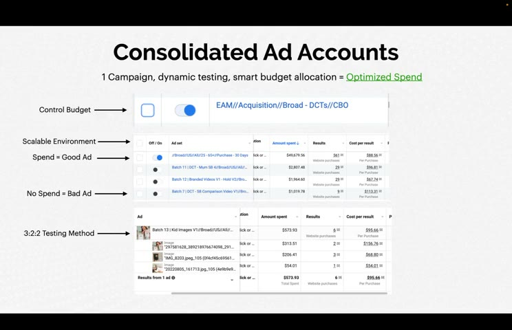

# 92. Evolve Facebook Ads Philosophy
> Why Evolve runs one fully broad CBO acquisition campaign and tests every new ad inside it: spend is the verdict, forcing spend on ads Meta ignored does not work, and the 3:2:2 test lets Meta pick winners without a big budget.

## 🤖 Agent use
- **Use when:** designing or auditing a Meta account structure, explaining why ads are tested inside the main campaign, or deciding whether to rescue an ad that got no spend.
- **Inputs → outputs:** an ad account's campaign list and creative backlog → a one-campaign structure (CBO, broad) with new ads launched into it, and a decision rule for each ad (spend = keep, no spend = bad).
- **Rules:**
  - **DO** run one campaign, called the acquisition campaign, fully broad; it covers prospecting, retargeting and middle of funnel by itself. "You do not have to have separate campaigns... a testing campaign or a scaling campaign or audience this or audience that." [00:00–00:51]
  - **DO** use the campaign level only to control the budget: "this is my budget, Facebook. Here it is and I want you to spend it." [00:51]
  - **DO** test new ads directly in the scalable campaign: "we are testing ads in the arena... not starting these ads on the playground... in the Coliseum." [00:51–01:48]
  - **DON'T** move ads that got no spend into an ABO and force spend. In the instructor's experience, 60-70 forced ads never outperformed in a separate campaign; forced ads ran at about 0.5x ROAS while the main campaign ran 3-4x. [02:29–04:05] (instructor claim)
  - **IF** an ad gets spend in this structure **THEN** treat it as a probable new winner: "nine times out of 10 have found a new winning ad". **IF** it gets no spend **THEN** "it is a bad ad." [01:48–02:29] (instructor claim)
  - **IF** an ad that had been forced elsewhere does perform **THEN** expect a short run: "it performs for maybe three or four days and then it falls off the face of the earth." [04:05]
  - **DO** test creative with the 3:2:2 method: three creatives around one concept, two copies, two headlines. [05:00]
  - **DON'T** judge a low-spend ad inside a test only by its own attributed results; low-spend ads can "hog view through attribution" or last click. [05:53]
- **See also:** [93. Full Media Buying Strategy Outline (2026)](093-full-media-buying-strategy-outline-2026.md) · [94. How To Set Up a 3/2/2 Campaign](094-how-to-set-up-a-3-2-2-campaign.md) · [103. How To Duplicate Ads Into Champions (New Way)](103-how-to-duplicate-ads-into-champions-new-way.md) · [Creative testing system](../../../../frameworks/creative-testing-system.md) · [Meta Andromeda](../../../../tools/meta-andromeda.md)

Page text adds a chapter list: 0:00 why CBO testing/scaling campaign; 2:25 hardest part of this strategy (no spend); 5:20 the 3:2:2 strategy; 6:20 what Facebook is trying to do. It calls this "the reason why we behind the 1-Campaign Strategy". [page text]

## Key ideas

### One broad campaign does everything [00:00–00:51]
- Speaker (unverified): "I have tried almost every single ad structure and media buying strategy that's out there... this is probably the best and it is the easiest structure to run." [00:00]
- One campaign: the **acquisition campaign**, fully **broad**. It retargets, prospects and covers middle of funnel on its own. [00:00]
- "Audiences don't matter... We're going broad." The only thing set at campaign level is budget. [00:51]

### A scalable environment, not a playground [00:51–01:48]
- Because every ad lands in the one scalable campaign, new ads face "the best of the best. There is no warmup... we put them in the one scalable environment that we have to see if they are worthy of getting spent." [00:51–01:48]
- Breakthrough: no budget is wasted on small pre-tests. Spend in this structure is the pass/fail signal. [01:48]

### The hardest part: ads that get no spend [02:29–05:00]
- "This is probably the hardest thing for people to understand." New media buyers hire in "every couple of months" and find the strategy hard to accept. [02:29]
- The instructor's own history: for six months he took ads that did not get spend and put them in an **ABO** (ad-set budget, where you can force spend) at **$25, $50 or $100 a day**. Outcome: about **0.5x ROAS**, while the one campaign was at **3-4x**. He repeated it weekly, spending **$300-$400** on single ads that did not convert. [02:29–03:15]
- Even "new images that we did... no way these are not good enough to scale": forced spend, "terrible" performance. [03:15–04:05]
- Count claimed: "we've probably tested about 60, 70 ads at this point"; none of those no-spend ads beat the main campaign in a separate campaign; if one did, it lasted "maybe three or four days". [04:05] (instructor claim)
- Conclusion: "this campaign is saving you money and actually optimizing your performance." [04:05]
- Scale proof offered: "I have seen us spend $40,000 on a single campaign" and a "$40,000 in a day" figure; a slide supposedly showing $50,000 in a month conflicts with the spoken "$40,000 a day in a single campaign". [04:05–05:00] (transcript garbled; unverified)

### The 3:2:2 test [05:00–06:37]
- Instead of three separate ads, give Meta three images around one concept (example concept: kids' images) with two pieces of copy and two headlines "and we let Facebook choose". [05:00]
- "You are giving the machine the tools to actually succeed." [05:53]
- The slide's numbers: of the three images inside one ad set, the first got $313.51 (2 purchases, $156.76 per result), the second $206.41 (3 purchases, $68.80), the third $54.01 (1 purchase, $54.01). The instructor says Meta "was obviously still trying to figure it out" and that lower-spend ads are often "just hogging view through attribution or... the last click compared to the ads that are really driving the performance". He promises to show deeper analytics later. [05:53–06:37]
- Reasoning: "Facebook is trying to make you money, because if Facebook makes you money, then they will make more money. So why would Facebook spend your budget on ads that aren't going to work?" [05:53–06:37]
- Benefit: "you don't have to have massive budgets to test a lot of creatives." [06:37]

## Steps / framework
Philosophy as a decision tree (derived from the lesson):

1. One campaign: `EAM//Acquisition//Broad - DCTs//CBO` as on the slide (naming in [109](109-how-to-set-up-naming-templates.md)). [slide 05:50]
2. New creative tests go in as new ad sets of 3 creatives x 2 copies x 2 headlines. [05:00]
3. Read the result by spend share first, returns second. [01:48]
4. Spend and good returns: keep, learn from it. No spend: bad ad, make a better one; do not force it. [01:48–02:29; 04:05]

## Examples
- **Slide: Consolidated Ad Accounts.** One campaign, dynamic testing, smart budget allocation = optimized spend. Annotated: Control Budget (campaign level), Scalable Environment (ad sets), Spend = Good Ad, No Spend = Bad Ad, 3:2:2 Testing Method (ad level). Figures on the slide: top ad set $49,679.56 (561 website purchases, $88.56 per result), other tested ad sets $2,807.48, $1,964.60, $1,019.78 (per-result $96.81, $67.74, $113.31). [slide 02:00–05:50]
- **Forced-spend experiment:** ABO at $25/$50/$100 a day, ROAS around 0.5x vs 3-4x in the main campaign, repeated for months. [02:29–03:15]
- **Kids' images test:** three images around one concept, $313 / $206 / $54 split. [05:00–05:53]

## Structured units

### Rules of thumb
- **DO** let Meta's spend decide which creative is worthy. [01:48]
- **DON'T** override no-spend verdicts with ABO forced spend. [02:29]
- **IF** a new media buyer wants separate audiences, retargeting or test/scale campaigns **THEN** explain this structure first, since most hires resist it. [02:29]

## Screenshots

*The one slide in the lesson, fully annotated: campaign `EAM//Acquisition//Broad - DCTs//CBO` (control budget), ad sets with spend (scalable environment, spend = good ad, no spend = bad ad) and a Batch 13 "Kid Images" ad set with three creatives (3:2:2 testing method). [05:50]*

## How to apply
- [ ] List every active campaign; mark which are separate testing, scaling or audience campaigns.
- [ ] For a new brand, plan a single broad CBO with one test ad set per concept (see [94](094-how-to-set-up-a-3-2-2-campaign.md) for settings).
- [ ] Record spend share per new ad set after 3 days; do not force-spend zero-spend ads.
- [ ] When a no-spend ad is rescued in ABO, log the outcome so the "forced ads fail" claim can be checked against your own data.

## Related
- Previous: [91. Action Item: Go To Copywriting Program](091-action-item-go-to-copywriting-program.md) · Next: [93. Full Media Buying Strategy Outline (2026)](093-full-media-buying-strategy-outline-2026.md)
- [97. How To Set Up ABO Scaling Campaign](097-how-to-set-up-abo-scaling-campaign.md) (the 2026 exception: ABO for breakthroughs, not for rescuing losers) · [Iteration vs variation](../../../../concepts/iteration-vs-variation.md)

## Sources and limitations
- Transcript: [92. Evolve Facebook Ads Philosophy…txt](<../../../../../raw/evolve/start-here/_transcripts/👣 Evolve (Start Here)/92. Evolve Facebook Ads Philosophy 👣 Evolve (Start Here) Evolve.txt>) · Page text: [….html.md](<../../../../../raw/evolve/start-here/_extracted/👣 Evolve (Start Here)/92. Evolve Facebook Ads Philosophy_👣 Evolve (Start Here)_Evolve.html.md>).
- Machine transcription (Whisper large-v3-turbo). Last segment 419.54 s of 420.78 s: complete. Speaker is not named in this video. The slide's "DCTs" refers to Dynamic Creative Tests, which [93](093-full-media-buying-strategy-outline-2026.md) and [94](094-how-to-set-up-a-3-2-2-campaign.md) say were replaced by manual ads; this philosophy video predates that change but its logic carries over.
- All ROAS, spend and ad-count figures are the instructor's claims; the slide screenshot is the only on-screen evidence and shows spend and per-result cost, not ROAS. The "$50,000 in a month" line is likely a misheard or misspoken figure.
