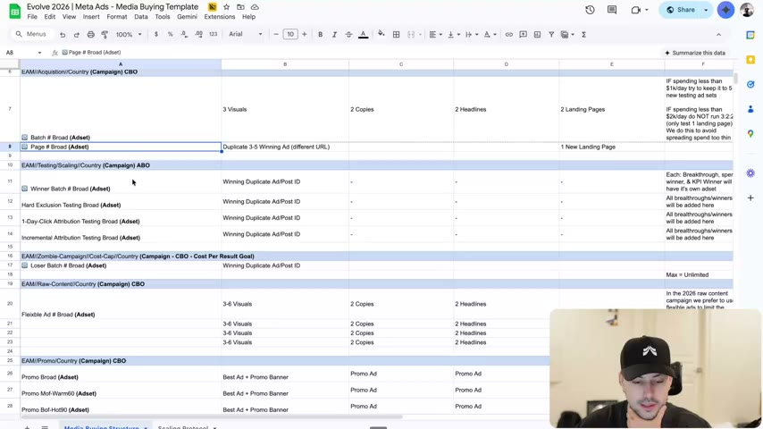

# 93. Full Media Buying Strategy Outline (2026)
> The 2026 map of every Evolve campaign (acquisition CBO, testing/scaling ABO, zombie cost cap, raw content, promo), with the exact creative counts and spend thresholds per structure; lessons 94-109 explain each campaign in depth.

## 🤖 Agent use
- **Use when:** planning an ad account structure, deciding what to launch into which campaign, or checking whether a structure is right for the current daily spend.
- **Inputs → outputs:** daily spend, creative batches, winners and losers → a campaign/ad-set layout using the sheet below, with the correct number of visuals, copies, headlines and landing pages.
- **Rules:**
  - **DO** keep "the one campaign strategy with the CBO" as the core. [00:00] The extra campaigns support it; they do not replace it.
  - **DO** use the 3:2:2:2 test (3 visuals, 2 copies, 2 headlines, 2 landing pages) only at 2k/day or more. Sheet: "IF spending less than $2k/day do NOT run 3:2:2:2 (only test 1 landing page). We do this to avoid spreading spend too thin." [00:58; sheet]
  - **DO** keep to about 5 new testing ad sets at once when spending under $1k/day. [00:58; sheet]
  - **DON'T** worry about the advanced structures at low spend: "for a lot of you guys [spending] less than two or three K a day, you don't really need to worry too much about this." [00:00]
  - **IF** an ad set loses (not hitting KPI, not spending) **THEN** duplicate its best ad into the zombie cost-cap campaign. [02:47; sheet]
  - **IF** you have a winning ad and a new landing page **THEN** duplicate 3-5 winners into a "Page #" ad set with the new URL. [01:45; sheet]
  - **IF** you are spam-testing raw content **THEN** use flexible ads (3-6 visuals, 2 copies, 2 headlines, 1 landing page) in one ad set. [02:47–03:29; sheet]
  - **DON'T** use the promo campaign for evergreen "sale ends tonight" offers; it is "only for limited time promo periods". [04:18]
- **See also:** [92. Evolve Facebook Ads Philosophy](092-evolve-facebook-ads-philosophy.md) · [94. How To Set Up a 3/2/2 Campaign](094-how-to-set-up-a-3-2-2-campaign.md) · [95. How To Test Landing Pages 3/2/2/2](095-how-to-test-landing-pages-3-2-2-2.md) · [96. Zombie/Graveyard Campaign](096-how-to-set-up-zombie-graveyard-campaign.md) · [97. ABO Scaling Campaign](097-how-to-set-up-abo-scaling-campaign.md) · [98. Raw Content Campaign](098-how-to-set-up-raw-content-campaign.md) · [108. Promo Campaign](108-how-to-set-up-a-promo-campaign.md) · [109. Naming Templates](109-how-to-set-up-naming-templates.md)

## Key ideas

### What changed in 2026 [00:00–00:58]
- The doc is "the updated entire media buying doc for February, 2026". The sheet's date cell reads 2026-04-01 and its title slide reads "February 2026" (possibly the video date vs the sheet last edit; derived). [00:00; sheet]
- "We are still living and breathing through the one campaign strategy with the CBO", but "it has evolved quite a lot over the last two years". The original philosophy ([92](092-evolve-facebook-ads-philosophy.md)) stays because many viewers spend under "two or three K a day". [00:00]
- New or changed: **3:2:2:2** (two landing pages per creative test), **Page # test**, **ABO testing/scaling campaign**, **zombie cost-cap campaign**, **raw content with flexible ads**; promo is "the exact same". Zombie is fine for small accounts "but again you probably have a creative issue". [00:00–00:58]

### 3:2:2:2 [00:00–01:45]
- "Whenever you test a new creative you can test two landing pages with it": for example one sales page and a listicle or the top-performing page, plus a new page made for that ad. [00:00]
- Ad count: "now because DCTs are gone... these three visuals with two copies and two headlines is three unique ads". One landing page = 3 ads in the ad set; adding a second landing page = **6 ads per ad set**. "That's obviously a lot of ads for Meta to consider", so without the spend "we just really don't recommend doing it". [00:58]
- Spend gates in the sheet: under $1k/day, keep to 5 new testing ad sets at one time; under $2k/day, do not run 3:2:2:2 and test one landing page only. [00:58; sheet row "Batch # Broad (Adset)"]

### Page # test [01:45–02:47]
- Same broad ad set structure. Put "three to five duplicates of whatever winning ads are" and change the URL to test one new landing page. Example: a page built for a specific angle, so take "the top three to five ads... or two to four ads for that specific angle" and test them with the new page in their own ad set. [01:45–02:47; sheet "Page # Broad (Adset)"]

### Testing/scaling ABO campaign [02:25–02:47]
- "This is an ABO strategy." Ad sets: Winner Batch # (repeatable), Hard Exclusion Testing, 1-Day-Click Attribution Testing, Incremental Attribution Testing. Winners enter as "winning duplicate ad or post ID". [01:45–02:47; sheet] Setup, budgets and exclusions are in [97](097-how-to-set-up-abo-scaling-campaign.md).
- Each breakthrough, spend winner or KPI winner gets its own ad set; "all breakthrough winners will be added into these specific ones for further scaling". [02:47]

### Zombie cost-cap campaign [02:47]
- "EAM stands for easy media. That's our agency." (Whisper wrote "easy media"; lesson 94's template says "Easy A Media".) Whenever you have a losing batch, "drop them in this cost result campaign". [02:47] Details in [96](096-how-to-set-up-zombie-graveyard-campaign.md).

### Raw content campaign with flexible ads [02:47–05:16]
- Rather than many ad sets, "we're just doing flexible ads that have three to six visuals inside of them with two copies and two headlines", with one landing page, all in a single ad set "so Meta can focus on the ad level rather than the ad set level". [02:47–03:29] Sheet: "we prefer to use flexible ads to limit the overwhelm to Meta."
- DCT history (instructor): DCTs were removed (the speaker is unsure if last year or the year before). A DCT counted as one ad with three creatives and allowed a breakdown by creative; now separate ads give three individual ads per ad set. Flexible ads can take up to 10 creatives and are effectively "DCTs... now flexible ads". [03:29–04:18]
- Downside: "breakdowns just don't work" for flexible ads, "you can't really see what is winning". Workaround: if a flexible ad takes off in raw content, "let it rip"; to do learnings click through and view the posts on Meta, where "usually it'll show you the one that's ripping the hardest". [04:18–05:16]

### Promo campaign [04:18–05:16]
- Same as before; sheet has three ad sets (Promo Broad, Promo MOF Warm60, Promo BOF Hot90), each with "Best Ad + Promo Banner" plus two promo ads, "Max = Unlimited, but don't overdo it". Only for limited-time promos, not fake "sale ends tonight". [04:18–05:16; sheet] Details in [108](108-how-to-set-up-a-promo-campaign.md).

## Steps / framework

### Media Buying Structure sheet (EAM Media Buying Formula, February 2026)
Rows reproduced from the spreadsheet; "🔁" in the sheet means the ad set can be repeated ("spam these as much as you want"). [01:45–02:47]

| Campaign (name pattern) | Ad set | Contents | Rule / note (sheet) |
|---|---|---|---|
| `EAM//Acquisition//Country` (Campaign) **CBO** | `Batch # Broad` 🔁 | 3 visuals, 2 copies, 2 headlines, 2 landing pages | "IF spending less than $1k/day try to keep it to 5 new testing ad sets. IF spending less than $2k/day do NOT run 3:2:2:2 (only test 1 landing page). We do this to avoid spreading spend too thin." |
| same | `Page # Broad` 🔁 | Duplicate 3-5 winning ads (different URL) | 1 new landing page |
| `EAM//Testing/Scaling//Country` (Campaign) **ABO** | `Winner Batch # Broad` 🔁 | Winning duplicate ad / post ID | "Each: Breakthrough, spend winner & KPI winner will have its own adset" |
| same | `Hard Exclusion Testing Broad` | Winning duplicate ad / post ID | "All breakthroughs/winners will be added here" |
| same | `1-Day-Click Attribution Testing Broad` | Winning duplicate ad / post ID | same note |
| same | `Incremental Attribution Testing Broad` | Winning duplicate ad / post ID | same note |
| `EAM//Zombie-Campaign//Cost-Cap//Country` (Campaign, **CBO**, Cost Per Result Goal) | `Loser Batch # Broad` 🔁 | Winning duplicate ad / post ID | "Max = Unlimited" |
| `EAM//Raw-Content//Country` (Campaign) **CBO** | `Flexible Ad # Broad` 🔁 (4 rows) | 3-6 visuals, 2 copies, 2 headlines, 1 landing page | "In the 2026 raw content campaign we prefer to use flexible ads to limit the overwhelm to Meta." "Max = Unlimited" |
| `EAM//Promo/Country` (Campaign) **CBO** | `Promo Broad` | Best ad + promo banner, promo ad, promo ad | "Max = Unlimited, but don't overdo it." |
| same | `Promo MOF-Warm60` | same | same |
| same | `Promo BOF-Hot90` | same | same |

The second sheet, "Scaling Protocol", contains only a link to a Figma whiteboard, "Scaling Protocol - Easy A Media" (content not in the course files). For the scaling rules see [115](115-how-to-scale-facebook-ads-up-down.md) and [97](097-how-to-set-up-abo-scaling-campaign.md).

### Mapping of campaigns to lessons
| Campaign | Optimisation | Lesson |
|---|---|---|
| Acquisition CBO (creative tests, 3:2:2 / 3:2:2:2) | CBO, maximize conversions | [94](094-how-to-set-up-a-3-2-2-campaign.md), [95](095-how-to-test-landing-pages-3-2-2-2.md) |
| Testing/Scaling ABO | ad-set budgets | [97](097-how-to-set-up-abo-scaling-campaign.md) |
| Zombie / Graveyard | CBO, cost per result goal | [96](096-how-to-set-up-zombie-graveyard-campaign.md) |
| Raw content | CBO, flexible ads | [98](098-how-to-set-up-raw-content-campaign.md) |
| Promo | CBO, three ad sets | [108](108-how-to-set-up-a-promo-campaign.md) |

## Examples
- **3:2:2:2 arithmetic:** 3 visuals x 2 copies x 2 headlines = 3 ads with 1 landing page; with a second landing page = 6 ads per ad set. [00:58]
- **Landing page scenario:** sales page + listicle or top-performing page + a newly built page for this ad. [00:00]
- **Raw content:** 4 flexible ad rows in the sheet, each 3-6 visuals with 2 copies and 2 headlines and a single landing page. [sheet; 02:47]

## Structured units

### Rules of thumb
- **DO** gate complexity by spend: under $1k/day max 5 new test ad sets; under $2k/day no 2-landing-page tests. [sheet]
- **DON'T** expect breakdowns on flexible ads; plan learnings from the Meta post view instead. [04:18]
- **IF** spending under $2-3k/day **THEN** ignore the ABO scaling machinery and focus on winning ads. [00:00; see also [97](097-how-to-set-up-abo-scaling-campaign.md) page text]

## Screenshots

*The Media Buying Structure sheet as shown on screen, listing the acquisition, testing/scaling, zombie, raw content and promo campaigns with their ad-set rows (replicated in the table above). [02:30]*

## How to apply
- [ ] Check daily spend against the sheet's gates (under $1k: 5 test ad sets; under $2k: single landing page only).
- [ ] Create `EAM//Acquisition//Country` as a CBO and launch batches as `Batch # Broad` ad sets.
- [ ] For each new landing page, create a `Page # Broad` ad set with 3-5 winning ads and the new URL.
- [ ] Add the ABO campaign and zombie campaign only when spend and winners justify them ([96](096-how-to-set-up-zombie-graveyard-campaign.md), [97](097-how-to-set-up-abo-scaling-campaign.md)).
- [ ] Put raw or ripped creator content in the raw content campaign as flexible ads, one landing page.

## Related
- Previous: [92. Evolve Facebook Ads Philosophy](092-evolve-facebook-ads-philosophy.md) · Next: [94. How To Set Up a 3/2/2 Campaign](094-how-to-set-up-a-3-2-2-campaign.md)
- [101. How To Set Targets & KPIs](101-how-to-set-targets-kpis.md) · [Creative testing system](../../../../frameworks/creative-testing-system.md) · [Test and iterate playbook](../../../../playbooks/test-and-iterate.md)

## Sources and limitations
- Transcript: [93. Full Media Buying Strategy Outline…txt](<../../../../../raw/evolve/start-here/_transcripts/👣 Evolve (Start Here)/93. 🆕 Full Media Buying Strategy Outline (2026) 👣 Evolve (Start Here) Evolve.txt>) · Page text: [….html.md](<../../../../../raw/evolve/start-here/_extracted/👣 Evolve (Start Here)/93. 🆕 Full Media Buying Strategy Outline (2026)_👣 Evolve (Start Here)_Evolve.html.md>) · Sheet: [….xlsx.md](<../../../../../raw/evolve/start-here/_extracted/👣 Evolve (Start Here)/93. 🆕 Full Media Buying Strategy Outline (2026).xlsx.md>) (identical to the linked Google Sheet export).
- Machine transcription (Whisper large-v3-turbo); full recording covered (326.57 s). Page text chapter times (0:20 3:2:2:2, 0:55 under $2k, 1:45 page test, 2:25 ABO, 3:00 zombie, 3:12 raw content, 5:06 promo) differ by up to about 30 s from the transcript, so transcript timestamps are used here.
- The spoken "February 2026" and the sheet's 2026-04-01 date disagree; treat the sheet as the later revision. Typos in the sheet ("Acquistion", "brealthroughs", "Fleixble") were normalised in the table above. The campaign "Max = Unlimited" notes mean no limit on how many repeats of that ad set.
- The Figma Scaling Protocol board linked in the second sheet was not fetched.
- Lessons 94 and 95 were recorded with earlier (2025) screens and DCT-era wording; this lesson supersedes their terminology (DCT means 3 manual ads now).
