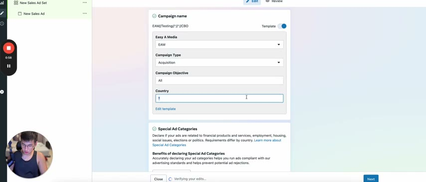
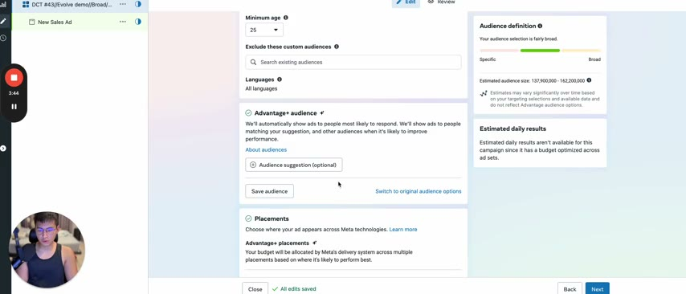
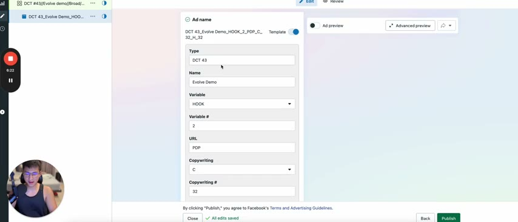
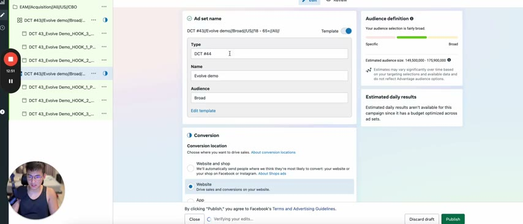
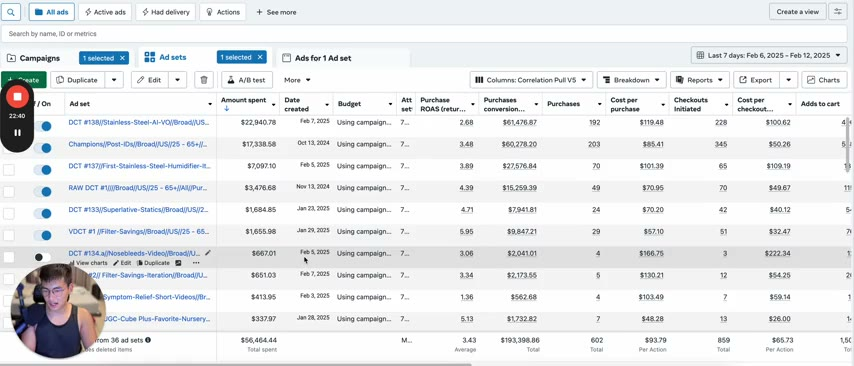

# 94. How To Set Up a 3/2/2 Campaign
> The step-by-step Meta Ads Manager build of Evolve's main campaign: one broad CBO of at least $100/day, one ad set per creative concept (3 creatives, each with 2 copies and 2 headlines), a "champions" ad set of proven post IDs as benchmark, and the rules for how long to test and when something is a winner.

## 🤖 Agent use
- **Use when:** building or auditing the main acquisition campaign, writing a campaign setup checklist for a media buyer, or deciding how many tests to run at a given budget.
- **Inputs → outputs:** brand, country, daily budget, a creative concept with 3 variations, optional list of past winners (post IDs) → a campaign spec (settings, names, UTMs, ad set and ad structure) and test-reading rules (days, spend share, benchmark).
- **Rules:**
  - **DO** create one **Sales** campaign with **manual** setup, **CBO** (campaign budget) on, minimum **$100/day**. [00:00–00:58]
  - **DO** send traffic to **website only** ("not website and shop"), optimize for **maximize number of conversions** (the regular purchase event on your pixel). "We tested value before"; the regular one works fine. [00:58]
  - **DON'T** use Dynamic Creative or flexible ads for creative tests: you "can't break down that data anymore". Use **manual ads** (single image or video) instead. [01:52]
  - **DO** go broad: change only age, gender and location; no interests; leave languages and placements (Advantage+ placements) at default. [02:47–06:03]
  - **DO** schedule ads to start at **midnight in the account time zone**, even if you sell to another region. [01:52–02:47]
  - **DO** make **9:16 vertical** the master format, edited inside safe zones so that 1:1 also looks fine; ignore horizontal ("nothing really converts horizontal"). [07:34]
  - **DO** turn off every Meta AI enhancement, "Disney" overlay, multi-advertiser ad and flexible-media toggle in the ad editor. [06:33–07:34; 10:27]
  - **DO** put exactly **one concept per ad set**: 3 creatives that differ by one variable (e.g. hooks), same format (all video or all image), the same 2 copies and 2 headlines. [08:30; 11:55]
  - **DO** use UTMs on every ad (string in "Prompts / templates") and the naming templates. [09:28; 06:03]
  - **DO** keep a **champions ad set** (post IDs of proven winners, never new ads) as a benchmark; a new test must out-spend it at KPI to count as a winner. [12:51–20:15]
  - **DON'T** set minimum or maximum spend limits: "it just spends more at lower KPI". [22:10–23:06]
  - **DON'T** turn off ads that are working. Page text: "THE DUMBEST THING YOU CAN DO IS TURN OFF ADS THAT ARE WORKING". [page text]
  - **IF** spending a few hundred dollars a day **THEN** run at most **5 ad sets** at once (champions counts when it has ads). **IF** about $10,000/day **THEN** many more are fine. [23:36–25:29]
  - **IF** a test ad set is tested **THEN** give it 3 days minimum, then 7 if it shows traction; turn off at ad-set level only. [26:29–28:31; page text]
- **See also:** [92. Evolve Facebook Ads Philosophy](092-evolve-facebook-ads-philosophy.md) · [93. Full Media Buying Strategy Outline (2026)](093-full-media-buying-strategy-outline-2026.md) · [95. How To Test Landing Pages 3/2/2/2](095-how-to-test-landing-pages-3-2-2-2.md) · [100. How To See Ads Performance + Our Columns](100-how-to-see-ads-performance-our-columns.md) · [103. Champions (New Way)](103-how-to-duplicate-ads-into-champions-new-way.md) · [104. Find Post IDs](104-how-to-find-any-post-ids-for-winning-ads.md) · [109. Naming Templates](109-how-to-set-up-naming-templates.md) · [Creative testing system](../../../../frameworks/creative-testing-system.md)

## Key ideas

### What the 3/2/2 campaign is [00:00–00:58]
- "Our main method of media buying": one campaign, CBO, ads tested inside. Previously "a DCT campaign" (dynamic creative test); "now, instead of DCTs, we run it with manual ads instead." [00:00]
- Page-text summary: 1 campaign; 1 champions ad set plus multiple creative-test ad sets; 3 creatives in each ad set (same concept), each with 2 headlines and 2 copies. [page text]
- The 2026 version adds a 2-landing-page variant (3:2:2:2): see [93](093-full-media-buying-strategy-outline-2026.md) and [95](095-how-to-test-landing-pages-3-2-2-2.md). The screens here date from early 2025.

### Campaign level [00:00–02:47]
- Create → **Sales** → manual sales campaign (not an Advantage+ sales campaign). Use the naming template. Example here: US, main acquisition campaign. [00:00–00:58]
- "Turn off these ad sets over here" (Meta's newly added AI options, per the speaker "a lot of different AI stuff since we last updated the videos"). **CBO on**, **$100 minimum**. [00:58]
- Drive to **websites only**: "You hardly drive it to websites and shops anymore. There's a lot of issues with shopping that come up. Discount issues, AI features." [00:58]
- Performance goal: **maximize number of conversions**; touch your pixel. [00:58]
- Dynamic creative: previously toggled on; now off because "Dynamic Creatives is not a thing anymore. It's only Flexible Ads", and with flexible ads "you are not able to break down that data anymore". You could previously see which of three images won; "now... you can't see that... what should I improve on? You don't know." [00:58–01:52]
- Schedule: "we always want to schedule it during midnight... 12 a.m. at account time zone, 2, 4 a.m... midnight is fine." For a Europe-time-zone account selling to the US, still use midnight account time. [01:52–02:47]

### Ad set level: targeting [02:47–06:03]
- Broad means no changes: "all you want to change is your age, gender and location". [02:47]
- Meta's new **audience controls** problem: minimum age shows 18 and Advantage+ audience may deliver only to a narrower age; to target 50+, open "See audience controls in advertising settings" and **switch to original audience options**. Advantage+ audience vs original makes little difference ("it's all the same thing"). [02:47–04:16]
- Unknown age/gender: "keep it broad, 18 plus all genders". After data (e.g. 35+), narrow later. [04:16]
- **Exclusions:** "it doesn't matter as much." Dropshipping or low repeat-customer brands need not exclude purchases. If the return-customer rate is high, exclude purchasers: create custom audience → website → past **180 days** → pixel purchase event → exclude. [04:16–05:11]
- Interests: "age gender interest here we don't really do anymore"; languages default; placements stay **Advantage+** ("if you give meta more data, it will perform better"). [05:11–06:03]

### Ad level: build one manual ad [06:03–11:55]
- Name the ad with your template: "if not, your team can't analyze what is working well." [06:03]
- Partnership ads are a separate topic. Select Facebook page **and an Instagram account** (create one if missing, to manage IG comments). [06:33]
- **Create ad → manual upload**, single image or video (not flexible). Turn off **multi-advertiser ads** ("doesn't really impact performance, but it's annoying"). Turn off the Disney-style creative options. Flexible media: "say no". [06:33]
- Creative spec: "we only create 9 by 16 ads... vertical... edited in safe zones. So when they're edited to 1 by 1 or 9 by 16, it looks fine. We don't care about horizontal." [07:34]
- Turn off all AI features and enhancements; a separate video in the AI program covers an AI tool ("it's called Kitchen", Whisper's spelling, unverified). [07:34; 10:27]
- Text: two **copies** (primary text), two **headlines**, description "free shipping" (or the offer) ("we don't really feel this out anymore"), CTA matching intent ("shop now"). Enhancements off. Website URL, website events, UTMs. [08:30–09:28]
- UTMs: "important for you to have UTMs" for third-party tools such as Triple Whale and for Google Analytics or Shopify; "it doesn't affect performance anyways." [09:28]
- Build 3 creatives: set up one ad, then duplicate it twice at ad level, keep text and headline identical and replace only the media. Example names "hook one... hook two... hook three". [09:28–10:59]
- Result: ad set = 3 creatives x 2 copies x 2 headlines. Because ads are manual you can see which exact creative spends; Meta still lets you break down **text and headline** (not creative): breakdown → "Dynamic creative element" → text / headline, then combine the best creative + best copy + best headline into a post ID. [10:59–11:55]

### One ad set = one concept [11:55–12:51]
- Example concept: an "Evolve Demo Video" ad idea: all three ads are about the demo, all video, three different hooks. "This is so when you test inside this ad set, the data you get is clean. If you test images and videos inside one ad set, the data might not be distributed properly." [11:55]
- To run another test, duplicate the ad set (here DCT 43 → DCT 44, concept "Evolve Showcase", variable changed to image). [12:51]

### Champions ad set [12:51–21:13]
- Create one extra ad set named "champions" with the same settings (website, maximize conversions, no dynamic creative) and identical audience targeting to the test ad sets. [12:51–13:50]
- Contents: only winning ads, never new ads. Find winners in older campaigns (ad level, last 30 days or maximum) and add via **existing post** by post ID. Example: a stainless-steel humidifier ad. Method used: "the Facebook post with comments method" (see [104](104-how-to-find-any-post-ids-for-winning-ads.md)). [13:50–15:49]
- Use post IDs so early winners keep their engagement; set UTMs as before; turn enhancements off. [15:49]
- Why a champions ad set ("some people like it, some people don't. We still do"): [15:49–18:16]
  - Consolidation. Too many test ad sets (20-30) cannot all be funded and spend gets allocated poorly. Move the best of a winning set (one of three creatives) into champions to give it more spend.
  - A winner one week may lose another; ad sets get turned off when they fade, but the proven ad stays in champions and can win spend again.
  - "Less ad sets running within the overall campaign, which means their spend will get allocated properly."
- **Benchmark / leaderboard** role: "If my creatives can't outspend the champions at KPI, they are not new winners." [18:16–19:16] If you skip champions, "you will have one ad set or one creative that is getting majority of spend anyways. That will be your best benchmark." [19:16]
- Do not turn off ads inside champions ("proven winners"); do not turn off the original test ad set after copying the best post ID into champions. If champions gets no spend, "that's fine... a bit hit or miss"; if it out-spends the original test ad set you can turn the original off, otherwise leave both. [19:16–21:13]
- Summary: one campaign, $100 minimum, one champions ad set plus several creative-test ad sets, each 3 creatives with 2 copies and 2 headlines. [21:13–22:10]

### Troubleshooting [22:10–32:30]
- **Minimum budgets:** tested and rejected. Ads compete; "some ads get spent, some ads do not." Minimum spend "just spends more at lower KPI" and does not create winners; it is "just for people's ego". Run broad without minimums. [22:10–23:36]
- **Ad sets at a time:** a few hundred dollars a day → five (e.g. 1 champions + 2 test ad sets, or 5 test ad sets for a new brand with no champions). Why: too little budget per ad set means creatives get only a few dollars a day and "it will take much, much longer" to reach statistical significance. Example arithmetic: $500/day across 20 ad sets. "General rule, spending a few hundred dollars a day, keep it to five ad sets max... if you're spending like $50,000 a day, you can definitely have more." [23:36–25:29]
- **$10,000/day account example:** many ad sets are affordable; one ad set got $67 over its test period. "If you were to spend $100 a day in it, how much would you get? ... like 6 cents... I don't think you can get any results out of 6 cents." [25:29–26:29]
- **How long to test:** minimum **3 days**, up to **7**; look at spend first. "In this campaign method, the most important thing is spend. And of course, returns still matter." [26:29–27:02]
- **Reading a test:** day-by-day breakdown. Example: day 1 little spend and weak return (don't panic), day 2 ROAS 12x? (garbled), day 3 3.92 ROAS; use the 3-day average and "judge traction based on the spend", checking whether spend rises each day and relative to campaign spend. [27:02–28:31]
- **Longer test only with traction:** "We only test creatives for one week if we see traction within the first three days. If... the first three days it's not doing [anything], we won't test for 7 days." [27:32–28:31]
- **Winner vs super winner:** an ad that does well but takes a minority of spend is not a champion; "A super winner is one that gets majority of spend at KPI." [28:31–29:01]
- **Live example:** champions ad set getting $14k; next day a new creative (city 56) launched, low spend day 1; by day 2-3 spend and returns rising; after one week still not a super winner, so left running; the next week "you took the majority of spend now... your new super winner". Drop the best post ID into champions. [29:01–30:06]
- **Scaling model:** "We test and scale within the same campaign." Example: week at about **$20k at 4x ROAS** → after a new winner took majority of spend, about **$60k at similar ROAS**; or **$30k at 4x**, increase the budget when returns are good, "scale to a point where your returns are where you desire. Chill there. Test new creatives. New creatives get majority of spend. Great, returns increase, increased budget." [30:06–32:06]
- Page FAQ confirms and adds numbers (see "Steps / framework").

## Steps / framework

### Campaign build checklist
| Level | Setting | Value |
|---|---|---|
| Campaign | Objective / buying | Sales, manual (not Advantage+ sales) [00:00] |
| Campaign | Budget | CBO (campaign budget) on, minimum $100/day [00:58] |
| Campaign | Name | `EAM//Testing//*//*//CBO`-style template with Easy A Media / Campaign Type (Acquisition) / Objective (All) / Country [screenshot] |
| Ad set | Conversion location | Website only [00:58] |
| Ad set | Performance goal | Maximize number of conversions (no value) [00:58] |
| Ad set | Dynamic creative | Off [01:52] |
| Ad set | Schedule | Start midnight, account time zone [01:52–02:47] |
| Ad set | Audience | Broad: change age, gender, location only; original audience options if you need 50+; default 18+ all genders [02:47–04:16] |
| Ad set | Exclusions | Optional: purchasers (pixel purchase, 180 days) only if repeat rate is high [04:16–05:11] |
| Ad set | Placements | Advantage+ placements [05:11–06:03] |
| Ad | Setup | Manual upload, single image or video; flexible media off; multi-advertiser off [06:33] |
| Ad | Format | 9:16 master with safe zones, also 1:1; no horizontal [07:34] |
| Ad | Text | 2 primary texts, 2 headlines, description = offer (e.g. free shipping), CTA e.g. Shop Now [08:30] |
| Ad | Enhancements / AI | All off [08:30; 10:27] |
| Ad | Tracking | Website events on, UTMs added [08:30–09:28] |
| Ad set | Contents | 3 creatives of one concept, same format, one variable (e.g. hook) [11:55] |
| Extra ad set | `Champions` | Same settings; existing posts by post ID; no new ads [12:51–15:49] |

### FAQ numbers from the page text
| Question | Answer (page text) |
|---|---|
| How many creative ad sets at once? | If spending a few hundred a day: 5 (including champions if it has ads); all 5 may launch the same day. Focus on "intent of the ads instead of throwing things at the wall". |
| Max creatives to test per week | Total ads = Budget / Target CPA. Example: $100/day budget, target CPA $20 → $100 / $20 = 5, "so the maximum amount of concepts is 5, considering 100% of your budget is testing." More ad sets are fine at a few thousand a day. |
| Min/max spend limits? | No: "we tested it and it didn't help." |
| How long to test? | Minimum 3 days; "we now leave them testing 7 days". If after 7 days there is not much spend or the KPI is missed, turn off. Usually not longer than 14 days. |
| Winner definition | Gets the majority of spend at KPI. Otherwise ask "Did my overall campaign performance improve?" If overall ROAS did not improve, "it's not a winner". |
| Turn off when? | Only at ad-set level, never ad level. After 7 days with little spend and poor ROAS: turn off (keep if ROAS good and no other creatives queued). If it took the majority of spend in the first 3 days but performance is poor and overall campaign performance fell: turn off, but do learnings because it got engagement, then make it "more conversion driven". Give it 2-3 days since day 1 may not convert. Do not turn off ads that were doing well and suddenly tanked: "zoom out look at averages instead". |
| Minimum budget? | $100/day. |
| No past winners or new brand? | Create the champions ad set but "don't launch any ads inside there until you have a proven winner". |
| Mix images and videos? | Yes in the same campaign, but in separate ad sets: "1 concept should be 1 ad set, so 1 image concept with 3 variations." |

## Examples
- **Evolve Demo test:** ad set `DCT 43 // Evolve demo // Broad // US // 18 - 65+ // All`, 3 ads `DCT 43_Evolve Demo_HOOK_1/2/3_...`, variable = hook; next test `DCT #44 Evolve Showcase`, variable = image. [06:33; 12:51; frames]
- **Champions example:** a stainless-steel humidifier post ID added from an older campaign as the first champion. [14:48]
- **Spend reading example:** week of Feb 6-12, 2025: DCT #138 (stainless steel) $22,940.78 at 2.68 ROAS, Champions $17,338.58 at 3.48, DCT #137 $7,097.10 at 3.89; whole campaign $56,464.44 at 3.43 ROAS over 36 ad sets. Spend decided who was the benchmark. [frame ~23:00]
- **Growth path:** about $20k at 4x → about $60k at similar ROAS after one breakout winner. [30:06–31:05] (instructor claim)
- **Forced concept discipline:** images and videos in one ad set can distort data; keep one concept and one format per ad set. [11:55]

## Structured units

### Templates
| Template | Use for | Example fill | Source |
|---|---|---|---|
| Campaign name: `EAM//Testing//{Type}//{Objective}//{Country}//CBO` with fields Easy A Media / Campaign Type / Campaign Objective / Country | Naming the CBO | Easy A Media = EAM, Type = Acquisition, Objective = All | screenshot 01:00 |
| Ad set name: `DCT {n}//{Name}//Broad//{Country}//{age range}//{gender}//` with fields Type / Name / Audience | Naming a creative test | `DCT #44 // Evolve demo // Broad` | screenshot 13:00 |
| Ad name: `{Type}_{Name}_{Variable}_{Variable #}_{URL}_{Copywriting}_{Copywriting #}_{Headline}_{#}` | Naming each ad | `DCT 43_Evolve Demo_HOOK_2_PDP_C_32_H_32` | screenshot 06:30 |

### Rules of thumb
- **DO** use spend as the primary test signal and returns second. [26:29–27:02]
- **DON'T** judge a test after day 1. [27:02]
- **IF** a new creative out-spends champions at KPI **THEN** copy its best post ID into champions and leave the original running. [20:15]
- **IF** champions does not spend **THEN** leave both running; it is "hit or miss". [21:13]

## Prompts / templates (verbatim)
Easy A UTM code (page text):

```text
utm_source=facebook&utm_medium=paid&utm_campaign={{campaign.name}}&utm_term={{adset.name}}&utm_content={{ad.name}}&fbadid={{ad.id}}&tw_source={{site_source_name}}&tw_adid={{ad.id}}
```

Page-text summary:

```text
1 Campaign
1 Champions Ad set, Multiple Creative Test Ad Sets
3 creatives in each ad set (same concept), each with 2 headlines and 2 copies
```

Page-text warning (verbatim): "DO NOT TURN OFF YOUR EXISTING ADS IF THEY ARE WORKING. THE DUMBEST THING YOU CAN DO IS TURN OFF ADS THAT ARE WORKING. IF YOUR OTHER CAMPAIGNS ARE WORKING - LEAVE THEM ON - IF YOU TURN THEM OFF AND YOU LOSE MONEY... THAT IS ON YOU."

## Screenshots

*Campaign-level name template in Ads Manager: template string `EAM//Testing//*//*//CBO`, with Easy A Media (EAM), Campaign Type (Acquisition), Campaign Objective (All) and Country fields. [01:00]*


*Ad set audience section: Advantage+ audience box and the "Switch to original audience options" link used to set 50+ ages; minimum age shows 25 in this view. [03:50]*


*Ad name template: `DCT 43_Evolve Demo_HOOK_2_PDP_C_32_H_32` built from Type = DCT 43, Name = Evolve Demo, Variable = HOOK, Variable # = 2, URL = PDP, Copywriting = C, Copywriting # = 32 (then headline H and number). [06:30]*


*Ad set name template while duplicating the first test into a second: `DCT #44 // Evolve demo // Broad // US // 18 - 65+ // All`, with the tree of ad sets and 3 hook ads each. [13:00]*


*A mature campaign: Champions $17,338.58 at 3.48 ROAS next to DCT #138 ($22,940.78, 2.68) and DCT #137 ($7,097.10, 3.89); total $56,464.44, 3.43 ROAS, 36 ad sets. Shows spend share as the benchmark. [23:00]*

## How to apply
- [ ] Create the campaign: Sales, manual, CBO, minimum $100/day, website, maximize conversions, dynamic creative off.
- [ ] Set broad targeting (age, gender, location only); use original audience options if Meta blocks the age range you need.
- [ ] Add UTMs and the naming templates before launching.
- [ ] Launch one ad set per concept with 3 manual ads (one variable), 2 copies and 2 headlines each.
- [ ] Add an empty `Champions` ad set; fill it with post IDs of proven winners.
- [ ] Limit simultaneous ad sets to 5 if spending a few hundred a day; compute weekly test capacity as budget / target CPA.
- [ ] Review at day 3; extend to day 7 only with traction; do not touch ads that are working; log which ad set took the majority of spend at KPI.
- [ ] When a test wins, put its best post ID in champions, keep the original running, then raise the campaign budget gradually.

## Related
- Previous: [93. Full Media Buying Strategy Outline (2026)](093-full-media-buying-strategy-outline-2026.md) · Next: [95. How To Test Landing Pages 3/2/2/2](095-how-to-test-landing-pages-3-2-2-2.md)
- [92. Evolve Facebook Ads Philosophy](092-evolve-facebook-ads-philosophy.md) · [97. ABO Scaling Campaign](097-how-to-set-up-abo-scaling-campaign.md) (2026: champions ad set dropped there) · [101. Targets & KPIs](101-how-to-set-targets-kpis.md) · [107. Protect Against Bad Ads Overspending](107-how-to-protect-against-bad-ads-over-spending.md)

## Sources and limitations
- Transcript: [94. How To Set Up a 3 2 2 Campaign…txt](<../../../../../raw/evolve/start-here/_transcripts/👣 Evolve (Start Here)/94. How To Set Up a 3 2 2 Campaign 👣 Evolve (Start Here) Evolve.txt>) · Page text: [….html.md](<../../../../../raw/evolve/start-here/_extracted/👣 Evolve (Start Here)/94. How To Set Up a 3_2_2 Campaign_👣 Evolve (Start Here)_Evolve.html.md>).
- Machine transcription (Whisper large-v3-turbo); full recording covered (last segment 1949.01 s of 1949.74 s). Whisper writes "322" for 3/2/2, "CT43" where the screen shows DCT 43, "Kitchen" for an AI tool (unverified), and some garbled figures in the day-by-day reading ("12x", "$67, 942.5k" meaning roughly $67, $942, $2.5k per day); those are not used as firm numbers.
- The speaker does not give a name. Screens are from early 2025 (Feb 2025 date ranges); the lesson speaks of DCT campaigns but now uses manual ads, which [93](093-full-media-buying-strategy-outline-2026.md) confirms. [97](097-how-to-set-up-abo-scaling-campaign.md) later (2026) says champions ad sets are no longer used, so treat the champions section as the 2025 method.
- Revenue and ROAS figures ($20k to $60k, 4x) are the instructor's examples; the only on-screen evidence is the account table above.
- The "turn off these ad sets" line at [00:58] is ambiguous in audio and the exact toggle was not captured in a frame; check the current Meta UI for the new AI options.
