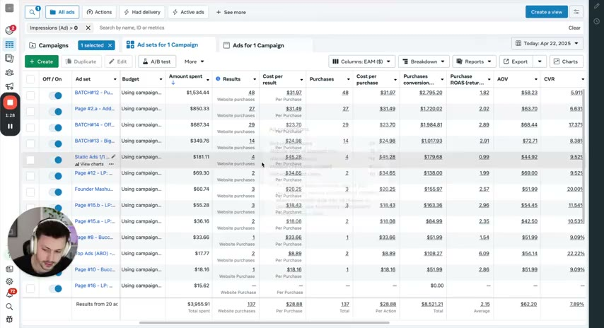
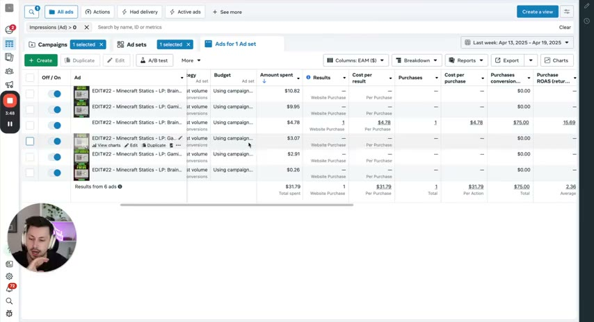

# 95. How To Test Landing Pages 3/2/2/2
> Test landing pages inside the main CBO instead of a separate ABO: every new creative batch launches with two landing pages (3:2:2:2), and existing winners are duplicated onto each new page in a "Page #" ad set, so Meta's budget allocation shows which page and ad pair spends.

## 🤖 Agent use
- **Use when:** a new landing page, listicle or product-page variant needs a live test, or when a new creative batch is being launched and the page is also a variable.
- **Inputs → outputs:** a new batch of 3 creatives (with 2 copies and 2 headlines) and 2 candidate landing pages; or 3-5 existing winning ads and 1 new page → either one ad set of 6 ads (3:2:2:2) or one "Page #" ad set with duplicated top ads pointing to the new URL.
- **Rules:**
  - **DO** run the 3:2:2:2 on new creatives: 3 creatives, 2 copies, 2 headlines, 2 landing pages. [02:16; page text]
  - **DO** build it by duplicating the same three ads and changing only the URL, giving 6 ads per ad set. [03:46–04:46]
  - **DO** test existing winners on a new page by duplicating the top 3-5 ads, changing the URL, and launching them in the main campaign as a "Page #" ad set. [00:38–01:29; page text]
  - **DO** label ads by page in the ad name (e.g. `LP: Gaming`, `LP: Brain`) so spend can be read per page. [03:46; frame 03:50]
  - **DO** test any two pages: product page vs homepage, collection page vs product page, listicle vs current control. [04:46]
  - **IF** you still test pages in ABO **THEN** after 7 days drip a winner into the champions ad set or main campaign, and watch it: "it might suck up spending". [06:15]
  - **DON'T** run this at low spend: [93](093-full-media-buying-strategy-outline-2026.md) states under $2k/day test one landing page only, because six ads per ad set spreads spend too thin.
- **See also:** [93. Full Media Buying Strategy Outline (2026)](093-full-media-buying-strategy-outline-2026.md) · [94. How To Set Up a 3/2/2 Campaign](094-how-to-set-up-a-3-2-2-campaign.md) · [Landing page psychology audit](../../../../frameworks/landing-page-psychology-audit.md) · [Landing page scorecard](../../../../rubrics/landing-page-scorecard.md) · [Evolve Copywriting: nine-component audit](../../copywriting/frameworks/nine-component-audit.md)

## Key ideas

### Old method vs new method [00:00–00:38]
- Before: pages were tested "inside of an actual campaign" as an **ABO** campaign with a minimum budget. The old method video is still on the page ("I'm still going to leave that"). [00:00]
- Now: "we're testing this all inside of our main campaign", "leveraging Meta's algorithm and the one campaign setup". [00:00–00:38]

### "Page #" ad sets: existing winners onto a new page [00:38–02:16]
- In the spending campaign, any ad set labelled "Page" contains "just our top ads inside of here going to a new LP". The speaker hides the brand. Examples on screen: Page #9 "absolutely ripping", Page #15, Page #12 ("not really getting that much spend"), Page #2A. Alongside them: batches such as Batch #12 and #13. [00:38–01:29]
- Contents: "five of our top performing ads or ads that we thought would work well with this page", all sent to a new version of the page. "We are simply leveraging Meta's AI and Meta's CBO structure to push spend based on specific pages inside of the main campaign." [01:29–02:16]
- Page text recipe for "PAGE # with BEST ads for testing NEW LPs on existing ad creatives": duplicate top 3-5 ads, change URL to the new LP, launch in the main campaign. [page text]

### 3:2:2:2: new creatives with two pages [02:16–04:46]
- New name: "the three, stay with me here, two, two, two method": 3 ad variations (creatives), 2 body copies, 2 headlines, 2 landing pages. [02:16]
- Worked example (Batch 13 "Big Industry Iteration" V1/V2/V3): ad names carry `LP:` labels, one for a "buckle" page and one for "5R" (five reasons). [02:47]
- Worked example (EDIT #22 "Minecraft Statics", a batch the editors built on their own): "edit is the label that our editors use. So whenever our editors make their own ads, we call it edit. So this is edit number 22, the 22nd batch that our editors have made just on their own without our creative strategy team." Three ads (named recipe, focus and "not harder") with ad names ending in `LP gaming` or `LP brain`: the same three ads duplicated, once going to the gaming landing page and once to the brain page. [03:46]
- Count: 3 ads x 2 pages = **6 ads per ad set**; copies and headlines still 2 each. "We're letting Meta read and analyze the page which it can do to decide what gets [spend]." [04:46] (Whisper garbled the last words.)
- Why: "we want to see what page is going to perform with the ad... for every single new ad that we're launching, as long as we have the landing pages with it, we're actually launching two pages." [04:46]

### Why test pages inside the campaign [05:32–06:15]
- In Batch 13 the page nobody expected to win did best: "this page right here was doing the best, out of the ones that we thought was going to actually do well. And so if we didn't test this 5R page, the five reasons page, and we only tested this buckle page, well, we wouldn't have found the top spending ad." [05:32]
- Reason for the move: "we want to make sure that when we're testing LPs, we're getting data right away. And for me, I was getting even impatient, just waiting in ABO." [05:32]

### If you still prefer ABO [06:15–07:14]
- Allowed ("you're more than welcome to"). Rule: "if something works after seven days... just drip it into your champion's ad set or drip it into your main campaign. Keep an eye on it because it might suck up spending." [06:15]
- Summary: 3:2:2:2 for new creative batches, "Page #" tests for existing top ads. Claimed result: "extremely effective for scaling". [06:15–07:14] (instructor claim)

## Steps / framework

### A. New creative batch with two pages (3:2:2:2)
1. Prepare 3 creatives (one concept), 2 primary texts, 2 headlines. [02:16]
2. Choose 2 pages (e.g. listicle vs control, product page vs homepage). [04:46]
3. In the batch ad set create the 3 ads with page A; duplicate the 3 ads and change the URL to page B. Name each with its page (`LP: <name>`). [03:46]
4. Launch in the main CBO. Read spend per ad and per page after 3-7 days ([94](094-how-to-set-up-a-3-2-2-campaign.md) rules).

### B. Existing winners on a new page ("Page #")
1. Pick the top 3-5 ads (or the ads that best match the page's angle). [01:29; [93](093-full-media-buying-strategy-outline-2026.md)]
2. Duplicate them into a new ad set called `Page #n`. [page text]
3. Change the URL to the new landing page. [page text]
4. Launch in the main campaign and read spend. [00:38]

## Examples
- **Batch 13:** the "5R" five-reasons page out-spent the "buckle" page for the same ads. Testing only the buckle page would have missed "the top spending ad". [05:32]
- **EDIT #22:** 6 static ads (3 ads x brain/gaming pages); in the frame the six ads spent $10.82, $9.95, $4.78, $3.07, $2.91 and $0.26 (total $31.79, 1 purchase), i.e. a tiny test that "didn't get any data" on some ads, which the speaker admits flopped. [03:00–03:46; frame 03:50]
- **Account snapshot (Apr 22, 2025, 20 ad sets, $3,955.91 spent, 137 purchases, $28.88 per purchase, ROAS 2.15):** Batch #12 $1,534.44 (48 purchases at $31.97), Page #2a $850.33 (27 at $31.49), Batch #14 $687.34 (29 at $23.70), Batch #13 $349.76 (14 at $24.98). Page ad sets spent less than top batches but several converted in the same cost range. [frame 01:30]

## Structured units

### Templates
| Template | Use for | Example fill | Source |
|---|---|---|---|
| `3:2:2:2` = 3 creatives, 2 copies, 2 headlines, 2 landing pages | New creative batch with page test | 3 statics x gaming LP / brain LP = 6 ads | [02:16] |
| `Page #n` ad set: top 3-5 ads duplicated, URL changed to the new LP | Existing winners onto a new page | Page #12, Page #2A | [00:38–01:29] |
| Ad name with page label: `<BATCH or EDIT> #n - <concept> - LP: <page>` | Reading spend per page | `EDIT#22 - Minecraft Statics - LP: Gaming` | frame 03:50 |

### Rules of thumb
- **DO** test two pages with every new batch if spend allows. [04:46]
- **DO** put the page name in the ad name. [03:46]
- **IF** the unexpected page wins in the first batch **THEN** keep sending traffic there, because the same ads would not have been found otherwise. [05:32]

## Prompts / templates (verbatim)
Page text:

```text
3:2:2:2 Method for testing LPs on NEW ad creatives
3 - Creatives
2 - Copies
2 - Headlines
2 - Landing Pages

PAGE # with BEST ads for testing NEW LPs on existing ad creatives (Do this for existing winners you want to test LPs with)
Duplicate top 3-5 ads
Change URL to new LP
Launch in main campaign
```

## Screenshots

*The main campaign's ad sets on Apr 22, 2025: `BATCH#12`, `Page #2.a`, `BATCH#14`, `BATCH#13`, `Page #12 - LP`, `Page #15.b`, `Page #8`, `Page #10`, `Page #16` and a `Top Ads (ABO)` set, with spend, purchases, cost per purchase and ROAS per row. [01:30]*


*A 3:2:2:2 ad set: six ads from `EDIT#22 - Minecraft Statics`, each name ending with its landing page label, last week Apr 13-19, 2025. [03:50]*

## How to apply
- [ ] Decide whether spend allows two pages (at least about $2k/day per [93](093-full-media-buying-strategy-outline-2026.md)); if not, test one page.
- [ ] For each new batch: create 3 ads, duplicate for the second page, change only the URL, tag names with `LP:`.
- [ ] For a new page on proven creative: create `Page #n` with the top 3-5 ads and the new URL.
- [ ] Compare spend (then returns) by page after the standard test window.
- [ ] If a page-only test is run in ABO, move winners to the main campaign after 7 days and monitor spend.

## Related
- Previous: [94. How To Set Up a 3/2/2 Campaign](094-how-to-set-up-a-3-2-2-campaign.md) · Next: [96. How To Set Up Zombie/Graveyard Campaign](096-how-to-set-up-zombie-graveyard-campaign.md)
- [92. Evolve Facebook Ads Philosophy](092-evolve-facebook-ads-philosophy.md) · [103. Champions (New Way)](103-how-to-duplicate-ads-into-champions-new-way.md) · [Creative testing system](../../../../frameworks/creative-testing-system.md)

## Sources and limitations
- Transcript: [95. How To Test Landing Pages 3 2 2 2…txt](<../../../../../raw/evolve/start-here/_transcripts/👣 Evolve (Start Here)/95. How To Test Landing Pages 3 2 2 2 👣 Evolve (Start Here) Evolve.txt>) · Page text: [….html.md](<../../../../../raw/evolve/start-here/_extracted/👣 Evolve (Start Here)/95. How To Test Landing Pages 3_2_2_2_👣 Evolve (Start Here)_Evolve.html.md>).
- Machine transcription (Whisper large-v3-turbo); full recording covered (445.49 s of 445.52 s). The speaker is not named. Whisper heard "LP buck"/"LP brain" and "not harder" ad names; these are readings of on-screen ad names and may be inexact. A sentence at [04:46] ("what gets banned") is garbled; "spend" is the likely meaning.
- Screens are April 2025, before the 2026 reorganisation in [93](093-full-media-buying-strategy-outline-2026.md); the brand is deliberately not shown. The ABO and champions mentions refer to 2025 practice, and [97](097-how-to-set-up-abo-scaling-campaign.md) says champions ad sets are no longer used.
