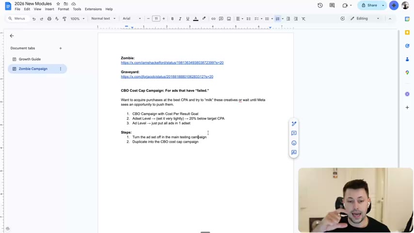
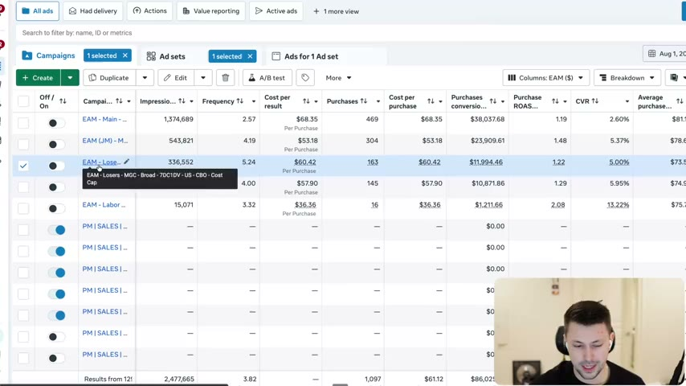
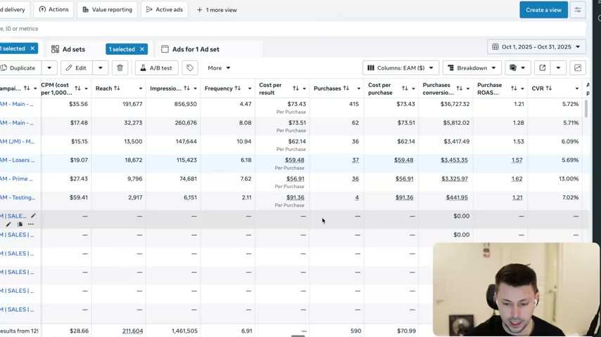

# 96. How To Set Up Zombie/Graveyard Campaign
> A low-maintenance CBO cost-cap campaign that re-runs creatives that "failed" in the main test, with a cost-per-result goal about 20% below target CPA, to squeeze some extra spend and ROI out of each creative test without blowing budget.

## 🤖 Agent use
- **Use when:** a creative test ad set has run 7 days without hitting KPI or getting spend, or when planning how much extra spend an account can get from failed ads.
- **Inputs → outputs:** a failed test ad set (and its best-spending ad), target CPA, account daily spend → a zombie CBO campaign spec: cost-per-result goal, ad-set cost cap, duplicated ads, budget at about 10% of account.
- **Rules:**
  - **DO** build it as a CBO campaign with bid strategy **cost per result goal**. At ad set level set the cost per result goal "very tightly", "about 20% below" target CPA (target $100 → set $80). [01:43; 06:15–06:53]
  - **DO** put all ads in **one ad set**; Meta allows about 50 ads per ad set, so start another ad set after that. [01:43–02:19]
  - **DO** process losers after the test: once an ad set has tested 7 days and is not hitting KPI and not getting spent, turn it off in the main testing campaign and duplicate its ad(s) here. [02:19; 06:53]
  - **DO** size the budget at roughly 10% of account spend: $2,000/day account → $200/day zombie. [07:47] Scale it up with the normal scaling protocol after 2 good days. [08:20]
  - **DON'T** treat it as a way to scale the account or rescue bad ads: "this is not going... to scale the account 200k days." [00:00–00:50] (instructor claim)
  - **DON'T** spend long tuning cost caps: "don't spend a whole day playing with cost caps." If it spends nothing, adjust once. [01:43]
  - **IF** you can only duplicate one ad **THEN** duplicate the ad that got the most spend in the ad set; to be safe duplicate all three variations. [02:19–03:10]
  - **IF** you also want ROAS-based delivery **THEN** a ROAS goal is possible, but "cost per result is usually a little bit better than ROAS goal". Bid caps "can have some issues". [06:53]
- **See also:** [93. Full Media Buying Strategy Outline (2026)](093-full-media-buying-strategy-outline-2026.md) · [97. How To Set Up ABO Scaling Campaign](097-how-to-set-up-abo-scaling-campaign.md) · [106. Turning On Seasonal Ads For Quick Performance](106-turning-on-seasonal-ads-for-quick-performance.md) · [94. How To Set Up a 3/2/2 Campaign](094-how-to-set-up-a-3-2-2-campaign.md) · [Creative testing system](../../../../frameworks/creative-testing-system.md)

## Key ideas

### What it is and why [00:00–01:43]
- "A CBO cost cap campaign for ads that have, in quotations, failed." Credit goes to two X accounts (Nick Shackleford for "Zombie", "J for Jacob" for "Graveyard"); the tweets were not shown because the screen-blocker app (Opal) blocked them, so the links sit on the page. [00:00; page text]
- Page text purpose: "a low-maintenance way to try to get 'more' out of each creative test without burning budget." It "prioritizes 'failed ads' that can achieve the best CPAs and attempt[s] to generate an ROI from each creative test." [page text]
- Seasonal angle: desires shift with the market, and "Meta may favor ads that 'failed' during specific testing periods, but now have an opportunity to drive some sales." Links to the seasonal ads section (see [106](106-turning-on-seasonal-ads-for-quick-performance.md)). [page text]
- Economics: "there is a cost per creative", the team's cost divided by the number of creatives made (or your own hourly rate), "and the goal is to try to be ROI positive from each creative test. Now, you won't always be that way." The zombie campaign tries to buy purchases "at the best CPA we can" and "milk these creatives or wait until Meta sees an opportunity to push them." [00:50–01:43]
- Honesty about incrementality: "how incremental is it? We're still kind of doing tests"; "it is kind of more retargeting". [00:50; 08:20]

### The structure in three lines [01:43–02:19]
- Campaign: CBO, cost per result goal. Ad set: cost cap "tightly... usually below whatever your target CPA is, about 20% below". Ad level: all ads in one ad set. [01:43]
- Doc tab "Zombie Campaign" (frame) states the same three-line structure and a two-step process (see "Prompts / templates").

### Moving ads in [02:19–03:10]
- After a creative test runs **7 days** and loses ("not hitting KPI and it's not getting spent"), "turn the ad set off in the main testing campaign and duplicate just the ad." Media buyers were duplicating "whatever ad in the ad set got the most amount of spend". [02:19]
- Option: duplicate all three variations from the 3:2:2. The team was testing whether all three or one makes more sense; "it doesn't matter if you want to be super safe." [02:19–03:10]
- "Basically just let it rip and let it do its thing." [03:10]

### Data shown (one client, blurred) [03:10–05:27]
All figures are the instructor's on-screen account data; the account later changed teams and the campaigns were turned off. [04:46]

| Period | Account total | Losers (zombie) campaign | Notes |
|---|---|---|---|
| August 1-31 | about $67,000 | about $9,000 spend | ROAS 1.22 for the losers campaign (speaker also says the main campaign was 1.9; the screen shows main 1.19), high frequency "which is again what we usually expect" because the ads "aren't scalable really" [03:10–03:54] |
| Same month, second view | about $66,000 | $6.3K, "about 10% of the account spend" | CPA much better after "tightening" the cap; ROAS "1.62 versus a 1.44" (speaker), a promo campaign in the account inflated conversion rate [03:54–04:46] |
| October | about $40,000 | about $2K, about 5% | Budget capped at about $200/day; frequency about 6, "very much a retargeting campaign" [04:46–05:27] |
| Other account | n/a | up to about 13-14% of spend in one month | No data available (parted ways with client) [05:27] |

- Spoken ceiling: "a max you can spend is like 200 bucks a day". [05:27]
- Frame check (Aug 1+ view): `EAM - Losers - MGC - Broad - 7DC1DV - US - CBO - Cost Cap` spent with frequency 5.24, 163 purchases at $60.42, $11,994.46 purchase value, ROAS 1.22, CVR 5.00%, vs `EAM - Main` $68.35 per purchase, 469 purchases, ROAS 1.19. Frame check (Oct 1-31, 2025): Losers frequency 6.18, 37 purchases at $59.48, ROAS 1.57; Main $73.43 per purchase, ROAS 1.21. [frames 04:00, 04:50]

### Build steps in Ads Manager [06:15–08:20]
1. Create → **Sales** campaign. Set as **CBO** (campaign budget); turn Advantage+ catalog off. [06:15]
2. Campaign bid strategy → **Cost per result goal**. "Once you set that up you're basically good to go." [06:15]
3. Ad set: **maximize number of conversions**, dataset/pixel, conversion event **purchases**. [06:15]
4. Ad set **cost per result goal** = target CPA minus at least 20%: "if our cost per result was $100... here we would set it at 80." [06:15–06:53]
5. One ad set; "dupe a bunch of ads in here". [06:53]
6. Name it like `EAM zombie ...` or "graveyard", e.g. worldwide CBO naming. [06:53–07:47]
7. Budget: whatever you are comfortable with; example account spending about $2,000/day got a $200/day zombie ("a 10% rule"). [07:47]
8. Scale like everything else: "if you have two good days performance in your zombie campaign, just start scaling it up." [07:47–08:20]

## Steps / framework
Zombie process (derived from [02:19] and the doc tab):
1. Test ad set runs 7 days in the main CBO. [02:19]
2. Loser = not hitting KPI and not getting spend. [02:19]
3. Turn the ad set off in the main campaign. [02:19]
4. Duplicate the highest-spend ad (or all 3) into the zombie CBO's single ad set; when it holds about 50 ads, open a new ad set. [02:19; 01:43]
5. Cost cap about 20% under target CPA; budget about 10% of account spend. [06:53; 07:47]
6. Check spend, CPA, frequency weekly; scale after 2 good days; compare blended results to see whether it adds sales or only retargets. [08:20; derived]

## Examples
- **Cost cap arithmetic:** target CPA $100 → cost per result goal $80. [06:53]
- **Budget arithmetic:** $2,000/day account → $200/day zombie ("10% rule"). [07:47]
- **August results:** zombie spent about $9k of a $67k month at 1.22 ROAS; October about $2k of $40k. [03:10–04:46]

## Structured units

### Rules of thumb
- **DO** add only ads that have finished a 7-day test. [02:19]
- **DON'T** judge the zombie campaign by account-level scale; judge by extra spend at acceptable CPA and by incrementality. [00:50; 08:20]
- **IF** frequency is high (about 5-6) **THEN** expect retargeting-like behaviour; it is normal here. [03:54; 05:27]
- **IF** it spends nothing **THEN** loosen the cap slightly, once. [01:43]

## Prompts / templates (verbatim)
Google Doc tab "Zombie Campaign" in the "2026 New Modules" doc (as shown on screen):

```text
Zombie: [link to X post]
Graveyard: [link to X post]

CBO Cost Cap Campaign: For ads that have "failed."

Want to acquire purchases at the best CPA in the account and try to "milk" these creatives or wait until Meta sees an opportunity to push them.

1. CBO Campaign with Cost Per Result Goal
2. Adset Level -> (set it very tightly) -> 20% below target CPA
3. Ad Level -> just put all ads in 1 adset

Steps:
1. Turn the ad set off in the main testing campaign
2. Duplicate into the CBO cost cap campaign
```

Campaign name pattern seen on screen (tooltip): `EAM - Losers - MGC - Broad - 7DC1DV - US - CBO - Cost Cap`. [frame 04:00]

## Screenshots

*The "2026 New Modules" doc, Zombie Campaign tab: CBO cost cap for failed ads, ad set cost goal 20% below target CPA, all ads in one ad set, and the two-step process. [03:15]*


*August data: the Losers cost-cap campaign (tooltip `EAM - Losers - MGC - Broad - 7DC1DV - US - CBO - Cost Cap`) with frequency 5.24, 163 purchases at $60.42 and ROAS 1.22, next to the main campaign at $68.35 and 1.19. [04:00]*


*October 1-31, 2025: Losers campaign frequency 6.18, 37 purchases at $59.48 and ROAS 1.57 versus Main at $73.43 and 1.21. [04:50]*

## How to apply
- [ ] Wait until a test ad set has run 7 days and failed KPI or spend.
- [ ] Create the zombie CBO once: Sales, CBO, cost per result goal, Advantage+ catalog off.
- [ ] Set the ad set cost per result goal at target CPA x 0.8; add the best-spending ad of each failed set.
- [ ] Set the budget near 10% of daily account spend; watch spend, CPA and frequency.
- [ ] Scale only after 2 solid days; measure blended sales to check incrementality.

## Related
- Previous: [95. How To Test Landing Pages 3/2/2/2](095-how-to-test-landing-pages-3-2-2-2.md) · Next: [97. How To Set Up ABO Scaling Campaign](097-how-to-set-up-abo-scaling-campaign.md)
- [93. Full Media Buying Strategy Outline (2026)](093-full-media-buying-strategy-outline-2026.md) · [107. How To Protect Against Bad Ads Over-spending](107-how-to-protect-against-bad-ads-over-spending.md)

## Sources and limitations
- Transcript: [96. How To Set Up Zombie Graveyard Campaign…txt](<../../../../../raw/evolve/start-here/_transcripts/👣 Evolve (Start Here)/96. 🆕 How To Set Up Zombie Graveyard Campaign 👣 Evolve (Start Here) Evolve.txt>) · Page text: [….html.md](<../../../../../raw/evolve/start-here/_extracted/👣 Evolve (Start Here)/96. 🆕 How To Set Up Zombie_Graveyard Campaign_👣 Evolve (Start Here)_Evolve.html.md>). The page's chapter times (0:00, 3:24 live example, 6:07 setup, 7:24 duplicating) roughly match the transcript.
- Machine transcription (Whisper large-v3-turbo); full recording covered (522.71 s). Whisper writes "cbo cost gap" (cost cap), "graveyard zombie campaign". The figures "1.62 versus 1.44" and "ROAS 1.9" in speech conflict with the screens (1.57 / 1.21 and 1.19); screen values are given alongside.
- Credits: the page names the two original X posters by handle only; the X posts themselves are not in the course files. The data is one blurred client account; incrementality is explicitly unproven by the instructor.
- The campaign table frames hide the brand; no account IDs recorded.
