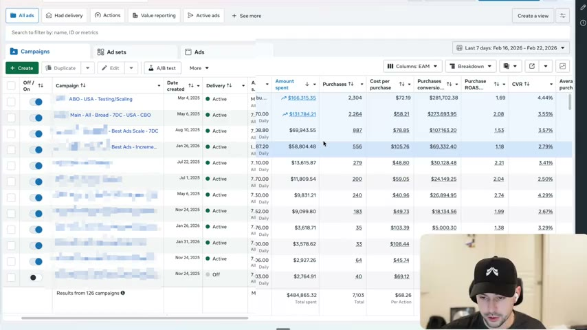
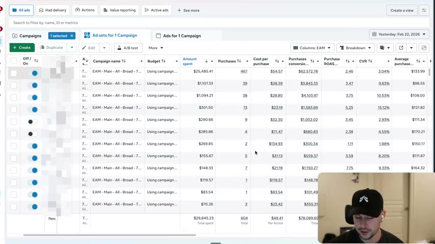
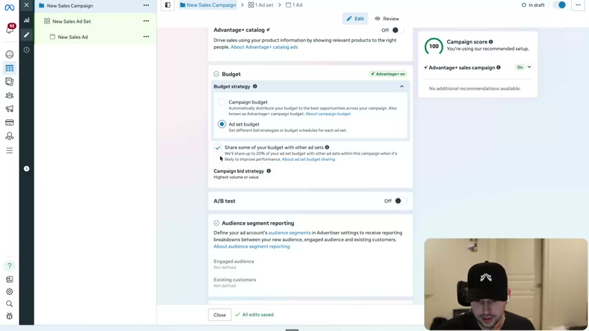

# 97. How To Set Up ABO Scaling Campaign
> For accounts past roughly $1-2k/day: a second ABO "testing and scaling" campaign where each breakthrough, spend winner and KPI winner from the main CBO is duplicated into its own ad set with a controlled budget (5-20% of daily budget), plus optional ad sets that test hard exclusions, 1-day-click and incremental attribution on the best ads.

## 🤖 Agent use
- **Use when:** an account already has a stable main CBO (see [94](094-how-to-set-up-a-3-2-2-campaign.md)) with identifiable winners and is spending enough ($1-2k+/day) to scale beyond what the CBO allocates; or when a media buyer asks where to put a winner that Meta spends too much, too little, or off-KPI.
- **Inputs → outputs:** the main CBO's winners classified as breakthrough / spend winner / KPI winner / loser, total daily budget → ABO ad sets with starting budgets, loser routing to the zombie campaign, and an exclusion/attribution test plan.
- **Rules:**
  - **DO** read the warnings first: "THIS WILL NOT FIX YOUR BAD ADS. IF YOU ARE LESS THAN $1K/DAY IN SPEND, FOCUS MORE ON WINNING ADS. ALSO, IF YOU DO NOT HAVE A MEDIA BUYER, WE RECOMMEND GETTING ONE... MANAGING THIS MANY AD SETS REQUIRES MORE TIME & EFFORT." [00:00–01:24; page text] (Spoken threshold: under "one or two K a day" skip the video. [00:33])
  - **DO** give each **breakthrough** its own ABO ad set "to scale further"; each **spend winner** its own ad set "to throttle their spend"; each **KPI winner** its own ad set "to see if they can take on more spend". [02:53–04:39; page text]
  - **DO** start each ad set at **5-20% of total daily budget** (lower for KPI winners and spend winners, higher for breakthroughs). [03:41; 06:14; page text]
  - **DON'T** turn off the original ads in the main CBO after duplicating to ABO "unless obviously performance is terrible". "Always keep them active." [05:17]
  - **DO** route losers (not spending, not hitting KPI) to the zombie campaign: see [96](096-how-to-set-up-zombie-graveyard-campaign.md). [05:17]
  - **DO** copy the exact setup of the CBO ad sets into the ABO ad sets. [06:14]
  - **DON'T** use a champions ad set any more: "we're actually not going to continue to use the champions ad set." [07:41–08:52] This reverses [94](094-how-to-set-up-a-3-2-2-campaign.md).
  - **DO** scale ABO ad sets fast but gated: after 2 good days double the budget, then again after another good day (e.g. $100-200 → $400 → $800), always "at least two or three solid days of performance before you start scaling". [07:02]
  - **DO** name ad sets after the actual ad, not "spend winner", for consistent naming across the account. [15:47]
  - **IF** you scale an ABO ad set hard **THEN** expect it to stop getting spend in the CBO: "Meta is favoring that specific campaign" where ads overlap. [14:48]
  - **IF** you test exclusions or attribution **THEN** judge incrementality with blended numbers (Triple Whale, Northbeam, total Shopify sales), not Meta-reported ROAS alone. [11:33–13:10]
- **See also:** [93. Full Media Buying Strategy Outline (2026)](093-full-media-buying-strategy-outline-2026.md) · [94. How To Set Up a 3/2/2 Campaign](094-how-to-set-up-a-3-2-2-campaign.md) · [96. Zombie/Graveyard Campaign](096-how-to-set-up-zombie-graveyard-campaign.md) · [110. Winning Ads Definition Part 1](110-winning-ads-definition-part-1.md) · [115. How To Scale Facebook Ads Up/Down](115-how-to-scale-facebook-ads-up-down.md) · [116. Facebook Ads Attribution](116-how-to-understand-facebook-ads-attribution.md) · [106. Seasonal Ads](106-turning-on-seasonal-ads-for-quick-performance.md)

## Key ideas

### Context and proof [00:00–02:53]
- The method comes from "working with a client of ours" who spends about **$70,000/day**; "as you get to more scale, there's definitely a lot more that you can do on the media buying side." It is not for creative strategists to run: "send your media buyer to watch this video instead." [00:00–01:24]
- Frame (last 7 days, Feb 16-22, 2026): total $484,865.32, 7,103 purchases, $68.26 per purchase. Four campaigns carry the account: [01:24–02:23]

| Campaign (as named on screen) | Spend (7 days) | Purchases | ROAS | Notes |
|---|---|---|---|---|
| `ABO - USA - Testing/Scaling` | $166,315.35 | 2,304 ($72.19) | 1.69 | The new ABO testing and scaling campaign ("a 1.7X ROAS") |
| `Main - All - Broad - 7DC - USA - CBO` | $131,784.21 | 2,264 ($58.21) | 2.08 | The standard CBO testing campaign ("a 2X ROAS") |
| `Best Ads Scale - 7DC` | $69,943.55 | 887 ($78.85) | 1.53 | A separate best-ad scaling campaign (not explained further in audio or page) |
| `Best Ads - Incremental` | $58,804.48 | 556 ($105.76) | 1.18 | The incremental-attribution side; "we did this in a separate CBO. You guys don't need to do this." [11:33] |

- The speaker notes the module structure will be cleaned up: "some excess modules there" will be merged. [00:33]

### The ABO scaling campaign: three kinds of winner [02:53–06:14]
Definitions as used here (formal ad definitions are in [110](110-winning-ads-definition-part-1.md)-[112](112-winning-ad-definitions-0-mo-1m-mo.md)):

1. **Breakthrough:** "clear winners that are sucking up a bunch of spend, hitting your KPIs and allowing you to scale your one CBO... further." Put into its own ABO ad set at **5-20% of total daily budget**. Example: at $10K/day, aggressive start $2K/day ad set budget; safer start 5% = $500/day. [02:53–03:41]
2. **Spend winner:** an ad that "sucks up a bunch of spend, but doesn't hit the KPI". Own ad set, start "a hundred bucks or 200 bucks a day". Bigger-account example: an ad using $1k/day, or at larger scale $4-5K/day, slightly below KPI → ABO at $400-$500/day, run **7 days** and see. Purpose: "throttle spend", because Meta likes it but "it might be getting too much spend and it can't maintain that performance". [03:41–04:39]
3. **KPI winner:** hits KPI but gets little spend (example: in a $10K/day CBO the ad gets $200-$300/day). Pull it into ABO, start at **$200-$300/day** (what it was getting) and try to scale; it may have been starved by "other savage ads crushing it". [04:39–05:17]
4. **Loser:** little spend and misses KPI → zombie campaign. [05:17]

Budget rule: **5-20% of total daily budget**, "remember you can always scale up. Lower on initial spend on KPI winners... if you have a breakthrough that's absolutely ripping in the CBO, you could probably start that on the higher end of 10, 15 or 20%." [06:14]. Even $100-$200/day starts are fine on a $10-15K/day account. [07:02]

### Scaling ABO ad sets [07:02–07:41]
- Start at $100-$200/day; "see two good days of performance, just double budget. Now you're at 400. If you see another good day... double again. Now you're at 800." Still apply the scaling protocol: "at least two or three solid days of performance before you start scaling". [07:02]

### Champions ad set dropped [07:41–08:52]
- Reason: overlap and the seasonal-ads logic. If an ad is duplicated to ABO, then stops performing in CBO and is turned off, then stops in ABO and is turned off, "that ad is kind of like gone"; it can go to the zombie campaign. [07:41–08:12]
- Still testing: whether a champions ad set helps when "randomly two months later, that ad just picks back up again" (the seasonal ads section, [106](106-turning-on-seasonal-ads-for-quick-performance.md)). "If you want to just try relaunching old ads... you can definitely test that." [08:12]
- Overlap evidence: "in our spend report... if you did duplicate these ads, usually you are allowed to get more spend out of them." [08:12–08:52] (instructor claim)

### Optional ABO testing ad sets: exclusions and attribution [08:52–12:17]
The tests are on proven ads, not creatives. They can live in the same ABO testing/scaling campaign (the team's choice, "we like things consolidated") or a separate testing-only ABO. [08:52; 10:34] Assumption: the main CBO runs on **7-day click** attribution. [page text]

| Ad set | Ads in it | Exclusions | Attribution | Purpose (page text and audio) |
|---|---|---|---|---|
| 1. Hard Exclusions | Top ads "plowed" in, mainly breakthroughs; one ad set | "Website visitors, add-to-carts, page engagers (365 days), past customers... every possible interaction a user might have with the brand" | 7-day click | "Force Facebook to go after net new people instead of spending on existing audience segments, since the main campaign is already doing that." Observed: "some additional spend"; new-visitor share in Triple Whale/Northbeam "is very high". [09:50] |
| 2. 1-Day Click Attribution (testing OR scaling) | Same top ads | More relaxed: "only exclude purchasers" | 1-day click | "Naturally more conservative and tends to limit over-attribution"; "telling the algorithm to go after people who are basically going to purchase on day one." [10:34] |
| 3. Incremental Attribution (testing OR scaling) | Same top ads | "Very strong exclusions to push Facebook toward net new acquisition" | Meta's new incremental attribution setting | Reported performance on Meta "is not great, but actually inside of Northbeam, it's really good. And the percentage of net new visitors is very high." Added "an extra 7.2k a day in spend", about 10% of a ~$70k/day brand. [10:34–11:33] |

- "In final": "This isn't our core campaign. The main CBO is still cruising and protecting baseline revenue. So even if one of these aggressive tests breaks, the overall business performance won't break with it." [11:33; page text]
- Incrementality check: "it's not just about adding spend. It's also about incremental... are we seeing more total Shopify sales or are we just spending more and seeing that our overall blended is not as strong?" Use Triple Whale or Northbeam and watch blended numbers. [12:17]
- Other things worth testing in ABO if budget allows: enhancements on vs off, "any kind of new stuff that Meta throws in there". [14:48]

### Why it matters: the "Titan" breakthrough [13:10–14:48]
- A new ad launched the 21st took **$25,000** of spend on the 22nd at **2.46x**, about "90% of a $30,000 per day campaign". The previous day other ads were each getting $1-3K (around $16K/day total); once the new ad took the budget they got less spend. [13:10–13:49]
- In an ABO scaling campaign those displaced ads "could just continue to get spent... whenever you find new winners, you're not really punished." (ROAS on them is "obviously inflated" in ABO.) [13:49]
- Competition: scaling ABO harder may stop the same ad spending in the CBO because "that's basically how Meta chooses... when there is overlap, what to spend on. It's all a technical thing that you don't really have to worry about." [13:49–14:48]
- Message: "Your creative issue is just a creative issue." [13:49]

### Live setup walkthrough [15:35–17:57]
1. Create → **Sales** → continue. ABO: turn the campaign budget (CBO) toggle **off**; budgets then sit at ad set level. [15:35]
2. New Meta option on screen: "Share some of your budget with other ad sets" (up to 20% of ad set budget shared within the campaign). The speaker says "you probably just turn that off if you want." [15:35; frame 15:50]
3. Name the campaign `EAM ... Testing and Scaling ... ABO`; create one ad set per winner ("winning ad number one", "number two") with the ad's real name; give a lower budget to a spend winner ($100) than a breakthrough ($200 in his example). "Don't call it spend winner, call it what the actual ad is because you're going to want to keep consistent ad naming all the way through the account." [15:47]
4. For the test ad sets (hard exclusions, 1-day click, incremental): duplicate the existing winning ad ad set into the 1-day-click ad set; all winning ads go in one ad set while breakthroughs keep their own. [16:46–17:42]

## Steps / framework

### Classification and routing table
| Class | How to recognise (spoken) | Where it goes | Starting daily budget | Original in main CBO |
|---|---|---|---|---|
| Breakthrough | Spends a lot, hits KPI, lets the CBO scale further | Own ABO ad set | 10-20% of total daily budget (min 5%); e.g. $2K on a $10K/day account | Keep ON |
| Spend winner | Spends a lot, misses KPI slightly | Own ABO ad set to throttle | $100-$200/day (or $400-$500 for $4-5K/day ads); 7-day run | Keep ON |
| KPI winner | Hits KPI, little spend (e.g. $200-300/day) | Own ABO ad set | $200-$300/day (what it was spending) | Keep ON |
| Loser | No spend, misses KPI | Zombie campaign ([96](096-how-to-set-up-zombie-graveyard-campaign.md)) | Zombie budget about 10% of account | Turn off per CBO rules |
| Proven ads (multiple) | Mainly breakthroughs | Hard exclusion, 1-day-click, incremental test ad sets | Test budgets, not stated | Keep ON |

### Process
1. Confirm spend gate ($1k+/day; the spoken gate is $1-2k) and that a media buyer exists. [00:33; page text]
2. List recent winners from the main CBO; classify. [02:53]
3. Create the ABO campaign (CBO off, budget sharing off). [15:35]
4. Duplicate each winner's ad set (same settings as the CBO ad sets) into its own ABO ad set; set the budget per table. [06:14]
5. Keep the originals running. [05:17]
6. Add test ad sets (hard exclusion, 1DC, incremental) with all proven ads. [08:52–11:33]
7. After 2 good days double; follow the scaling protocol; check blended results for incrementality. [07:02; 12:17]

## Examples
- **$10K/day account:** breakthrough at $2K (20%) or $500 (5%) per day. [03:10]
- **Spend winner:** $4-5K/day ad below KPI → $400-$500/day ABO, run for 7 days. [03:41]
- **KPI winner:** $200-$300/day in a $10K/day CBO → start at $200-$300/day in ABO. [05:17]
- **Doubling ladder:** $100-$200 → $400 → $800 after 2-3 solid days each. [07:02]
- **Titan ad:** $25,000 spend, 2.46x, 90% of a $30K/day campaign, launched the day before. [13:10]
- **Incremental campaign:** extra 7.2k/day (about 10% of a $70k/day brand); Meta-reported performance weak, Northbeam strong. [11:33]

## Structured units

### Rules of thumb
- **DO** keep winners alive in the CBO when duplicating. [05:17]
- **DON'T** expect this to fix weak creative. [00:00]
- **IF** a media buyer is absent **THEN** do not run this structure; ad-set management load is high. [page text]
- **IF** spend is under $1-2k/day **THEN** focus on finding winning ads. [00:33; page text]

## Prompts / templates (verbatim)
Page text of the lesson (the written protocol):

```text
THIS WILL NOT FIX YOUR BAD ADS.
IF YOU ARE LESS THAN $1K/DAY IN SPEND, FOCUS MORE ON WINNING ADS.
ALSO, IF YOU DO NOT HAVE A MEDIA BUYER, WE RECOMMEND GETTING ONE BEFORE DOING THIS.
MANAGING THIS MANY AD SETS REQUIRES MORE TIME & EFFORT.

ABO Testing/Scaling Campaign (Recommended)
#1 - Breakthroughs get their own ad set to scale further
#2 - Spend Winners get their own ad set to throttle their spend
#3 - KPI winners get their own ad set to see if they can take on more spend
^ NEVER TURN OFF ANY OF THESE ADS IN THE MAIN CBO AFTER YOU DUPLICATE TO ABO (unless obviously performance is terrible, which is another video)
#4 - Losers will move to zombie campaign
These ad sets will have the same setup as the CBO ad sets

#2 - What budget do you start these at?
5-20% of total daily budget -> remember you can always scale up (lower on initial spend on kpi winners, higher initial spend on breakthroughs)

#3 - Are we still using a champions ad set?
No.

ABO Testing Only Campaign (Optional)
Again, a separate campaign is OPTIONAL for this. We are currently just adding these as individual adsets in our main testing/scaling ABO campaign.
Assuming the main CBO campaign is running on 7-day click attribution:

Ad Set 1: Hard Exclusions
Test the top ads again under 7-day click, but go very aggressive on exclusions. Exclude website visitors, add-to-carts, page engagers (365 days), past customers - basically every possible interaction a user might have with the brand
The goal here is to force Facebook to go after net new people instead of spending on existing audience segments, since the main campaign is already doing that.

Ad Set 2: 1 Day Click Attribution (Testing OR Scaling)
Test the same top ads under 1-day click attribution, but with more relaxed exclusions (only exclude purchasers).
1DC is naturally more conservative and tends to limit over-attribution, so we don't need to be as aggressive with exclusions here.

Ad Set 3: Incremental Attribution (Testing OR Scaling)
Test the same top ads using incremental attribution settings, again with very strong exclusions to push Facebook toward net new acquisition.

IN FINAL
This isn't our core campaign.
The main CBO is still cruising and protecting baseline revenue. So even if one of these aggressive tests breaks, the overall business performance won't break with it.
This structure lets us push growth without destabilizing the foundation.
```

The page also has a "COST CAP UPDATE (July 2026)" heading whose content is only a Discord link; the text is not included in the course files.

## Screenshots

*The four campaigns that carry a roughly $70k/day account: ABO Testing/Scaling $166k at 1.69, Main CBO $132k at 2.08, Best Ads Scale 7DC $70k at 1.53, Best Ads Incremental $59k at 1.18; total $484,865.32. Names visible, other rows blurred. [01:30]*


*The new breakthrough ad took $25,485.41 (467 purchases at $54.57, ROAS 2.46) out of $29,845.23 total ad-set spend yesterday (Feb 22, 2026); other ad sets got $1.1k, $1.1k, $0.3k and less. [13:50]*


*ABO creation screen: budget strategy set to Ad set budget; the checkbox "Share some of your budget with other ad sets... up to 20%" (new in Meta) is ticked; the speaker says you can turn it off. [15:50]*

## How to apply
- [ ] Gate: confirm spend of $1-2k+/day and a dedicated media buyer.
- [ ] Classify each recent winner (breakthrough, spend winner, KPI winner, loser) using spend share and KPI.
- [ ] Create `EAM//Testing/Scaling//Country` ABO; turn CBO and ad-set budget sharing off.
- [ ] Duplicate each winner's ad set into its own ad set, budget 5-20% of daily total (lower for spend and KPI winners).
- [ ] Leave originals ON; send losers to the zombie campaign.
- [ ] Add the three test ad sets (hard exclusions, 1-day click, incremental) with all proven ads; use strong exclusions where stated.
- [ ] Double budgets after 2 good days (gated by the scaling protocol); track blended sales and new-visitor % to judge incrementality.
- [ ] Do not use a champions ad set; log if relaunching old ads seasonally.

## Related
- Previous: [96. How To Set Up Zombie/Graveyard Campaign](096-how-to-set-up-zombie-graveyard-campaign.md) · Next: [98. How To Set Up Raw Content Campaign](098-how-to-set-up-raw-content-campaign.md)
- [92. Evolve Facebook Ads Philosophy](092-evolve-facebook-ads-philosophy.md) (contrast: forced spend on ad sets Meta ignored) · [103. How To Duplicate Ads Into Champions (New Way)](103-how-to-duplicate-ads-into-champions-new-way.md) · [117. Attribution in Triple Whale](117-how-to-view-attribution-in-tw-triple-whale.md) · [118. Advanced Surf Scaling Method](118-advanced-surf-scaling-method.md)

## Sources and limitations
- Transcript: [97. How To Set Up ABO Scaling Campaign…txt](<../../../../../raw/evolve/start-here/_transcripts/👣 Evolve (Start Here)/97. 🆕 How To Set Up ABO Scaling Campaign 👣 Evolve (Start Here) Evolve.txt>) · Page text: [….html.md](<../../../../../raw/evolve/start-here/_extracted/👣 Evolve (Start Here)/97. 🆕 How To Set Up ABO Scaling Campaign_👣 Evolve (Start Here)_Evolve.html.md>).
- Machine transcription (Whisper large-v3-turbo); full recording covered (1077.29 s). The page's chapter times differ from the transcript by up to about 30 s; transcript times are used. Whisper heard "media bar" for media buyer, "ABL" for ABO and "EZA media" for the agency name (EAM).
- Spoken thresholds vary: [00:33] "one or two K a day", page "$1K/day", [93](093-full-media-buying-strategy-outline-2026.md) "two or three K a day" for the zombie and advanced structures. Use the page text ($1k/day) as the floor and expect real value at $2k+.
- The "Best Ads Scale" campaign is named on screen and in the audio ("which I'll explain") but never explained in the files.
- Revenue, ROAS and "extra spend" figures are the instructor's account data (blurred client); incrementality is not independently verified. The July 2026 cost-cap update is not included (Discord link only). The dropped champions ad set supersedes the 2025 method in [94](094-how-to-set-up-a-3-2-2-campaign.md) and [103](103-how-to-duplicate-ads-into-champions-new-way.md).
