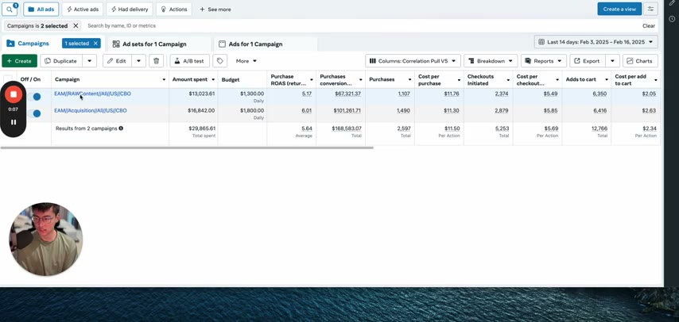
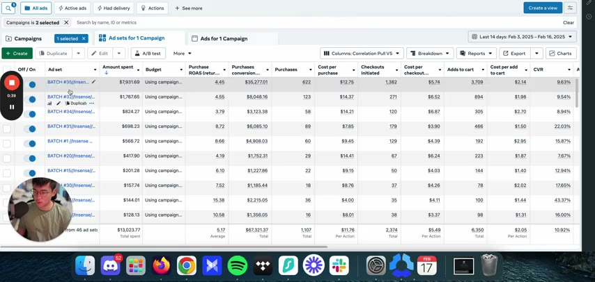

# 98. How To Set Up Raw Content Campaign
> A second, separate CBO campaign holds raw, unedited creator and ripped ads so they can be force-spent, creators can be ranked, and the main "strategised" campaign stays clean for learnings.

## 🤖 Agent use
- **Use when:** planning where an ad goes after it is made: raw creator footage (product seeding, Insense, ripped ads) versus a strategised, edited ad. Also when deciding whether a brand needs this campaign at all.
- **Inputs → outputs:** a batch of raw creator videos or ripped ads plus the account's existing 3/2/2 main campaign → a placement decision (raw campaign vs main campaign), an ad-set layout, and a hiring signal (which creator to sign as brand ambassador).
- **Rules:**
  - **DO** run raw, unedited content (no edits, no captions) in a dedicated raw content campaign, not in the main 3/2/2 campaign. [00:00–01:46; page text]
  - **DON'T** create this campaign if there is no product-seeding, Insense or ripped content. "If you don't have any of those you don't need this campaign" (page text).
  - **DO** use it to force spend on creator ads, find the winning creator, then hire them as a brand ambassador to make more winning ads. [00:00–00:50]
  - **IF** you have too little raw content **THEN** "cut it three ways": the same video, no new text or music, started at three different points = three hooks. [02:44–03:36]
  - **IF** you have a lot of raw content **THEN** one ad set can hold three different videos instead of one concept with three hooks. [02:44]
  - **DO** copy the 3/2/2 settings (budget, UTM, ad set targeting) exactly. [03:36]
- **See also:** [94. How To Set Up a 3/2/2 Campaign](094-how-to-set-up-a-3-2-2-campaign.md) · [100. How To See Ads Performance + Our Columns](100-how-to-see-ads-performance-our-columns.md) · [93. Full Media Buying Strategy Outline (2026)](093-full-media-buying-strategy-outline-2026.md) · [Creative testing system](../../../../frameworks/creative-testing-system.md)

## Key ideas

### Why a separate raw campaign [00:00–02:44]
- The raw campaign is "very, very similar" and "pretty much identical" to the 3/2/2 campaign shown in the previous lesson; only a few differences. [00:00]
- Purpose: if you used the product-seeding module (Insense), "the whole goal of it is to get a bunch of raw content". It is tested "as is, no edits, no captions", and "the goal is to find a winning creator" to hire as brand ambassador. [00:00]
- Three stated reasons: [00:50–01:46]
  1. **Push more volume**, additional scale ("the main one is just to give it more additional spend so you can get additional scale").
  2. **Force spend towards creator ads** so you learn which creators work.
  3. **Do not let raw ads compete with high-intent ads.** The main campaign is "for high intent ads". Raw content is "ads that you don't really give much thought towards".
- Learnings problem: raw content is made by creators given guidelines who "just did their own thing". Some "wacky social media" ads work, and you cannot explain why. When raw ads out-spend main ads it is confusing, so keep them apart. [01:46]
- Ripped ads also go here: "Some people who rip ads as well, if you do so, I recommend just launching it inside the raw content campaign." [01:46]
- Page text restates it: strategised ads stay in the 3/2/2 main campaign; raw unedited ads (some ripped ads) go in this campaign; not mixing "makes doing learnings on your ads much easier".

### Setup is identical to 3/2/2 [01:46–04:00]
- One CBO, multiple creative-test ad sets. This account has many ad sets "because we're spending a good amount... not a few hundred a day, but... over a thousand". [01:46]
- Winners are decided the same way: by spend doing well. [01:46]
- No champions ad set for raw content in this account, "but you definitely can if you want. It doesn't really matter too much." [02:44]
- Difference in ad-set contents: main campaign = one concept per ad set with three variations; raw campaign = sometimes one ad set with three different videos when content is plentiful. [02:44]
- Everything else is the same: "budget setup, UTM setup, ad set targeting exactly the same". [03:36]

## Steps / framework
1. Duplicate your 3/2/2 structure into a second CBO named for raw content (screenshot name pattern: `EAM//RAWContent//All//US//CBO`, see [109](109-how-to-set-up-naming-templates.md)).
2. Put only raw creator, Insense and ripped ads in it.
3. Per ad set: three raw videos, or one video cut at three start points (no new text, no new music).
4. Same budget logic, UTMs and targeting as the main campaign.
5. Rank by spend and results. Hire creators whose ads win.

## Examples
- Screenshot account, last 14 days (Feb 3–16, 2025): raw campaign `…RAWContent…CBO` at $1,300/day budget spent $13,023.61 at 5.17 ROAS (1,107 purchases); acquisition campaign at $1,800/day spent $16,842.00 at 6.01 ROAS (1,490 purchases). Instructor: raw spend is "quite similar" to the main one. [00:10, frame]
- Top raw ad set that window: "BATCH #35 //Insense//…" with $7,931.69 spent, 4.45 ROAS, 622 purchases, out of 46 ad sets. [00:40, frame]

## Structured units

### Rules of thumb
- **DO** keep raw and strategised ads in different campaigns. [01:46]
- **DON'T** build the raw campaign without raw content to put in it (page text).
- **IF** a raw ad wins big **THEN** treat the creator as a hiring lead, not just an ad. [00:00]

## Screenshots

*Two CBO campaigns, 14 days: raw content ($13.0K spent, 5.17 ROAS) versus acquisition ($16.8K, 6.01 ROAS). Evidence that raw can take similar spend. [00:10]*

*46 ad sets in the raw campaign, named by batch and source (Insense). The top batch took $7.9K of $13.0K. [00:40]*

## How to apply
- [ ] Decide: do we have product-seeding, Insense or ripped assets? If no, skip this campaign.
- [ ] Clone the 3/2/2 CBO structure; name it so raw is obvious.
- [ ] Load raw ads untouched. Cut thin batches three ways (three start points) for three hooks.
- [ ] Review spend per creator weekly; shortlist creators for brand-ambassador hiring.
- [ ] Never move a raw ad into the main campaign's learnings sheet without labelling it raw.

## Related
- Previous: [97. How To Set Up ABO Scaling Campaign](097-how-to-set-up-abo-scaling-campaign.md) · Next: [99. Action Item - Launch Your Campaigns](099-action-item-launch-your-campaigns.md)
- [94. 3/2/2 campaign](094-how-to-set-up-a-3-2-2-campaign.md) · [95. Landing page tests 3/2/2/2](095-how-to-test-landing-pages-3-2-2-2.md)

## Sources and limitations
- Transcript: [98 transcript](<../../../../../raw/evolve/start-here/_transcripts/👣 Evolve (Start Here)/98. How To Set Up Raw Content Campaign 👣 Evolve (Start Here) Evolve.txt>) · Page text: [98 page](<../../../../../raw/evolve/start-here/_extracted/👣 Evolve (Start Here)/98. How To Set Up Raw Content Campaign_👣 Evolve (Start Here)_Evolve.html.md>)
- Machine transcription (Whisper large-v3-turbo). Full recording covered (last segment 4:00 of 4:00). Whisper wrote "Instance"/"incense" for Insense, "SE Brand Ambassador" for "a brand ambassador", and the audio says "3-2-2-1" once at [00:50] and "322" elsewhere (likely just the 3/2/2 campaign). The sentence "returns double very well" at [00:50] is garbled and not used. Instructor is not named in audio; the on-screen account and webcam match lesson 108 but this is unverified.
