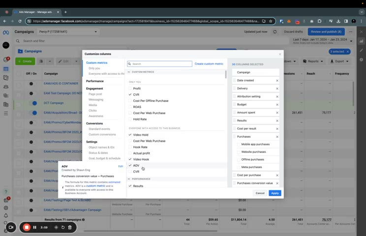
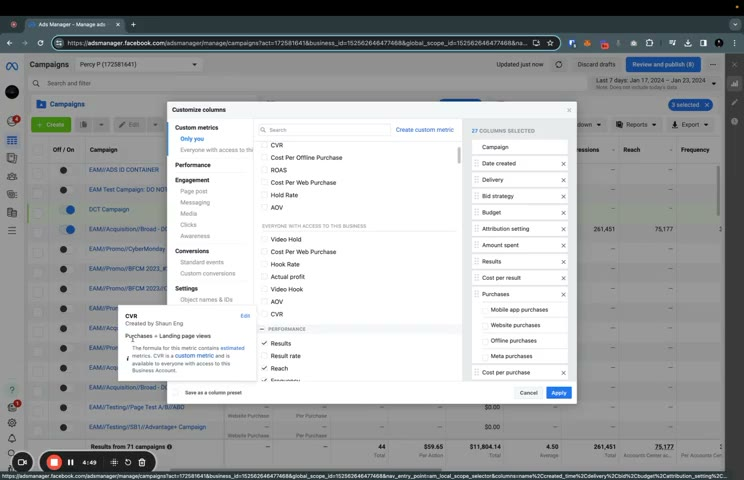
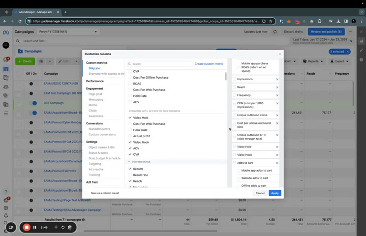
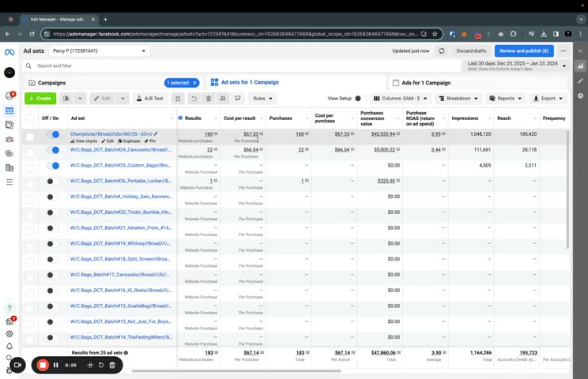
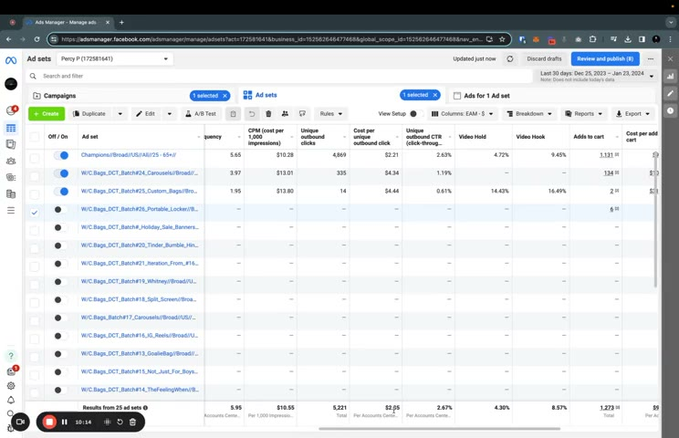
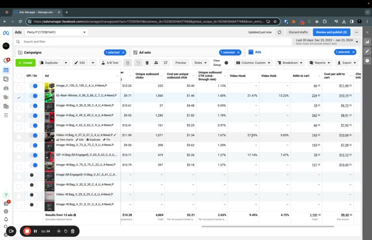
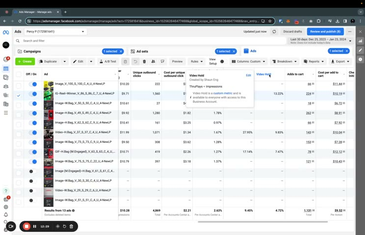
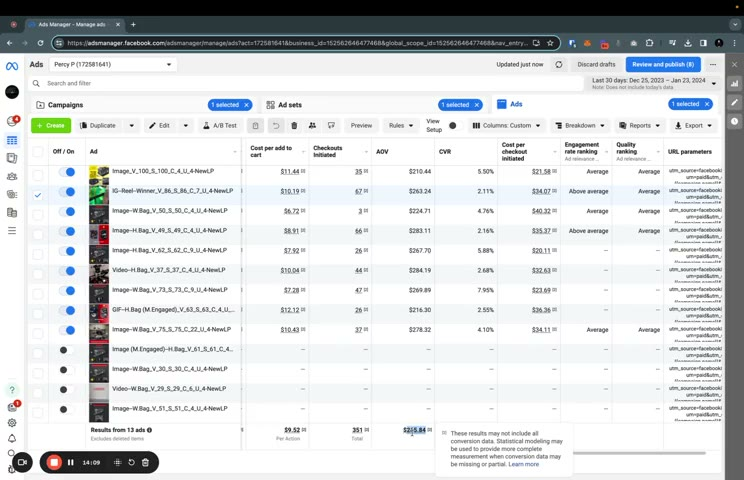

# 100. How To See Ads Performance + Our Columns
> Build the Evolve Ads Manager column preset (including custom AOV, CVR, Video Hook and Video Hold metrics), sort by amount spent, and read performance by money first and soft metrics second, so you can find the winning ads to carry into the Champions ad set.

## 🤖 Agent use
- **Use when:** auditing an ad account, finding past winners, reading a test, or telling a human how to set up Ads Manager before a performance review.
- **Inputs → outputs:** an Ads Manager export or screen with the Evolve columns → a ranked list of ads by spend with ROAS/CPA, AOV, CVR, hook and hold, plus a verdict on which to move into the Champions ad set.
- **Rules:**
  - **DO** sort by Amount spent and look only at ads that get spend AND results. "We only care about ads that are getting spend and ads that are getting results." [00:00]
  - **DO** judge on money: "What do you pay bills with? You pay bills with money." Treat cost per click, add to cart etc. as soft context. [00:56]
  - **DON'T** trust hook or hold rates without purchases: "We've seen ads with insane hook and hold rates just not perform at all." [13:08]
  - **DO** pull winners from the last 30–90 days. Be careful with ads older than 3 months, 6 months at most. [06:33–07:27]
  - **IF** you have no past winners **THEN** still create the (empty) winners ad set and launch your first DCT. [16:32]
  - **DON'T** read hook or hold for image ads: "images don't have hooks or holds". [13:08]
  - **DO** keep URL parameters as a column to verify every ad has them. [14:55]
- **See also:** [101. How To Set Targets & KPIs](101-how-to-set-targets-kpis.md) · [104. How To Find Any Post IDs](104-how-to-find-any-post-ids-for-winning-ads.md) · [103. Duplicate Ads Into Champions](103-how-to-duplicate-ads-into-champions-new-way.md) · [110. Winning Ads Definition - Part 1](110-winning-ads-definition-part-1.md) · [116. Facebook Ads Attribution](116-how-to-understand-facebook-ads-attribution.md)

## Key ideas

### 1. Look at spend and results only [00:00–01:52]
- Goal of the video: after setting up your DCT campaign, find your best-performing past ads (even if you have none, set up the columns anyway). [00:00]
- Example account: last 7 days, $2,600 spent. One ad with about $250 spent at roughly 3.9 ROAS "is not really an ad that excites me" versus three ads taking the bulk of spend at great performance. [00:00–00:56]
- "I know everybody wants to look at cost per click and add to cards and all this other stuff. It doesn't matter." [00:56]

### 2. Build the column preset [00:56–05:39]
Path: Columns > Customize columns. [00:56] Remove bid strategy ("you actually really don't care about bid strategy"). [00:56] Tick every column in the list below; for Purchases untick the sub-variants (mobile app, website, offline, Meta). [02:48] Drag with the hamburger handle to reorder. [02:48]
- Link clicks, unique link clicks or outbound variants are "all kind of the same"; use whichever, "I don't even look at cost per click". [02:48–03:43]
- Create the custom metrics with the blue "Create custom metric" button. Each is a formula built from existing metrics: [03:43–04:40]
  - **Average order value (AOV)** = Purchases conversion value ÷ Purchases. Format: currency. [03:43]
  - **Conversion rate (CVR)** = Purchases ÷ Landing page views. "Also, you can do purchases divided by link clicks, but we typically do landing page views." [04:40; formula confirmed in frame]
  - **Video hook** = 3-second video plays ÷ Impressions. [04:40]
  - **Video hold** = ThruPlays ÷ Impressions (Whisper heard "through plays"; the tooltip on screen reads "ThruPlays ÷ Impressions"). [04:40, 12:22]
- Save as a column preset and name it (he uses "$"). If the table still says "Custom", reselect the preset from the dropdown. [05:39]
- Put Video Hook and Video Hold next to the link-click columns. [04:40]


*Hover on the AOV custom metric: "Purchases conversion value ÷ Purchases". [04:00]*


*CVR custom metric: "Purchases ÷ Landing page views". [04:50]*


*Right-hand list shows the final stack: Impressions, Reach, Frequency, CPM, Unique outbound clicks, Cost per unique outbound click, Unique outbound CTR, Video Hold, Video Hook, Adds to cart. [05:50]*

### 3. How to read the table [05:39–15:34]
- Date range: use last 30 days to see what is really performing; widening to Max shows old campaigns (from the previous top/middle/bottom funnel era). Ads older than 3 months (6 max) deserve caution. Look within the last 30–90 days. [05:39–07:27]
- Always sort by **Amount spent**. [07:27]
- **Results / Cost per result / Purchases / Cost per purchase** are the same thing, but the doubled columns are kept because "sometimes we will get shop orders" (Shop purchases) next to website purchases, so both are tracked. [07:27–08:21]
- **CPA**: set a target CPA relative to AOV. **Purchase ROAS** "is the big one": "if you're scaling off of return on ad spend... you need profitable growth". [08:21]
- **Impressions vs reach:** impressions = total views, reach = individual people. Example: 30 days, frequency 5.95 (he also says about 5.6) with 185,000 people reached; "we definitely need to improve our prospecting ads". [08:21–09:02]
- **CPM:** about $10 per 1,000 here, "very good". Other accounts $30, $40, $50, up to $60–$70, "really hard to manage". "Your goal is to create ads that make Facebook happy so they give you good CPMs." [09:02–10:00]
- **Link CTR:** aim for above 1%; above 1.5% is good; but "if the ad is profitable, it doesn't matter what the cost per click is". Example: blended cost per click $2.35; CTR 2.6% on champions, 1.19% and 0.61% on two DCTs; one ad had almost double the CPC and a similar ROAS. [10:00–10:51]
- **Video hook** (3-second plays ÷ impressions): 21% okay, 30% good, 40% really good, above 50% "I don't know what you're putting on your ad". A 50% hook means every second viewer watches 3 seconds. [11:32]
- **Video hold** (ThruPlay ÷ impressions; ThruPlay = 15 seconds or the full ad if shorter): above 5% always, above 10% good, above 15% sensational. Compare ad length: a 7-second ad with 13% hold vs a ~1 minute ad with 9.8%. If hook is good and hold is worse, the ad is not holding people. [11:32–13:08]
- **Add to cart / Checkouts initiated:** "you probably don't even need these". Use early on in a new account: e.g. 1,500 link clicks with 1 add to cart is concerning. [13:08–14:01]
- **AOV and CVR** show what each ad does: a customised-bag version produced higher AOV; another winner had higher AOV from a different variant; one ad at 2.68% CVR and $284 AOV vs another at 2.1% CVR and $263 AOV. [14:01–14:55]
- **Engagement rate and quality ranking:** "vanity metric. It doesn't really matter." **URL parameters:** kept to confirm every ad has them. [14:55]


*Ad-set view, last 30 days: the Champions ad set (25-65+ audience) holds 160 purchases at 3.95 ROAS; a DCT ad set holds 22 at 3.44. The point: money sits in Champions. [08:30]*


*Champions row: CPM $10.28, unique outbound CTR 2.63%, hold 4.72%, hook 9.45% (30 days); account total CPM $10.55, hold 4.30%, hook 8.57%. Hook and hold are blank for image-only sets. [10:15]*


*Ad level: hook 21.47% / hold 13.22% on the top reel; image ads show "—". [11:40]*


*Video Hold formula "ThruPlays ÷ Impressions". [12:30]*


*Right-hand columns: AOV ($210-$284), CVR (2.11%-7.95%), engagement rate and quality ranking, URL parameters. [14:10]*

### 4. What to do next [15:34–17:10]
- Grab the Post IDs of winners (next lesson), put them in the winners ad set, then launch DCTs. [15:34] (Newer duplication method: [103](103-how-to-duplicate-ads-into-champions-new-way.md).)
- No winners: create the winners ad set but leave it empty, then launch the first DCT. [16:32]
- Views by attribution setting are covered in another video ([116](116-how-to-understand-facebook-ads-attribution.md)). [15:34]

## Steps / framework
1. Ads Manager > Columns > Customize columns.
2. Tick the columns in the verbatim list below; untick sub-variants of Purchases; delete bid strategy.
3. Create 4 custom metrics (AOV, CVR, Video Hook, Video Hold) with the formulas above.
4. Save as column preset; apply.
5. Set date range to last 30 days (cross-check 90).
6. Sort by Amount spent; read ROAS/CPA, then AOV and CVR, then hook/hold, then CTR/CPM.
7. Shortlist ads with real spend plus results for Champions.

## Examples
| Metric | Instructor's example value | Verdict given | Source |
|---|---|---|---|
| Frequency (30d) | 5.95 on 185,000 reached | "pretty intense for a 30-day period" | [09:02] |
| CPM | about $10 | "very, very good" | [09:02] |
| Link CTR | 2.6% champions / 1.19% / 0.61% DCTs | aim >1%, >1.5% good | [10:00] |
| Video hook | 21% / 30% / 40% / 50%+ | okay / good / really good / "everybody's stopping" | [11:32] |
| Video hold | 13% on a 7 sec ad; 9.8% on ~60 sec ad | "pretty good" / "okay but needs to catch up" | [12:22] |
| AOV / CVR | $284 at 2.68% vs $263 at 2.1% | splits differ per ad | [14:55] |

## Structured units

### Rules of thumb
- **DO** sort by spend first, then ROAS/CPA. [07:27–08:21]
- **IF** CPC is high but ROAS is similar **THEN** keep the ad; CPC is soft. [10:51]
- **IF** hook is high and hold is low **THEN** the ad "is probably not doing a good enough job of holding people". [12:22]
- **IF** hook/hold are great but no purchases **THEN** ignore them. [13:08]
- **IF** CPMs are $30–$70 **THEN** profitability is hard; fix ads to "make Facebook happy". [10:00]

## Prompts / templates (verbatim)
Evolve column list (page text), in order:
```
Campaign
Date created
Attribution setting
Delivery
Budget
Amount spent
Results
Cost per result
Purchases
Cost per purchase
Purchases conversion value
Purchase ROAS (return on ad spend)
AOV
CVR
Impressions
Reach
Frequency
CPM (cost per 1,000 impressions)
Link clicks
Cost per link click
Link CTR (click-through rate)
Video Hook
Video Hold
Video average play time
Adds to cart
Cost per add to cart
Checkouts Initiated
Cost per checkout initiated
URL parameters
```
Custom metrics (video + frames):
```
AOV         = Purchases conversion value / Purchases   (currency)
CVR         = Purchases / Landing page views
Video Hook  = 3-second video plays / Impressions
Video Hold  = ThruPlays / Impressions
```
Benchmarks stated by the instructor: CTR >1% target, >1.5% good; hook 21% ok / 30% good / 40% very good / 50%+ exceptional; hold >5% minimum target, >10% good, >15% sensational.

## How to apply
- [ ] Build the preset exactly as listed. Note: the spoken list also includes unique outbound clicks, engagement rate and quality ranking, while the page list uses Link clicks / Link CTR and adds "Video average play time"; use the page list as canonical (derived choice).
- [ ] Sort by Amount spent, last 30 days, then last 90.
- [ ] Record for each ad: spend, ROAS or CPA, AOV, CVR, hook, hold, age.
- [ ] Drop anything older than 3-6 months from the "use now" shortlist unless re-validated.
- [ ] Flag high hook/hold with no purchases as "soft-metric only".

## Related
- Previous: [99. Action Item - Launch Your Campaigns](099-action-item-launch-your-campaigns.md) · Next: [101. How To Set Targets & KPIs](101-how-to-set-targets-kpis.md)
- [Iteration outcomes (Copywriting)](../../copywriting/concepts/iteration-outcomes.md) · [Hooks (Copywriting)](../../copywriting/concepts/hooks.md)

## Sources and limitations
- Transcript: [100 transcript](<../../../../../raw/evolve/start-here/_transcripts/👣 Evolve (Start Here)/100. How To See Ads Performance + Our Columns 👣 Evolve (Start Here) Evolve.txt>) · Page text: [100 page](<../../../../../raw/evolve/start-here/_extracted/👣 Evolve (Start Here)/100. How To See Ads Performance + Our Columns_👣 Evolve (Start Here)_Evolve.html.md>)
- Machine transcription. Full recording covered (1030.25 s). Whisper writes "DCT" correctly in places but "AOB" for AOV at [03:43], "through plays/three plays" for ThruPlays at [11:32], "post ideas" for post IDs at [15:34], and "Outbound click ... CTRs" inconsistently. The audio said "$250 ... 3.9" and "$2,600"; figures are as heard. The custom-metric tooltips on screen show they were created by a colleague's account; not recorded here. "Video hold ... above 5%" is repeated in the hook section as "three plays", read as ThruPlays.
