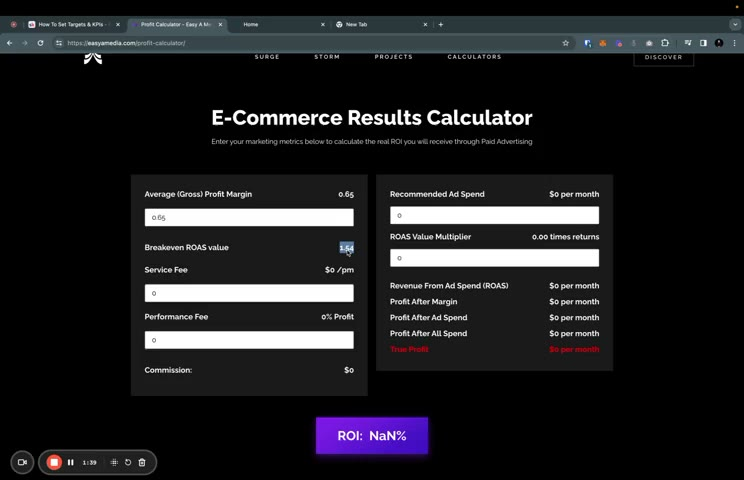
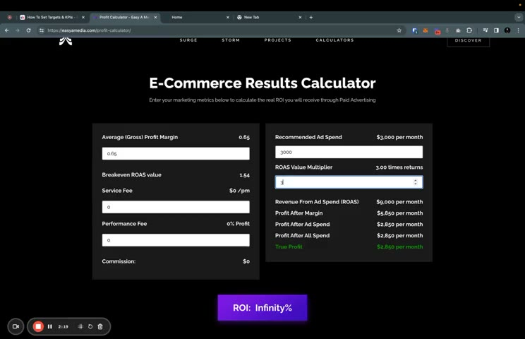
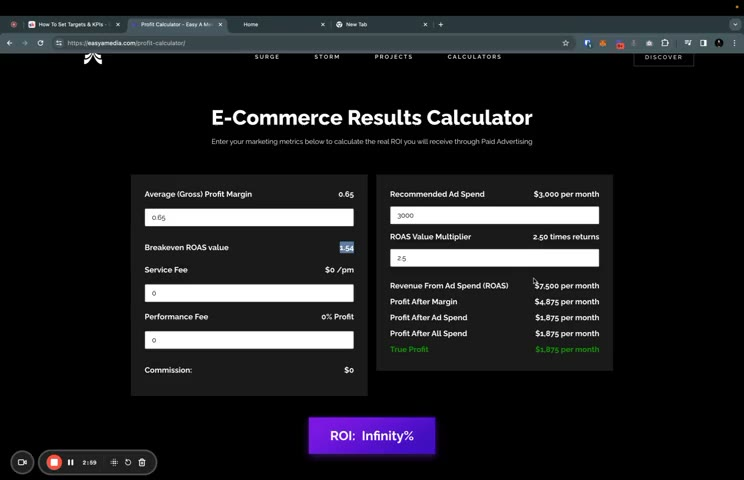
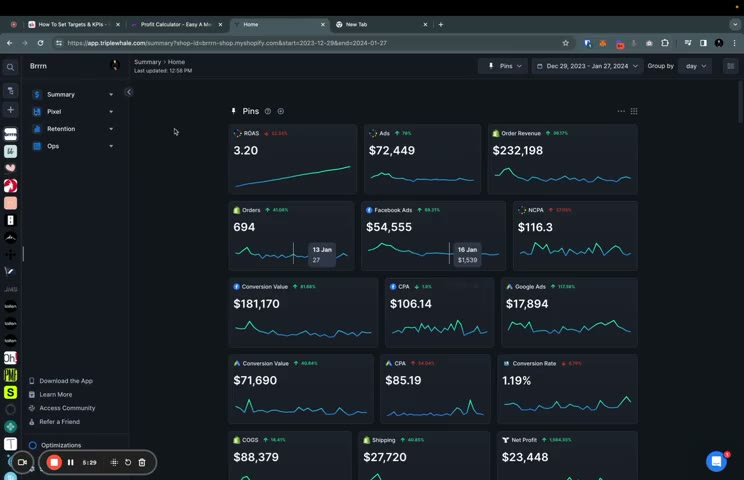
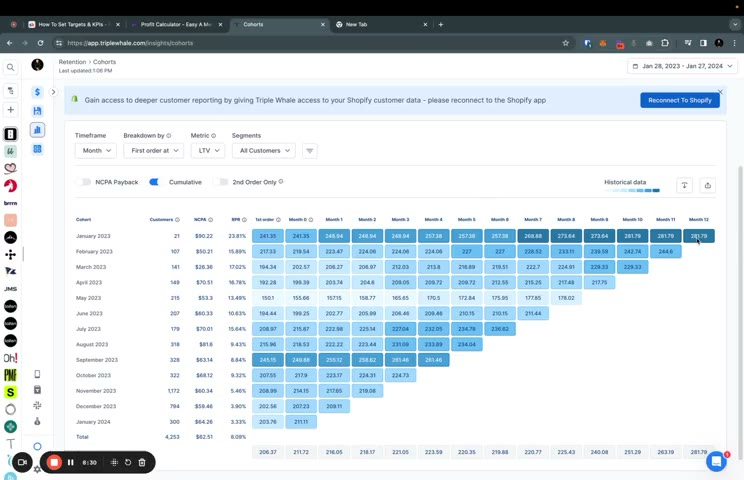

# 101. How To Set Targets & KPIs
> Compute your own breakeven ROAS from gross margin, set a scaling ROAS about one full point above it, and choose one of three KPI levels (blended ROAS, in-platform ROAS, or NCPA plus LTV) instead of copying a generic "3x".

## 🤖 Agent use
- **Use when:** setting or checking an account's targets before reading performance (lesson 100), deciding if an ad or campaign is profitable, or choosing when to increase budgets.
- **Inputs → outputs:** price plus shipping, product cost plus shipping, daily/monthly ad budget, Shopify revenue and ad spend (optionally Triple Whale NCPA and LTV) → Breakeven ROAS, Scaling ROAS (and BROAS, CPA, LTV equivalents) to store as the account's targets.
- **Rules:**
  - **DON'T** adopt a flat "3x ROAS" target. "It varies very much so based on what your actual profit margins are." [00:00]
  - **DO** calculate Breakeven ROAS first from gross profit margin and write it down. [00:53–01:27]
  - **DO** set Scaling ROAS = Breakeven ROAS + 1 ("typically adding one point"). [02:50]
  - **IF** ROAS is above your scaling ROAS **THEN** push budget; **IF** below **THEN** drop budget. [09:26]
  - **IF** you have a very high ROAS (the example is 5x) **THEN** scale until ROAS falls, because more spend at a lower ROAS can make more total profit. [03:41]
  - **DON'T** scale only off Facebook-reported ROAS. Check blended ROAS (Shopify revenue ÷ ad spend). [05:59]
  - **IF** spending under about $50k a month **THEN** stay on blended ROAS and in-platform ROAS; skip LTV/NCPA. [07:38, 09:26]
- **See also:** [100. Columns](100-how-to-see-ads-performance-our-columns.md) · [102. Action Item - Set Your Targets & KPIs](102-action-item-set-your-targets-kpis.md) · [110. Winning Ads Definition - Part 1](110-winning-ads-definition-part-1.md) · [115. How to Scale Facebook Ads](115-how-to-scale-facebook-ads-up-down.md) · [117. Attribution in Triple Whale](117-how-to-view-attribution-in-tw-triple-whale.md)

## Key ideas

### 1. Compute Breakeven ROAS [00:00–02:17]
- Use the instructor's profit-margin calculator (page: easyamedia.com/profit-calculator). Enter **price of product plus shipping** (e.g. $89.99 + $5 shipping = $94.99; if shipping is included in a $100 price, enter $100). Enter **cost of product plus shipping** (e.g. $25 to make + $10 to ship = $35). [00:00–00:53]
- Take the resulting **gross profit margin** into the "E-Commerce Results Calculator". Set service fee, performance fee, ad spend and the ROAS multiplier to zero. The tool then shows **Breakeven ROAS**. Save it in your project tool or on paper. [00:53–01:27]
- Frame example: margin 0.65 gives Breakeven ROAS 1.54 (equal to 1 ÷ 0.65, derived). [01:40, frame]

### 2. Why "3x" is not a rule [02:17–02:50]
- At 65% margin, $3,000 spend and 3x ROAS: $9,000 revenue and $2,850 "True Profit" per month (the frame shows per month; the audio says per day). [02:17, frame at 02:20]
- "Do you need a 3X return on ad spend? No, you don't." 2.5x and 2x are profitable at this margin; about 1.5x is break even. [02:17] At 2.5x the frame shows $7,500 revenue and $1,875 true profit. [03:00, frame]


*"E-Commerce Results Calculator": Average (Gross) Profit Margin 0.65, Breakeven ROAS value 1.54, fees zeroed. [01:40]*


*3.00x on $3,000/month: $9,000 revenue, $5,850 profit after margin, $2,850 true profit. [02:20]*


*2.50x on $3,000/month: $7,500 revenue, $1,875 true profit, so still profitable with breakeven at 1.54. [03:00]*

### 3. Scaling ROAS and why spend can beat ROAS [02:50–04:36]
- "Our scaling return on ad spend for brands is gonna be plus one of whatever their breakeven is." Example: a 2.54x ROAS is profitable here, so the brand is comfortable scaling spend while above it. [02:50]
- The calculation behind it is partly garbled in the audio ("6,000 divided by 25,400... about a 25% gross profit margin just from ads"). At 2.54x on $10,000 spend, revenue is $25,400; profit at a 65% margin is about $6,500, roughly 25% of revenue (derived). [02:50]
- A 5x ROAS is not required. "If you were getting a 5X return on ad spend, I would recommend you to probably scale so that way your return on ad spend comes down lower, but you can actually make more money." [03:41]
- Worked comparison: $10,000 at 4x = $40K top line and $16K profit; $20,000 at 3.5x = $70K top line and "25,000 in profit" (the instructor's rounding of $25,500 at a 65% margin, derived). [03:41]
- Higher margin means more profit; if the margin changes, reset the calculator. Margins can be improved via shipping costs and price points. [04:36]
- Lower ROAS at higher spend makes more sense once there is a customer base and LTV. [03:41]

### 4. Three KPI levels [04:36–09:26]
| Level | KPI | When | How |
|---|---|---|---|
| Beginner | **BROAS** (blended ROAS, a.k.a. MER) | Few sales, little organic presence, mostly ad-driven | Shopify revenue ÷ ad spend. Breakeven BROAS = minimum revenue the store needs to be profitable; Scaling BROAS = BROAS you are comfortable raising budgets at (page text). |
| Intermediate | **ROAS** in the ad account | More organic sales: $10–15K/month predominantly organic | Look at MER, but also in-platform ROAS "so you can better understand attribution". Page: Breakeven ROAS, Scaling ROAS. [06:52] |
| Advanced | **CPA / NCPA and LTV** | Needs a tool like Triple Whale; not for under ~$50K/month | Breakeven CPA (max you can spend to acquire a customer), Scaling CPA (ideal acquisition spend), LTV at 3/6/12 months. [07:38] |

- Blended ROAS example from Triple Whale (30 days): $232K revenue, $72K ad spend, blended ROAS 3.2 (frame: $232,198 revenue, $72,449 ads, ROAS 3.20). Client is "happy" while above 3x blended. Facebook reports about 3.32, "we're probably overspending on Google, if anything". [05:27, frame at 05:30]
- Do-it-yourself blended ROAS: "I did $10,000 this month in sales and I spent $4,000 on ads... my blended ratio is a 2.5." [05:59]
- Why not trust Facebook alone: "Facebook only has a seven-day attribution window"; buyers often take longer, especially new brands. [05:59] (instructor claim; see [116](116-how-to-understand-facebook-ads-attribution.md))
- LTV: with $270 by month 8 or $280 by month 12 you can scale more aggressively than if you only compare new-customer CPA with first-order value. [07:38–08:30]


*Triple Whale summary tile: blended ROAS 3.20, ad spend $72,449, order revenue $232,198, NCPA $116.3 (30 days, Dec 29-Jan 27). [05:30]*


*Retention > Cohorts, metric LTV, monthly cohorts; the first cohort grows from about $241 (month 0) to about $282 (month 12). [08:30]*

## Steps / framework
1. Price + shipping = P. Product cost + shipping = C. Gross margin m = (P − C) ÷ P (derived).
2. Breakeven ROAS = 1 ÷ m (derived; matches the calculator: 0.65 → 1.54).
3. Scaling ROAS = Breakeven ROAS + 1.
4. Pick the KPI level (BROAS, ROAS, CPA/NCPA + LTV) from the table above.
5. Daily budget: Evolve recommends $50–$100/day; "if you're spending less, that is fine". Monthly = daily × 30. [01:27]
6. Review: above scaling ROAS → raise budget; below → drop budget. [09:26]

## Examples
- Margin example: product $89.99 + $5 shipping; cost $25 + $10 shipping gives price $94.99, cost $35 (spoken inputs). Gross margin ≈ 63%, so Breakeven ROAS ≈ 1.58 (derived).
- "If your product is $100 and you include shipping in that price, then you would just put $100." [00:00]

## Structured units

### Rules of thumb
- **DO** write Breakeven and Scaling targets down per brand. [01:27]
- **IF** a brand is mostly organic **THEN** use ROAS and BROAS together. [06:52]
- **IF** no Triple Whale **THEN** compute blended ROAS by hand from Shopify and Ads Manager. [05:59]

## Prompts / templates (verbatim)
Page text, three KPIs:
```
(Beginner) KPI #1: BROAS = Blended Return On Ad Spend
Breakeven BROAS = The minimum amount in revenue your store needs to make to be profitable.
Scaling BROAS = The BROAS you are comfortable increasing budgets at.

(Intermediate) KPI #2: ROAS = Return On Ad Spend
Breakeven ROAS = The Minimum amount you need back to be profitable.
Scaling ROAS = The ROAS you are comfortable increasing budgets at.

(Advanced) KPI #3: CPA or NCPA and LTV = Cost Per Acquisition or New Customer Cost Per Acquisition and Life Time Value (TripleWhale needed)
Breakeven CPA = The maximum amount you can spend to acquire a customer
Scaling CPA = The ideal amount you are spending to acquire a customer
LTV = Lifetime value of the customer based on specific time periods.
```
Page also links "an advanced training on how to set KPIs based on LTV" by Grayson (Skool classroom link, not in the course files) and a short link (shorturl.at/5Qori) whose target is not stated.

## How to apply
- [ ] Collect P, C, daily budget, 30-day Shopify revenue and ad spend.
- [ ] Compute margin, Breakeven ROAS, Scaling ROAS, blended ROAS.
- [ ] Store them in the campaign sheet; compare against the Purchase ROAS column from [100](100-how-to-see-ads-performance-our-columns.md).
- [ ] Only add NCPA and LTV targets if on Triple Whale and above about $50K/month.

## Related
- Previous: [100. How To See Ads Performance + Our Columns](100-how-to-see-ads-performance-our-columns.md) · Next: [102. Action Item - Set Your Targets & KPIs](102-action-item-set-your-targets-kpis.md)
- [Creative testing system](../../../../frameworks/creative-testing-system.md)

## Sources and limitations
- Transcript: [101 transcript](<../../../../../raw/evolve/start-here/_transcripts/👣 Evolve (Start Here)/101. How To Set Targets & KPIs 👣 Evolve (Start Here) Evolve.txt>) · Page text: [101 page](<../../../../../raw/evolve/start-here/_extracted/👣 Evolve (Start Here)/101. How To Set Targets & KPIs_👣 Evolve (Start Here)_Evolve.html.md>)
- Machine transcription; full recording (583.57 s). Suspicious items: "1.5 Forex you will make $3" at [02:17] (likely about 1.5x = break even), "$3,000 a day" (frame says per month), "$6,000... 25,400" at [02:50], "$50 a month" at [08:30] (context says about $50K/month), "Triple O/Triple Well" for Triple Whale, "Breaky Bean ROAS" for breakeven ROAS. The calculator is an external tool (easyamedia.com), not part of the course files.
