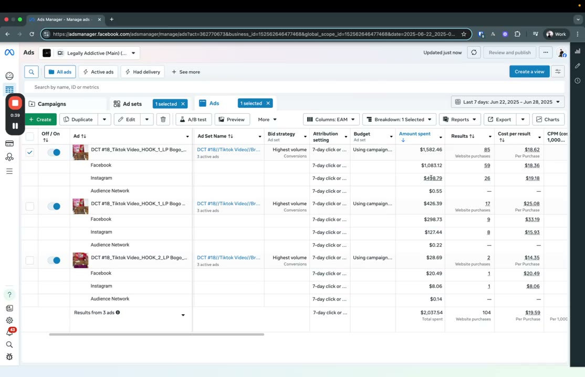
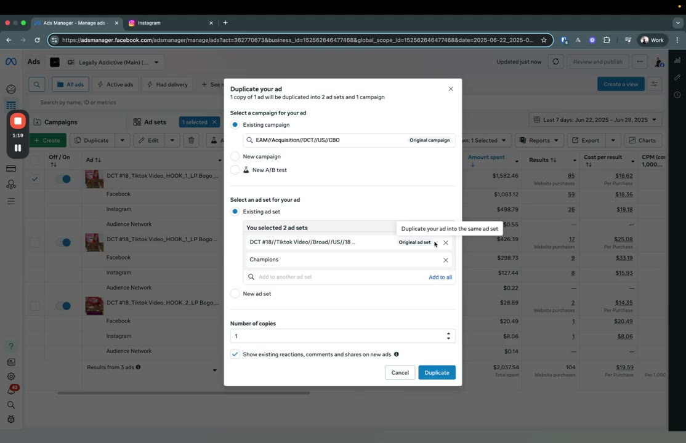

# 103. How To Duplicate Ads Into Champions (NEW WAY)
> Move a winning ad into the Champions ad set by duplicating it unchanged with "Show existing reactions, comments and shares" ticked, which keeps Instagram engagement that Post IDs drop.

## 🤖 Agent use
- **Use when:** promoting a tested winner from a DCT/test ad set into the Champions (winners) ad set; troubleshooting Champions ads that get no spend.
- **Inputs → outputs:** a winning ad in a test ad set → a duplicate in the Champions ad set that keeps Facebook and Instagram likes, comments and shares.
- **Rules:**
  - **DO** use native Ads Manager duplication into the Champions ad set, with "show existing reactions" ticked. [01:13]
  - **DON'T** change anything in the duplicate (copy, creative, settings). "If you change anything in here, it will obviously remove the engagement." [02:03–02:50]
  - **DO** remove the original ad set from the destination list so only Champions is selected. [01:13]
  - **IF** this fails **THEN** fall back to Post IDs ([104](104-how-to-find-any-post-ids-for-winning-ads.md)). Page text and audio both say so. [02:03]
  - **DO** check the preview afterwards: "you'll know it's worked if you preview it and you see the engagement". [02:03]
- **See also:** [104. How To Find Any Post IDs For Winning Ads](104-how-to-find-any-post-ids-for-winning-ads.md) · [105. Action Item - Add Your Winning Ads](105-action-item-add-your-winning-ads.md) · [100. Columns](100-how-to-see-ads-performance-our-columns.md) · [94. 3/2/2 Campaign](094-how-to-set-up-a-3-2-2-campaign.md)

## Key ideas

### Why Post IDs fail [00:00–01:13]
- "One of the biggest problems with using post IDs... it only actually copies over the Facebook engagement." [00:00]
- Ads Manager > Breakdown > Platform shows the split. In this brand over the last 7 days about $1,000 went to Facebook and $500 to Instagram, and the ad still had Instagram engagement (844 likes on the Instagram post with comments). [00:00–00:32]
- A Post ID version does not show that Instagram engagement. Instructor: "the reason why your champions ads will sometimes not get any spend is because of that." [00:32] (instructor claim, no data shown)

### The duplication method [01:13–02:50]
1. Select the winning ad. Click Duplicate. [01:13]
2. Choose the existing campaign and the **existing ad set: Champions**. Remove the original ad set from the list. Make sure "show existing reactions, comments and shares on new ads" is ticked ("make sure this is ticked"). Leave everything else alone, "you can remove the copy here" (the "- Copy" suffix). [01:13]
3. Publish. May give an Instagram access issue, but it "should go through". Refresh (remove the breakdown first). [01:13]
4. Open the Champions ad set, preview the ad, confirm Facebook engagement; check "Instagram posts with comments" to confirm Instagram engagement. [02:03]

- "Right now, it's working like 90% of the time" (instructor claim). It is "the method that our media buyer has been using". The instructor says he does not do all the media buying at the agency. [02:03]
- It is described as "a sneaky way to keep Instagram engagement" because Post-ID-only workflows lose Instagram. [02:50]

## Steps / framework
1. Find the winner (use the spend-sorted view from [100](100-how-to-see-ads-performance-our-columns.md)).
2. Select > Duplicate > Existing campaign > Existing ad set > Champions only.
3. Tick "Show existing reactions, comments and shares on new ads". Number of copies: 1.
4. Do not edit. Publish.
5. Preview in the Champions ad set; verify Facebook and Instagram engagement.
6. If engagement or spend fails, use Post IDs ([104](104-how-to-find-any-post-ids-for-winning-ads.md)).

## Examples
- Frame: duplicating "DCT #18 TikTok Video HOOK_1" into a "Champions" ad set within an Acquisition DCT campaign, with 2 ad sets selected, 1 copy, and the checkbox "Show existing reactions, comments and shares on new ads" ticked. The ad had $1,582.46 spent over 7 days at $18.62 per purchase. [01:20, frame]
- Frame (platform breakdown): Facebook $1,083.12 (59 purchases) vs Instagram $498.79 (26 purchases) for that ad over 7 days. [00:40, frame]

## Screenshots

*Platform breakdown: a Facebook vs Instagram spend and result split on one DCT ad; Instagram is a real share, so losing its engagement matters. [00:40]*

*The Duplicate dialog: existing campaign, ad sets chosen (original plus Champions; original is removed), 1 copy, and the engagement checkbox. [01:20]*

## How to apply
- [ ] For every winner, duplicate (not Post ID) first.
- [ ] Leave names, copy and creative untouched.
- [ ] Confirm engagement in preview on both Facebook and Instagram.
- [ ] If the duplicate gets no spend or engagement is missing, switch to a Post ID and log it.

## Related
- Previous: [102. Action Item - Set Your Targets & KPIs](102-action-item-set-your-targets-kpis.md) · Next: [104. How To Find Any Post IDs For Winning Ads](104-how-to-find-any-post-ids-for-winning-ads.md)
- [109. Naming templates](109-how-to-set-up-naming-templates.md) (Champions ad set naming)

## Sources and limitations
- Transcript: [103 transcript](<../../../../../raw/evolve/start-here/_transcripts/👣 Evolve (Start Here)/103. 🆕 How To Duplicate Ads Into Champions (NEW WAY) 👣 Evolve (Start Here) Evolve.txt>) · Page text: [103 page](<../../../../../raw/evolve/start-here/_extracted/👣 Evolve (Start Here)/103. 🆕 How To Duplicate Ads Into Champions (NEW WAY)_👣 Evolve (Start Here)_Evolve.html.md>)
- Machine transcription; full recording (194.62 s). The ticked box is identified from the frame; the audio only says "make sure this is ticked". The "90% of the time" figure is anecdotal. The "Instagram access issue" is described, not shown.
