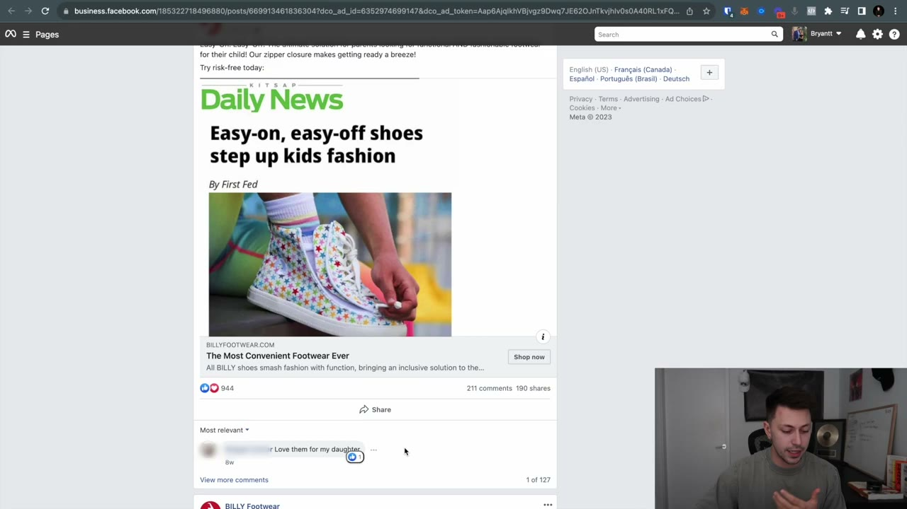
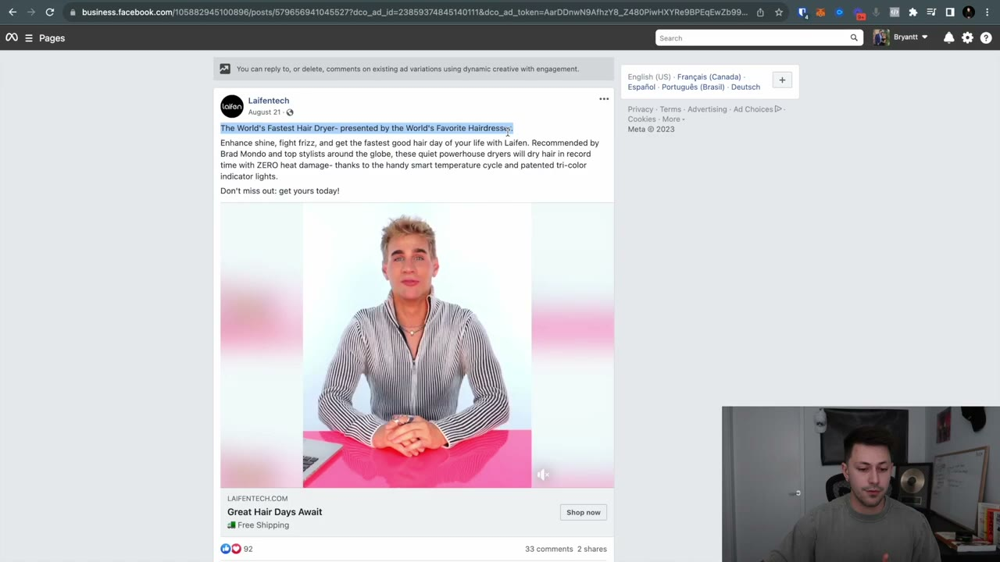
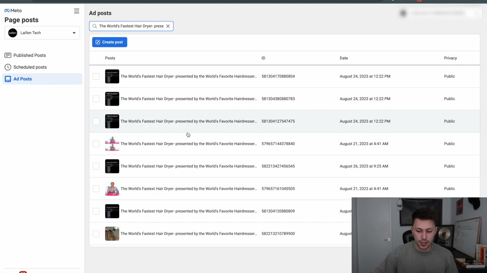

# 104. How To Find Any Post IDs For Winning Ads
> Fallback method: copy the Facebook Post ID of a winning ad (or locate it through Page Posts > Ad posts) and add it to the Champions ad set as "Use existing post", so the ad keeps its likes, comments and shares instead of restarting at zero.

## 🤖 Agent use
- **Use when:** native duplication ([103](103-how-to-duplicate-ads-into-champions-new-way.md)) does not work or Instagram engagement is not a concern; also when the winning ad lives in a DCT (dynamic creative test) and the Post ID is not obvious.
- **Inputs → outputs:** a winning ad in a testing campaign → its Post ID and a new ad in the Champions ad set using "Use existing post".
- **Rules:**
  - **DO** prefer the duplication method first; Post IDs "are really no longer needed UNLESS the duplication method is NOT working". (page text)
  - **DO** confirm the Post ID carries "all of the correct headlines + text". (page text)
  - **DO** check the preview shows the same engagement as the source (likes, comments, shares). [04:30]
  - **IF** the ID pasted from the share view is rejected ("this is not the post ID") **THEN** copy the first 50–100 characters of primary text and search Page Posts > Ad posts. [05:21–06:54]
  - **IF** a DCT has several combinations **THEN** pick the one with the most engagement, not the Breakdown "winning combination". [06:54–07:41]
  - **DON'T** forget that engagement is the reason: social proof stops the scroll and signals engagement to Facebook. [01:14–02:12]
- **See also:** [103. Duplicate Ads Into Champions](103-how-to-duplicate-ads-into-champions-new-way.md) · [105. Action Item - Add Your Winning Ads](105-action-item-add-your-winning-ads.md) · [100. Columns](100-how-to-see-ads-performance-our-columns.md) · [94. 3/2/2 Campaign](094-how-to-set-up-a-3-2-2-campaign.md)

## Key ideas

### Why post IDs matter [00:00–02:12]
- A duplicated ad "starts from zero" and often does not perform; a Post ID is a unique ID attached to every post/ad, and reusing it keeps the engagement you paid for. [00:39]
- "9.9 times out of 10" an ad with many likes, comments and shares stops users better and delivers more results than one with none (instructor claim). [01:14]
- Facebook's goal is to keep users on the platform; engaging ads put you "on Facebook's good side and can sometimes help lower your CPMs" (instructor claim). Comments like "I love this product" or "I just bought one" "help your ads". [01:14]
- Logic: if you spent $100, $1,000 or $10,000 building engagement, keep it when you scale. [02:12]

### Standard method [02:12–05:21]
1. In Ads Manager click into the test campaign. With the 3/2/2 DCT structure, click into the DCT ad set and the ad with the most spend and best performance. [02:12–02:57]
2. Click **Preview > Share > Facebook post with comments**. A page loads that lists several combinations, ranked by engagement. [02:57–03:51]
3. Example: top variation 944 likes, 211 comments, 190 shares; a comment reads "love them for my daughter". [03:51]
4. Click the post date under the page name; the URL contains the Post ID (a long string of digits after the page ID). Copy it. [03:51–04:30]
5. Back in Ads Manager, open the Champions/scaling ad set, Create > Ad setup > **Use existing post** > "Enter post ID", paste, confirm. The preview must show the same engagement. [04:30]

*Post-with-comments view from Preview > Share. The instructor reads engagement here (944 likes, 211 comments, 190 shares) and the date link yields the Post ID. [04:10]*

### Workaround when the ID is "not the post ID" [05:21–08:28]
- "Facebook is always changing things on their back end and some pages are different than others." [05:21]
- Copy the top line of primary copy (first 50–100 characters). Note the likes/comments/shares (example: 92 likes, 33 comments, 2 shares). [05:21–06:15]
- Ads Manager hamburger > **All tools > Page posts > Ad posts**; paste the text in the search bar. Several posts appear; the right one "is typically the one closest to the top" for the running video. Match engagement, then copy that row's ID. [06:15–06:54]
- Also check the date versus the launch date (launched August 21; new ads posted the 24th and 26th). The audio picking of which date is correct is unclear. [07:41–08:28]
- Then: Ads Manager > campaign > Champions/winners ad set > Create > paste ID > Ad setup > Use existing post > Enter post ID > Confirm. [08:28]

*Highlighting the first line of primary text on the source post (92 likes, 33 comments, 2 shares) before searching Ad posts. [06:20]*

*Page posts > Ad posts search results: many posts share the same copy; the ID column plus date help pick the one. [06:55]*

### DCT note: use most-engagement ad, not the Breakdown winner [06:54–07:41]
- Instructor did not use the Breakdown "winning combination" for DCTs. "Whenever we grab a certain combination of best text, best headline and best visual, sometimes that doesn't always lead to the best combination... that ad gets zero spend." Still being tested at the agency. [06:54–07:41]
- So: take the ad with the most engagement Facebook currently sees in the DCT. [07:41]

## Steps / framework
| Step | Action | Source |
|---|---|---|
| 1 | Identify the winner by spend and results ([100](100-how-to-see-ads-performance-our-columns.md)) | [02:57] |
| 2 | Preview > Share > Facebook post with comments | [02:57] |
| 3 | Click the post date; copy the number from the URL | [04:30] |
| 4 | Champions ad set > Create > Ad setup > Use existing post > Enter post ID > Confirm | [04:30] |
| 5 | Verify preview engagement; verify headlines and text (page text) | [04:30] |
| 6 | If rejected: search Page posts > Ad posts by first 50–100 characters of copy, match engagement/date, copy ID | [06:15] |

## Examples
- Example 1: DCT from a kids' shoe brand, post with 944 likes, 211 comments, 190 shares and a "love them for my daughter" comment. [03:51, frame at 04:10]
- Example 2: hair-dryer DCT, source post 92 likes, 33 comments, 2 shares; Ad posts search returned about 8 candidate IDs. [06:15–06:54]

## Structured units

### Rules of thumb
- **DO** paste the ID, then confirm the preview shows the original engagement. [04:30]
- **IF** the preview shows no engagement **THEN** you used the wrong ID. [04:30]
- **IF** a combination gets zero spend in Champions **THEN** use the highest-engagement ad instead. [07:41]

## Prompts / templates (verbatim)
Page text: "PLEASE NOTE WE ARE NOW DUPLICATING ADS AS SHOWN IN THIS VIDEO HERE" (link to lesson 103). "So, post IDs are really no longer needed UNLESS the duplication method is NOT working for you." "NOTE* - IF USING THE METHOD BELOW, MAKE SURE YOU CONFIRM THIS POST ID HAS ALL OF THE CORRECT HEADLINES + TEXT AS WELL." The page links a YouTube video "Find Post IDs In 90 Seconds" (the lesson video appears to be that recording).

## How to apply
- [ ] Try duplication ([103](103-how-to-duplicate-ads-into-champions-new-way.md)) first.
- [ ] If not working, get the Post ID via Share > post with comments.
- [ ] If ID is rejected, search Ad posts with the first 50–100 characters of copy.
- [ ] Match engagement counts and date to the right row.
- [ ] Add as "Use existing post" in Champions; verify headlines, text and engagement.

## Related
- Previous: [103. How To Duplicate Ads Into Champions (NEW WAY)](103-how-to-duplicate-ads-into-champions-new-way.md) · Next: [105. Action Item - Add Your Winning Ads](105-action-item-add-your-winning-ads.md)

## Sources and limitations
- Transcript: [104 transcript](<../../../../../raw/evolve/start-here/_transcripts/👣 Evolve (Start Here)/104. How To Find Any Post IDs For Winning Ads 👣 Evolve (Start Here) Evolve.txt>) · Page text: [104 page](<../../../../../raw/evolve/start-here/_extracted/👣 Evolve (Start Here)/104. How To Find Any Post IDs For Winning Ads_👣 Evolve (Start Here)_Evolve.html.md>)
- Machine transcription. Last segment ends at 575.44 s of 585.07 s (the outro is cut off, nothing instructional). The recording is an older YouTube video (2023 UI: "all tools > page posts"); Meta menus may have changed. "Easya media" is heard as "easy a media". Brand names in the frames are other people's ads and are used only as UI examples.
