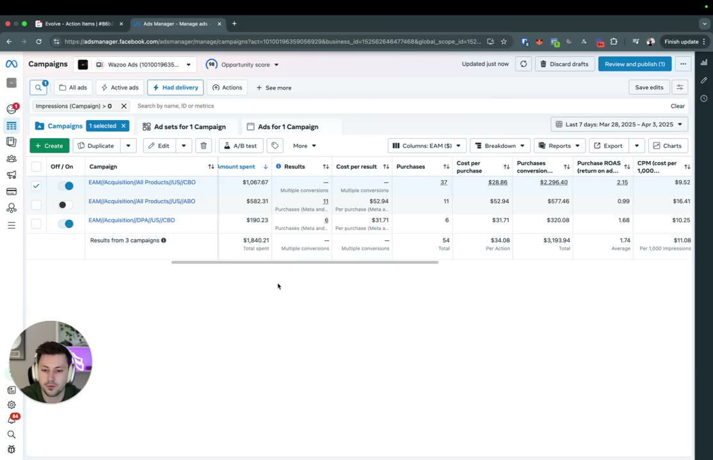
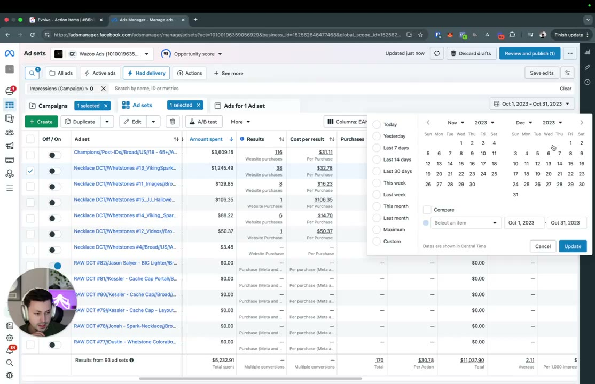
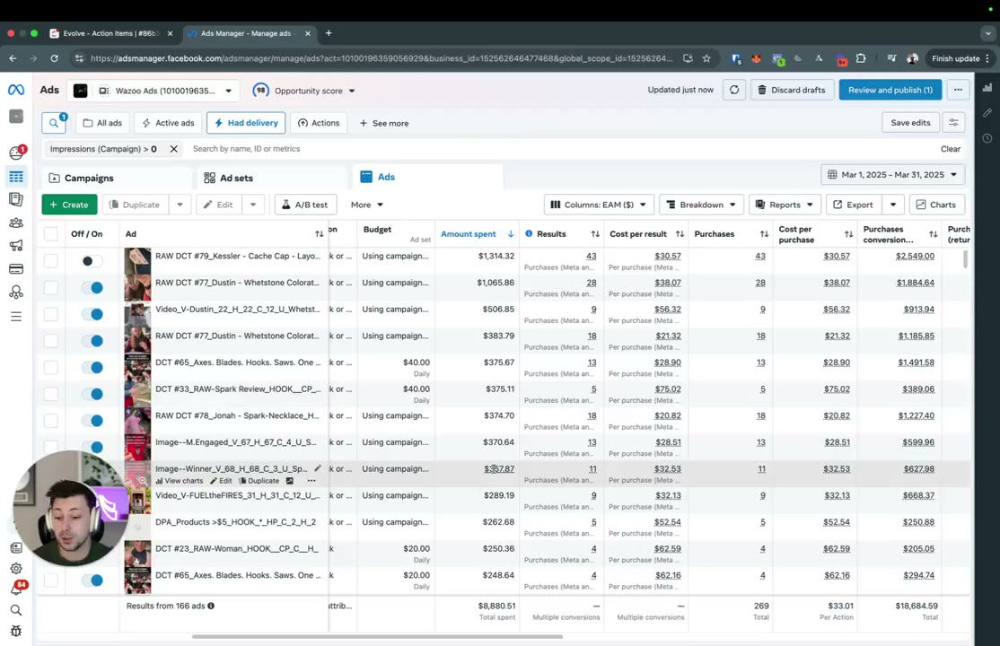

# 106. Turning On "Seasonal" Ads For Quick Performance
> Old winners that died can come back at the same time of year, so turn them back on (in a separate ABO or back in CBO) before writing them off. Two accounts are shown as evidence.

## 🤖 Agent use
- **Use when:** an account has stalled and past top ads exist; when deciding whether to kill or archive fatigued winners; when planning seasonal (monthly/holiday) ad reuse.
- **Inputs → outputs:** ad-level spend/ROAS history by month for past winners → a shortlist of ads to reactivate this season and a placement (CBO, or an ABO "top ads" ad set).
- **Rules:**
  - **DO** look back at when each old winner spent and returned well; reactivate it at the same time of year. [04:24–04:58]
  - **DO** reactivate after "a couple months of having them turned off". [05:54]
  - **DON'T** treat this as a reason to stop making new ads: "This is NOT an excuse to stop making new ads." (page text, Note 2)
  - **DON'T** assume it will work: "Do this at your OWN risk. This may NOT help performance, I am simply sharing what has worked for us." (page text, Note 1)
  - **IF** an ad slumps for one month **THEN** wait before killing it: "if you would have just left them running, their performance might have just picked back up". [06:48]
  - **DO** keep CBO as default: "we are testing ABO vs CBO massively... CBO is still showing as the superior strategy so far." (page text, Note 3)
- **See also:** [100. Columns](100-how-to-see-ads-performance-our-columns.md) · [103. Duplicate Ads Into Champions](103-how-to-duplicate-ads-into-champions-new-way.md) · [110. Winning Ads Definition - Part 1](110-winning-ads-definition-part-1.md) · [121. How To Deal With Roller Coaster Performance](121-how-to-deal-with-roller-coaster-performance.md)

## Key ideas

### Case 1: brand in the media-buying program [00:00–04:58]
- The brand is "an account that's in our media buying program" the team has known for years. Current top spender in the main campaign is a new raw DCT, plus an older image ad with 13,000 likes that now does little even over 30 days. [00:00–00:56]
- Historical: the Champions ad set took all spend in the prior November and December; this ad "was pulling all of the weight". December spend $35,000 "at a 2.3". [00:56–01:41]
- That ad had been launched as a DCT on September 27, 2023. In November 2023 the account spent $45,000 at 2.36x and the brand ran out of stock after scaling. [01:41–03:29]
- The ad then stopped getting spend ("It got $81 in spend and we didn't really change anything. It just died"), and the team "ran a lot of last year without that new best performing ad"; they did a summer promo but the ad was nowhere in the top-spender list. [03:29]
- In the next November the instructor turned it back on, and it performed again: $13,000 spend in December, still "a decent amount" in January, then "less and less" in February and March. [03:29–04:58]
- Conclusion: "some ads do just have a time of year where they perform really well." [04:58]

### Case 2: a bigger brand [04:58–06:48]
- In June the top ads spent $157,000 "absolutely ripping"; by August–September spend dropped, the team slowed or killed the campaign while page testing, and "those ads just completely fatigued". [04:58]
- After turning the old ads back on, spend returned to about $60,000 a month. The audio says they "did that in March" and turned the ads back on in June (timeline unclear). [04:58–05:54]
- The team pulled previous winners into an ABO "top ads" ad set (also turned on others), later "ripped back into the CBO" where they got spend and did well. [05:54–06:48]

### Takeaway [06:48–08:34]
- "There's not too many buttons that you can click that can really drive up performance. But this has been one that has been really, really helpful for us for driving down our NCPA" and raising NC ROAS (instructor claim, no figures shown). [06:48–07:44]
- Anytime you have had "super winners or ads that have really helped you scale in the past", try them again. [06:48]
- Some ad sets were relaunched at **7-day click only** instead of 7-day click, 1-day view, as a variable inside a big ABO test; "there's gonna be a big video, probably like an hour long" with ABO findings. [07:44–08:34]
- TL;DR: "if you guys have old ads that you turned off because they had slow performance during a certain period, go back to see when they performed well and you might have an opportunity to get that performance again the next year." [07:44]

## Steps / framework
1. Export ad-level spend and ROAS by month for the last 1-2 years (Ads Manager, ad level, custom date ranges).
2. Mark ads that were top spenders in a specific season (holiday, weather, buying month).
3. Four to eight weeks before that season, turn those ads back on (original ad, so engagement persists).
4. Either place in the main CBO or in an ABO "top ads" ad set, then move to CBO when spend appears. (derived from [05:54–06:48])
5. Track NCPA and NC ROAS (new customer metrics), not just blended ROAS.
6. Keep launching new ads in parallel.

## Examples
| Case | Ad / account | Window | Metric | Source |
|---|---|---|---|---|
| 1 | Image ad (DCT launched Sep 27, 2023) | Nov 2023 | $45,000 spend, 2.36x | [02:40] |
| 1 | Same ad, reactivated | Dec | $13,000 ad spend; campaign $35,000 at about 2.3 | [01:41, 04:24] |
| 2 | Top ads | June | $157,000 spend | [04:58] |
| 2 | Same ads, reactivated | recent | back up to about $60,000 per month | [05:54] |

## Structured units

### Rules of thumb
- **IF** an old winner was strong at this time last year **THEN** reactivate it. [04:58]
- **DO** use the same exact ad (existing engagement) rather than a recreation (derived from [103](103-how-to-duplicate-ads-into-champions-new-way.md)).
- **DON'T** pause everything during a slump month. [06:48]

## Screenshots

*Instructor's Ads Manager: acquisition CBO ($1,067.67 spent, 2.15 ROAS), ABO ($582.31, 0.99) and DPA CBO ($190.23, 1.68) over 7 days (Mar 28-Apr 3, 2025). Shows the CBO vs ABO comparison the page mentions. [00:15]*

*Oct 2023 ad-set view: "Champions//Post-IDs" took $3,609 of $5,232 total (2.11 ROAS), with DCT test ad sets behind it; this is the pattern of champions carrying spend. [02:50] (Account shown may differ from the one named in the audio.)*

*March 2025, ad level, sorted by spend: raw DCT ads and older image/video ads in the top-spend list. [05:00]*

## How to apply
- [ ] Build a "seasonal winners" log: ad name, month it spent best, spend, ROAS.
- [ ] 4-8 weeks before each season, reactivate the matching ads (instructor reactivated after a few months off).
- [ ] Check for "stuck in learning"/new-ad re-entry before changing budget.
- [ ] Compare NCPA before and after; record the result.
- [ ] Keep the new-ads pipeline running; this is a supplement.

## Related
- Previous: [105. Action Item - Add Your Winning Ads](105-action-item-add-your-winning-ads.md) · Next: [107. How To Protect Against "Bad Ads" Over Spending](107-how-to-protect-against-bad-ads-over-spending.md)
- [Triggering events](../../../../concepts/triggering-events.md)

## Sources and limitations
- Transcript: [106 transcript](<../../../../../raw/evolve/start-here/_transcripts/👣 Evolve (Start Here)/106. Turning On Seasonal Ads For Quick Performance 👣 Evolve (Start Here) Evolve.txt>) · Page text: [106 page](<../../../../../raw/evolve/start-here/_extracted/👣 Evolve (Start Here)/106. Turning On _Seasonal_ Ads For Quick Performance_👣 Evolve (Start Here)_Evolve.html.md>)
- Machine transcription; last segment 517.58 s of 517.93 s. The timeline is reconstructed from a rambling live walk-through; the instructor says "I'm clicking and clacking around" and "I know". Months and years may be mixed up (for example "$35,000 in December" is not tied to a year; "$81 in spend" is not tied to a date; "March... June" at [05:54]). Treat dates as approximate. The frames' account names are not reproduced; the account in the audio may differ from the frame accounts. "Sparks ad" is probably "Spark" necklace ad (Whisper). The NCPA/NC ROAS improvement is an instructor claim.
