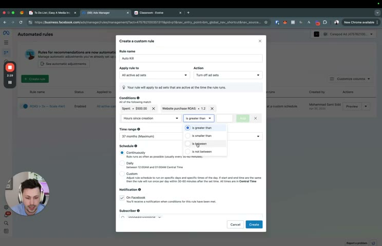
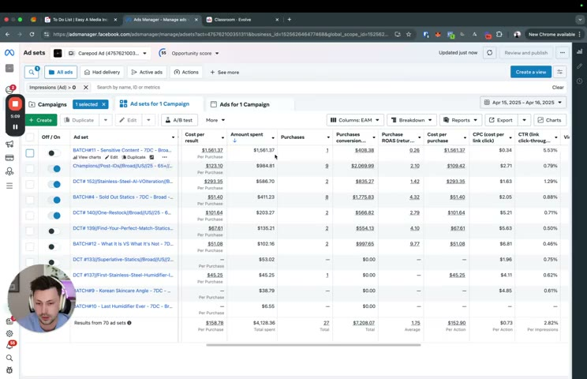

# 107. How To Protect Against "Bad Ads" Over Spending
> Meta's automated rules cannot auto-kill a bad ad inside a CBO, so cap new ad sets with a daily spending limit and lift the cap when the ad proves itself. Only for accounts spending $10K+ per day or with frequent overspenders.

## 🤖 Agent use
- **Use when:** launching a batch into a high-budget CBO; reviewing a spike where one new ad took a large share of spend at a poor ROAS; diagnosing click-bait ads.
- **Inputs → outputs:** account daily spend, tolerance per new ad, batch launch → a daily maximum per new ad set, plus a check of link clicks vs landing page views.
- **Rules:**
  - **DO** apply this only if you spend $10K+ per day or have seen many overspenders. "This is only for brand owners that are at scale spending 10K+ per day." (page text)
  - **DO** Step 1: set a maximum daily budget (ad-set spending limit) "of whatever you are comfortable spending, no matter what". (page text; [05:10])
  - **DO** Step 2: remove the maximum if performance is really strong. (page text) "That is it."
  - **DON'T** rely on an automated rule for CBO ad sets. Meta rejects performance-based turn-off rules there. [02:15–02:48]
  - **IF** the ad gets no spend in the first 1–2 days **THEN** remove the cap. [06:00]
  - **DO** audit a spike with Link clicks vs Landing page views; a low ratio means accidental or wrong-reason clicks. [03:34]
- **See also:** [100. Columns](100-how-to-see-ads-performance-our-columns.md) · [120. How To See If You Should Turn Off High-Spend Ads](120-how-to-see-if-you-should-turn-off-high-spend-ads.md) · [110. Winning Ads Definition - Part 1](110-winning-ads-definition-part-1.md) · [94. 3/2/2 Campaign](094-how-to-set-up-a-3-2-2-campaign.md)

## Key ideas

### The ideal that Meta does not allow [00:00–02:48]
- Goal: an automatic kill trigger for new ads that "tank or... take over majority of spend and are below KPI". Meta has no way to do this inside CBO. [00:00]
- Attempt: rule named "Auto Kill", apply to all active ad sets, action "turn off ad sets", conditions: spent > $500 (or $1,000), Website purchase ROAS < 1.2, "hours since creation is smaller than 24" (frame shows `Spent > $500.00` and `Website purchase ROAS < 1.2`). [00:51–02:15]
- Thresholds depend on spend: "$2, $3, $4, $5, $10, $15, $20k a day" accounts use $500 or $1,000; a $200–$300/day account might use $150/day. If scaling at 1.5, ROAS floor could be below 1; adjust as you like. [00:51–01:30]
- Result: creation fails with "performance related conditions are not available for this rule when actions turn off or turn on... any assets that use CBO." [02:15–02:48]


*The rule attempt: "Auto Kill" applied to all active ad sets with the conditions above; this rule type fails for CBO ad sets. [02:20]*

### The case: a click-bait ad [02:48–05:02]
- Ad launched April 16: by the 15th/16th it had spent about $972. Cost per click was $0.57 (later $0.20), "way too click baity": the creative said "click for sensitive info, see why" and sent people to the website. [02:48–04:25]
- Diagnosis with the custom columns: 1,649 link clicks but about 1,300 landing page views (1,300 ÷ 1,649 is about 78%). The Champions ad set at about $600 had 173 link clicks and 172 landing page views, about 100%. [03:34–04:25]
- Return was a 0.26x ROAS and "we blew basically $1,500 in budget". The ad was turned off on the 16th/17th with $0 spend after. [04:25–06:57]
- Instructor reasoning: Meta saw the cheap clicks as a likely winner and pushed spend. "People were just saying, oh shit, I didn't mean to click on this." [04:25]


*Ad-set view: BATCH #11 (clicky "Sensitive Content" concept) $1,561.37 spent, 1 purchase, ROAS 0.26 versus Champions $984.81, 9 purchases at 2.10. [05:10]*

### The fix: ad-set spending limit [05:02–06:57]
- Go into the ad set > "Spending limits" > edit > **Add set spending limit** > put a **daily maximum**. Example: $500 daily max on every new creative test "no matter what, like even if it's a new winner". [05:02]
- Chosen $500 "for most people... spending 15, 20 or 30K a day... a pretty decent amount". Give more if you want. [05:02]
- Next day: if ROAS is good, remove the cap. [05:02–06:00]
- Scenario: a 20K/day budget, launching at midnight, waking to an ad that already spent $3-4K at a poor ROAS: "this maximum daily budget can help you." [06:00]
- Caution: editing the budget "kind of re-entering learning". [06:57]
- Final remark: people "spamming comments on people's ads" and fooling Meta's algorithm are another source of bad spend; this is "part of the game". [07:42]

## Steps / framework
1. Confirm you qualify: $10K+/day, or repeated overspenders.
2. On launch, in each new ad set: Edit > Spending limits > Add set spending limit > Daily max = your tolerance (example $500).
3. Next day: check ROAS, spend, link clicks vs landing page views.
4. If strong, remove the cap. If no spend for 1–2 days, remove the cap. If poor, switch the ad off.
5. Expect a possible learning reset when you edit.

## Examples
| Ad | Symptom | Diagnostic | Action | Source |
|---|---|---|---|---|
| Click-bait "sensitive info" ad | $972 spent in about a day, CPC $0.57 → $0.20, 0.26x ROAS | LPV ÷ link clicks about 78% (vs about 100% on Champions) | Turned off; $1,500 lost | [02:48–06:57] |

## Structured units

### Rules of thumb
- **DO** compute LPV ÷ link clicks for suspicious cheap-click ads. [03:34]
- **IF** CPC is far below the account norm and ROAS is poor **THEN** suspect click-bait. [04:25]
- **DO** keep the daily cap at an amount you can lose "no matter what". [05:02]

## Prompts / templates (verbatim)
Page text:
```
Process For Protecting Against Overspenders:
Step 1: Set a maximum daily budget of whatever you are comfortable spending, no matter what. (Time Stamp: 5:10)
Step 2: Remove the maximum daily budget if you see performance is really strong.
That is it.
```
Meta rule attempt (for reference; fails on CBO):
```
Rule name: Auto Kill
Apply rule to: All active ad sets
Action: Turn off ad sets
Conditions (all): Spent > $500 | Website purchase ROAS < 1.2 | Hours since creation < 24
Schedule: Continuously
```

## How to apply
- [ ] Add LPV (landing page views) and a LPV-per-link-click ratio next to the Evolve columns.
- [ ] Set a daily cap on each new ad set at launch (batch launches especially).
- [ ] Review the first 24 hours; remove caps on winners.
- [ ] Never launch a click-bait creative that does not match the landing page.

## Related
- Previous: [106. Turning On "Seasonal" Ads For Quick Performance](106-turning-on-seasonal-ads-for-quick-performance.md) · Next: [108. How To Set Up A Promo Campaign](108-how-to-set-up-a-promo-campaign.md)
- [Emotional misfire](../../../../concepts/emotional-misfire.md)

## Sources and limitations
- Transcript: [107 transcript](<../../../../../raw/evolve/start-here/_transcripts/👣 Evolve (Start Here)/107. How To Protect Against Bad Ads Over Spending 👣 Evolve (Start Here) Evolve.txt>) · Page text: [107 page](<../../../../../raw/evolve/start-here/_extracted/👣 Evolve (Start Here)/107. How To Protect Against _Bad Ads_ Over Spending_👣 Evolve (Start Here)_Evolve.html.md>)
- Machine transcription; full recording (478.31 s). The spoken rule says "hours since creation... smaller than 24"; Whisper also muddles "14th/15th/16th" dates and the $972 vs $1,500 totals (the frame shows $1,561.37 at 0.26 ROAS). The year is not stated (frame date range Apr 15-16, 2025). The ad set name "Sensitive Content" is from the frame. The "5:10" timestamp in the page text matches the spend-limit demo.
