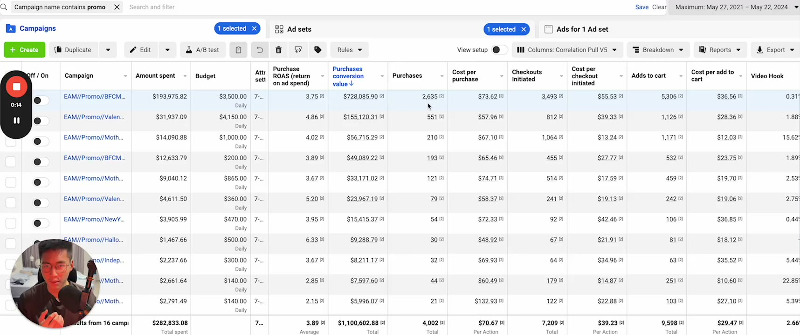
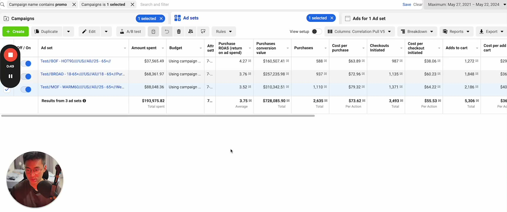
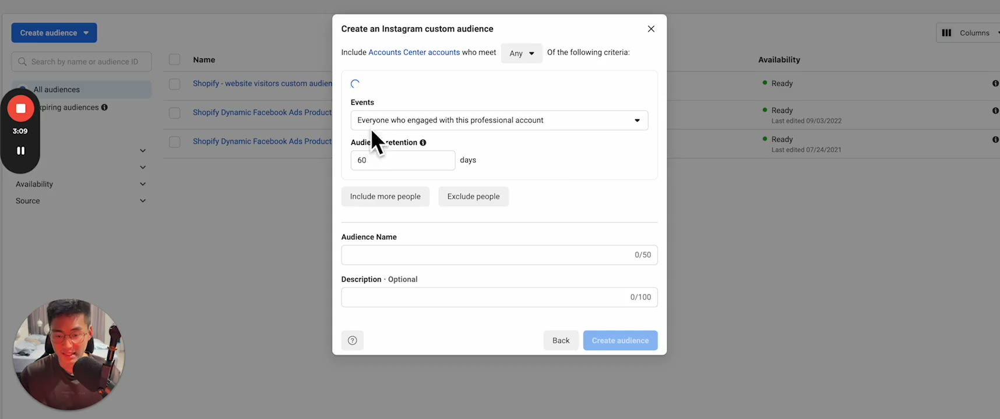
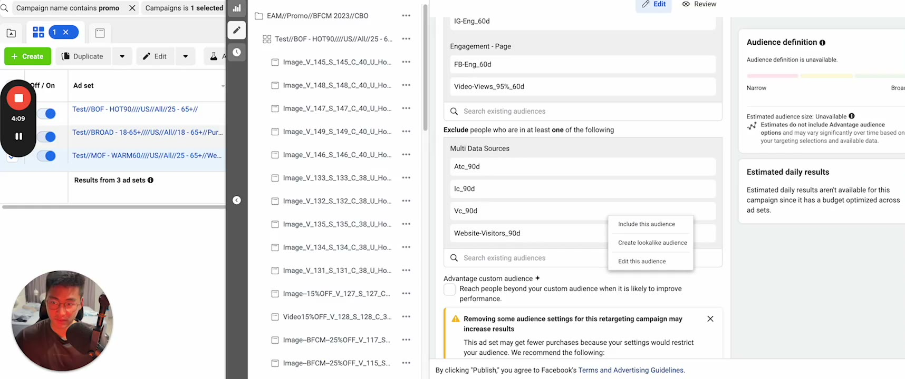
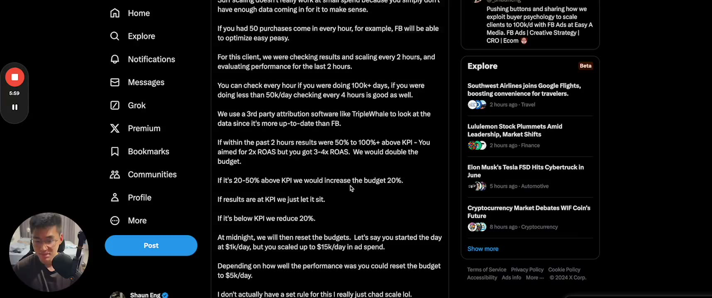

# 108. How To Set Up A Promo Campaign
> For sales (Mother's Day, BFCM, Valentine's Day), run one CBO with three ad sets (Broad, WARM60, HOT90), put sale banners over your best ads, and optionally self-scale the budget every few hours with a third-party attribution tool.

## 🤖 Agent use
- **Use when:** planning a sale or holiday promotion in Meta; building retargeting audiences for a sale; deciding how fast to scale a sale campaign.
- **Inputs → outputs:** sale dates, best-performing existing ads and product images, pixel audiences → a one-CBO, three-ad-set sale campaign, banner creatives, and a scaling schedule.
- **Rules:**
  - **DO** run this campaign type only during sale periods. "We only run this type of campaigns during sale periods." (page text)
  - **DO** use 1 CBO campaign with 3 ad sets: 1 Broad, 1 WARM60 (FB engagers, IG engagers, 95% video viewers over 60 days), 1 HOT90 (website visitors, view content, add to cart, initiate checkout over 90 days). (page text)
  - **DO** keep creative simple: banners over existing best ads plus simple product image ads that mention the sale. (page text) [05:03]
  - **DON'T** do retargeting outside sales: "Regularly, I will not do retargeting. Hasn't really worked that well for us. But for sale periods... it is very helpful". [00:43]
  - **DO** exclude HOT90 audiences from WARM60 to keep them separate. [01:39]
  - **IF** daily spend is under $50K **THEN** check results every 4 hours (6–8 hours is fine); with $20K/day or more hourly checks are possible. [05:57]
  - **IF** you self-scale **THEN** use third-party attribution (Hyros, Triple Whale, Northbeam; Whisper also heard "WeTrack") because Facebook data is too slow. [05:57]
  - **DON'T** self-scale without third-party attribution. [05:57]
- **See also:** [94. 3/2/2 Campaign](094-how-to-set-up-a-3-2-2-campaign.md) · [118. (Advanced) Surf Scaling Method](118-advanced-surf-scaling-method.md) · [115. How to Scale Facebook Ads](115-how-to-scale-facebook-ads-up-down.md) · [109. Naming templates](109-how-to-set-up-naming-templates.md) · [101. Targets & KPIs](101-how-to-set-targets-kpis.md)

## Key ideas

### Campaign structure [00:00–02:10]
- Instructor claim: "We've made millions with this one sale campaign structure alone"; used "for a few years now and it's never let us down". One campaign "made us 700k in about one month". [00:00]
- Structure: **one campaign, three ad sets**: Broad, WARM60, HOT90. [00:00–00:43]
- **Broad** = age, gender, country only. "No look likes, no interest." [00:43]
- **WARM60 (middle of funnel)**: Facebook page engagers, Instagram engagers, video viewers; "60 just means last 60 days". [00:43–01:39]
- **HOT90 (bottom of funnel)**: people already on the site: website visitors, view content, add to cart, initiate checkout, 90 days. [00:43, 01:39]
- Exclusions: WARM60 excludes the HOT90 audiences ("I don't want to mix my middle of funnel and bottom of funnel"). HOT90 includes what was excluded in WARM60. [01:39]
- All in one CBO, budget "as high as you want"; Facebook allocates to whichever ad set does best: "I don't really care where it allocates". [02:10]
- Why retargeting during sale: "We don't really care about returning customers for... sale periods we want them to purchase". [00:43]
- Claim: it "helped us go from 10k to 70k per day in 24 hours for all of our clients" (instructor claim). [04:05]

*Campaigns with "promo" in the name (May 2021-May 2024): BFCM campaign $193,975.82 spent at 3.75 ROAS on a $3,500/day budget, $728,085.90 purchase value, 2,635 purchases; other promos (Valentine's, Mother's Day, New Year, Halloween...) at 2.15-6.33 ROAS. Total: $282,833.08 and 3.89 ROAS across 16 campaigns. [00:15]*

*The BFCM campaign's three ad sets: HOT90 $37,565 spent at 4.27 ROAS (588 purchases), BROAD $68,362 at 3.76 (937), WARM60 $88,048 at 3.52 (1,110). Names start `Test//BOF`, `Test//BROAD`, `Test//MOF`. [00:50]*

### Building the audiences [02:10–04:05]
1. Ads Manager > All tools > Audiences > Create audience > Custom audience. [02:10]
2. **WARM60:** Facebook Page (everyone who engaged with the page, 60 days), Instagram account (everyone who engaged with this professional account, 60 days, audience retention default), **Video viewers 95%** (60 days; pick videos from ads or organic with over 1,000 views; name "Video Viewers 95%. 60 days"). [02:10–03:34]
3. Plug in via Custom audiences > include; exclude HOT90 from the same field. [03:34–04:05]
4. **HOT90:** Custom audience > Website > website visitors (90 days), view content, add to cart, initiate checkout. Create each, include them in HOT90 and exclude them in WARM60. [04:05]

*Instagram custom audience: event "Everyone who engaged with this professional account", retention 60 days. [03:10]*

*WARM60 ad set: includes IG-Eng_60d, FB-Eng_60d, Video-Views_95%_60d; excludes Atc_90d, Ic_90d, Vc_90d, Website-Visitors_90d. The ad list is sale-banner images (15% OFF, BFCM 25% OFF). [04:10]*

### Creative [04:05–05:57]
- Sale audiences are "most aware", so "all you need to do is create a graphic offer. Just put your product image offer." [04:05]
- "Take your best existing videos, the best existing images... put a banner on it" with the sale name (Black Friday etc.). Extra stacks of sale-only videos are optional: "it doesn't actually add on". [04:05–05:03]
- "Just announce the sale, show your product." [05:03]

### Scaling [05:03–07:44]
- Regular scaling: "scale only 20% or double the budget if performance is very good". Over about $3,000/day you can scale more aggressively and self-scale. [05:03]
- **Self-scaling** = scale intra-day (every 2, 4, 6 or 8 hours) instead of daily, using third-party attribution because "Facebook doesn't update their data that fast". [05:57]
- Frequency depends on spend: under $50K/day check every 4 hours (6–8 is fine); at $20K/day hourly is possible. [05:57]
- Rules per check window (instructor's text version, frame at 06:00):

| Result in last window | Action |
|---|---|
| 50–100%+ above KPI (aimed 2x, got 3–4x) | Double the budget |
| 20–50% above KPI | Increase budget 20% |
| At KPI | Let it sit |
| Below KPI | Reduce budget 20% |

- **Midnight reset:** reset budgets, e.g. start the day at $1K, scale to $15K, reset to $5K "depending on how well the performance was". Reason: a $15K budget will not spend fully (maybe $8–10K), so don't leave the final scaled budget. [06:47–07:44]
- "I don't have a super set rule for this." [07:44]

*Text version of self-scaling: "If within the past 2 hours results were 50% to 100%+ above KPI... double the budget"; "If it's 20-50% above KPI we would increase the budget 20%"; "At midnight, we will then reset the budgets"; "You can check every hour if you were doing 100k+ days, if you were doing less than 50k/day checking every 4 hours is good as well". The thread author name shown on screen is Shaun Eng. [06:00]*

## Steps / framework
1. Create CBO campaign named for the sale (frame names: `EAM//Promo//BFCM 2023//CBO`).
2. Ad set 1 Broad: age, gender, country only.
3. Ad set 2 WARM60: include IG engagers 60d, FB page engagers 60d, 95% video viewers 60d; exclude HOT90 audiences.
4. Ad set 3 HOT90: include website visitors, view content, add to cart, initiate checkout (90d).
5. Creatives: sale banner on best existing ads, simple product images mentioning the sale.
6. Scale: 20% or double the budget daily; if spend is $3K+/day and you have third-party attribution, self-scale with the table above and reset budget at midnight.

## Examples
- BFCM 2023 campaign (frame): $193,975.82 spent, $728,085.90 purchase value, ROAS 3.75, 2,635 purchases at $73.62 each; HOT90 4.27, Broad 3.76, WARM60 3.52. [00:15, 00:50]
- Another case from the audience demo: video-viewer audience from videos with "over a thousand views". [03:34]

## Structured units

### Templates
| Template | Use for | Example fill | Source |
|---|---|---|---|
| `Test//BOF - HOT90////<country>//<gender>//<age>//` | HOT90 ad set name | `Test//BOF - HOT90////US//All//25 - 65+//` | frame [00:50] |
| `Test//MOF - WARM60////<country>//<gender>//<age>//<audiences>` | WARM60 ad set name | `Test//MOF - WARM60////US//All//25 - 65+//We…` (truncated) | frame [00:50] |
| `Test//BROAD - <age>////<country>//<gender>//<age>//<audiences>` | Broad ad set name | `Test//BROAD - 18-65+////US//All//18 - 65+//Pur…` (truncated) | frame [00:50] |

### Rules of thumb
- **DO** keep promo creative simple. [05:03]
- **DON'T** mix MOF and BOF audiences. [01:39]
- **IF** a self-scaled day ends at a high budget **THEN** reset at midnight. [06:47]

## How to apply
- [ ] Name the campaign and ad sets with the template ([109](109-how-to-set-up-naming-templates.md)).
- [ ] Build the five custom audiences (IG 60d, FB 60d, 95% video 60d, website 90d, ATC/IC/VC 90d).
- [ ] Add banners to best ads; add simple product-image sale ads.
- [ ] Confirm third-party attribution before self-scaling; set check cadence by daily spend.
- [ ] Reset budgets at midnight.

## Related
- Previous: [107. How To Protect Against "Bad Ads" Over Spending](107-how-to-protect-against-bad-ads-over-spending.md) · Next: [109. How To Set Up Naming Templates](109-how-to-set-up-naming-templates.md)

## Sources and limitations
- Transcript: [108 transcript](<../../../../../raw/evolve/start-here/_transcripts/👣 Evolve (Start Here)/108. How To Set Up A Promo Campaign 👣 Evolve (Start Here) Evolve.txt>) · Page text: [108 page](<../../../../../raw/evolve/start-here/_extracted/👣 Evolve (Start Here)/108. How To Set Up A Promo Campaign_👣 Evolve (Start Here)_Evolve.html.md>)
- Machine transcription; full recording (497.6 s). Whisper garbles the catchphrase: "chat scale / I can close my eyes and still chat scale" is "chad scale" on screen (the thread text reads "I really just chad scale lol"). "Silk creatives" = sale creatives; "put the quiz inside once" and "WeTrack" are unclear. Timeline of the audience demo is partly mixed ("Warm 61st Facebook page"). The ad-account data in the frames comes from May 2024 and earlier (date range shown), so benchmarks may be older. The speaker's name is not stated in the audio; it is inferred from the on-screen X post.
