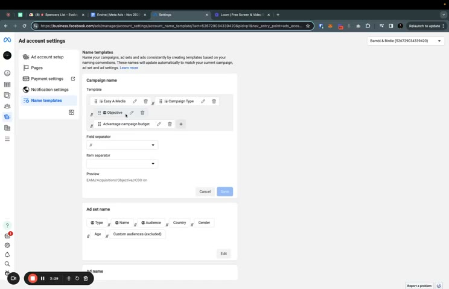
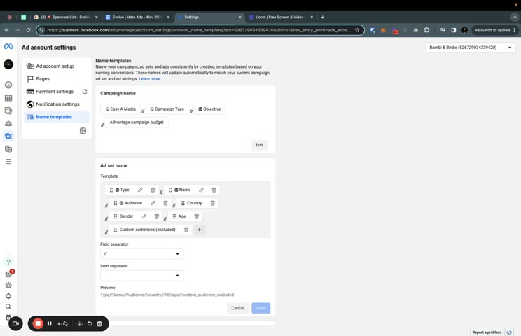
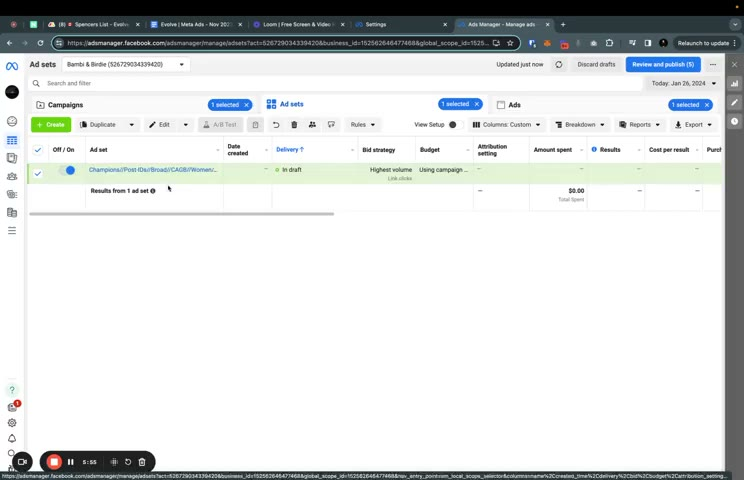

# 109. How To Set Up Naming Templates
> Use Ads Manager "Name templates" (campaign, ad set, ad) so names auto-fill from real settings and double as a safety check, and follow the three-level 2025 naming convention for ad files, ads and ad sets.

## 🤖 Agent use
- **Use when:** naming ad files, ads, ad sets or campaigns; reviewing an account's naming; building the learnings sheet (names carry batch, concept, format, type, editor, variation, copy and headline numbers).
- **Inputs → outputs:** batch number, concept/creator/sale name, URL type, format, creative type, editor, variation, copy and headline numbers → file names, ad names, and ad set names in the Evolve patterns.
- **Rules:**
  - **DO** treat naming as a "safety check", not a time sink: "I do not want to have this be something that slows you down". [00:00]
  - **DO** use Ads Manager name templates so country, gender, age and CBO state fill from the actual settings. [03:21–04:54]
  - **DO** record the ad type as `IDEA`, `ITER` or `IMIT` (Ideation, Iteration, Imitation) and the format as Video, Image, Promo, Raw or Creator. (docx)
  - **DO** name the Champions ad set `Champions//Post-IDs//…` and put DCT number plus concept in the first slot for test ad sets. [05:48]
  - **IF** an ad set targets other countries/genders than the template says **THEN** the auto-filled name exposes the mismatch. [04:03–04:54]
  - **DON'T** over-engineer: "it is definitely helpful... not crazy mandatory". [06:39]
- **See also:** [94. 3/2/2 Campaign](094-how-to-set-up-a-3-2-2-campaign.md) · [98. Raw Content Campaign](098-how-to-set-up-raw-content-campaign.md) · [108. Promo Campaign](108-how-to-set-up-a-promo-campaign.md) · [103. Champions](103-how-to-duplicate-ads-into-champions-new-way.md) · [100. Columns](100-how-to-see-ads-performance-our-columns.md)

## Key ideas

### Why name templates [00:00–02:31]
- Two ways to name in Facebook: type it, or use a template that "fills everything out for you already". Templates keep things "very, very organized". [00:00–00:48]
- Purpose: a safety check so "you do not turn off things that are not supposed to be turned off and vice versa". [00:00]
- Minimum: "just make sure that when you name your campaigns, you make sure that you know what they mean." [00:48]
- Campaign naming used by the team: DCT campaigns are called an **acquisition** campaign; `EAM` = Easya Media (a tag you do not need). [00:48–01:38]
- Ad-set level: `Champions` is the winners ad set; `Post-IDs` says only post IDs are in it. [01:38]
- Ad level example: ad about "moon hoops" (a jewelry type) with `TXT_2` (testing messaging on the creative), `HP` (sending to homepage), and `C1H1` (copy 1, headline 1). Detail is "confusing", so details are left for calls. [01:38–02:31]

### Where to set it up [02:31–05:48]
- Ads Manager > left menu > **Ad account settings > Name templates**. [02:31]
- **Campaign template** fields (in order): Easy A Media (optional; leave blank) // **Campaign Type** // **Objective** // **Advantage campaign budget**. Field separator `//`. Preview in frame: `EAM//Acquisition//Objective//CBO on`. [02:31–03:21]
- Campaign types used: **Acquisition**; **Testing** (only to test landing pages; "most of you probably won't even need this"); **Promo** (shown in a later video, see [108](108-how-to-set-up-a-promo-campaign.md)). [02:31]
- **Objective** field states whether the campaign targets a specific product selection or all products. [03:21]
- **Advantage campaign budget** states CBO or ABO and is filled dynamically, so you "know it's actually on rather than I just put CBO in there". [03:21–04:03]
- **Ad set template** (frame): Type // Name // Audience // Country // Gender // Age // Custom audiences (excluded). Preview: `Type//Name//Audience//country//All//age//custom_audience_excluded`. Dynamic fields: country, gender, age, custom audiences. [04:03]
- Demo: Canada targeted shows `CA`; adding US/UK changes it to `CAGB` without editing the name; changing gender to women shows "woman"; default shows `All`. [04:03–04:54]
- In **ad** names the first slot is either the DCT number plus the DCT name (e.g. "DCT number one, Moonhoops") or `Champions` plus the Post ID. Ads inside a DCT may simply carry the DCT name. [04:54–06:39]


*Ad account settings > Name templates > Campaign name: fields Easy A Media // Campaign Type // Objective // Advantage campaign budget, separator "//"; preview `EAM//Acquisition//Objective//CBO on`. [03:30]*


*Ad set name template with dynamic fields; preview `Type//Name//Audience//country//All//age//custom_audience_excluded`. [04:55]*


*The template output for a Champions ad set: `Champions//Post-IDs//Broad//CAGB//Women//…`, built automatically from settings. [05:55]*

## Steps / framework
1. Ad account settings > Name templates.
2. Build the Campaign template (Campaign Type // Objective // Advantage campaign budget) with `//` separator.
3. Build the Ad set template with dynamic fields (Type, Name, Audience, Country, Gender, Age, Custom audiences).
4. Name files per Level 1, ads per Level 2, ad sets per Level 3 below.
5. Check the generated names against the real targeting.

## Prompts / templates (verbatim)
From the attached doc "How To Set Up Naming Templates" (also the Google Doc linked on the page, "2025 Updated Naming Templates"). Typos are as in the source.

**Level #1: Naming Ad Files**
```
File Legend
Client: Client's Name
Batch #: Is the batch # for the creative team-developed ads
Edit #: Is the "Batch #" for editor-developed ads
Concept Name: Is the name given to the concept
Format: Is the source of the creative - Video, Image, Promo
Type: The type of creative - Ideation, Iteration, Imitation (IDEA,ITER,IMIT)
Editor: The person responsible for editing
Variation#: The variation number

Template: Client - Batch# - Concept Name - Format - Type - Editor - Variation#

Example: Carepod - Batch#122 - Stainless Steel - Video - IDEA - Dale - V2
Example: Katia Designs - Edit#4 - Mashup - Video - ITER - John - V3
```

**Level #2: Naming All Ads In Accounts - Batch# Testing**
```
Ad Account Legend
Batch #/UGC #/Page #: Is the specific # for each creative batch or page
Concept/Creator/Page-Name/Sale-Name: Is the name given to the concept, creator's name, page, or sale name
URL: Is the link to where the ad will be sent (CP = Collection Page, PDP = Product Page, HP = Homepage, LP-Name = Landing Page Name)
Format: Is the source of the creative - Video, Image, Promo, Raw, Creator
Type: The type of creative - Ideation, Iteration, Imitation (IDEA,ITER,IMIT)
Editor: The person responsible for editing
Variation#: The variation number
Copy#: Is the # of primary text (or copies in initial test) for that ad
Headline#: Is the # of the headline (or headlines in initial test) for that ad

Template: Batch#/Edit#/UGC#/Client# - Concept/Creator - URL - Format - Type - Editor - Variation# - Copy#,# - Headline#,#

Example: Batch#16_Armpits_PDP_Video_IDEA_John_V2_C_14,20_H_3,78
Example: UGC#4_GirlCreator_LP-Buy2Get1_Raw__V3_C_2,3_H_1,5
Example: Batch #25_Valentines-Sale__LP-Buy2Get1_Promo__V2_C_2,3_H_1,5
```

**Level #3: Ad Set Naming**
```
Ad Account Legend
Batch #/Edit #/UGC #/Client #/ Page #/Champions: Is the specific # for each creative batch or the champions adset specifically
Concept/Creator/Promo-Name//Post-IDs: Is the name given to the concept, page, creator's name, or the name for the champion's specific ad set (Post IDs)
Audience: Is the adset selected audience
Country: is the country selected
Age: Is the adsets age demo
Gender: Is the adsets gender demo
Attribution: Is the adsets attribution model
Exclusions: Is any audiences that have been excluded

Adset Template: Batch #/Edit #/UGC #/Client # or Champions//Concept-Name or Post-IDs//Attribution//Audience//Country//Age//Gender//Custom Aud.

Creative Testing Ad Set
Batch #10//Mom-Angle//7DC-1DV//Broad//US//18+//Women//Purchasers-30d

Champions Ad Set
Champions//Post-IDs//7DC//Broad//US//25+//All//Purchasers-180d

Landing Page Test Ad Set
Page #4//Additcion-Free//7DC//Broad//US//25+//Male//Purchasers-180d
```
(The doc uses `7DC-1DV` and `7DC` for attribution; read as 7-day click plus 1-day view and 7-day click only (derived; see [106](106-turning-on-seasonal-ads-for-quick-performance.md) and [116](116-how-to-understand-facebook-ads-attribution.md)).)

Spoken template (video, ad level): `<DCT # or Champions> // <DCT name or Post ID>`, e.g. "DCT number one, Moonhoops".

## Examples
- Ad set name from the screenshots: `Champions//Post-IDs//Broad//CAGB//Women//…`. [05:55, frame]
- Ad name pattern in the video: concept `Moonhoops` + `TXT_2` + `HP` + `C1H1`. [01:38]

## Structured units

### Templates
| Template | Use for | Example fill | Source |
|---|---|---|---|
| Client - Batch# - Concept Name - Format - Type - Editor - Variation# | Ad file names | Carepod - Batch#122 - Stainless Steel - Video - IDEA - Dale - V2 | docx Level 1 |
| Batch#/Edit#/UGC#/Client# - Concept/Creator - URL - Format - Type - Editor - Variation# - Copy#,# - Headline#,# | Ads in the account | Batch#16_Armpits_PDP_Video_IDEA_John_V2_C_14,20_H_3,78 | docx Level 2 |
| Batch#/…//Concept-Name//Attribution//Audience//Country//Age//Gender//Custom Aud. | Ad sets | Batch #10//Mom-Angle//7DC-1DV//Broad//US//18+//Women//Purchasers-30d | docx Level 3 |
| Campaign Type // Objective // Advantage campaign budget | Campaigns | EAM//Acquisition//Objective//CBO on | [03:30, frame] |

### Rules of thumb
- **DO** keep the three IDs consistent between file, ad and ad set names so a learning can be traced back. (derived)
- **DON'T** treat naming as the work; it is a safety check. [00:00]

## How to apply
- [ ] Set up the Name templates in Ad account settings.
- [ ] Apply Level 1 naming when files leave the editor.
- [ ] Apply Level 2/Level 3 when uploading; verify auto-filled country, gender, age against targeting.
- [ ] Keep the winners ad set named `Champions//Post-IDs//…`.

## Related
- Previous: [108. How To Set Up A Promo Campaign](108-how-to-set-up-a-promo-campaign.md) · Next: [110. Winning Ads Definition - Part 1](110-winning-ads-definition-part-1.md)

## Sources and limitations
- Transcript: [109 transcript](<../../../../../raw/evolve/start-here/_transcripts/👣 Evolve (Start Here)/109. How To Set Up Naming Templates 👣 Evolve (Start Here) Evolve.txt>) · Page text: [109 page](<../../../../../raw/evolve/start-here/_extracted/👣 Evolve (Start Here)/109. How To Set Up Naming Templates_👣 Evolve (Start Here)_Evolve.html.md>) · Attachment: [docx text](<../../../../../raw/evolve/start-here/_extracted/👣 Evolve (Start Here)/109. How To Set Up Naming Templates.docx.md>) · Linked Google Doc export: [109 doc](../../../../../raw/evolve/start-here/_extracted/_linked/google/109-document-1WFJYZr2h6.docx.md) (identical to the attachment)
- Machine transcription; full recording (405.97 s). Whisper writes "EZA Media" and "Easy A Media" for Easya Media, "AVO" for ABO, "Moon hoops" (jewelry) as heard. The video demos an older template (Type/Name/Audience/Country/Gender/Age/Custom audiences) than the 2025 doc (which adds Attribution and Batch/UGC/Page numbers). The doc and the video differ; use the doc as current. The doc's "Additcion-Free" is a typo in the source.
