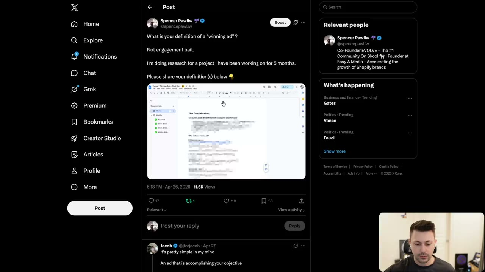
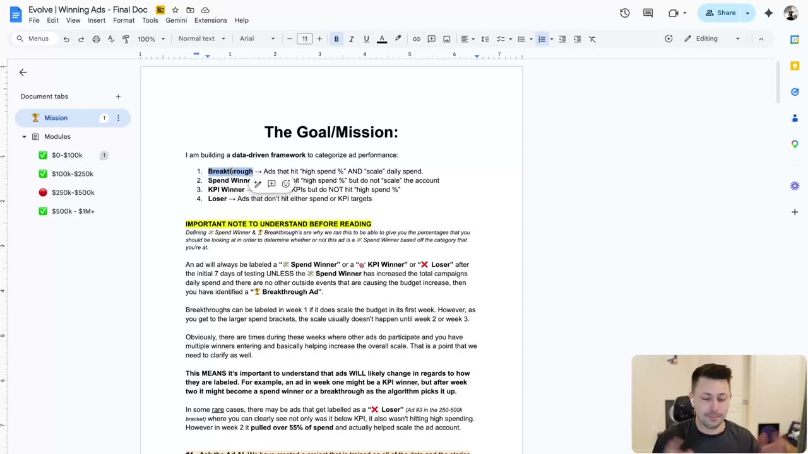
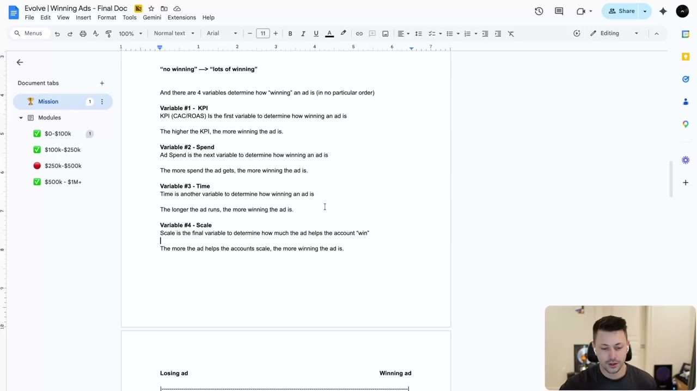
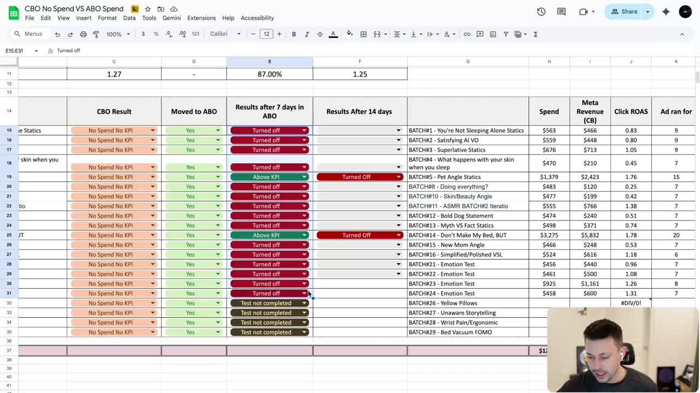
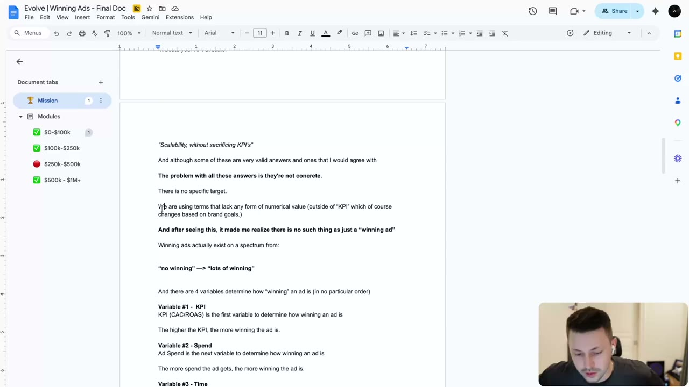
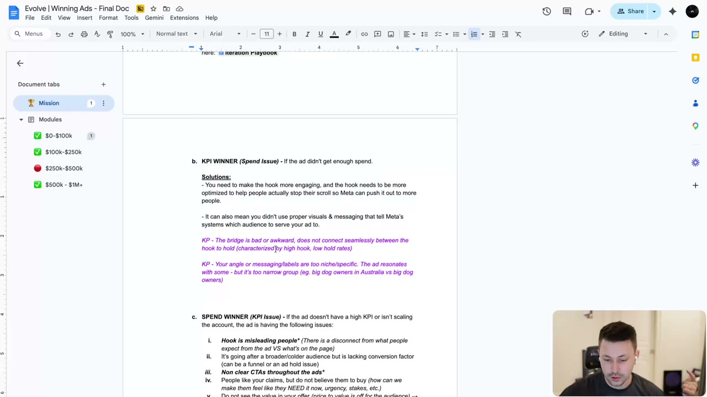

# 110. Winning Ads Definition - Part 1
> There is no single "winning ad"; ads sit on a spectrum set by KPI, spend, time and scale, and are labelled Breakthrough, Spend Winner, KPI Winner or Loser from their share of CBO spend and ROAS in week 1 (and whether the campaign's daily budget rose). The team's north star becomes breakthrough hit rate, and each label comes with a diagnosis and iteration path.

## 🤖 Agent use
- **Use when:** classifying an ad after its first test week; deciding to kill, keep, scale or iterate; reporting hit rate to a team; choosing the right iteration fix for an ad that spends but doesn't convert (or converts but doesn't spend).
- **Inputs → outputs:** ad-level spend and ROAS for the first 7 days in a CBO, the campaign's initial ROAS, whether daily campaign budget rose after launch, monthly spend bracket → one of four labels with the matching iteration playbook, and a KPI for the team (breakthrough hit rate).
- **Rules:**
  - **DO** label each ad after week 1 as Breakthrough, Spend Winner, KPI Winner or Loser using the definitions below. Labels can change by week 2 or 3. [16:59; doc "IMPORTANT NOTE"]
  - **DO** use breakthrough hit rate, not generic "hit rate", as the north star: "what really matters is breakthrough hit rate". [17:43]
  - **DON'T** call an ad a winner because it spent a threshold: "just because an ad spends $2,000 doesn't make it a winner... I could have an ad spend $2,000 and then get turned off the next week." [02:28]
  - **DO** judge on click-based data (7-day or 1-day click) and net-new customers. [09:38–11:18; doc]
  - **DO** test in CBO so Meta decides which ads deserve spend. [12:01–14:29]
  - **IF** an ad is a **KPI Winner** (ROAS ok, low spend) **THEN** fix the hook, visuals/messaging and bridge, or widen the angle. [20:09–21:01; doc 4b]
  - **IF** an ad is a **Spend Winner** (spend ok, low KPI) **THEN** check hook honesty, audience breadth, CTAs, belief, price-value and logistics. [21:01–21:44; doc 4c]
  - **IF** a winner **dies fast** **THEN** expand the avatar, move up the funnel, raise awareness level, add emotion, or check seasonality. [21:44–22:26; doc 4d]
  - **IF** a **Breakthrough** **THEN** run the Iteration Playbook (aggressive iteration and variation). [20:09; doc 4a]
- **See also:** [111. Winning Ads Definition - Part 2](111-winning-ads-definition-part-2.md) · [112. Winning Ad Definitions (0/mo-1M/mo)](112-winning-ad-definitions-0-mo-1m-mo.md) · [113. How To Generate + Submit Winning Ad Report](113-how-to-generate-submit-winning-ad-report.md) · [Iteration playbook (Copywriting)](../../copywriting/frameworks/iteration-playbook.md) · [Iteration issue codes (Copywriting)](../../copywriting/frameworks/iteration-issue-codes.md) · [Iteration vs variation](../../../../concepts/iteration-vs-variation.md)

## Key ideas

### 1. Why define a winning ad [00:00–04:54]
- Spencer inserted an intro "from the future" so the "why" comes before the data. Audience is anyone with editors or creative strategists who need alignment, especially for people with a "10%, 15% hit rate, but... I'm not winning". [00:00–00:58]
- Problem: "nobody has a clear answer on what makes a winning ad." [00:58]
- Example from X: a post says creative win rate is 10–20% good, under 10% is "a volume game"; asked what a win is, the reply: hitting a spend threshold and a KPI (ROAS or CPA), the threshold "whatever you want it to be, relative to your AOV and CPA, could be $500 per ad, $2,000 per ad" (screenshot of a Phil Kiel / "ron" thread, in the doc). [01:45]
- Spencer's own X poll ("What is your definition of a 'winning ad'?", 17 replies, 11.6K views on screen) surfaced definitions: "An ad that is accomplishing your objective" (Jacob; a bottom-of-funnel ad may be a high-KPI ad, a top-of-funnel ad may just soak spend); "It beats your KPI at scale"; "Scalability, without sacrificing KPI's"; "Anything that hits target CPA whilst allowing increase in total spend". [03:08–04:02]
- Critique: none is concrete. "What's scale?... What is the XX?... By how much?" There is no numerical target, and spend thresholds change with account size ($1M/month vs $100/month). [04:02–04:54]
- Old team definition: "an ad that just scales the account". It is incomplete: some ads help overall ROAS or hold the account (middle-of-funnel). [04:54–05:33]


*His X poll ("Not engagement bait... research for a project I have been working on for 5 months") with the Google Doc screenshot attached and Jacob's reply "An ad that is accomplishing your objective". [03:00]*

### 2. Winning is a spectrum with 4 variables [05:33–09:38]
- Winning ads live on a spectrum "no winning" → "lots of winning". Breakthroughs differ: one may add 30–40% to a $100–250K/month account, another 200%; hold them to the same standard. One breakthrough spent over $1.5M, "an ad that we should be studying a lot harder than a breakthrough... that spent maybe like $300,000". [05:33–06:14]
- Four variables, "in no particular order": [06:14–07:37; doc]

| Variable | Rule | Losing end | Winning end |
|---|---|---|---|
| KPI (CAC/ROAS) | The higher the KPI, the more winning | Low/no KPI | Super high KPI |
| Spend | The more spend the ad gets, the more winning | Low/no spend | All of the spend |
| Time | The longer the ad runs, the more winning | Runs 1 day | Runs 30+ days |
| Scale | The more the ad helps the account scale, the more winning | Increases spend 0% | Increases spend 100%+ |

- Example: 10K/day account at a 2x; an ad takes 100% of spend at 10x: "an amazing winning ad". [06:59]
- Spend and KPI usually indicate scale, because "as you increase spend, ROAS will usually go down", but the breakthrough reports show cases where spend rises and KPI is up. [07:37–08:17]
- "Middle" ads: lots of spend but weak KPI, only +10% spend, runs three weeks. Communicate to the team: maximise all four. [08:51–09:38]


*The doc's variable sections (Variable #1 KPI, #2 Spend, #3 Time, #4 Scale) and the "Losing ad ... Winning ad" scale below. [06:30]*

### 3. Two crucial components: click-based data and net-new customers [09:38–12:01]
- **Click-based data:** review only 7-day or 1-day click data. "View data is not incremental from what we have seen." TikTok view-through can be incremental, but for Facebook they want clicks and purchases; if a view-through-heavy ad still scales and spends, that is still fine ("all that matters is that you're scaling"). [09:38–11:18; doc]
- **Net new customers:** look at the new-visitor % in Northbeam or Triple Whale; a high share signals scalability. Existing-customer targeting "is gonna be capped by a specific TAM" and for "98% of businesses" growth means new customers. [11:18–12:01; doc]

### 4. The EVOLVE testing process: CBO [12:01–16:59]
- All ads in the dataset were tested in CBO. "When you test in ABO or you apply a minimum budget to your creative, you are forcing Meta to go out and get you purchases." Those ads may show decent ROAS but "a lot of the time they are not incremental": low new-visitor % in Northbeam/Triple Whale; they "collect" rather than "generate" purchases (retargeting-like). [12:01–13:45]
- Testing in CBO tells Meta "only spend on these ads if you think they're good enough to scale." The spend percentages below are "based on the CBO campaign structure all the way up to 500K plus a month". [13:45–14:29]
- Time matters because a "two days, $100 day budget ABO, 3x ROAS" win is usually switched off within a week. [14:29–15:13]
- Evidence sheet "CBO No Spend VS ABO Spend": ads that got no spend in CBO moved to ABO; after 7 days, 14 days, how many scaled? First account about 1 of at least 30; one account 0 (3 ads above KPI at day 7, all off by day 14); another 2 of 30–40 "quote unquote scaling"; one with 17 ads, 2 above KPI at day 7, none at day 14. Total: "176 ads... not getting spent in CBO that we moved to ABO... literally, I think one of them actually ended up quote unquote scaling". [15:13–16:59]
- Position: "I'm not saying you have to test in CBO, but for the sake of the data to follow, it is crucial for you to know...". Also: "I don't really care" about CBO vs ABO at this point. [12:01, 14:29]


*"CBO No Spend VS ABO Spend": CPA $27, ROAS target 2.5x, min spend in ABO $189. CBO (28 Feb-10 July): $614,226 spend, $1,036,546 Meta revenue, 1.69 ROAS, 5.05 frequency, 96% (NVP, new-visitor % per the audio, derived), TW ROAS 1.39, NC ROAS 1.27. ABO: $38,287 spend, $65,546 revenue, 1.71 ROAS, 68% NVP, TW ROAS 1.45. Rows below list each creative's CBO result, "Moved to ABO", result after 7 and 14 days. [08:20] (audio discusses the sheet at [15:13])*


*Another account: almost all "No Spend No KPI" ads moved to ABO were "Turned off" after 7 days; two (Batch #5 Pet Angle statics, Batch #14) were "Above KPI" and still "Turned Off" at 14 days; four "Test not completed". [16:10]*

### 5. The four labels and the doc's definitions [mission doc; 16:59]
- Mission: a "data-driven framework to categorize ad performance". [doc]
- Categories (doc and frame): [doc "The Goal/Mission"]

| Label | Definition |
|---|---|
| 🏆 Breakthrough | Hits "high spend %" AND scales daily spend |
| 💸 Spend Winner | Hits "high spend %" but does not scale the account |
| 🎯 KPI Winner | Hits KPIs but not "high spend %" |
| ❌ Loser | Hits neither spend nor KPI targets |

- Labelling timing: after the first 7 days an ad is Spend Winner, KPI Winner or Loser unless the Spend Winner has "increased the total campaign's daily spend" with no other outside event, which makes it a Breakthrough. Breakthroughs can be labelled in week 1, but "as you get to the larger spend brackets, the scale usually doesn't happen until week 2 or week 3". Labels can change (a KPI winner in week 1 can become a Spend Winner or Breakthrough in week 2). [doc]
- Rare case: an ad labelled Loser in week 1 pulled over 55% of spend in week 2 and helped scale (doc: "Ad #4 in the 500k+ bracket"; the on-screen version says "Ad #3 in the 250-500k bracket"). [doc; frame at 05:00]
- Spend brackets (doc tabs shown in the frame): $0-$100k, $100k-$250k, $250k-$500k, $500k-$1M+ per month. [frame 05:00]


*"The Goal/Mission": the four categories, the left tabs for each spend bracket ($0-$100k to $500k-$1M+), and the week-1 labelling note. [05:00]*

### 6. What you get from the framework: five action items [16:59–23:25]
1. **Labelling** so people agree what a Breakthrough, Spend Winner, KPI Winner and Loser are. Example sentence: "This is 100% a Breakthrough ad because in my spend category of $0 to $100K per month, after Week 1 the ad spent 50% of my campaign's budget and increased the total daily spend by 70%." Breakthrough hit rate is the north star; a 20% hit rate of spend/KPI winners with no scaling means you "need breakthroughs". [16:59–18:34]
2. **Ad scaling**: how much an ad should scale the account. "On average, breakthroughs at $500K to a million a month will increase your ad spend by 34%" (dataset claim; detail in [112](112-winning-ad-definitions-0-mo-1m-mo.md)). [18:34–19:15]
3. **Ad killing**: guidance to keep or kill based on prior breakthrough signals; an AI/"Claude Skill" will answer "should we kill this?"; the reporting process is "phase two". [19:15–20:09]
4. **Iteration recommendations** (see table below). [20:09–22:26]
5. **Ad optimization**: how much ROAS falls if you increase spend or rises if you decrease it; e.g. "you can safely scale spend 100% while still staying above KPI, GIVEN... ad is currently at X spend and Y KPI". Being tested with clients. [22:26–23:25]
- Key message: "It's how winning are the ads", not "winning ads". [23:25]


*Section 4b-4c: "KPI WINNER (Spend Issue)" fixes (more engaging hook, proper visuals/messaging, bridge, niche angle) and "SPEND WINNER (KPI Issue)" reasons. [21:00]*

## Steps / framework

### Classification flow (derived from the doc's definitions)
1. Test the ad in a CBO for 7 days. Record the share of campaign spend it took, its ROAS versus the campaign's initial ROAS, and whether the campaign's daily budget rose because of it (10% to 100%+).
2. Look up the bracket spend-% threshold for your monthly spend (**10–30% or more**; "higher spend, lower %, lower spend, higher %") ([112](112-winning-ad-definitions-0-mo-1m-mo.md) has the per-bracket numbers).
3. Apply the label table below.
4. Re-check at week 2 and week 3.

### Label definitions ("IDGAF" definitions, last updated May 13th, 2026)
| Label | Spend rule | KPI rule | Budget rule |
|---|---|---|---|
| 💸 Spend Winner (Week 1) | Captures **10–30% or more** of total campaign spend (higher spend, lower %; lower spend, higher %) | — | Campaign budget has NOT increased week over week as a result of the ad |
| 🎯 KPI Winner (Week 1) | Not capturing at least 10–30% of spend | Ad ROAS the same as, or higher than, the initial campaign ROAS | — |
| ❌ Loser (Week 1) | Less than 10–30% of total campaign spend | Ad ROAS below initial campaign ROAS | — |
| 🏆 Breakthrough (Weeks 1+) | Captures 10–30% or more of total campaign spend | — | Campaign budget HAS increased week over week as a result of launching the ad (10% to 100%+ increase) |

An ad labelled Spend Winner or KPI Winner in week 1 can become a Breakthrough in week 2 or 3 if it pulls the set % of spend and increases the daily budget. [doc "Definitions"]

### Iteration recommendations (doc section 4)
| Situation | Diagnosis | Fix |
|---|---|---|
| 🏆 Breakthrough (Winner) | Crushing it | Follow the iteration playbook: dissect core components, aggressive iteration and variation |
| 🎯 KPI Winner (Spend Issue): didn't get enough spend | Hook not stopping scroll; weak visuals and messaging that tell Meta whom to serve; bridge "bad or awkward" (high hook, low hold); angle or labels too niche (e.g. "big dog owners in Australia vs big dog owners") | Make the hook more engaging; use proper visuals and messaging; fix the hook-to-hold bridge; broaden the label |
| 💸 Spend Winner (KPI Issue): doesn't have high KPI or scale | See list below | Study price objections; clarify CTAs; build belief and urgency; close open loops |
| Time issue: dying fast | See list below | Expand avatar, raise awareness, add emotion, refresh seasonal assets |

Spend Winner (KPI Issue) causes: (i) hook is misleading, disconnect between expectation and page; (ii) broader/colder audience but lacking conversion factor (funnel or ad hold); (iii) non-clear CTAs; (iv) people like your claims but do not believe them (urgency, stakes); (v) value not seen, price to value off, study price objections; (vi) offer has logistical issues; "KP note": you did not close all the loops opened earlier, strong soft metrics but low KPI. [doc 4c]

Time issue causes (doc 4d): expand the avatar (self identity + valence + intensity), increase TAM; gone too bottom of funnel (picked up the scraps); try a higher awareness level (problem aware/unaware); not resonating on an emotional level; people realise it's fake (AI-native story ads); competitor launches a better offer or creative; seasonal demand issues (example humidifier in July); seasonal messaging/visuals fatigue (winter background in UGC in spring or summer). [doc 4d]

## Examples
- 🏆 "This is 100% a Breakthrough ad because in my spend category of $0-$100k/mo, after Week 1 the ad spent 50% of my campaign's budget and increased my total daily spend by 70%." (doc, template statement) [18:34]
- 🎯 "This is 100% a KPI Winner because in my spend category of $100k-$250k/mo, the ad failed to spend 22% or more in the first week, but it was above the initial campaign ROAS." (doc)
- 💸 "This Ad is showing as a clear Spend Winner. However, the KPI is much further below what it should be based on breakthrough data. So, I am confident in turning this ad off to save the campaign performance." (doc, ad-killing example)
- Stat: "On average Breakthrough at $500k-$1M+/mo will increase your ad spend by 34%." (doc; dataset claim)
- Stat: a client breakthrough that spent over $1.5M (audio; instructor claim). [06:14]

## Structured units

### Rules of thumb
- **DO** use one shared vocabulary (Breakthrough, Spend Winner, KPI Winner, Loser) across team and tools. [16:59]
- **DON'T** report a generic hit rate as success if the account isn't scaling. [17:43]
- **IF** week-1 ad is a Loser **THEN** still watch it into week 2 (one rare case took 55%+ of spend). [doc]
- **IF** ABO shows a high ROAS **THEN** check the new-visitor %; low % means retargeting-style purchases. [12:47]

### Hit rate vocabulary (derived)
| Metric | Meaning | Source |
|---|---|---|
| Breakthrough hit rate | Share of tested ads that become Breakthroughs; the north star | [17:43] |
| Spend Winner rate | Signals you are "doing something right" | [17:43] |
| KPI Winner rate | Ads getting purchases that "aren't complete flops" | [17:43] |
| Loser rate | "We're not even close here" | [17:43] |

## Prompts / templates (verbatim)
Ad-labelling template statements are above. The claude-code reporting tool from the doc ("📊 Generating Reports"):
```
Step1 : Download VS Code: https://code.visualstudio.com/
Step 2: Create "Claude Code" Folder
Step 3: Download this folder + follow steps
Repo: https://github.com/zjamesblake/analyze-breakthrough
1. Download ZIP from the repo
2. Unzip and place analyze-breakthrough/ in his Claude Code workspace
3. Open Claude Code and say: "Go into analyze-breakthrough and install the requirements"
4. Drop a CSV into account-csvs/
5. Run: /analyze-breakthrough @File.csv "AD NAME" --brand "Brand"
6. Report lands in breakthrough-reports/
Step 4: Upload CSV into google sheet + open for all to view
Step 5: Submit via Clickup Form
```
The doc also describes "#4 - Ask the Ad AI": "We have created a project that is trained on all of the data and the stories that come from it for this data set. (Coming as a Claude Skill)". Not included in the course files: the AI project itself. The repository and ClickUp form are external; review the repo before running its install step (derived advice). Report workflow continues in [113](113-how-to-generate-submit-winning-ad-report.md).

## How to apply
- [ ] Record per ad: first-7-day spend share, ROAS vs initial campaign ROAS, whether campaign daily budget rose.
- [ ] Pick the spend bracket and the 10–30% threshold ([112](112-winning-ad-definitions-0-mo-1m-mo.md)).
- [ ] Label: Breakthrough, Spend Winner, KPI Winner or Loser; relabel in weeks 2 and 3.
- [ ] Choose the fix list from the table above and write the iteration brief.
- [ ] Track breakthrough hit rate per creator/editor/strategist.
- [ ] Test in CBO; if using ABO, check new-visitor % before trusting ROAS.

## Related
- Previous: [109. How To Set Up Naming Templates](109-how-to-set-up-naming-templates.md) · Next: [111. Winning Ads Definition - Part 2](111-winning-ads-definition-part-2.md)
- [100. Columns](100-how-to-see-ads-performance-our-columns.md) · [106. Seasonal ads](106-turning-on-seasonal-ads-for-quick-performance.md) · [107. Protect against overspending](107-how-to-protect-against-bad-ads-over-spending.md)

## Sources and limitations
- Transcript: [110 transcript](<../../../../../raw/evolve/start-here/_transcripts/👣 Evolve (Start Here)/110. 🆕 Winning Ads Definition - Part 1 👣 Evolve (Start Here) Evolve.txt>) · Page text: [110 page](<../../../../../raw/evolve/start-here/_extracted/👣 Evolve (Start Here)/110. 🆕 Winning Ads Definition - Part 1_👣 Evolve (Start Here)_Evolve.html.md>) · Attachment: [docx text](<../../../../../raw/evolve/start-here/_extracted/👣 Evolve (Start Here)/110. 🆕 Winning Ads Definition.docx.md>) · Linked Google Doc: [110 doc export](../../../../../raw/evolve/start-here/_extracted/_linked/google/110-document-1ZStpr7F1B.docx.md) (the same as the attachment except the report-generation section, which only the attachment holds) · Embedded image from the doc: a screenshot of a Phil Kiel / "ron" thread, quoted above.
- Machine transcription; full recording (1430.95 s). Whisper writes "spam winners" for "spend winners" and "Opal is going to cook me" refers to the site blocker (not content). The "Master Winning Ads Analysis" sheet and "CBO No Spend VS ABO Spend" sheet are linked from the doc; the Master sheet is covered under lessons 111-112 and the CBO vs ABO sheet is only seen on screen here. The "34%" and "55%" stats come from the doc, not verified. The audio stays at general definitions: per-bracket percentages are not in this lesson. The video frame at 08:20 shows the ABO sheet while the audio at that time is about the spectrum, so audio and frame may be cut in different orders (the instructor re-edited the lesson). The iteration playbook link in the doc points to a Skool classroom page not included in the files.
