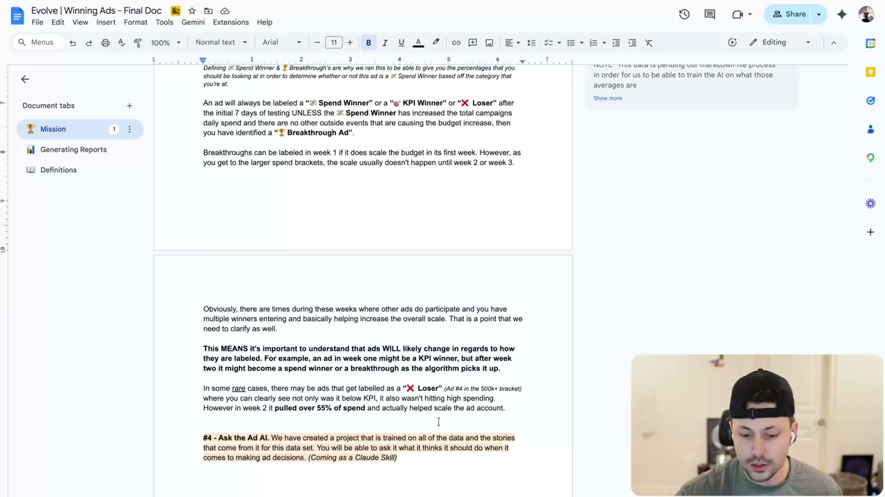

# 111. Winning Ads Definition - Part 2
> An ad's label after week 1 is provisional: a spend winner, KPI winner or even a loser can become a breakthrough in week 2 or 3, so never lock a label or kill an ad on week-1 data alone.

## 🤖 Agent use
- **Use when:** labelling a test ad (breakthrough / spend winner / KPI winner / loser), deciding whether to kill or keep an ad after its first 7 days, or writing a performance report that states an ad's status.
- **Inputs → outputs:** the ad's share of campaign (or account) spend, its ROAS versus the campaign ROAS, and whether total daily budget rose after launch → a provisional label plus a note that it must be re-checked in weeks 2 and 3.
- **Rules:**
  - **DO** label provisionally: "what you label an ad in week one may not be an ad's final result". [00:00]
  - **IF** an ad is a spend winner, KPI winner or loser in week 1 **THEN** re-check it in week 2 and week 3. At higher spend brackets "sometimes it takes a week or so for an ad to really pick up spend". [00:47]
  - **IF** the ad launches mid-week, sucks up about 50% of spend and total daily budget rises from $3k to $5k within 7 days **THEN** call it a breakthrough immediately. Breakthroughs can happen in week 1. [00:47–01:43]
  - **DON'T** assume a KPI winner stays a KPI winner: very high-KPI ads in particular "become breakthroughs" once the algorithm picks them up. [00:47]
  - **DO** log the label and the week it was assigned, so the label history is visible. (derived)
- **See also:** [112. Winning Ad Definitions ($0/mo-$1M/mo)](112-winning-ad-definitions-0-mo-1m-mo.md) (the actual thresholds) · [113. How To Generate + Submit Winning Ad Report](113-how-to-generate-submit-winning-ad-report.md) · [110. Winning Ads Definition - Part 1](110-winning-ads-definition-part-1.md) · [Iteration outcomes (Copywriting)](../../copywriting/concepts/iteration-outcomes.md)

## Key ideas

### 1. Context: the definitions moved into a sheet [00:00–00:47]
- The instructor says this is "Spencer from way in the future": he is adding a note ahead of the definitions. The old bracket-by-bracket text ("zero to 100K, 100K to 250") "is gone" from the document because "we have actually moved the definitions into a sheet". [00:00]
- The actual thresholds are in the next video ([112](112-winning-ad-definitions-0-mo-1m-mo.md)): "that's the very next video". [00:00]

### 2. Labels are not final after week 1 [00:00–01:43]
- Example: an ad is a spend winner in week 1 because it hits the spend threshold, but it does not scale the account. In week 2 it starts to scale the account. It is then a breakthrough. [00:00]
- "You likely will have spend winners, KPI winners or losers in week one that may turn into breakthroughs in week two." Reason given: at higher spend brackets "sometimes it takes a week or so for an ad to really pick up spend and really have a big impact." [00:47]
- "This is more common with very high KPI winners that become breakthroughs." [00:47]
- You can still have a week-1 breakthrough. Worked example: you launch an ad on a Wednesday while spending $3k/day; seven days later the budget is $5k/day and the ad has "sucked up like 50% of spend". "That ad is what allowed you to scale further", so it is a breakthrough. [00:47–01:43]
- The point is not that breakthroughs cannot appear early. It is that you "might not see the full impact until later, especially if you are in the higher spend categories". [01:43]

### 3. What is coming next [01:43–02:54]
- The next-but-one video ([113](113-how-to-generate-submit-winning-ad-report.md)) shows "the very first Claude skill" for generating these reports from your own ad account. You can then share the reports with the course team. [01:43]
- A series of further Claude skills is planned so you can "train your own AI on your ad account data" and ask things like "here's the stats from a new ad, do you think I should turn this off?" and "how is this pacing in regards to my other breakthroughs? Is it the same kind of KPI percentage above or below?" [01:43–02:42]
- The speaker presents this as an incentive to watch the "how to generate and submit the reports" video. [02:42]

## Steps / framework
Provisional-label routine (derived from [00:00–01:43] and the document's "Mission" tab):

| Step | Check | Action |
|---|---|---|
| Day 7 | Spend share and ROAS vs campaign for the ad | Assign spend winner / KPI winner / loser (thresholds in [112](112-winning-ad-definitions-0-mo-1m-mo.md)) |
| Day 7 | Did total daily budget rise because of this ad, with no other outside cause? | If yes and the spend share is met, label breakthrough |
| Week 2 | Re-pull the same numbers | Upgrade the label if the ad now holds the spend share and budget rose |
| Week 3 | Re-pull again | Same; breakthroughs at large spend often only show now |

## Examples
- **Late-bloomer (instructor's illustration):** spend winner in week 1 that did not move total budget, then starts scaling the account in week 2 → relabel breakthrough. [00:00]
- **Week-1 breakthrough:** $3k/day → $5k/day over 7 days with one ad holding about 50% of spend → breakthrough in week 1. [00:47–01:43]
- **Rare loser-to-breakthrough case (document, "Mission" tab):** an ad that was below KPI and not hitting high spend (Ad #4 in the $500k+ bracket) "pulled over 55% of spend" in week 2 and helped scale the ad account. The document says such cases are rare. This is the same ad the sheet in lesson 112 records at 2.6% spend in week 1 and 55.8% of initial-campaign spend in week 2. (Frame at [00:45] shows this paragraph on screen.)

## Prompts / templates (verbatim)
The on-screen "Mission" tab text the instructor reads from (Document "Mission" tab, "IMPORTANT NOTE" section):

```
An ad will always be labeled a "Spend Winner" or a "KPI Winner" or "Loser" after the initial 7 days of testing UNLESS the Spend Winner has increased the total campaigns daily spend and there are no other outside events that are causing the budget increase, then you have identified a "Breakthrough Ad".

Breakthroughs can be labeled in week 1 if it does scale the budget in its first week. However, as you get to the larger spend brackets, the scale usually doesn't happen until week 2 or week 3.

Obviously, there are times during these weeks where other ads do participate and you have multiple winners entering and basically helping increase the overall scale. That is a point that we need to clarify as well.

This MEANS it's important to understand that ads WILL likely change in regards to how they are labeled. For example, an ad in week one might be a KPI winner, but after week two it might become a spend winner or a breakthrough as the algorithm picks it up.

In some rare cases, there may be ads that get labelled as a "Loser" (Ad #4 in the 500k+ bracket) where you can clearly see not only was it below KPI, it also wasn't hitting high spending. However in week 2 it pulled over 55% of spend and actually helped scale the ad account.
```

## Screenshots

*The Mission tab of the Winning Ads doc (tabs: Mission, Generating Reports, Definitions). Bold text: ads "WILL likely change" label between weeks; the rare "Loser" that pulled over 55% of spend in week 2 is the last paragraph. [00:45]*

## How to apply
- [ ] Stamp every ad label with the week it was assigned (W1, W2, W3).
- [ ] Do not kill a KPI winner or spend winner on week-1 data alone; re-pull in week 2 and 3. (Losers: see the rule in [112](112-winning-ad-definitions-0-mo-1m-mo.md) that they are "more than likely good to turn off".)
- [ ] If budget rose after launch and no other change explains it, check the spend-share threshold and consider a breakthrough label.
- [ ] If you are above roughly $100k/month in spend, expect the scaling effect to appear in week 2-3, not week 1. (derived from [00:47])

## Related
- Previous: [110. Winning Ads Definition - Part 1](110-winning-ads-definition-part-1.md) · Next: [112. Winning Ad Definitions ($0/mo-$1M/mo)](112-winning-ad-definitions-0-mo-1m-mo.md)
- [Iteration outcomes (Copywriting)](../../copywriting/concepts/iteration-outcomes.md) · [How to iterate on breakthroughs (Copywriting 51)](../../copywriting/lessons/51-how-to-iterate-on-breakthroughs.md) · [Test and iterate playbook](../../../../playbooks/test-and-iterate.md)

## Sources and limitations
- Transcript: [111 transcript](<../../../../../raw/evolve/start-here/_transcripts/👣 Evolve (Start Here)/111. 🆕 Winning Ads Definition - Part 2 👣 Evolve (Start Here) Evolve.txt>) · Page text: [111 page](<../../../../../raw/evolve/start-here/_extracted/👣 Evolve (Start Here)/111. 🆕 Winning Ads Definition - Part 2_👣 Evolve (Start Here)_Evolve.html.md>) (only a link to the Google Doc tab) · Attached doc: [111 docx text](<../../../../../raw/evolve/start-here/_extracted/👣 Evolve (Start Here)/111. 🆕 Winning Ads Definition.docx.md>) (byte-for-byte the same document as the attachment to 112; its full content, definitions and diagnostic lists are summarised in [112](112-winning-ad-definitions-0-mo-1m-mo.md)).
- Machine transcription (Whisper large-v3-turbo). Full recording covered (173.65 s). The instructor says "This is Spencer from way in the future": this clip is an insert recorded after the rest of the section, which is why it refers to the definitions having moved into a sheet.
- The "Claude skill ... after this video" is the report generator walked through in [113](113-how-to-generate-submit-winning-ad-report.md); the further "Claude skills" and the "Ask the Ad AI" project are promised but not included in the course files.
