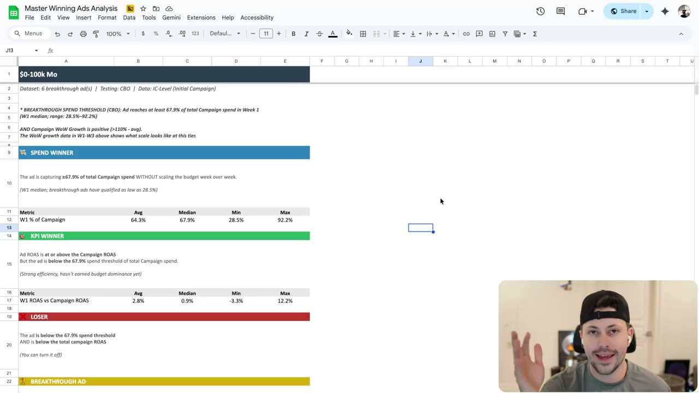
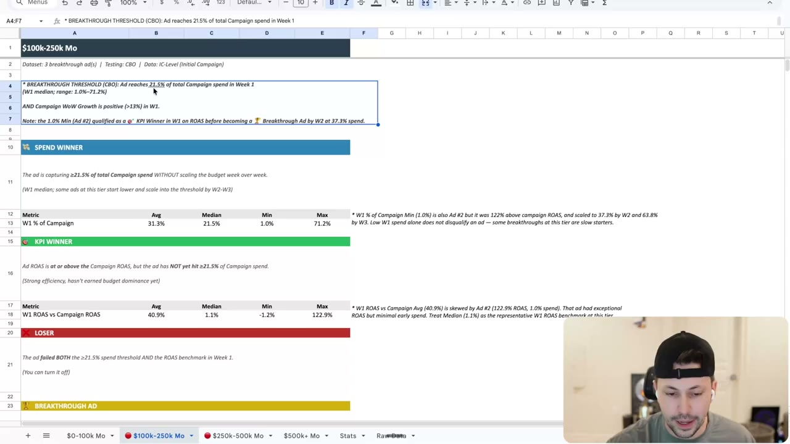
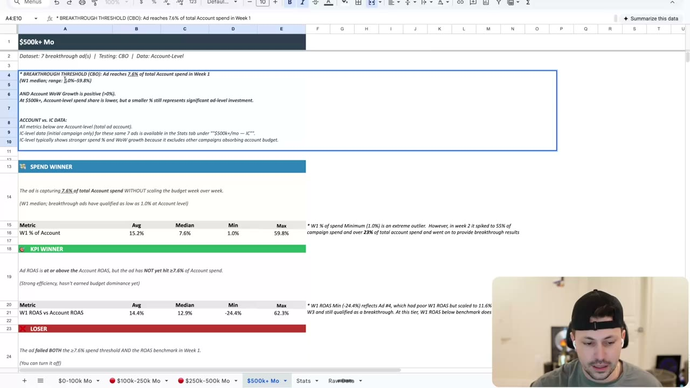
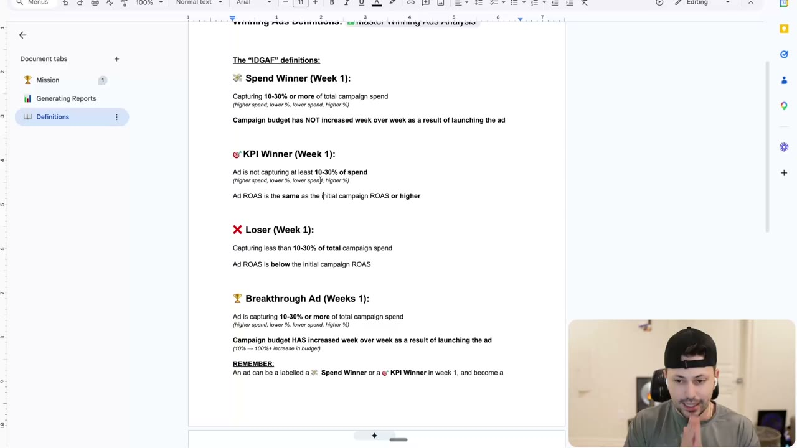
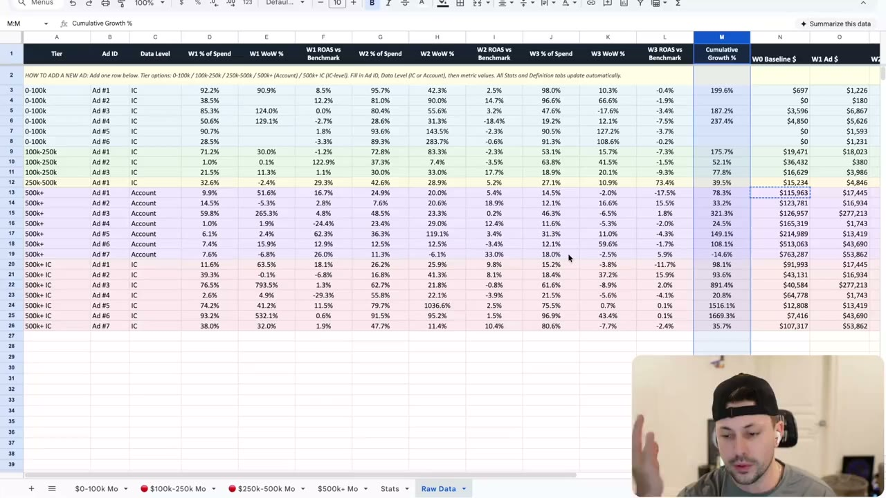

# 112. Winning Ad Definitions ($0/mo-$1M/mo)
> A "winning ad" is not one thing: Evolve labels every tested ad as breakthrough, spend winner, KPI winner or loser from its share of spend and its ROAS versus the campaign, with different spend-share thresholds for each monthly ad-spend tier, and this page holds the exact numbers.

## 🤖 Agent use
- **Use when:** classifying a test ad after its first 7 days, setting the "winner" bar for a brand's spend tier, deciding keep or kill, estimating how much a breakthrough should scale the account, or briefing an iteration (the label picks the fix list).
- **Inputs → outputs:** the account's monthly **ad spend** (not revenue), the testing structure (must be CBO), the ad's share of initial-campaign spend (or of whole-account spend at $500k+/mo), the ad's ROAS versus the campaign ROAS, and whether total daily budget rose after launch → one of four labels, the benchmark it is being compared with, and a keep / kill / iterate decision.
- **Rules:**
  - **DO** segment by **ad spend per month, not revenue**: "this is spend, not revenue. I just want to be very clear that this is a spend category." [01:27]
  - **DO** use the tier thresholds in the table below. Fast version: $0-100k/mo → ad should take about **60-70%** of campaign spend (as low as ~30% still counted); $100k-250k/mo → about **20%**; $500k+/mo → **7.6% of total account spend**. [00:00; 01:27; 02:35]
  - **DO** use the generic bar if unsure: spend winner = "10 to 30% or more of your total initial campaign spend"; "higher spend, lower %; lower spend, higher %". [04:03–06:39]
  - **DO** call it a **breakthrough** only if the ad holds the spend share **and** the campaign (or account) budget increased week over week because of it. A spend winner that does not raise the budget 7 days after launch "is a spend winner. It is not a breakthrough." [06:39]
  - **DO** call it a **KPI winner** if it misses the spend share but its ROAS is the same as or higher than the initial campaign ROAS (example: campaign 2x, ad pulls 5% of spend at 3x after 7 days). [06:39]
  - **DO** call it a **loser** if it misses both (example: 3% of spend at 1.5x ROAS in a 2x campaign). [06:39]
  - **DO** leave spend winners and KPI winners on; "if you have a loser, you're more than likely good to turn it off." [20:48]
  - **DON'T** apply these percentages to ABO tests: "these percentages are for CBO, not for ABO. If you're testing in ABO, I can't really help you." [04:03–05:13]
  - **DON'T** trust the 100k-250k, 250k-500k rows as hard benchmarks: they have 3 and 1 breakthrough ads in the sheet snapshot. [01:27; 02:35; 23:11]
  - **IF** a KPI winner has a very high ROAS but low spend **THEN** let it run: Meta often hands such ads more spend in week 2-3 (sheet example: 1.0% of spend in week 1 at 122% above campaign ROAS → 37.3% in week 2 → 63.8% in week 3). [24:16–25:30]
  - **IF** your account moves up a tier **THEN** re-set the bar: after a 60%-of-spend breakthrough takes you from $0-100k to $100k-250k, expect winners nearer 30-40% of spend. [16:51–18:15]
  - **IF** you are $500k+/mo **THEN** judge at the account level (7.6%), not only the initial campaign; initial-campaign shares are much higher and misleading at that size. [02:35–05:13; 27:46]
- **See also:** [111. Winning Ads Definition - Part 2](111-winning-ads-definition-part-2.md) · [113. How To Generate + Submit Winning Ad Report](113-how-to-generate-submit-winning-ad-report.md) · [100. How To See Ads Performance + Our Columns](100-how-to-see-ads-performance-our-columns.md) · [Iteration outcomes (Copywriting)](../../copywriting/concepts/iteration-outcomes.md) · [Iteration playbook (Copywriting)](../../copywriting/frameworks/iteration-playbook.md) · [115. How to Scale Facebook Ads](115-how-to-scale-facebook-ads-up-down.md)

## Key ideas

### 1. Why a data-driven definition (document "Mission" tab)
- Goal stated in the doc: "a data-driven framework to categorize ad performance": **Breakthrough** (hits "high spend %" and scales daily spend), **Spend Winner** (high spend % but does not scale the account), **KPI Winner** (hits KPI but not high spend %), **Loser** (neither). (Doc, "Mission" tab)
- The problem: "Nobody has a CLEAR answer on 'What makes a winning ad?'". Common answers are "an ad that is accomplishing your objective", "it beats your KPI at scale", "scalability, without sacrificing KPIs"; the doc's complaint is that none has a numeric target. (Doc, "Mission" tab)
- The doc embeds a Twitter exchange (Phil Kiel, named on screen): "Hitting a spend threshold and KPI (ROAS or CPA)"; asked what the threshold is, he answers "Whatever you want it to be, relative your AOV and CPA, could be $500 per ad, $2,000 per ad etc". The doc's point is that this is not concrete enough. (Doc image)
- The doc's conclusion: "there is no such thing as just a 'winning ad'"; ads sit on a spectrum from "no winning" to "lots of winning", set by four variables, in no particular order: **KPI** (CAC/ROAS), **Spend**, **Time**, **Scale**. (Doc, "Mission" tab)

| | Losing ad | Winning ad |
|---|---|---|
| KPI | Low/no | Super high |
| Spend | Low/no | "All of the spend" |
| Time | Runs 1 day | Runs 30+ days |
| Scale | Increases spend 0% | Increases spend 100%+ |

### 2. Two non-negotiables in every definition (doc)
1. **Click-based data only**: review either 7-day or 1-day click data. "View data is not incremental from what we have seen. We know it has a place. But we want ads that customers are clicking and buying from." See [116](116-how-to-understand-facebook-ads-attribution.md). (Doc, "Mission" tab)
2. **Net new customers**: "ads targeting existing customers will be capped by TAM"; "for 98% of businesses, they need to focus on getting more NEW customers" (instructor claim). (Doc, "Mission" tab)

### 3. Why the data comes only from CBO tests (doc; instructor reasoning)
- "We test in CBO to see if Meta will favor ads": with ABO or a minimum budget on a creative you are "FORCING Meta to go get you purchases". Those purchases are often "not incremental": in Northbeam or Triple Whale "you will notice a smaller amount of new visitor %", meaning the ads are "collecting" purchases rather than "generating" them (instructor claim, no data shown on this page). (Doc, "Mission" tab)
- CBO instruction to Meta, in the doc's words: "Hey, please only spend on these ads if you think they're good enough to scale." (Doc)
- Time matters: "some people will say they've found a winning ad after 2 days of a $100 day budget in ABO", but "within a week, the ads in ABO are usually turned off because it's sucking". ABO can do well but it is "very rare that ABO will actually beat out a CBO". The doc links a "CBO No Spend VS ABO Spend" mass-test Google Sheet, which is not included in the course files. (Doc, "Mission" tab)
- The spoken version: percentages "are for CBO, not for ABO". [04:03–05:13]

### 4. The fast answer: thresholds by monthly ad-spend tier [00:00–04:03; sheet tabs]
- Tiers are **ad spend per month**, based on where the whole **account** was when the ad launched, not the initial campaign. Example: an initial campaign at $15,000/week ×4.4 weeks/month ≈ $67k looked like a $0-100k campaign, but the account was in the $250k-500k range, so the ad is filed there. [10:19–11:24]
- Spoken benchmarks and the sheet's numbers (see the table in "Structured units"):
  - **$0-100k/mo:** "around 60 to 70% of total campaign spend" (spoken); sheet: breakthrough threshold 67.9% (W1 median), range 28.5%-92.2%. "Even if you wanna go on the lower end and say, I just need to make sure an ad gets 30%, then that's fine." Breakthroughs "should basically double your account spend": "if you're spending $1,000 a day, a true breakthrough ad should double your account to $2,000 a day". [00:00]
  - **$100k-250k/mo:** "around 20% of spend" (spoken; sheet 21.5% W1 median, range 1.0%-71.2%). "If an ad gets 20% of spend, I will call it a spend winner. And then if it grows my account by 13% or more, you can call it a breakthrough." Red-dot tab (incomplete data: 3 ads). [01:27]
  - **$250k-500k/mo:** red-dot tab, one ad ("completely irrelevant"). Provide data to help complete it (see [113](113-how-to-generate-submit-winning-ad-report.md)). [02:35]
  - **$500k+/mo:** "7.6% of total account spend" (account level, not campaign). "Hopefully greater than 0% growth on the total account." [02:35–04:03]

### 5. Account vs initial campaign [02:35–05:13; 29:10]
- "Initial campaign" = the campaign the ad launched in. Spoken example: ad launches in campaign 1 at $5k/day, campaign 2 spends $2k/day, campaign 3 $1k/day → account = $8k/day. The tiers up to $500k use initial-campaign percentages; the $500k+ tier uses account percentages (the sheet also keeps IC-level data for them). [05:13]
- A $500k+ account usually runs 4-6 campaigns, so an ad can hold a large share of its initial campaign and only a small share of the account. Example: ad #6 held 7.4% of the account but 93% of its initial campaign and grew that campaign about 500% in its first week, because the campaign had only been spending $7,400 beforehand. [27:46]
- "Week zero baseline" in the sheet is the **campaign** spend, not the ad's; weeks 1-3 are the individual ad's spend. [29:10]
- If you judge a single campaign inside a larger account, use the IC-level numbers for that campaign's size. [02:35–04:03]

### 6. The definitions ("IDGAF" version) [04:03–07:46; doc "Definitions" tab, last updated May 13th, 2026]
See "Prompts / templates (verbatim)" for the text. In plain terms (week 1, CBO, initial campaign):
- **Spend winner:** 10-30% or more of campaign spend; campaign budget has **not** increased week over week because of the ad. [05:13–06:39]
- **KPI winner:** below that spend share; ad ROAS same as or higher than the initial campaign ROAS. [06:39]
- **Loser:** below that spend share; ad ROAS below the initial campaign ROAS. [06:39]
- **Breakthrough:** 10-30% or more of campaign spend **and** the campaign budget has increased week over week because of the ad, in the doc's words "(10% → 100%+ increase in budget)". [06:39]
- "Holy fuck this got the spend and allowed us to scale the account" is the speaker's own gloss on a breakthrough. [07:46]
- Labels change: an ad can be a spend winner or KPI winner in week 1 and become a breakthrough in week 2 or 3 as long as it pulls the set % of spend and increases daily budget. [18:15–19:24; 20:48]. See [111](111-winning-ads-definition-part-2.md).

### 7. How to read the sheet [09:03–18:15]
- Tabs: $0-100k Mo, $100k-250k Mo, $250k-500k Mo, $500k+ Mo, Stats, Raw Data. Red dots on the two middle tabs mean too little data. [09:03]
- Each tab shows: dataset size, testing type ("always CBO"), data level (IC or Account), the breakthrough spend threshold, and per-week metrics (Avg / Median / Min / Max). [12:27]
- **"% of Campaign"** = the ad's share of campaign (or account) spend that week. **"Campaign WoW growth"** = how much total campaign spend rose that week vs the week before. **"ROAS vs campaign ROAS"** = the ad's ROAS as a % above/below the campaign's. [12:27–13:33]
- ROAS is stored relative to the campaign because every brand has a different KPI: "we need to hold all ads in the same KPI range". Example: week-1 ROAS 3.87 was 8.5% above the campaign (campaign about 3.5x). [13:33–14:37]
- **Cumulative growth** = campaign (or account) spend in week 3 vs the week-0 baseline. It cannot be recomputed by adding the weekly percentages: "you need to take a look at whatever the baseline was for the campaign versus where it is at now." [14:37]
- Use the **median** rather than the average to "remove specific outliers": "medians are calculated by looking at an array of numbers and picking the numbers that are in the middle." [18:15–19:24]
- Closer to $0 spend → expect values near the max; closer to the top of the tier → expect values near the min. [16:51]
- Spend ×4.4 converts a weekly figure to a monthly one ("4.4 weeks or something like that in a month"). [11:24]

### 8. Tier results, week by week [22:08–33:41]
- **$0-100k (6 ads, IC):** W1 spend share avg 64.3% / median 67.9%; campaign grew 114.7% avg in W1 (based on 3 of 6 ads, the other 3 started from $0); W2 share 78.1% avg, campaign +107.7% avg (median +72.8%, pulled up by one ad at +283.7%); W3 share 73.9% avg, campaign +51.2%; W3 ROAS vs campaign negative for every ad (avg -2.9%), "expected": as a breakthrough dominates spend, its ROAS converges towards the campaign average. Cumulative growth W0→W3: avg 208% / median 199.6% ("you literally tripled your budget... $100 a day should be at $300 a day"). [22:08–23:11]
- **$100k-250k (3 ads):** W1 share median 21.5% (min 1.0%); W1 campaign growth median 11.3% (avg 13.8%); cumulative campaign growth avg 101.8% / median 77.8% ("if you're spending 4K a day... closer to 8K per day by the end of week 3"). Account-level view (3 ads): W1 share of account median 8.8%; cumulative account growth avg 79.3% / median 46.3%. [23:11–26:37]
- **$250k-500k (1 ad):** W1 share 32.6% IC / 12.2% account; cumulative +39.5% campaign / +34.5% account. Single data point. [26:37]
- **$500k+ (7 ads, account level):** W1 share of account avg 15.2% / median 7.6% (range 1.0%-59.8%); W1 account growth median +2.4% (avg +46.4%, skewed by the 59.8% ad at +265%); W2 share median 23.4%, growth median +20.6%; W3 share median 14.5%, growth median -2.0%; cumulative account growth avg 100% / median 78.3% (min -14.6%). The negative W3 median is "expected. The scaling event has already occurred by W3." [27:46–33:41; sheet notes]
- Spoken extrapolations for tiers without data (instructor's rough guesses, not data): 250k-500k "probably closer to 30 to 40%" then later "15 to 30%"; 100-250k "30 to 50%"; "zero to 100K was like 50 to 70%". These two guesses for the 250k-500k tier conflict, so treat the sheet row as unusable until more ads are added. [26:37]

### 9. What to do with a label (doc, "Ideal action items") 
1. **Labeling:** everyone speaks the same language. Example sentence the doc models: "This is 100% a Breakthrough ad because in my spend category of $0-$100k/mo, after Week 1 the ad spent 50% of my campaign's budget and increased my total daily spend by 70%."
2. **Ad scaling:** answer how much an ad should scale the account, e.g. "On average a Breakthrough at $500k-$1M+/mo will increase your ad spend by 34%" (illustrative sentence in the doc; the sheet's $500k+ median cumulative growth is 78.3%).
3. **Ad killing:** use previous breakthroughs as a pacing reference ("clear Spend Winner, but KPI much further below breakthrough data → confident turning it off").
4. **Iteration recommendations:** by label (lists below). Breakthrough playbook link: the doc points to a Skool classroom page not exported to the course files; see the Copywriting course [How to iterate on breakthroughs](../../copywriting/lessons/51-how-to-iterate-on-breakthroughs.md).
5. **Ad optimization:** "how much ROAS drops if you raise spend (and rises if you cut)". Example wording: "you can safely scale spend 100% while still staying above KPI, GIVEN that your ad is currently at X spend and Y KPI and your target KPI is Z". The doc lists this as a goal; no ROAS-vs-spend curve is in the files.
6. **"#4 Ask the Ad AI":** a project trained on this dataset is "Coming as a Claude Skill". Not included in the course files.

### 10. Wrap-up [33:41–35:50]
- "Not all breakthroughs are the same": the 59.8%-of-account ad "almost quadrupled this account's daily spend with one ad", a very different event from a 7.4%-share ad that grew the account 15%. [33:41]
- $500k+ accounts have the most winning ads and get the most from running their own reports; $250k-500k accounts "should be closer to the 500K plus accounts" and have enough ads to pull their own percentages. [33:41]
- Zach is introduced as "head of AI, head of tech" who will build more skills; viewers are asked to submit their own reports ([113](113-how-to-generate-submit-winning-ad-report.md)). [34:55]

## Steps / framework
Classify a test ad (derived from the definitions above; CBO only):
1. Confirm the ad ran in a CBO campaign for 7 days (2-3 days if it is plainly scaling the account; see Copywriting [iteration outcomes](../../copywriting/concepts/iteration-outcomes.md)).
2. Pick the tier from **account ad spend per month** at launch (÷ weeks × 4.4 if you have weekly numbers).
3. Compute the ad's share of **initial-campaign** spend (tiers up to $500k) or **account** spend ($500k+).
4. Compare with the tier threshold (table below). Compare the ad's ROAS with the campaign ROAS.
5. Check whether total daily budget rose after launch with no other cause.
6. Assign the label: spend share met + budget rose = breakthrough; spend share met, budget flat = spend winner; spend share missed but ROAS ≥ campaign = KPI winner; neither = loser.
7. Re-pull in week 2 and week 3 and relabel (see [111](111-winning-ads-definition-part-2.md)).
8. Pick the fix list for the label (below).

## Examples
- **KPI winner (instructor):** initial campaign at 2x ROAS; new ad pulls 5% of spend at 3x after 7 days → KPI winner. [06:39]
- **Loser (instructor):** ad gets 3% of spend after 7 days at 1.5x in a 2x campaign → loser. [06:39]
- **KPI winner (instructor):** campaign ROAS 1.89 in Meta; new ad at 1.92 after one week but below the spend threshold → KPI winner. If the ad is at 1.4 with about 10% of spend → loser. [19:24–20:48]
- **Slow starter (sheet, $100k-250k Ad #2):** 1.0% of campaign spend and ROAS 122.9% above campaign in week 1 (KPI winner), 37.3% in week 2, 63.8% in week 3 → breakthrough. [24:16–25:30]
- **Mega-breakthrough (sheet, $500k+ Ad #3):** 59.8% of account spend in week 1, account +265% week over week, +321% cumulative; initial-campaign baseline $40,584/week → $277,213 ad spend in week 1. [27:46; 33:41]
- **Cross-level difference (sheet, $500k+ Ad #7):** account cumulative growth -14.6% (account was ~$763k/week and pulled back) while the same ad delivered +35.7% at the initial-campaign level; the speaker still calls it a breakthrough in its campaign and says it was among the top-spending ads after a year. [32:38]
- **Largest campaign jump in the data (sheet, IC level):** a campaign at about $7,400/week in week 0 reached about $127,000/week of ad spend by week 3 (Ad #6, $500k+ IC). [07:46]

## Structured units

### Winning-ad thresholds by tier (sheet "Master Winning Ads Analysis", snapshot in the course files)
| Tier (monthly ad spend) | Data level | n (breakthrough ads) | Breakthrough spend share, W1 (median; min-max) | Campaign/account growth in W1 | Cumulative growth W0→W3 (median / avg) | Reliability |
|---|---|---|---|---|---|---|
| $0-100k | Initial campaign | 6 | 67.9% (28.5%-92.2%); spoken "60-70%" | median +124.0% (3 of 6 ads; other 3 had $0 baseline) | 199.6% / 208.1% | Small n |
| $100k-250k | Initial campaign | 3 | 21.5% (1.0%-71.2%); spoken "around 20%" | median +11.3% (spoken: "13% or more") | 77.8% / 101.8% | Red dot: "use with a grain of salt" [23:11] |
| $100k-250k | Account | 3 | 8.8% (1.1%-50.4%) | median -9.3% | 46.3% / 79.3% | Small n |
| $250k-500k | Initial campaign / Account | 1 | 32.6% IC / 12.2% account | -2.4% IC / -5.3% account | 39.5% IC / 34.5% account | "PRELIMINARY DATA", single point |
| $500k+ | Account | 7 | 7.6% (1.0%-59.8%) | median +2.4% (avg +46.4%) | 78.3% / 100.0% | Small n; medians more reliable than averages |
| $500k+ | Initial campaign | 7 | 39.3% (2.6%-93.2%) | median +41.2% | 98.1% / 617.9% (avg skewed) | Same 7 ads as above, IC view |

### Label definitions (doc "Definitions" tab, "IDGAF" version)
| Label | Spend condition (week 1) | ROAS condition | Budget condition | Keep or kill |
|---|---|---|---|---|
| Breakthrough | 10-30% or more of campaign spend (higher spend → lower %) | none stated | Campaign budget has increased week over week because of the ad (10% → 100%+) | Keep and iterate hard |
| Spend winner | 10-30% or more of campaign spend | none stated | Budget has NOT increased | Leave on [20:48]; fix KPI (list below) |
| KPI winner | Below 10-30% | Same as or higher than initial campaign ROAS | n/a | Leave on [20:48]; fix spend (list below) |
| Loser | Below 10-30% | Below initial campaign ROAS | n/a | "More than likely good to turn it off" [20:48] |

### Week-by-week benchmark curves (medians, from the Stats tab)
| Tier / level | W1 % of spend | W2 % | W3 % | W1 growth | W2 growth | W3 growth |
|---|---|---|---|---|---|---|
| $0-100k IC (n=6) | 67.9 | 85.2 | 90.9 | 124.0 | 72.8 | 39.4 |
| $100k-250k IC (n=3) | 21.5 | 37.3 | 53.1 | 11.3 | 33.0 | 20.1 |
| $100k-250k Account (n=3) | 8.8 | 31.5 | 44.0 | -9.3 | 21.6 | 13.5 |
| $250k-500k IC (n=1) | 32.6 | 42.6 | 27.1 | -2.4 | 28.9 | 10.9 |
| $500k+ Account (n=7) | 7.6 | 23.4 | 14.5 | 2.4 | 20.6 | -2.0 |
| $500k+ IC (n=7) | 39.3 | 55.8 | 61.6 | 41.2 | 25.9 | -3.8 |

### Raw ad-level data (sheet "Raw Data" tab; ROAS columns omitted)
Columns: W1/W2/W3 % of spend; W1 WoW % = campaign (or account) growth in week 1; cumulative = W0→W3 growth; W0 baseline = campaign (or account) spend in the week before launch. "-" = not computable (the baseline was $0).

| Tier | Ad | Level | W1 % of spend | W1 WoW % | W2 % of spend | W3 % of spend | Cumulative growth % | W0 baseline |
|---|---|---|---|---|---|---|---|---|
| 0-100k | Ad #1 | IC | 92.2 | 90.9 | 95.7 | 98.0 | 199.6 | $697 |
| 0-100k | Ad #2 | IC | 38.5 | - | 81.0 | 96.6 | - | $0 |
| 0-100k | Ad #3 | IC | 85.3 | 124.0 | 80.4 | 47.6 | 187.2 | $3,596 |
| 0-100k | Ad #4 | IC | 50.6 | 129.1 | 28.6 | 19.2 | 237.4 | $4,850 |
| 0-100k | Ad #5 | IC | 90.7 | - | 93.6 | 90.5 | - | $0 |
| 0-100k | Ad #6 | IC | 28.5 | - | 89.3 | 91.3 | - | $0 |
| 100k-250k IC | Ad #1 | IC | 71.2 | 30.0 | 72.8 | 53.1 | 175.7 | $19,471 |
| 100k-250k IC | Ad #2 | IC | 1.0 | 0.1 | 37.3 | 63.8 | 52.1 | $36,432 |
| 100k-250k IC | Ad #3 | IC | 21.5 | 11.3 | 30.0 | 18.9 | 77.8 | $16,629 |
| 100k-250k | Ad #1 | Account | 50.4 | 50.2 | 63.7 | 44.0 | 177.6 | $23,832 |
| 100k-250k | Ad #2 | Account | 1.1 | -9.3 | 31.5 | 52.0 | 46.3 | $49,141 |
| 100k-250k | Ad #3 | Account | 8.8 | -17.2 | 13.4 | 9.0 | 14.1 | $54,650 |
| 250k-500k IC | Ad #1 | IC | 32.6 | -2.4 | 42.6 | 27.1 | 39.5 | $15,234 |
| 250k-500k | Ad #1 | Account | 12.2 | -5.3 | 16.9 | 12.0 | 34.5 | $68,997 |
| 500k+ IC | Ad #1 | IC | 11.6 | 63.5 | 26.2 | 15.2 | 98.1 | $91,993 |
| 500k+ IC | Ad #2 | IC | 39.3 | -0.1 | 16.8 | 18.4 | 93.6 | $43,131 |
| 500k+ IC | Ad #3 | IC | 76.5 | 793.5 | 62.7 | 61.6 | 891.4 | $40,584 |
| 500k+ IC | Ad #4 | IC | 2.6 | 4.9 | 55.8 | 21.5 | 20.8 | $64,778 |
| 500k+ IC | Ad #5 | IC | 74.2 | 41.2 | 79.7 | 75.5 | 1516.1 | $12,808 |
| 500k+ IC | Ad #6 | IC | 93.2 | 532.0 | 91.5 | 96.9 | 1669.3 | $7,416 |
| 500k+ IC | Ad #7 | IC | 38.0 | 32.0 | 47.7 | 80.6 | 35.7 | $107,317 |
| 500k+ | Ad #1 | Account | 9.9 | 51.6 | 24.9 | 14.5 | 78.3 | $115,963 |
| 500k+ | Ad #2 | Account | 14.4 | -5.3 | 7.6 | 12.1 | 33.2 | $123,781 |
| 500k+ | Ad #3 | Account | 59.8 | 265.3 | 48.5 | 46.3 | 321.3 | $126,957 |
| 500k+ | Ad #4 | Account | 1.0 | 1.9 | 23.4 | 11.6 | 24.5 | $165,319 |
| 500k+ | Ad #5 | Account | 6.1 | 2.4 | 36.3 | 31.3 | 149.1 | $214,989 |
| 500k+ | Ad #6 | Account | 7.3 | 15.9 | 12.5 | 12.1 | 108.1 | $513,063 |
| 500k+ | Ad #7 | Account | 7.6 | -6.8 | 11.3 | 18.0 | -14.6 | $763,287 |

### Rules of thumb
- **DO** compare an ad's ROAS with its **own campaign's** ROAS, not a fixed number: "we need to hold all ads in the same KPI range". [13:33]
- **DO** use medians at small n; the averages in these tabs are skewed by one or two outlier ads (the sheet's own notes say so). [18:15; sheet notes]
- **DON'T** read a negative W3 ROAS-vs-campaign as failure for a breakthrough: it converges toward the campaign average as it takes share. (Sheet notes)
- **DON'T** read hook or hold rate as the verdict: the label comes from spend share, ROAS and budget movement. (derived; see [100](100-how-to-see-ads-performance-our-columns.md))
- **IF** you are $0-100k **THEN** aim for an ad that takes about 60% of campaign spend and doubles daily spend within a week. [00:00]
- **IF** you are $100k-250k **THEN** use about 20% of campaign spend and 13%+ account growth as the bar, and treat it as provisional. [01:27]
- **IF** you are $500k+ **THEN** use 7.6% of account spend and positive account growth. [02:35]

## Prompts / templates (verbatim)

Document "Definitions" tab (Last updated May 13th, 2026 in the exported docx; the on-screen version at [05:00] reads May 11th, 2026 in the doc header):

```
The "IDGAF" definitions:

Spend Winner (Week 1):
Capturing 10-30% or more of total campaign spend
(higher spend, lower %, lower spend, higher %)
Campaign budget has NOT increased week over week as a result of launching the ad

KPI Winner (Week 1):
Ad is not capturing at least 10-30% of spend
(higher spend, lower %, lower spend, higher %)
Ad ROAS is the same as the initial campaign ROAS or higher

Loser (Week 1):
Capturing less than 10-30% of total campaign spend
Ad ROAS is below the initial campaign ROAS

Breakthrough Ad (Weeks 1):
Ad is capturing 10-30% or more of total campaign spend
(higher spend, lower %, lower spend, higher %)
Campaign budget HAS increased week over week as a result of launching the ad
(10% → 100%+ increase in budget)

REMEMBER:
An ad can be a labelled a Spend Winner or a KPI Winner in week 1, and become a breakthrough in week 2 or 3
(as long as it pulls the set % of spend listed above and increases daily budget)
```

Document "Mission" tab, iteration recommendations by label (verbatim; "KP" lines are comments by a second author, initials as in the doc):

```
BREAKTHROUGH (Winner) - If the ad is crushing it, we will have a playbook you can follow to dissect the ad and its core components and then be able to start an aggressive iteration and variation process.

KPI WINNER (Spend Issue) - If the ad didn't get enough spend.
Solutions:
- You need to make the hook more engaging, and the hook needs to be more optimized to help people actually stop their scroll so Meta can push it out to more people.
- It can also mean you didn't use proper visuals & messaging that tell Meta's systems which audience to serve your ad to.
KP - The bridge is bad or awkward, does not connect seamlessly between the hook to hold (characterized by high hook, low hold rates)
KP - Your angle or messaging/labels are too niche/specific. The ad resonates with some - but it's too narrow group (eg. big dog owners in Australia vs big dog owners)

SPEND WINNER (KPI Issue) - If the ad doesn't have a high KPI or isn't scaling the account, the ad is having the following issues:
1. Hook is misleading people* (There is a disconnect from what people expect from the ad VS what's on the page)
2. It's going after a broader/colder audience but is lacking conversion factor (can be a funnel or an ad hold issue)
3. Non clear CTAs throughout the ads*
4. People like your claims, but do not believe them to buy (how can we make them feel like they NEED it now, urgency, stakes, etc.)
5. Do not see the value in your offer (price to value is off for the audience) → study price objections use techniques there to overcome / prevent
6. Your offer has logistical issues (more so for early on brands without winning ads)
KP note - You did not fully close all the loops opened earlier - viewers were intrigued but some felt unsatisfied / not fully sold after watching through (strong soft metrics but low KPI)

TIME ISSUE - If your winning ads are dying fast, they might need to:
1. Expand the avatar (Self identity + valence + intensity) - increase TAM
2. Have gone too bottom of funnel (just picked up the scraps)
3. Try a higher awareness level (problem aware/unaware)
4. You're not resonating with the audience on an emotional level. (To actually scale an ad, you need to talk to people's emotions)
5. People overtime realize it's bullshit (fake AI native story ads)
6. Competitor launches a better offer/creative that outscales you
7. Seasonal demand issues (example: humidifier in July)
8. Seasonal messaging/visuals fatigue (example: winter background in UGC feels outdated in spring/summer)
```

Sheet notes the instructor highlights (verbatim, abbreviated where marked):

```
$100k-250k: "W1 % of Campaign Min (1.0%) is also Ad #2 but it was 122% above campaign ROAS, and scaled to 37.3% by W2 and 63.8% by W3. Low W1 spend alone does not disqualify an ad - some breakthroughs at this tier are slow starters."
$250k-500k: "PRELIMINARY DATA: This tier has only 1 breakthrough ad. All values (Avg = Median = Min = Max) reflect a single data point. Do not treat these as definitive thresholds until more ads are added."
$500k+: "W3 WoW Growth (Median: -2.0%) and W3 ROAS vs Account (Median: -1.7%) turning slightly negative is expected. The scaling event has already occurred by W3; the account is normalizing. Do not read negative W3 metrics as a failure signal."
$500k+: "W1 ROAS Min (-24.4%) reflects Ad #4, which had poor W1 ROAS but scaled to 11.6% of Account by W3 and still qualified as a breakthrough. At this tier, W1 ROAS below benchmark does not automatically disqualify an ad."
```

Page chapter list (page text, for jumping around the video):

```
0:00 Sheet Overview | 0:33 $0-$100k/month (high level) | 1:24 $100k-$250k/month (NOT COMPLETE) | 2:35 $250k-$500k/month (NOT COMPLETE) | 2:58 $500k+/month (high level) | 3:10 Difference between Account Spend & Initial Campaign Spend (IMPORTANT) | 3:37 $500k+/month continued | 4:42 The Simplified Definitions (Everyone watch this) | 8:33 Getting into the data behind the definitions (17 breakthrough ads) | 9:55 Full Winning Ads Sheet Overview | 12:31 $0-$100k/month in depth | 12:52 Raw Data tab | 15:59 Stats tab | 16:33 $0-$100k resumed | 17:24 How to analyze breakthrough ads more individually | 18:33 Understanding how "Winning Ad" changes (Everyone watch this) | 18:54 $0-$100k resumed again | 24:03 $100k-$250k in depth | 26:37 $250k-$500k (We need your help) | 27:40 $500k+ in depth | 34:10 Final Recap
```

## Screenshots

*"Master Winning Ads Analysis" sheet, $0-100k Mo tab: dataset of 6 breakthrough ads, CBO, IC-level data; breakthrough threshold 67.9% of campaign spend (range 28.5%-92.2%); W1 % of campaign avg 64.3% / median 67.9% / min 28.5% / max 92.2%; KPI winner and loser blocks use the same threshold. [00:10]*


*$100k-250k tab (red dot = incomplete): 3 ads; threshold 21.5% of campaign spend in week 1 and campaign WoW growth >13%; note that Ad #2 (1.0% spend, 122% above ROAS) became a breakthrough by week 2. [02:00]*


*$500k+ tab: 7 ads, account-level data; threshold 7.6% of total account spend in week 1 with account WoW growth >0%; the sheet's note says IC-level views are in the Stats tab. [04:00]*


*The four labels in the simplified wording: 10-30% or more of campaign spend, budget not increased vs increased, ROAS same or higher vs below the initial campaign. [05:00]*


*Raw Data tab: one row per ad with tier, data level (IC or Account), weekly spend share, WoW growth, ROAS vs benchmark and baselines. New reports submitted by students feed these rows. [15:40]*

## How to apply
- [ ] Record the brand's **monthly ad spend** (not revenue) and pick the tier.
- [ ] Confirm tests are in a **CBO** campaign. If they are ABO, mark any label as "not comparable to Evolve data".
- [ ] For each test ad after 7 days, record: share of initial-campaign (or account) spend, ad ROAS vs campaign ROAS, change in total daily budget since launch.
- [ ] Apply the label table. Write the label with its week: "KPI winner (W1)".
- [ ] Re-label at weeks 2 and 3. Do not kill a KPI winner or spend winner on week 1 alone.
- [ ] Turn off losers; leave spend winners and KPI winners on while fixing them with the matching list.
- [ ] If a breakthrough appears, open the breakthrough iteration process (Copywriting [51](../../copywriting/lessons/51-how-to-iterate-on-breakthroughs.md)) and measure how far the account moved against the tier's cumulative-growth benchmark.
- [ ] When the account crosses into the next tier, replace the threshold, and tell the team why the "winner" bar moved.
- [ ] Submit your own breakthrough reports via [113](113-how-to-generate-submit-winning-ad-report.md) / [114](114-action-item-generate-submit-your-reports.md) if you are in the thin tiers ($100k-500k).

## Related
- Previous: [111. Winning Ads Definition - Part 2](111-winning-ads-definition-part-2.md) · Next: [113. How To Generate + Submit Winning Ad Report](113-how-to-generate-submit-winning-ad-report.md)
- [110. Winning Ads Definition - Part 1](110-winning-ads-definition-part-1.md) (same document, earlier walkthrough) · [101. How To Set Targets & KPIs](101-how-to-set-targets-kpis.md) · [115. How to Scale Facebook Ads](115-how-to-scale-facebook-ads-up-down.md) · [116. How To Understand Facebook Ads Attribution](116-how-to-understand-facebook-ads-attribution.md) · [121. How To Deal With Roller Coaster Performance](121-how-to-deal-with-roller-coaster-performance.md)
- Copywriting: [Iteration outcomes](../../copywriting/concepts/iteration-outcomes.md) · [Iteration issue codes](../../copywriting/frameworks/iteration-issue-codes.md) · [Iteration playbook](../../copywriting/frameworks/iteration-playbook.md) · [Creative testing system](../../../../frameworks/creative-testing-system.md)

## Sources and limitations
- Transcript: [112 transcript](<../../../../../raw/evolve/start-here/_transcripts/👣 Evolve (Start Here)/112. 🆕 Winning Ad Definitions ($0 mo-$1M mo) 👣 Evolve (Start Here) Evolve.txt>) · Page text (chapter list): [112 page](<../../../../../raw/evolve/start-here/_extracted/👣 Evolve (Start Here)/112. 🆕 Winning Ad Definitions ($0_mo-$1M_mo)_👣 Evolve (Start Here)_Evolve.html.md>) · Document: [112 docx text](<../../../../../raw/evolve/start-here/_extracted/👣 Evolve (Start Here)/112. 🆕 Winning Ad Definitions ($0_mo-$1M_mo).docx.md>) (embedded image: Twitter thread screenshot) · Sheet: [112 xlsx text](<../../../../../raw/evolve/start-here/_extracted/👣 Evolve (Start Here)/112. 🆕 Winning Ad Definitions ($0_mo-$1M_mo).xlsx.md>), [raw data CSV](<../../../../../raw/evolve/start-here/_extracted/👣 Evolve (Start Here)/112. 🆕 Winning Ad Definitions ($0_mo-$1M_mo).xlsx.raw-data.csv>), [stats CSV](<../../../../../raw/evolve/start-here/_extracted/👣 Evolve (Start Here)/112. 🆕 Winning Ad Definitions ($0_mo-$1M_mo).xlsx.stats.csv>).
- Machine transcription (Whisper large-v3-turbo). Full recording covered (2149.61 s). Whisper artifacts: "CBL" for CBO (sheet header says CBO), "Whisperer" at [07:46] (apparently a dictation tool the speaker was using; unverified), "KPI winners ... the mid was 90%" (the sheet's W1 growth minimum is 90.9%; the median is 124.0%).
- **Numbers that do not match the sheet snapshot in the files:** the speaker says "around 24 specific breakthroughs" and an "average ... 297%" cumulative growth [07:46], but the page chapter list says "17 breakthrough ads" and the exported sheet totals 17 (6 + 3 + 1 + 7); the exported sheet's $0-100k cumulative average is 208%. The spoken numbers probably refer to an earlier or different version of the sheet. Use the sheet figures. The speaker also reads "365%" for the 500k+ ad #3's week-1 growth where the sheet shows +265.3%. The speaker says the sheet will be updated (extra account-spend columns, campaign spend); the exported files may predate those updates. The doc header says "Last Updated May 13th, 2026"; the on-screen version at [05:00] says May 11th, 2026.
- The Twitter links in the doc and the "CBO No Spend VS ABO Spend" Google Sheet are not included in the course files. The Skool breakthrough-playbook link in the doc is likewise not exported. "KP" comments in the doc are another author's initials; unverified who. Instructor attribution: first name Spencer; surname is shown on screen in lesson 113, not in this video. The doc's claim that testing in ABO produces non-incremental purchases and the claim about "98% of businesses" are instructor claims without data on this page.
- The sheet's tier boundary is based on account spend when the ad launched; the video says the sheet may later add an account-spend column to every row [10:19].
