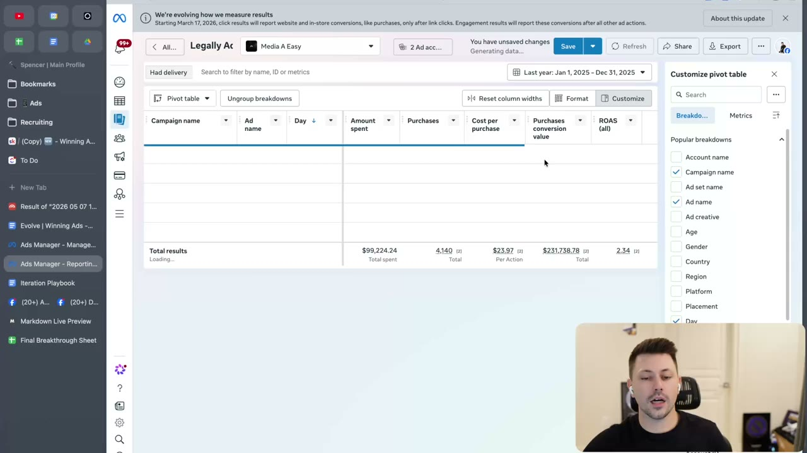
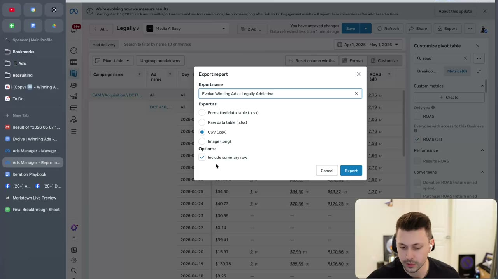
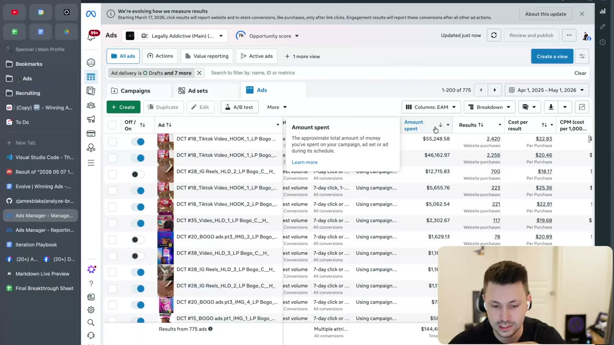
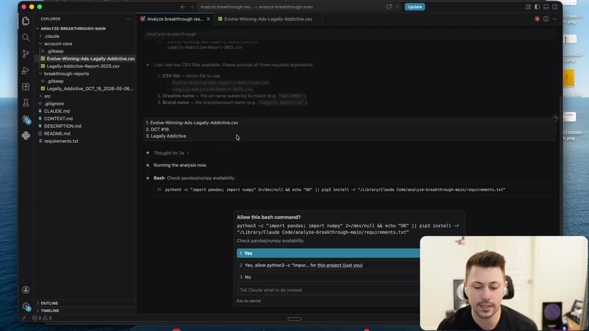
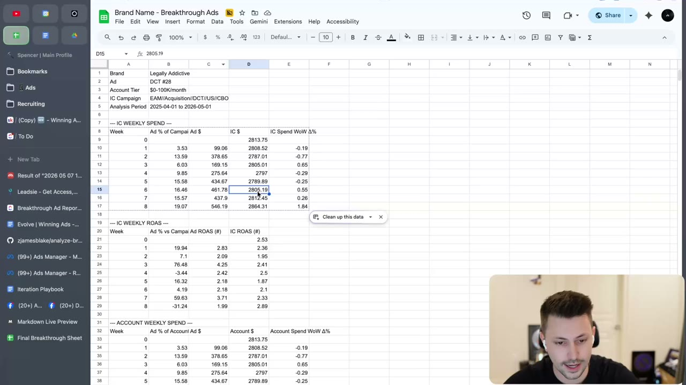
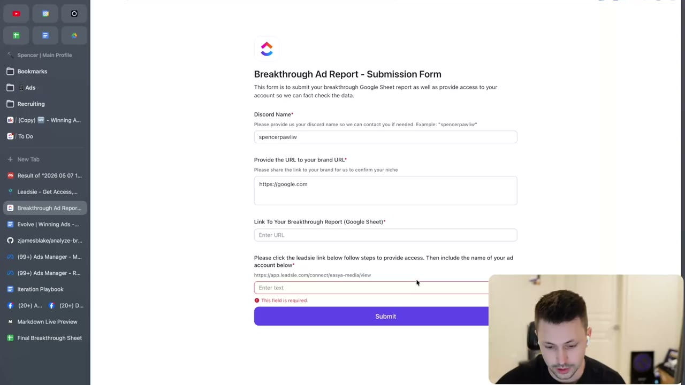

# 113. How To Generate + Submit Winning Ad Report
> Export a year of daily ad-level data from Meta Ads Reporting, run the "analyze-breakthrough" Claude Code skill on your top-spending ad, and submit the resulting Google Sheet plus view access to your ad account, so you get your own breakthrough benchmarks and improve Evolve's winning-ad definitions.

## 🤖 Agent use
- **Use when:** building a brand-specific breakthrough benchmark (how much of campaign/account spend and how much growth your best ads delivered), or contributing a report to the Evolve winning-ads dataset ([112](112-winning-ad-definitions-0-mo-1m-mo.md)).
- **Inputs → outputs:** a Meta Ads Reporting CSV (one row per campaign / ad / day with spend, purchases, cost per purchase, purchase conversion value, ROAS) + the ad's name string + the brand name → a breakthrough report CSV with weekly initial-campaign spend, ROAS and account spend, an upload to a "view for anyone with the link" Google Sheet, and a submission via the ClickUp form.
- **Rules:**
  - **DO** use these exact report columns or "it will not work": Campaign name, Ad name, Day breakdown, Amount spent, Purchases, Cost per purchase, Purchase conversion value, ROAS. [02:38]
  - **DO** standardise to **USD** and **7-day click** attribution. If you spend in another currency and cannot create a USD ad account to combine with, "unfortunately you cannot do this report". [01:21]
  - **DO** export **CSV** with **"Include summary row"** ticked: "the AI prefers that". [03:42]
  - **DO** cover **April 1, 2025 to May 1, 2026** (or as far as the account allows); the ads need "at least eight weeks of spend". If a year will not export, cut back to about March 2026. [03:42]
  - **DO** run the report on your **top-spending ad over the whole period**, not an ad that "did well for one week". Set the filter "ad delivery is all" so deleted or off ads appear, and filter by the naming code to total all duplicates. [08:25–09:46]
  - **DON'T** use ad names like "new sales ad" or the ad ID: duplicates make the AI unable to isolate the ad. "If you have the new ad labeled everywhere in your account, you're honestly going to be pretty cooked." [07:15–10:54]
  - **DO** make the Google Sheet "anyone with the link: viewer" before submitting. [14:50]
  - **IF** Python install prompts appear **THEN** accept them; the speaker says it "shouldn't break anything in your computer". [10:54]
  - **DON'T** submit ads that are not true breakthroughs: "you really want to focus on the ads that are true breakthroughs". [13:21]
- **See also:** [114. Action Item - Generate + Submit Your Reports](114-action-item-generate-submit-your-reports.md) · [112. Winning Ad Definitions](112-winning-ad-definitions-0-mo-1m-mo.md) · [109. How To Set Up Naming Templates](109-how-to-set-up-naming-templates.md) · [116. Understanding Facebook Ads Attribution](116-how-to-understand-facebook-ads-attribution.md) · [100. How To See Ads Performance + Our Columns](100-how-to-see-ads-performance-our-columns.md)

## Key ideas

### 1. Why contribute, and privacy as stated [00:00–01:21; 14:50–18:40]
- Combining your data with everyone else's gives "a much more accurate representation of what the actual percentages should be across your specific category". [00:00]
- Privacy claims (instructor claims, not verifiable here): your brand and ads "are not going to be shared with everybody else"; the instructor says he has "zero incentive to tell anybody about your brand"; data in the definitions is anonymous ("ad number one, ad number two"). Invites DMs on Discord to confirm identity. [00:00; 14:50; 18:40]
- Access you grant is view-only; the instructor will "let you know once we process the report that you can kick us out". [17:34]

### 2. Create the report in Meta Ads Reporting [00:00–05:01]
1. In Ads Manager hover the left menu → **Ads reporting** (or go via Settings if it is missing). → **Create a report**. [00:00]
2. Name it (spoken: "Evolve winning ads report"). Select the ad account. [00:00]
3. If you do not spend in USD, add a second (even empty) ad account to the same report. This lets you set currency to **USD** and attribution to **7-day click**; the speaker uses an empty "YouTube" account for that. [00:00–01:21]
4. If you are already in USD and run 7-day click with 1-day view, "I'm not overly concerned about it because ... you can just leave it", though the ideal is 7-day click. [01:21]
5. Customize the pivot table: breakdowns **Campaign name**, **Ad name**, **Day**; metrics **Amount spent**, **Purchases**, **Cost per purchase**, **Purchase conversion value**, **ROAS**. If ROAS is not listed, create a custom metric "ROAS" = purchase conversion value ÷ amount spent. [02:38]
6. Set the date range (see rules) and **Export → CSV**, name "Evolve winning ads", keep "Include summary row" ticked. Processing takes 15 seconds to 2-3 minutes; refresh before downloading if needed. [03:42–05:01]

### 3. Set up the Claude Code workspace [05:01–07:15]
1. Install **VS Code**; install the **Claude Code** extension (Extensions → search "Claude Code"). [05:01]
2. Create a folder named "Claude Code" on your machine. The speaker is on a Mac: "if you're on Microsoft, I'm not going to lie, I'm not really sure how to help you guys with this, but I think you guys could probably follow along." [05:01]
3. From the GitHub repo `zjamesblake/analyze-breakthrough` choose **Download ZIP**, drag it from Downloads into the Claude Code folder, double-click to unzip. "You now actually have the exact skill and the exact process that you need." [06:02]
4. In VS Code: **Open folder** → select the unzipped folder → Claude **New session**. [06:02]
5. Page instruction: tell Claude "Go into analyze-breakthrough and install the requirements". [page]

### 4. Run the analysis [07:15–12:04]
- Drag the exported CSV into the folder's `account-csvs/` (Zach, named at [07:15], showed him drag-and-drop). [07:15]
- In the Claude chat type `/analyze-breakthrough`. The skill asks for three inputs (see frame): (1) the CSV file name, (2) the **creative name** substring that must match the ad's name, (3) the **brand name**. Example answers on screen: `Evolve-Winning-Ads-Legally-Addictive.csv`, `DCT #18`, `Legally Addictive`. [07:15–08:25]
- Page syntax: `/analyze-breakthrough @File.csv "AD NAME" --brand "Brand"`. Output lands in `breakthrough-reports/`. [page]
- Picking the ad: sort the Ads view for the full date range by **amount spent**, "ad delivery is all", and filter "ad name contains" the naming code. The demo account had spent only about $100,000 over the year; DCT #18 was "by far" the top ad, "basically 90% of the account" at [08:25], later "basically 80%" at [10:54]. Duplicated copies of the same code across campaigns held another $10,000, so total by code. [08:25–09:46]
- The speaker will ask for access to the first contributors' ad accounts to proof the data: "I need to make sure that this data is 100% accurate." [09:46]
- Python install prompt: allow it. The whole report generated "in literally like 15 seconds". [10:54–12:04]
- Run it again for the second-highest-spending ad (example: DCT #28, about $15,000 spent, now turned off) by changing the ad name. [12:04–13:21]

### 5. What the report contains [13:21–14:50]
- Header: brand, ad, **account tier**, **initial campaign name** it launched in, **analysis period**. Then tables: initial-campaign weekly spend, initial-campaign weekly ROAS, account weekly spend, account weekly ROAS (see frame). [13:21]
- Because the whole account export is in Claude's context you can ask follow-ups, for example "tell a story: what was the story of DCT #18? What actually happened? How much spend did it have? How hard did we scale?" The speaker says account data is too big for regular Claude chat, hence Claude Code. [13:21]

### 6. Submit [14:50–18:40]
1. Upload each report CSV into **one** Google Sheet (File → Import → Upload, "Insert new sheet"); name the sheet something like "[Brand] breakthrough ads"; one tab per ad. [14:50–16:06]
2. Share → "Anyone with the link" → **Viewer**. "I don't want to request access." [14:50]
3. Open the ClickUp "Breakthrough Ad Report - Submission Form". Fields: **Discord name** (the username under your Discord profile, so the team can DM you), **URL to your brand** (to confirm the niche; "most of you guys love to do Google.com"), **link to the Google Sheet**, then follow the **Leadsie** link to grant access and enter your **ad account name**. [16:06–17:34]
4. Leadsie: sign in, select your ad account, submit. Only **ad account and page** access are needed; catalog, dataset and Instagram can be ignored. The business portfolio has "like 60 ad accounts", so the account name must be pasted into the form or the team cannot match it. [17:34–18:40]
5. Click **Submit**. [18:40]

## Steps / framework
| # | Step | Detail | Source |
|---|---|---|---|
| 1 | Create Ads Reporting report | Account(s); USD; 7-day click; columns listed below | [00:00–03:42] |
| 2 | Set date range | 2025-04-01 → 2026-05-01 (min ~8 weeks of spend per ad) | [03:42] |
| 3 | Export | CSV, summary row ticked | [03:42–05:01] |
| 4 | Install | VS Code + Claude Code extension + `analyze-breakthrough` repo in a "Claude Code" folder | [05:01–06:02] |
| 5 | Pick ad | Highest total spend across the period; filter by naming code, "ad delivery is all" | [08:25–09:46] |
| 6 | Run | `/analyze-breakthrough @File.csv "AD NAME" --brand "Brand"` | page |
| 7 | Collect | `breakthrough-reports/*.csv` → Google Sheet tabs | [12:04–16:06] |
| 8 | Share + submit | Anyone-with-link viewer; ClickUp form; Leadsie access | [14:50–18:40] |

## Examples
- **Demo run:** brand "Legally Addictive" (the on-screen name; Whisper writes "illegally addictive"), first ad `DCT #18`, then `DCT #28`. The DCT #28 report on screen shows Account Tier `$0-100K/month`, initial campaign `EAM//Acquisition//DCT//US//CBO`, analysis period 2025-04-01 to 2026-05-01, and the ad's share of its campaign by week (3.53% in week 1, 19.07% in week 8). [10:54–14:50]
- **Naming dependency:** with the code "DCT #18" in every ad name, "ad name contains" finds all copies; with generic names such as "new sales ad" you cannot isolate the ad and the AI cannot tell the difference. The speaker says "ad ID doesn't work either because ... you probably have duplicates". [07:15–10:54]
- **Tip:** put several winners as separate tabs in one sheet and rename the sheet to "breakthrough ads", not "winning ad". [16:06]

## Prompts / templates (verbatim)
Report columns required (spoken list):

```
Campaign name
Ad name
Day (breakdown)
Amount spent
Purchases
Cost per purchase
Purchase conversion value
ROAS   (custom metric if missing: Purchase conversion value / Amount spent)
```

Page instructions (verbatim):

```
Step1 : Download VS Code: https://code.visualstudio.com/
Step 2: Create "Claude Code" Folder
Step 3: Download this folder + follow steps
Repo: https://github.com/zjamesblake/analyze-breakthrough

1. Download ZIP from the repo
2. Unzip and place analyze-breakthrough/ in his Claude Code workspace
3. Open Claude Code and say: "Go into analyze-breakthrough and install the requirements"
4. Drop a CSV into account-csvs/
5. Run: /analyze-breakthrough @File.csv "AD NAME" --brand "Brand"
6. Report lands in breakthrough-reports/

Step 4: Upload CSV into google sheet + open for all to view
Step 5: Submit via Clickup Form:
https://forms.clickup.com/10505015/f/a0jtq-196694/56KSP3MSJJ3W6KDVEI
```

ClickUp form fields (frame at [17:20]): Discord Name* · URL to your brand* · Link to Your Breakthrough Report (Google Sheet)* · Leadsie link + "name of your ad account"*.

## Screenshots

*The required report layout in Meta's Ads Reporting pivot table. [02:40]*


*Export settings: CSV with summary row; date range April 1, 2025 to May 1, 2026. [04:40]*


*Find the ad to analyse by sorting all ads by amount spent over the full range; the DCT naming code makes duplicates filterable. [09:20]*


*The skill asks for CSV file, creative name and brand; the folder tree shows `account-csvs/` and `breakthrough-reports/`. [11:40]*


*Report layout after import: header block then "IC WEEKLY SPEND", "IC WEEKLY ROAS", "ACCOUNT WEEKLY SPEND" tables with week, ad % of campaign, ad $, IC $ and WoW %. [16:30]*


*The submission form. The page text links the same form. [17:20]*

## How to apply
- [ ] Check ad names carry a unique code (see [109](109-how-to-set-up-naming-templates.md)); rename or map before exporting if not.
- [ ] Build the Ads Reporting report with the eight required fields, USD, 7-day click.
- [ ] Export CSV (summary row ticked), range 2025-04-01 → 2026-05-01 or the longest that exports.
- [ ] Install VS Code, Claude Code extension and the `analyze-breakthrough` repo; run the install-requirements prompt.
- [ ] For each true breakthrough, run `/analyze-breakthrough` with the ad's code and the brand name.
- [ ] Import each report into one Google Sheet (viewer link), then submit through the ClickUp form and grant Leadsie view access.
- [ ] Remove the course's access after they confirm processing (the instructor invites this at [17:34]).
- [ ] Use your own report to set your own thresholds (average and median of your breakthroughs' week-1 spend share), as recommended in [112 at 07:46](112-winning-ad-definitions-0-mo-1m-mo.md).

## Related
- Previous: [112. Winning Ad Definitions ($0/mo-$1M/mo)](112-winning-ad-definitions-0-mo-1m-mo.md) · Next: [114. Action Item - Generate + Submit Your Reports](114-action-item-generate-submit-your-reports.md)
- [111. Winning Ads Definition - Part 2](111-winning-ads-definition-part-2.md) · [118. (Advanced) Surf Scaling Method](118-advanced-surf-scaling-method.md) · [Claude Code 10-step iteration process (Copywriting 47)](../../copywriting/lessons/47-claude-code-10-step-iteration-process.md)

## Sources and limitations
- Transcript: [113 transcript](<../../../../../raw/evolve/start-here/_transcripts/👣 Evolve (Start Here)/113. 🆕 How To Generate + Submit Winning Ad Report 👣 Evolve (Start Here) Evolve.txt>) · Page text: [113 page](<../../../../../raw/evolve/start-here/_extracted/👣 Evolve (Start Here)/113. 🆕 How To Generate + Submit Winning Ad Report_👣 Evolve (Start Here)_Evolve.html.md>).
- Machine transcription (Whisper large-v3-turbo). Full recording covered (1165.67 s). Whisper writes "Leadsy" for Leadsie (the on-screen URL is `app.leadsie.com`), "illegally addictive" for "Legally Addictive", "cloud code/cloud" for Claude Code/Claude, "DC number 18" for "DCT #18", "Spencer Paul" for the Discord handle (the handle on screen contains the surname Pawliw).
- Contradictions inside the video: DCT #18 is described as ~90% of account spend at [08:25] and ~80% at [10:54]. The speaker says "April 1st, 2025 ... to April 1st or, you know, May 1st, 2026" at [03:42]; the on-screen export shows Apr 1, 2025 - May 1, 2026.
- Not included in the course files: the contents of the `analyze-breakthrough` repo (its CLAUDE.md/CONTEXT.md/skill instructions), the formula the skill uses for weekly shares, the exported Meta CSV, and the Leadsie flow beyond what is on screen. The Meta UI shown (Ads Reporting) may have changed; the on-screen banner mentions that from March 17, 2026 "click results" report purchases only after link clicks.
- Windows users: the speaker does not demonstrate Windows steps.
