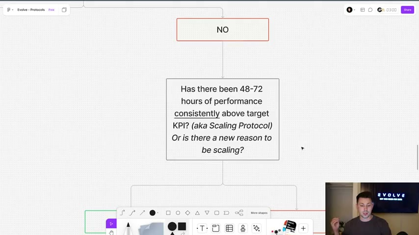
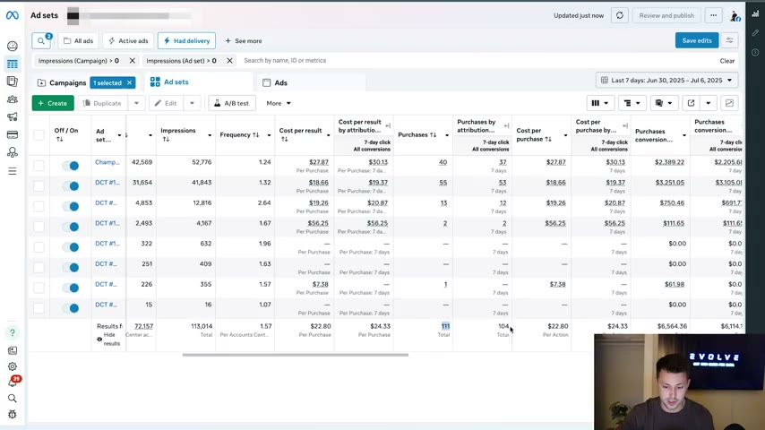
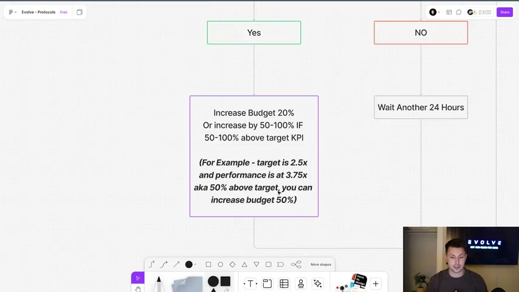
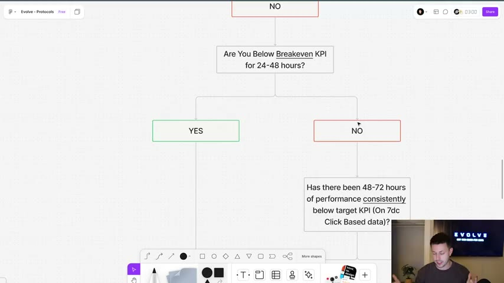
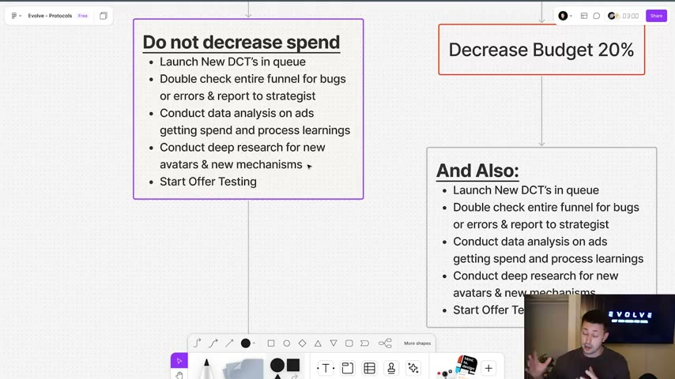
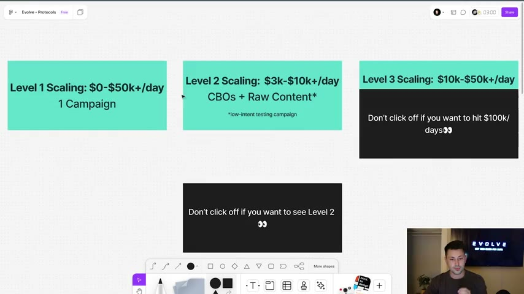
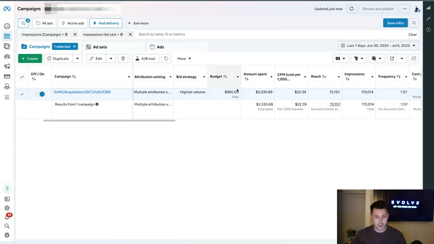
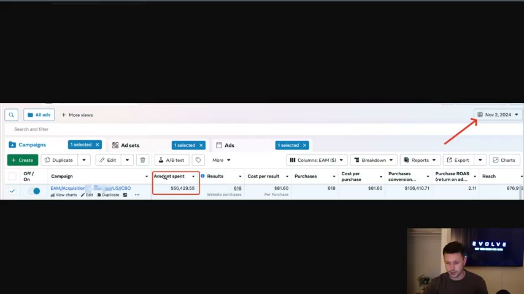

# 115. How to Scale Facebook Ads (Up & Down)
> The EAM scaling SOP: a yes/no flowchart that tells you, every 24 hours, whether to raise a campaign budget by 20% (or 50-100%), wait, or cut it by 20%, plus what to do outside the ad account when performance falls, and the first two "levels of scaling" by daily spend.

## 🤖 Agent use
- **Use when:** deciding whether to change a campaign's daily budget, reviewing why scaling keeps failing, setting a minimum daily spend, or planning work when the account is at its minimum budget.
- **Inputs → outputs:** the campaign's (and account's) 7-day-click ROAS or CPA versus target KPI and break-even KPI, hours of consistent performance, share of purchases that are click-based, current daily spend, minimum daily spend, whether a promo or new winning asset exists → one action (increase 20%, increase 50-100%, wait 24 h, decrease 20%, or hold budget and do the out-of-account work list).
- **Rules:**
  - **DO** start with "are we hitting target KPI?" for the campaign **and** the whole ad account. [00:00]
  - **IF** KPI is hit and it is a limited-time promo or sale with a hard end date (4th of July, Black Friday) **THEN** go straight into scaling protocol; do not wait. [01:01]
  - **IF** KPI is hit and it is a regular campaign **THEN** require **48-72 hours of consistently above-target KPI** (that is "scaling protocol": scale every 24 hours) **or** a "new reason to be scaling" (a new winning ad, offer or landing page). If not, wait another 24 hours. [01:01–03:23]
  - **DO** require click-based proof before scaling: **60% or more of purchases click-based**, or click-based data alone meeting KPI. If not, wait another 24 hours and consider switching to 7-day click only. [03:23–05:51; 07:13–08:23]
  - **DO** then **increase budget 20% flat**; for big budgets use smaller steps (15%, 10% or 5%). **IF** performance is 50-100% above KPI, consistently, **THEN** raise the budget by that same percentage, "at your own risk" (target 2.5x, performance 3.75x = 50% above → +50%). [05:51–07:13]
  - **IF** KPI is not hit and you are **below break-even KPI for 24-48 hours** **THEN** if above minimum daily spend, **decrease budget 20%**. [08:23–09:41]
  - **IF** you are between break-even and target for **48-72 hours** (on 7-day-click data) **THEN** if above minimum daily spend, decrease 20%; otherwise wait 24 hours. [09:41]
  - **IF** you are at your minimum daily spend (or cutting) **THEN** work **outside** the ad account: launch new DCTs, check the funnel for bugs, run data analysis and learnings, do deep research for new avatars and mechanisms, start offer testing. [11:04–15:42]
  - **DON'T** fix a falling account by restructuring campaigns: "what is actually going to fix the inside of your ad account is everything outside." [12:13–13:30]
  - **DON'T** read a single great day as permission: scaling needs consistency, though a new winning asset can justify scaling within 24 hours; in practice the team often waits 36-48 hours. [03:23; 07:13]
- **See also:** [116. How To Understand Facebook Ads Attribution](116-how-to-understand-facebook-ads-attribution.md) · [112. Winning Ad Definitions](112-winning-ad-definitions-0-mo-1m-mo.md) · [101. How To Set Targets & KPIs](101-how-to-set-targets-kpis.md) · [118. (Advanced) Surf Scaling Method](118-advanced-surf-scaling-method.md) · [120. How To See If You Should Turn Off High Spend Ads](120-how-to-see-if-you-should-turn-off-high-spend-ads.md) · [Test and iterate playbook](../../../../playbooks/test-and-iterate.md)

## Key ideas

### 1. Page context
- Page text: "This is the YouTube video version, as it is more up-to-date but edited and optimized to get to the point." It links the Figma board "Evolve - Protocols" (Scaling Protocol). The board itself (a Figma link) is not in the course files; the frames below show parts of it.

### 2. The EAM scaling process: top of the flowchart [00:00–03:23]
- The process "applies to the campaigns that are in your account and what you currently have an active budget on". [00:00]
- Step 1: "Is this campaign hitting target KPI? ... is your entire ad account actually hitting target KPI?" There are level-specific additions later in the video. [00:00]
- **Scaling protocol** = "where you scale the ad account every 24 hours". You qualify once you have seen "two to three days of consistent performance above your target KPI". [01:01–02:19]
- Worked day count: Monday check at 3x ROAS above KPI is "the first 24 hours"; on that Monday the answer to "48-72 hours?" is no → wait. Tuesday, another day at 3x = 48 hours → yes. [02:19]
- A promo or sale campaign with a hard end date skips the waiting. The speaker promises an ad account scaled to $100,000/day with a promo structure; that example is not shown in this cut (see lesson [108](108-how-to-set-up-a-promo-campaign.md) for the promo campaign). [01:01]
- **"New reason to be scaling"** is a recent addition to the chart: "have you found a new winning ad? ... a new winning offer ... a new winning landing page, or has something happened inside of the ad account that is leading to dramatically better performance". Example: a new winning ad "taking us from a 2x to a 5x". [02:19–03:23]
- Even with a new reason, "a lot of times ... we will wait 48 hours ... or we'll wait like 36 hours", then scale if still crushing. [07:13]


*The scaling-protocol gate in the Evolve Protocols board. [02:10]*

### 3. The click-based check [03:23–05:51]
- In Ads Manager: **Customize → Compare attribution settings**, then read the 7-day-click columns. The demo brand runs "seven day click, one day view" (and "one day engaged view" on the Champions ad set). [03:23–04:36]
- Demo numbers (7-day window, brand's own account): 111 purchases, 104 of them click-based [spoken at 04:36; the frame shows the Ad sets view with total 111 and the 7-day-click total column]; click-based ROAS 2.4 (campaign ROAS 2.59 on screen). [04:36]
- Why: "we want to see that the ads are actually driving the performance and it's not just collecting a bunch of view-through attribution ... I prefer to look at click-based data" for incrementality. [04:36]
- Rule from the chart: scale only if **more than 60%** of purchases are click-based, "or click-based data is actually meeting KPI". [04:36–05:51]


*Ad sets with "Purchases by attribution setting, 7-day click" next to total purchases (111 total). Used to test the 60% click-based rule. [05:00]*

### 4. How much to increase [05:51–08:23]
- Default: **increase budget 20% flat** ("$100 a day → $120"). [05:51]
- Big budgets: 20% of $10,000/day is +$2,000, and of $100,000/day is +$20,000. "We have at times scaled by 15% or 10% or 5%, but it really does depend on the brand. For most people, you can actually scale 20%." [05:51]
- If you "over-scaled" and are no longer hitting KPI, scale back down (see section 5). [05:51]
- If you are **50-100% above KPI consistently** (not one day), you can increase "by however much you are above", doubling or 1.5x. Example on the chart: target 2.5x, performance 3.75x = 50% above target → increase budget 50%. "Do this at your own risk." [05:51–07:13]
- Aggressiveness depends on size: under $1,000/day, "or even less than two or $3,000 a day, you're probably fine to be more aggressive". $200 → $400/day is "not really that big of a difference", whereas $10k → $20k "is a massive jump". [07:13]
- If it fails the checks: "wait another 24 hours" (not in scaling protocol; no new reason; or <60% click-based). [07:13–08:23]


*The "yes" branch of the chart: +20%, or +50-100% when performance is 50-100% above target KPI. A "NO" branch next to it says "Wait Another 24 Hours". [05:45]*

### 5. Scaling down: the "no" side [08:23–11:04]
- Why scaling up fails: when you raise budget Meta "has to expand its reach and serve your ads to more people". If creatives convert say 10,000 people/day but not colder people beyond that, ROAS falls and spend becomes inefficient: "the creatives are just not good enough". [08:23]
- New question (added because "we have seen some people ultimately ... scale and just tank their account"): **"Are you below break-even KPI for 24-48 hours?"** [08:23]
  - Yes → check minimum daily spend. If above it, decrease budget **20%**. "The minimum that we usually scale [down] is around 20%. It's very, very rare that we'll scale down like 10%." Sometimes more aggressively. [08:23–09:41]
  - No (e.g. target 2.5, performing 2.0: not losing money but off target) → "Has there been 48-72 hours of performance consistently below target (on 7-day-click based data)?" If not, wait 24 hours; if yes, check minimum daily spend and decrease. [09:41]


*The scale-down gate. [10:00]*

### 6. Minimum daily spend [09:41–11:04]
- Definition: "how much you're willing to spend no matter what", derived from cash flow and reserves, and it grows with the brand. Early on: probably "$50 to $100 a day" that you spend "for 30 days" regardless. For most viewers: "$100 or $200 a day". For a brand spending $20k/day the minimum might be $10k: "no matter what ... we're spending 10K a day and we better figure it out." [09:41–11:04]

### 7. When you cannot cut: work outside the ad account [11:04–15:42]
Board text (frame): "Do not decrease spend" (at minimum spend) and, next to "Decrease Budget 20%", "And Also:". Both lists are the same:
1. Launch new DCTs in queue. [11:04]
2. Double-check the entire funnel for bugs or errors and report to the strategist. Anecdote: brands "accidentally removed a piece of code for their cart", changed a product page, or ran out of stock; performance tanked and the funnel check found it. Recommend checking daily, especially after a dramatic change. [11:04–12:13]
3. Conduct data analysis on ads getting spend and process learnings; "complete those feedback loops" about which angle, avatar or creative style Meta likes. [12:13]
4. Conduct deep research for new avatars and new mechanisms: "if you are seeing that performance is going down and that every time you scale you get hit and punched in the face, it's probably time for you to spend more time outside of the ad account". Includes studying existing creatives; the course's first step for new members is the winning-ads document of ads that spent millions. [12:13–13:30]
5. Start offer testing. [14:32]


*The five out-of-account actions listed under both "Do not decrease spend" and "Decrease Budget 20%". [12:00]*

### 8. Offer testing [14:32–15:42]
- Use it if you plateaued for months, are scaling back down, or sit at your minimum daily budget. [14:32]
- Reason: "The market is going to get sophisticated. The offer that you ran in January is probably not as powerful as it is now in June"; desires shift with season (summer: people outside, travelling). Build offers that can scale through seasons when "everything might not be in your favor". [14:32]
- Preferred method: inside your one campaign, launch brand-new ads with a brand-new offer and see whether it gets spend. At $10-15k/day you may have the data to split-test on the store. Also vary avatar focus, pricing and bundles. [14:32–15:42]

### 9. Levels of scaling [15:42–19:06]
Board titles (frames): Level 1 Scaling: $0-$50k+/day · 1 Campaign; Level 2 Scaling: $3k-$10k+/day · CBOs + Raw Content* (*low-intent testing campaign); Level 3 Scaling: $10k-$50k+/day; Level 4 Scaling: $50k-100k+/day.
- **Level 1 ($0-$50k+/day): one campaign.** "How can my scaling setup be the same at zero dollars to 50k? Because that's where Meta is pushing everything and there's proof of it." Example: a $100/day brand should have a single campaign with scaling protocol applied; the demo campaign has a $360/day budget. [15:42–16:46]
- Proof shown: a screenshot of a brand spending **$50,000 on a single campaign** (the frame reads $50,429.55 amount spent on one date, 618 purchases, ROAS 2.11); the speaker says "an ad account that was spending 50K per day at a 2X ROAS" and that he has seen larger but lacks permission to share. "You can literally scale this, do 50K plus a day with one campaign." [16:46–17:57]
- Belief the speaker rejects: needing "this campaign and that campaign ... to launch new CBOs with every single ad that you test". "It's all about the things that are outside of your ad account." [16:46]
- Under **$3k/day**: one campaign; "lock in on your creatives, lock in on your landing pages"; "whether you're running a CBO or an ASC, I literally don't care." [17:57]
- **Level 2 ($3k-$10k/day): CBOs + a "raw content" campaign.** "Raw content" is "the word that we've come up with for low-intent testing campaigns". At this stage a brand likely gets UGC or TikTok Shop content. The main campaign stays one campaign; the raw content campaign "is barely spending $200 a day" (frame: Main $3,760 vs Raw Content ASC $175 vs a Testing campaign $120 in the demo account). The speaker says the testing campaign exists for "ABO versus CBO", "going to be an insane video" (not in this cut). [17:57–19:06]
- **Levels 3-4:** the board teases "Don't click off if you want to hit $100k/days" (Level 3) and "If you're spending this much your time is valuable so you're allowed to skip to the end" (Level 4). This video ends at the Level 2 reveal; levels 3-4 are not explained here. See lessons [118](118-advanced-surf-scaling-method.md) and [119](119-action-item-scale-your-ads.md).


*Levels of scaling by daily spend. [18:10]*


*Level 1: a single CBO acquisition campaign with a $360 daily budget; scale it by the same flowchart. [16:40]*


*Proof that one campaign can run at about $50k/day at about 2x ROAS (single-day view, one date selected). [17:05]*

## Steps / framework
The EAM scaling process as an ordered decision list (from the board and speech; run once per day per campaign):

| # | Question | Yes → | No → |
|---|---|---|---|
| 1 | Is the campaign (and the whole account) hitting target KPI? | go to 2 | go to 6 |
| 2 | Hard-end-date promo or sale campaign? | skip the wait, go to 4 | go to 3 |
| 3 | 48-72 h consistently above target KPI (scaling protocol), or a new reason to scale (new winning ad / offer / landing page)? | go to 4 | wait 24 h |
| 4 | More than 60% of purchases click-based, or click-based data alone meets KPI? | go to 5 | wait 24 h; check switching to 7-day click only |
| 5 | Performance 50-100% above target KPI, consistently? | increase by that % (at your own risk) | increase 20% (or 15/10/5% at very large budgets) |
| 6 | Below break-even KPI for 24-48 h? | go to 7 | go to 8 |
| 7 | At minimum daily spend? | hold budget; do the out-of-account list | decrease 20% **and** do the out-of-account list |
| 8 | 48-72 h consistently below target KPI on 7-day-click data? | go to 7 | wait 24 h |

## Examples
- **Counting hours:** Monday 3x ROAS (above KPI) = first 24 h; Tuesday 3x again = 48 h → yes. [02:19]
- **New reason:** a newly launched winning ad lifts ROAS from 2x to 5x ("taking off like a rocket ship"); not in scaling protocol, no promo, but a new reason → scale after 24-48 h. [03:23; 07:13]
- **Click-based check:** 111 purchases, 104 click-based, click ROAS 2.4 → passes the 60% test. [04:36]
- **20% math:** $100/day → $120. At $10,000/day, +20% = +$2,000; at $100,000/day, +$20,000. [05:51]
- **50% rule:** target 2.5x; performance 3.75x consistently → increase budget 50%. [05:51–07:13]
- **Minimum spend:** a $20k/day brand might set $10k/day as its floor. [09:41–11:04]
- **Funnel break:** client removed cart code, product page changed or out of stock; performance fell; a funnel check found it. [11:04–12:13]

## Structured units

### Rules of thumb
- **DO** read KPI on **7-day click** data when deciding to scale or cut. [09:41]
- **DON'T** scale recklessly off one good day: wait for 48-72 h of consistency. The speaker warns that some people "scale up and then all of a sudden your ROAS just tanks" (transcript word "Chad scale", read as reckless scaling). [08:23]
- **IF** you must decrease **THEN** decrease 20%, not 10%. [09:41]
- **IF** a brand is under $1k/day (or under $2-3k/day) **THEN** you can scale more aggressively. [07:13]
- **IF** a brand is at $10k+/day **THEN** use smaller steps (15%, 10%, 5%) depending on the brand. [05:51]
- **IF** plateaued for months **THEN** test new offers inside the existing campaign. [14:32]

### Templates
| Template | Use for | Example fill | Source |
|---|---|---|---|
| "Increase budget 20% / or by X% if X% above KPI" | Daily budget move when conditions pass | target 2.5x, performance 3.75x → +50% | [05:51–07:13] |
| "Minimum daily spend = $ I will spend for 30 days regardless" | Floor for decreases | $100-$200/day for most viewers; $10k for a $20k/day brand | [09:41–11:04] |

## Prompts / templates (verbatim)
Board text read from frames:

```
Has there been 48-72 hours of performance consistently above target KPI? (aka Scaling Protocol)
Or is there a new reason to be scaling?

Increase Budget 20%
Or increase by 50-100% IF 50-100% above target KPI
(For Example - target is 2.5x and performance is at 3.75x aka 50% above target, you can increase budget 50%)

Wait Another 24 Hours

Is more than 60% of purchases from click based attribution data?
Or is Click Based data alone meeting KPI?

Are You Below Breakeven KPI for 24-48 hours?

Has there been 48-72 hours of performance consistently below target KPI (On 7dc Click Based data)?

Are we at the minimum daily spend?

Decrease Budget 20%

Do not decrease spend / And Also:
- Launch New DCT's in queue
- Double check entire funnel for bugs or errors & report to strategist
- Conduct data analysis on ads getting spend and process learnings
- Conduct deep research for new avatars & new mechanisms
- Start Offer Testing

Level 1 Scaling: $0-$50k+/day (1 Campaign)
Level 2 Scaling: $3k-$10k+/day (CBOs + Raw Content*; *low-intent testing campaign)
Level 3 Scaling: $10k-$50k+/day ("Don't click off if you want to hit $100k/days")
Level 4 Scaling: $50k-100k+/day ("If you're spending this much your time is valuable so you're allowed to skip to the end")
```

## How to apply
- [ ] Each day, for each campaign: log ROAS/CPA on 7-day click vs target KPI and break-even KPI, plus current daily budget and the minimum daily spend.
- [ ] Count consecutive hours above target KPI; note any promo end date or new winning ad/offer/landing page.
- [ ] Pull attribution comparison (7-day click) and compute the click-based share of purchases; require more than 60% or click KPI met.
- [ ] Apply the table: +20% (smaller % at $10k+/day), or +50-100% if consistently that far above KPI, or wait, or -20%.
- [ ] When holding at minimum spend or cutting, assign the five out-of-account tasks (DCTs, funnel check, learnings, deep research, offer test) and log them.
- [ ] Set the brand's minimum daily spend from cash flow and reserves.
- [ ] Below $3k/day run one campaign only; add a raw-content testing campaign at $3k-$10k/day.

## Related
- Previous: [114. Action Item - Generate + Submit Your Reports](114-action-item-generate-submit-your-reports.md) · Next: [116. How To Understand Facebook Ads Attribution](116-how-to-understand-facebook-ads-attribution.md)
- [94. How To Set Up a 3-2-2 Campaign](094-how-to-set-up-a-3-2-2-campaign.md) · [97. How To Set Up ABO Scaling Campaign](097-how-to-set-up-abo-scaling-campaign.md) · [98. How To Set Up Raw Content Campaign](098-how-to-set-up-raw-content-campaign.md) · [107. How To Protect Against Bad Ads Over-Spending](107-how-to-protect-against-bad-ads-over-spending.md) · [121. How To Deal With Roller Coaster Performance](121-how-to-deal-with-roller-coaster-performance.md)
- [Iteration outcomes (Copywriting)](../../copywriting/concepts/iteration-outcomes.md) · [Creative testing system](../../../../frameworks/creative-testing-system.md)

## Sources and limitations
- Transcript: [115 transcript](<../../../../../raw/evolve/start-here/_transcripts/👣 Evolve (Start Here)/115. How to Scale Facebook Ads (Up & Down) 👣 Evolve (Start Here) Evolve.txt>) · Page text: [115 page](<../../../../../raw/evolve/start-here/_extracted/👣 Evolve (Start Here)/115. How to Scale Facebook Ads (Up & Down)_👣 Evolve (Start Here)_Evolve.html.md>).
- Machine transcription (Whisper large-v3-turbo). Recording fully covered (last segment 19:06 = video end), but the video ends mid-teaser at Level 2; Level 3, Level 4, the "$100,000 a day with the promo structure" account, and the "ABO versus CBO" video are announced and not shown. The Figma board is only available as screenshots; the full board, including anything below "Decrease Budget 20%", is not in the course files.
- Whisper artefacts: "customs" for the Customize/column-options control; "Chad scale" (reckless scaling) at [08:23] and "Chad scaling from 10K to 20K" at [07:13] (sense: chat-style "just scaling"); "CBL/CBO"; "ASC" (Advantage+ Shopping Campaign, expanded by derivation only). "EAM" is the agency's campaign prefix; "DCT" is the creative-test campaign/ad format (expansion not stated here).
- The "50K/day at 2x ROAS" screenshot shows a single date (Nov 2, 2024) and an amount spent of $50,429.55; the speaker calls it "50K per day". The demo account numbers (111 purchases, $360 budget) are from an account of the instructor's with dates visible as 30 Jun-6 Jul 2025 in the frame.
- "50-100% above KPI" increases and 20% steps are instructor practice without a published test; the speaker says "do this at your own risk".
