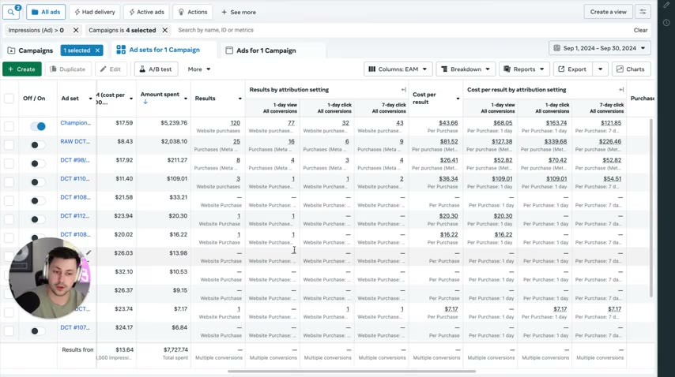
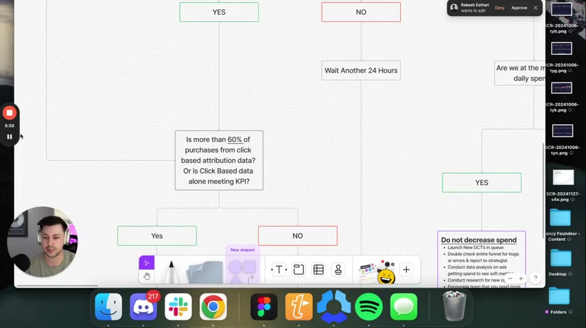
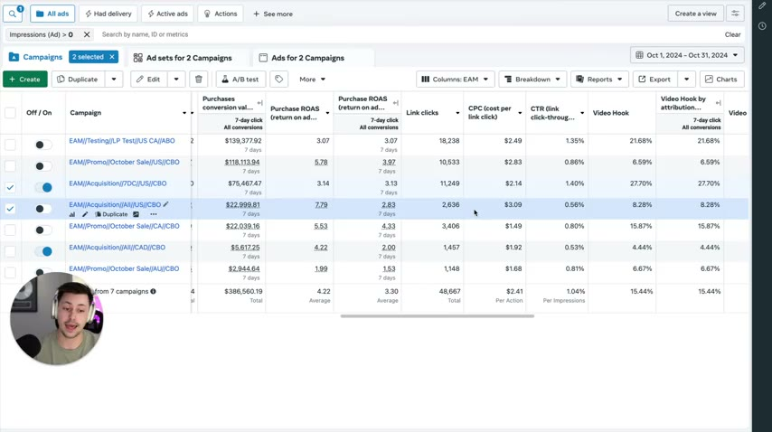

# 116. How To Understand Facebook Ads Attribution
> Meta's reported ROAS depends on its attribution setting; judge ads and scale on 7-day click data, check how much of your reported purchases are only 1-day view, and test a 7-day-click-only campaign when view-through inflates your numbers.

## 🤖 Agent use
- **Use when:** reading a Meta ROAS before scaling, diagnosing "roller coaster" or unexplained scaling failures, choosing an attribution setting for a campaign, or auditing why Meta, Shopify and Triple Whale disagree.
- **Inputs → outputs:** Ads Manager campaign/ad set data with **Compare attribution settings** enabled (7-day click, 1-day click, 1-day view; every conversion vs first conversion) → click-based share of purchases, click-based ROAS vs reported ROAS, and a decision whether to test a 7-day-click-only campaign.
- **Rules:**
  - **DO** use **7-day click** as the performance basis: "Click Based = Good, View Through = No Good" (page text). [00:00; 08:10]
  - **DO** open **Compare attribution settings** and check the click-based share of purchases before trusting ROAS. [02:32]
  - **IF** the **majority** of purchases come from view-through (the speaker's example: 77 click-based of 234 = 32%) **THEN** test a 7-day-click-only campaign. [09:32–10:50]
  - **IF** you spend **more than $1,000/day**, or you have a bad view-through problem even below $1,000/day, **THEN** use 7-day click. [12:11]
  - **IF** you spend under $1,000/day and need more data, the agency uses **7-day click + 1-day view**. [11:50–12:11]
  - **DON'T** treat the click-based test as a fix-all: "Is this going to scale your ad account from $1,000 to $10,000 per day? Absolutely not." It drives more incrementality, especially for bigger brands. [10:50]
  - **DON'T** worry about 1-day click unless spending over $100,000/day. [10:50]
  - **IF** you have roller-coaster days **THEN** check view-through attribution first. [10:50]
  - **DON'T** read a high reported ROAS (e.g. 7.79x) as proof of performance when the click-based ROAS is much lower. [07:02–08:10]
- **See also:** [115. How to Scale Facebook Ads (Up & Down)](115-how-to-scale-facebook-ads-up-down.md) · [117. How To View Attribution in TW (Triple Whale)](117-how-to-view-attribution-in-tw-triple-whale.md) · [121. How To Deal With Roller Coaster Performance](121-how-to-deal-with-roller-coaster-performance.md) · [101. How To Set Targets & KPIs](101-how-to-set-targets-kpis.md) · [112. Winning Ad Definitions](112-winning-ad-definitions-0-mo-1m-mo.md)

## Key ideas

### 1. Attribution does two jobs [00:00–01:11]
- Meta uses the attribution setting to **learn who to go after**: with "lowest cost, highest volume" on a 7-day-click, 1-day-view setting, it optimises toward purchases counted by those parameters. [00:00]
- It is also **how Meta reports back**: purchases shown in Ads Manager are counted by the same window. [00:00]
- 7-day click: someone clicks Monday and buys the next Sunday → counted. Clicks Monday, buys "next Wednesday, like 10 days go by" → not counted, unless they click an ad again before purchasing (click Monday, click next Tuesday, buy Wednesday → counted). [01:11]

### 2. View-through is an attribution model too [01:11–02:32]
- "One day view is also an attribution model inside of Meta." The speaker accepts there is "some place" for it for brands with little data: someone sees your ads for two weeks, sees one at lunch, buys on a laptop that night; Meta matches them and credits the ad with a view-through purchase. [01:11]
- It matters for scaling because of how it distorts what you see (section 4). [01:11–02:32]

### 3. How to see click vs view in Ads Manager [02:32–03:45]
- Scroll to **Compare attribution settings** (in the columns control). Choose **7-day click** and also **1-day click**; the other options shown are 1-day view. [02:32]
- "Choose conversion count": **see every conversion** (after a view or click) or **see only the first conversion** after an ad view/click. The second gives people who purchased, not new customers specifically, only the first conversion for repeat buyers. [02:32]
- Example (a brand's September campaign, filtered by spend): about $5,000 spend and 120 purchases at the ad-set level. 77 were 1-day-view conversions, "only 43 of them actually came from people clicking the ad". Reported ROAS fell from 5.32 to 2.24 on 7-day click only. [02:32–03:45]


*Results by attribution setting (1-day view all conversions / 1-day click / 7-day click). The top ad set shows 120 results: 77 / 32 / 43. [03:45]*

### 4. Why view-through is high: three causes [03:45–05:58]
1. **Email.** An email send or drop produces a spike in Meta-attributed purchases that day, because those buyers had seen an ad. "The most common thing that applies to everyone." [03:45]
2. **Returning customers.** Meta optimises for volume at lowest cost; the cheapest buyers are people who already know you. With 1-day-view optimisation and a high returning-customer rate, "you're going to see a very high view-through data." [04:52]
3. **Organic presence and other channels** (influencers etc.). Meta "collects" attribution from purchases driven elsewhere, inflating Facebook numbers, and "you might start overspending dramatically". [04:52–05:58]
- Consequence: "you spent seven K at a five, why didn't you spend more? It's because our actual seven day click KPI was not meeting the target KPI" (the brand was targeting about 2.5x-3x on 7-day click). [05:58]


*The scaling-protocol check from [115](115-how-to-scale-facebook-ads-up-down.md): scale only if more than 60% of purchases are click-based (or click data alone meets KPI). Shown while the speaker explains why. [07:00]*

### 5. 1-day click [05:58; 10:50]
- 1-day click shows "how many people actually buy within 24 hours of clicking your ad", a read on ad effectiveness and the customer journey. A new creative with weak day-1 ROAS may just have a longer path to purchase; sometimes 7-day and 1-day click are close. [05:58]
- Ignore it "unless you're a brand spending over $100,000 per day". [10:50]

### 6. The test: a 7-day-click-only campaign [07:02–10:50]
- The brand ran a normal acquisition campaign in September; in October it launched a **7-day-click-only** campaign with the same ads and creatives (Champions ad set, DCTs). [07:02; 08:10]
- Results (7-day-click basis; spoken numbers and the frame agree): the all-acquisition campaign (7-day click, 1-day view) reported **7.79x ROAS**, spending about **$8,000**; on 7-day click its ROAS was **2.83**. The 7-day-click campaign spent about **$24,000** ("three times as much") at **3.13** 7-day-click ROAS. [07:02–08:10]
- Interpretation: "simply by changing the attribution setting and letting Facebook start to optimize more for click-based customers rather than view-through customers", it scaled more at a higher click ROAS. The "7.79x" looks great but "this data is not incremental". [07:02–08:10]
- The setup was accidental: the team first set the campaign as 7-day-click 1-day-view and the instructor made them switch it. [09:32]
- Caution: "This does not mean that you should go and set seven day click just because of these results. This client had a very specific view-through problem." Evidence: 234 total purchases, only 77 on 7-day click (32%), so about 70% of purchases were people viewing without clicking. One ad had nine purchases and zero click-through purchases: "Facebook was literally just showing this to people and collecting attribution." [09:32–10:50]
- Also a reminder to test landing pages: the LP campaign was the top performer on 7-day click too. [07:02]


*Two campaigns side by side: the 7DC1DV campaign's 7.79 reported ROAS vs 2.83 on 7-day click, and the 7-day-click campaign at 3.14/3.13 with roughly three times the spend. [08:00]*

### 7. The agency's two settings and the decision rule [10:50–13:05]
- "We at the agency only really use two attribution settings. One is seven-day click and one-day view [for lower spends that need more data, usually under $1,000/day]; the other is seven-day click." [10:50–12:11]
- "If you're spending above $1,000 per day, or again, you have bad view-through attribution, you should be using seven-day click." Below $1,000/day with a terrible view-through problem "it's still worth a switch". [12:11]
- Even when click-based share is healthy (the speaker's inverse example: about 70% click-based), the team "still tests a seven-day click campaign just to see if Facebook optimizes differently". [10:50]
- Recommended test for bigger brands that struggle with view-through or "rocky" scaling: it "helps the machine learn off of data that is from people clicking and not just viewing". [12:11]
- Triple Whale equivalent: TA (click) vs TA+V (click + view); see [117](117-how-to-view-attribution-in-tw-triple-whale.md). [08:10]

## Steps / framework
Attribution audit (derived from [02:32–12:11]):
1. In Ads Manager choose Columns → **Compare attribution settings**; add 7-day click and 1-day click next to your current setting.
2. Filter to the campaign and period (e.g. last 30 days). Record: total purchases, 7-day-click purchases, 1-day-view purchases, reported ROAS, 7-day-click ROAS.
3. Compute click share = 7-day-click purchases ÷ total purchases. Compare with the 60% scaling-protocol bar ([115](115-how-to-scale-facebook-ads-up-down.md)) and the "majority from view-through" test case (32%).
4. Look at ad level: any ad with spend and zero click purchases is "collecting attribution".
5. Check for the three causes: email sends on the spike days, returning-customer rate, organic/influencer activity.
6. If view-through dominates, duplicate the winning ads into a **7-day-click-only** campaign and compare its 7-day-click ROAS and spend with the original over 2-4 weeks.
7. Decide: spend > $1,000/day or view-through problem → 7-day click; otherwise 7-day click + 1-day view.

## Examples
- **September campaign:** $5,000 spend, 120 purchases (ad-set level), 77 1-day view, 43 7-day click; ROAS 5.32 → 2.24 on 7-day click. [03:45]
- **October all-acquisition vs 7DC campaign:** 7.79x reported / 2.83x click vs 3.13x click on ~3x the spend. [07:02]
- **Click share 32%:** 234 purchases, 77 on 7-day click. [09:32]
- **Zero-click ad:** nine purchases, none click-based. [09:32–10:50]
- **Why "seven K at a five" did not get more budget:** click ROAS under the 2.5x-3x target. [05:58]

## Structured units

### Rules of thumb
- **DO** compare click ROAS with target KPI, not reported ROAS. [05:58]
- **DON'T** judge a new creative on day-1 ROAS alone when 1-day and 7-day click diverge. [05:58]
- **IF** view-through spikes on email days **THEN** do not credit the ad account for the spike. [03:45]
- **IF** Meta reports a very high ROAS but little scale **THEN** check the click-based ROAS before adding budget. [05:58; 07:02]

### Templates
| Template | Use for | Example fill | Source |
|---|---|---|---|
| Click share = 7-day-click purchases ÷ total purchases | Test whether Meta ROAS is incremental | 77 ÷ 234 = 32% | [09:32] |
| Reported vs click ROAS pair | Show the inflation | 7.79x reported vs 2.83x 7-day click | [07:02] |

## Prompts / templates (verbatim)
Page text, in full: 
```
Click Based = Good
View Through = No Good
```

## How to apply
- [ ] Add Compare attribution settings to the default column set.
- [ ] Log click share and click ROAS beside reported ROAS in every report.
- [ ] If click share is under 60% (the 115 gate) or the majority of purchases are view-through, launch a 7-day-click-only duplicate campaign.
- [ ] Mark email-send days when reading daily ROAS.
- [ ] Re-evaluate every month or when spend crosses $1,000/day.

## Related
- Previous: [115. How to Scale Facebook Ads (Up & Down)](115-how-to-scale-facebook-ads-up-down.md) · Next: [117. How To View Attribution in TW (Triple Whale)](117-how-to-view-attribution-in-tw-triple-whale.md)
- [112. Winning Ad Definitions](112-winning-ad-definitions-0-mo-1m-mo.md) (click-based data is a non-negotiable in the winning-ad definition) · [100. How To See Ads Performance + Our Columns](100-how-to-see-ads-performance-our-columns.md) · [Iteration outcomes (Copywriting)](../../copywriting/concepts/iteration-outcomes.md)

## Sources and limitations
- Transcript: [116 transcript](<../../../../../raw/evolve/start-here/_transcripts/👣 Evolve (Start Here)/116. How To Understand Facebook Ads Attribution 👣 Evolve (Start Here) Evolve.txt>) · Page text: [116 page](<../../../../../raw/evolve/start-here/_extracted/👣 Evolve (Start Here)/116. How To Understand Facebook Ads Attribution_👣 Evolve (Start Here)_Evolve.html.md>).
- Machine transcription (Whisper large-v3-turbo). Full recording covered (last segment 783.98 s of 784.55 s). Whisper says "seven-day clicker one-day view ratio" (read: 7-day click, 1-day view), "Loom is not showing me my little pen thing" (screen-recording tool), "Facebook ... TA and TA plus view" (Triple Whale terms), "seven to eight click" at [10:50] (read: 7-day click).
- Reading of the on-screen table: the September ad-set row shows 120 results = 77 (1-day view) + 43 (7-day click), with 32 of the 43 also being 1-day click, so the spoken "77 view-through, 43 click" matches the columns. The October example uses 234 total and 77 on 7-day click for 32%. The spoken "$8,000 at 7.79x" and "$24,000" match the frame's 7-day-click conversion values divided by the click ROAS; the frame columns show conversion value, not spend. The second attribution line at [10:50] ("seven-day click and one-day view or one-day view") is a transcription glitch; read as above.
- The "more than 60%" line in this lesson is the scaling-protocol gate shown in the 115 chart; the speaker's own "majority from view-through" threshold at [09:32] is "more than half". The instructor claim that the 7-day-click test "will not" turn $1k into $10k per day, and the idea that view-through mostly "isn't incremental", are claims without data here. The video does not show Meta's own documentation of the attribution windows. Dates visible in frames are 2024 (Sep 1-30, Oct 1-31); the screen-recorded account may not be the same account as in lesson 115.
