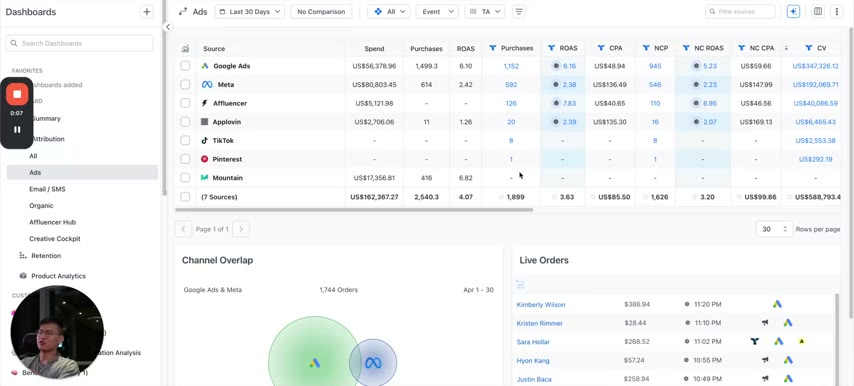
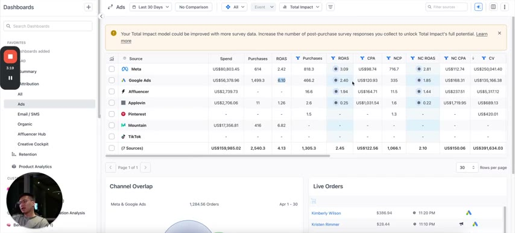
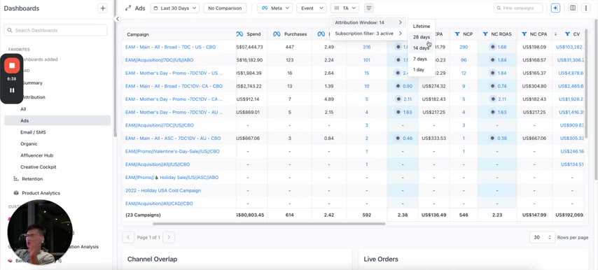
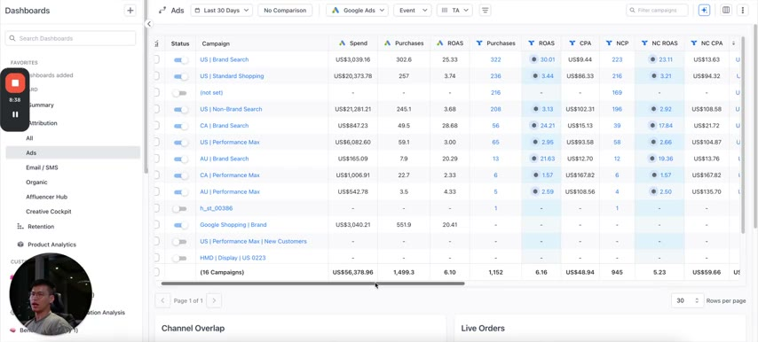
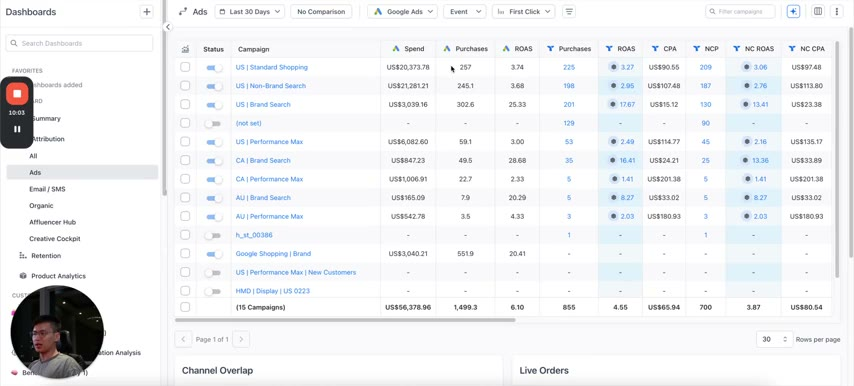

# 117. How To View Attribution in TW (Triple Whale)
> Use Triple Whale for channel-level incrementality (Total Impact, Triple Attribution, new-customer ROAS, first click vs last click), not for ad-set or ad decisions, and read Meta on click-through (TA) rather than view-through.

## 🤖 Agent use
- **Use when:** reconciling Meta, Google and Triple Whale numbers, deciding which channel is truly incremental, judging a Google Ads campaign (especially branded search vs shopping), or checking new-customer ROAS before scaling.
- **Inputs → outputs:** Triple Whale Attribution → Ads dashboard (last 30 days), attribution window and subscription filter, per-channel TA / TA+V / Total Impact / First Click / Last Click ROAS and NC ROAS → a per-channel read on incrementality and a keep / scale / investigate decision.
- **Rules:**
  - **DO** set the attribution window to **14 days**; the default can be lifetime, which is "very inaccurate". If numbers look "ridiculous", re-check the window. [06:50; page]
  - **DO** read Meta (and TikTok, AppLovin, Snapchat, Pinterest) on **Triple Attribution (TA)** = click-through, plus Total Impact for the channel view. [00:00; 11:48]
  - **DON'T** use Triple Whale for campaign, ad-set or ad-level decisions: purchases attributed by the post-purchase survey sit in one "Triple Survey" bucket that does not name the ad. Use it "from a whole channel perspective". [04:21–06:50]
  - **DO** use **Total Impact** to compare channels holistically, not per campaign; it needs the post-purchase survey enabled and gets more accurate over time. Treat it as "not the end-all be-all". [01:24–02:53]
  - **IF** Google Ads has no YouTube or Display **THEN** a low Total Impact ROAS is normal: search and shopping capture demand. [02:53]
  - **DO** compare TA, **First Click** and **Last Click** for Google Ads, and check **new-customer ROAS (NC ROAS)**; do not trust in-platform or TA ROAS on branded search. [08:16–11:48]
  - **IF** YouTube/Display runs at break-even or below 1 in platform **THEN** check Total Impact: it may be much higher. [11:48–13:17]
  - **DO** check NC ROAS for subscription or established brands: a 2x in-platform ROAS can be 0.8x NC ROAS. [05:49]
- **See also:** [116. How To Understand Facebook Ads Attribution](116-how-to-understand-facebook-ads-attribution.md) · [115. How to Scale Facebook Ads (Up & Down)](115-how-to-scale-facebook-ads-up-down.md) · [100. How To See Ads Performance + Our Columns](100-how-to-see-ads-performance-our-columns.md) · [121. How To Deal With Roller Coaster Performance](121-how-to-deal-with-roller-coaster-performance.md)

## Key ideas

### 1. Scope and glossary (page text)
- Page: "For Triple Whale users - This is purely how to use TW when making **channel specific** media buying decisions not for overall brand." "Set your attribution window to 14 days."
- Glossary on the page:
  - **Total Impact (TI):** "look at which overall channel is incremental to business (caveat to this for Google Ads mentioned in video)".
  - **Triple Attribution (TA):** click-through ROAS.
  - **Triple Attribution + Views (TA+V):** click-through + view-through ROAS.
  - **First Click (FC):** customer clicked on this ad/campaign first.
  - **Last Click (LC):** customer converted through this ad/campaign regardless where they initially saw you.
  - "TA combines FC and LC attribution."

### 2. Meta: read TA, not TA+V [00:00–01:24]
- Defaults: TA = click-through only; TA+V = click + view-through. Facebook's own default is 7-day click, 1-day view, so TA+V "is usually more accurate to the Facebook ads for us", but "that doesn't matter. We want to see what's the most accurate ... the most incremental." [00:00]
- Decision: look only at click-through ROAS: "7-day click on Facebook or triple attribution inside Triple Whale". "I don't care if you have a lot of view-through ROAS." [00:00]
- Demo (Last 30 days, Attribution → Ads): Meta spend about $80.8k, 614 purchases, platform ROAS 2.42, TA ROAS 2.38 (frame: Meta row, columns Spend, Purchases, ROAS, TA purchases, TA ROAS, CPA, NCP, NC ROAS). [00:00; 04:21]


*Ads dashboard on the TA model: platform-reported ROAS vs Triple Attribution ROAS and new-customer ROAS per channel (Meta 2.42 platform vs 2.38 TA). [00:10]*

### 3. Total Impact [01:24–04:21]
- Enable it via the survey settings (a settings button on the left); the instructor says "some AI model, I'm not sure about that". "Take some time, then you'll be more accurate over time." [01:24]
- Use it for the **business-wide** view of which platforms are most incremental. Platform and TA purchases/revenue "don't actually match my Shopify revenue ... the revenue reported in total is always going to be higher because ad platforms want to take credit". [01:24]
- Demo: revenue was previously "500k plus" on TA; Total Impact shows about **$390k** "which is more accurate to what we're seeing for ads only". Meta drove the most (top of funnel); a Google channel "looks good as well" (Whisper writes "Roads"); AppLovin "didn't actually drive any incrementality". [01:24–02:53]
- Compare top-of-funnel channels (Meta, TikTok, AppLovin) with Total Impact to see which is most incremental. [02:53]


*Total Impact view: Google Ads' platform ROAS 6.10 falls to 2.40 and AppLovin's 1.26 falls to 0.25, while Meta's 2.42 rises to 3.09. A banner says the Total Impact model improves with more post-purchase survey responses. [03:20]*

### 4. Google Ads caveat for Total Impact [02:53]
- With no YouTube or Display, "your Google Ads Total Impact is always going to be very, very low and that's normal", because Google Ads without those is "not meant to do prospecting, it's just meant to capture the demand (retargeting, bottom of funnel)". The demo shows platform ROAS 6x vs Total Impact 2.4. [02:53]

### 5. Don't use TW below channel level [04:21–06:50]
- Triple Whale TA ROAS 2.38 vs Meta 2.4 looks "sort of similar", but at campaign/ad-set/ad level the numbers differ because **Triple Survey**: people fill a survey and say they came from Facebook ads; Triple Whale cannot say which ad, so it "bunches it up under Triple Survey". "In total, it looks correct. Individually ... it doesn't look that correct." [04:21]
- "Campaign level is still okay." [06:50]
- Use TW for the **new-customer ROAS** view, and LTV (separate topic): "Am I actually getting new customers from this?" [04:21]

### 6. New-customer ROAS (NC ROAS) [04:21–05:49]
- Matters most for subscription or well-established brands; "for a lot of you guys who have a dropship turned brand, it doesn't matter too much." [04:21]
- Example: 2x ROAS in platform but 0.8 NC ROAS. "You're just targeting the same customers that have bought before. They might have already bought even if you didn't push it to them." [05:49]

### 7. Attribution window and subscription filter [05:49–06:50]
- In TW, open the **attribution model window** control (frame: menu with Lifetime, 28 days, 14 days, 7 days, 1 day, and "Subscription filter: 3 active"). Facebook used to be 28 days, now 7-day click. Recommended TW window: **14 days**. Default may be **lifetime**: "very inaccurate". [05:49–06:50]
- **Subscription filter:** for subscription brands, toggle to see ROAS from people not already subscribed (new-customer ROAS). [06:50]


*The attribution window menu (currently "Attribution Window: 14") and the subscription filter. [06:40]*

### 8. Google Ads: compare TA, First Click and Last Click [06:50–11:48]
- Incrementality is hard to see for Google; "I wouldn't take a look at Total Impact too much overall unless you have YouTube display". [06:50]
- TA on Google tends to **inflate** ROAS, especially for **branded search**: ROAS "28, 24, 20, 21" for branded search; "branded search isn't incremental ... 20x ROAS isn't 20x ROAS actually." Non-brand search at **3x** is "pretty accurate". [08:16]
- TA+V does not apply to non-YouTube Google campaigns. Compare **First Click** (credit to the first channel clicked) and **Last Click** (credit to the last channel clicked: if someone went on Facebook ads and then searched your Google ad, last click credits Google). [08:16]
- Worked example: Standard Shopping campaign, target 3x.
  1. **First click** = about **3x** ROAS: "people are actually coming in from our SEO-optimized titles, not from the brand name". [09:45]
  2. **Last click** = about **2x**: "it's actually doing some prospecting because it's not retargeting; the retargeting ROAS is only a 2x ... they convert through other platforms later on" (Performance Max, Facebook, etc.). [09:45]
  3. **TA** reads about 3.4-4 (spoken "3.7, 4, 3.4"; frame shows 3.44 TA ROAS and 3.21 NC ROAS for Standard Shopping; first click 3.27 ROAS and 3.06 NC ROAS). [10:46; frames]
  4. **NC ROAS** on both is "looking good as well", on target. Conclusion: "my assumption is that this standard shopping is actually doing prospecting for us ... so in that case, I'll keep scaling this one if it's on target." [10:46–11:48]


*Google Ads campaigns on the TA model: branded search shows 25-30x ROAS (not incremental), shopping and non-brand search about 3x. [08:40]*


*First Click view for the same campaigns: branded search falls from 30 to 17.67 while Standard Shopping stays about 3.3. [10:00]*

### 9. Other channels and a YouTube note [11:48–13:17]
- TikTok: "same like Meta: look at it from TA, look at from Total Impact." AppLovin, Snapchat and Pinterest: "TA, Total Impact". [11:48]
- Google: compare TA, first click, last click; if you run YouTube/Display, use Total Impact to see how incremental they are. YouTube "usually runs at breakeven or below one in platform, but in Total Impact it actually has a much higher ROAS" (no demo available). [11:48–13:17]
- Make sure the subscription filter and attribution window are where you want them. [11:48]

## Steps / framework
Channel read-out in Triple Whale (derived from [00:00–13:17]):

| Channel | Models to read | What to conclude | Source |
|---|---|---|---|
| Meta | TA (click) + Total Impact; ignore TA+V | Incremental or not; scale on TA vs target | [00:00; 02:53] |
| TikTok, AppLovin, Snapchat, Pinterest | TA + Total Impact | Same as Meta | [11:48] |
| Google (search / shopping) | TA, First Click, Last Click, NC ROAS | Prospecting if first-click ROAS on target and last-click lower | [08:16–11:48] |
| Google (YouTube / Display) | Total Impact | Incrementality of upper-funnel | [11:48–13:17] |
| Whole business | Total Impact vs platform revenue | Which platforms inflate | [01:24] |

Settings checklist: window 14 days; subscription filter set deliberately; surveys enabled for Total Impact.

## Examples
- **Meta platform vs TA:** 2.42 platform, 2.38 TA; revenue 500k+ (TA) vs about 390k (Total Impact). [00:00; 01:24]
- **Google total impact:** platform 6x vs Total Impact about 2.4. [02:53]
- **NC ROAS:** 2x platform vs 0.8 NC ROAS. [05:49]
- **Branded search:** ROAS "28, 24, 20, 21" in TA; "isn't incremental". [08:16]
- **Standard Shopping verdict:** first click ~3x on a 3x target + last click ~2x + good NC ROAS = prospecting; keep scaling. [09:45–11:48]

## Structured units

### Rules of thumb
- **DO** use Triple Whale for the whole-channel question: "Is Meta Ads in general doing well?" [06:50]
- **DON'T** compare a Triple Whale campaign ROAS directly with Meta's: survey attribution is bundled. [04:21]
- **IF** your KPI is only met on TA+V **THEN** you are leaning on view-through; check lesson [116](116-how-to-understand-facebook-ads-attribution.md). (derived)
- **IF** Google branded search shows 20x+ **THEN** discount it as non-incremental. [08:16]

## Prompts / templates (verbatim)
Page text:
```
For Triple Whale users - This is purely how to use TW when making channel specific media buying decisions not for overall brand.

Set your attribution window to 14 days

Total Impact (TI) = Look at which overall channel is incremental to business (Caveat to this for Google ads mentioned in video)
Triple Attribution (TA) = Click through ROAS
Triple Attribution + Views (TA+V) = Click through + View through ROAS
First Click (FC) = Customer clicked on this ad/campaign first
Last Click (LC) = Customer converted through this ad/campaign regardless where they initially saw you guys
TA combines FC and LC attribution
```

## How to apply
- [ ] Set the attribution window to 14 days and confirm the subscription filter.
- [ ] Enable post-purchase surveys so Total Impact can learn.
- [ ] For each channel, record platform ROAS, TA ROAS, Total Impact ROAS and NC ROAS in one table.
- [ ] Drop TA+V from decisions; use TA.
- [ ] For Google, add First Click and Last Click; discount branded search.
- [ ] Do ad-set and ad decisions in Ads Manager (7-day click), not in Triple Whale.
- [ ] Revisit when the brand has YouTube or Display running.

## Related
- Previous: [116. How To Understand Facebook Ads Attribution](116-how-to-understand-facebook-ads-attribution.md) · Next: [118. (Advanced) Surf Scaling Method](118-advanced-surf-scaling-method.md)
- [115. How to Scale Facebook Ads (Up & Down)](115-how-to-scale-facebook-ads-up-down.md) · [112. Winning Ad Definitions](112-winning-ad-definitions-0-mo-1m-mo.md) (new customers and click-based data) · [Creative testing system](../../../../frameworks/creative-testing-system.md)

## Sources and limitations
- Transcript: [117 transcript](<../../../../../raw/evolve/start-here/_transcripts/👣 Evolve (Start Here)/117. How To View Attribution in TW (Triple Whale) 👣 Evolve (Start Here) Evolve.txt>) · Page text: [117 page](<../../../../../raw/evolve/start-here/_extracted/👣 Evolve (Start Here)/117. How To View Attribution in TW (Triple Whale)_👣 Evolve (Start Here)_Evolve.html.md>).
- Machine transcription (Whisper large-v3-turbo). Full recording covered (810.8 s of 810.82 s). The speaker is not named; the voice differs from the Spencer videos in this section (unverified). Whisper artefacts: "triplewill/Triplewell" for Triple Whale, "CA" for TA at [00:00] ("we look at it from CA"), "Roads" for Google at [01:24], "AppLevin" for AppLovin, "in Platform 66X" for platform 6.10x at [02:53], "Triple will row us" for Triple Whale ROAS, "Affluencer" is a channel label on screen.
- Numbers: the spoken Standard Shopping TA values "3.7, 4, 3.4" do not appear on screen; frames show TA ROAS 3.44 / NC 3.21 and First Click 3.27 / NC 3.06; the Last Click view was not captured in the sampled frames, so the "2x" last-click figure is the spoken value only. The "$390k vs 500k+" revenue figures are spoken; the frames show total conversion value of about $588.8k on the TA view and about $391.6k on the Total Impact view. Treat them as illustrative, not as a benchmark.
- Total Impact is described by the speaker as an "AI model" with uncertainty; its method is not explained in the files. The 14-day window is the instructor's recommendation, not a Triple Whale rule.
- Triple Whale UI and defaults shown may have changed since recording.
