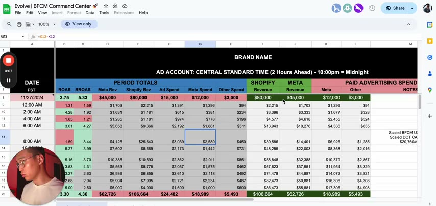
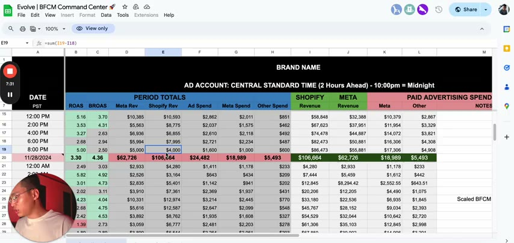

# 118. (Advanced) Surf Scaling Method
> During big promo periods (Black Friday), raise and cut Meta budgets several times a day on a fixed schedule, driven by blended return per period instead of gut feel, then reset budgets before midnight so the next day does not overspend.

## 🤖 Agent use
- **Use when:** planning or running budget moves for a promo window (BFCM, big sale), or for an evergreen campaign that already spends "a few thousand a day" on one campaign; filling in the surf-scaling sheet; deciding how often to check and by how much to scale.
- **Inputs → outputs:** ad-account time zone, our time zone, current daily spend, per-period Shopify revenue, Meta revenue, Meta spend and other-channel spend, breakeven and target blended return → a per-period action (scale up %, do nothing, pull back %, or rework/turn off) plus a midnight budget-reset number.
- **Rules:**
  - **DO** use surf scaling mainly in promo periods; only use it on evergreen if "you're already spending few thousand a day on that 1 campaign" (page text, "I ONLY recommend...").
  - **DO** put the ad-account time zone in the sheet first and scale against it, not against your own time zone. [00:59–01:55]
  - **DO** pick the check interval from current spend: a few hundred dollars a day -> every 6 hours; about $5,000/day -> every 4 hours; about $20k/day ($500k/month) -> can experiment with 4 hours; about $1M/month -> potentially every 2 hours; close to $100k/day -> 1 hour is fine. [02:56–03:55]
  - **DON'T** check too often at low volume. With about one purchase an hour the algorithm cannot optimise between your edits. [02:56]
  - **DO** judge each period on blended return (Shopify revenue / total ad spend), not only Meta's in-platform ROAS. [04:52–05:48]
  - **IF** period returns are strong **THEN** scale aggressively (the video doubles budget at 5x, 3.5x, 3.2x returns instead of +20%); **IF** returns are weak **THEN** hold or reduce. [05:48–06:48]
  - **DO** reset budgets before the ad account's midnight. If you ended the day at a budget you only partly spent, the next day starts at that full budget. [06:48–07:47]
  - **IF** you scaled during the day **THEN** set the next day's starting budget to half of what you actually spent that day (24k spent -> 12k), unless it performed really well, in which case leave it and scale again. [07:47]
- **See also:** [115. How To Scale Facebook Ads Up/Down](115-how-to-scale-facebook-ads-up-down.md) · [101. How To Set Targets / KPIs](101-how-to-set-targets-kpis.md) · [108. How To Set Up A Promo Campaign](108-how-to-set-up-a-promo-campaign.md) · [107. How To Protect Against Bad Ads Over-Spending](107-how-to-protect-against-bad-ads-over-spending.md) · [120. How To See If You Should Turn Off High-Spend Ads](120-how-to-see-if-you-should-turn-off-high-spend-ads.md)

## Key ideas

### Why scale several times a day [00:00–00:59]
- "We want to be scaling multiple times per day instead of just on a daily basis" in a period like Black Friday, "where majority of our sale comes from". Conversions are higher and buying intent is higher. [00:00]
- Surf scaling is "a systematic way" and "much more data-driven" than scaling "based off feeling". The sheet is the plan so a team makes the same decisions. [00:00–00:59]
- Whisper wrote "search scaling" / "subscribe"; the lesson title and page text confirm the term is **surf scaling**.

### Time zones: scale on the ad account's clock [00:59–01:55]
- Enter the ad-account time zone at the top of the sheet. Example: account in CST, operator in PST (CST is 2 hours ahead), so 10 p.m. PST is midnight for the account. [00:59; 03:55]
- Why: Meta resets daily budgets on the account's clock. If you scale right before account midnight, you still get a low-budget day. [01:55]
- The sheet colours the account's midnight row (the instructor calls it "pinkish"). [01:55]

### How often to surf scale [01:55–03:55]
| Current spend (as stated) | Check interval | Timestamp |
|---|---|---|
| "a few hundred dollars a day" | every 6 hours | [02:56] |
| "$5,000 a day" | every 4 hours | [02:56] |
| "500k per month... 20k per day" | "You can experiment 4 hours" | [02:56] |
| "a million a month" | "potentially every 2 hours" | [02:56] |
| "close to 100k a day" | "definitely can do 1 hour" | [02:56] |
- The demo uses a 2-hour interval for an account "spending 40k a day". [02:56–03:55]
- The instructor says he wrote a post on how to decide the interval (not included in the course files). [01:55]

### Period-by-period decision loop [03:55–06:48]
1. At the account midnight (10 p.m. PST in the example), reset budgets. [03:55]
2. Two hours later, enter the period's numbers: Shopify revenue, Meta revenue, Meta spend, other-channel ad spend. The sheet auto-calculates ROAS and blended return for that period only. [03:55–04:52]
3. Decide on the period, not the day. "Instead of every day, it's every period." [03:55]
4. Overnight example: blended "not good", low spend anyway (no one is awake), so hold or reduce. [04:52]
5. Later period: Meta return good but blended still weak -> check blended before scaling. [04:52–05:48]
6. Blended is "basically your Shopify revenue to ad spend. So this is the most accurate one." In-platform attribution "not always the most accurate". [05:48]
7. Strong stretch: "really good 5x... instead of doing small increases like 20% I can be more aggressive. Let's say on a double budget." Repeats at 5x, 3.5, 3.2: "Double." [05:48–06:48]
8. Slow periods: "you didn't increase or you reduced the budget". The result: spend ends far above the starting budget while returns are protected. "If it's not, you protect the profits. End of day, the profits are the most important thing." [05:48–06:48]
- Whisper heard "your cnl roughly" at [05:48] for what blended determines; unclear (possibly "P&L"). Not relied on.

### Budget reset after a surf-scaled day [06:48–07:47]
- Failure case: day starts at 10k, scaled to 100k mid-day, spends maybe 50k because changes mid-day can't fully spend. If you do not lower the budget by midnight, the next day "it's still going to spend 100k... which could potentially mean you blew your whole ad account." [06:48]
- Rule: take what was actually spent (example 24k), halve it, use that as the next day's start (12k), then scale up again. If it did really well at 24k, "potentially I can leave the budget as is." [07:47]
- Claim: this is how "our students are scaling up to 100k per day" (instructor claim). [07:47]

## Steps / framework
1. Fill the sheet header: brand name, ad-account time zone, your own time zone, breakeven return, target return.
2. Choose the interval from the spend table above.
3. Mark the ad account's midnight row. Reset budgets at that time.
4. At each check, enter period (not cumulative) Shopify revenue, Meta revenue, Meta spend, other spend.
5. Read the sheet's "Do This:" ladder (below), then act in Ads Manager. Write the action and new budget in Notes (who, which campaign, % and resulting daily budget).
6. Before account midnight, scale/hold per the last period, then reset to half of the day's actual spend.
7. Repeat until the promo ends. After the promo, cut back to a normal budget (the sheet's notes show a reset to $10k/day on the first day after BFCM).

### "Do This:" ladder as set in the sheet (KPI columns)
Breakeven 2.0, Target BROAS (blended) 3.5 in every row. The "Actual BROAS" column lists the thresholds the action applies to. [xlsx, Surf Scaling Sheet, KPIs]

| Actual blended return | Do this |
|---|---|
| 4.5+ | Scale by 100% |
| 4.0 | Scale by 50% |
| 3.75 | Scale by 20% |
| 3.5 | Do Nothing |
| 3.0 | 20% pull back |
| 2.0 | 50% or more pull back |
| 1.5 | "rework overall offer + creatives, etcc, may be best to turn ads off" |

- Sheet note beside the ladder: "During hourly checkups at 8am and 4pm, only scale down by 20% if below target. 50-100% if performance is terrible and losing lots of money."
- **Contradiction to flag:** the narration doubles budget at 3.5 and 3.2 and the sheet ladder says 3.5 = do nothing and 3.0 = 20% pull back. The narration quotes "returns"/Meta returns mid-sentence and may mean Meta ROAS, while the ladder is on blended return. Prefer the sheet ladder for decisions, the narration for intent (be aggressive when it is strong). (derived)
- Sheet columns (Surf Scaling Sheet): Date (PST), Period totals [ROAS, BROAS, Meta Rev, Shopify Rev, Ad Spend, Meta Spend, Other Spend], running Shopify revenue and Meta revenue and paid spend (Meta, Other), Notes, KPIs [Breakeven, Target BROAS, Actual BROAS, Do This]. ROAS = Meta revenue / Meta spend; BROAS = Shopify revenue / total ad spend (checked against sheet rows; derived).
- Three tabs: **Overview** (links to a Loom "How This Sheet Works"; the Loom is not in the course files), **Surf Scaling Sheet** (2-hour rows, ad account CST, 2 hours ahead of PST), **4 hour Surf Scaling Sheet** (ad account same as local time zone; uses "Target MER / Actual MER" for the same ladder).

## Examples
- **Sheet sample data** (BFCM 2024-11-27 to 2024-12-01 template): period rows from 00:00 to 20:00 with sample revenue and spend; BFCM weekend total row shows ROAS 2.97, BROAS 4.21, Meta revenue 112,969, Shopify revenue 203,069, ad spend 48,259.66. These look like illustrative/sample figures (instructor does not discuss them); treat as sample data.
- **Team notes in the sheet** (what actions look like when written down): "Scaled BFCM US by 20% Scaled DCT CA by 20% $20,760/day"; "BFCM US Scaled 50% to $14.9k"; "BFCM US Scaled 50% to $22.3k (TA & TA+V ROAS last hours is 4x)"; "Scaled BFCM camp by 20% Scaled main camp by 20% Doubled both ad sets inside A/B camp"; "Scaled main camp by 50%"; "Scaled main camp by 20% - $33,048.00 Last send before midnight"; "Budget Reset BFCM CA: $1,000 + DCT CA: $500 BFCM $15,000 + DCT $15,000"; "Scaled down BFCM camp - $25k Scaled down main camp - $17.5k"; "Scaled down BFCM camp - $20k"; "Ripping"; "Reset BFCM budget to $10k/day. Reset DCT budget to $10k/day". Team members appear by first name in the notes. [xlsx, Surf Scaling Sheet, Notes]
- **Time-zone example:** account CST, operator PST: reset at 10 p.m. PST; first period check at midnight PST (2 a.m. CST). [03:55]

## Structured units

### Templates
| Template | Use for | Example fill | Source |
|---|---|---|---|
| `<Person> - <campaign> Scaled <+x%> to $<new daily budget>` | Notes column after each scale move | "BFCM US Scaled 50% to $22.3k" | xlsx Notes |
| `Budget Reset <campaign>: $<new>` | Midnight reset log | "BFCM $15,000 + DCT $15,000" | xlsx Notes |

### Rules of thumb
- **DO** reset to half of actual spend after a surf-scaled day. [07:47]
- **DON'T** scale just before ad-account midnight. [01:55]
- **IF** blended is below target in a period **THEN** hold or cut that campaign's budget for the next period. [05:48]

## Screenshots

*The 2-hour sheet: ad account CST header, period totals (ROAS, BROAS, Meta Rev, Shopify Rev, spends), notes column. [00:08]*

*Scrolled to the 12 p.m.-8 p.m. rows and the next day's block, showing how rows roll into daily totals. [07:32]*

## How to apply
- [ ] Copy the sheet; set ad-account time zone, our time zone, breakeven and target blended return.
- [ ] Choose the interval from current spend (6h / 4h / 2h / 1h).
- [ ] At each interval log period revenue and spend; apply the ladder; write the action in Notes.
- [ ] Never edit budgets in the last stretch before the ad account's midnight without a plan to reset.
- [ ] Reset to ~50% of the day's actual spend (or hold if the day was strong), then re-scale the next day.
- [ ] Only run on evergreen if one campaign already spends a few thousand dollars a day.

## Related
- Previous: [117. How To View Attribution in TW (Triple Whale)](117-how-to-view-attribution-in-tw-triple-whale.md) · Next: [119. Action Item - Scale Your Ads](119-action-item-scale-your-ads.md)
- [116. How To Understand Facebook Ads Attribution](116-how-to-understand-facebook-ads-attribution.md) · [112. Winning Ad Definitions 0 mo-1M mo](112-winning-ad-definitions-0-mo-1m-mo.md)

## Sources and limitations
- Transcript: [118 transcript](<../../../../../raw/evolve/start-here/_transcripts/👣 Evolve (Start Here)/118. (Advanced) Surf Scaling Method 👣 Evolve (Start Here) Evolve.txt>) · Page text: [118 page](<../../../../../raw/evolve/start-here/_extracted/👣 Evolve (Start Here)/118. (Advanced) Surf Scaling Method_👣 Evolve (Start Here)_Evolve.html.md>) · Attachment: [xlsx text](<../../../../../raw/evolve/start-here/_extracted/👣 Evolve (Start Here)/118. (Advanced) Surf Scaling Method.xlsx.md>) · Linked Google Sheet export: [118 sheet](<../../../../../raw/evolve/start-here/_extracted/_linked/google/118-spreadsheets-1bzzLKMwLD.xlsx.md>)
- Machine transcription (Whisper large-v3-turbo); covers the full 8:33 (last segment 8:32). Spoken thresholds are loosely worded (e.g. "you're spending 40k a day" next to the 2-hour demo).
- Not included in the course files: the Loom "How This Sheet Works" and the instructor's post on choosing the interval.
- Sheet period values are sample/illustrative data; later rows show #DIV/0! because they are empty templates.
