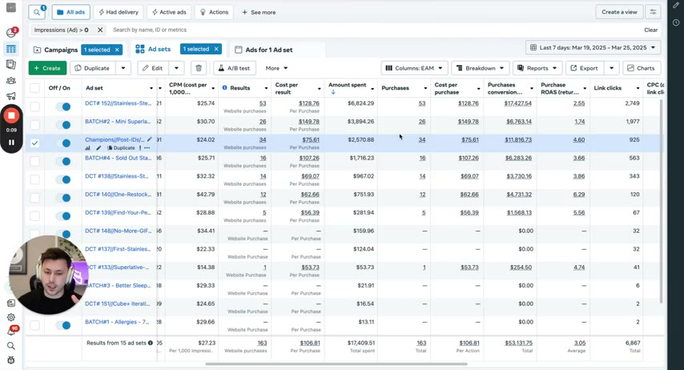
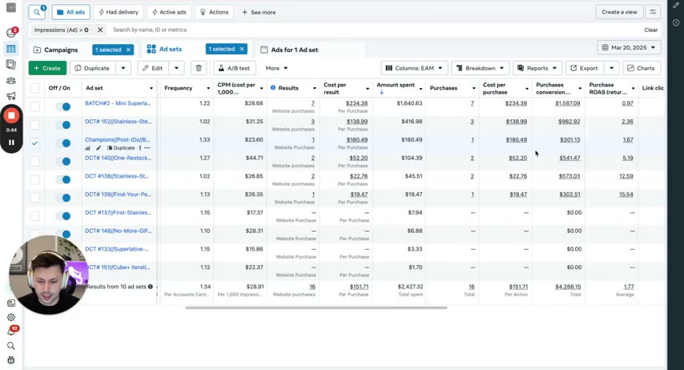
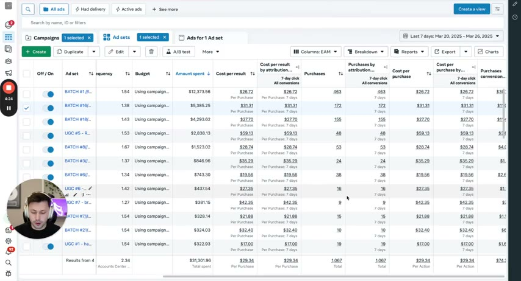
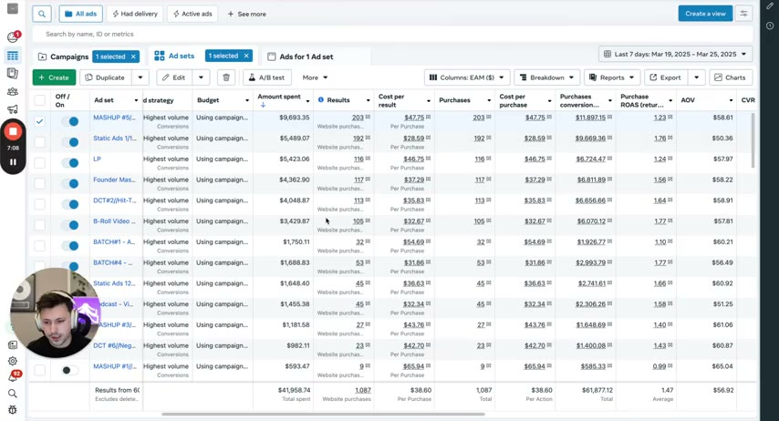

# 120. How To See If You Should Turn Off High-Spend Ads
> Do not turn off a top-spending ad just because its ROAS looks mediocre. Turn it off only if the other top 2-3 ads would do better with that forced spend, and give a brand-new ad that sucks up spend at a bad KPI only 24-48 hours.

## 🤖 Agent use
- **Use when:** an ad (or DCT ad set) takes most of the budget and the agent is asked whether to pause it; reviewing a 7-day Ads Manager export for kill/keep calls; setting auto-rules for bad new ads.
- **Inputs → outputs:** 7-day (click-based) spend, ROAS/CPA, frequency, launch date, daily account spend, KPI → keep, turn off, or watch with a rule.
- **Rules:**
  - **DO** check frequency first: "Low frequency (1.5 or below) = prospecting" (page text). A 1.13 frequency ad was read as retargeting; a low-frequency ad "could probably do some prospecting". [07:47]
  - **DO** ask: if this ad is off and its spend is forced to my other top 2-3 ads, would they perform better than the top spender? "Most of the time the answer to that is NO. If you believe it is a 'yes' then turn it off." (page text, step 2) [04:25–05:46]
  - **DO** use the multiplication test: if this ad set got 3x its budget (4K/day -> 12K/day) would it still beat 2.49x? "Probably not." [04:25–05:15]
  - **IF** a NEW ad sucks up spend at a bad KPI **THEN** it can be turned off in the first 24-48 hours; at $20k/day "you should have rules in place to avoid getting burned" (page text, step 3). [02:18; 09:11]
  - **IF** daily spend is below $10k-$20k **THEN** give a new top spender "a day or two" before killing; above about $15-20k/day keep watch and have rules, "because you can always turn an ad back on". [09:11]
  - **DON'T** turn off older, proven top spenders because ROAS is lower than a tiny new ad; "this is why we always leave top spending ads on that are older". [09:11]
  - **DO** turn off ads that "are not getting spend AND NOT hitting KPI after 7 days+" (page text, context). Reason: each ad set should ideally get 3x CPA of spend per day.
  - **DO** judge on click-based data. The team runs 7-day click attribution on most brands; check whether a number is view-through or click-through first. [04:25]
- **See also:** [107. How To Protect Against Bad Ads Over-Spending](107-how-to-protect-against-bad-ads-over-spending.md) · [101. How To Set Targets / KPIs](101-how-to-set-targets-kpis.md) · [100. How To See Ads Performance + Our Columns](100-how-to-see-ads-performance-our-columns.md) · [115. How To Scale Facebook Ads Up/Down](115-how-to-scale-facebook-ads-up-down.md) · [121. Roller Coaster Performance](121-how-to-deal-with-roller-coaster-performance.md)

Page text: a timestamp note, the decision framework, context numbers, and a link to a YouTube video "inside of the Origins Program" (classroom link on the page; not included in the course files).

## Key ideas

### Two scenarios where this question comes up [00:00]
- Scenario 1: a newly launched DCT sucks up spend and does not hit KPI. Scenario 2: an older ad with the top spend has a ROAS you do not love. The instructor calls this "a decision making framework when it comes to actually turning off DCTs that get a lot of spend". [00:00]

### Scenario 1: new DCT spikes spend, then Meta pulls it back [00:00–03:46]
- Account example, launched March 19: DCT #2 got about $280 spend at a 2.11 return on day one. On the 20th it "sucked up all of the spend... 0.97 extra return", spending $1.6K of a $2.4K budget. [00:41]
- They left it one more day. Overall account was still at KPI; Facebook "stopped spending money on it" and spend dropped from about $1,900 to $800 on the 21st while DCT #152 picked up and "started to absolutely smash". [00:41–01:26]
- Why Meta pushed it: cost per click was "sensational", so Meta saw an opportunity to lower cost per purchase, but "it didn't have the conversion rate to hold up. This conversion rate is terrible. AOV was also terrible." [01:26]
- Rule from this: "If performance had stayed like this, where it was sucking up all the spend and still eating shit, after two days, we'd probably turn that off." [01:26]
- At $20k-$25k/day "you might not be able to afford that", so set custom rules that cut an ad that wrecks the account. [02:18]
- Zoom-out over 7 days: DCT #152 took the bulk of spend at 2.55x; other batches that "got nothing" for days were still strong the days they spent (one 5x, one 8x on a given day). Daily whiplash is normal. [03:08]

### Scenario 2: old/high-spend ad with lower ROAS [03:46–08:25]
- Account B: Batch #1 spent $12K at 2.49x, frequency 1.54, about $26 CPA. Batch #6 sits at 3.62x with $743 spend. Why not push Batch #6? [03:46]
- Decision test: "If we were to 3X this budget, this is spending 4K per day, this is spending 12. ... do you think this would get better than a 2.49? Probably not." [04:25]
- Same for the whole campaign: 3x the campaign probably would not hold 2.38; it spent $30K in 7 days. [05:15]
- Batch #6 at 3.6x on $743: 20x the budget would not hold 3.6. It was launched about two days ago, so it is early. [05:15–05:46]
- Batch #5 (new, launched on the 24th): $100 spend on the 24th, then $2K at 1x on the 25th ("complete shit"), down to $600 the next day and doing better; "Meta is gonna push your spend around based on what you give it." [05:46–06:37]
- "If the overall account performance is good, then we're good." [06:37]
- Account C: Batch #5, last 7 days $9K at 1.23x; Edit #12 at 2.7x on $81 spend ("let's 100X this"). If the 1.76x ad set were doubled, would it beat 1.23x? "Probably not." [07:08–07:47]
- Frequency read: one ad at 1.13 is retargeting; another low-frequency ad spending $5K at 1.24 "could probably do some prospecting". Turning off a prospecting ad that spent about $10K in 7 days means you "find $10,000" for the others and also starves the retargeting ad of new people to retarget. [07:47–08:25]

### New ads can rip too; old ads fade on their own [08:25–10:52]
- A new ad launched the previous day sucked up $3.8K at 1.7x on a subscription brand; day one, probably improves. [08:25–09:11]
- Instead of complaining about the top spender, make a better ad: "Mashup #5... was our top spender... It's not getting anything now because... we just made a better ad." [10:02]
- Closing: "this is why you shouldn't turn off ads that are top spending". [10:02]

### Page-text note on the 3:49 mark [03:49]
- The page says "we should KILL Batch #2" in the first account: Champions 4.6x with $2.5K vs Batch #2 1.74x with $3.9K. The reason the team did not kill it: "I am forcing my media buyer to test everything for 7-days (you guys don't need to do this - it's just an experiment)". With $1.4K more spend (+60%) Champions "will likely still be better than a 1.74". The page labels the timestamp 3:49, but the matching on-screen numbers are in the first minute of the video (Mar 19-25 view, frame 00:09).

## Steps / framework
Decision framework (page text), with the video's tests in brackets:
1. **Frequency.** 1.5 or below = prospecting. (Higher frequency = more retargeting; do not read retargeting ROAS as scalable.) [07:47]
2. **Spend + ROAS/CPA, then the replacement test.** If I turn this off and force that spend to my other top 2-3 ads, would they perform better than the top spender? Mostly no -> keep. [04:25]
3. **New ad that sucks up spend at a bad KPI:** turn off within 24-48 hours; at $20k/day have rules; below $10-20k/day "a day or two". [09:11]
4. **Housekeeping kill rule:** turn off ads not getting spend AND not hitting KPI after 7+ days. Give each ad set about 3x CPA per day.

### Ad-set capacity formula (page text)
| Target CPA | Daily spend per ad set (3x CPA) | Daily budget | Max ad sets |
|---|---|---|---|
| $30 | $90 | $900/day | 10 |
- Keep testing: turn off the worst first ("not taking spend AND not at KPI") to make space for new creative tests.

## Examples
| Ad (account) | Stats as shown | Decision logic | Source |
|---|---|---|---|
| DCT #2 (new, launched Mar 19) | day 1 ~$280 at 2.11; day 2 $1.6K of $2.4K at 0.97 | left one more day because account was still at KPI; Meta cut spend itself; would kill if still hogging after 2 days | [00:41–02:18] |
| Batch #1 (account B) | $12K spend, 2.49x, freq 1.54, ~$26 CPA | keep: tripling budget unlikely to beat 2.49 | [03:46–05:15] |
| Batch #6 (account B) | $743, 3.62x, launched ~2 days ago | too early; 20x budget would not hold 3.6 | [05:15–05:46] |
| Batch #5 (account C) | 7-day $9K at 1.23x; day: $2K at 1x then $600 | keep unless a better replacement exists; doubling a 1.76x ad set unlikely to beat 1.23 | [06:37–07:47] |
| New ad (subscription brand) | $3.8K in one day at 1.7x | day one; likely improves | [08:25] |
| Mashup #5 | previously top spender, hundreds of thousands of dollars | faded when a better ad was found | [10:02] |

## Screenshots

*Mar 19-25 7-day ad-set view: DCT #152 about $6.8K at 2.55x, Batch #2 about $3.9K at 1.74x, Champions about $2.6K at 4.60x. This is the data behind the page-text note about killing Batch #2. [00:09]*

*Mar 20 single-day view with the Frequency column: Batch #2 about $1.6K at 0.97 while other ads got far less. [00:44]*

*Account B, last 7 days (Mar 20-26): Batch #1 about $12.4K at 2.49 with frequency 1.54, hook-rate and hold columns. The 3x-budget thought experiment. [04:24]*

*Account C, Mar 19-25: top spenders at 1.23-1.77x; the point is that doubling them would not yield better than what the top spender already does. [07:09]*

## How to apply
- [ ] Pull the ad sets for the last 7 days, click-based attribution; add Frequency, Spend, ROAS, CPA and date created.
- [ ] Mark frequency <= 1.5 (prospecting) vs higher (retargeting-leaning).
- [ ] For each candidate to turn off: name the top 2-3 other ads; ask if they would beat the candidate with the extra spend. Keep unless clearly yes.
- [ ] For ads launched in the last 48 hours that take spend at a bad KPI: turn off after 24-48 hours; below $10-20k/day wait 1-2 days; above, set an auto-rule.
- [ ] Compute max active ad sets as daily budget / (3 x target CPA); when full, pause ads that get no spend and miss KPI first.
- [ ] Log each decision and the result in the learnings system ([122](122-how-to-do-learnings-part-1-losers.md)).

## Related
- Previous: [119. Action Item - Scale Your Ads](119-action-item-scale-your-ads.md) · Next: [121. How To Deal With Roller Coaster Performance](121-how-to-deal-with-roller-coaster-performance.md)
- [103. How To Duplicate Ads Into Champions (New Way)](103-how-to-duplicate-ads-into-champions-new-way.md) · [116. How To Understand Facebook Ads Attribution](116-how-to-understand-facebook-ads-attribution.md)

## Sources and limitations
- Transcript: [120 transcript](<../../../../../raw/evolve/start-here/_transcripts/👣 Evolve (Start Here)/120. How To See If You Should Turn Off High-Spend Ads 👣 Evolve (Start Here) Evolve.txt>) · Page text: [120 page](<../../../../../raw/evolve/start-here/_extracted/👣 Evolve (Start Here)/120. How To See If You Should Turn Off High-Spend Ads_👣 Evolve (Start Here)_Evolve.html.md>)
- Machine transcription (Whisper large-v3-turbo); full coverage (last segment 10:51 of 10:52). The spoken "Nahal" at [04:25] is a name the transcript only mentions in passing. Account names are not stated; "DCT" is used as in the course; other lesson pages read it as dynamic creative test (unconfirmed, see [94](094-how-to-set-up-a-3-2-2-campaign.md)).
- Spoken thresholds are rough ("10k or below 20k per day", "above like 15 or 20k"). The written rules on the page are cleaner; use both ranges as guidance, not exact cutoffs.
- Spoken numbers come from on-screen Ads Manager; some read off screenshots (e.g. $2.5K/$3.9K on the page text match the frame at 00:09, which shows $2.6K/$3.9K).
