# 121. How To Deal With Roller Coaster Performance
> When daily ROAS swings (3.6 -> 2.2 -> 1x), three causes are outside your control (real people, the market, Meta) and one is yours (strategy), so fix strategy: target permanent desires, climb up-market in awareness, educate or entertain scrollers, send them through congruent funnels, and make offers too good to pass up today.

## 🤖 Agent use
- **Use when:** diagnosing a sudden performance drop in an account; deciding whether to change media-buying settings or go back to creative/offer/page work; planning a batch for an account in a sophisticated or trend-driven market; testing landing pages and offers.
- **Inputs → outputs:** daily ROAS/CPM/CPC history, current ads' awareness levels, desires used (permanent vs trending), funnel pages, offers → diagnosis (controllable vs uncontrollable cause) plus a plan: new permanent-desire angles, higher-up-market (unaware/problem aware) ads, extra landing pages, stronger offers.
- **Rules:**
  - **DON'T** "test a new media buying strategy... a new product... change our creative testing process" or complain when performance drops. The team "didn't waste our energy" on these. (Slide 62; [35:19])
  - **DO** focus on "what you can control": "Make better ads. Make better offers. Make better pages." (Slides 63-66; [35:19])
  - **DO** rely less on trending desires; build on permanent desires: wealth, health, relationships. [09:00–12:50]
  - **IF** most ads are product/most aware in a sophisticated market **THEN** climb up-market: create unaware and problem-aware ads that educate or entertain, built with storytelling. [12:50–15:36]
  - **DO** send education/entertainment ads to a page that continues the journey (advertorial or listicle) and test at least two landing pages per batch (control LP plus a listicle/advertorial). [23:20–25:50]
  - **DO** test new pages and offers inside CBO as new ads, not as split tests. "There's no point in waiting." [42:22]
  - **DO** run a Friday review: every winner plus one loser from the batch. [50:53–52:19]
  - **DON'T** use other people's poor results as comfort ("pure copium"). [00:00–01:26]
  - **IF** CPM/CPC fall sharply for no reason and ads suddenly take spend **THEN** treat as a Meta-side anomaly; pause what hogs spend at a bad KPI and keep launching. [05:12–06:22; 37:47]
- **See also:** [120. How To See If You Should Turn Off High-Spend Ads](120-how-to-see-if-you-should-turn-off-high-spend-ads.md) · [10. Market Awareness](010-market-awareness.md) · [9. Market Desires](009-market-desires.md) · [12. Market Sophistication](012-market-sophistication.md) · [95. How To Test Landing Pages (3-2-2-2)](095-how-to-test-landing-pages-3-2-2-2.md) · [Copywriting: unaware ads](../../copywriting/concepts/unaware-ads.md)

Page text: only a link to the slideshow (Google Slides, 67 slides; exported as the pptx text, same content).

## Key ideas

### What roller coaster performance looks like [00:00–01:26]
- Real client example (instructor's words): "One day you spend a thousand bucks a day... 3.6" then the next day "3.6 to a 2.2" then "a day after that... one extra turn on ad spend". [00:00]
- Slides show the same account on three days: Apr 29 spend $1,100.20, 12 purchases, ROAS 3.61, CPP $91.68, CPC $4.78, CTR 0.61%; Apr 30 spend $1,169.39, 9 purchases, ROAS 2.23, CPP $129.93, CPC $6.06, CTR 0.48%; May 1 spend $1,312.71, 5 purchases, ROAS 0.99, CPP $262.54, CPC $5.34, CTR 0.60% (slides 3-5, read from screenshots).
- A tweet by an operator ("Ash" in the call) from May 6, 2025: "Every single week is different. We will have 1-2 weeks of solid performance and then something will completely flip", tested account structures, attribution, exclusions, bidding, creative strategy, landing pages and offers, "But the constant volatility is making things difficult to plan and forecast". The instructor frames this style of venting as "super copium" and asking others if bad performance is okay as "pure copium". [00:00–01:26]
- Direct quote: "rather than typing a long-ass tweet complaining about Facebook, you could just make better ads if you ask us." [01:26]

### Reasons 1-3: things you cannot control [01:26–06:22]
1. **We don't sell to robots** (slides 8-10). Behind CPC, AOV, ROAS, CVR "are real people... sometimes we're just not in a buying mood" (taxes, gifts, incidents). Example: "last month... I had to pay a shitload in taxes. So am I going to go spend... this month on personal things? Probably not." [01:26–03:48]
2. **The market itself** (slides 11-13). Policy changes, natural disasters, interest rates, "tweets"; tariffs: "for some brands, we actually saw CPMs go down like 300 or 400%" (instructor claim; a screenshot is promised, see reason 3). A new competitor with a better mechanism (example: Ozempic vs weight-loss brands) or a competitor offer that beats yours. He mentions AI agents being built "that can actually scrape and let us know when competitors do certain things or launch offers". [03:48–05:12]
3. **Meta devs** (slides 14-18). CarePod ad that ran all April: about $35 CPM and $6 CPC; May 1-3 about $10 CPM and $1.46 CPC; May 4 about $8 CPM and 50 cents CPC, so it picked up spend and they paused it. "How that happened, I have no idea." [05:12–06:22]
- Verdict: spending energy on reasons 1-3 turns "super copium" into "hyper copium". [06:22]

### Reason 4: your strategy (the part you control) [06:22–09:00]
- Example: an account reviewed the day before had "unaware and problem aware style hooks" for about two seconds, then "straight into product and most aware, like straight into their brand". [06:22–07:31]
- Product/most aware is the most competitive awareness level; sophisticated markets (his example: weight loss) are the most competitive markets; "level four, level five sophisticated markets". Add trending desires ("running tariff ads right now"; Valentine's/Mother's Day promos) and performance falls when the trend does. [07:31]
- Formula (slides 25-28): product-aware ads + sophisticated market + trending desire = roller coaster. [07:31]
- "Roller coaster problems" (slide 29), what you rely on: people being ready to buy; people being on the platform that day; Meta serving your ad to the right person that day; existing competitors not launching offers; new competitors not launching a solution; "you go with the ebbs & flows of the market". Anecdote: "Q4, December... I was doing 400K a month. Now in January, I'm doing 100." This is "the hopium strategy" (slide 30). [08:57]

### Solution 1: permanent desires [08:57–12:50]
- Slide 24 (from the winning-ads material): "Permanent Desire - Health, Wealth, Relationships (Desires that never leave us)" vs "Trending Desire - Crypto, Valentines Day, AI (Desires that come and go)". See [9. Market Desires](009-market-desires.md).
- Instructor's generalised map (slide 34; he warns it may sound sexist and says it does not apply to everyone) [10:11–11:34]:
  | | Wealth | Health | Relationships |
  |---|---|---|---|
  | Men | make more money, get status... get more girls | look jacked... get more girls | get more girls |
  | Women | get more status from others | be confident in yourself, love yourself | help kids, family, loved ones; caregivers want to "give love" |
- "It doesn't matter if their stock is down 30%. They still want to be healthy." [10:11]
- Question to ask (slide 35): "How can X [product] improve [avatar's] wealth, health, or relationships?" Then "work backwards" (slide 36): start with a person ("what's your problem?"), then "build a bridge back to your product". He notes status can be counted as wealth, or added as a fourth desire. [11:34–12:50]
- Claim: "the guys who are scaling the hardest in here understand these things and they work it back to their product." (instructor claim) [11:34]

### Solution 2: awareness levels, climb up-market [12:50–15:36]
- Slides 37-43: re-shows the 5 stages of awareness (unaware, problem aware, solution aware, product aware, most aware) and market sophistication levels 1-5. Callback: "we talked about this on the winning ads doc last week" ([4. 100 Winning Ads Document](004-100-winning-ads-document.md)). See also [10](010-market-awareness.md), [11](011-understanding-unaware-awareness-levels.md), [12](012-market-sophistication.md).
- Goal (slides 40-42): "turn scrollers into customers": take someone with zero intention of buying and get them to buy. Example from Daily Virals (a viral TikTok-shop ad feed he checks daily): a hook "Jimmy Fallon is getting canceled for this" bridged two minutes later to selling "boom, boom nose inhalers". "If you guys don't think you can bridge a gap like that... it's just a skill issue." [14:12]
- Five-part solution (slide 44; [15:36]):
  1. Climb up market (target problem aware/unaware)
  2. Create ads that educate scrollers (storytelling)
  3. Create ads that entertain scrollers (storytelling)
  4. Create funnels that continue the customer journey
  5. Create offers that are too good to pass up on TODAY

### Climbing up-market, humidifier example (slide 45) [15:36–16:57]
- Most aware: "Save 20% On Humidifiers"
- Product aware: "The world first stainless steel humidifier"
- Solution aware: "Traditional Humidifier bread mold, ours eliminates it."
- Problem aware: "Waking Up Tired? It's Not Your Mattress..."
- Unaware: "You'll Never Guess What's Floating in Your Air Right Now"
- Why: in the off season (summer) nobody is thinking of a humidifier. The unaware line "anybody can stop and be like, what the fuck's floating in my air?" whereas "are you struggling to sleep? Or do you need a humidifier?" gets scrolled by "90, 99% of people". [16:57]
- Slide text and the instructor's wording differ slightly; the ladder above is the slide text.

### Education ads [16:57–20:41]
- "Do the research to educate yourself. Share those findings with the audience. When you learn about your product, what it ACTUALLY does, and the functional outcomes it provides, the more you can scale." (slide 46)
- Research the problem, not only the product: "does anybody actually know what scientifically causes a migraine?" He claims about 90% of the room would not know. Learn how it happens, then explain it. [18:17]
- Guardrails: stay interesting ("fine line between being super boring"), hook must be interesting, simplify "so a monkey can understand", at "a third grade or fourth grade reading level". The Daily Virals tool has a reading-grade checker; "if you're writing at like a university reading level, like that ad's going to completely flop." [18:17–20:41]
- Exercise: write it like a research paper you must present; "become an authority on that subject". [20:41]

### Entertainment ads [20:41–23:20]
- Slide 47: "There is never too long, only too boring." Customers binge a Netflix series in a day; "Every time a video hooks you in, save it. Ask yourself: 'Why am I watching this?'" Usually there is suspense and you want to see what happens at the end. [20:41–23:20]
- Example video with an on-screen "Who TF Did I Marry?!?" title and an "Introduction/Disclaimer" label (32.7M views, 2.2M likes in the screenshot). Do not credit the format (bathroom, intro/disclaimer callout); study what is being said. [22:03]
- His own example: golf video with suspense ("fix my slice in 30 seconds"). Findings: "they usually create suspense in the hook" and then you wait for the payoff. [22:03–23:20]
- Action items: become an authority (education), and study entertaining videos and what they say. [20:41–23:20]

### Congruent funnels [23:20–25:50]
- "Some people are not ready to buy RIGHT AWAY... they just need MORE INFORMATION." Sending directly to a buy-now page "is not always best practice". [23:20; slide 48]
- Why: a viewer may watch only 20-30 seconds, click before the pitch, and a PDP/collection page feels like "just an ad"; an advertorial or listicle continues the story. Quoting Schwartz: "the goal of each line is to get them to read the next line." [24:34]
- Slide 48 matrix, awareness level vs page type (colour-coded in the slide; symbols as shown; derived reading):
  | Awareness | Collection page | PDP | HP | LP | Listicle | Advertorial |
  |---|---|---|---|---|---|---|
  | Unaware | - | - | - | -/+ | + | ++ |
  | Problem aware | - | - | -/+ | + | ++ | ++ |
  | Solution aware | - | -/+ | + | ++ | ++ | ++ |
  | Product aware | -/+ | + | ++ | ++ | ++ | ++ |
  | Most aware | + | ++ | ++ | ++ | ++ | -/+ |
- Instruction: with every educational/entertainment/unaware/problem-aware ad, "make sure that you're testing multiple LPs, so at least two LPs... your control LP, and then... a listicle or an advertorial", as part of the new 3-2-2-2 structure. [25:50] ([95. How To Test Landing Pages (3-2-2-2)](095-how-to-test-landing-pages-3-2-2-2.md))
- Claim: "This is what all of the big dogs are using to scale." (instructor claim) [25:50]

### Offers "too good to say no to" [25:50–30:41]
Three screenshots (slide 49):
- **Bedding brand ("Miracle" in the call; name as spoken):** "Ends at midnight! Early Mother's Day sale up to 46% off auto-applied", "Limited supply: 3 FREE towels + extra 20% off with code BEST", sizes with "17 Sets Left", "44% OFF - YOU SAVE $95", bonus: free towels (offer ends at midnight), add-on: 2x extra pillowcases. The instructor: maybe too much, "but these guys are printing" and it is "real scarcity and real incentive". [25:50–27:17]
- **Norse (skin/acne):** "No Acne in 60 days or money back", "97% of customers got Acne free", "Botanical Buffet: Made with Arctic plants", "For Females/Males & Adults/Teens", "SAVE 20%" one-time purchase ($159, struck $200) vs "SAVE 40% ON THE FIRST ORDER" subscribe ($105), subscription perks (30% off future orders, free shipping, lowest price ever, cancel anytime, long-term healthy skin, out-of-stock protection), and a "WARNING: Low Stock Notice... sold out 12 times last year... PS: Only available here. Don't buy fakes on Amazon/eBay". [27:17–29:22]
  - Analysis: they removed risk (money back); increased perceived likelihood of achievement (97%); a possible new mechanism (Arctic plants); previous funnel was a long testimonial/screenshots page, so belief was built before the claim; "none of this stuff really costs them extra but this is done in a way where it's actually believable." Caution: "you might want to be careful with these claims". He would specify per avatar but they are at scale. [27:17–29:22]
  - He also ties it to Hormozi's offer equation: "there are times where you guys are just thinking that... the $100 million offer equation... doesn't apply. It's like, bro, look at how Norse has applied this." [27:17]
- **Try-before-you-buy (body-care brand):** "Try it & subscribe: now $0", "Try It Now", "TRY BEFORE YOU BUY | $0", "Pay for shipping today and $49 after you try it at home", "Get a full-size jar of [product], just pay $5.90 for shipping. Try it at home for 3 weeks." Some competitors "literally giving products away for $5. Now, am I telling you to do this? No, but... you guys can really push the threshold here". [29:22–30:41]
- Pushback: "a lot of you guys... do a buy one get one free and then... I can't scale. And that's the only offer that you've ever tested. Start testing more." He is working on a CRO winning landing page doc similar to the winning ads doc. [29:22]
- See also [Offer and bundle psychology](../../../../frameworks/offer-and-bundle-psychology.md).

### Real client case: how the team coped (slides 50-60) [30:41–35:19]
Weekly account view (Ads Manager, ROAS from the screenshots; small digits read from slides; spoken numbers in brackets):
| Week (dates) | Spend / ROAS | What happened |
|---|---|---|
| 1 (Mar 16-22) | about $42K / 1.57 ("41 or 42K... 1.57X") | baseline; one winner sucking up spend, about 6K/day [30:41] |
| 2 (Mar 23-29) | same spend / 1.65 | new "Batch #2" winner; top spender 16K at 1.3 -> 16K at 1.8 [30:41] |
| 3 (Mar 30-Apr 5) | about $42K / 1.73 | new ads started helping; Batch #7 picking up [31:47] |
| 4 (Apr 6-12) | about $35K / 1.58 | "absolutely kicked in the nuts"; had to turn off Batch #2 (reason not given); 6K/day -> 5K/day at worse ROAS [31:47] |
| 6 (Apr 13-19) "Stable" | about $34K / 2.09 | new offers and a new page; page test ("3X, spent 10K") [31:47–32:58] |
| 7 (Apr 20-26) "Bangin" | about $50K / 2.02 | another winning ad plus another batch; new page with top ads "ripping 15K during the week at a 2X" [32:58] |
| 8 (Apr 27-May 3) | about $52K / 1.66 | "punched in the nuts again" (2X -> 1.6) [32:58] |
| 9 (May 5, one day) "We're so back" | about $5.8K / 2.23 | scaled back down to about 6K/day at 2.2X; "now we've restable" [32:58–34:14] |
- Week 5 has no slide. Weeks 6-9 numbers are from the slide screenshots; the instructor's spoken numbers match within rounding.
- Summary (slide 60): "We found 3 new winning ads. We found 1 new winning offer. We found 1 new winning LP. Spent extra time processing learnings (which lead to #22)". Ad #22 was "an iteration of a losing ad": they "spent an hour reviewing a single ad" and that became "our new top spender". [34:14]
- What they did not do (slide 62): test a new media buying strategy, a new product, change the creative testing process, or complain that performance sucks. [35:19]
- Sean's context: they saw a "super weird CPM drop and cost per click drop that led to some ads getting a shitload of spend for no reason" that week. [37:47]
- Mindset claim: complaining "doesn't do anything positive for you... if it makes you feel better, then you're just going to use that as an excuse". [37:47]

## Steps / framework
Roller-coaster response (derived from the deck, slides 29-66):
1. Name the cause: robots, market, Meta, or strategy. Only act on strategy. 
2. Check desires: are the ads built on trending desires? Add permanent-desire angles.
3. Check awareness: if most ads are product/most aware, add unaware/problem-aware education or entertainment ads.
4. Check the funnel: unaware/problem-aware ads need an advertorial/listicle test next to the control LP.
5. Check the offer: stack risk reversal, scarcity that is real, bonuses that cost little.
6. Keep launching: each week, find new winning ads, offers and pages; review every winner plus one loser.

## Examples (instructor's Q&A details)
- **LP test frequency:** 1-2 per week, sometimes 3, with several brands; "if we had our own brand, we'd be testing them every day, like with every batch of ads". Build in PageDeck (not Figma); "what actually matters about the LP is the offer, the messaging and the imagery". Two to three a week is feasible. [40:07–41:09]
- **Offers/LPs test in CBO:** new LP and new offers launched as new ads in CBO; no split test ("I don't have time to split test"); a very large brand ($15M/month) might use Intelligems. "If it gets spent, let it rip." [41:09–42:22]
- **Page-2A example:** an ad set with three best creatives pointed to a new LP; he makes a new ad set so the LP can be tracked at ad set level. [46:38–48:01]
- **Duplicating loses engagement?** "Engagement's cope. Because if engagement actually was everything, you'd never be able to find a new winning ad." The top ad in one account had about 11,000-15,000 likes yet new ads beat it. [45:10–46:38]
- **New-agency-account migration:** one to two weeks; "import everything, use the same pixel, use the same pages... import your ads with post ID, ideally"; make new creatives to pump it back up. (Sean) [43:48]
- **Under $100K/month:** "you need one customer journey and one ad. That's it... you can honestly scale any product to a hundred K per month. Genuinely." (instructor claim) [45:10]
- **Team scope:** about 15 people on growth brands, five or six brands, "400 concepts a month like we do" if all on one brand (instructor claim, ambiguous); scope per brand 3-4 ad concepts and 1-2 landing pages per week; Friday review of about 1.5 hours, "we review every single winner" plus one loser; the other two are just marked winner/loser. [50:53–52:19]
- **New concepts should be bigger swings;** a net-new concept (e.g. nurses to doctors) may need a different LP; smaller swings for winners. [53:19–54:39; 59:37]
- **LP variable impact:** "Offer will change everything. An offer can double your business, honestly"; then messaging; then above the fold, "it's like your hook". [54:39]
- **PDP vs LP A/B test:** do not split PDP vs LP; organic traffic would hit the advertorial. "Just test it inside of Meta... if you make a better [journey], you're good." [53:19]
- **Price tests:** use Intelligems; if one product is about 70% of sales, build an LP for that product and test price/offer there. [56:04]
- **Subscriptions:** "it's not all about AOV"; know three-month LTV, payback "within three months"; a brand got to "just shy of a million a month" without subscriptions and now "15 to 20K a day, just automatic from returning customers" (instructor claim). If you need subscription for retention, "product's probably not that good." [57:22–59:37]
- **Tracking:** ClickUp board: ideas, briefs, editing, finished, launched, winner, loser; automations stamp dates when status changes (brief created, sent to editors, back, launched, time to launch, winner/loser). A ClickUp course module is promised in "about a month". [1:02:08–1:04:50]
- **Tariffs (Sean, from a 3PL visit):** most shipping companies "are not too worried"; the risk is supplements (FDA approval needed to ship in), and riskier shipping lines that get seized. [38:48–40:07; 1:01:00–1:02:08]
- **Europe localisation:** native speakers or a proofreader every batch; one team expands with AI without native speakers. [48:01–49:27]

## Structured units

### Hooks
| Hook | Heuristic(s) | Emotion / zone | Self targeted | Why it works | Source |
|---|---|---|---|---|---|
| "You'll Never Guess What's Floating in Your Air Right Now" (unaware humidifier) | Curiosity gap (derived) | Disgust/curiosity (derived) | — | Anyone can stop; no product named | Slide 45; [16:57] |
| "Waking Up Tired? It's Not Your Mattress..." (problem aware) | — | — | — | Problem-first, resonates with tired people | Slide 45; [16:57] |
| "Jimmy Fallon is getting canceled for this" (bridged to nose inhalers) | Topical attention hook (derived) | Curiosity (derived) | — | Instructor: story bridges attention to product | [14:12] |
| "Who TF Did I Marry?!?" (text on a viral video) | Open loop (derived) | Curiosity (derived) | — | Suspense then payoff | Slide 47; [20:41–23:20] |

### Rules of thumb
- **DO** study what is said in an entertaining video, not the setting. [22:03]
- **DON'T** leave unaware/problem-aware traffic on a PDP only. [24:34]
- **IF** performance drops **THEN** ship new winners (ads, offers, pages) rather than new strategy. [34:14]

## Screenshots
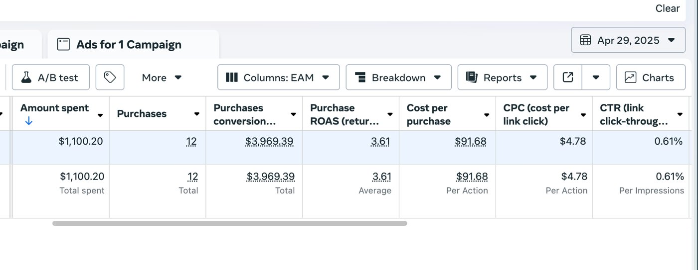
*Roller-coaster day 1 (Apr 29): $1,100 spend at 3.61 ROAS; the next two days fall to 2.23 then 0.99 (slides 3-5). [00:00]*

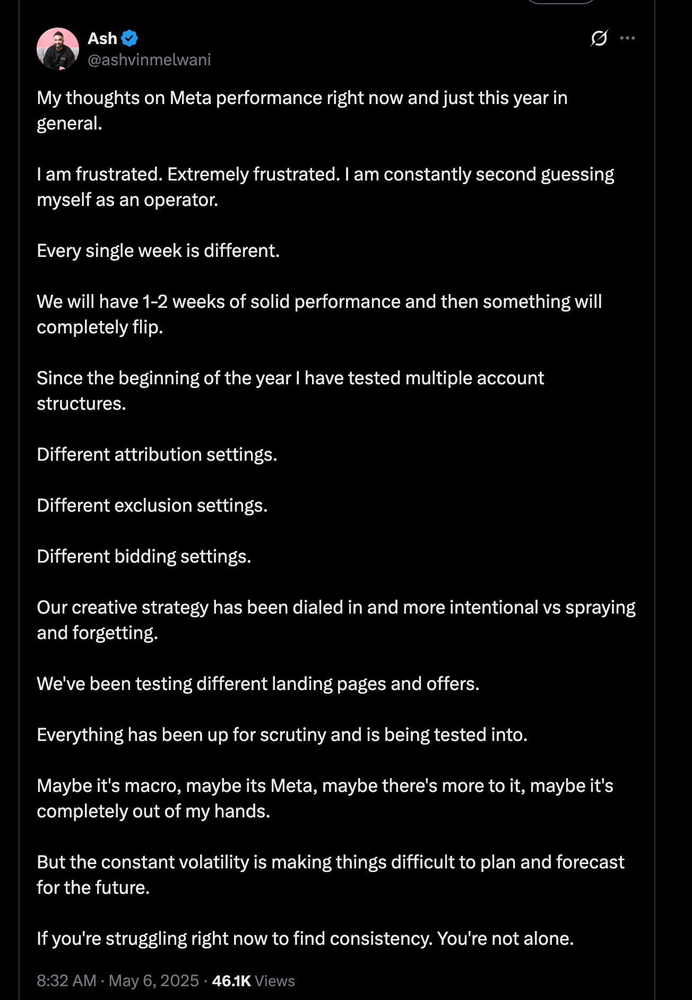
*Slide 6: operator tweet "Every single week is different..." used as the example of copium. [00:00–01:26]*

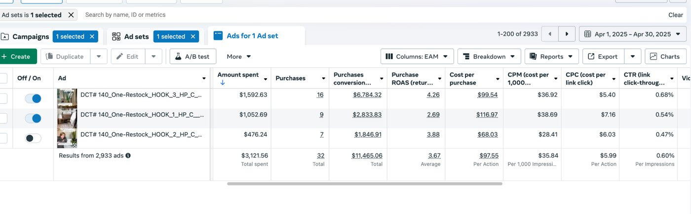
*Slide 16: April ad-level view (about $35 CPM, about $6 CPC) used for the "Meta devs" reason. [05:12–06:22]*

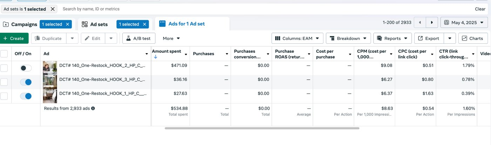
*Slide 18: May 4 view (about $8 CPM, about $0.50 CPC) after the sudden drop. [05:12–06:22]*

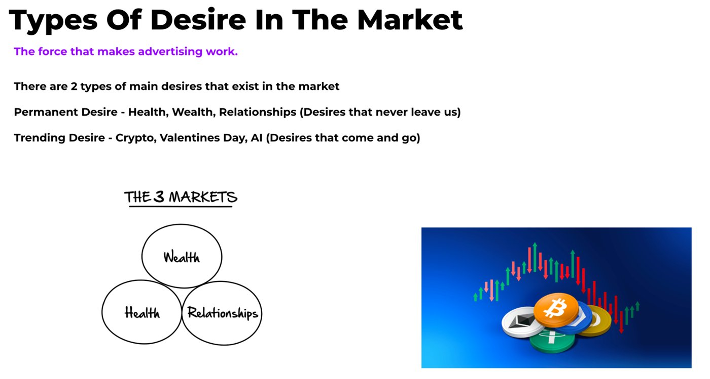
*Slide: permanent desires (health, wealth, relationships) vs trending desires (crypto, Valentine's Day, AI). [10:11]*

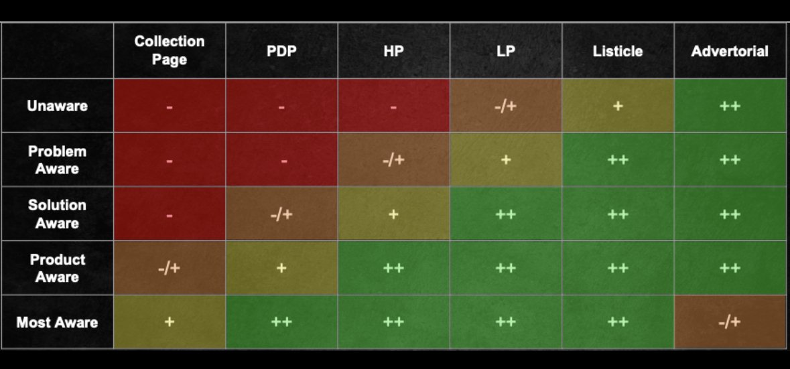
*Slide 48: red-to-green matrix of awareness level against page type (collection page, PDP, HP, LP, listicle, advertorial). [24:34]*

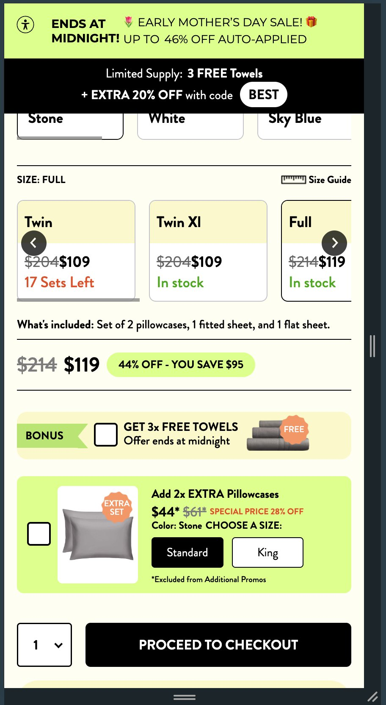
*Slide 49: bedding product page with auto-applied sale, limited supply, free towel bonus and add-on. [25:50–27:17]*

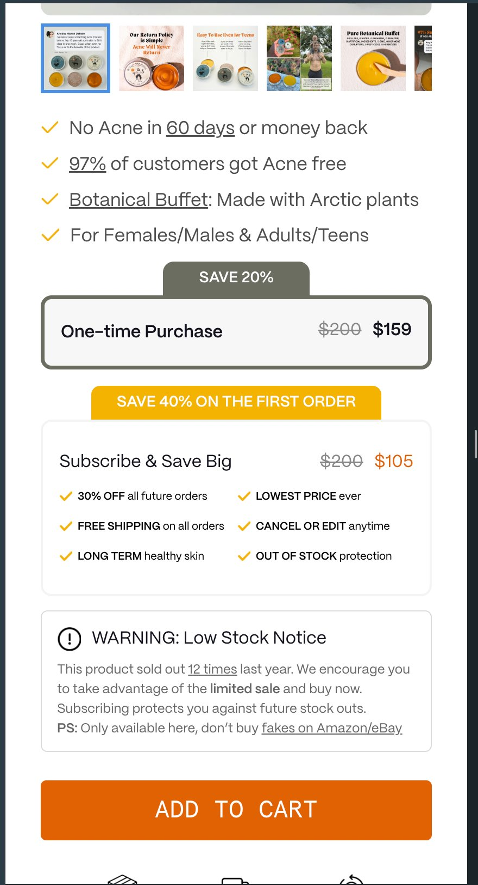
*Slide 49: guarantee, 97% claim, mechanism, subscribe-and-save, low-stock warning. [27:17–29:22]*

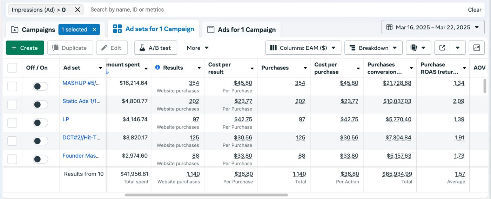
*Slide 51: week 1 (Mar 16-22), about $42K spend at 1.57 ROAS. [30:41]*

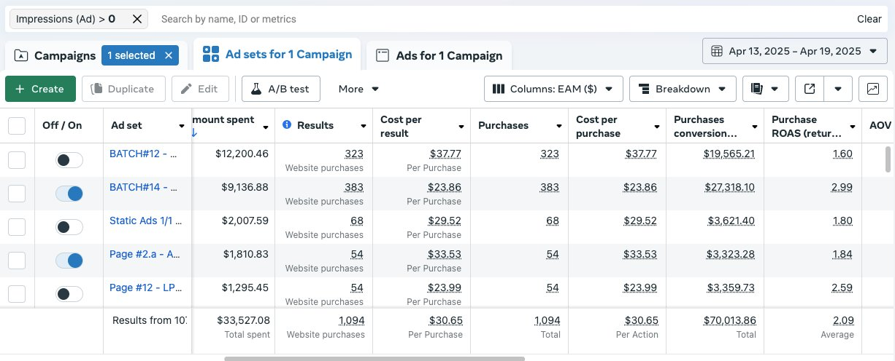
*Slide 55: "Week 6 Stable"; the page-test ad set ("Page #2.a") is visible in the list. [31:47–32:58]*

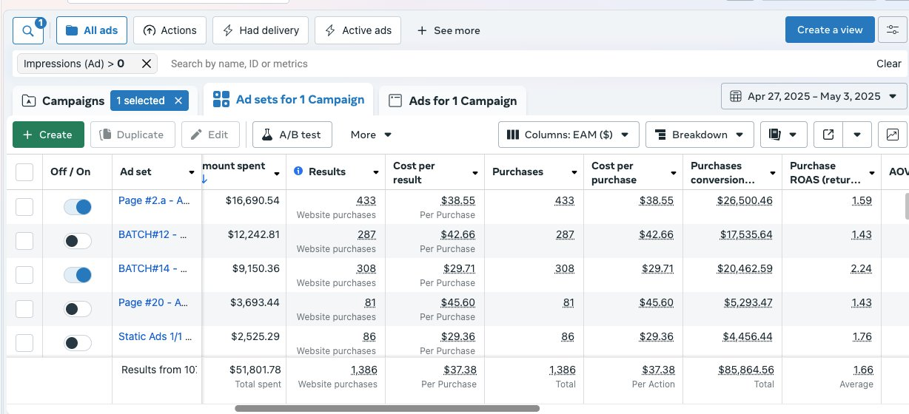
*Slide 57: week 8, ROAS back down to about 1.66 on about $52K. [32:58]*

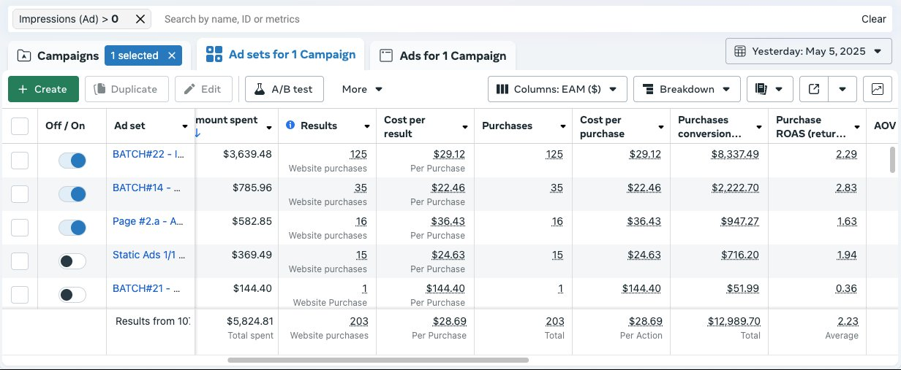
*Slide 58: "We're so back", yesterday 2.23 ROAS on about $5.8K. [32:58–34:14]*

## How to apply
- [ ] Classify the drop: people / market / Meta / strategy. Only the last gets action.
- [ ] Count the share of ads built on trending desires; add permanent-desire angles (wealth, health, relationships) for the avatar.
- [ ] For each product-aware ad, write an unaware and a problem-aware sibling using the humidifier ladder; keep education simple (3rd-4th grade reading level).
- [ ] Build an advertorial or listicle; test it against the control LP with the same ads.
- [ ] Rework the offer: risk reversal, real scarcity, low-cost bonuses; test new offers as CBO ads.
- [ ] Add a weekly Friday review: all winners + 1 loser; log learnings ([122](122-how-to-do-learnings-part-1-losers.md), [123](123-how-to-do-learnings-part-2-winning-ads.md)).
- [ ] Track: brief date, editor hand-off, launch date, time to launch, winner/loser in a ClickUp-style board.

## Related
- Previous: [120. How To See If You Should Turn Off High-Spend Ads](120-how-to-see-if-you-should-turn-off-high-spend-ads.md) · Next: [122. How To Do Learnings - Part 1 (Losers)](122-how-to-do-learnings-part-1-losers.md)
- [Copywriting: market awareness](../../copywriting/concepts/market-awareness.md) · [Copywriting: unaware ads](../../copywriting/concepts/unaware-ads.md) · [Creative testing system](../../../../frameworks/creative-testing-system.md) · [Landing page psychology audit](../../../../frameworks/landing-page-psychology-audit.md) · [Test and iterate](../../../../playbooks/test-and-iterate.md)

## Sources and limitations
- Transcript: [121 transcript](<../../../../../raw/evolve/start-here/_transcripts/👣 Evolve (Start Here)/121. How To Deal With Roller Coaster Performance 👣 Evolve (Start Here) Evolve.txt>) · Page text: [121 page](<../../../../../raw/evolve/start-here/_extracted/👣 Evolve (Start Here)/121. How To Deal With Roller Coaster Performance_👣 Evolve (Start Here)_Evolve.html.md>) · Deck text: [pptx md](<../../../../../raw/evolve/start-here/_extracted/👣 Evolve (Start Here)/121. How To Deal With Roller Coaster Performance.pptx.md>) · [linked Slides export](../../../../../raw/evolve/start-here/_extracted/_linked/google/121-presentation-1_d0-_2_kb.pptx.md)
- Screenshots are slide images extracted from the attached deck, not MEGA video frames. Slide-image digits are small; ROAS/spend figures from slides are approximate reads.
- Live call recording: several attendees speak (Sean, Frederick, Lucas, others) and chat messages are referenced but not visible. Whisper garbles names ("Nahal", "Zachariah", "Ash") and brand names ("Miracle" for the bedding brand, "Norse", "PageDeck" written as "paycheck"/"page deck"). Slide numbering in the call ("slide 46") is the speaker's own.
- The transcript covers the full 1:05:48 (last segment 1:05:47). Some timestamps for the Q&A answers are approximate to the paragraph that contains them.
- The "Miracle" bedding page and the try-before-you-buy brand are not verified brand names; the deck shows only page screenshots.
- Sensitive: the instructor's gender-based desire generalisations are quoted as his own; agents should treat them as a starting hypothesis per avatar, not a rule.
