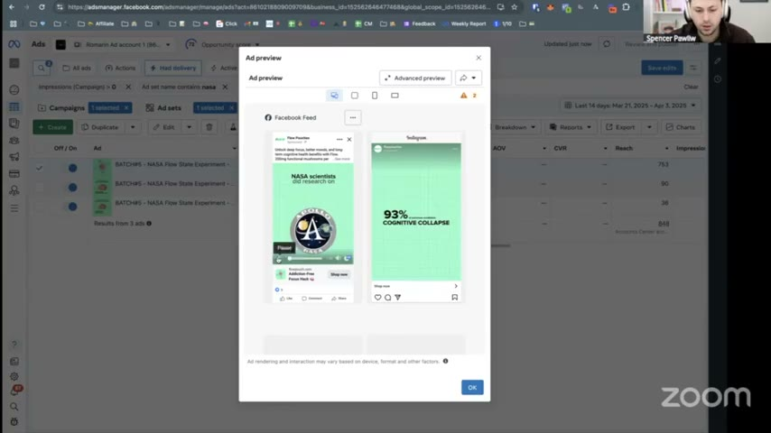
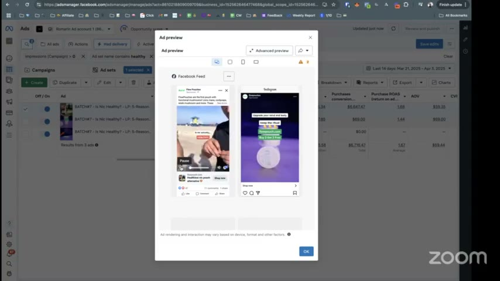
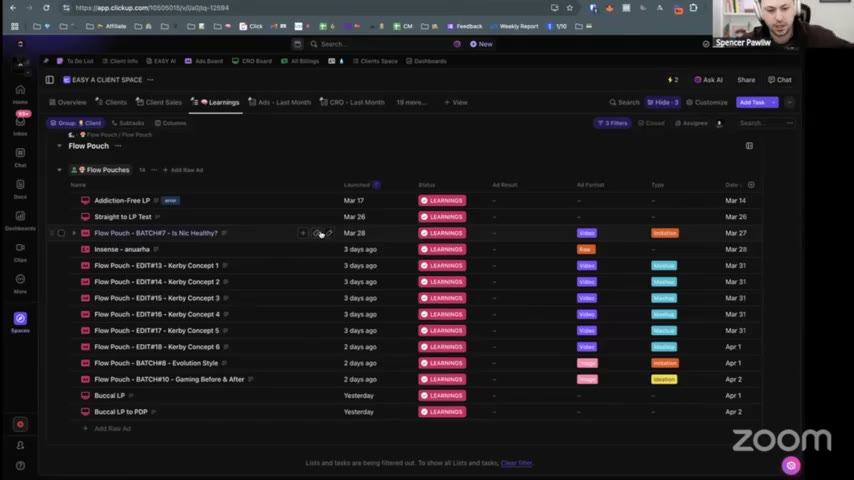
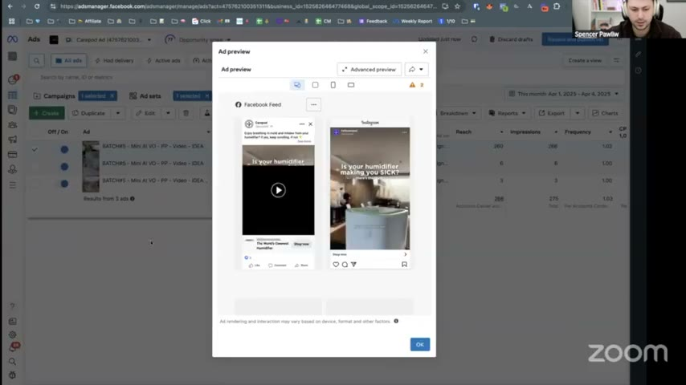

# 122. How To Do Learnings - Part 1 (Losers)
> A recorded agency "learnings" call: the team reviews losing ads, diagnoses why each failed (usually hook or hold) and decides a specific iteration, because feedback loops on losers are how a team raises its hit rate.

## 🤖 Agent use
- **Use when:** reviewing a batch of launched ads that got no spend, little spend or poor KPIs; deciding which loser to iterate and how; writing the iteration brief.
- **Inputs → outputs:** the losing ad, its spend, hook rate, hold rate, CPA/purchases, the top performer in the same account → a diagnosis (hook, hold, concept, format, audience fit) and 2-4 specific iterations (new hooks, relaunch with a fixed hook, retag, different visuals).
- **Rules:**
  - **DO** review losing ads, not only winners: "you got to know where you're fucking up... and why your ads aren't working". [01:28–02:32]
  - **IF** an ad gets no CBO spend, **THEN** check hook rate and hold rate first (the team's first question: "what was the hook rate?"; hook rate was "16%"; hold "insanely low"). [02:32]
  - **IF** the concept is good but the hook is poor **THEN** fix only the hook and relaunch (quick cut, new first line), rather than throwing the concept away. [03:39–05:06]
  - **DO** compare the loser to "what's winning" in the same account before deciding the fix. [03:39]
  - **DO** ask whether the hook speaks to the avatar. NASA authority did not interest a "construction"-type avatar. [03:39–05:06]
  - **DO** test variants of one idea as three new hooks over the same visual, or three visuals for one hook (smaller swings). [07:36]
  - **IF** a hook works but hold is poor **THEN** adjust format (storytelling or text-on-screen with explanation) rather than a comparison/"versus" format. [05:06–06:31]
  - **DO** record the iteration lineage with a tag. A tagging idea is mentioned (iteration percent) but is unclear in the audio. [06:31]
  - **DON'T** share the video or client data. It is "an Evolve exclusive"; sharing risks no more videos like it. [00:00]
- **See also:** [124. How To Do Learnings - Part 3 (Losers)](124-how-to-do-learnings-part-3-losers.md) · [123. Learnings Part 2 (Winning Ads)](123-how-to-do-learnings-part-2-winning-ads.md) · [Copywriting: iteration playbook](../../copywriting/frameworks/iteration-playbook.md) · [Copywriting: ten-step iteration learnings](../../copywriting/frameworks/ten-step-iteration-learnings.md) · [Iteration vs variation](../../../../concepts/iteration-vs-variation.md) · [100. How To See Ads Performance + Our Columns](100-how-to-see-ads-performance-our-columns.md)

Page text: none ("no lesson text on page").

## Key ideas

### Context: a real learnings call [00:00–02:32]
- The video is "a sneak peek inside of one of our agency learning calls", mostly the instructor reviewing the previous week's work for the brands with his team. [00:00]
- Accounts shown: "one spending about 40,000 a week and the other spending around... 20,000 a week" (Whisper wrote "10 or around 20,000"). [00:00–01:28]
- Principle: "it doesn't matter if you're spending 30,000 or 40,000 a day, or if you're spending a thousand dollars a day, this is creative reviews." All shown ads are losing ads. [01:28]
- Processing winners "is a must"; a video on that comes later ([123](123-how-to-do-learnings-part-2-winning-ads.md)). [01:28]
- Why bother: "feedback loops are so crucial... you got to know where you're fucking up and you got to know when you need to make changes and you got to know why your ads aren't working." [01:28–02:32]

### Case 1: NASA / flow-state hook (pouch brand) [02:32–06:31]
- Problem: "I was very disappointed to see that didn't get any spend in CBO." Hook rate and hold rate "like insanely low"; hook rate about 16%. [02:32]
- Original hook (read on the call): "NASA scientists did research on how to enter the flow state. Here's what they found out." [02:32–05:06]
- Team diagnosis: the avatar is probably "more like construction", not into NASA; "boring"; the idea is good so the fix is the hook only. "We put too much work into this to just throw it away." [03:39–05:06]
- Iteration ideas spoken: start with the answer, "Here's how to enter the flow state"; "here's how to get locked in"; "Here's what mushrooms and NASA have in common"; "Here's what mushrooms do to your brain"; bridge with "here's why you should care" rather than "here's what they found out". Make hooks "more about the people rather than... something cool that NASA did." [03:39–05:06]
- Plan: a quick cut and relaunch; look at it Monday "with some fresh brains". Closing line: "That's why we do learnings." [05:06]

### Case 2: "versus flow" comparison video [05:06–06:31]
- Got about $4K spend, throttled a lot in the first couple of days, then turned off; hold rate about 1.2 ("tragic"); Whisper may mean 1.2%. [05:06]
- Diagnosis: viewers expected an explanation; "versus flow comparison style" needs more storytelling or on-screen text with explanation. [05:06–06:31]
- Later note: "this hook was punching and it was just like kind of weird", metrics "pretty solid, so we just fixed the hold. We might have another banger here." [06:31]
- Whisper garbled one number ("40 in a three-fold"); not relied on.

### Case 3: "Is nic healthy?" / "Are pouches healthy?" [06:31–07:36]
- Batch #7 ad with the on-screen question; the "is nic healthy" version "answers the question right away" and began to hold hook rate. "Surprised this one didn't get the highest hold rate." [06:31]
- Next step: "do three more hooks focus just on nicotine" and smaller swings such as "is nicotine actually healthy". Use "the same visual just try three different headlines", or different visuals if more congruent. [07:36]

### Other losing ads [07:36–08:45]
- Ad that spent $3.60 in a week with no purchases (Canada-targeted): "That's tough." [07:36]
- A mini AI-voiceover test was "turned off already", "No spend". [07:36]
- Two ads left running because of a client ask; the team moves on. [08:45]

### Case 4: humidifier "germaphobe" hook [08:45–12:19]
- Question: why did one humidifier ad fail? Same headline as others. [08:45]
- Ad hook: "If you have a humidifier at home, let me show you something that actually blew my mind. You can actually see them all right away."
- Top performer's hook by comparison: "If you have a humidifier at home, I know you know that feeling when you take a look inside."
- Findings: "I think the hook's too long"; the germaphobe callout was missing; the first clip was cut at 3 seconds on the winner but this one stayed on one clip about 5 seconds ("Very slow"). [08:45–09:54]
- Angles tried: a "kid/parenting" one and a "cozy home" one; no germaphobe tag was tried. [09:54]
- New ideas: "Nursery room must have" (simplest), "studio apartment must have" (more relatable if you have one), "see-through"/"transparent humidifier". Mini model: "someone was smart enough to make this transparent" — same logic as "stainless steel". Mini script line: "You know when your humidifier gets all gross and you can't clean those impossible corners?... doctor-designed CarePod humidifiers" and "The Mini model easily comes apart. No weird corners or spots you can't reach." Team decision: "that's an easy iteration"; go with the germaphobe one plus a transparent angle. [09:54–12:19]
- One variant already had $10 spend: "I mean it got 10 bucks in spend". [12:19]

## Steps / framework
Learnings-call routine as demonstrated (derived from the call):
1. Pick the loser. Open the ad preview and the ClickUp learnings board list. [06:39]
2. Check spend (did Meta test it?), then hook rate, hold rate, CPA/purchases.
3. Compare against the account's top performer (hook wording, first-clip length, angle).
4. Name the single failure (hook, hold, avatar fit, format, speed).
5. Decide the smallest fix that tests the hypothesis (new hooks over the same visual; same hook different visuals; shorter first clip; add a callout tag).
6. Write the iteration list with owner and revisit date.

## Examples
| Ad | Result | Diagnosis | Fix | Source |
|---|---|---|---|---|
| NASA flow-state hook (pouch brand) | no CBO spend; hook ~16%; hold very low | avatar not into NASA; hook boring | start with answer; "here's how to get locked in"; mushrooms/NASA hooks | [02:32–05:06] |
| Versus-flow comparison | ~$4K, throttled, turned off; hold ~1.2 | people expected explanation | storytelling / on-screen text with explanation | [05:06–06:31] |
| "Is nic healthy?" Batch #7 | hook rate held; hold not the best | answers the question immediately | three more nicotine hooks, smaller swings | [06:31–07:36] |
| Humidifier "if you have a humidifier at home..." | ~$10 spend | hook too long; first clip too slow; no germaphobe tag | "germaphobe"/"transparent" angle; nursery / studio versions | [08:45–12:19] |

## Structured units

### Hooks
| Hook (verbatim or near) | Heuristic(s) | Emotion / zone | Self targeted | Why it works / fails | Source |
|---|---|---|---|---|---|
| "NASA scientists did research on how to enter the flow state. Here's what they found out." | Authority (derived) | — | — | Failed: avatar does not care about NASA; slow | [02:32] |
| "Here's how to enter the flow state" (proposed) | Direct answer (derived) | — | — | Start with the payoff, then the story | [03:39] |
| "Here's what mushrooms and NASA have in common" (proposed) | Curiosity gap (derived) | — | — | Unusual pairing | [03:39] |
| "Is nic healthy?" / "Are pouches healthy?" | Question hook (derived) | — | — | "Answers the question right away"; hook rate held | [06:31] |
| "If you have a humidifier at home, I know you know that feeling when you take a look inside." (top performer) | Germaphobe callout (instructor's term) | Disgust (derived) | — | Names the shared experience | [08:45] |
| "If you have a humidifier at home, let me show you something that actually blew my mind." (loser) | — | — | — | Too long, no callout | [08:45] |
| "Is your humidifier making you SICK?" (on-screen text of an ad variant) | Fear/health (derived) | Fear (derived) | — | Visible in ad preview; not discussed | frame [09:59] |

### Rewrites (before -> after)
| Before | After | What changed | Source |
|---|---|---|---|
| "NASA scientists did research on how to enter the flow state. Here's what they found out." | "Here's how to enter the flow state." | lead with the answer; drop the authority detour | [03:39–05:06] |
| "...Here's what they found out." | "...Here's why you should care." | bridge about the viewer | [05:06] |
| "Are pouches healthy?" | "Is nicotine actually healthy?" | smaller, sharper question | [07:36] |
| Steel humidifier framing | "see-through / transparent humidifier" | new mechanism claim ("someone was smart enough to make this transparent") | [10:56–12:19] |

### Rules of thumb
- **DO** keep a good concept and change only the hook when hook/hold are the issue. [03:39–05:06]
- **IF** an ad hardly gets spend in CBO **THEN** read hook rate and hold rate before judging the concept. [02:32]
- **DON'T** iterate more than one thing when you want a clean read (three hooks over one visual). [07:36] (derived)

## Screenshots

*The NASA hook ad in Ads Manager preview: "NASA scientists did research on..." over the NASA badge, with the 93% cognitive-collapse card beside it. [04:59]*

*Batch #7 "Is Nic Healthy?" ad previews (feed and story/reel placement). [06:29]*

*ClickUp list of ads in "Learnings" status with launch date, status, format and type, ad names like "Flow Pouch - BATCH#7 - Is Nic Healthy?". This is how the team queues ads for review. [06:39]*

*The humidifier loser ("Is your humidifier making you SICK?") in preview while the team debates the hook. [09:59]*

## How to apply
- [ ] List this week's launched ads with spend, hook rate, hold rate and CPA; select every loser with a concept worth saving.
- [ ] Open the top performer in the same account and compare hook wording, first-clip length and angle.
- [ ] For each loser write a one-line diagnosis; choose 3 new hooks (same visual) or 3 visuals (same hook).
- [ ] Add the iteration to the production queue with a "learnings" status and a re-launch date.
- [ ] Never share client call recordings outside the course.

## Related
- Previous: [121. How To Deal With Roller Coaster Performance](121-how-to-deal-with-roller-coaster-performance.md) · Next: [123. How To Do Learnings - Part 2 (Winning Ads)](123-how-to-do-learnings-part-2-winning-ads.md)
- [130. How To Rewrite Losing Ads Into Winners](130-how-to-rewrite-losing-ads-into-winners.md) · [Copywriting: iteration issue codes](../../copywriting/frameworks/iteration-issue-codes.md) · [Test and iterate](../../../../playbooks/test-and-iterate.md)

## Sources and limitations
- Transcript: [122 transcript](<../../../../../raw/evolve/start-here/_transcripts/👣 Evolve (Start Here)/122. How To Do Learnings - Part 1 (Losers) 👣 Evolve (Start Here) Evolve.txt>) · Page text: [122 page](<../../../../../raw/evolve/start-here/_extracted/👣 Evolve (Start Here)/122. How To Do Learnings - Part 1 (Losers)_👣 Evolve (Start Here)_Evolve.html.md>) (empty)
- Machine transcription (Whisper large-v3-turbo); full coverage (last segment 13:19). The call has several unlabelled speakers, so who proposes which iteration is not attributed. Whisper garbled a few lines ("40 in a three-fold", "iteration percent"; "Carlo" is a team member's name as heard).
- Brand names are not said aloud; "pouch brand" and "CarePod" are inferred from screen text (ClickUp list "Flow Pouch", ad preview "CarePod"). The ad ids and account names were not copied.
- Lesson order oddity: the instructor says the winners video "should be above this one"; in the course map Part 2 (winners) comes after this lesson.
- The actual call clip starts at about [02:32] (the instructor says it is "about 10 minutes long"); ClickUp board and ad previews are legible only in the frames.
