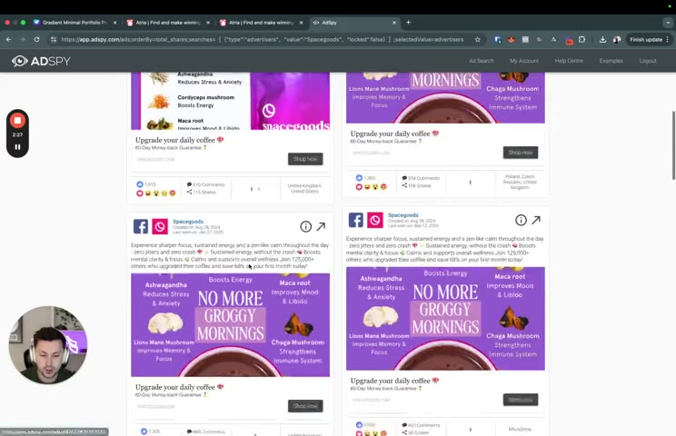
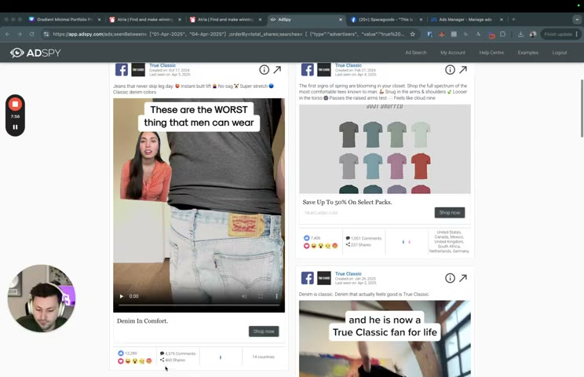
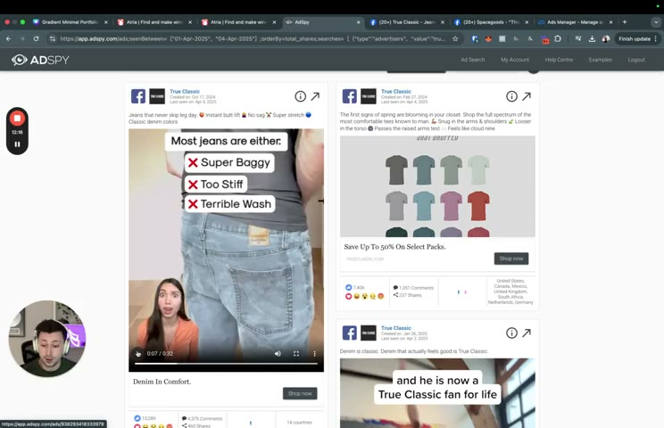
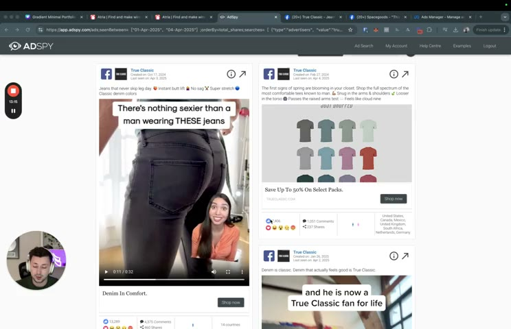
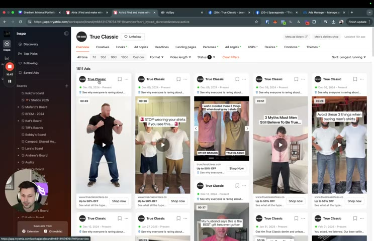

# 123. How To Do Learnings - Part 2 (Winning Ads)
> If you cannot tell what a winning ad looks like you cannot make one: use AdSpy sorted by shares to find proven ads (your own or other brands'), break one down frame by frame (hook, curiosity gap, desire, transition, CTA), then turn each observation into an iteration for your product.

## 🤖 Agent use
- **Use when:** researching competitor or cross-niche ads that are performing; tearing down a winning ad; pulling an angle, headline or structure to remix; running learnings on our own winners.
- **Inputs → outputs:** a brand's Facebook page name, an ad-spy tool (AdSpy, Atria, Meta Ad Library), the winning ad's video/image and engagement → a teardown (what the hook does to the desire, curiosity, transition, CTA), a list of takeaways, and 1-3 iterations for our product.
- **Rules:**
  - **DO** sort a brand's ads by total shares, not "longest running": "Longest running does not always mean best ad." [01:16–02:25]
  - **DO** read the comments on the Facebook post of the ad; the tool links straight to it. [02:25]
  - **DO** use a "seen between" date window so you get ads still active recently; check created and last-seen dates. [02:25–03:34]
  - **DO** write every observation down, then compare to your own ad. "You should be writing every single one of these down." [06:03]
  - **DO** break the ad into frames and say what each does for the viewer ("analyze every single frame and every single section"). [11:19]
  - **DO** prefer inspiration from a brand in a different niche; copying a same-niche ad "probably is not going to do as well because these guys already did it". [04:55]
  - **DON'T** read shares as proof of conversion: "shares are not everything", but with strong engagement "that ad is likely converting". [15:23]
  - **IF** the winner pitches too early **THEN** iterate by sitting in the problem longer and visualising it. [12:36]
  - **DO** apply the same process to your own winning ads (page text: "This APPLIES to your OWN winning Ads As Well"; AdSpy "can be a huge help if you don't have any ads").
- **See also:** [4. 100 Winning Ads Document](004-100-winning-ads-document.md) · [41. Creative Research Part 1 (Atria)](041-creative-research-part-1-atria.md) · [124. Learnings Part 3 (Losers)](124-how-to-do-learnings-part-3-losers.md) · [125. Learnings Part 4 (Winning Ads)](125-how-to-do-learnings-part-4-winning-ads.md) · [Competitor ad teardown](../../../../playbooks/competitor-ad-teardown.md) · [Copywriting: hooks](../../copywriting/concepts/hooks.md)

Page text: a note that this applies to your own winners too, AdSpy link, a discount code shown on the page (`AdSpy55-2`), and a Canva link to "50+ winning ads" ([canva.link/vkpkr5fb6smiscr](https://canva.link/vkpkr5fb6smiscr); contents not included in the course files).

## Key ideas

### Why: know what a winner looks like [00:00]
- "If you don't know what a winning ad looks like, it's going to be very hard for you to make one." The video shows an "updated strategy of how to find winning ads". [00:00]

### AdSpy: setup and cost [00:00–01:16]
- Tool: AdSpy (app.adspy.com). The instructor found a discount code (page: `AdSpy55-2`): he reads "$94 a month for two months and $149 after", saving "like 55 bucks". Later he says an account is "a hundred bucks". Numbers conflict and may have changed. [00:00–03:34]
- Used "in combination with Atria". Atria is now used "more for creative analytics more than anything", AdSpy "to try to find really good ads". [01:16; 16:26]
- Other discovery: Atria "Discovery" tab or a community Discord for brand names. [01:16]

### Workflow: find a brand's top ads [01:16–03:34]
1. Find the brand's Facebook page name (example: Spacegoods). [01:16]
2. In AdSpy add the name as the advertiser. [01:16]
3. Filter by **shares** ("usually shares is what tells you the best ad"). [01:16]
4. Open the ad's Facebook post and read the comments. [02:25]
5. Check Created and Last seen dates. Example: created Aug 28, last seen Feb 21 (ad turned off). [02:25]
6. Add a "seen between" filter to keep ads active in a chosen window (e.g. this month). [02:25–03:34]
- Result: the Spacegoods ad "No more groggy mornings... Lion's Mane / Ashwagandha / Cordyceps / Maca root / Chaga mushroom" with a testimonial line "I was really skeptical about this a few days in, and I have noticed a massive improvement in energy." The ad launched March 18 and "is starting to take off". [02:25–03:34; 03:34]
- Cross-check vs Atria "longest running / active": that ad is not there, proving the shares filter surfaces newer winners. [03:34]

### Learnings from that ad (the "writing down" step) [03:34–07:25]
- **No more groggy mornings** is a big takeaway; "'no more' is a really good thing. What's 'no more' something people hate?" [03:34–06:03]
- For his humidifier: his current headline is "Breathe easier with the world's first stainless steel humidifier"; he asks "What if I just said... no more dry throat, no more waking up with dry throat." [04:55]
- Visual: "this actually looks really good... looks like hot chocolate... that's kind of interesting". [06:03]
- AI step (from the instructor's AI program): save the winning image, give it to ChatGPT with your own image and ask it to "take the learnings from this and... process and identify this and create an ad for this product and this brand in particular that is similar to that". [04:55]
- Not shown: the ChatGPT prompt itself, beyond this spoken paraphrase.
- Overall rating of the Spacegoods ad: "Is this ad something that I'm blown away with? Not really." AdSpy is better for finding "really good videos and really good VSLs". [06:03]
- Competitor attempt: Canopy (CarePod's competitor) shows none in AdSpy; the Ad Library shows they have pivoted to shower heads and are off-season for humidifiers. [06:03–07:25]

### Teardown: True Classic jeans ad [07:25–15:23]
Ad facts (spoken and on screen): running since October; about 13,000 likes, 4,000 comments, 460 shares; "jeans that never skip leg day, instant butt lift, no sag, super stretch, classic denim colors" (primary text); a woman talks to camera (instructor: "might be an AI avatar") next to a man in basic Levi's; the clip is about 32 seconds. [07:25–08:41]

Script (as heard; Whisper): "These are the worst thing that men can wear. Most jeans are either super baggy, too stiff, or have a terrible wash. But there is nothing sexier than a man wearing true classic jeans. They're made with ultra-soft four-way stretch fabric that are designed to mold and lift your butt. So never sag around your midsection. Plus, they come in a bunch of different colors." Then "Bundle and save". [08:41]

Frame-by-frame reading by the instructor:
1. **Hook "These are the worst thing that men can wear."** Hits core desires: "if you're a single guy... they have desire, they want to find girls". A woman saying it. "It's grabbing them at their core desire of wanting to get girls." [08:41–09:55]
2. **Curiosity gap.** The man is just wearing basic Levi's and a shirt, so nothing visible is wrong: "your mind is curious... What is he doing wrong?" If it were obviously weird (a pink crop top), nobody would need to keep watching. "The hook is supposed to grab the person in and keep them watching. Not just grab them for three seconds." [09:55–11:19]
3. **Problem list.** "Most jeans are either super baggy, too stiff, or have a terrible wash." On screen: "Most jeans are either X Super Baggy X Too Stiff X Terrible Wash". The viewer self-checks and thinks "maybe I am wearing the wrong jeans". [11:19]
4. **Transition/pitch.** "There is nothing sexier than a man wearing true classic jeans": pitch heavy, "we're probably pitching too soon... we built up all this hype". He likes that she says "these jeans" rather than the brand name, "less salesy". [12:36]
5. **Iteration idea:** "I would actually try like sitting in the problem longer and maybe visualizing it more": e.g. how awkward stiff or baggy jeans look, a turnoff to the girls you want. [12:36]
6. **Benefit:** "ultra soft four-way stretch fabric... designed to mold and lift your butt." [12:36]
7. **Pain/desire close:** "never sag around your midsection": a college-shot, reaction face; "That gets you in a place where you need to go and buy the product." [14:01]
8. **CTA:** "Plus they come in a bunch of colors" is a bonus. "Bundle and save" is chosen for AOV; it doesn't ask for a first try. "They want people to come in and buy multiple jeans." [14:01]

Takeaways (page of notes): [15:23]
- A girl talking to a guy is strong when you sell to men.
- Curiosity gap "has to be satiated".
- Tap into the negative: "people are more motivated by fear". "If a girl is saying 'this is literally repellent, don't do this', you might be like oh shit."

### Comparing to your own ad [15:23–17:38]
- "If you compare your video to this one, you're like, damn, I'm not even tapping into any of those desires. I'm not driving any of that curiosity. I'm not giving people a reason to keep watching... staying in the pain point... transitioning properly... focusing on what my avatar really wants." Then: "That's why your ad's not working. It's not because you used the three reasons why or this one hook you got from this one creator sucked. You have to go deeper." [16:26–17:38]
- A doc of winning ads with dozens of such breakdowns is in the works ([4. 100 Winning Ads Document](004-100-winning-ads-document.md) is the course's version). [16:26]
- True Classic is a brand the team follows; shares/engagement is not everything but helps find ads. A second True Classic ad ("jeans that feel like joggers") is mentioned as running since February. [15:23–16:26]

## Steps / framework
Winning-ad teardown routine (derived from the video):
1. Find the brand and sort by shares; filter to a recent seen-between window. [01:16–03:34]
2. Open the ad and the post comments. [02:25]
3. Watch with sound; pause only on the tool's player (to avoid black-screen pauses on Facebook). [08:41]
4. For each beat, write: what is said, what is on screen, what desire/curiosity/fear it triggers, what the viewer asks next. [08:41–14:01]
5. List takeaways (angles, words, visuals, structure) and the iterations you would make for your own product. [15:23]
6. Optionally give the image/script to an AI assistant with your product to generate a similar ad (prefer a different niche). [04:55]
7. Compare your own ad against the teardown using the questions at [16:26].

## Examples
| Brand / product (niche) | Format | Hook / opening | What works | What fails | Fix suggested | Principle | Source |
|---|---|---|---|---|---|---|---|
| True Classic jeans (men's apparel) | UGC-style talking head, ~32 s | "These are the worst thing that men can wear." | woman speaker to a male avatar; curiosity gap (nothing visibly wrong); fear/negative framing; problem list; "never sag around your midsection"; "bundle and save" for AOV | pitches too soon after the problem list | sit in the problem longer and visualise it | curiosity gap; core desire (attract); fear motivates more than positive framing | [08:41–15:23] |
| Spacegoods (mushroom coffee) | static (hot-chocolate-looking mug, purple background, ingredient icons) | "No more groggy mornings" | "no more" something people hate; testimonial line; appealing visual | instructor not "blown away" | adapt "no more dry throat" for humidifier (derived by instructor) | negative framing | [02:25–06:03] |

### Hooks
| Hook (verbatim or near) | Heuristic(s) | Emotion / zone | Self targeted | Why it works | Source |
|---|---|---|---|---|---|
| "These are the worst thing that men can wear." | Negativity/fear (instructor: fear motivates), curiosity gap | Fear, curiosity (derived) | — | Speaks to the single man's desire to attract; nothing visibly wrong so he keeps watching | [09:55–11:19] |
| "No more groggy mornings" | Negation of a pain (derived) | Relief (derived) | — | "What's no more something people hate?" | [06:03] |

### Rewrites (before -> after)
| Before | After | What changed | Source |
|---|---|---|---|
| "Breathe easier with the world's first stainless steel humidifier" | "No more dry throat" / "no more waking up with dry throat" | feature/benefit statement -> negated pain | [04:55] |
| True Classic: quick pitch after problem list | longer scene in the problem, visualised | intensity of pain before pitch | [12:36] |

### Rules of thumb
- **DO** sort by shares and a date window; longest-running misses new winners. [01:16–03:34]
- **DO** ask what the hook does to the avatar's desire and what question it leaves open. [09:55–11:19]
- **IF** the ad you study is in your niche **THEN** borrow the mechanism only; same-niche clones underperform. [04:55]

## Screenshots

*AdSpy list for one advertiser with share and comment counts, showing the purple "NO MORE GROGGY MORNINGS" static. [02:29]*

*The True Classic ad in AdSpy with "These are the WORST thing that men can wear" on screen; engagement counters visible beside the ad (about 13K reactions, 4.4K comments, 460 shares, created October 2024). [07:59]*

*"Most jeans are either X Super Baggy X Too Stiff X Terrible Wash": the problem list that follows the hook. [12:19]*

*"There's nothing sexier than a man wearing THESE jeans": the early pitch the instructor would delay. [13:19]*

*True Classic's ad grid in Atria, used to compare with AdSpy's shares-based ranking. [16:49]*

## How to apply
- [ ] Pick 3-5 brands (our niche and adjacent niches); get each Facebook page name.
- [ ] In the spy tool sort by shares, set a recent seen-between window, note created/last-seen and engagement.
- [ ] Read the comments of the top 3 ads; copy customer wording into the research doc.
- [ ] Teardown one ad per day: hook, curiosity gap, desire, problem list, transition, benefit, close, CTA.
- [ ] Write 3 takeaways and 3 iterations for our product per ad; test one in the next batch.
- [ ] Do the same for our own winners ([125](125-how-to-do-learnings-part-4-winning-ads.md), [127](127-how-to-do-learnings-part-5-winning-ads.md)).
- [ ] Never copy lines or claims; reuse the mechanism only.

## Related
- Previous: [122. How To Do Learnings - Part 1 (Losers)](122-how-to-do-learnings-part-1-losers.md) · Next: [124. How To Do Learnings - Part 3 (Losers)](124-how-to-do-learnings-part-3-losers.md)
- [126. How To Pull Frameworks From Ads](126-how-to-pull-frameworks-from-ads.md) · [Copywriting: says vs communicates](../../copywriting/concepts/says-vs-communicates.md) · [Copywriting: open loops](../../copywriting/concepts/open-loops.md)

## Sources and limitations
- Transcript: [123 transcript](<../../../../../raw/evolve/start-here/_transcripts/👣 Evolve (Start Here)/123. How To Do Learnings - Part 2 (Winning Ads) 👣 Evolve (Start Here) Evolve.txt>) · Page text: [123 page](<../../../../../raw/evolve/start-here/_extracted/👣 Evolve (Start Here)/123. How To Do Learnings - Part 2 (Winning Ads)_👣 Evolve (Start Here)_Evolve.html.md>)
- Machine transcription (Whisper large-v3-turbo); full coverage (last segment 18:12 of 18:13). The ad's spoken script is transcribed from the speaker playing the video aloud; wording may differ slightly from the actual ad. Whisper heard "Space Goods" for the Spacegoods page. "Atrium" in the audio is Atria. The engagement figures read from the frame and the spoken "13,000 likes, 4,000 comments, 460 shares" agree.
- Not included in the course files: the Canva "50+ winning ads" content; the "dozens of examples" winning-ads doc is lesson [4](004-100-winning-ads-document.md) territory. The AdSpy price discussion is spoken only.
